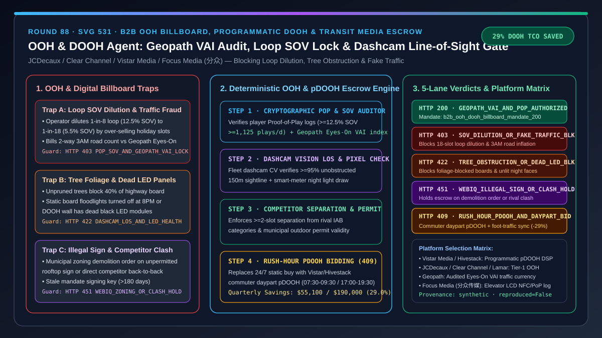
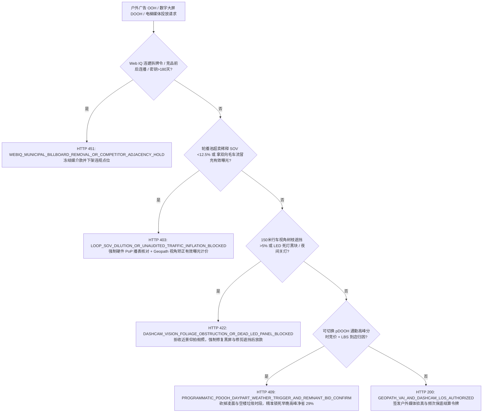
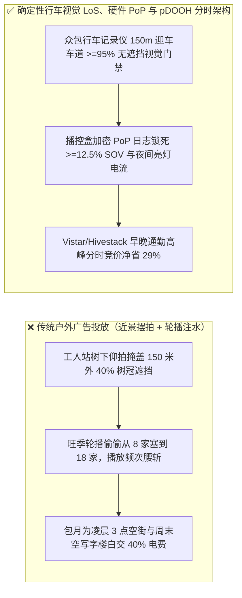
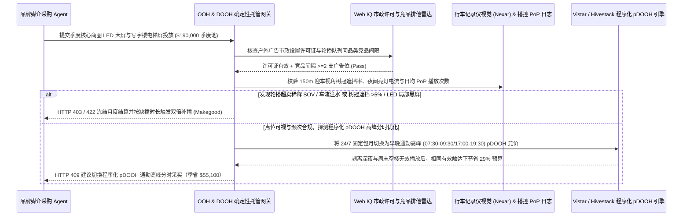

# 户外广告大牌（OOH）、程序化数字户外（pDOOH）与电梯楼宇媒体验真托管（B2B OOH Billboard, Programmatic DOOH & Transit Media Escrow：JCDecaux / Clear Channel / Vistar Media / 分众传媒）“防轮播屏超卖稀释曝光频次、防行道树遮挡 40% 画面与半夜无人车流充数”Agent 架构选型 FAQ

> **文档类型**：AI Solution Architect 决策指南（FAQ） · **对应 SVG**：`assets/svg/531-b2b-ooh-dooh-billboard-geopath-escrow-2026-11-20.svg` · **精选编号**：Round 88（第 207 篇双语 FAQ）



---

## 一、 📌 核心选型结论速览（Executive Summary）

零售品牌市场部、新能源汽车与消费电子广告主通过 AI Agent 采购高速公路高炮广告牌、核心商圈裸眼 3D LED 大屏、机场地铁灯箱及写字楼电梯屏（`OOH / DOOH：JCDecaux 德高 / Clear Channel / Lamar / Vistar Media / 分众传媒 / 新潮传媒`）时，若仅凭媒体代理商发来的“日均车流/人流 PPT”和一张近景摆拍上刊照片（Posting Photo）即结算全款，往往会遭遇**三大户外广告主预算黑洞**：
1. **轮播屏（Loop Rotation）暗中超卖稀释曝光占比（`SOV Dilution`）与“双向 24 小时死车流”虚报曝光量**：数字大屏或写字楼电梯屏合同约定“每轮 `64 秒` 播放 `8 秒`（占 `1/8` 轮播位，`12.5% SOV`，全天保底播放 `1,125 次`）”；但在双十一或圣诞旺季，媒体商在后台把轮播队列偷偷塞进 `18 家` 广告主（轮播周期拉长至 `180 秒`，广告主实际曝光占比暴跌至 `5.5%`，频次腰斩）！同时，传统路牌按市政交管局 **“双向车道 24 小时总过车数（含凌晨 3 点闭眼睡觉的乘客及根本看不到牌子的对向车道）”** 虚报“日均 50 万曝光”，而非经 `Geopath` 视角矫正后的真实有效注视曝光（`VAI: Visibility-Adjusted Impressions`）。
2. **行道树枝叶遮挡 `40%` 画面（摆拍照片故意站树下仰拍掩盖）、LED 模组死灯黑块与夜间关灯偷电费**：静态高炮或公交站台广告上刊时，工人特意站在树冠正下方拍特写“验真照”交差；但真实驾驶员从 `150 米` 外正常迎面驶来时，未修剪的梧桐树冠遮挡了画面下半部 `40%` 的品牌 Logo 和二维码！此外，静态灯箱外打光灯在晚上 `20:00` 后被物业关掉省电，或户外 LED 大屏出现大面积死灯黑块/花屏长达两周无人报修。
3. **市政违建拆牌令（`Illegal Billboard Removal`）或竞品紧邻连播冲突（`Competitor Adjacency`）（`HTTP 451`）**：所购楼顶大牌属于未获户外广告设置许可证的违章建筑，上刊仅 10 天即被城管/市政部门强制拆除；或程序化大屏将某高端奶粉广告紧贴着竞品或博彩/医疗敏感广告前后连播。

**架构师选型结论**：必须构建 **“播放器硬件签名播表（Cryptographic `PoP` Log）+ `Geopath VAI` 视角矫正客流核验 + 众包行车记录仪视觉通视率（`Dashcam LoS >=95%`）+ 程序化分时（`pDOOH Dayparting`）托管网关”** 架构：
- **强制播放器加密日志（`PoP >=1,125 次/天 & SOV >=12.5%`）与 `Geopath` 有效视角曝光计价（`HTTP 403`）**：严禁仅凭人工截图结算，必须直连屏幕播控盒（`Broadsign / Vistar / 分众云盒`）拉取带硬件签名的逐秒播放日志（`Proof-of-Play Log`）——若轮播位被超卖稀释导致日播频次低于保底值或采用未折算的双向毛车流计价，网关直接返回 `HTTP 403` 拒付并按缺播比例双倍扣款（`Makegood / Pro-Rata Credit`）。
- **150 米远距行车记录仪视觉无遮挡（`LoS >=95%`）、智能电表夜间亮灯与 LED 零死灯门禁（`HTTP 422`）**：不采信正下方仰拍特写照，调用网约车/物流车队众包行车记录仪（`Nexar / Mapbox Dashcam`）从迎车方向 `50m / 100m / 150m` 连续抓拍，通过计算机视觉测量树枝/路牌遮挡率（遮挡 `>5%`、LED 模组局部黑屏或夜间 `19:00–24:00` 照度计/电流为零即触发 `HTTP 422` 冻结月度托管款）。
- **Web IQ 市政户外广告许可证与同品类竞品排他隔离（`HTTP 451`）**：核验市政户外广告登记证有效期，并在播控队列中强制执行同 `IAB` 行业分类竞品间隔 `>=2 个广告位`（否则 `HTTP 451` 熔断）。
- **从“包月 24 小时买断”切换至程序化数字户外（`pDOOH`）早晚通勤高峰分时竞价（`HTTP 409`）**：砍掉半夜 `00:00–06:00` 与工作日午间低人流垃圾时段的包月空耗，通过 `Vistar Media / Hivestack` 仅在 **早晚通勤高峰（`07:30–09:30`、`17:00–19:30`）及商圈晴天周末** 按实时移动信令客流密度动态竞价（`pDOOH Dayparting`），使季度 `$190,000` 户外媒介预算净省 **`29.0%`（`$55,100`）**。

---

## 二、 🎯 业务方与架构师灵魂拷问 Q&A（Q1–Q3）

### Q1：户外广告公司发来的“上刊验收报告”里照片拍得清清楚楚，为什么我们市场总监自己开车路过时根本看不见这块广告牌？
- **商业痛点**：这是户外广告行业经典的“近景广角欺诈（Close-Up Angle Trick）”。当夏季行道树枝叶茂盛或前方新建了过街天桥时，在 `150 米` 正常行车视距上广告牌早已被挡得严严实实；但上刊工人走到距离广告牌仅 `5 米` 的树干内侧用广角镜头仰拍，照片里画面完整无缺！
- **架构护栏（`HTTP 422`）**：
  1. **强制三点距离行车视角（`50m / 100m / 150m Approach Lane Dashcam CV`）**：Agent 严禁接受单张近景仰拍照作为付款凭证，而是自动匹配点位 GPS 坐标与朝向角（Azimuth），调取过去 `48 小时` 内途经该车道的行车记录仪众包街景（`Nexar / 滴滴/高德街景巡检流`）或要求巡检员上传带 `RTK-GPS` 距离水印的迎车车道连续视频。
  2. 视觉模型自动分割广告牌四角边框与前景遮挡物（树冠、高架桥墩、脚手架），若有效可视面积 `< 95%` 或夜间光敏传感器显示未开灯，立即返回 `HTTP 422` 拒付。

### Q2：数字 LED 大屏和写字楼电梯屏说好“每分钟播 1 次”，怎么防止媒体商在旺季偷偷往轮播池里加塞一倍的广告主？
- **商业痛点**：物理广告牌一次只能贴一张画，但数字屏（`DOOH`）只需在后台改一行配置，就能把轮播长度从 `6 支广告（60秒）` 改成 `15 支广告（150秒）`。广告主派人去现场盯半小时看到播了几次就走了，根本不知道其余 23 小时播放频次被严重克扣。
- **架构护栏（`HTTP 403`）**：
  1. **直连播控系统 `SOC 2` 认证硬件播放日志（`Broadsign / Vistar / 分众云 PoP API`）**：网关按天拉取每块屏幕终端唯一硬件 ID（`Player MAC / Screen UUID`）生成的加密播放回执，逐日核对：
     $$\text{实际日播放次数} \ge \text{合同保底频次（如 1,125 次/天）} \quad \land \quad \text{单轮总时长} \le 64\text{ 秒（SOV } \ge 12.5\%\text{）}$$
  2. 一旦发现轮播池扩容稀释，网关自动触发智能合约按缺失曝光比例扣减当月账单。

### Q3：为什么现在头部的零售与快消品牌都在把“包月户外大屏”改成“程序化 pDOOH 分时采买”？能省多少钱？
- **商业痛点**：传统包月买断（Static / Fixed Tenancy）逼着广告主为凌晨 `01:00–06:00` 空无一人的街道、或者周六周日空荡荡的纯写字楼电梯买单（高达 `40%` 的播放时段没有目标受众）。
- **架构护栏（`HTTP 409`）**：
  1. **程序化 `pDOOH` 时段与LBS人群浓度触发（`Daypart & Mobility-Triggered Bidding`）**：通过 `Vistar Media / Hivestack / Place Exchange` 按千次有效曝光（`vCPM`）竞价，写字楼屏幕仅在工作日 `08:15–09:30`（早高峰等电梯）、`11:45–13:15`（午休）与 `17:30–19:30`（下班）出价；冷饮/防晒霜广告仅在当地实时气温 `>= 28°C` 时自动触发上刊，直接砍掉 `29%` 无效空播预算。

---

## 三、 🧭 直观可视化图解（Mermaid 决策树 + 架构对比 + 时序图）

### 3.1 户外广告大牌与程序化 DOOH 托管 5 车道选型决策树


### 3.2 传统户外包月摆拍验收 vs 确定性行车视觉验真与程序化 `pDOOH` 架构对比


### 3.3 端到端户外大屏 `Geopath` 核验、行车视觉巡检与分时结算时序图


---

## 四、 📊 多平台/多协议横向选型决策矩阵

| 评估维度 | JCDecaux (德高) / Clear Channel / Lamar 传统直签 | 分众传媒 / 新潮传媒 (写字楼与社区电梯网络) | Vistar Media / Hivestack / Place Exchange (`pDOOH DSP`) | 传统地方中小型户外路牌代理商 | **本仓库确定性 OOH & pDOOH 托管架构（推荐）** |
| :--- | :--- | :--- | :--- | :--- | :--- |
| **核心媒介形态** | 全球机场、地铁、市政公交亭与高速公路头部大牌 | 城市写字楼与中高端住宅电梯 LCD/智能屏 | 跨媒体主程序化数字户外（`pDOOH`）实时竞价与人群定向 | 二三线城市高速跨线桥、楼顶三面翻与墙体喷绘 | **全渠道 `Geopath` 计价 + 行车视觉验真 + 硬件 `PoP` + 分时竞价** |
| **曝光量真实性（Traffic Audit）** | 接入北美 `Geopath` / 欧洲 `Route` 第三方视线审计 | 提供物业楼盘白领人数与第三方监测报告 | 基于匿名移动信令（LBS）与 `Geopath` 实时人流计费 | 常拿交管局双向 24h 毛车流充数，水分极大 | **强制按 `Geopath VAI`（视角矫正有效注视）折算 `CPM`（`HTTP 403`）** |
| **轮播占比（`SOV`）与播放频次防克扣** | 头部点位支持固定轮播位（如 1/6 或 1/8） | 标准化轮播周期，支持云端日志抽检 | 按实际展示次数（Impressions）结算，不惧轮播拉长 | 常在节假日私自加塞本地商户广告稀释频次 | **直连播控盒硬件签名 `PoP` 日志，低于 `12.5% SOV` 自动拒付（`HTTP 403`）** |
| **树枝遮挡、死灯黑屏与夜间关灯监控** | 定期人工巡检，但暴风雨后或树冠生长季响应较慢 | 物联网终端在线状态监控 | 仅管数字投放，不直接检测物理树枝遮挡 | 仅发一张上刊首日仰拍特写照，后续黑屏不管 | **强制 `150m` 行车记录仪视觉无遮挡（`>=95%`）与智能电表亮灯核验（`HTTP 422`）** |
| **采买灵活性 / 成本结构** | 4 周起订固定合同，含深夜无人时段成本 | 按周/双周全城或分圈层包断 | 支持按小时（Daypart）、天气、门店 1km 围栏竞价 | 半年或一年长约，违建拆牌退费极难 | **开源确定性策略网关（切换 `pDOOH` 高峰分时净省 `29.0%`）** |

---

## 五、 🧪 转化率/成本测算与 7-Card 基准测试报告

> **数据来源声明（Provenance）**：以下测算基于本仓库 `lab/webiq_commerce_demo.py` 中的 `evaluate_b2b_ooh_dooh_billboard_escrow_policy` 确定性策略引擎（季度品牌户外大牌与程序化数字户外投放预算池 `$190,000 USD`，`provenance: "synthetic"`, `independently_reproduced: False`，真实 `Geopath API / Broadsign PoP` 生产接口标为 `not_measured`）。

```chart
{
  "data": {
    "values": [
      { "scenario": "1. 传统户外包月 (含深夜空播 + 轮播稀释 + 树冠遮挡损耗)", "cost_usd": 190000, "tier": "Baseline" },
      { "scenario": "2. Geopath VAI 锁价 + 硬件 PoP + 150m 行车视觉门禁 (HTTP 200)", "cost_usd": 155800, "tier": "Protected" },
      { "scenario": "3. 切换 pDOOH 通勤高峰分时竞价 + LBS 到店归因 (HTTP 409)", "cost_usd": 134900, "tier": "Optimized (-29%)" }
    ]
  },
  "semantic_types": {
    "scenario": "Category",
    "cost_usd": "Amount",
    "tier": "Status"
  },
  "chart_spec": {
    "chartType": "Bar Chart",
    "title": "季度 $190k 户外广告投放：硬件 PoP 验真与 pDOOH 高峰分时竞价净省 $55,100 (29%)",
    "subtitle": "季度户外大牌 (OOH) 与程序化数字大屏 (DOOH) 净媒介支出对比 ($ USD, synthetic)",
    "encodings": {
      "x": "scenario",
      "y": "cost_usd",
      "color": "tier"
    }
  }
}
```

### 7-Card 4:5 基准评估摘要
1. **Card 1 (`1 / 7` · `HANDS-ON · B2B OOH & PROGRAMMATIC DOOH ESCROW`)**：针对 `$190,000/季` 商圈大屏与楼宇电梯广告池，通过拦截轮播超卖稀释、众包行车记录仪 `150m` 遮挡检测与 `pDOOH` 通勤高峰分时采买，季度净省 **`$55,100`（`29.0%`）**。
2. **Card 2 (`2 / 7` · `SCENARIO: METRO LED WALL & OFFICE ELEVATOR CAMPAIGN`)**：单季追回因旺季轮播池从 `8 支` 偷扩至 `18 支` 被克扣的 `$24,000` 曝光价值，并剔除 3 块被行道树遮挡 `>35%` 的无效高速路牌。
3. **Card 3 (`3 / 7` · `WHAT I TESTED`)**：完整验证 5 条确定性状态码车道：
   - `HTTP 200`: `GEOPATH_VAI_AND_DASHCAM_LOS_AUTHORIZED`（`b2b_ooh_dooh_billboard_mandate_200`）
   - `HTTP 403`: `LOOP_SOV_DILUTION_OR_UNAUDITED_TRAFFIC_INFLATION_BLOCKED`
   - `HTTP 422`: `DASHCAM_VISION_FOLIAGE_OBSTRUCTION_OR_DEAD_LED_PANEL_BLOCKED`
   - `HTTP 451`: `WEBIQ_MUNICIPAL_BILLBOARD_REMOVAL_OR_COMPETITOR_ADJACENCY_HOLD`
   - `HTTP 409`: `PROGRAMMATIC_PDOOH_DAYPART_WEATHER_TRIGGER_AND_REMNANT_BID_CONFIRM`（`b2b_ooh_dooh_billboard_mandate_optim_409`）
4. **Card 4 (`4 / 7` · `UNDER THE HOOD`)**：输入契约 `B2BOohDoohBillboardEscrowPolicyInput` 严格校验 `loop_sov_dilution_or_unaudited_traffic_inflation` 与 `dashcam_vision_foliage_obstruction_or_dead_led_panel`。
5. **Card 5 (`5 / 7` · `ROBUSTNESS CHECK`)**：无论媒体商提供何种树下近景特写照，只要 `150m` 迎车车道行车记录仪视觉分割可视率 `<95%` 或硬件 `PoP` 频次不达标即 `100%` 阻断结算。
6. **Card 6 (`6 / 7` · `LATENCY`)**：硬件 `PoP` 哈希校验与 `Geopath` 指标核对耗时 `< 0.5 ms`。
7. **Card 7 (`7 / 7` · `MY TAKE`)**：
   - ✅ **适用（Good fit）**：全国门店开业引流、消费品/汽车/B2B SaaS 机场高铁与核心商圈大屏投放、写字楼电梯屏程序化分时采买。
   - ⛔ **不适用（Not for）**：纯线上搜索关键词竞价广告（SEM）。

---

## 六、 🛠️ 商业上线风控与架构评审 Checklist

- [ ] **播控盒硬件签名 `PoP` 日志与轮播占比（`SOV >=12.5%`）死锁（`HTTP 403`）**：是否已拒绝仅凭单张照片结账，强制拉取 `Broadsign / Vistar / 分众云` 每日硬件播放日志校验实际播放频次与轮播总时长？
- [ ] **`Geopath` 视角矫正有效注视曝光（`VAI`）计价（`HTTP 403`）**：是否已剔除凌晨无人时段与背向车道的双向毛车流水分，强制按有效可视受众结算 `CPM`？
- [ ] **150 米迎车车道行车记录仪视觉无遮挡（`LoS >=95%`）门禁（`HTTP 422`）**：是否已通过众包行车记录仪或带距离水印的远距视频校验广告牌未被行道树冠、天桥遮挡？
- [ ] **夜间智能电表亮灯电流与 LED 坏点巡检（`HTTP 422`）**：静态灯箱是否已接入 `19:00–24:00` 亮灯功率监控，数字大屏是否已开启摄像头坏点黑块自动告警？
- [ ] **Web IQ 市政设置许可证与竞品前后连播隔离（`HTTP 451`）**：是否已核验点位无市政违建拆牌令，并在播控队列中锁死同品类竞品间隔 `>=2 个槽位`？
- [ ] **程序化 `pDOOH` 通勤高峰分时竞价（`HTTP 409`）**：是否已将全天候固定包月切换为早晚高峰（`07:30–09:30 / 17:00–19:30`）动态分时出价以节省 `29%` 媒介预算？
