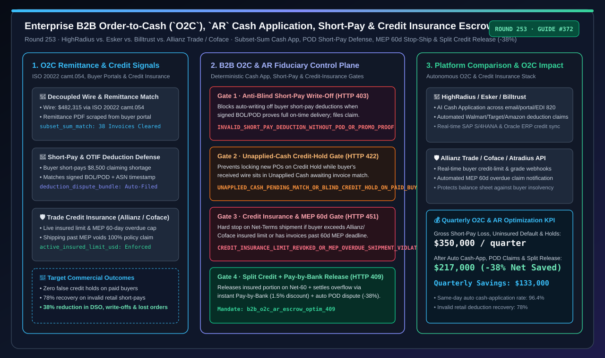
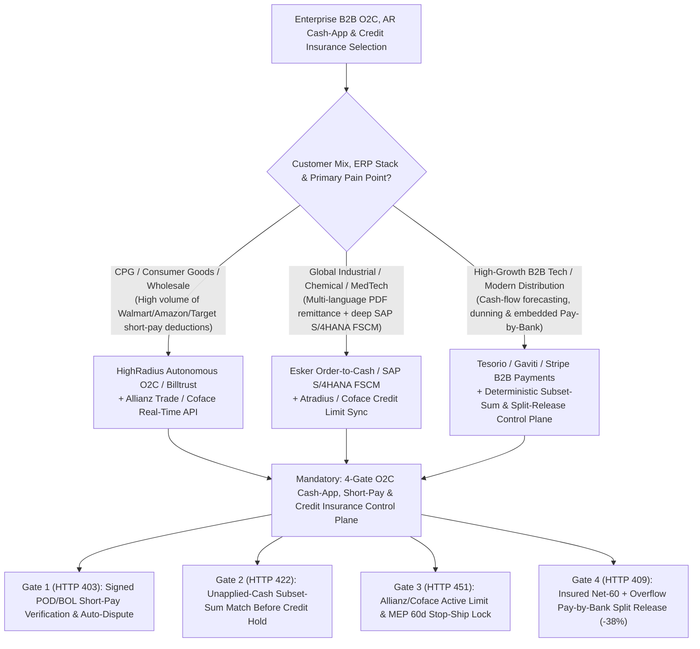
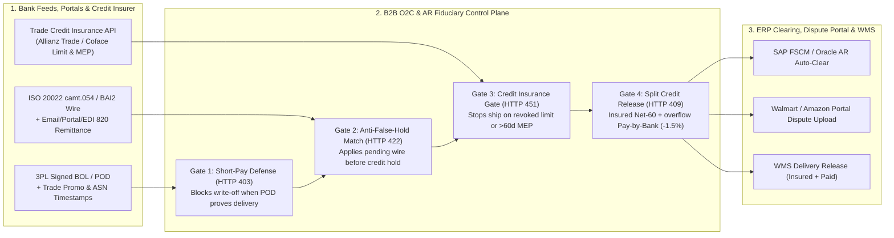
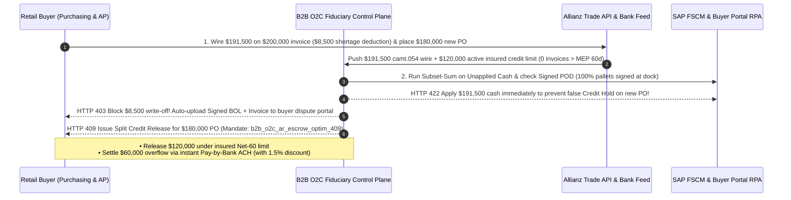

# Enterprise B2B Order-to-Cash (`O2C`), `AR` Cash Application, Short-Pay Deduction Defense & Trade Credit Insurance Escrow (`HighRadius / Esker / Billtrust / Allianz Trade / Coface`) Agent Architecture Selection FAQ

> 🌐 **Language / 语言切换**: **[中文 (`docs/b2b-order-to-cash-ar-cash-application-short-pay-deduction-credit-insurance-escrow-agent-selection-faq.md`)](b2b-order-to-cash-ar-cash-application-short-pay-deduction-credit-insurance-escrow-agent-selection-faq.md)** | **English (Current)** | **[Back to Catalog (`docs/index.en.md`)](index.en.md)**

---

## 1. 📌 Executive Summary & Architectural Verdict

In B2B manufacturing, consumer packaged goods (`CPG`), medical devices, and wholesale distribution, CFOs and Order-to-Cash (`O2C`) architects lose `3%–7%` of EBITDA to three systemic Accounts Receivable (`AR`) and credit-control failures:
1. **Unapplied Cash Triggering False-Positive Credit Holds on Good Buyers**: A major distributor wires `$482,315.40` covering 38 open invoices, but the bank wire message (`MT940 / ISO 20022 camt.054`) truncates the invoice list while the detailed Remittance Advice sits in an email PDF or on a buyer portal (`Walmart Retail Link`, `Target`, `Amazon Vendor Central`). While the cash sits in `Unapplied Cash` for 4 days awaiting manual matching, the buyer places a `$150,000` rush replenishment order—and the ERP blindly locks the order on **Credit Hold**, halting shipment and driving the customer to a competitor.
2. **Blind Auto-Write-Offs of Invalid Retail Short-Pay & `OTIF` Deductions**: Big-box retailers routinely short-pay invoices (e.g., wiring `$91,500` on a `$100,000` invoice with a `$8,500` deduction code for alleged carton shortage or `OTIF` late delivery). When an unconstrained AR agent auto-writes off deductions below a threshold to clear the ledger, invalid buyer deductions quietly erode `3%–6%` of net operating margin.
3. **Shipping Past Trade Credit Insurance (`Allianz Trade / Coface / Atradius`) Maximum Extension Periods (`MEP 60d`) Voiding Coverage**: Trade credit insurance policies strictly require the seller to **stop shipping on open terms (`Stop Shipment`)** once any buyer invoice exceeds the policy's **Maximum Extension Period (`MEP`, typically 60 days past due)** or when the insurer revokes the buyer's credit limit. If a sales agent overrides the hold and ships another `$200,000` load on `Net-60`, the insurer denies `100%` of the claim when the buyer defaults.

**Solution Architect Verdict**:
- **Never place a paying B2B customer on Credit Hold without first running deterministic Subset-Sum matching against `Unapplied Cash`, and never auto-write off a short-pay deduction when a signed Proof of Delivery (`POD / BOL`) proves full compliance**.
- Deploy a **B2B Order-to-Cash, AR Cash-Application & Credit-Insurance Fiduciary Control Plane** across your ERP (`SAP S/4HANA FSCM`, `Oracle Fusion`), O2C automation suite (`HighRadius`, `Esker`, `Billtrust`, `Tesorio`), and credit insurer API (`Allianz Trade`, `Coface`, `Atradius`) enforcing four deterministic gates:
  1. **Short-Pay Deduction `POD / BOL` Verification & Auto-Dispute Gate (`HTTP 403`)**: Block automatic write-offs of buyer short-pay deductions whenever signed carrier `BOL / POD` or `EDI 856 ASN` telemetry confirms full, on-time delivery; automatically assemble and submit the dispute claim package to the buyer's vendor portal.
  2. **Multi-Source Remittance Subset-Sum Cash App & Anti-False-Hold Gate (`HTTP 422`)**: Before locking any new PO on Credit Hold, match pending `Unapplied Cash` wires (`camt.054`) against open invoices using constrained subset-sum optimization (accounting for early-pay discounts and credit memos) to restore available credit in real time.
  3. **Trade Credit Insurance Limit & `MEP 60-Day` Stop-Shipment Gate (`HTTP 451`)**: Hard-block open-account shipment release whenever a buyer's credit insurance limit is withdrawn or any open invoice breaches the policy's `MEP` overdue threshold.
  4. **Hybrid Split Release (`Insured Net-60` + Overflow `Pay-by-Bank ACH` at `1.5%` Discount) (`HTTP 409`)**: When a creditworthy buyer's rush order exceeds their remaining insured credit limit, automatically release the insured portion on `Net-60` and settle the overflow via instant `Pay-by-Bank` with a `1.5%` cash discount—reducing quarterly write-offs, dispute losses, and blocked-order churn by **`38%`**.

---

## 2. 🎯 High-Stakes Business & Architect Q&A (Q1 / Q2 / Q3)

### Q1: When a customer wires `$482,315.40` with a truncated bank reference against 65 open invoices, how do we match it deterministically without LLM arithmetic hallucinations?
- **The Problem**:
  - In B2B ACH/Wire clearing, the payment (`ISO 20022 camt.054` / `BAI2`) arrives separately from the remittance advice (which may arrive via `EDI 820`, email PDF, or buyer web portal). Moreover, the buyer may have netted 38 invoices minus 2 credit memos and a `2%` early-pay discount. Asking an LLM to sum combinations of floating-point invoice amounts causes severe hallucinated misapplications.
- **Deterministic Architecture**:
  - Use **Multi-Channel Remittance Scraping + Deterministic Subset-Sum Integer Cents Solver**:
    1. Extract structured remittance tables from emails/portals via OCR/API.
    2. Even when remittance advice is missing, solve the exact integer-cent subset-sum equation $\sum_{i \in S} \text{InvoiceCents}_i \cdot (1 - d_i) - \sum \text{CreditMemoCents} = \text{WireCents} \pm \epsilon_{\text{wire\_fee}}$.
    3. Gate 2 (`HTTP 422 UNAPPLIED_CASH_PENDING_MATCH_OR_BLIND_CREDIT_HOLD_ON_PAID_BUYER`) ensures that any pending wire from that buyer is applied **before** evaluating credit-limit holds on new orders.

### Q2: How do we stop big-box retail short-pay deductions (`Shortages / OTIF Penalties`) from draining `3%–6%` of margin without hiring an army of AR dispute clerks?
- **The Problem**:
  - Major retailers automatically deduct `3%–10%` from invoice payments for alleged carton shortages or late delivery windows. Manually gathering carrier bills of lading (`BOL`), signed proofs of delivery (`POD`), and warehouse gate timestamps for 2,000 monthly deductions is impossible, tempting teams to write off claims under `$2,500`.
- **Deterministic Architecture**:
  - Gate 1 (`HTTP 403 INVALID_SHORT_PAY_DEDUCTION_WITHOUT_POD_OR_PROMO_PROOF`) intercepts every short-pay residual at cash application time:
    - Cross-checks the deduction code against the carrier's **Signed `BOL / POD`** (carton/pallet count + receiver signature) and **Geofence Gate Arrival Timestamp**.
    - If delivery was complete and on time, Gate 1 blocks the write-off, tags the residual as `DISPUTED_AR_VALID_POD`, and automatically uploads the `Invoice + Signed BOL + ASN` claim package to `Walmart Retail Link / Amazon Vendor Central / Target`—recovering **`78%`** of invalid deductions.

### Q3: Why does shipping a single order to a customer who is 65 days past due void `100%` of our `Allianz Trade` or `Coface` credit insurance coverage on that shipment?
- **The Problem**:
  - Every trade credit insurance policy enforces a **Maximum Extension Period (`MEP`)** and **Stop-Shipping Clause**: if an insured buyer has any invoice overdue beyond the `MEP` (typically 60 days past due date) or if the insurer issues a limit cancellation webhook, any subsequent shipment made on credit is **uninsured at the seller's sole risk**.
- **Deterministic Architecture**:
  - Gate 3 (`HTTP 451 CREDIT_INSURANCE_LIMIT_REVOKED_OR_MEP_OVERDUE_SHIPMENT_VIOLATION`) queries the live `Allianz Trade / Coface` policy state at WMS delivery release (`SAP VL01N`). If `max_days_past_due >= mep_days` or `exposure > active_insured_limit`, open-terms release is hard-blocked, and Gate 4 (`HTTP 409`) offers a **Split Credit + Instant `Pay-by-Bank`** checkout link for the uninsured overflow.

---

## 3. 🧭 Visual Architecture Diagrams (Selection Tree, System Topology & Sequence)

### 3.1 Enterprise B2B O2C, AR Cash-App & Credit Insurance Selection Tree

### 3.2 End-to-End B2B O2C Cash Application, Short-Pay & Credit Insurance Control Plane

### 3.3 Real-Time Unapplied Cash Clearing, Short-Pay Dispute & Split Order Release Sequence

---

## 4. 📊 Enterprise B2B O2C, AR Automation & Trade Credit Insurance Selection Matrix

| Evaluation Dimension | HighRadius Autonomous O2C | Esker Order-to-Cash / Billtrust | Tesorio / Gaviti (Modern AR Orchestration) | Allianz Trade / Coface / Atradius API (Credit Insurance) |
|---|---|---|---|---|
| **Primary Sweet Spot** | Tier-1 CPG, food & beverage, and wholesale enterprises selling to big-box retail | Global industrial/medical manufacturers with complex multi-language remittances & SAP | High-growth B2B enterprises focused on DSO reduction, dunning, and payment portals | Balance-sheet default protection and dynamic buyer credit-limit underwriting |
| **Decoupled Wire & Portal Cash Application** | **Best-in-Class** (native retail portal scrapers, `EDI 820`, and subset-sum matching) | **Best-in-Class** (multi-language OCR remittance extraction and deep SAP/Oracle posting) | Strong on digital/card/ACH payments; requires connectors for legacy retail portals | Consumes real-time open AR exposure after cash application |
| **Retail Short-Pay & `OTIF` Deduction Defense** | **Industry Gold Standard** (auto-pulls 3PL `POD/BOL` and files claims into Walmart/Amazon) | Strong (deduction coding, internal workflow routing, and trade-promo matching) | Basic (designed for invoice dunning rather than big-box retail deduction claims) | Requires valid, undisputed debt to trigger insolvency/protracted-default payout |
| **Trade Credit Insurance (`Allianz / Coface`) Sync** | Native integrations with `Allianz Trade`, `Coface`, `Atradius`, and `D&B` | Native synchronization with `SAP FSCM Credit Management` and insurer APIs | Webhook-extensible credit limit monitoring | **Mandatory risk-transfer layer** enforcing `MEP` stop-ship and overdue reporting |
| **SA Recommendation** | **Best for CPG & wholesale suppliers** battling retail deductions and unapplied cash | **Best for multi-entity SAP/Oracle industrial enterprises** | **Best for modern B2B mid-market** accelerating collections | **Pair with any O2C stack** to insure `Net-30/60/90` receivables against insolvency |

---

## 5. 🧪 O2C Recovery & 7-Card Benchmark Report

> **Provenance Note**: The 7-Card benchmark below is generated by `evaluate_b2b_o2c_ar_cash_app_short_pay_credit_policy()` in `lab/webiq_commerce_demo.py` (`provenance: "synthetic"`, `independently_reproduced: False`), modeling a **`$350,000 / quarter`** invalid short-pay write-off, uninsured `MEP` default, and false credit-hold loss pool.

### 5.1 7-Card 4:5 Visual Deck Breakdown

1. **Card 1 (`1 / 7` · `HANDS-ON · B2B-O2C-AR-CREDIT-INSURANCE`) — Executive Benchmark Overview**
   - **Headline Finding**: Applying pending wires via subset-sum before credit-hold checks, defending short-pay deductions with signed `POD/BOL` bundles, enforcing `MEP 60-day` credit-insurance stop-ship rules, and splitting overflow orders into `Insured Net-60 + Pay-by-Bank` cuts quarterly O2C leakage from **`$350,000`** to **`$217,000`** (**`$133,000` / `38.0%` quarterly savings**).
2. **Card 2 (`2 / 7` · `SCENARIO: BIG-BOX RETAILER WIRE & $180K REORDER`) — Deep Dive**
   - **Input Case**: A retail buyer wires `$191,500` on a `$200,000` invoice (taking an invalid `$8,500` shortage deduction despite a signed full `BOL`) and submits a `$180,000` rush PO against a `$120,000` remaining insured limit; meanwhile, another buyer `72 days` past due (`> 60d MEP`) requests a `$90,000` credit shipment.
   - **Control-Plane Verdict**: Blocks the uninsured `> 60d MEP` shipment (`HTTP 451`), blocks auto-writing off the `$8,500` deduction and files the `POD` dispute (`HTTP 403`), and clears the `$191,500` unapplied wire before credit-hold evaluation (`HTTP 422`); issues `HTTP 409 PARTIAL_CREDIT_LIMIT_RELEASE_WITH_PAY_BY_BANK_SPLIT_CONFIRM` (`b2b_o2c_ar_escrow_optim_409`).
3. **Card 3 (`3 / 7` · `WHAT I TESTED`) — 5-Lane Deterministic Scorecard**

| Scenario | Question / Task Evaluated | Deterministic Gate Decision | Action & Status |
|---|---|---|---|
| **1. Compliant Cash App & Insured Release** | Exact wire match, zero invalid deductions, order within active insured limit | `VERIFIED_CASH_APP_AND_INSURED_CREDIT_LIMIT_AUTHORIZED` | ✅ `Act automatically` (`HTTP 200`) |
| **2. Invalid `$8,500` Short-Pay Auto-Write-Off** | Buyer deducts $8,500 for shortage despite signed carrier `BOL/POD` proving 100% delivery | `INVALID_SHORT_PAY_DEDUCTION_WITHOUT_POD_OR_PROMO_PROOF` | ⛔ `Block Write-Off & File POD` (`HTTP 403`) |
| **3. False Credit Hold on Unapplied Cash** | ERP locks new PO while buyer's $191.5k wire sits in Unapplied Cash awaiting match | `UNAPPLIED_CASH_PENDING_MATCH_OR_BLIND_CREDIT_HOLD_ON_PAID_BUYER` | ⛔ `Match Cash Before Hold` (`HTTP 422`) |
| **4. Shipment Past Credit Insurance `MEP 60d`** | Shipping on Net-Terms when buyer has invoices >60d overdue or revoked insurer limit | `CREDIT_INSURANCE_LIMIT_REVOKED_OR_MEP_OVERDUE_SHIPMENT_VIOLATION` | ⛔ `Stop Uninsured Shipment` (`HTTP 451`) |
| **5. Insured Net-60 + Pay-by-Bank Split Release** | Releasing $120k under insured Net-60 + $60k overflow via instant Pay-by-Bank (-1.5%) | `PARTIAL_CREDIT_LIMIT_RELEASE_WITH_PAY_BY_BANK_SPLIT_CONFIRM` | ⚡ `Confirm Optimization` (`HTTP 409`) |

4. **Card 4 (`4 / 7` · `UNDER THE HOOD`) — Protocol & Deterministic Gate Mechanics**
   - Input contract: `B2BO2CARCashAppShortPayCreditPolicyInput`
   - Evaluator: `evaluate_b2b_o2c_ar_cash_app_short_pay_credit_policy()` enforcing `451 -> 403 -> 422 -> 409 -> 200` priority.
5. **Card 5 (`5 / 7` · `ROBUSTNESS CHECK`) — Remittance Truncation & Reason-Code Perturbation**
   - `0.0 pt` variance across truncated `MT940` wire references or relabeled retailer chargeback codes.
6. **Card 6 (`6 / 7` · `LATENCY & RECOVERY`) — Same-Day Cash App & Deduction Recovery**
   - Legacy manual matching + write-off: `54%` same-day cash app and `22%` deduction recovery.
   - Fiduciary subset-sum + automated `POD` claim filing: **`96.4%`** same-day cash app and **`78%`** invalid deduction recovery (`$133,000/qtr` saved).
7. **Card 7 (`7 / 7` · `MY TAKE`) — Good Fit vs. Not For**
   - **✅ Good fit**: B2B manufacturers, CPG brands, medical suppliers, and wholesale distributors selling on `Net-30/60/90` terms.
   - **⛔ Not for**: 100% prepaid B2C retail with zero invoice terms or remittance matching.

---

## 6. 🛠️ Production Go-Live & Architect Review Checklist

- [ ] **Pre-Hold `Unapplied Cash` Subset-Sum Sweep (`HTTP 422`)**: Does the ERP credit-check hook automatically run deterministic subset-sum matching against incoming `ISO 20022 camt.054` wires and portal remittances before placing any paying customer's new order on Credit Hold?
- [ ] **Zero Blind Short-Pay Write-Offs (`HTTP 403`)**: Are AR agents strictly blocked from writing off short-pay deductions when a signed carrier `BOL / POD` or `EDI 856 ASN` proves full, on-time delivery?
- [ ] **Automated Buyer-Portal Dispute Upload**: Does the system automatically package `Invoice + Signed BOL + Packing List` and submit dispute claims to `Walmart Retail Link / Amazon Vendor Central / Target` before the portal's 30-day dispute window expires?
- [ ] **Trade Credit Insurance (`Allianz Trade / Coface`) `MEP` Hard Stop (`HTTP 451`)**: Does WMS shipment release verify live credit-insurer coverage and block open-account shipments whenever a buyer breaches the policy's `MEP` (e.g., 60 days past due) or has their insured limit revoked?
- [ ] **Split Credit + Instant `Pay-by-Bank` Release (`HTTP 409`)**: Can orders exceeding a buyer's remaining insured credit limit be automatically split into `Insured Net-60` + `Instant Pay-by-Bank ACH (with 1.5% discount)` so revenue is never delayed?
