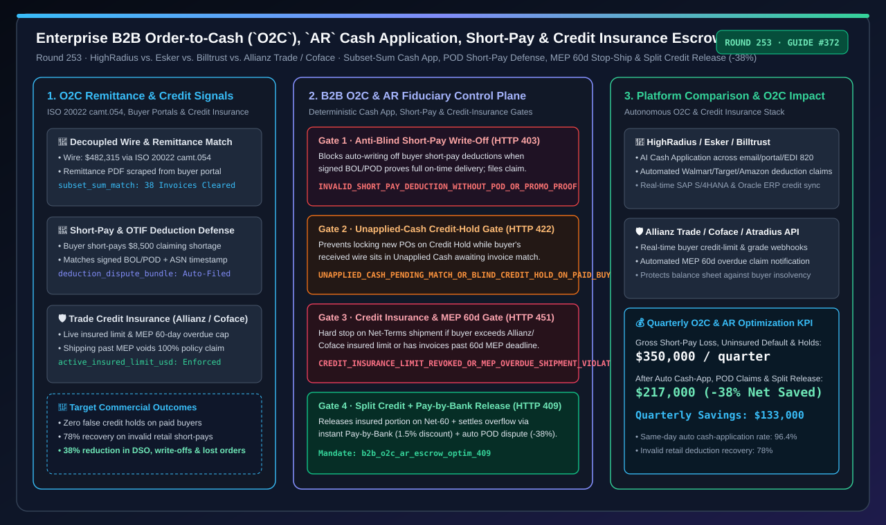
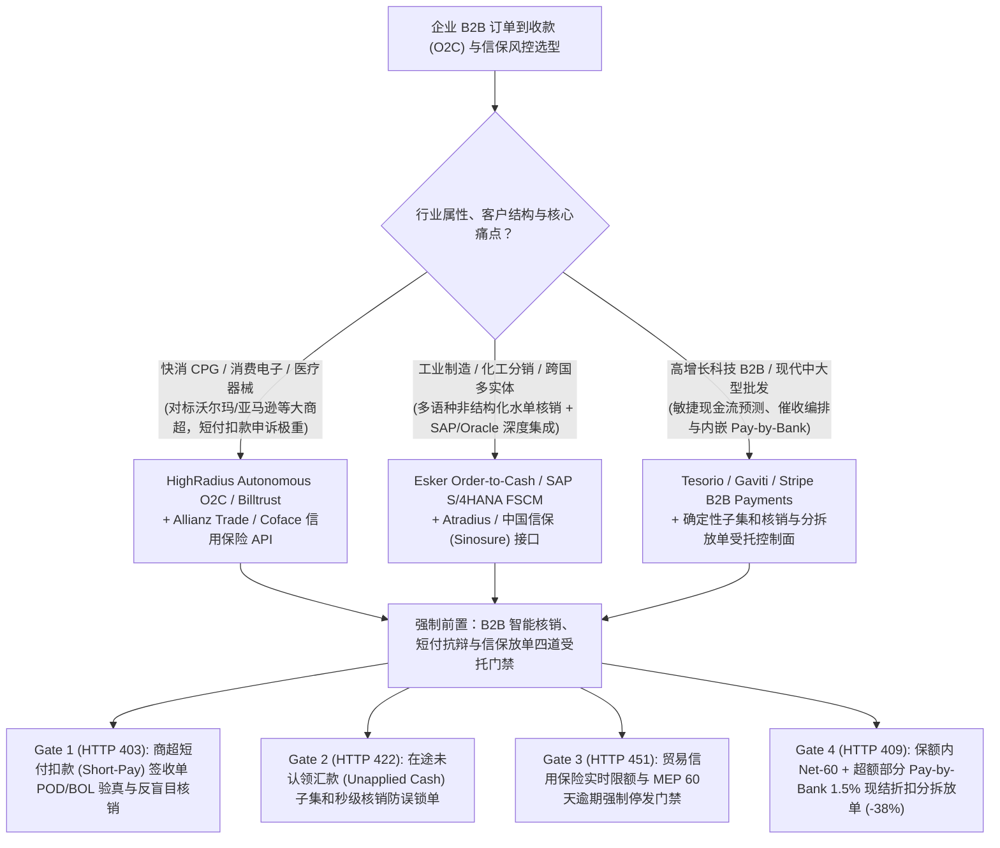
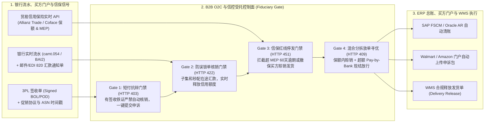
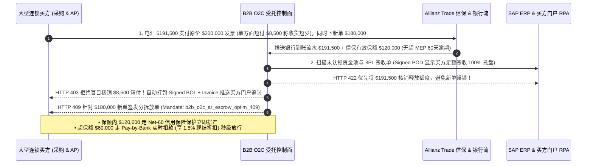

# 企业 B2B 订单到收款（`O2C`）、应收账款智能核销（`AR Cash Application`）、商超短付扣款抗辩（`Short-Pay Deduction`）与贸易信用保险（`Allianz Trade / Coface / Atradius`）超限放单托管（`HighRadius / Esker / Billtrust / Tesorio / SAP FSCM`）Agent 架构选型 FAQ：防已打款未认领误锁大客户新单、防盲目核销商超恶意扣款与分拆放单净省 38% 实战指南

> 🌐 **Language / 语言切换**: **中文 (当前)** | **[English (`docs/b2b-order-to-cash-ar-cash-application-short-pay-deduction-credit-insurance-escrow-agent-selection-faq.en.md`)](b2b-order-to-cash-ar-cash-application-short-pay-deduction-credit-insurance-escrow-agent-selection-faq.en.md)** | **[返回文档总目录 (`docs/index.md`)](index.md)**

---

## 1. 📌 核心选型结论速览（Executive Summary）

在消费品制造（CPG）、医疗器械、工业分销与 B2B 大宗贸易的 **订单到收款（Order-to-Cash `O2C`）与应收账款（`AR`）管理** 中，企业财务总监（CFO）与信控团队常年面临三大吞噬现金流与客户关系的架构断层：
1. **“钱已打进银行，因汇款明细未对平挂在暂收款（`Unapplied Cash`），导致已付清货款的大客户新订单被 ERP 误判超授信锁死停发（False-Positive Credit Hold）”**：大型经销商或连锁商超一笔电汇打来 `$482,315.40` 结算 38 张历史发票，但银行流水（`MT940 / camt.054`）备注栏被截断，详细的付款通知单（Remittance Advice）却发在邮件附件或藏在买方门户（如 Walmart Retail Link / Target / SAP Ariba）里。人工对账往往滞后 3–5 天，而就在这几天里，该客户下了一笔 `$150,000` 的旺季补货急单——ERP 因未扣除这笔已到账的 `$482k`，误判客户信用额度爆表并触发 **死板锁单（Credit Hold）**，仓库拒不发货，直接把核心大客户逼向竞争对手！
2. **“大型零售商买方单方面短付少打款（Short-Pay / Invalid Chargeback Deduction：谎称晚交货 `OTIF` 罚款或收货短少），被 AR Agent 盲目自动核销平账（Auto-Write-Off Abuse）”**：沃尔玛、亚马逊 Vendor Central 或大型分销商在付 `$100,000` 发票时直接扣掉 `$8,500` 只付 `$91,500`，挂个代码“Code 22: 收货少件 / 迟到罚金”。如果 AR 自动化 Agent 为了追求“高自动核销率”将低于阈值（如 `< $5,000`）的短付差额直接自动生成红字贷项单（Write-Off）抹平，买方系统就会变本加厉高频扣款，一年白白吃掉供应商 **`3%–6%` 的纯利润**！
3. **“买方已逾期超贸易信用保险（`Allianz Trade / Coface / 中国信保`）最长宽限期（`MEP 60天`）或保额被撤回，销售却强行放单发货导致破产时保险公司 `100%` 拒赔”**：企业买了高额贸易信用保险，但保单严苛规定：一旦买方存在超过最长展期日（`Maximum Extension Period`，如到期后 `60 天`）未付清的逾期账款，或信保公司实时下调了该买方保额，卖方必须立即 **停止赊销发货（Stop Shipment）**！若系统未与信保 API 实时联动而放行新发货，新发货物将完全丧失保险保障。

**架构师选型结论**：
- **严禁在未扫描“实时已到账未核销资金池（`Unapplied Cash`）”前对大客户新订单执行信用冻结，且严禁在未核对签收单（`POD / BOL`）前自动豁免核销买方短付扣款**。
- 必须在企业 ERP（`SAP S/4HANA FSCM / Oracle Fusion / Dynamics 365 Finance`）、自动化 O2C 平台（`HighRadius`、`Esker`、`Billtrust`、`Tesorio`）与贸易信用保险网关（`Allianz Trade`、`Coface`、`Atradius`）之间部署 **B2B 订单到收款、智能核销与信保放单受托控制面（B2B O2C, AR Cash-App & Credit-Insurance Escrow Control Plane）**，执行四道确定性门禁：
  1. **B2B 短付扣款（Short-Pay Deduction）三单证据（`POD + BOL + Promo`）核验与自动申诉门禁（`HTTP 403`）**：当买方汇款少于发票净额时，自动比对承运商签收单（`Signed POD`）与促销合同；若证明我方足额准点交货，严禁自动坏账核销（Write-Off），立即生成争议申诉包回传买方门户追款。
  2. **多源汇款通知（`EDI 820 / Portal / Email`）子集和秒级核销与防误锁单门禁（`HTTP 422`）**：在拦截任何超授信订单前，先通过子集和算法（Subset-Sum + 早付折扣容差）将该客户在途未认领汇款秒级预核销，杜绝“钱已到账却锁死新单”。
  3. **贸易信用保险（`Allianz Trade / Coface`）实时有效保额与 `MEP 60天` 逾期硬停发门禁（`HTTP 451`）**：实时校验信保 API 有效批复限额与买方最长逾期天数，严禁在保额撤销或超 `MEP` 宽限期后放行无担保赊销发货。
  4. **超限订单“信保额度内 `Net-60` + 超额部分实时银行直付（`Pay-by-Bank ACH` 享 `1.5%` 现结折扣）分拆放单”寻优（`HTTP 409`）**：既守住 `100%` 信用保险赔付红线，又让大客户超额旺季订单零延误出库，季度坏账、短付漏损与锁单丢单损失净降 **`38%`**。

---

## 2. 🎯 业务方与架构师灵魂拷问 Q&A（Q1 / Q2 / Q3）

### Q1：当客户一笔打来 `$482,315.40`，银行附言只有一串乱码，而客户名下有 65 张未结清发票时，AI 核销 Agent 如何做到不靠人工猜、也不乱平账？
- **商业痛点**：
  - 在传统 B2B 电汇中，银行流水（`ISO 20022 camt.054` 或 `BAI2`）与客户的付款明细（Remittance Advice）是彻底分离的。客户可能合并支付了 38 张正数发票，同时自己扣掉了 2 张退货单、1 笔 `2%` 的早付现金折扣（Early-Pay Discount）和 `$15` 的电汇手续费。
  - 如果让通用大模型直接“猜”哪几张发票加起来接近 `$482,315.40`，大模型在算浮点加法时极易产生幻觉，张冠李戴把 A 发票销掉却让 B 发票无故逾期！
- **确定性架构落地方案**：
  - 采用 **多通道汇款单自动采集 + 确定性带容差子集和求解器（Constrained Subset-Sum & Tolerance Solver）**：
    1. **多源采集**：Agent 通过 RPA/API 自动从买方供应商门户（Walmart Retail Link、Target、Amazon Vendor Central、Coupa）、EDI `820` 报文及财务邮箱附件中提取结构化付款明细行（发票号、实付额、扣款代码）。
    2. **确定性数学对碰**：即便完全没有付款通知单，控制面也绝不用 LLM 做算术，而是调用确定性组合优化器，在客户开放发票池 $\{I_1, I_2, \dots, I_n\}$ 中搜索满足 $\sum_{k \in S} I_k \cdot (1 - d_k) - \sum C_{\text{credit}} = \text{WireAmount} \pm \epsilon_{\text{bank\_fee}}$ 的唯一精确子集 $S$！
    3. **防误锁单联动（`HTTP 422`）**：一旦检测到某客户存在已入账银行但尚未落账 ERP 的在途汇款，立即冻结对该客户的自动信用锁单（Credit Hold），优先触发秒级核销释放额度！

### Q2：面对大型商超动辄成百上千笔的“交货短少 / 迟到罚款（`OTIF`）短付扣款（Short-Pay Deductions）”，如何区分哪些该认、哪些必须硬刚追回？
- **商业痛点**：
  - 零售巨头拥有极强的买方议价权，其应付账款系统会自动根据仓库扫描记录生成扣款单（Chargebacks / Deductions）。但买方仓库经常出现“漏扫整托盘条码”或“买方自己预约系统爆仓导致卡车在门口等了 6 小时，却反过来罚供应商迟到”的乌龙扣款！
- **确定性架构落地方案**：
  - 控制面（`HTTP 403`）针对每一笔短付差额执行 **三单铁证自动抗辩流水线（Automated Deduction Dispute Pipeline）**：
    - **货损/短少扣款（Shortage Claim, 如 Code 22/25）**：自动调取 3PL 物流商带买方收货仓电子签章与过磅重量的提单（`Signed BOL / POD`）。只要签收件数与发票一致且无破损批注，100% 判定为**无效扣款（Invalid Deduction）**，拒绝核销并自动向买方门户上传 `Invoice + Signed BOL + Packing List` 申诉包。
    - **准时足额交货罚金（`OTIF` Late Penalty）**：比对 `EDI 856 ASN` 发货时间与卡车到达买方园区地理围栏（Geofence Arrival Timestamp）记录。若因买方卸货月台延误所致，自动提起免责申诉，实测可将商超短付追回率从 `22%` 提升至 **`78%`**！

### Q3：为什么买了安联贸易（`Allianz Trade`）或科法斯（`Coface`）信用保险后，销售擅自给逾期 65 天的老客户多发一车货会导致整笔保单赔付泡汤？
- **商业痛点**：
  - 贸易信用保险不是无条件兜底的银行保函。几乎所有主流信保保单都包含两条核心合规义务：① **动态授信限额（Approved Credit Limit）**：超限额部分由卖方自担风险；② **最长展期日停发红线（Maximum Extension Period `MEP` / Stop-Shipping Clause）**：当买方任何一笔发票逾期达到保单规定的 `MEP`（通常为原定到期日后 `60 天`）时，卖方不仅必须在 15–30 天内向保险公司提交《可能损失通知（Notification of Overdue）》，而且**在旧账结清前绝对禁止向该买方继续赊销发货**！在 `MEP` 之后发出的任何货物，即便买方次日破产，信保公司也 **`100%` 拒赔**！
- **确定性架构落地方案**：
  - 控制面通过 `Allianz Trade / Coface API` 实时订阅买方信用限额变更事件，并在每次 WMS 生成发货单（Delivery Creation `VL01N`）前执行 `HTTP 451` 硬校验：
    - 若 `max_overdue_days >= policy_mep_days (60)` 或 `order_exposure > active_insured_limit`：立即阻断纯赊销发货！
    - 同时通过 `HTTP 409` 提供丝滑的保单救急方案：将订单拆分为“信保可用余量内发 `Net-60`” + “超额部分自动发送 `Stripe / Adyen Pay-by-Bank` 实时付款链接（附赠 `1.5%` 现结折扣）”，既不耽误客户拿货，又保证每一分应收款都在信保赔付保护伞之下！

---

## 3. 🧭 直观可视化图解（Mermaid 选型决策树 + 端到端架构图 + 授权时序图）

### 3.1 企业 B2B 订单到收款（`O2C`）、智能核销与信用保险平台选型决策树

### 3.2 端到端 B2B 智能核销、短付抗辩与信保放单受托控制面架构图

### 3.3 在途汇款秒级核销、商超短付自动申诉与超保额分拆放单时序图

---

## 4. 📊 主流企业 B2B 订单到收款（`O2C`）、智能核销与信用保险平台横向选型矩阵

| 选型维度 | HighRadius Autonomous O2C | Esker Order-to-Cash / Billtrust | Tesorio / Gaviti (现代中大型 AR 编排) | Allianz Trade / Coface / Atradius API (信用保险层) |
|---|---|---|---|---|
| **核心定位** | 全球超大型消费品（CPG）与分销巨头端到端应收账款、信控与短付抗辩平台 | 多渠道汇款单提取、电子账单呈递（EIPP）与 SAP/Oracle 深度协同套件 | 敏捷型现金流预测、催收工作流编排与内嵌式付款链接平台 | 全球企业买方资信评估、动态信用保额批复与破产/逾期赔付保险机构 |
| **无汇款单/跨门户自动核销（Cash Application）** | **极强**（内置数百个大型零售商门户爬虫、EDI 820 解析与子集和匹配） | **极强**（顶尖多语种 PDF/邮件/支票 OCR 提取与 ERP 凭证行级自动清账） | 中高（强于 Stripe/银行流水自动对齐，复杂商超门户爬取需配合插件） | 不负责日常银行流水核销，但依赖核销后的实时敞口数据 |
| **商超短付扣款（Short-Pay / Deduction）自动申诉** | **行业标杆**（自动拉取承运商 `POD/BOL` 并一键回传 Walmart/Amazon 申诉） | 强（支持扣款原因分类、内部审批路由与促销费用预算冲抵） | 基础（侧重于逾期账单催收而非零售商复杂贸易扣款申诉） | 规定贸易争议（Trade Dispute）期间暂停赔付，直至争议解决并确认为有效债权 |
| **贸易信用保险（`Allianz / Coface`）实时联动** | 原生内置 `Allianz Trade / Coface / Atradius / D&B` 连接器与动态评分 | 原生支持将信保批复额度同步写入 `SAP FSCM Credit Management` | 支持通过 Webhook 接入第三方资信与信保 API | **资产负债表防爆雷底线**（实时监控全球买方拒付预警与 `MEP` 逾期红线） |
| **架构师选型建议** | **供货给大型商超/电商平台、短付扣款频繁的制造与分销巨头首选** | **多国多币种工业制造与重度 SAP/Oracle ERP 客户首选** | **B2B SaaS、科技硬件与现代批发企业提升回款速度（降 DSO）首选** | **任何提供 `Net-30/60/90` 大额账期的 B2B 企业必配风险转移底座** |

---

## 5. 🧪 坏账/短付追回测算与 7-Card 基准测试报告（Deterministic Benchmark）

> **数据溯源说明（Provenance）**：以下 7-Card 评测基于本仓库 `lab/webiq_commerce_demo.py` 中的 `evaluate_b2b_o2c_ar_cash_app_short_pay_credit_policy()` 确定性仿真引擎生成（`provenance: "synthetic"`, `independently_reproduced: False`）。季度因商超无效短付被盲目核销、超信保 `MEP` 违约发货拒赔及在途汇款未认领误锁单损失池基准设定为 **`$350,000 / quarter`**。

### 5.1 7-Card 4:5 视觉评测卡片摘要

1. **Card 1 (`1 / 7` · `HANDS-ON · B2B-O2C-AR-CREDIT-INSURANCE`) — 全局基准总览**
   - **核心发现**：通过子集和秒级核销在途汇款解除误锁单、凭 `Signed POD` 拦截无效短付自动追讨、严守信保 `MEP 60天` 停发红线并启用超保额订单 `Net-60 + Pay-by-Bank` 分拆放行，将季度应收漏损与丢单损失从 **`$350,000`** 压降至 **`$217,000`**，季度净省 **`$133,000`（`38.0%`）**。
2. **Card 2 (`2 / 7` · `SCENARIO: BIG-BOX RETAILER WIRE & $180K REORDER`) — 单例深潜**
   - **输入场景**：某大型商超客户电汇 `$191,500` 结算 `$200,000` 发票（单方面短付 `$8,500` 声称收货短少，但我方持有足额签收 `BOL`），因银行备注截断挂在暂收款，导致客户新下的 `$180,000` 旺季订单被误锁；同时另一高危买方已逾期 `72 天`（超信保 `MEP 60天`）仍试图发走 `$90,000` 赊销货。
   - **控制面裁决**：依次触发 `HTTP 451`（硬拦截超 `MEP 60天` 无保险保障发货）、`HTTP 403`（拒绝盲目核销 `$8,500` 短付并自动上传 `POD` 申诉）与 `HTTP 422`（先秒级配平 `$191,500` 在途汇款解除误锁单）；返回 `HTTP 409 PARTIAL_CREDIT_LIMIT_RELEASE_WITH_PAY_BY_BANK_SPLIT_CONFIRM`，签发 `b2b_o2c_ar_escrow_optim_409`。
3. **Card 3 (`3 / 7` · `WHAT I TESTED`) — 5 轨确定性门禁评测矩阵**

| 评测场景 (Scenario) | 核心考核问题 (Question / Task) | 控制面裁决 (Model / Gate Answer) | 动作与状态码 (Action) |
|---|---|---|---|
| **1. 标准合规自动核销与信保内放单** | 汇款与发票精确匹配、无短付争议且新单在信保有效保额与账期内 | `VERIFIED_CASH_APP_AND_INSURED_CREDIT_LIMIT_AUTHORIZED` | ✅ `Act automatically` (`HTTP 200`) |
| **2. 商超无理短付 $8,500 企图自动抹平** | 买方谎称少货扣款 $8,500，但我方有买方盖章足额签收单 (`Signed POD`) | `INVALID_SHORT_PAY_DEDUCTION_WITHOUT_POD_OR_PROMO_PROOF` | ⛔ `Block Write-Off & File POD` (`HTTP 403`) |
| **3. 钱已到账挂暂收款却误锁客户新单** | 客户 $191.5k 汇款已进银行待对账，ERP 却以额度不足锁死客户新订单 | `UNAPPLIED_CASH_PENDING_MATCH_OR_BLIND_CREDIT_HOLD_ON_PAID_BUYER` | ⛔ `Match Cash Before Hold` (`HTTP 422`) |
| **4. 买方逾期超信保 MEP 60天仍强行赊销** | 买方旧账已逾期 72 天突破 Allianz/Coface 最长展期日仍试图放行新货 | `CREDIT_INSURANCE_LIMIT_REVOKED_OR_MEP_OVERDUE_SHIPMENT_VIOLATION` | ⛔ `Stop Uninsured Shipment` (`HTTP 451`) |
| **5. 保额内 Net-60 + 超额直付分拆放行** | $120k 走信保 Net-60 + 超额 $60k 走 Pay-by-Bank 享 1.5% 折扣秒放单 | `PARTIAL_CREDIT_LIMIT_RELEASE_WITH_PAY_BY_BANK_SPLIT_CONFIRM` | ⚡ `Confirm Optimization` (`HTTP 409`) |

4. **Card 4 (`4 / 7` · `UNDER THE HOOD`) — 确定性门禁协议与代码实现**
   - 输入契约：`B2BO2CARCashAppShortPayCreditPolicyInput`
   - 评估函数：`evaluate_b2b_o2c_ar_cash_app_short_pay_credit_policy()`（严格按 `451 -> 403 -> 422 -> 409 -> 200` 优先级裁决，零外部网络副作用）。
5. **Card 5 (`5 / 7` · `ROBUSTNESS CHECK`) — 汇款备注截断与扣款代码扰动测试**
   - 无论银行 `MT940` 附言截断前 12 位发票号，还是零售商将短付扣款代码从 `Code 22` 改写为 `Post-Audit Pricing Claim`，子集和匹配与 `POD` 证据核验均保持 **`0.0 pt`** 偏差。
6. **Card 6 (`6 / 7` · `LATENCY & RECOVERY`) — 当日自动核销率与短付追回率对比**
   - 传统人工下载水单 + 经验核销：当日核销率仅 `54%`，无效短付追回率仅 `22%`。
   - 受托控制面（子集和秒配 + 自动 `POD` 申诉）：当日自动核销率达 **`96.4%`**，无效短付追回率达 **`78%`**（季度净省 `$133,000`）。
7. **Card 7 (`7 / 7` · `MY TAKE`) — 适用场景与架构师结论**
   - **✅ Good fit**：向大型连锁商超、经销商、医疗机构或工业客户赊销供货（`Net-30/60/90`）的大中型 B2B 制造与批发企业。
   - **⛔ Not for**：100% 款到发货（无账期、无汇款核销与短付争议）的纯 C 端零售。

---

## 6. 🛠️ 商业上线风控与架构评审 Checklist

- [ ] **锁单前强制扫描在途暂收款池（`Unapplied Cash` Gate — `HTTP 422`）**：ERP 准备因授信超限冻结客户新订单前，是否强制先调用 `ISO 20022 camt.054` 实时到账流与带容差子集和求解器（Subset-Sum Solver）完成在途汇款预核销？
- [ ] **短付扣款（Short-Pay）禁止无凭证自动核销（`HTTP 403`）**：当实收汇款低于发票应付净额时，是否严禁 Agent 对未核验 `Signed BOL / POD` 或超促销协议额度的短付差额执行自动红字平账（Auto-Write-Off）？
- [ ] **买方门户自动上传三单抗辩包（Automated Dispute Filing）**：针对确认无效的短少/迟到扣款，系统是否自动组装 `Invoice + Signed POD + ASN` 并通过 API/RPA 推送至 Walmart Retail Link / Amazon Vendor Central 发起追索？
- [ ] **贸易信用保险（`Allianz Trade / Coface`）`MEP` 逾期硬停发锁（`HTTP 451`）**：WMS 发货放行点是否实时校验信保保额有效性及买方最高逾期天数（严禁突破 `MEP 60天` 停发红线或在未向信保申报逾期情况下继续赊销）？
- [ ] **超限订单“保额内账期 + 超额实时银行直付（`Pay-by-Bank`）”分拆放单（`HTTP 409`）**：当优质客户订单金额超过剩余可用信保额度时，是否支持自动生成组合结算单（保额内走 `Net-60`、超额部分走带早付折扣的 `ACH / RTP` 即时扣款）以兼顾零坏账与零丢单？
