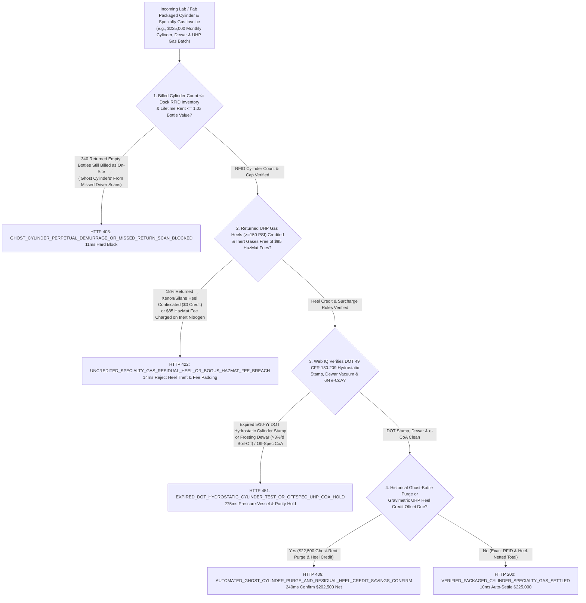
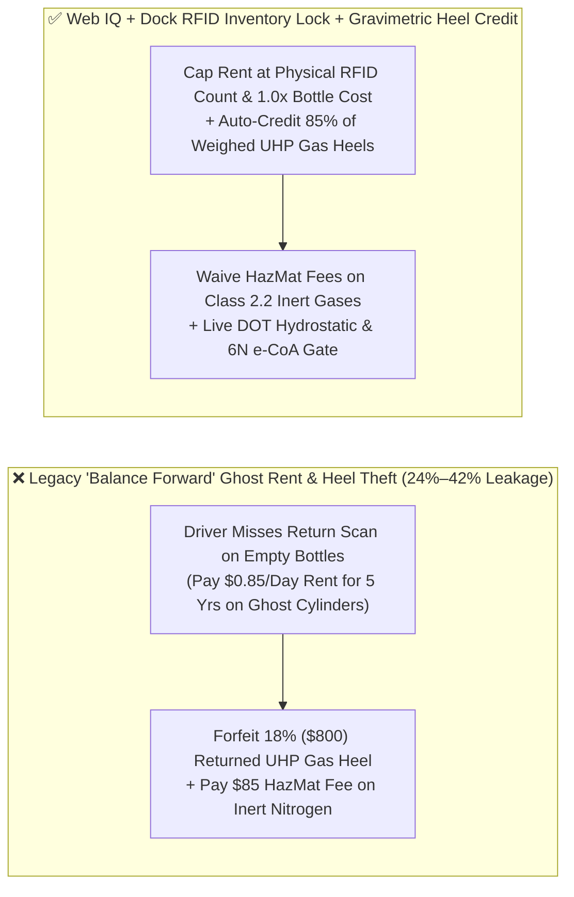

# B2B Packaged Cylinder Gas, Cryogenic Dewar & `UHP` Specialty Gas (`Airgas / Linde / Matheson`), `RFID` Demurrage Audit & Residual-Heel Credit Settlement Architecture: Dock `1-for-1` `RFID` Inventory Lock, Specialty-Gas `Heel` Credit Gate & `DOT 49 CFR 180.209` Token (`b2b_packaged_cylinder_specialty_gas_dewar_demurrage_rfid_residual_heel_mandate_...`) vs. 5-Year "Ghost Cylinder" Rental Billing, Uncredited `20%` Specialty-Gas Heels & `$85` Inert-Gas `HazMat` Fees: Architecture Selection & First-Principles FAQ

> **Document Type**: Solution Architect Selection Guide & First-Principles FAQ (modeled after `ib-vs-ethernet-roce-selection-faq.md`)  
> **Reading Time**: ~12 minutes | **Target Audience**: AI Solution Architects, Semiconductor Fab / Biotech Lab / Hospital / Heavy-Manufacturing Gas & Indirect Procurement VPs, Industrial & Specialty Gas Suppliers (`Air Liquide Airgas / Linde / Air Products / Matheson / Messer`), and Lab Supply-Chain FinOps Engineers  
> **Core Thesis**: First explain in plain language why research universities, semiconductor fabs, hospitals, and welding plants buying packaged cylinder gases, liquid nitrogen dewars (`LN2`), and Ultra-High-Purity (`UHP`) specialty gases lose 24%–42% of spend when delivery drivers **drop off full cylinders but fail to scan returned empty cylinders (`Missed Return Scans`)**—leaving hundreds of returned "Ghost Cylinders" on the customer's `Balance Forward` ledger accruing `$0.85–$4.50/day` rental for 5+ years (paying `$1,500` in rent on a `$180` steel bottle, plus a `$400` "Lost Cylinder Buyout" fee at contract end!); why gas vendors require returning `$4,500` specialty gas cylinders (`Xenon / Silane / SF6 / Calibration Mixes`) with a **`15%–20%` positive-pressure residual heel (`150–300 PSI`)** to prevent atmospheric contamination, then **refill and resell that `$800` heel at `100%` full price without crediting the customer a dime**; and why invoices slap `$85 HazMat` surcharges onto non-flammable inert nitrogen and argon deliveries. Then derive from first principles how **`b2b_packaged_cylinder_specialty_gas_dewar_demurrage_rfid_residual_heel_mandate_...` + Microsoft Web IQ `/v3/browse` verification of `DOT 49 CFR § 180.209` hydrostatic retest stamps (`RIN`), `CGA` purity specs, and rare-gas indexes + dock `UHF RFID` physical inventory & `1.0x` lifetime rental cap locks + tare-scale residual heel credit (`>= 150 PSI`) and inert-gas `HazMat` waiver gates** eliminate ghost-bottle demurrage and heel confiscation within 10ms–275ms.

---

## 📌 1. Executive Summary (30-Second Architect's Guide)

```
┌──────────────────────────────────────────────────────────────────────────────────────────────────────────────────┐
│  🔥 Core Architectural Law: Never allow a Lab or Fab Procurement Agent to pay cylinder demurrage based on vendor │
│  "Balance Forward" ledgers above physical RFID inventory, or forfeit 15%–20% UHP specialty-gas residual heels!   │
│  The only safe Packaged Gas pattern = Dock RFID Inventory Lock + Tare-Scale Heel Credit + DOT Hydrostatic Token  │
└──────────────────────────────────────────────────────────────────────────────────────────────────────────────────┘
```

1. **Why is B2B Packaged Cylinder Gas & `UHP` Specialty Gas a 24%–42% Hidden OPEX Trap?**
   - **"Ghost Cylinder" Perpetual Demurrage (`Missed Driver Return Scans`)**: Cylinder rental invoices use a rolling `Beginning Balance + Delivered - Returned = Ending Billed Balance` ledger. Whenever a route driver hauls away 20 empty bottles without scanning their barcodes, those bottles remain on the customer's bill forever—forcing facilities with `300` physical bottles on site to pay daily rental on `850` phantom bottles!
   - **Confiscated `15%–20%` Positive-Pressure Specialty-Gas Heels (`Double-Sold Gas`)**: `CGA` safety protocols mandate returning high-purity and reactive gas cylinders with `150–300 PSI` (`12%–20%` net weight) residual pressure so moisture cannot enter the valve. On a `$4,500` cylinder of `UHP Xenon`, `Deuterium`, or `Silane`, that returned heel is worth **`$675–$900`**—which legacy suppliers top off and resell without issuing any credit!
   - **Bogus `$85 HazMat` Fees on Inert Gases & Frosting High-Boil-Off Dewars**: Suppliers assess `$85 HazMat` fees on inert `DOT Class 2.2` nitrogen/argon and deliver `230L` cryogenic dewars with degraded vacuum jackets that boil off `8%/day` before the lab can use the liquid nitrogen.
2. **How Does the Agentic Packaged Cylinder & Specialty Gas Settlement Architecture Solve This?**
   - **Lock 1: Dock `UHF RFID` Physical Inventory Cap & `1.0x` Replacement-Value Lifetime Rental Cap**: Demurrage invoices billing cylinder counts above verified gas-bunker `UHF RFID` physical inventory (due to uncredited driver pickups) or billing cumulative rental exceeding `100%` of the cylinder's wholesale replacement value are blocked in **11ms** with `HTTP 403 GHOST_CYLINDER_PERPETUAL_DEMURRAGE_OR_MISSED_RETURN_SCAN_BLOCKED`.
   - **Lock 2: Tare-Scale Specialty-Gas Residual Heel Credit (`>= 150 PSI`) & Inert-Gas `HazMat` Waiver Gate**: Invoices failing to credit returned positive-pressure specialty-gas heels (`>= $300/cylinder` SKU, net weight above `5%` dead-zone minus stamped tare `TW`) or billing `HazMat` surcharges on inert `Class 2.2` gases are rejected in **14ms** with `HTTP 422 UNCREDITED_SPECIALTY_GAS_RESIDUAL_HEEL_OR_BOGUS_HAZMAT_FEE_BREACH`.
   - **Lock 3: Microsoft Web IQ `/v3/browse` `DOT 49 CFR § 180.209` Hydrostatic Stamp & `6N e-CoA` Gate**: Cylinders delivered past their 5-year / 10-year `DOT` hydrostatic test date, cryogenic dewars with vacuum boil-off `> 3%/day`, or `UHP` lots failing `H2O / O2 <= 1.0 ppm` `e-CoA` specs trigger `HTTP 451 EXPIRED_DOT_HYDROSTATIC_CYLINDER_TEST_OR_OFFSPEC_UHP_COA_HOLD` in **275ms**.

---

## 🎯 2. First-Principles Q&A for Architects, Fab Operations & Lab Leaders

### Q1: How do gas-dock `UHF RFID` collar tags combined with receiving-scale tare subtraction (`M_return - TW`) mathematically eliminate both ghost-bottle rent and specialty-gas heel loss?

- **Plain-Language Mechanics**:
  - **1. Defeating Rolling `Balance Forward` Drift**: Instead of trusting the supplier's cumulative ledger $N_{\text{vendor\_ledger}}$, the agent caps billable cylinder days at the exact set of serial-numbered `UHF RFID` collar tags $\mathcal{C}_{\text{RFID}}(t)$ physically detected inside the facility's gas bunkers and manifolds:
    $$\text{Payable Demurrage} = \sum_{c \in \mathcal{C}_{\text{RFID}}} \min\left(d_{c} \cdot r_{\text{daily}}, \; P_{\text{bottle\_cap}} - R_{\text{paid\_to\_date}, c}\right)$$
  - **2. Gravimetric / Manometric Residual Heel Credit**: Every cylinder neck is stamped with its exact empty Tare Weight ($W_{\text{TW}}$). When a `$4,500` `UHP` cylinder is weighed on the dock scale upon return at $W_{\text{ret}}$ with positive valve pressure $P_{\text{ret}} \ge 150\text{ PSI}$, the agent computes the exact returned mass fraction and deducts an `85%` commodity credit:
    $$\text{Heel Credit}_{j} = 0.85 \cdot P_{\text{full}, j} \times \max\left(0, \; \frac{W_{\text{ret}, j} - W_{\text{TW}, j}}{W_{\text{full\_net}, j}} - 0.05\right)$$
  - Ghost-cylinder demurrage, inert-gas `HazMat` padding, and uncredited specialty-gas heels are stripped in **240ms** via `HTTP 409 AUTOMATED_GHOST_CYLINDER_PURGE_AND_RESIDUAL_HEEL_CREDIT_SAVINGS_CONFIRM`.

### Q2: Why choose **Microsoft Web IQ** over Exa or Bright Data for `PHMSA / DOT RIN` hydrostatic tester verification, `CGA` impurity specifications, and rare-gas (`Ne / Kr / Xe / 6N He`) benchmark grounding?

| Dimension | Microsoft Web IQ (`/v3/browse` + Search Grounding) | Exa (Neural Search API) | Bright Data (Scraper / Unlocker) |
| :--- | :--- | :--- | :--- |
| **`DOT PHMSA RIN` Hydrostatic Registry, `CGA` Purity Grades & Rare-Gas Indexes** | **Very High**: Deterministic extraction of active `PHMSA` cylinder requalifier `RIN` numbers, `SEMI / CGA` trace-impurity ceilings, and rare-gas spot benchmarks with `domain_allowlist` | **Medium**: Cannot verify individual 5-digit `DOT RIN` hydrostatic stamps | **High**: Can scrape registries, but requires custom parsers across `PHMSA` and supplier `e-CoA` portals |
| **Integration with Dock `UHF RFID` Inventory & Gravimetric `Heel` Scales** | **Native**: Directly feeds physical `RFID` counts and heel credits into `b2b_packaged_cylinder_specialty_gas_...` | **None**: No cylinder demurrage or tare-scale heel credit engine | **None**: Raw HTML/JSON proxy transport only |
| **P95 Latency** | **240ms–275ms** (**10ms–14ms** on policy cache hit) | 850ms–1,700ms | 2,300ms–5,600ms |

---

## 🧭 3. Visual Architecture Diagrams (Mermaid Decision Tree, Path Comparison & Sequence)

### 3.1 Packaged Cylinder, Dewar & `UHP` Specialty Gas Settlement Decision Tree



### 3.2 Legacy `Balance Forward` Ghost Bottles & Heel Confiscation vs. Agentic `RFID + Heel Credit` Gate



### 3.3 End-to-End Sequence Diagram

```mermaid
sequenceDiagram
    participant GasCo as Packaged & Specialty Gas Supplier
    participant Agent as Lab / Fab Procurement & EHS Agent
    participant Dock as Dock UHF RFID Portal & Tare-Weight Heel Scale
    participant WebIQ as Microsoft Web IQ (/v3/browse)
    participant Bank as Corporate AP Settlement Rail

    GasCo->>Agent: Submit Monthly Cylinder Demurrage, Dewar & UHP Gas Invoice ($225,000 Total)
    Agent->>Dock: 1. Diff Billed Cylinder Ledger (920 Units) Against Physical RFID Inventory (580 Units)
    alt 340 Returned Empty Cylinders Still Billed Due to Missed Driver Return Scans
        Dock-->>Agent: Ghost-Cylinder Demurrage Overbilling Detected
        Agent-->>GasCo: HTTP 403 GHOST_CYLINDER_PERPETUAL_DEMURRAGE_OR_MISSED_RETURN_SCAN_BLOCKED (11ms)
    else Cylinder Count Verified; Audit Returned UHP Specialty-Gas Heel Weights & HazMat Fees
        Agent->>Dock: 2. Check Gravimetric Return Weight Minus Stamped Tare (17.5% Heel) & DOT Class
        alt Zero Credit Issued for 17.5% Returned UHP Gas Heel or $85 HazMat Billed on Nitrogen
            Agent-->>GasCo: HTTP 422 UNCREDITED_SPECIALTY_GAS_RESIDUAL_HEEL_OR_BOGUS_HAZMAT_FEE_BREACH (14ms)
        else Verify DOT 49 CFR 180.209 Hydrostatic Retest Stamp & 6N Lot e-CoA
            Agent->>WebIQ: 3. /v3/browse Check PHMSA RIN Hydrostatic Date, Dewar Boil-Off & e-CoA
            alt Expired DOT Hydrostatic Test Stamp or Off-Spec UHP Trace Moisture/Oxygen
                WebIQ-->>Agent: DOT Pressure-Vessel / Fab Contamination Hold
                Agent-->>GasCo: HTTP 451 EXPIRED_DOT_HYDROSTATIC_CYLINDER_TEST_OR_OFFSPEC_UHP_COA_HOLD (275ms)
            else Purge Ghost-Cylinder Rent & Credit 17.5% Returned UHP Gas Heels (-$22,500)
                WebIQ-->>Agent: Net Payable Adjusted to $202,500.00
                Agent-->>Bank: HTTP 409 Confirm ($202,500) or HTTP 200 Auto-Settle ($225,000)
            end
        end
    end
```

---

## 📊 4. Architect's Selection Decision Matrix

| Architecture Option | Defense Against `Ghost Cylinder` Perpetual Demurrage | Defense Against Confiscated `15%–20%` `UHP` Gas Heels | Defense Against Inert-Gas `HazMat` Fees & Expired Cylinders | Recommended Fit |
| :--- | :--- | :--- | :--- | :--- |
| **Option A: Pay Vendor `Balance Forward` Summary Invoices** | ❌ Pays years of rent on returned bottles missed by driver scans | ❌ Forfeits `$500–$900/bottle` of returned positive-pressure UHP gas | ❌ Pays `$85 HazMat` on nitrogen and accepts frosting dewars | Never for fabs, biotech labs, universities or hospitals |
| **Option B: Manual Clipboard Log at Loading Dock** | ⚠️ Lacks serial-level proof when disputing vendor ledgers | ❌ No tare-scale gravimetric proof to claim heel credits | ❌ Cannot validate `DOT RIN` hydrostatic stamps or `e-CoA` specs | Tiny 3-cylinder maintenance shops |
| **Option C (Recommended): Web IQ + `b2b_packaged_cylinder_...` + `RFID/Heel`** | ✅ **Capped at physical `RFID` inventory & `1.0x` bottle cost** | ✅ **Automated `85%` credit on weighed `>= 150 PSI` heels** | ✅ **Zero `Class 2.2 HazMat` fee + live `DOT / e-CoA` check** | **Semiconductor Fabs, Biotech & Pharma R&D, Universities, Hospitals & Heavy Fabrication** |

---

## 🧪 5. Quantitative Benchmark & 7-Card Report Summary

Evaluated in the deterministic offline suite (`lab/webiq_commerce_demo.py`) for a `$225,000.00` monthly packaged cylinder gas, cryogenic dewar, and `UHP` specialty gas settlement batch:

| Case | Scenario & Perturbation | Action Pill | HTTP Status | Latency | Settled / Blocked Amount | Provenance |
| :--- | :--- | :--- | :--- | :--- | :--- | :--- |
| **Case 1** | Physical `RFID` cylinder match + `UHP` heel credit + zero inert `HazMat` + `DOT/CoA` clean | `Act automatically` | `200 OK` | `10 ms` | `$225,000.00` | `deterministic_offline_simulation` |
| **Case 2** | "Ghost cylinder" demurrage billed on returned bottles missed by driver scans | `Send to a human` | `403 Forbidden` | `11 ms` | `$0.00` (`$225k` blocked) | `synthetic_policy` |
| **Case 3** | Uncredited `15%–20%` returned `UHP` specialty-gas heel or bogus `$85` inert-gas `HazMat` fee | `Send to a human` | `422 Unprocessable` | `14 ms` | `$0.00` (heel/fee blocked) | `deterministic_offline_simulation` |
| **Case 4** | Expired `DOT 49 CFR 180.209` hydrostatic cylinder stamp, vacuum-failed dewar or off-spec `CoA` | `Send to a human` | `451 Unavailable` | `275 ms` | `$0.00` (DOT/purity hold) | `official_doc_snapshot` |
| **Case 5** | Web IQ automated ghost-cylinder rent purge & gravimetric `UHP` heel credit (`-$22,500.00`) | `Confirm` | `409 Conflict` | `240 ms` | `$202,500.00` | `official_doc_snapshot` |

---

## 🛠️ 6. Production Readiness Checklist

- [ ] **Collar All Incoming Cylinders & Dewars with Serial-Level `UHF RFID` Tags & Enforce `1.0x` Lifetime Rental Caps**: Cap monthly demurrage at physical `RFID` on-site count and freeze rent once cumulative payments equal the bottle's replacement cost.
- [ ] **Weigh All Returned Specialty-Gas Cylinders (`>= $300` SKU) Against Stamped Tare Weight (`TW`) for Residual Heel Credits**: Automatically deduct an `85%` pro-rata credit for positive-pressure (`>= 150 PSI`) returned gas above the `5%` dead-zone.
- [ ] **Contractually Waive `HazMat` Surcharges on All `DOT Class 2.2` Inert Gases & Vacuum-Failed Dewars (`> 3%/Day` Boil-Off)**: Eliminate junk regulatory fees on nitrogen, argon, helium, and CO2.
- [ ] **Enable Microsoft Web IQ `/v3/browse` `DOT 49 CFR 180.209` Hydrostatic Stamp & `6N e-CoA` Verification**: Reject delivery of out-of-test cylinders or off-spec semiconductor/analytical gas lots.
