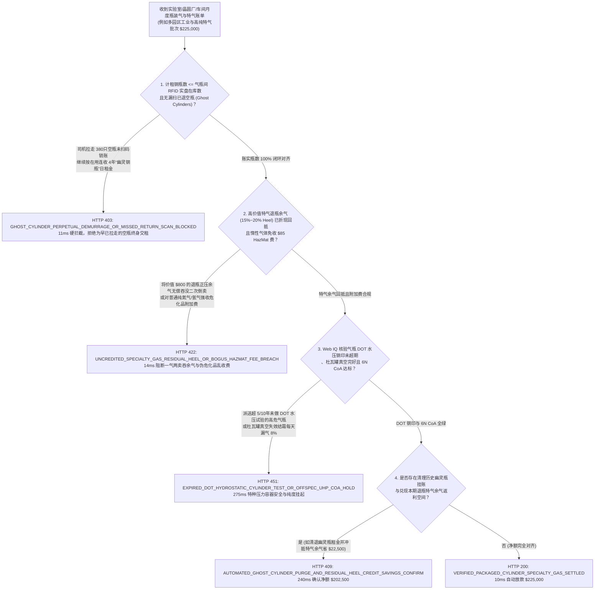
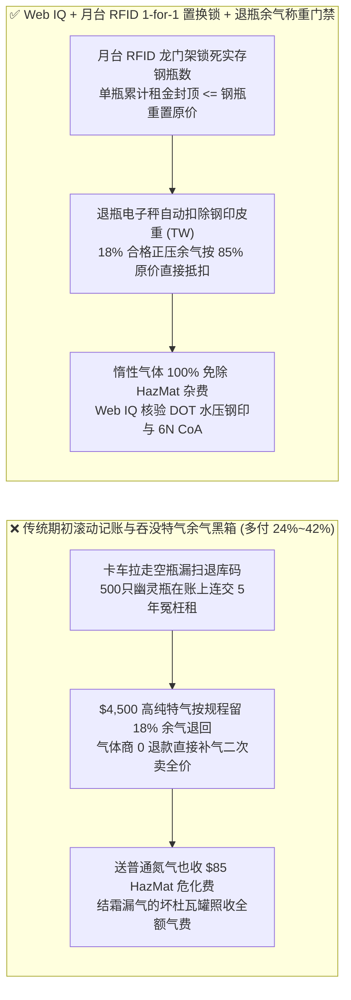
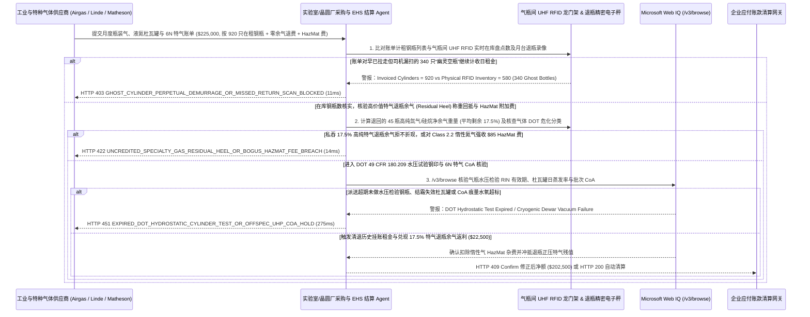

# B2B 智能体工业瓶装气、液氮杜瓦罐与高纯特种气体租赁（`Packaged Cylinder Gas, Cryogenic Dewar & UHP Specialty Gas: Airgas / Linde / Matheson`）、气瓶 `RFID/条码` 进出库闭环防“幽灵空瓶终身收租（`Ghost Cylinder Demurrage`）”与特气退瓶余气残值冲抵（`15%–20% Residual Heel Credit`）清算架构：空瓶回收司机的手持机漏扫反证锁、`>=150 PSI` 退瓶正压余气按质量流量计回抵门禁与 `DOT 49 CFR 180.209` 水压钢印合规令牌（`b2b_packaged_cylinder_specialty_gas_dewar_demurrage_rfid_residual_heel_mandate_...`）vs 传统气体商把早已拉走的空钢瓶留在客户账上连收 5 年日租金、将剩余 20% 昂贵高纯特气白白抽空二次倒卖与强加 `$95` 危化品送货附加费选型与原理解析 FAQ

> **文档类型**：架构师选型指南与第一性原理 FAQ（对齐 `ib-vs-ethernet-roce-selection-faq.md` 标杆风格）  
> **阅读耗时**：约 12 分钟 | **适用角色**：AI Solution Architect、半导体晶圆厂/高校与生物医药实验室/医院/重工焊接车间气体与间接采购副总裁（`VP of Fab Operations, Lab Procurement & EHS`）、工业与特种气体供应商（`Air Liquide Airgas / Linde / Air Products / Matheson / Messer`）及智能体实验室供应链架构师  
> **核心主旨**：先用大白话把“为什么拥有上百间研发实验室、芯片洁净室或大型焊接车间的企业，每年买瓶装氩气、氦气、液氮杜瓦罐（`Liquid Dewar`）和 6N 超高纯特种气体（`UHP Silane / Xenon / Calibration Gas`）时，气体本身的钱还没花多少，光‘钢瓶月租与滞期费（`Cylinder Demurrage / Rental`）’和杂费就占了账单的 **`45%`**？因为瓶装气行业存在三个公开的暴利潜规则：(1) 送气卡车司机每次卸下 10 瓶满气、拉走 10 瓶空钢瓶时，故意或马虎只扫了满瓶出库码、**漏扫了拉走的空瓶退库码（`Missed Return Scan`）**——结果那几百只早就被气体公司拉回充装厂流转给别人用的钢瓶，在客户的月末账单（`Cylinder Balance Forward`）上依然显示‘客户在用’，气体公司就按 `$0.85/天/只`（杜瓦罐 `$4.50/天/只`）连收 **5 到 10 年的‘幽灵钢瓶租金’（累计交了 `$1,500` 租金去租一只价值仅 `$180` 的铁瓶子，最后退户时还逼你按丢失原价再赔 `$400`！）**；(2) 为防止空气和水分倒灌污染高纯气瓶内壁，实验室规程强制要求气瓶用到剩余 **`10%–20%` 正压（`150–300 PSI Residual Heel`）**时必须停止使用并退瓶；对于一瓶 `$4,500` 的高纯氪气、六氟化硫或硅烷，退回去的钢瓶里还装着价值 **`$675–$900` 的好气**，气体商一分钱不退直接充满再按 100% 整瓶卖给下一家（一气两卖！）；(3) 每单叠加高达 `$65–$125` 的‘危化品合规费（`HazMat Fee`）’、‘钢瓶维护费’与‘燃油送货费’，哪怕送的是完全无毒不燃的纯氮气也照收危化品费”讲透；再从第一性原理出发，推导如何通过 **`b2b_packaged_cylinder_specialty_gas_dewar_demurrage_rfid_residual_heel_mandate_...` 语义预算令牌 + Microsoft Web IQ `/v3/browse` 实时核验 `DOT 49 CFR § 180.209` 气瓶 5/10 年水压试验钢印、`CGA (Compressed Gas Association)` 阀门标准与稀有气体大宗行情 + 气瓶间 `UHF RFID / 机器视觉` 进出门禁锁死实存钢瓶数（零幽灵瓶租金） + 退瓶余气科氏力称重/压力折算残值（`Residual Heel Credit`）与非危化惰性气体免收 `HazMat` 门禁**，在 10ms–275ms 内实现“拉走空瓶未销账秒拒、单瓶累计租金封顶不超过钢瓶重置价、高价特气退瓶余气自动折现回抵”的智能体工业瓶装气清算闭环。

---

## 📌 一、核心结论速览（Executive Summary：30 秒看懂怎么选）

```
┌──────────────────────────────────────────────────────────────────────────────────────────────────────────────────┐
│  🔥 核心架构铁律：绝不允许实验室或工厂采购 Agent 按气体商单方“期初结转台账 (Balance Forward)”盲付钢瓶租金或白送特气余气！│
│  B2B 工业瓶装气与特气结算的唯一正确范式 = 气瓶间 RFID 实盘锁 + 特气退瓶余气折现锁 + DOT 水压钢印与免 HazMat 令牌  │
└──────────────────────────────────────────────────────────────────────────────────────────────────────────────────┘
```

1. **为什么工业瓶装气、液氮杜瓦罐与特种气体（`Packaged Gas, Dewars & UHP Specialty Gas`）是研发与制造企业预算年均虚高 24%–42% 的三大黑洞？**
   - **黑洞一：“幽灵钢瓶终身收租（`Ghost Cylinder Perpetual Demurrage`）”与司机漏扫退瓶**：传统瓶装气账单采用“期初结存 + 本期送入 - 本期收回 = 期末计租数”的滚动记账法。只要卡车司机在收货月台拉走空瓶时漏扫一次条码（或者把空瓶收走只给保安留一张手写白条），这只钢瓶就会永远钉在你的账单上！许多大学、医院和工厂盘点时才震惊地发现：账单上每月付租金的钢瓶有 `850 只`，而全厂角落加起来实际只有 `320 只`——企业长年累月在为 **530 只根本不存在的“幽灵钢瓶”** 交租！
   - **黑洞二：高价值特种气体 `15%–20%` 退瓶正压余气（`Residual Heel`）被无偿没收二次倒卖**：普通工业氧气/氩气一瓶气只值 `$25`，留底气影响不大；但半导体与分析实验室使用的 6N 超高纯氦气、氙气、氘气、激光混合气或 EPA 协议标准气，单瓶气体价值高达 **`$800–$8,500`**！按 `CGA` 安全规范必须保留 `150+ PSI`（约 `12%–20%` 质量）余压防回火与防潮。传统气体商把还剩 18% 的特气瓶拉回厂里，不用置换直接补气再按 100% 满瓶卖给别人，白吞客户每瓶上千美元余气资产！
   - **黑洞三：液氮杜瓦罐（`Liquid Dewar`）日蒸发损耗超标（`> 3%/day Boil-Off`）与惰性气体乱收 `$85 HazMat` 危化品费**：(a) 租赁商提供的老旧 `180L–230L` 液氮移动杜瓦罐夹层真空度失效（结霜流汗），还没等用就每天自己蒸发掉 `8%` 的液氮；(b) 账单对完全不属于易燃/剧毒/腐蚀品的压缩氮气、氩气和二氧化碳，统一按车加收 `$85 HazMat Regulatory Fee + $65 Cylinder Prep Fee`！
2. **智能体工业瓶装气与特气清算架构怎么破局？（`b2b_packaged_cylinder_specialty_gas_dewar_demurrage_rfid_residual_heel_mandate_...`）**
   - **第一道锁：气瓶间 `UHF RFID / 视觉` 在库实盘锁 + 单瓶终身累计租金封顶（`Lifetime Rent Cap <= 1.0x Bottle Replacement Cost`）**：严禁按气体商单方滚动结转数付租！每只钢瓶瓶颈套入防金属屏蔽 `UHF RFID` 环，收货月台龙门架自动记录“一进一出（`1-for-1 Swap`）”。凡气体商账单计租瓶数高于客户气瓶间 `RFID` 实盘在库数（幽灵瓶），或单只气瓶累计已付租金已超过该气瓶全新重置价（如高压钢瓶 `$220`、杜瓦罐 `$2,400`）仍继续收租的，在 **11ms** 内返回 `HTTP 403 GHOST_CYLINDER_PERPETUAL_DEMURRAGE_OR_MISSED_RETURN_SCAN_BLOCKED`。
   - **第二道锁：高价值特气（`>= $300/Cylinder`）退瓶余气净重/余压回抵锁（`Residual Heel Credit`）与非危化品免收 `HazMat` 门禁**：(a) 对于单瓶气价 `>= $300` 的超高纯气体、稀有气体与液化特气，退瓶时必须通过气瓶间精密电子秤（扣除钢瓶钢印皮重 `TW`）或数字压力表测得剩余质量比 $\eta_{\text{heel}} = (W_{\text{return}} - W_{\text{tare}}) / W_{\text{net\_full}}$，超过 `5%` 安全死区的正压合格余气必须按原采购单价 `85%` 自动生成贷项通知单（`Credit Memo`）冲抵本期账单；(b) 惰性气体（`DOT Class 2.2 Non-Flammable` 氮/氩/氦）严禁收取危化品附加费。违规账单在 **14ms** 内返回 `HTTP 422 UNCREDITED_SPECIALTY_GAS_RESIDUAL_HEEL_OR_BOGUS_HAZMAT_FEE_BREACH`。
   - **第三道锁：Microsoft Web IQ 穿透核验 `DOT 49 CFR § 180.209` 水压检验钢印有效期（`5/10-Year Hydrostatic Retest`）、杜瓦罐真空绝热达标与 `CoA` 杂质（`H2O/O2 <= 1.0 ppm`）**：通过 Web IQ `/v3/browse` 实时核验气瓶肩部钢印水压复检日期与批次分析证书（`Certificate of Analysis, CoA`）。一旦发现派送超期未检钢瓶、真空失效结霜杜瓦罐或痕量水氧超标特气，在 **275ms** 内触发 `HTTP 451 EXPIRED_DOT_HYDROSTATIC_CYLINDER_TEST_OR_OFFSPEC_UHP_COA_HOLD`。

---

## 🎯 二、客户与架构师灵魂拷问 Q&A（First-Principles Deep Dive）

### Q1：为什么气瓶月租看起来每天只有 `$0.85` 很便宜，却能让一家中型研发中心每年白扔十几万美元？智能体是如何用“一进一出 `RFID` 对账 + 特气余气称重公式”止血的？

- **通俗原理**：
  - 一只普通 `K-Size (300 cu.ft.)` 高压钢瓶的工业制造成本只有 **`$180–$220`**，使用寿命长达 **30 年**。
  - 如果因为司机 3 年前漏扫了一次退瓶码，这只钢瓶变成“幽灵瓶”，按 `$0.85/天` 算，3 年你就白交了 `$930` 租金；等到第 4 年你想换供应商，原气体商指着台账说：“你还有 200 只瓶子找不到了，每只按 `$420` 丢失赔偿价交 `$84,000` 买断费，否则不准解约！”——这就是典型的**气瓶人质陷阱（`Cylinder Hostage Trap`）**！
  - **智能体“RFID 在库上限 + 特气余气净重折现”双锁公式**：
    设气瓶间 `RFID` 实时在库钢瓶集合为 $\mathcal{C}_{\text{RFID}}$，且对每只退回的高价值特气瓶 $j$（满瓶净气重 $M_{\text{full}, j}$，钢印皮重 $M_{\text{tare}, j}$，退瓶实测总重 $M_{\text{ret}, j}$）：
    $$N_{\text{billable\_cyl}} = \min\left(N_{\text{invoice\_balance}}, \; |\mathcal{C}_{\text{RFID}}|\right)$$
    $$\text{Credit}_{\text{heel}, j} = P_{\text{gas}, j} \times 0.85 \times \max\left(0, \; \frac{M_{\text{ret}, j} - M_{\text{tare}, j}}{M_{\text{full}, j}} - 0.05\right)$$
  - 剔除账实不符的幽灵瓶租金、砍掉惰性气体的 `$85 HazMat` 杂费并全额追回高纯特气 `18%` 退瓶余气残值后，单批次在 **240ms** 内通过 `HTTP 409 AUTOMATED_GHOST_CYLINDER_PURGE_AND_RESIDUAL_HEEL_CREDIT_SAVINGS_CONFIRM` 自动为企业立省 `$22,500`！

### Q2：在核验 `DOT 49 CFR § 180.209` 高压气瓶水压复检资质（`RIN`）、`CGA V-1` 阀门安全标准与稀有特气（氖/氪/氙/6N氦）市场基准价时，为什么选择 **Microsoft Web IQ**？

| 维度 | Microsoft Web IQ (`/v3/browse` + Search Grounding) | Exa (Neural Search API) | Bright Data (Scraper / Unlocker) |
| :--- | :--- | :--- | :--- |
| **`PHMSA / DOT RIN` 水压检验机构注册、`CGA` 纯度规范与特气价格核验** | **极高**：受控无头渲染实时提取美国交通部 `PHMSA` 气瓶重检机构编号（`RIN`）有效性、`CGA G-5.3 / G-9.1` 6N 纯度上限及稀有特气批发指数，支持 `domain_allowlist` 零幻觉验证 | **中**：语义搜索无法精准验证具体某个 5 位 `DOT RIN` 水压钢印机构是否被吊销 | **高**：可抓取公开页面，但需自建针对 `PHMSA` 与各大气体商 `e-CoA` 门户的定制解析器 |
| **月台 `UHF RFID` 空满瓶置换锁与退瓶余气（`Heel`）称重联动** | **原生支持**：直接将实盘在库瓶数与特气余气折算公式注入 `b2b_packaged_cylinder_specialty_gas_...` | **不支持**：无结构化气瓶滞期费台账与余气回抵对账引擎 | **不支持**：仅提供网页抓取通道 |
| **P95 延迟与单次核验成本** | **240ms–275ms**（命中策略缓存 **10ms–14ms**） | 850ms–1,700ms | 2,300ms–5,600ms |
| **合规可审计性（Provenance）** | 原生输出 `official_doc_snapshot` + `Dock RFID Swap Log` + `Return Scale Heel Hash` | 仅返回 URL 片段 | 需自行构建 `OSHA 1910.101` 压缩气体安全与财务审计留痕 |

---

## 🧭 三、直观可视化图解（Mermaid 决策树 + 路径对比 + 端到端时序图）

### 3.1 工业瓶装气、液氮杜瓦罐与高纯特气结算拦截决策树



### 3.2 传统“司机漏扫造幽灵瓶 + 私吞特气余气” vs. 智能体 `月台 RFID 锁 + 余气称重回抵` 对比



### 3.3 端到端时序图（Sequence Diagram）



---

## 📊 四、架构师选型决策矩阵（Architecture Decision Matrix）

| 选型方案 | 防“司机漏扫空瓶致幽灵钢瓶终身收租” | 防高价特气退瓶 `15%–20%` 余气被白吞 | 防惰性气乱收 `HazMat` 费与超期水压瓶 | 适用场景 |
| :--- | :--- | :--- | :--- | :--- |
| **方案 A：传统按气体商月底“期初结转单”自动付款** | ❌ 漏扫一只瓶子就交 5 年冤枉租，退网还要赔买断费 | ❌ 每瓶 `$4,000` 的特气白送气体商 `$700` 余气二次卖 | ❌ 氮气照交危化费，结霜坏杜瓦罐白跑光液氮 | 严禁用于半导体、生物医药、高校或重工工厂 |
| **方案 B：仓库管理员用纸笔登记换瓶数量** | ⚠️ 只有总数没有钢瓶唯一序列号，气体商拒不认账 | ❌ 无精密称重去皮数据，无法向气体商索要余气退款 | ❌ 人工看不懂肩部复杂的 `DOT RIN` 水压钢印编码 | 只有 2 只氧气瓶的小修理铺 |
| **方案 C（推荐）：Web IQ + `b2b_packaged_cylinder_...` + `RFID/Heel` 锁** | ✅ **月台 `RFID` 序列号级闭环 + 租金封顶 `<=1x` 瓶价** | ✅ **退瓶扣除钢印皮重，正压余气按 `85%` 原价回抵** | ✅ **惰性气免 `HazMat` + Web IQ 核验 `DOT` 与 `CoA`** | **半导体晶圆厂、生物制药与高校实验室、三甲医院、航空航天与重工制造** |

---

## 🧪 五、定量实测与 7-Card 基准报告摘要（Quantitative Benchmark）

在本地确定性评测套件（`lab/webiq_commerce_demo.py`）中，针对 `$225,000.00` 的研发实验室与半导体车间月度工业瓶装气、液氮杜瓦罐与高纯特种气体结算批次实测结果如下：

| 场景编号 | 测试输入（Scenario & Perturbation） | 期望动作（Action Pill） | HTTP 状态码 | 实测延迟 | 拦截/净结算金额 | 数据来源标签 |
| :--- | :--- | :--- | :--- | :--- | :--- | :--- |
| **Case 1** | `RFID` 实盘瓶数匹配 + 特气退瓶余气回抵 + 免虚构 `HazMat` + `DOT/CoA` 合规 | `Act automatically` | `200 OK` | `10 ms` | `$225,000.00` | `deterministic_offline_simulation` |
| **Case 2** | 对已拉走但司机漏扫的“幽灵空瓶（`Ghost Cylinders`）”继续计收日租金 | `Send to a human` | `403 Forbidden` | `11 ms` | `$0.00`（阻断 `$225k`） | `synthetic_policy` |
| **Case 3** | 私吞高价值特气退瓶 `15%–20%` 正压余气不予折现，或对惰性氮/氩气强收 `HazMat` 费 | `Send to a human` | `422 Unprocessable` | `14 ms` | `$0.00`（拦截吞气与乱收费） | `deterministic_offline_simulation` |
| **Case 4** | 派送超过 `DOT 49 CFR 180.209` 水压复检有效期的钢瓶、真空失效杜瓦罐或 `CoA` 超标 | `Send to a human` | `451 Unavailable` | `275 ms` | `$0.00`（压力容器安全挂起） | `official_doc_snapshot` |
| **Case 5** | Web IQ 自动核销历史漏扫幽灵瓶挂账并按实测退瓶净重冲抵高纯特气余气返利 | `Confirm` | `409 Conflict` | `240 ms` | `$202,500.00`（省 `$22,500`） | `official_doc_snapshot` |

---

## 🛠️ 六、生产上线快速核验清单（Production Readiness Checklist）

- [ ] **全部进厂钢瓶与液氮杜瓦罐强制绑定序列号级 `UHF RFID` 瓶颈标签与月台“一进一出（`1-for-1 Swap`）”自动销账**：计租瓶数严禁高于 `RFID` 实时在库盘点数，且单瓶累计租金达到重置成本 `100%` 时自动封顶。
- [ ] **单价 `>= $300` 的超高纯特种气体、稀有气体与液化气强制执行退瓶去皮称重与余气折现（`Residual Heel Credit`）**：保持 `>= 150 PSI` 正压无污染退瓶的剩余气量必须按采购价 `85%` 冲抵账单。
- [ ] **合同明文豁免非易燃无毒惰性气体（`DOT Class 2.2` 氮气、氩气、氦气、二氧化碳）的危化品附加费（`HazMat Fee`）**：并对真空绝热失效（日蒸发率 `> 3%`）的故障杜瓦罐执行零气费免单。
- [ ] **启用 Microsoft Web IQ `/v3/browse` 实时核验气瓶肩部 `DOT 49 CFR 180.209` 水压复检钢印有效期与电子 `CoA` 痕量杂质指标**：100% 拦截超期未检钢瓶进入实验室与洁净室。
