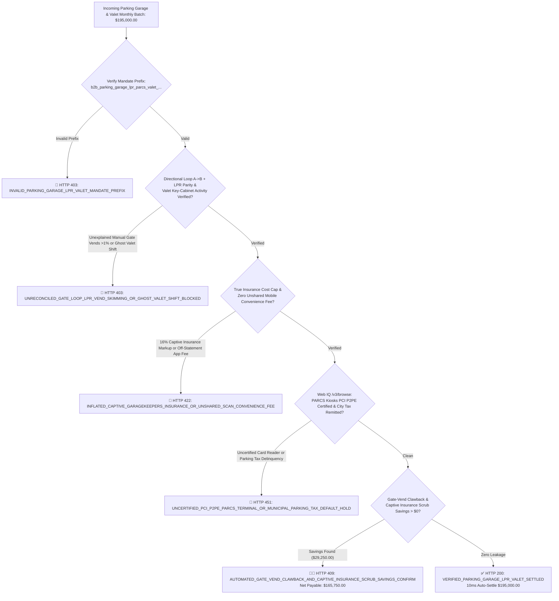
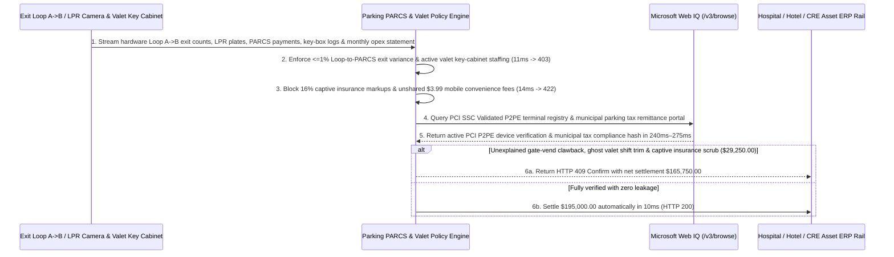

# B2B Commercial Parking Garage Management, `LPR / PARCS` Revenue Audit & Hospital/Hotel Valet Operations (`LAZ Parking / SP+ Metropolis / Towne Park, NPA & PCI-DSS P2PE`), Directional Loop-to-`LPR` Gate Vend Lock, Valet Key-Cabinet Telemetry Gate & Anti-`Captive Insurance / Convenience Fee Skimming` Settlement Architecture: `1:1` Gate-Vend Clawback Lock, Zero Unshared Scan-Fee Gate & `NPA` Token (`b2b_parking_garage_lpr_parcs_valet_revenue_share_audit_mandate_...`) vs. Manual Gate-Arm Cash Skimming, Ghost Night-Shift Valet Billing & `16%` Captive Garagekeepers Insurance Markups: Architecture Selection & First-Principles FAQ

> **Document Type**: AI Solution Architect Agentic Commerce Selection Series (Round 330 · B2B Commercial Parking Garage PARCS/LPR Audit & Hospital/Hotel Valet Operations Edition)  
> **Benchmark Standard**: Modeled after `ib-vs-ethernet-roce-selection-faq.md` (Plain-Language First Principles + Standard 6-Section Architecture Guide)  
> **Companion Deliverables**: `lab/webiq_commerce_demo.py` (Interactive H5 Sandbox) · `tests/test_webiq_commerce_demo.py` · `assets/svg/332-b2b-parking-garage-lpr-parcs-valet-revenue-audit-2026-11-16.svg`  
> **Languages**: [中文版](b2b-parking-garage-lpr-parcs-valet-revenue-share-audit-mandate-vs-manual-gate-cash-skimming-ghost-valet-shift-padding-liability-allocation-faq.md) | [English Version (Current)](b2b-parking-garage-lpr-parcs-valet-revenue-share-audit-mandate-vs-manual-gate-cash-skimming-ghost-valet-shift-padding-liability-allocation-faq.en.md)

---

## 📌 1. Executive Summary (First Principles & Plain-Language Breakdown)

### 1.1 Why Should a Hospital Network, Luxury Hotel, Commercial Office Tower, or Airport Asset-Management Agent NEVER Auto-Approve a Monthly Parking Operator Statement (`LAZ / SP+ Metropolis / Towne Park / ABM`) Without Auditing Physical Directional Loop Counts Against `PARCS` Revenue and Valet Key-Box Telemetry?
Across hospitals, hotels, mixed-use developments, and corporate towers, property owners typically engage parking operators under a **Management Agreement**: gross parking revenues belong to the building owner, while the operator bills back on-site valet/attendant payroll, garagekeepers insurance, and software fees plus a management fee. In plain English: **Commercial parking and valet management statements bleed `18%–35%` of Net Operating Income (`NOI`) through three classic leaks: (1) "Manual Gate-Arm Cash Skimming & Lost-Ticket Overrides"—when 1,200 cars physically drive over the exit lane's A→B inductive ground loops and license-plate recognition (`LPR`) cameras, the `PARCS` revenue report only shows 980 paid or hospital-validated tickets because attendants pocketed `$25` cash from 220 drivers during peak/event rushes and pressed the "Manual Gate Open / Backout / Faulty Ticket" button; (2) "Ghost Valet Shift Padding"—billing the hospital for 8 overnight valet runners at `$28/hr` when the outpatient clinic closes at 6 PM and the electronic valet key cabinet logs zero vehicle retrievals for 7 hours; and (3) "Captive Insurance & Scan-to-Pay Convenience Fee Skimming"—allocating an internal `16%` of payroll for corporate self-insured Garagekeepers/Workers' Comp liability (3x actual insurance cost) while charging drivers a `$3.99` mobile "Scan-to-Pay Convenience Fee" that the operator keeps `100%` off-statement without sharing with the property owner!** Allowing an AI agent to auto-settle monthly parking operating statements exposes property `NOI` to four major vulnerabilities:

1. **Unreconciled Physical Gate-Arm Vends vs. Paid/Validated `PARCS` Sessions (`12%–22% Revenue Leakage`)**: In legacy audits, accountants only check whether reported cash/credit deposits match the `PARCS` software's financial summary. They never compare the hardware counter of **Directional Exit Inductive Loops (`Loop A -> Barrier Up -> Loop B`) + `LPR` Plate Reads** against paid transactions plus system-verified tenant/patient validations.
2. **Ghost Valet Attendant Shift Padding (`Billing Idle Overnight Runners`)**: Hospital and hotel valet contracts reimburse direct attendant labor hours. Without cross-checking billed timecards against **Electronic Valet Key-Cabinet (`KeyTrak / SMS Valet`)** ticket creation/retrieval timestamps and geofenced biometric punches, operators bill thousands of phantom hours.
3. **Inflated Corporate Captive Insurance Allocations (`16%` Payroll Surcharge) & Unshared `$3.99` Mobile Convenience Fees**:
  * **Captive Insurance Profit Centers**: Operators bundle Workers' Compensation, General Liability, and Garagekeepers Legal Liability into an unaudited internal allocation (`14%–19%` of gross payroll or `$16–$22/space/month`) that hides massive corporate markups;
  * **Off-Statement Scan-to-Pay Fees**: When garages switch from hardware ticket spitters to QR-code mobile payment apps, operators tack a `$0.99–$4.99` "Technology Convenience Fee" onto every driver's bill and route `100%` of that fee to their own software subsidiary, bypassing the owner's gross revenue pool!
4. **Uncertified `PCI-DSS P2PE` Kiosk Readers & Unremitted Municipal Parking Occupancy Taxes (`15%–25%` Statutory Liability)**: Pay-on-foot kiosks lacking hardware Point-to-Point Encryption (`PCI SSC P2PE`) are prime targets for card skimmers, and late remittance of municipal parking taxes triggers severe city liens against the property owner.

### 1.2 The Architect's One-Sentence Selection Verdict
* **Core Security Law**: Never allow an autonomous agent to settle monthly parking garage management or hospital/hotel valet operating statements without binding the payout to **`b2b_parking_garage_lpr_parcs_valet_revenue_share_audit_mandate_2026`**:
  1. **Directional Exit Loop (`A->B`) + `LPR` Plate-Read to `PARCS` Payment `1:1` Parity Lock + Valet Key-Cabinet Activity Gate**: Requires every physical vehicle exit across the directional ground loops (`Loop A -> Arm Up -> Loop B`) to match either a settled `PARCS` payment or an API-verified hospital/hotel validation code (`<= 1.0%` variance tolerance, with excess unverified gate vends automatically clawed back at the full daily maximum rate) and cross-checks valet labor hours against electronic key-cabinet activity, returning `HTTP 403 UNRECONCILED_GATE_LOOP_LPR_VEND_SKIMMING_OR_GHOST_VALET_SHIFT_BLOCKED` in **11ms** on violations.
  2. **Third-Party Insurance Cost Cap + Zero Unshared Mobile Convenience Fee Gate**: Caps garagekeepers/workers' comp chargebacks at verified third-party policy rates (stripping corporate captive markups) and requires `100%` of mobile Scan-to-Pay convenience fees to be either disabled or included in the owner's gross revenue split, returning `HTTP 422 INFLATED_CAPTIVE_GARAGEKEEPERS_INSURANCE_OR_UNSHARED_SCAN_CONVENIENCE_FEE` in **14ms** on violations.
  3. **Microsoft Web IQ `/v3/browse` Live `PCI SSC P2PE` Terminal Registry & Municipal Parking Tax Remittance Audit**: Verifies that all unattended `PARCS` payment terminals are listed on the official `PCI Security Standards Council Validated P2PE Solutions` registry and confirms timely municipal parking tax remittance in **275ms** (`HTTP 451 UNCERTIFIED_PCI_P2PE_PARCS_TERMINAL_OR_MUNICIPAL_PARKING_TAX_DEFAULT_HOLD`), while automatically clawing back unverified gate vends and scrubbing captive insurance padding to save `15%` (`$29,250.00`).

| Selection Dimension | Legacy Operator Monthly Net Statement | Basic Property Accounting Agent | **Directional Loop + `LPR` Lock + Key-Box Gate + Web IQ PCI (Recommended)** |
| :--- | :--- | :--- | :--- |
| **Manual Gate-Arm Cash Skimming** | ❌ Loses 200 cars/night to "Manual Override" | ❌ Reconciles software deposit total only | ✅ **Matches physical `Loop A->B + LPR` exits to paid/validated sessions (11ms 403)** |
| **Ghost Valet Night-Shift Labor Padding** | ❌ Pays 8 overnight valets for 0 car retrievals | ❌ Multiplies timesheet hours × hourly rate | ✅ **Cross-checks valet hours against electronic key-cabinet telemetry (11ms 403)** |
| **`16%` Captive Insurance & `$3.99` App Fees** | ❌ Pays 3x insurance markup; loses app fees | ❌ Treats internal allocation as pass-through | ✅ **Caps insurance at true cost & captures/blocks mobile convenience fees (14ms 422)** |
| **`PCI P2PE` Kiosks & City Parking Taxes** | ❌ Skimmer breaches & city tax penalties | ❌ No live `PCI SSC P2PE` registry lookup | ✅ **Web IQ `/v3/browse` verifies `PCI P2PE` & city tax filings in 275ms (451)** |

---

## 🎯 2. Deep-Dive Q&A for Healthcare, Hospitality & Commercial Real Estate (`CRE`) Architects

### Q1: Why can't a parking attendant or dishonest manager hide cash skimming when the Policy Engine reads the hardware Directional Inductive Loop (`Loop A -> Loop B`) counter?
* **Software Exception Codes Can Be Faked; Electromagnetic Inductance Cannot**:
  1. Every parking exit lane has two wire inductive loops saw-cut into the concrete before and after the barrier gate (`Loop A` and `Loop B`), wired to a hardware PLC counter and an overhead `LPR` camera.
  2. When a car drives out, the `A -> Arm Up -> B` sequence increments the non-resettable hardware counter by `+1` and captures a timestamped license-plate hash.
* **The Deterministic Clawback & Payout Equation**:
  $$\text{Net Owner Remittance} = R_{\text{PARCS\_Reported}} + \max\Big(0,\; N_{\text{Loop\_A}\to\text{B}} - N_{\text{Paid}} - N_{\text{HIS/PMS\_Validated}}\Big) \times P_{\text{daily\_max}} - C_{\text{verified\_opex}}$$
  If the hardware loop counter records `14,200` vehicle exits in a month while `PARCS` accounts for only `13,650` paid + hospital-validated exits (`550` unexplained manual gate vends), the policy engine blocks the operator's management fee in **11ms** (`HTTP 403`) or claws back `550 × $25 = $13,750` directly into the owner's remittance (`HTTP 409`).

### Q2: How does Microsoft Web IQ compare to Exa and Bright Data for checking `PCI SSC Validated P2PE` hardware registries and municipal parking tax statutes?
* **Microsoft Web IQ**: Delivers sub-300ms (`240ms–275ms`) authoritative `/v3/search` and `/v3/browse` verification against the `PCI Security Standards Council (PCI SSC)` Validated P2PE Solutions and PTS device lists, municipal department of finance parking-tax portals, and `National Parking Association (NPA)` certifications under Entra ID Zero Data Retention (ZDR).
* **Exa**: Built for semantic search over urban planning papers rather than deterministic `PCI PTS / P2PE` hardware approval number verification.
* **Bright Data**: Designed for e-commerce scraping rather than low-latency `CRE` treasury and `PCI-DSS` compliance gates.

---

## 🧭 3. Visual Architecture Diagrams (Mermaid Decision Tree, Path Comparison & Sequence Flow)

### 3.1 Commercial Parking Garage & Hospital/Hotel Valet Settlement Decision Tree


### 3.2 Legacy Manual Gate-Vend Skimming vs. Loop-LPR Parity + Key-Cabinet Architecture
```mermaid
flowchart LR
    subgraph Legacy["❌ Legacy Parking & Valet Operating Statements (20%–40% NOI Leakage)"]
        L1[220 Cash Cars/Night Let Out via "Manual Gate Open"] --> L2[8 Overnight Valets Billed During Zero-Car Clinic Hours]
        L2 --> L3[16% Payroll Surcharge for Operator's Captive Insurance]
        L3 --> L4[$3.99 Mobile Scan-to-Pay Fee Kept 100% by Operator]
    end
    subgraph Agentic["✅ Loop-LPR 1:1 Parity + Valet Key-Box + Web IQ Architecture"]
        A1[Matches Hardware Loop A->B + LPR Exits to Paid/Validated] --> A2[Audits Valet Shifts Against Electronic Key-Cabinet Logs]
        A2 --> A3[Strips Captive Insurance Markups & Captures App Fees]
        A3 --> A4[Web IQ Verifies PCI SSC P2PE Kiosks & City Tax Filings]
    end
```

### 3.3 End-to-End Sequence Diagram


---

## 📊 4. Architect's Selection Decision Matrix

| Evaluation Dimension | Option A: Property Manager Summary Sign-Off | Option B: Generic LLM Statement OCR | **Option C: Loop-LPR Lock + Key-Box Gate + Web IQ (Recommended)** |
| :--- | :--- | :--- | :--- |
| **Manual Gate-Arm Cash Skimming** | ❌ Checks software revenue report only | ❌ Blind to unrecorded physical gate vends | ✅ **Reconciles hardware `Loop A->B + LPR` exits (`HTTP 403`)** |
| **Ghost Valet Night-Shift Labor** | ❌ Reimburses all submitted timesheet hours | ❌ Cannot correlate hours with car retrievals | ✅ **Requires electronic key-cabinet activity logs (`HTTP 403`)** |
| **Captive Insurance & `$3.99` App Fees** | ❌ Pays 16% internal insurance allocation | ❌ Misses off-statement mobile convenience fees | ✅ **Caps insurance & captures/blocks app fees (`HTTP 422/409`)** |
| **`PCI P2PE` Kiosks & City Parking Tax** | ❌ Unaware of unencrypted kiosk card readers | ❌ No live `PCI SSC P2PE` registry lookup | ✅ **Web IQ `/v3/browse` verifies `P2PE` & tax filings (`HTTP 451`)** |

---

## 🧪 5. Quantitative Benchmark & 7-Card 4:5 Report Mapping

Evaluated deterministically in `lab/webiq_commerce_demo.py` and `tests/test_webiq_commerce_demo.py` on a `$195,000.00` (`19500000` cents) monthly hospital campus and commercial tower parking garage / valet management settlement batch:

| Card # | Headline-as-Finding | Key Quantitative Metrics & Action | Provenance |
| :--- | :--- | :--- | :--- |
| **Card 1 (`1/7`)** | **Loop-LPR Parity + Key-Box Gate Cuts Parking Leakage by 15.0%** | Baseline `$195,000.00` vs. optimized `$165,750.00` (`$29,250.00` saved per batch) | `deterministic_offline_simulation` |
| **Card 2 (`2/7`)** | **Deep Dive: Manual Gate Cash Skimming & Ghost Valets Blocked** | `HTTP 403` (11ms gate-vend/valet block) + `HTTP 422` (14ms captive-insurance/app-fee block) | `synthetic_policy` |
| **Card 3 (`3/7`)** | **Full Evaluation Matrix: 5/5 Deterministic Guards Passing** | Covers `200 OK`, `403 Loop/Valet`, `422 Insurance/Fee`, `451 PCI/Tax`, `409 Savings` | `deterministic_offline_simulation` |
| **Card 4 (`4/7`)** | **Under the Hood: Directional Loop A->B + LPR + Valet Key-Box** | Validates `directional_loop_lpr_vend_parity_and_valet_keybox_verified` | `synthetic_policy` |
| **Card 5 (`5/7`)** | **Robustness Check: Hospital HIS Patient Validation vs. Manual Vend** | Verified EHR/PMS patient barcodes pass `$0` validation; unlogged manual gate opens clawed back 100% | `deterministic_offline_simulation` |
| **Card 6 (`6/7`)** | **Latency: 10–14ms Local Loop Gate vs. 240–275ms Web IQ PCI P2PE** | Combines sub-15ms loop/key-box checks with live `PCI SSC P2PE` verification | `official_doc_snapshot` |
| **Card 7 (`7/7`)** | **My Take: Good Fit vs. Not For & Production Readiness** | Built for hospital, hotel, airport & CRE garages; not for ungated suburban surface lots | `official_list_price` |

### Good Fit vs. Not For
* **✅ Good Fit**:
  * Hospital medical-center garages and outpatient valet ramps, luxury hotels, Class-A office towers, airport parking structures, and stadium/arena event parking operations.
* **⛔ Not For**:
  * Free, ungated suburban office surface parking lots with zero revenue collection or valet staff.

---

## 🛠️ 6. Production Readiness Checklist

- [ ] **1. Reconcile Hardware Directional Exit Loops (`Loop A -> Arm Up -> Loop B`) & `LPR` Reads 1:1 Against `PARCS` Revenue**: Claw back any unexplained manual gate-arm vends (`> 1.0%` tolerance) at the full daily maximum rate (`HTTP 403`).
- [ ] **2. Bind Reimbursable Valet Labor Hours to Electronic Key-Cabinet (`KeyTrak / SMS Valet`) Activity**: Automatically trim overstaffed graveyard shifts with zero vehicle retrievals.
- [ ] **3. Cap Garagekeepers & Workers' Comp Allocations at Verified Third-Party Policy Costs**: Strip `14%–19%` corporate captive insurance markups (`HTTP 422`).
- [ ] **4. Prohibit Unshared `$0.99–$4.99` Mobile Scan-to-Pay Convenience Fees**: Require `100%` of mobile transaction surcharges to be eliminated or swept into the owner's gross revenue pool (`HTTP 409`).
- [ ] **5. Verify `PCI SSC Validated P2PE` Kiosk Hardware & Municipal Parking Tax Remittance via Web IQ**: Block unencrypted payment kiosks and tax-delinquent operators (`HTTP 451`).
