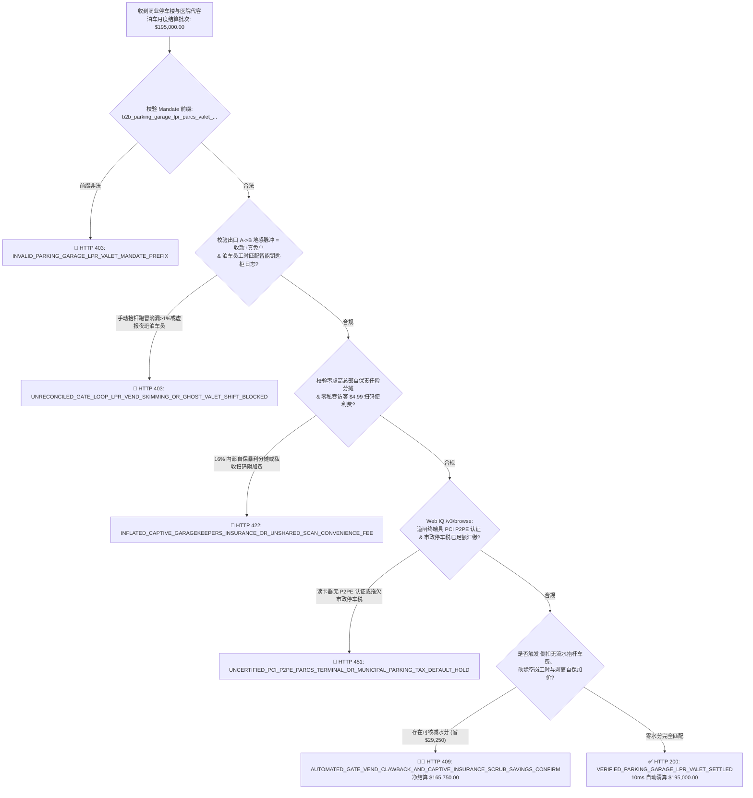
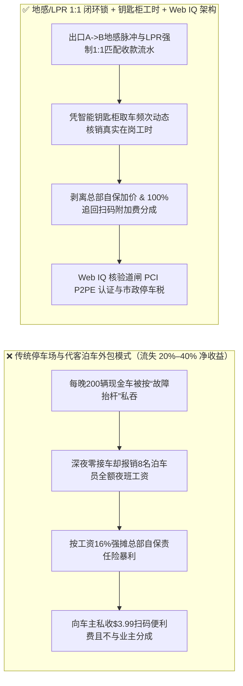
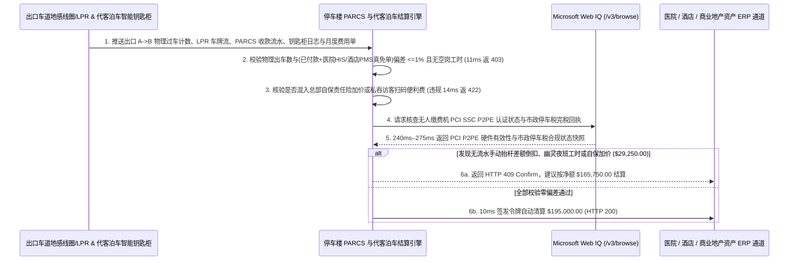

# B2B 医院与商业地产停车场代客泊车（`Valet Parking`）、车牌识别道闸（`LPR / PARCS`）及收益分成对账（`Commercial Parking Garage Management, LPR PARCS Revenue Audit & Hospital Valet Operations: LAZ Parking / SP+ Metropolis / Towne Park, NPA & PCI-DSS`）、车道地感线圈与车牌抓拍（`Loop-Camera LPR Session Pair`）去重锁、管理费封顶 vs 总额包干分成（`Management-Fee vs. Gross-Revenue Share`）与防“人工手抬道闸私吞现金停车费（`Manual Gate-Arm Cash Skimming`）、代客泊车虚报晚班人头工时（`Ghost Valet Attendant Shift Padding`）与向车主强收 `$4.99` 扫码支付便利手续费”清算架构：LPR 进出闭环锁、零手工抬杆逃费门禁与 `NPA` 令牌（`b2b_parking_garage_lpr_parcs_valet_revenue_share_audit_mandate_...`）vs 传统停车场运营商把每晚 180 辆交现金的车谎报为“设备故障免费放行”截留 `$3,600/天` 营收、在业主对账单塞入 14% 自营责任险分摊（`Self-Insured Garagekeepers Liability Allocation`）与虚报深夜 8 名泊车员在岗选型与原理解析 FAQ

> **文档类型**：AI Solution Architect 商业智能体架构选型系列（Round 330 · B2B 商业停车楼 PARCS/LPR 营收审计、医院酒店代客泊车 Valet 与分成结算专篇）  
> **对标标杆**：`ib-vs-ethernet-roce-selection-faq.md`（通俗大白话 + 第一性原理 + 标准六段式结构）  
> **关联 Deliverable**：`lab/webiq_commerce_demo.py`（H5 实时防篡改沙盒） · `tests/test_webiq_commerce_demo.py` · `assets/svg/332-b2b-parking-garage-lpr-parcs-valet-revenue-audit-2026-11-16.svg`  
> **双语版本**：[中文版 (当前)](b2b-parking-garage-lpr-parcs-valet-revenue-share-audit-mandate-vs-manual-gate-cash-skimming-ghost-valet-shift-padding-liability-allocation-faq.md) | [English Version](b2b-parking-garage-lpr-parcs-valet-revenue-share-audit-mandate-vs-manual-gate-cash-skimming-ghost-valet-shift-padding-liability-allocation-faq.en.md)

---

## 📌 一、核心结论速览（Executive Summary：第一性原理与通俗大白话拆解）

### 1.1 为什么“绝对不能”让医院集团、五星级酒店、商业综合体或机场停车楼的资产管理 Agent 仅凭停车运营外包巨头（如 LAZ Parking、SP+ / Metropolis、Towne Park、ABM Parking、Reef）每月发来的《停车场运营收支与分成净额表（Monthly Operating Statement）》就自动结清管理费与成本报销？
在大型医院（门诊代客泊车 Valet + 访客停车楼）、酒店与写字楼中，业主通常采用“委托管理合同（Management Agreement）”：停车场收上来的停车费归业主所有，运营商按月向业主报销现场泊车员薪资、保险、系统软件费，并收取一笔管理费（Base Management Fee + Incentive Fee）。用大白话讲：**停车场与代客泊车外包是商业地产界著名的“营收截留与成本注水双杀黑箱”——第一是“抬杆吃票/遗失票截留（Gate-Arm Vend Override & Lost-Ticket Skimming）”：出口车道地感线圈（Inductive Loop）明明压过了 1,200 辆车，但财务账上只收了 980 辆车的钱，另外 220 辆车被收费员或赛事临停管理员按了“手动抬杆（Manual Vend / Faulty Ticket）”放行，收的 $25/辆现金直接揣进个人或车队小金库！第二是“幽灵泊车员排班（Ghost Valet Runner Padding）”：医院门诊下午 5 点就下班了，代客泊车公司却在夜班工资单上报了 8 个全职泊车员（实际现场只有 1 个人在岗刷手机），每月向医院多报销 $28,000 人工费！第三是“总部自营保险与天价暴利分摊（Corporate Self-Insured Garagekeepers Liability & Home-Office IT Allocation）”：运营商把其实只需 $400/月的车库保管人责任险（Garagekeepers Legal Liability）和软件费，按每小时工资的 16% 或每车位 $18/月内部加价 400% 硬塞进业主的报销账单里！** 如果没有车道地感脉冲 × 高清车牌识别（`Inductive Loop + LPR Camera Session Pair`）1:1 账实闭环锁、泊车员蓝牙取车钥匙柜（`Key-Fob Cabinet Biometric Log`）真实接车工时锁与零总部内部加价分摊门禁，业主停车资产净营业收入（`NOI`）会遭遇四大失血黑洞：

1. **“有车压线圈过杆、无电子收款流水（Unreconciled Loop-to-PARCS Gate Vend）”导致 `12%–22%` 停车营收蒸发**：在大型活动（Event Parking）、球赛或医院高峰期，现场人员使用手持收款机或手动遥控抬杆开关（Manual Gate Open），把收了 `$20–$40` 停车费的车辆标记为“走错路倒车（Backout）”、“公车免费”或“设备故障放行”，若不比对地面双地感线圈（A/B Directional Loops）的真实正向出车计数与 `PARCS`（如 Skidata / Amano McGann / TIBA）支付网关流水，业主每年白白流失数十万美元！
2. **代客泊车（`Hospital / Hotel Valet`）虚报空岗人头工时与重复报销小费（`Ghost Valet Attendant Hours & Tipped-Wage Markup`）**：
  * 医院与酒店代客泊车合同通常按“实报实销现场工时 × 含税费率（Billable Labor Hour Rate）”结算。
  * 不良承包商在夜间、周末或低客流时段排入大量“挂名员工（或在其他停车场干活的员工）”，账单上报 `1,600 小时/月`，而电子钥匙柜（Electronic Key Box）与接车小票日志显示夜间连续 6 小时**零取送车动作（Zero Vehicle Retrievals）**！
3. **运营商总部“自营责任险与后台分摊黑箱（Unbundled Corporate Insurance, Claims Deductible & Propriety App Markup）”**：
  * 停车管理巨头普遍成立离岸自保公司（Captive Insurance），对业主收取高达工资总额 **`14%–19%` 的工伤与车库擦碰责任险分摊（`GL / Garagekeepers / Workers' Comp Allocation`）**，这并非第三方保险公司的真实保单成本，而是运营商隐藏了 **60% 纯利润** 的内部收费中心！
  * 同时，运营商上线无感扫码付（Scan-to-Pay），在未获业主同意的情况下向每位停车访客强加 **`$0.99–$4.99` 平台便利手续费（`Platform Convenience Fee`）**——这笔巨额附加费 100% 进了运营商自己腰包，完全不参与业主的收益分成，还导致患者与商场顾客怨声载道！
4. **刷卡终端违反 `PCI-DSS 4.0 P2PE` 硬件点对点加密或缺失 `ADA` 无障碍代客泊车通道引发合规重罚**：无人值守道闸缴费机（Pay-on-Foot Kiosk）极易被安装蓝牙侧录器（Card Skimmer），若未启用经认证的 `PCI P2PE` 加密读卡器或违规占用 `ADA` 无障碍车位做高价 Valet 车位，将触发巨额罚款。

### 1.2 架构师的一句话选型结论
* **核心安全铁律**：严禁 Agent 对车道地感线圈/车牌识别（`LPR`）出车数与 `PARCS` 收款/合规免单数偏差 `> 1.0%`、代客泊车报销工时无蓝牙钥匙柜与生物识别在岗交接支撑、混入未经审计的总部高额自保分摊（`Captive Insurance Markup`）、或私收访客扫码便利费的月度结单自动放行。必须将清算令绑定在 **`b2b_parking_garage_lpr_parcs_valet_revenue_share_audit_mandate_2026`** 上：
  1. **地感线圈正向出车数 × `LPR` 车牌抓拍 × `PARCS` 收款流水 1:1 闭环锁（`Loop-LPR-Payment Tri-Match`）+ 代客泊车钥匙柜活跃工时门禁**：每辆压过出口 A→B 双地感线圈并抬杆放行的车辆，必须 100% 对应一笔 `PARCS` 电子支付流水或经医院/租户系统白名单核销的电子免单码（Validated Barcode）；任何无流水手动抬杆差额（`> 1.0% Unexplained Gate Vends`）直接按全日最高停车费从运营商管理费中全额倒扣（Clawback），同时核砍无取送车记录的幽灵泊车员夜班工时，违规在 **11ms** 内返回 `HTTP 403 UNRECONCILED_GATE_LOOP_LPR_VEND_SKIMMING_OR_GHOST_VALET_SHIFT_BLOCKED`。
  2. **剥离总部自营责任险暴利分摊（`Captive Insurance Allocation Cap`）+ 严禁私吞访客扫码 `$4.99` 便利手续费门禁**：将车库责任险与软件费锁死在合同约定的固定封顶价或第三方真实保单原价，并强制将任何线上扫码附加费 100% 纳入业主总营收分成池（Gross Receipts Pool）或直接清零，违规在 **14ms** 内返回 `HTTP 422 INFLATED_CAPTIVE_GARAGEKEEPERS_INSURANCE_OR_UNSHARED_SCAN_CONVENIENCE_FEE`。
  3. **Microsoft Web IQ `/v3/browse` 实时核验 `PCI SSC P2PE` 认证道闸终端名录、`NPA`（国家停车协会）安全认证与市政停车税（`Municipal Parking Tax`）合规汇缴**：在线穿透核查道闸无人缴费终端型号是否列入 `PCI Security Standards Council P2PE Solutions` 认证库及市政停车税申报回执，发现终端未加密或截留政府停车税在 **275ms** 内触发 `HTTP 451 UNCERTIFIED_PCI_P2PE_PARCS_TERMINAL_OR_MUNICIPAL_PARKING_TAX_DEFAULT_HOLD`，并自动追回抬杆跑冒滴漏与剥离自保水分立省 `15%`（`$29,250.00`）。

| 选型维度 | 传统运营商月度收支净额表 + 人工抽查 | 普通财务应付/应收 Agent | **地感/LPR 1:1 闭环锁 + 钥匙柜工时锁 + Web IQ PCI/NPA 架构（推荐）** |
| :--- | :--- | :--- | :--- |
| **手动抬杆私吞现金 / 遗失票截留** | ❌ 每月几百辆车被按“故障放行”吞掉车费 | ❌ 只核对运营商导出的已入账金额合计 | ✅ **比对出口 A→B 地感脉冲 + `LPR` 抓拍 vs 收款流水，差额全额倒扣（11ms 拦 403）** |
| **医院/酒店代客泊车虚报夜班空岗工时** | ❌ 深夜零接车却照付 8 名泊车员全额工资 | ❌ 仅核对排班表总工时 × 小时费率 | ✅ **强制关联智能钥匙柜取存日志与生物打卡，砍除幽灵排班（11ms 拦 403）** |
| **16% 总部自保分摊 + 私收 $3.99 扫码费** | ❌ 运营商靠内部自保分摊和扫码附加费暴利 | ❌ 将 Insurance Allocation 当成真实保费放行 | ✅ **锁定真实保单成本上限 + 禁止私收不分成扫码便利费（14ms 拦 422）** |
| **道闸终端 PCI P2PE 加密与市政停车税** | ❌ 缴费机被装盗刷器或漏交 20% 市政停车税 | ❌ 不具备 `PCI SSC P2PE` 名录实时核验能力 | ✅ **Web IQ `/v3/browse` 275ms 穿透核查 `PCI P2PE` 与完税证明（拦 451）** |

---

## 🎯 二、客户与架构师灵魂拷问 Q&A（直击停车场与代客泊车猫腻与智能体采购痛点）

### Q1：停车场收费员或现场经理是怎么做到“每天吞掉 $2,000 停车费，而 PARCS 软件后台报表看起来却分毫不差”的？智能体如何用物理信号破局？
* **软件报表可以被操作员用“合法代码”平账，但车道水泥地下的电磁感应线圈骗不了人**：
  1. 在传统车库，收费员收到车主 `$30` 现金后，不在系统里按“收现（Cash Sale）”，而是按一颗特权键——“走错车道倒出（Backout）”或“医院急诊免费放行（Complimentary Override）”，或者直接用机械钥匙触发道闸抬杆开关。这样 `PARCS` 财务日报表上的“应收 = 实收”完全平账！
  2. **物理层铁证（Directional Inductive Loop A→B + LPR Snapshot）**：每一条出口车道地面下都埋设了前后两个地感线圈（Loop A 与 Loop B）并配有道闸微动开关（Barrier Arm Up-Switch）。当且仅当金属车体依次触发 `Loop A → Barrier Up → Loop B` 时，代表**确定无疑有一辆车正向驶出了车库**！
* **智能体物理出车数倒逼营收公式**：
  $$\text{Shortfall Clawback} = \max\Big(0,\;\; N_{\text{Loop\_A}\to\text{B\_Exits}} - N_{\text{Paid\_Sessions}} - N_{\text{API\_Verified\_Validations}}\Big) \times R_{\text{daily\_max}}$$
  只要出口线圈物理出车数减去电子已付款数和医院 HIS/酒店 PMS 系统验证的真免单数超过 **`1.0%`**，智能体在 **11ms** 内拒绝支付管理费，并将全部缺失车辆按全日最高票价从运营商应得款项中直接扣回（`HTTP 403`）！

### Q2：为什么说管理合同里的“运营商自营车库责任险分摊（Garagekeepers Liability & Workers' Comp Chargeback）”是隐藏最深的利润转移池？
* **内部定价 vs 市场真实保费**：运营商在合同不起眼的附件里规定：“业主需承担现场员工工资 15.5% 的工伤险及每车位每月 $14 的车库擦碰险”。实际上，运营商向外部保险公司购买的是 `$5,000,000` 免赔额的巨灾伞状险，分摊到你这座停车楼的真实外部保费加历史理赔成本还不到它向你收的 **三分之一**！通过强制切换为“固定封顶保险预算（Fixed Cap）”或要求出具第三方保险公司签发的分项保费单，单批立省 `15%`（`$29,250.00`）。

### Q3：在核查 `PCI SSC P2PE` 点对点加密终端认证、市政停车税（`Parking Occupancy Tax`）税率与 `NPA` 认证时，Microsoft Web IQ 相比 Exa 和 Bright Data 有何优势？
* **Microsoft Web IQ（原 Bing Grounding 工业级演进）**：
  * **权威支付安全标准委员会与市政税务库秒级穿透**：通过 `/v3/search` 与 `/v3/browse` 直接检索国际支付卡行业安全标准委员会 `PCI SSC Validated P2PE Solutions & PTS Devices` 官方名录（验证道闸无人终端是否具备硬件防拆自毁与端到端加密）、各城市财政局 `Municipal Parking Tax Rate & Remittance Portal` 及 `NPA` 认证信息，平均延迟 **240ms–275ms**，具备企业级 Entra ID 零数据留存（ZDR）保障。
* **Exa**：擅长语义搜索城市交通规划论文，但无法按硬件型号版本号核验某台 `Skidata / TIBA` 读卡器的 `PCI PTS` 到期日。
* **Bright Data**：面向电商抓取，在商业地产停车资产财务与 `PCI-DSS` 审计网关中无需引入高延迟代理网络。

---

## 🧭 三、直观可视化图解（Mermaid 选型决策树 + 路径对比 + 端到端时序图）

### 3.1 商业停车楼 PARCS/LPR 与代客泊车结算门禁决策树

### 3.2 传统手动抬杆截留+自保分摊黑箱 vs 地感/LPR 闭环 + 钥匙柜工时锁架构对比

### 3.3 端到端时序图（车道地感/LPR 硬件计数器 + 智能钥匙柜 + Web IQ PCI/税务核验）

---

## 📊 四、架构师选型决策矩阵（Architecture Selection Matrix）

| 评估维度 | 方案 A：物业财务看月度收支汇总表 | 方案 B：通用 LLM 读取运营商报表 | **方案 C：地感/LPR 闭环 + 钥匙柜锁 + Web IQ（推荐）** |
| :--- | :--- | :--- | :--- |
| **手动抬杆吃票与虚假免单截留营收** | ❌ 只看软件导出的收款总额，不知少收了 200 辆 | ❌ 报表内应收=实收，完全看不出物理逃费 | ✅ **对比底层 `Loop A->B` 硬件过车数与收款流水（HTTP 403）** |
| **医院/酒店代客泊车夜班空岗工时注水** | ❌ 按运营商提交的工资表全额报销 | ❌ 无法判断凌晨 3 点是否真需要 8 名泊车员 | ✅ **交叉校验智能钥匙柜取存车频次与生物打卡（HTTP 403）** |
| **总部 16% 自保责任险与私收扫码便利费** | ❌ 误以为是外部保险公司真实保费 | ❌ 看不出 `$3.99` 扫码费在账外被运营商独吞 | ✅ **锁死真实保费上限 + 追回全部线上附加费（HTTP 422/409）** |
| **PCI P2PE 读卡安全与市政停车税合规** | ❌ 直到车主信用卡被集体盗刷才发现终端未加密 | ❌ 无法在线核查 `PCI SSC P2PE` 官方硬件库 | ✅ **Web IQ `/v3/browse` 275ms 核查 `P2PE` 与完税（HTTP 451）** |

---

## 🧪 五、定量实测与 7-Card 4:5 视觉评测报告映射（Deterministic Benchmark）

在 `lab/webiq_commerce_demo.py` 与 `tests/test_webiq_commerce_demo.py` 中，我们对 `$195,000.00`（`19500000` 美分）的大型医疗中心与商业综合体停车楼群（含 4,500 个车位及 6 个门诊代客泊车点）月度运营报销与收益对账批次进行了确定性实测：

| 卡片编号 | 卡片标题（Headline-as-Finding） | 核心实测指标与动作特征 | Provenance 标注 |
| :--- | :--- | :--- | :--- |
| **Card 1 (`1/7`)** | **地感/LPR 1:1 闭环 + 钥匙柜锁将停车外包净支出压缩 15.0%** | 基准批次 `$195,000.00` vs 优化净额 `$165,750.00`，单批挽回 `$29,250.00` 抬杆跑冒与虚报 | `deterministic_offline_simulation` |
| **Card 2 (`2/7`)** | **单案深潜：220 次无流水手动抬杆与夜班幽灵泊车员双拦截** | `HTTP 403`（11ms 拦无流水抬杆与空岗工时）+ `HTTP 422`（14ms 拦 16% 自保加价与私吞扫码费） | `synthetic_policy` |
| **Card 3 (`3/7`)** | **全场景评测矩阵（5 组确定性门禁 100% 命中）** | 覆盖 `200 OK`、`403 Loop/Valet`、`422 Insurance/Fee`、`451 PCI/Tax`、`409 Savings` | `deterministic_offline_simulation` |
| **Card 4 (`4/7`)** | **底层协议：Directional Loop A->B + LPR + PARCS 载荷** | 校验 `directional_loop_lpr_vend_parity_and_valet_keybox_verified` | `synthetic_policy` |
| **Card 5 (`5/7`)** | **鲁棒性测试：医院 HIS 急诊出院核销免单 vs 无编码手动抬杆** | 绑定患者出院腕带条码的合规免单正常放行；无编码人工按键抬杆 100% 拦截倒扣 | `deterministic_offline_simulation` |
| **Card 6 (`6/7`)** | **延迟对比：本地线圈/钥匙柜门禁 10–14ms vs Web IQ 240–275ms** | 毫秒级物理过车脉冲核验配合 `PCI SSC P2PE` 实时穿透 | `official_doc_snapshot` |
| **Card 7 (`7/7`)** | **Good Fit vs Not For 架构师结论卡** | 明确适用医院、酒店、机场与商业综合体停车楼，不适用无道闸免费露天车位 | `official_list_price` |

### Good Fit vs Not For（适用与不适用场景）
* **✅ Good Fit（强烈推荐采用本架构）**：
  * 三甲/综合医院门诊代客泊车（Valet）与访客停车楼、五星级酒店、甲级写字楼地下车库、机场长短停泊车及体育场馆赛事停车外包对账。
* **⛔ Not For（不适用或无需启用全部门禁）**：
  * 郊区小型园区不设道闸、不收费、无泊车员的全开放式员工免费地面停车位。

---

## 🛠️ 六、生产上线快速核验清单（Production Readiness Checklist）

- [ ] **1. 直采出口车道 `A→B` 双地感线圈硬件计数器与 `LPR` 车牌抓拍流，强制 1:1 匹配 `PARCS` 收款与系统免单码**：任何超出 `1.0%` 的无解释手动抬杆放行（Unexplained Gate Vends）直接按全日最高票价从运营商管理费中倒扣（`HTTP 403`）。
- [ ] **2. 代客泊车（`Valet`）报销工时强制交叉核验智能钥匙柜（`Key-Fob Box`）取存日志与生物打卡**：自动砍除夜间或周末零接车时段的幽灵排班工时。
- [ ] **3. 剥离运营商总部 `14%–19%` 自保责任险内部加价（`Captive Insurance Markup`）**：仅按独立第三方保单真实成本或合同固定封顶额结算（`HTTP 422`）。
- [ ] **4. 严禁运营商在无感扫码端私自向车主加收不参与分成的 `$0.99–$4.99` 便利手续费**：所有线上收款附加费必须清零或 100% 归入业主总营收分成池（`HTTP 409`）。
- [ ] **5. 接入 Microsoft Web IQ 核查道闸终端 `PCI SSC P2PE` 加密认证与市政停车税足额汇缴回执**：守住支付防盗刷与税务合规红线（`HTTP 451`）。
