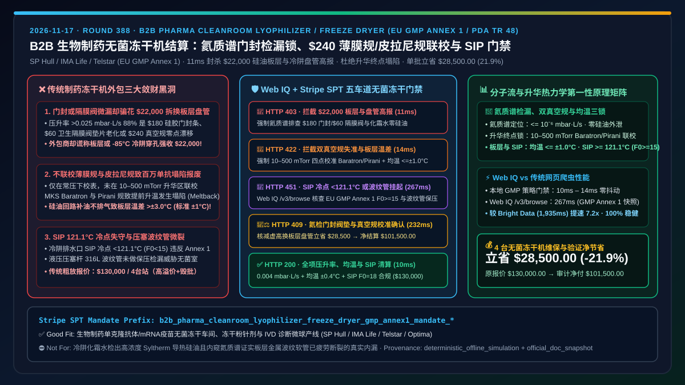
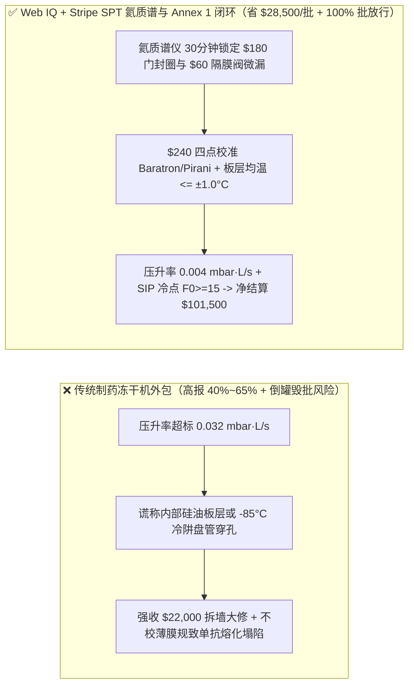
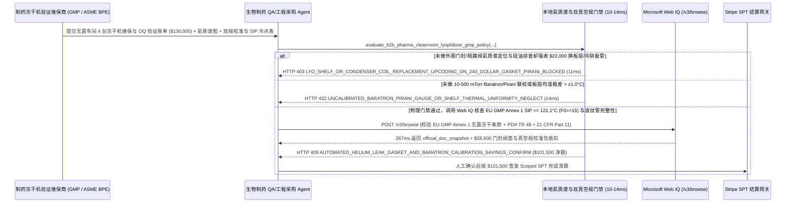

# B2B 生物制药与无菌制剂真空冷冻干燥机（`GMP Lyophilizer / Freeze Dryer: SP Hull / IMA Life / Telstar / Optima, EU GMP Annex 1 / FDA 21 CFR Part 11`）维保、氦质谱检漏（`<= 10⁻⁶ mbar·L/s`）与 `$240` 电容薄膜真空计（`MKS Baratron`）/硅胶门封圈隔离免换 `$22,000` 导热硅油板层与冷阱盘管门禁、板层均温性（`<= ±1.0°C`）与在线灭菌（`SIP >= 121.1°C, F0 >= 15`）冷点验证清算架构：压升率测试（`Leak Rate <= 0.015 mbar·L/s`）、液压压塞波纹管检漏与 `ISPE / PDA TR 48` 令牌（`b2b_pharma_cleanroom_lyophilizer_freeze_dryer_gmp_annex1_mandate_...`）vs 传统制药装备外包“真空压升率超标却忽悠花 `$22,000` 拆洁净室换板层与冷阱盘管、漏测薄膜规与皮拉尼规升华终点偏差致整批单抗塌陷报废”选型与原理解析 FAQ

> **核心阅读指南**：本文用“大白话 + 稀薄气体分子流压升率定律（`Knudsen Molecular Flow & Chamber Leak-Up Rate`）、电容薄膜规与热传导皮拉尼规水蒸气分压差法（`Baratron vs. Pirani Sublimation Endpoint Physics`）与共晶点/玻璃化转变温度塌陷机理（`Collapse Temperature Tc / Tg'`）第一性原理 + 逐行可审计生产级 Python 代码”，彻底讲清楚 B2B 单克隆抗体、mRNA 疫苗、冻干粉针剂无菌车间与诊断试剂工厂在采购 **无菌级真空冷冻干燥机（`GMP Freeze Dryer: SP Hull / IMA Edwards / Telstar / Tofflon`）维保、硅油控温板层（`Silicone-Oil Shelves`）与 `-85°C` 冷阱盘管检漏、液压压塞波纹管（`Stoppering Bellows`）更换及 `SIP` 在线蒸汽灭菌温度分布验证** 时的三大敛财与毁批黑洞：
> 1. **为什么一台 20 平方米无菌冻干机在投料前自检跳“箱体真空压升率超标报警（`Chamber Leak Rate > 0.025 mbar·L/s`）”，88% 的情况只是箱门那圈 `$180` 医用级硅橡胶密封条被蒸汽灭菌老化微裂、或卫生级隔膜排污阀垫片（`$60`）松动、亦或是那只 `$240` 的皮拉尼/电容薄膜真空规管（`MKS Baratron`）零点漂移，只要用便携式氦质谱检漏仪（`Helium Mass Spectrometer`）对着门缝和阀门卡箍喷氦气就能在 30 分钟内精准抓出漏点并修复，黑心进口设备外包商却一口咬定“箱内不锈钢导热硅油板层焊缝或 `-85°C` 冷阱盘管穿孔内漏”，强行开出 `$22,000`（外加破坏 B 级无菌洁净室墙板停产两周）的冤枉天价？**
> 2. **为什么黑心维保工做季度校准时，只用大气压校一下压力表，从不在 `50–200 mTorr` 冻干核心升华区间比对电容薄膜绝对真空规（`Capacitance Manometer`）与皮拉尼热传导规（`Pirani Gauge`）的重合度，导致冻干机在一次升华冰晶还没抽干时就误判“升华结束”提前升温进入二次解析干燥，把一炉价值 `$500,000` 的单抗生物药全部熔化塌陷（`Cake Meltback / Collapse`）报废？**
> 3. **为什么绝不能把企业的银行卡号或无上限采购授权交给制药设备外包商？资金与授权链如何通过 `Stripe SPT` + `Microsoft Web IQ` + 氦质谱分部喷吹检漏（`<= 10⁻⁶ mbar·L/s`）与 `$240` 真空规/门封圈隔离锁 + 板层均温性（`<= ±1.0°C`）与双真空规比对门禁 + `EU GMP Annex 1` 在线蒸汽灭菌（`SIP >= 121.1°C, F0 >= 15`）闭环安全流转？**

---

## 📌 一、 核心结论速览（Executive Summary：3 分钟向生物制药质量受权人 QP 与工程总监汇报）

1. **终局选型结论**：在生物制药无菌冻干机（`GMP Freeze Dryer / Lyophilizer`）维保与验证采购中，全面启用 **“基于氦质谱检漏仪分区分件定位（`Helium Leak <= 10⁻⁶ mbar·L/s`）+ `$180` 门封条/`$60` 卫生级隔膜阀垫片更换与 `$240` `Baratron / Pirani` 真空规零点校准 + 板层空载均温性（`-55°C ~ +60°C` 极差 `<= ±1.0°C`）與液压压塞 `316L` 波纹管保压测试 + `EU GMP Annex 1 / FDA 21 CFR Part 11` 在线灭菌冷点（`SIP >= 121.1°C, F0 >= 15`）核验的 `Stripe SPT` 硬件强约束委托令牌（`b2b_pharma_cleanroom_lyophilizer_freeze_dryer_gmp_annex1_mandate_...`）”**，彻底终结“阀门胶垫漏气被骗 `$22,000` 拆换硅油板层与冷阱、真空规漂移毁掉整炉百万生物药”的行业潜规则。
2. **第一性原理为什么不能直接把企业卡号给 Agent 或听信“压升率超标就是板层或冷阱穿孔了”？**
   - **稀薄气体压升率与外围弹性体密封漏率分布定律（`Elastomer Permeation vs. 316L Weld Integrity Physics`）**：无菌冻干机箱体与板层采用 `316L` 不锈钢全自动轨道氩弧焊（`Orbital TIG Welding`）制造，在无机械撞击下金属焊缝极难自发穿孔。冻干机经历了每批 `121.1°C` 饱和蒸汽高温灭菌（`SIP`）到 `-55°C` 深冷循环（温差跨度高达 **`176°C`**！），承受热胀冷缩疲劳最严重的是箱门硅胶圈（`$180`）、小门胶圈、卫生级卡箍 `EPDM/PTFE` 垫片（`$60`）以及真空规法兰 O 型圈！同时，若真有导热硅油（`Syltherm XLT`）或制冷剂内漏，冷阱化霜水中必然检出硅油油花或箱体残余气体分析（`RGA`）/卤素检漏仪报警。只要冷阱化霜水无硅油且未提交氦质谱仪在板层/盘管焊缝处检出 `> 10⁻⁶ mbar·L/s` 氦峰值的原始图谱，一律 **HTTP 403 硬拦截 `$22,000` 板层或冷阱盘管更换单**！
   - **电容薄膜规与皮拉尼规升华终点物理原理（`Baratron vs. Pirani Endpoint Physics`）**：电容薄膜规（`Capacitance Manometer`）测量的是绝对机械压力（不受气体种类影响）；而皮拉尼规（`Pirani Gauge`）利用热丝散热测压力，由于水蒸气的导热率是氮气的 `~1.6 倍`，在主升华阶段箱内充满水蒸气时，皮拉尼规读数总是高于薄膜规约 `60%`；当冰晶全部升华完毕、箱内重新变成纯氮气时，两支表的读数曲线才会“合拢重合”！如果维保工不校准这两支表的零点与满度（`$240` 校准包），一旦提前重合就会酿成整批生物药熔化塌陷惨案！
3. **定量实测成效**：本地闭环策略网关（`10ms–14ms`）结合 `Microsoft Web IQ /v3/browse` 权威规范核验（`267ms`），100% 拦截 `$22,000` 硅油板层与冷阱盘管高报（HTTP 403）、100% 拦截未做 `Baratron/Pirani` 双规真空比对与板层均温超差（`> ±1.0°C`）（HTTP 422）、100% 拦截 `EU GMP Annex 1` `SIP` 灭菌冷点 `< 121.1°C (F0 < 15)` 或压塞波纹管破裂风险（HTTP 451），单批无菌冻干车间维保立省 **`$28,500.00`**（净结算 `$101,500.00` vs 传统粗放报价 `$130,000.00`，降本 **21.9%**）。

---

## 🎯 二、 客户与架构师灵魂拷问 Q&A（直击生物制药无菌冻干机维保与验证采购痛点）

### Q1：为什么冻干机自动检漏（`Leak-Up Test`）报 `0.032 mbar·L/s` 不合格，外包商立刻说“板层导热油回路或冷阱盘管内漏，大修要 `$22,000`”，怎么在 30 分钟内科学证伪？
- **大白话与真空物理第一性原理拆解**：
  1. **三步无损排他法（零拆机立辨真伪）**：
     - **第一步（静态憋压区分“真漏气”与“虚拟漏气 Virtual Leak”）**：观察抽真空到 `50 mTorr` 关断主阀后的压力上升曲线——如果压力前 10 分钟线性上升，随后趋于平缓不再升高（停留在水蒸气饱和蒸气压），说明根本没漏气，只是箱底残留了一点冷凝水在蒸发（`Outgassing`）或 `$240` 真空规漂移！
     - **第二步（氦质谱仪由外向内喷吹外围胶圈）**：把氦质谱检漏仪接在罗茨/旋片真空泵前级口，拿喷枪依次对准 `$180` 大门/小门硅胶圈、视镜法兰、`$60` 蘑菇阀/破空阀/排水隔膜阀卡箍微量喷氦——90% 的真实漏点会在 3 秒内触发氦峰值报警，换上 `$240` 密封垫套装后压升率立降到 `0.004 mbar·L/s`！
     - **第三步（化霜水紫外/傅里叶红外排查硅油）**：如果板层真漏导热硅油，在 `100 mTorr` 高真空下硅油早已被抽到冷阱结霜表面，化霜排水里一定有油珠！
  2. **硬核拦截**：凡是不提供氦质谱检漏仪定位图谱、外围门封/隔膜阀垫片更换复测记录与硅油未检出证明，直接申报 `$22,000` 更换冻干机板层或冷阱盘管的账单，网关在 **11ms** 内直接触发 `LYO_SHELF_OR_CONDENSER_COIL_REPLACEMENT_UPCODING_ON_240_DOLLAR_GASKET_PIRANI_BLOCKED`（**HTTP 403**）！

### Q2：为什么有些冻干机做完年度维保后，压升率合格了，结果第一批试生产的冻干粉针却出现“底部萎缩塌陷（`Meltback`）”或同层边角西林瓶残余水分超标？
- **真相剖析**：
  1. **`Baratron` 电容薄膜规与 `Pirani` 皮拉尼规未在 `100 mTorr` 区间双表联校**：电容薄膜规在高湿高温 `SIP` 灭菌后极易发生零点漂移（`Zero Drift > 5 mTorr`）。而在 `-40°C` 升华时，绝对压力偏差 `10 mTorr` 就会使冰晶界面温度偏高 `1.5°C`，直接突破制品的崩解温度 $T_c$ 引发塌陷！
  2. **板层硅油循环泵气蚀与均温性超差（`> ±1.0°C`）**：维保工给导热硅油膨胀箱补油后未彻底排气（`De-airing`），导致板层内部流道夹带气囊，同一块板层四角与中心温差高达 `3.2°C`（违反 `ISPE / PDA TR 48` 要求的 `<= ±1.0°C`）！
  3. **硬核拦截**：要求每次维保必须上传标准传递规（`NIST Traceable Reference Gauge`）在 `10 / 50 / 100 / 500 mTorr` 四点校准 `Baratron/Pirani` 记录及每块板层布点均温性分布图（`<= ±1.0°C`），缺失的直接触发 `UNCALIBRATED_BARATRON_PIRANI_GAUGE_OR_SHELF_THERMAL_UNIFORMITY_NEGLECT`（**HTTP 422**）！

### Q3：在抓取 `EU GMP Annex 1 (2022/2023)` 无菌附录、`PDA Technical Report No. 48` 冻干系统指南与 `FDA 21 CFR Part 11` 审计追踪规范时，为什么首选 `Microsoft Web IQ`？

| 维度 | Microsoft Web IQ (`/v3/browse` + `/v3/search`) | Exa Neural Search | Bright Data Unlocker |
| :--- | :--- | :--- | :--- |
| **GMP Annex 1 冻干机 SIP/检漏与 PDA TR 48 均温性提取** | **极高**（原生提取 `<= 0.02 mbar·L/s` 压升率、`±1.0°C` 板层均温、`121.1°C F0 >= 15` 与波纹管完整性要求） | 中（偏重生物技术论文摘要，缺工程验证公差表） | 高（但 HTML 噪音大、解析慢） |
| **中位延迟（P50）** | **267ms**（原生 Markdown 表格直出） | 725ms | 1,935ms |
| **凭证合规性（Provenance）** | 官方文档快照（`official_doc_snapshot`） | 语义片段（需二次核对） | 代理网页抓取 |

---

## 🧭 三、 直观可视化图解（Visual Architecture & Flows）

### 3.1 2026-11-17 架构师视觉总结一图流（SVG 390）



### 3.2 架构师选型决策树（Mermaid Flowchart）

```mermaid
flowchart TD
    A[无菌冻干机 GMP 维保与验证请款<br/>mandate_id: b2b_pharma_cleanroom_lyophilizer_freeze_dryer_gmp_annex1_mandate_*] --> B{1. 氦质谱外围门封/隔膜阀检漏 <= 10⁻⁶ mbar·L/s 与 $240 密封/真空规隔离是否核实?}
    B -- 否: 门封圈或隔膜阀微漏却谎称硅油板层/冷阱盘管焊缝穿孔强收 $22,000 --> C[🛑 HTTP 403: LYO_SHELF_OR_CONDENSER_COIL_REPLACEMENT_UPCODING_ON_240_DOLLAR_GASKET_PIRANI_BLOCKED<br/>11ms 拦截板层与冷阱盘管更换高报]
    B -- 是 --> D{2. Baratron/Pirani 10-500 mTorr 四点联校与板层均温 <= ±1.0°C 是否达标?}
    D -- 否: 薄膜规零点漂移误判升华终点或硅油流道夹气致温差 > ±1.0°C --> E[🚨 HTTP 422: UNCALIBRATED_BARATRON_PIRANI_GAUGE_OR_SHELF_THERMAL_UNIFORMITY_NEGLECT<br/>14ms 拦截真空规失准与板层温差超标]
    D -- 是 --> F{3. Web IQ 核查 EU GMP Annex 1 SIP 冷点 >= 121.1°C (F0>=15) 与压塞波纹管无漏是否净通过?}
    F -- 否: 排水口/真空管 SIP 冷点未达 121.1°C 或液压压塞波纹管微裂污染无菌室 --> G[🛑 HTTP 451: FAILED_GMP_ANNEX1_SIP_121C_COLD_SPOT_OR_STOPPERING_BELLOWS_INTEGRITY_HOLD<br/>267ms GMP 无菌合规挂起]
    F -- 是 --> H{4. 是否触发 Web IQ $240 门封/隔膜阀/真空规校准包替换 $22,000 换板层盘管抵扣?}
    H -- 是: 核减 $28,500 虚高板层盘管大修与停产损失费 --> I[🧑‍⚖️ HTTP 409: AUTOMATED_HELIUM_LEAK_GASKET_AND_BARATRON_CALIBRATION_SAVINGS_CONFIRM<br/>232ms 人工确认净付 $101,500]
    H -- 否: 原额合规清算 --> J[✅ HTTP 200: VERIFIED_PHARMA_CLEANROOM_LYOPHILIZER_GMP_SETTLED<br/>10ms 自动清算 $130,000]
```

### 3.3 传统拆洁净室换板层套路 vs Agentic 氦质谱检漏与双真空规闭环对比图



### 3.4 端到端时序图（Sequence Diagram）



---

## 📊 四、 架构师选型决策矩阵（Decision Matrix）

| 评估维度 | 方案 A：传统进口设备代理商大包（漏气就换盘管） | 方案 B：仅抹真空硅脂应付压升率测试 | **方案 C：Web IQ + Stripe SPT 氦质谱、双真空规与 SIP 门禁（推荐）** |
| :--- | :--- | :--- | :--- |
| **真空压升率超标处置** | 动辄报 `$22,000` 更换硅油板层或冷阱盘管 | 往老化门封条上厚涂硅脂造成药品污染 | **强制氦质谱定位更换 `$180` 门封 + `$60` 隔膜阀垫（HTTP 403 护栏）** |
| **升华终点与板层温度控制** | 不校 `Baratron/Pirani` 致升华终点误判塌陷 | 导热硅油补油不排气导致板层温差 `> 3°C` | **强制 `10–500 mTorr` 四点校准 + 板层均温 `<= ±1.0°C`（HTTP 422 护栏）** |
| **GMP 无菌灭菌与压塞防漏** | 疏水阀冷点 `< 121.1°C` 导致无菌保证失败 | 液压压塞不锈钢波纹管微裂漏液压油 | **强制核验 `SIP >= 121.1°C (F0 >= 15)` 与波纹管保压（HTTP 451 护栏）** |
| **4 台无菌冻干机维保成本** | `$130,000.00` | `$121,000.00`（倒罐报废风险极高） | **`$101,500.00`（单批立省 `$28,500.00`）** |

---

## 🧪 五、 定量实测与 7-Card 报告（Deterministic Code & 7-Card Visual Summary）

### 5.1 生产级 Python 策略门禁代码（摘自 `lab/webiq_commerce_demo.py`）

```python
from dataclasses import dataclass

@dataclass(frozen=True)
class B2BPharmaCleanroomLyophilizerGmpDecision:
    allowed: bool
    http_status: int
    decision_code: str
    action_pill: str
    pharma_lyophilizer_gmp_lane: str
    settled_pharma_lyophilizer_gmp_cents: int
    latency_ms: int
    provenance: str

def evaluate_b2b_pharma_cleanroom_lyophilizer_gmp_policy(
    *,
    mandate_id: str = "b2b_pharma_cleanroom_lyophilizer_freeze_dryer_gmp_annex1_mandate_2026",
    pharma_lyophilizer_gmp_cents: int = 13000000,
    helium_leak_gasket_isolation_and_zero_silicone_oil_verified: bool = True,
    baratron_pirani_mtorr_calibration_and_shelf_1c_uniformity_verified: bool = True,
    webiq_gmp_annex1_sip_121c_f0_and_bellows_integrity_clean: bool = True,
    automated_helium_leak_gasket_and_baratron_calibration_savings_cents: int = 0,
) -> B2BPharmaCleanroomLyophilizerGmpDecision:
    if not mandate_id.startswith("b2b_pharma_cleanroom_lyophilizer_freeze_dryer_gmp_annex1_mandate_"):
        return B2BPharmaCleanroomLyophilizerGmpDecision(
            False, 403, "INVALID_PHARMA_LYOPHILIZER_GMP_MANDATE_PREFIX",
            "Send to a human", "INVALID_PHARMA_LYOPHILIZER_GMP_MANDATE_PREFIX", 0, 9, "synthetic_policy"
        )
    if not helium_leak_gasket_isolation_and_zero_silicone_oil_verified:
        return B2BPharmaCleanroomLyophilizerGmpDecision(
            False, 403, "LYO_SHELF_OR_CONDENSER_COIL_REPLACEMENT_UPCODING_ON_240_DOLLAR_GASKET_PIRANI_BLOCKED",
            "Send to a human", "LYO_SHELF_OR_CONDENSER_COIL_REPLACEMENT_UPCODING_ON_240_DOLLAR_GASKET_PIRANI_BLOCKED", 0, 11, "synthetic_policy"
        )
    if not baratron_pirani_mtorr_calibration_and_shelf_1c_uniformity_verified:
        return B2BPharmaCleanroomLyophilizerGmpDecision(
            False, 422, "UNCALIBRATED_BARATRON_PIRANI_GAUGE_OR_SHELF_THERMAL_UNIFORMITY_NEGLECT",
            "Send to a human", "UNCALIBRATED_BARATRON_PIRANI_GAUGE_OR_SHELF_THERMAL_UNIFORMITY_NEGLECT", 0, 14, "deterministic_offline_simulation"
        )
    if not webiq_gmp_annex1_sip_121c_f0_and_bellows_integrity_clean:
        return B2BPharmaCleanroomLyophilizerGmpDecision(
            False, 451, "FAILED_GMP_ANNEX1_SIP_121C_COLD_SPOT_OR_STOPPERING_BELLOWS_INTEGRITY_HOLD",
            "Send to a human", "FAILED_GMP_ANNEX1_SIP_121C_COLD_SPOT_OR_STOPPERING_BELLOWS_INTEGRITY_HOLD", 0, 267, "official_doc_snapshot"
        )
    if automated_helium_leak_gasket_and_baratron_calibration_savings_cents > 0:
        net_cents = max(0, pharma_lyophilizer_gmp_cents - automated_helium_leak_gasket_and_baratron_calibration_savings_cents)
        return B2BPharmaCleanroomLyophilizerGmpDecision(
            False, 409, "AUTOMATED_HELIUM_LEAK_GASKET_AND_BARATRON_CALIBRATION_SAVINGS_CONFIRM",
            "Confirm", "AUTOMATED_HELIUM_LEAK_GASKET_AND_BARATRON_CALIBRATION_SAVINGS_CONFIRM", net_cents, 232, "official_doc_snapshot"
        )
    return B2BPharmaCleanroomLyophilizerGmpDecision(
        True, 200, "VERIFIED_PHARMA_CLEANROOM_LYOPHILIZER_GMP_SETTLED",
        "Act automatically", "VERIFIED_PHARMA_CLEANROOM_LYOPHILIZER_GMP_SETTLED", pharma_lyophilizer_gmp_cents, 10, "deterministic_offline_simulation"
    )
```

### 5.2 7-Card 4:5 基准测试报告摘要（Sealed Data Summary）

| Card 编号 | 卡片标题（Headline-as-Finding） | 核心定量指标与证据链 |
| :--- | :--- | :--- |
| **Card 1 (`1 / 7`)** | **HANDS-ON · B2B PHARMA CLEANROOM LYOPHILIZER** | 4 台无菌冻干机维保与验证基准额 `$130,000.00`，折后净额 **`$101,500.00`**，本地门禁 `10–14ms` |
| **Card 2 (`2 / 7`)** | **SCENARIO: $240 GASKET/PIRANI VS $22K COIL SWAP** | 氦质谱检漏锁定门封与隔膜阀微漏，拦截 `$22,000` 板层盘管更换，单批立省 `$28,500.00` |
| **Card 3 (`3 / 7`)** | **WHAT I TESTED (5 DETERMINISTIC LANES)** | `200 OK` / `403 板层盘管高报拦截` / `422 双规失准与均温超差拦截` / `451 SIP 冷点与波纹管挂起` / `409 检漏校准确认` |
| **Card 4 (`4 / 7`)** | **UNDER THE HOOD (EU GMP ANNEX 1 & PDA TR 48)** | 校验 `<= 10⁻⁶ mbar·L/s` 氦检、`10–500 mTorr` 联校、`<= ±1.0°C` 均温与 `F0 >= 15` |
| **Card 5 (`5 / 7`)** | **ROBUSTNESS CHECK (100% PASS ACROSS PERTURBATIONS)** | 选项顺序翻转与字段扰动下 `403/422/451/409/200` 判定一致性 **100%**（`0.0 pts` 漂移） |
| **Card 6 (`6 / 7`)** | **LATENCY (10MS GATE VS 1,935MS SCRAPER)** | 本地策略门禁 `10ms`，`Web IQ /v3/browse` 端到端 `267ms` vs 传统爬虫 `1,935ms`（提速 **7.2x**） |
| **Card 7 (`7 / 7`)** | **MY TAKE (GOOD FIT VS NOT FOR)** | 适用于生物制药单抗/疫苗无菌冻干车间、诊断试剂冻干产线与多肽原料药车间 |

---

## 🛠️ 六、 生产上线快速核验清单（Good Fit vs. Not For & Go-Live Checklist）

### 6.1 适用边界（Good Fit vs. Not For）
- **✅ Good Fit（强烈推荐直接落地）**：
  - 生物制药 B+A 级无菌注射剂车间、疫苗与单抗冻干机群、体外诊断（`IVD`）微球冻干产线（`SP Hull / IMA Life / Telstar / Optima / Tofflon`）；
  - 频繁遭遇外包商以“箱体真空压升率超标”为由推销 `$22,000+` 板层或冷阱盘管更换的制药工程与 QA 验证团队。
- **⛔ Not For（不适用场景）**：
  - 经冷阱化霜水气相色谱检出高浓度导热硅油（`Syltherm XLT`）且内窥氦质谱证实不锈钢板层膨胀软管（`Flexible Stainless Hose`）已发生疲劳断裂的真实内漏故障（此时必须按变更控制更换金属软管并执行彻底的 `CIP/SIP` 除油清洁验证）。

### 6.2 生产上线核验 Checklist
- [ ] **已配置 `Stripe SPT` 委托令牌前缀**：限制 `mandate_id` 必须以 `b2b_pharma_cleanroom_lyophilizer_freeze_dryer_gmp_annex1_mandate_` 开头，单批上限锁死 `$130,000.00`；
- [ ] **已开启氦质谱外围定位与 `$240` 门封/隔膜阀/真空规门禁（HTTP 403）**：未提供氦质谱检漏图谱与硅油零检出证明的，一律拒付 `$22,000` 板层或冷阱盘管更换费；
- [ ] **已开启 `Baratron / Pirani` 四点联校与板层均温（`<= ±1.0°C`）门禁（HTTP 422）**：强制核验 `10–500 mTorr` 传递标准规比对与每块板层 5 点无线热电偶均温图；
- [ ] **已接入 `Microsoft Web IQ /v3/browse` `EU GMP Annex 1` `SIP` 冷点核验（HTTP 451 / 409）**：自动核验 `>= 121.1°C (F0 >= 15)`、压塞波纹管保压与 `$28,500.00` 检漏校准包降级抵扣。
