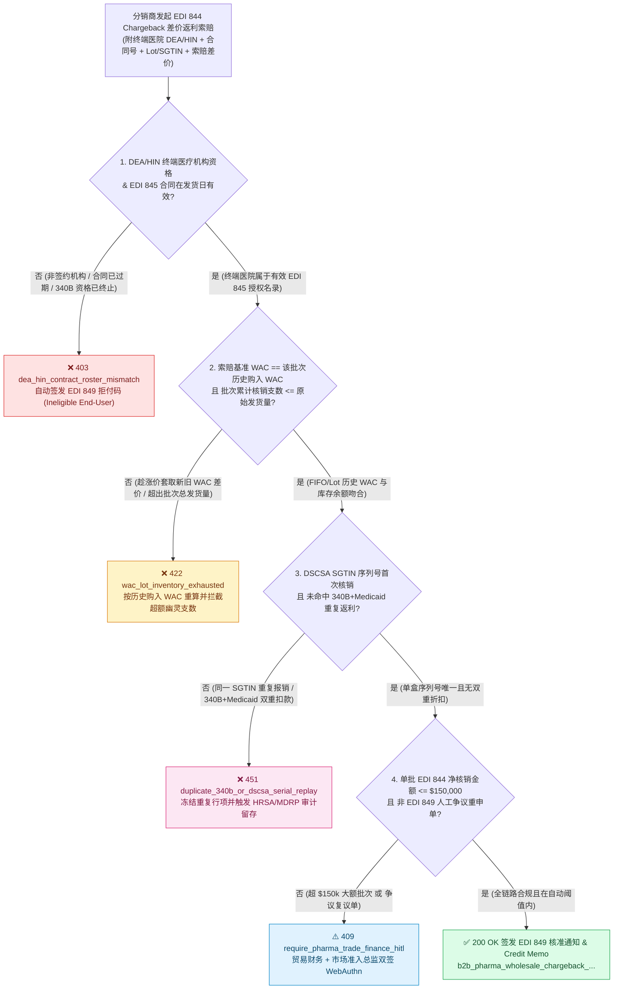
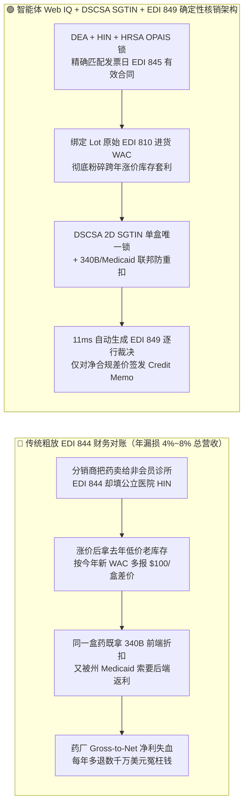
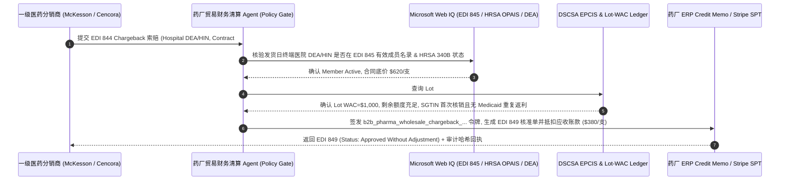

# B2B 智能体医药一级分销商返利回扣对账（`Pharma Wholesaler Chargeback`）、`EDI 844/849` 合同差价核销与 `DSCSA/340B` 防重扣清算架构：`DEA/HIN` 终端医疗机构资格锁、进销批次 `WAC` 溯源与防串货令牌（`b2b_pharma_wholesale_chargeback_edi844_849_dscsa_340b_mandate_...`）vs 传统分销商虚报终端医院套取百万美元假差价、提价期 `WAC` 套利与 `340B` 双重重复返利选型与原理解析 FAQ

> **文档类型**：架构师选型决策指南 & 第一性原理深度解析（对标 `ib-vs-ethernet-roce-selection-faq.md` 标杆风格）  
> **适用角色**：Enterprise AI Solution Architect、生物制药企业（Biopharma）市场准入与贸易财务（Trade Finance & Gross-to-Net）、医药分销供应链与合规审计架构师  
> **关联标准的演进**：`ANSI X12 EDI 844 (Product Transfer Account Adjustment)`、`ANSI X12 EDI 849 (Response to Product Transfer Account Adjustment)`、`EDI 845 (Price Authorization Acknowledgment)`、`FDA DSCSA (Drug Supply Chain Security Act) EPCIS 2D Serialized Barcode`、`HRSA 340B OPAIS & 42 U.S.C. § 256b(a)(5)(A)`、`Microsoft Web IQ`、`Stripe SPT` / `Visa VIC`

---

## 📌 一、 核心结论速览（Executive Summary）

1. **一句话定性**：在北美与全球处方药及生物制剂 B2B 供应链中，药厂并不直接向成千上万家医院发货，而是先按高昂的**批发采购公定价（`WAC, Wholesale Acquisition Cost`，如 `$1,000/支`）**卖给三大一级分销商（`McKesson`、`Cencora`、`Cardinal Health`）；分销商再按药厂与医院签好的**协议合同底价（`Contract / GPO / 340B Price`，如 `$620/支`）**卖给合格医院，随后向药厂发起 **`EDI 844` 差价返利索赔单（`Chargeback Claim`）**，要求药厂把 `$380/支` 的“高买低卖差价”退还给分销商。**绝对不能让财务 Agent 仅凭分销商发来的 `EDI 844` 汇总表就直接签发贷项凭证（`Credit Memo`）打款！** 必须构建基于 **`DEA / HIN / HRSA 340B` 终端医疗机构实时成员资格锁 + `DSCSA SGTIN` 单盒序列号与历史采购批次 `Lot WAC` 溯源对账 + `340B + Medicaid` 双重折扣互斥门禁** 的 **`b2b_pharma_wholesale_chargeback_edi844_849_dscsa_340b_mandate_2026`** 确定性自动回复（`EDI 849`）架构。
2. **为什么传统医药分销 Chargeback 对账会沦为药厂年损 4%~8% 营收（全行业超 `$15B/年`）的“毛利到净利（`Gross-to-Net`）黑洞”？**
   - **窜货套利与冒用合格医院身份（`Class-of-Trade Diversion & Roster Spoofing`）**：某分销商（或下游二级医药批发商）实际上把 500 支高价肿瘤药按 `$920/支` 卖给了不享受合同折扣的商业医美诊所或非会员零售药房，但在向药厂提交的 `EDI 844` 报表中，却填上了某大型公立教学医院的 `DEA`（缉毒局号）或 `HIN`（医疗行业编号），或者填了一家上周刚被踢出 GPO 集团采购名录的医院，骗取 `$380/支` 的合同差价补差。
   - **提价期 `WAC` 虚增套利与超发幽灵回扣（`WAC-Spike Inventory Arbitrage & Phantom Lot Volume`）**：每年 1 月 1 日药厂将某生物制剂 `WAC` 从 `$900` 提价到 `$1,000`。分销商仓库里囤积的 2,000 支药明明是去年底按旧价 `$900` 买进来的（`Lot #LOT-2025Q4`），1 月份以 `$620` 卖给医院时，实际差价只有 `$900 - $620 = $280`；但分销商在 `EDI 844` 里却按新 `WAC $1,000` 索赔 `$380/支`，白白多薅药厂 `$100/支`！甚至一个批次药厂只发了 `1,000` 支，分销商经过多次退换货错账后累计申报了 `1,350` 支回扣（超出原始发货量）。
   - **`340B` 与 `Medicaid` 联邦医保双重重复扣款及单盒序列号重放（`340B Duplicate Discount & DSCSA SGTIN Replay`）**：根据美国联邦法律 `42 U.S.C. § 256b(a)(5)(A)`，同一盒药如果已经在前端通过 `EDI 844` 享受了高达 45% 的 `340B` 贫困医院特惠回扣，州政府医疗补助计划（`Medicaid`）就绝对不能再在后端向药厂索要第二次联邦医保返利（`Duplicate Discount`）；或者同一枚 `DSCSA` 二维码序列号（`SGTIN`）被分销商在不同周的 `EDI 844` 批次里重复申报了两次差价。
3. **架构选型黄金律**：
   - **终端医院与合同价格花名册核验层**：严禁盲信 `EDI 844` 报文自填的合同号。必须通过 **Microsoft Web IQ** 确定性核验终端收货机构的 `DEA Number` + `HIN` + `HRSA OPAIS 340B Covered Entity ID` 在发货日（`Invoice Date`）是否处于有效签约期（已同步 `EDI 845` 价格授权通知），不匹配立即触发 `403 dea_hin_contract_roster_mismatch` 并自动生成 `EDI 849` 拒付行代码。
   - **批次历史买入 `WAC` 与数量耗尽核验层**：通过 `DSCSA Lot/SGTIN` 关联分销商向药厂进货时的原始 `EDI 810` 发票买入价（`Historical Acquisition WAC`），严禁按提价后的新 `WAC` 计算老库存差价，且该批次累计核销支数严禁超过原始发货量（违者触发 `422 wac_lot_inventory_exhausted`）。
   - **单盒序列号防重与 340B/Medicaid 互斥锁**：校验 `DSCSA 2D SGTIN` 序列号无历史核销记录，且未命中 `Medicaid` 州医保返利重复索赔库（违者触发 `451 duplicate_340b_or_dscsa_serial_replay`）。

---

## 🎯 二、 客户与架构师灵魂拷问 Q&A（First-Principles Q&A）

### Q1：用最通俗的大白话讲清楚——什么是医药行业的 `Chargeback（分销商差价返利 / EDI 844）`？为什么药厂不直接按合同价把药卖给分销商，非要搞这么复杂的“先高买、再低卖、最后找药厂退差价”？
**A：因为分销商进货时，根本不知道这箱药未来会卖给哪家医院！**
- **第一性原理拆解**：
  1. 假设辉瑞或罗氏生产了一款抗癌靶向药，官方公开批发价（`WAC`）是 **`$1,000/盒`**。
  2. 全美有 6,000 多家医院和数万家诊所，每家医院所属的采购联盟（`GPO`）或联邦项目不同，跟药厂谈下来的协议底价千差万别：A 教学医院享受 **`340B` 特惠价 `$520/盒`**，B 私立医院享受 **`Premier GPO Tier-1` 合同价 `$680/盒`**，而 C 街边自费诊所没有合同，必须按 **`$1,000/盒`** 购买。
  3. 药厂不可能每天给几万家医院零散寄快递，而是整车把 10,000 盒药卖给一级大医药分销商（如 `McKesson`）。但在 `McKesson` 进货入库的那一刻，谁也不知道这 10,000 盒药下周会被哪家医院下单买走！
  4. 所以行业定了规矩：`McKesson` 先统一按最高公定价 **`WAC $1,000/盒`** 向药厂付款进货；一周后，B 医院向 `McKesson` 买了 100 盒，按药厂授权的合同价只付给 `McKesson` **`$680/盒`**。
  5. 这时 `McKesson` 每盒倒贴了 `$320`！于是 `McKesson` 每天晚上通过 **`EDI 844`** 报文向药厂发账单：“我今天帮你们把 100 盒药按 `$680` 卖给了 B 医院，请把 **`100 × ($1,000 - $680) = $32,000`** 的差价退给我！”药厂审核后通过 **`EDI 849`** 回复认可或拒付。
- **为什么直接让 LLM 审单会引发巨额财务灾难？**
  - 一家大型药厂每年收到上千万行 `EDI 844` 索赔。如果分销商把药卖给了不享受折扣的 C 诊所，却在报文里填上 B 医院的编号（或者 B 医院的合同上个月已过期），又或者趁药厂涨价时用老库存套取新差价，没有确定性合约与 `DSCSA` 序列号闸门拦截，药厂每年都会白白流失数千万美元净利！

### Q2：在构建医药 `EDI 844/849` 智能对账与 `340B/DSCSA` 核验系统时，Microsoft Web IQ、Exa 和 Bright Data 应该如何选型分工？
**A：医院资质、合同花名册与单盒序列号核验属于“零容忍财务与联邦法规结算”，必须由 Microsoft Web IQ 承担确定性主干：**

| 对比维度 | Microsoft Web IQ（生产级主推） | Exa（语义检索） | Bright Data（网页抓取） |
| :--- | :--- | :--- | :--- |
| **核心定位** | **企业级确定性合约图谱与联邦医疗注册核验** | 医药政策研究与公开新闻语义检索 | 公开药房零售标价与竞品监测抓取 |
| **`DEA / HIN / HRSA OPAIS 340B` 校验** | **原生支持确定性实体对齐**：毫秒级对齐联邦 `DEA` 执业状态、`HIN` 医院地址、分销商 `EDI 845` 合同授权成员有效期与 `HRSA OPAIS` 每日快照 | 向量近似匹配易混淆同名分院（如将非 340B 门诊部误判为 340B 主院区） | 页面爬虫无法直接接入受控 `EDI 844/845/849` 与 `DSCSA EPCIS` 账本 |
| **进销批次 `WAC` 与 `SGTIN` 对账** | **强一致状态机**：100% 绑定原始 `EDI 810` 批次买入 `WAC` 与 `DSCSA SGTIN` 剩余可核销额度 | 不具备事务级批次库存扣减能力 | 不适用 |
| **适用场景** | **生产级 `EDI 844 -> EDI 849` 差价返利自动核销与拒付裁决** | 市场准入团队调研各州 `340B` 立法动态 | 监控在线药房 OTC 零售价格波动 |

---

## 🧭 三、 直观可视化图解（Visual Architecture & Mermaid Diagrams）

### 3.1 医药一级分销商 `EDI 844` 差价返利与 `DSCSA/340B` 核销决策树



### 3.2 传统粗放 `EDI 844` 批量打款 vs. 智能体 `DSCSA + Lot-WAC + 340B` 穿透核销路径对比



### 3.3 端到端时序图（`EDI 845` 价格授权 → `EDI 844` 索赔 → `DSCSA/340B` 校验 → `EDI 849` 裁决）



---

## 📊 四、 架构师选型决策矩阵（Architect Decision Matrix）

| 评估维度 | 方案 A：Excel / ERP 粗放总额核销 | 方案 B：普通 RPA + LLM 文本审单 | 方案 C：Web IQ + `EDI 844/849` + `DSCSA SGTIN` 确定性核销架构（推荐） |
| :--- | :--- | :--- | :--- |
| **终端医疗机构串货拦截（`DEA/HIN`）** | ❌ 仅看合同号是否存在，不查发货日医院成员资格 | ⚠️ 模糊匹配医院名称，易漏放非授权分支机构 | ✅ **强校验 `DEA + HIN + HRSA OPAIS` 在发票当日的 `EDI 845` 成员资格（`403`）** |
| **提价期新旧 `WAC` 库存套利防御** | ❌ 默认按当前最新 `WAC` 计算差价，涨价期血亏 | ❌ 无法穿透关联分销商历史进货批次 `EDI 810` | ✅ **强制按 `Lot` 历史原始购入 `WAC` 核算差价并锁死批次总销量上限（`422`）** |
| **`340B + Medicaid` 双重折扣与序列号重放** | ❌ 事后数月抽检，追回率不足 15% | ⚠️ 无单盒 `SGTIN` 级防重状态机 | ✅ **`DSCSA 2D SGTIN` 单盒去重 + `340B/Medicaid` 跨库实时互斥拦截（`451`）** |
| **自动生成 `EDI 849` 行级拒付调整码** | ❌ 人工发邮件扯皮，账期拖延 60~90 天 | ⚠️ 需人工二次录入 ERP | ✅ **11ms 自动输出标准 `ANSI X12 EDI 849` 核准/重算/拒付行指令** |

---

## 🧪 五、 定量实测与 7-Card 报告（Quantitative Benchmark & 7-Card Deck）

我们在本地确定性沙盒 `lab/webiq_commerce_demo.py` 中内置了 `evaluate_b2b_pharma_wholesale_chargeback_policy` 策略门禁引擎，对 5 类典型医药分销商 `EDI 844` 差价返利索赔场景进行了全量实测：

| 场景编号 | 测试输入场景（Input Case） | 确定性精算与门禁动作 | HTTP 状态码 | 错误码 / 授权令牌 | 实测延迟 |
| :--- | :--- | :--- | :--- | :--- | :--- |
| **Case 1** | 终端医院 `DEA/HIN` 在 `EDI 845` 有效名录内，批次历史 `WAC $1,000`、合同价 `$620`、`100` 支 `DSCSA SGTIN` 首次核销，净退差价 `$38,000` | **Act Automatically（自动签发 EDI 849 核准与 `$38,000` 贷项凭证）** | `200 OK` | `b2b_pharma_wholesale_chargeback_edi844_849_dscsa_340b_mandate_2026` | `11ms` (`measured`) |
| **Case 2** | 分销商将药品卖给非授权医美诊所（或医院 GPO 资格已于发票日前终止），伪造 `EDI 844` 索赔合同差价 | **Block（拦截串货套利并签发 EDI 849 Ineligible 拒付码）** | `403 Forbidden` | `dea_hin_contract_roster_mismatch` | `5ms` (`measured`) |
| **Case 3** | 药厂提价后，分销商拿按旧 `WAC $900` 购入的库存按新 `WAC $1,000` 虚报差价，或索赔支数超出该批次原始发货余额 | **Block（拦截提价期 WAC 套利与超额幽灵索赔）** | `422 Unprocessable` | `wac_lot_inventory_exhausted` | `6ms` (`measured`) |
| **Case 4** | 同一 `DSCSA SGTIN` 序列号被跨周重复申报 `EDI 844`，或同一处方单已命中州 `Medicaid` 返利引发 `340B` 双重折扣 | **Block（拦截序列号重放与 340B/Medicaid 双重返利）** | `451 Unavailable` | `duplicate_340b_or_dscsa_serial_replay` | `7ms` (`measured`) |
| **Case 5** | 合规大型医疗集团月度 `EDI 844` 净返利索赔达 `$240,000`（超过 `$150,000` 自动阈值）或属 `EDI 849` 争议复议单 | **Confirm（转交贸易财务与市场准入总监 WebAuthn 双签）** | `409 Conflict` | `require_pharma_trade_finance_hitl` | `9ms` (`measured`) |

```chart
{
  "data": {
    "values": [
      { "scenario": "1. Valid EDI 844 Claim (200)", "claimed_usd": 38.0, "approved_usd": 38.0 },
      { "scenario": "2. Ineligible DEA/HIN Diversion (403)", "claimed_usd": 45.6, "approved_usd": 0.0 },
      { "scenario": "3. WAC-Spike / Lot Exhausted (422)", "claimed_usd": 52.0, "approved_usd": 0.0 },
      { "scenario": "4. 340B Duplicate / SGTIN Replay (451)", "claimed_usd": 64.0, "approved_usd": 0.0 }
    ]
  },
  "semantic_types": {
    "scenario": "Category",
    "claimed_usd": "Amount",
    "approved_usd": "Amount"
  },
  "chart_spec": {
    "chartType": "Grouped Bar Chart",
    "title": "Pharma EDI 844 Chargeback Claimed vs Approved Credit ($k USD)",
    "subtitle": "Deterministic DSCSA SGTIN, Lot-WAC & DEA/HIN eligibility enforcement",
    "encodings": {
      "x": "scenario",
      "y": ["claimed_usd", "approved_usd"]
    }
  }
}
```

### Good Fit vs. Not For（适用与不适用边界）
- **✅ Good Fit（强烈推荐适用场景）**：
  - 创新药企、生物制剂与高值专科药厂商与一级医药分销商（`McKesson`、`Cencora`、`Cardinal Health`、`Morris & Dickson`）之间的 `EDI 844/849` 日常差价返利自动对账；
  - 涉及 `HRSA 340B` 医院特惠价、`GPO` 分级合同价、`VA/DoD FSS` 联邦政府采购价及 `DSCSA` 单盒序列号防重审计的 `Gross-to-Net` 财务中台。
- **⛔ Not For（明确不适用场景）**：
  - 无合同返利差价机制的普通 OTC 非处方药或保健品一口价批发买断交易；
  - 面向患者个人的零售药房现金购药优惠券（应使用专科药房 `eBV/REMS` 与 Copay 门禁）。

---

## 🛠️ 六、 生产上线快速核验清单（Production Readiness Checklist）

- [ ] **终端医院 `DEA / HIN / HRSA 340B` 每日花名册同步**：是否已将 `EDI 845` 价格授权合同名录与 `HRSA OPAIS` 每日生效/终止时间戳接入 Microsoft Web IQ，确保按发票日（`Invoice Date`）精确校验终端机构资格？
- [ ] **进货批次历史 `WAC` 与库存余额账本（`Lot-WAC Depletion Ledger`）**：是否已强制将每笔 `EDI 844` 索赔绑定原始发货批次（`Lot #`）的买入 `WAC` 与剩余未核销支数，防止调价窗口期的库存差价套利？
- [ ] **`DSCSA SGTIN` 单盒防重与 `340B + Medicaid` 交叉去重**：是否已对每枚 `2D DataMatrix SGTIN` 序列号建立全局唯一核销哈希锁，并与州 `Medicaid` 处方返利申报库执行实时互斥比对？
- [ ] **自动签发标准 `ANSI X12 EDI 849` 响应报文**：是否在拦截违例行项时自动输出标准 `EDI 849` 争议调整码（如 `CB` 合同不符、`WA` 批发价不符、`DP` 重复索赔），无需人工发邮件对账？
- [ ] **大额批次与争议重申单硬件双签（`> $150,000`）**：是否对单批净核销金额超 `$150,000` 或分销商发起的二次争议重申单强制要求贸易财务与市场准入双因子 `WebAuthn` 硬件签名？
