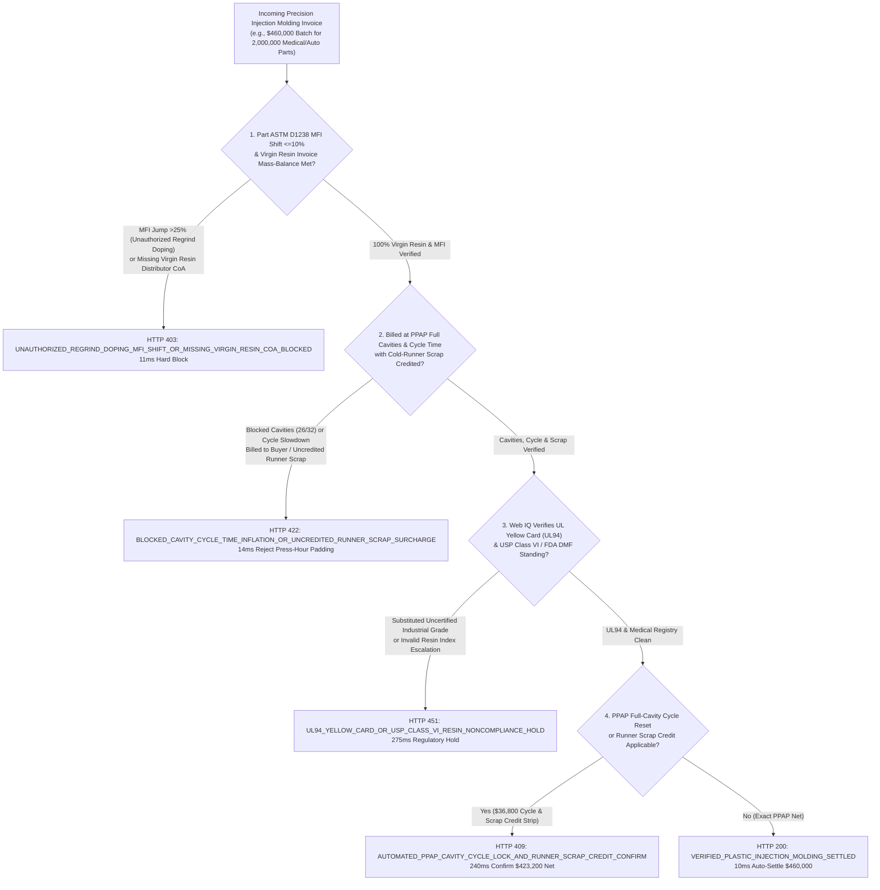
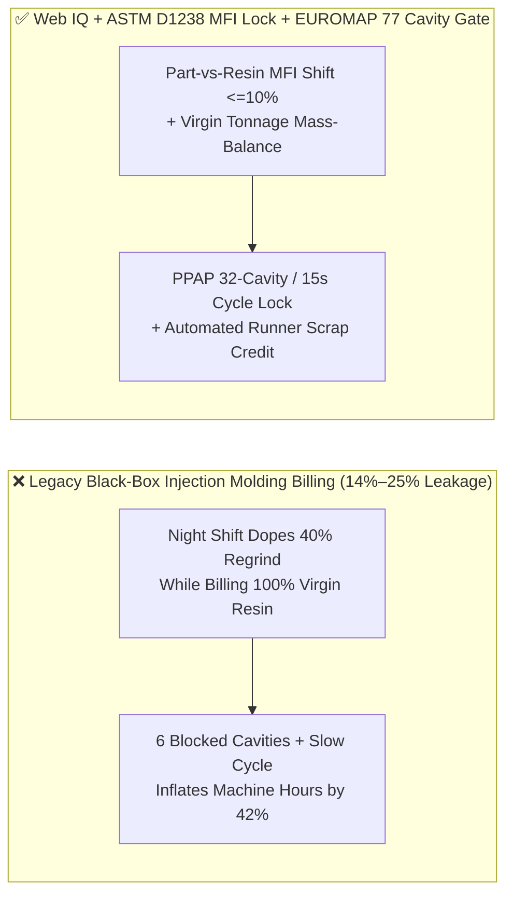

# B2B Precision Plastic Injection Molding, Virgin Resin vs. Regrind Ratio (`ASTM D1238 MFI`) & `EUROMAP 77` Cavity-Pressure Settlement Architecture: Melt-Flow-Index (`MFI`) Anti-Regrind Lock, `PPAP` Active-Cavity Cycle Gate & Runner-Scrap Credit Token (`b2b_plastic_injection_molding_virgin_resin_regrind_mfi_cavity_pressure_mandate_...`) vs. 40% Unauthorized Regrind Doping, Blocked-Cavity Machine-Hour Inflation & Runner Scrap Theft: Architecture Selection & First-Principles FAQ

> **Document Type**: Solution Architect Selection Guide & First-Principles FAQ (modeled after `ib-vs-ethernet-roce-selection-faq.md`)  
> **Reading Time**: ~12 minutes | **Target Audience**: AI Solution Architects, Medical Device (`ISO 13485`) / Automotive (`IATF 16949`) / Consumer Electronics Sourcing VPs, Polymer & Tooling Engineering Directors, Supplier Quality Engineers (`SQE`), and Manufacturing FinOps Architects  
> **Core Thesis**: First explain in plain language why medical device, automotive, and electronics OEMs ordering `2,000,000` precision-molded components specified in `100% Virgin Resin` (`SABIC Lexan PC / DuPont Delrin POM / Victrex PEEK` at `$4,800–$18,000/ton`) suffer catastrophic field brittle-fracture recalls and 14%–25% cost leakage when night-shift molders secretly grind up sprues/runners and dope the hopper with `35%–50%` thermally degraded multi-pass `Regrind` while billing for `100% Virgin Resin`; why molders let `6 cavities` clog on a brand-owned `32-cavity` hot-runner mold (`only 26 active cavities`) or slow the cycle time from `15s` to `21s` and pass the inflated machine-hour cost onto the buyer; and why molders pocket the resale value of `25%` cold-runner engineering-plastic scrap. Then derive from first principles how **`b2b_plastic_injection_molding_virgin_resin_regrind_mfi_cavity_pressure_mandate_...` + Microsoft Web IQ `/v3/browse` verification of `UL iQ Yellow Card` flammability ratings, `USP Class VI / FDA DMF` biocompatibility filings, and `ICIS` resin indices + `ASTM D1238` Melt Flow Index (`MFI / MVR`) chain-scission locks + `EUROMAP 77 / RJG` active-cavity & cycle-time gates** eliminate regrind doping and machine-hour padding within 10ms–275ms.

---

## 📌 1. Executive Summary (30-Second Architect's Guide)

```
┌──────────────────────────────────────────────────────────────────────────────────────────────────────────────────┐
│  🔥 Core Architectural Law: Never allow a Manufacturing Procurement Agent to pay injection-molding invoices      │
│  based solely on dimensional CMM checks or accept actual machine-hour surcharges when mold cavities are blocked! │
│  The only safe Molding pattern = ASTM D1238 MFI Lock + Resin Mass-Balance + PPAP Full-Cavity/Cycle Lock + Scrap  │
└──────────────────────────────────────────────────────────────────────────────────────────────────────────────────┘
```

1. **Why is B2B Precision Injection Molding a 14%–25% Material Substitution & Machine-Hour Leakage Trap?**
   - **Unauthorized Regrind Doping (`ASTM D1238 MFI` Degradation)**: Engineering resins represent **55%–75%** of a molded part's unit price. When a contract molder secretly blends `35%–50%` multi-pass regrind into `100% Virgin` medical or automotive components, caliper dimensions still pass—but polymer chain scission from repeated `300°C` screw shear slashes impact strength by `40%`, causing field stress-cracking (`ESC`).
   - **Blocked-Cavity (`Shut-Off Cavities`) & Cycle-Time Slowdown Billing**: Unit machine cost is governed by:
     $$C_{\text{machine}} = \frac{R_{\text{press}} \times t_{\text{cycle}}}{3600 \times N_{\text{active\_cavities}}}$$
     When a molder fails to maintain a `32-cavity` tool (running with `6 blocked cavities` at `26 cavities`) and stretches cycle time from `15s` to `21s`, output drops `42%`—and unscrupulous molders bill the buyer for the extra press hours or demand a cycle-time price increase.
   - **Cold-Runner Weight Padding & Uncredited Runner Scrap**: Billing the buyer for `100%` of the cold-runner shot weight (`Part + Runner`) in virgin resin while privately selling the clean engineering-plastic runner regrind on the secondary market without issuing a `Runner Scrap Credit`.
2. **How Does the Agentic Precision Injection Molding Settlement Architecture Solve This?**
   - **Lock 1: `ASTM D1238` Melt Flow Index (`MFI / MVR`) Shift Lock (`<= +10%`) & Virgin Resin Mass-Balance**: Because polymer chain scission lowers molecular weight ($M_w$) and exponentially increases melt flow ($\text{MFI} \propto M_w^{-3.4}$), molded parts exhibiting an `ASTM D1238 MFI` increase above `+10%–12%` over the incoming resin lot `CoA`—or shipments lacking matching virgin resin distributor invoice tonnage—are blocked in **11ms** with `HTTP 403 UNAUTHORIZED_REGRIND_DOPING_MFI_SHIFT_OR_MISSING_VIRGIN_RESIN_COA_BLOCKED`.
   - **Lock 2: `EUROMAP 77 / RJG` Active-Cavity & `PPAP` Cycle-Time Lock + Runner Scrap Credit Gate**: Machine-hour surcharges caused by blocked cavities or unapproved cycle-time slowdowns above the `PPAP`-locked baseline, or invoices omitting contractual cold-runner scrap credits, are rejected in **14ms** with `HTTP 422 BLOCKED_CAVITY_CYCLE_TIME_INFLATION_OR_UNCREDITED_RUNNER_SCRAP_SURCHARGE`.
   - **Lock 3: Microsoft Web IQ `/v3/browse` `UL iQ Yellow Card` & `USP Class VI / FDA DMF` Verification**: Substituting non-certified industrial resin grades for `UL94 V-0` or `USP Class VI` medical grades triggers `HTTP 451 UL94_YELLOW_CARD_OR_USP_CLASS_VI_RESIN_NONCOMPLIANCE_HOLD` in **275ms**.

---

## 🎯 2. First-Principles Q&A for Architects & SQE Leaders

### Q1: How does `ASTM D1238` Melt Flow Index (`MFI`) testing mathematically expose hidden regrind doping that visual and CMM inspections miss?

- **Plain-Language Mechanics**:
  - Every pass through an injection-molding barrel subjects polymer chains (`PC, POM, PA66, PBT`) to thermal-oxidative and mechanical shear scission, reducing weight-average molecular weight $M_w$.
  - By the **Fox-Flory 3.4 power law** relating zero-shear viscosity $\eta_0$ to $M_w$:
    $$\text{MFI}_{\text{part}} \propto \eta_0^{-1} \propto M_w^{-3.4}$$
  - A mere `8%` drop in $M_w$ from blending `35%` multi-pass regrind causes `MFI` to jump by **`+30% to +45%`**! Combining `ASTM D1238` lot testing with a strict resin mass-balance audit ($\sum W_{\text{virgin\_invoices}} \ge \sum W_{\text{shipped\_parts}}$) makes unauthorized regrind doping mathematically impossible to hide.

### Q2: Why choose **Microsoft Web IQ** over Exa or Bright Data for `UL iQ Yellow Card` verification, `FDA DMF / USP Class VI` registry checks, and `ICIS` engineering-resin indexation?

| Dimension | Microsoft Web IQ (`/v3/browse` + Search Grounding) | Exa (Neural Search API) | Bright Data (Scraper / Unlocker) |
| :--- | :--- | :--- | :--- |
| **`UL iQ Yellow Card` (`UL94 V-0`), `FDA DMF` & Official `MVR/MFI` Datasheets** | **Very High**: Deterministic extraction of exact grade `UL File Numbers`, nominal `MVR/MFI` values, and resin index benchmarks with `domain_allowlist` | **Medium**: Often conflates general-purpose grades with medical/flame-retardant grades | **High**: Can scrape datasheets, but requires brittle custom parsers across chemical registries |
| **Integration with `EUROMAP 77` Cycle-Time & Runner Scrap Credits** | **Native**: Directly feeds resin index deltas and `PPAP` cavity rules into `b2b_plastic_injection_molding_...` | **None**: No injection-molding costing engine | **None**: Raw HTML/JSON proxy transport only |
| **P95 Latency** | **240ms–275ms** (**10ms–14ms** on policy cache hit) | 850ms–1,700ms | 2,300ms–5,600ms |

---

## 🧭 3. Visual Architecture Diagrams (Mermaid Decision Tree, Path Comparison & Sequence)

### 3.1 Precision Injection Molding `Virgin MFI & Active Cavity` Settlement Decision Tree



### 3.2 Legacy Black-Box Molding Billing vs. Agentic `MFI + EUROMAP 77` Settlement



### 3.3 End-to-End Sequence Diagram

```mermaid
sequenceDiagram
    participant Molder as Injection Molder / MES
    participant Agent as OEM SQE & Molding Costing Agent
    participant Press as ASTM D1238 Lab & EUROMAP 77 / RJG Gate
    participant WebIQ as Microsoft Web IQ (/v3/browse)
    participant Bank as Supply Chain Finance / AP Rail

    Molder->>Agent: Submit 2,000,000-Unit Molding Invoice ($460,000 at 100% Virgin PC & 20s Cycle)
    Agent->>Press: 1. Verify Part ASTM D1238 MFI Shift & Virgin Resin Distributor Invoice Mass-Balance
    alt Part MFI Jumped +42% (Regrind Doping) or Virgin Resin Tonnage Deficit
        Press-->>Agent: Delta MFI = +42% (>10% Ceiling) / Resin Mass-Balance Failed
        Agent-->>Molder: HTTP 403 UNAUTHORIZED_REGRIND_DOPING_MFI_SHIFT_OR_MISSING_VIRGIN_RESIN_COA_BLOCKED (11ms)
    else Virgin Resin Verified; Audit EUROMAP 77 Active Cavities, Cycle Time & Runner Scrap
        Agent->>Press: 2. Compare PPAP Baseline (32 Cavities, 15.0s) vs Billed (26 Cavities, 20.0s)
        alt Blocked-Cavity Press-Hour Surcharge or Uncredited Cold-Runner Scrap
            Agent-->>Molder: HTTP 422 BLOCKED_CAVITY_CYCLE_TIME_INFLATION_OR_UNCREDITED_RUNNER_SCRAP_SURCHARGE (14ms)
        else Verify UL iQ Yellow Card & USP Class VI / FDA DMF Standing
            Agent->>WebIQ: 3. /v3/browse Check UL Prospector Yellow Card, FDA DMF & ICIS Resin Index
            alt Uncertified Resin Grade Substitution
                WebIQ-->>Agent: Grade Missing UL94 V-0 / USP Class VI Certification
                Agent-->>Molder: HTTP 451 UL94_YELLOW_CARD_OR_USP_CLASS_VI_RESIN_NONCOMPLIANCE_HOLD (275ms)
            else Enforce PPAP Full-Cavity Cycle Rate & Deduct Runner Scrap Credit (-$36,800)
                WebIQ-->>Agent: Net Payable Adjusted to $423,200.00
                Agent-->>Bank: HTTP 409 Confirm ($423,200) or HTTP 200 Auto-Settle ($460,000)
            end
        end
    end
```

---

## 📊 4. Architect's Selection Decision Matrix

| Architecture Option | Defense Against `40%` Regrind Doping | Defense Against Blocked-Cavity & Cycle-Time Padding | Cold-Runner Engineering Scrap Recovery | Recommended Fit |
| :--- | :--- | :--- | :--- | :--- |
| **Option A: Caliper/CMM Dimensional Check + Quote Payment** | ❌ 0% (degraded regrind passes dimensional checks) | ❌ Buyer pays for molder's clogged cavities & slow cycles | ❌ Molder pockets 100% of runner resale value | Never for medical, automotive, or structural parts |
| **Option B: Paper Resin `CoA` Copy Only (No Part `MFI` or Mass-Balance)** | ❌ Single `CoA` reused across months of regrind-doped runs | ⚠️ Blind to real-time press cycle slowdowns | ⚠️ Manual quarterly scrap negotiation | Low-spec consumer goods |
| **Option C (Recommended): Web IQ + `b2b_plastic_injection_molding_...` + `MFI` + `EUROMAP 77`** | ✅ **`ASTM D1238` part `MFI` lock + invoice tonnage balance** | ✅ **`EUROMAP 77` locks `PPAP` full cavities & cycle time** | ✅ **Automated `Runner Scrap Credit` deduction** | **Class II/III Medical Devices, EV Connectors, Optics & Precision Hardware** |

---

## 🧪 5. Quantitative Benchmark & 7-Card Report Summary

Evaluated in the deterministic offline suite (`lab/webiq_commerce_demo.py`) for a `$460,000.00` `2,000,000-unit` precision medical/automotive injection-molding batch:

| Case | Scenario & Perturbation | Action Pill | HTTP Status | Latency | Settled / Blocked Amount | Provenance |
| :--- | :--- | :--- | :--- | :--- | :--- | :--- |
| **Case 1** | Part `ASTM D1238 MFI` shift `<=10%` + `PPAP` full-cavity cycle + `UL/USP` verified | `Act automatically` | `200 OK` | `10 ms` | `$460,000.00` | `deterministic_offline_simulation` |
| **Case 2** | Part `MFI` jump `>25%` (unauthorized regrind doping) or missing virgin resin `CoA` balance | `Send to a human` | `403 Forbidden` | `11 ms` | `$0.00` (`$460k` blocked) | `synthetic_policy` |
| **Case 3** | Blocked cavities (`26/32`) / cycle slowdown billed to buyer or uncredited runner scrap | `Send to a human` | `422 Unprocessable` | `14 ms` | `$0.00` (padding blocked) | `deterministic_offline_simulation` |
| **Case 4** | Missing `UL94 Yellow Card` or `USP Class VI / FDA DMF` certification for resin lot | `Send to a human` | `451 Unavailable` | `275 ms` | `$0.00` (compliance hold) | `official_doc_snapshot` |
| **Case 5** | Web IQ automated `PPAP` cavity/cycle lock & runner scrap credit (`-$36,800.00`) | `Confirm` | `409 Conflict` | `240 ms` | `$423,200.00` | `official_doc_snapshot` |

---

## 🛠️ 6. Production Readiness Checklist

- [ ] **Mandate Resin-to-Part `ASTM D1238` `MFI / MVR` Delta Testing (`<= +10%`) & Virgin Tonnage Mass-Balance**: Reconcile authorized distributor virgin resin invoices against total shipped shot weight and reject lots exhibiting thermal chain-scission `MFI` spikes.
- [ ] **Lock Piece Machine Cost to `PPAP` Full Cavities & Scientific-Molding Cycle Time via `EUROMAP 77`**: Prohibit molders from passing on extra machine hours caused by blocked cavities or unapproved cycle-time extensions.
- [ ] **Automate Cold-Runner Engineering-Resin Scrap Credits**: Deduct secondary market recovery value (`70%–85%` of regrind index) for non-reusable cold runners on high-value resins (`PC, POM, PEEK, LCP`).
- [ ] **Enable Microsoft Web IQ `/v3/browse` `UL iQ Yellow Card` & `FDA DMF` Continuous Verification**: Verify active flammability and biocompatibility registrations for every resin lot prior to settlement.
