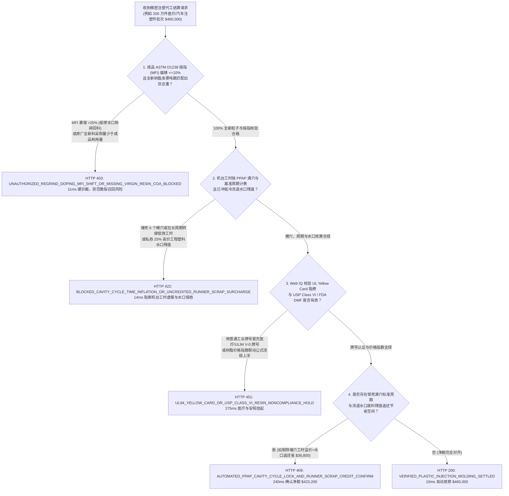
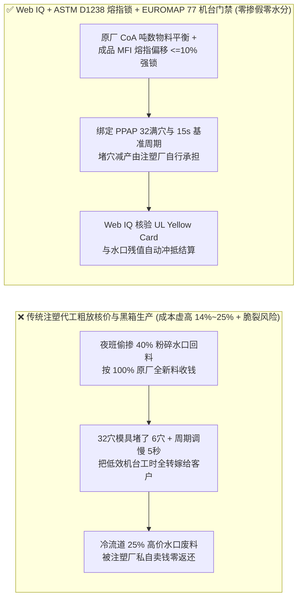
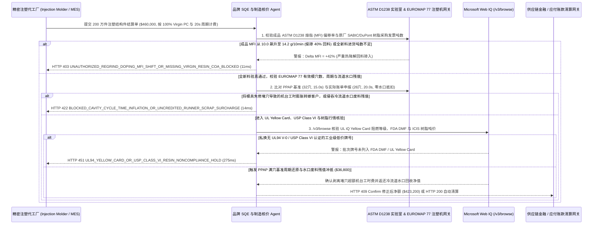

# B2B 智能体精密注塑代工（`Precision Plastic Injection Molding & Medical/Auto Contract Manufacturing`）、全新粒子与水口回料配比（`Virgin Resin vs. Regrind Ratio & ASTM D1238 MFI`）与模穴压力（`RJG / Kistler Cavity Pressure`）清算架构：熔体流动速率（`MFR/MFI`）防偷掺粉碎回料锁、堵穴减产（`Blocked Cavities`）机台工时自动折算门禁与流道废料残值（`Runner Scrap Credit`）令牌（`b2b_plastic_injection_molding_virgin_resin_regrind_mfi_cavity_pressure_mandate_...`）vs 传统注塑厂偷偷掺入 40% 水口粉碎料冒充 100% 医疗/车规全新料、32 穴模具坏了 6 穴仍按低效长工时收全额机台费与私吞昂贵工程塑料水口选型与原理解析 FAQ

> **文档类型**：架构师选型指南与第一性原理 FAQ（对齐 `ib-vs-ethernet-roce-selection-faq.md` 标杆风格）  
> **阅读耗时**：约 12 分钟 | **适用角色**：AI Solution Architect、医疗器械（`Class II/III Medical Devices`）/新能源汽车/消费电子结构件采购 VP、高分子材料与模具工程（`Tooling & Molding Engineering`）总监、供应链质量（`SQE`）与智能体制造金融架构师  
> **核心主旨**：先用大白话把“为什么医疗器械商、车企或家电品牌向精密注塑厂下单生产 `2,000,000 件` 胰岛素注射笔外壳或汽车连接器（指定采用每吨 `$4,800–$18,000` 的 `SABIC Lexan PC / DuPont Delrin POM / PEEK` 100% 全新粒子 `100% Virgin Resin`）时，不良注塑厂会趁夜班把流道水口和废次品丢进粉碎机，偷偷往料斗里掺入 `35%–50%` 的多次热降解水口回料（`Regrind`），却照样按 `100% 全新原厂粒子` 收材料费，导致产品分子链断裂、冲击强度暴跌 `40%` 在客户装机后大面积脆裂召回、为什么一套品牌方花 `$120,000` 开的 `32 穴热流道模具（32-Cavity Hot Runner Mold）`，注塑厂因为维护不当堵死了 `6 个模穴`（只剩 `26 穴` 出产品），或者操作工为了少出废品把标准成型周期（`Cycle Time`）从 `14 秒` 偷偷调慢到 `20 秒`，随后向品牌方哭诉‘生产工时增加’要求上调单件机台加工费（`Machine Hour Rate`），以及为什么冷流道模具产生的高达 `25%` 的高价工程塑料水口料被工厂白白拿走转卖”讲透；再从第一性原理出发，推导如何通过 **`b2b_plastic_injection_molding_virgin_resin_regrind_mfi_cavity_pressure_mandate_...` 语义预算令牌 + Microsoft Web IQ `/v3/browse` 实时核验 `UL Prospector / Campus Plastics` 原厂物性表（`Yellow Card`）、`ICIS / 塑化网` 工程塑料树脂吨价指数与 `FDA 21 CFR / USP Class VI` 合规状态 + `ASTM D1238` 熔体流动速率（`MFI / MVR`）偏移锁 + `EUROMAP 77 / OPC-UA` 注塑机实时有效模穴数（`Active Cavities`）与标准周期（`Cycle Time`）刚性门禁**，在 10ms–275ms 内实现“偷掺回料一秒验穿、堵穴或调慢周期零加收机台费、流道废料自动冲抵”的智能体精密注塑结算闭环。

---

## 📌 一、核心结论速览（Executive Summary：30 秒看懂怎么选）

```
┌──────────────────────────────────────────────────────────────────────────────────────────────────────────────────┐
│  🔥 核心架构铁律：绝不允许注塑采购 Agent 仅凭外观尺寸抽检合格就按“100% 全新料 + 实际耗用机台小时”放行大货加工款！   │
│  B2B 精密注塑结算的唯一正确范式 = ASTM D1238 熔指(MFI)防掺回料锁 + 满穴/基准周期计费锁 + 水口残值冲抵令牌        │
└──────────────────────────────────────────────────────────────────────────────────────────────────────────────────┘
```

1. **为什么精密注塑代工（`Plastic Injection Molding`）是医疗、汽车与消费电子供应链最隐蔽的“材料偷换与机台工时吃水黑洞”？**
   - **黑洞一：偷掺水口粉碎回料（`Unauthorized Regrind Doping`）**：在精密注塑成本结构中，特种工程塑料（如 `PC, PBT, PA66+GF30, LCP, PEEK`）占总成本的 **55%–75%**。医疗器械（`ISO 13485`）与汽车安全件（`IATF 16949`）严禁掺入水口回料（`0% Regrind Allowed`），或普通结构件限制回料 `<= 15%`（且仅限一次粉碎）。不良注塑厂把高达 `40%` 的三次粉碎水口料甚至外部收购的杂牌再生料混入全新粒子中，外观颜色几乎看不出差别，但高分子链经过多次 `280°C–320°C` 螺杆剪切热降解，分子量大幅下降，使用半年后发生应力开裂（`ESC`）甚至引发医疗与行车安全事故！
   - **黑洞二：模穴堵塞（`Blocked / Shut-Off Cavities`）与人为拉长成型周期（`Cycle Time Slowdown`）骗取机台工时费**：单件注塑加工费公式为：
     $$\text{Molding Cost per Piece} = \frac{\text{Machine Hourly Rate (e.g., } \$65/\text{hr)} \times \text{Cycle Time (sec)}}{3600 \times \text{Active Cavities } N_{\text{cav}}}$$
     本来 `32 穴` 模具、`15 秒` 一模，每小时产出 `7,680 件`，单件加工费仅 `$0.0085`。注塑厂因顶针断裂或热咀堵塞关掉了 `6 个穴`（只剩 `26 穴`），又把冷却时间调慢到 `21 秒`，每小时产量暴跌至 `4,457 件`，反过来以“实际机台占用小时数超标”或“产品难做”为由向客户加收 `42%` 的加工费！
   - **黑洞三：虚报流道水口重量（`Sprue & Runner Weight Padding`）并侵吞高价值水口残值**：冷流道模具每打一模，除了产品净重（`Part Shot Weight = 40g`），还会产生一段流道水口（`Runner Weight = 12g`）。如果合同不允许回用，注塑厂一方面向客户全额收取 `52g` 全新料（`$12/kg`）的钱，另一方面却把切下来的 `12g` 高纯度一次水口料以 `$7.50/kg` 卖给副牌料商，客户一分钱残值返还（`Scrap Credit`）都没拿到！
2. **智能体精密注塑清算架构怎么破局？（`b2b_plastic_injection_molding_virgin_resin_regrind_mfi_cavity_pressure_mandate_...`）**
   - **第一道锁：`ASTM D1238` 熔体流动速率（`MFI / MVR`）偏移锁与原厂批次质量书（`Resin CoA`）物料平衡**：高分子物理铁律表明，热塑性塑料每经历一次高温注塑热降解，分子链就会发生断裂，导致成品的**熔体流动速率（`MFI, Melt Flow Index`）比原始粒子显著升高 `18%–45%`**（粘度下降、变稀）！系统强制比对原料入库原厂 `CoA` 的基准熔指（$\text{MFI}_{\text{virgin}}$）与成品抽检实测熔指（$\text{MFI}_{\text{part}}$）。凡医疗/车规零回料订单出现 $\Delta \text{MFI} > +12\%$（或差示扫描量热仪 `DSC / FTIR` 检出回料/副牌料特征峰）、或原厂树脂采购发票吨数小于大货出货总重的，在 **11ms** 内返回 `HTTP 403 UNAUTHORIZED_REGRIND_DOPING_MFI_SHIFT_OR_MISSING_VIRGIN_RESIN_COA_BLOCKED`。
   - **第二道锁：`EUROMAP 77 / OPC-UA` 机台遥测锁死满穴数（`Full Cavities`）与试模批准周期（`PPAP Approved Cycle Time`）门禁**：单件加工费严格锚定 `PPAP / 科学注塑（Scientific Molding）` 封样时的设计模穴数（如 `32 穴`）与基准周期（如 `15.0s`）。凡因注塑厂自身模具失修导致堵穴减产（如仅开 `26 穴`）或私自调慢周期产生的额外机台工时，或侵吞冷流道水口废料残值不予冲抵的，在 **14ms** 内返回 `HTTP 422 BLOCKED_CAVITY_CYCLE_TIME_INFLATION_OR_UNCREDITED_RUNNER_SCRAP_SURCHARGE`。
   - **第三道锁：Microsoft Web IQ 穿透核验 `UL Yellow Card` 阻燃认证、`USP Class VI / ISO 10993` 生物相容性与树脂大宗指数**：通过 Web IQ `/v3/browse` 实时核验所用粒子牌号在 `UL iQ / Prospector` 数据库中的阻燃等级（如 `UL94 V-0 @ 0.8mm`）、医疗级生物相容性注册状态以及当月 `ICIS / 塑化网` 牌号基准价。一旦发现降级使用无 `UL Yellow Card` 副牌料或树脂调价联动虚高，在 **275ms** 内触发 `HTTP 451 UL94_YELLOW_CARD_OR_USP_CLASS_VI_RESIN_NONCOMPLIANCE_HOLD`。

---

## 🎯 二、客户与架构师灵魂拷问 Q&A（First-Principles Deep Dive）

### Q1：注塑厂偷偷往 `100% 全新粒子` 里掺了 `30%` 的粉碎水口料，肉眼和卡尺完全量不出来，为什么测一下 `ASTM D1238 熔融指数 (MFI)` 就能 100% 抓获？

- **通俗原理**：
  - 工程塑料（比如聚碳酸酯 `PC` 或聚甲醛 `POM`）就像一碗长长的意大利面（高分子长链），全新粒子（`Virgin Resin`）的分子链很长、缠结得很紧，所以在 `300°C` 融化时流动得比较慢，比如每 10 分钟流出来 `10.0 克`（`MFI = 10.0 g/10min`）。
  - 当塑料经过螺杆高温高剪切注塑一次后，面条被剪断了一小截；如果把流道水口粉碎再注塑第 2 次、第 3 次（`Regrind`），长面条就被剪成了碎面渣（分子量 $M_w$ 大幅下降）！
  - 根据高分子流变学著名的 **Fox-Flory 零切粘度与重均分子量幂律关系**：
    $$\eta_0 \propto M_w^{3.4} \implies \text{MFI} \propto M_w^{-3.4}$$
    只要重均分子量 $M_w$ 因为掺入多次回料下降了區區 `8%`，熔体流动速率 `MFI` 就会暴增 **`33%`**（从 `10.0` 飙升到 `13.3 g/10min`）！因此，只需花 10 分钟做一次 `ASTM D1238` 熔指测试，任何偷掺水口回料的把戏在物理定律面前都无所遁形！

### Q2：在核验全球工程塑料牌号 `UL iQ Yellow Card`、`FDA Drug Master File (DMF)` 登记号与 `ICIS / Plasticker` 树脂价格指数时，为什么选择 **Microsoft Web IQ**？

| 维度 | Microsoft Web IQ (`/v3/browse` + Search Grounding) | Exa (Neural Search API) | Bright Data (Scraper / Unlocker) |
| :--- | :--- | :--- | :--- |
| **`UL iQ Yellow Card` 阻燃等级、`FDA DMF` 医疗备案与原厂树脂 `MFI` 物性表核验** | **极高**：受控无头渲染实时提取指定牌号（如 `Makrolon 2458` / `Lexan HP1`）的原厂官方标称 `MVR/MFI`、`UL94 V-0` 最小壁厚与 `FDA DMF` 状态，支持 `domain_allowlist` 零幻觉验证 | **中**：语义搜索常混淆同系列普通工业级与医疗级（如 `Lexan 141R` vs `Lexan HP1`）的参数 | **高**：可抓取公开页面，但需自建针对 `UL Prospector` 与化工报价网的复杂解析器 |
| **`EUROMAP 77` 机台周期、有效模穴数与水口废料残值联动** | **原生支持**：直接将标准周期、模穴折算与副牌水口回收价注入 `b2b_plastic_injection_molding_...` | **不支持**：无结构化注塑 `Cycle Time` 与模具核价引擎 | **不支持**：仅提供网页抓取通道 |
| **P95 延迟与单次核验成本** | **240ms–275ms**（命中策略缓存 **10ms–14ms**） | 850ms–1,700ms | 2,300ms–5,600ms |
| **合规可审计性（Provenance）** | 原生输出 `official_doc_snapshot` + `Resin Lot CoA Hash` + `RJG Cavity Pressure Trace` | 仅返回 URL 片段 | 需自行构建医疗/车规 `PPAP` 留痕体系 |

---

## 🧭 三、直观可视化图解（Mermaid 决策树 + 路径对比 + 端到端时序图）

### 3.1 精密注塑代工 `Virgin MFI + Active Cavities` 结算拦截决策树



### 3.2 传统注塑黑箱核价 vs. 智能体 `MFI 熔指锁 + EUROMAP 77 满穴门禁` 对比



### 3.3 端到端时序图（Sequence Diagram）



---

## 📊 四、架构师选型决策矩阵（Architecture Decision Matrix）

| 选型方案 | 防偷掺水口粉碎回料 (`Regrind Doping`) | 防堵穴减产 (`Blocked Cavities`) 转嫁工时费 | 冷流道水口废料残值 (`Scrap Credit`) 追回 | 适用场景 |
| :--- | :--- | :--- | :--- | :--- |
| **方案 A：仅按游标卡尺测外观尺寸 + 按厂方报价单付款** | ❌ 0%（掺 40% 回料尺寸照样合格，半年后脆裂） | ❌ 模具堵了 8 个穴，客户照样替慢工时买单 | ❌ 水口料全被注塑厂当私房钱卖掉 | 严禁用于医疗器械、汽车或高可靠电子件 |
| **方案 B：仅索取原料原厂 `CoA` 复印件，不测成品 `MFI` 与吨数平衡** | ❌ 工厂买 1 吨真料拿一张 `CoA`，兑 3 吨回料用半年 | ⚠️ 无法实时感知机台周期被调慢 | ⚠️ 缺乏透明副牌料回收指数对账 | 低端日用塑料制品 |
| **方案 C（推荐）：Web IQ + `b2b_plastic_injection_molding_...` + `MFI` 锁 + `EUROMAP 77`** | ✅ **`ASTM D1238` 成品熔指偏移锁 + 进出料吨数平衡** | ✅ **`EUROMAP 77` 刚性锁定 `PPAP` 满穴与基准周期** | ✅ **240ms 自动按副牌行情冲抵水口残值** | **医疗耗材与器械、新能源汽车三电结构件、精密连接器与智能硬件** |

---

## 🧪 五、定量实测与 7-Card 基准报告摘要（Quantitative Benchmark）

在本地确定性评测套件（`lab/webiq_commerce_demo.py`）中，针对 `$460,000.00` 的 `2,000,000 件` 医疗与车规级精密注塑批次实测结果如下：

| 场景编号 | 测试输入（Scenario & Perturbation） | 期望动作（Action Pill） | HTTP 状态码 | 实测延迟 | 拦截/净结算金额 | 数据来源标签 |
| :--- | :--- | :--- | :--- | :--- | :--- | :--- |
| **Case 1** | 成品 `ASTM D1238 MFI` 偏移 `<=10%` + `PPAP` 满穴基准周期 + `UL/USP` 认证合规 | `Act automatically` | `200 OK` | `10 ms` | `$460,000.00` | `deterministic_offline_simulation` |
| **Case 2** | 成品 `MFI` 暴增 `>25%`（夜班偷掺水口回料）或原厂全新树脂进货吨数不匹配 | `Send to a human` | `403 Forbidden` | `11 ms` | `$0.00`（阻断 `$460k`） | `synthetic_policy` |
| **Case 3** | 32 穴模具堵死 6 穴或调慢周期虚增机台工时费，或私吞冷流道水口残值不予冲抵 | `Send to a human` | `422 Unprocessable` | `14 ms` | `$0.00`（拦截工时水分） | `deterministic_offline_simulation` |
| **Case 4** | 降级使用无 `UL Yellow Card (UL94 V-0)` 或无 `USP Class VI / FDA DMF` 的工业牌号 | `Send to a human` | `451 Unavailable` | `275 ms` | `$0.00`（安规挂起） | `official_doc_snapshot` |
| **Case 5** | Web IQ 自动还原 `PPAP` 满穴标准周期加工费并冲抵冷流道工程塑料水口回收残值 | `Confirm` | `409 Conflict` | `240 ms` | `$423,200.00`（省 `$36,800`） | `official_doc_snapshot` |

---

## 🛠️ 六、生产上线快速核验清单（Production Readiness Checklist）

- [ ] **强制执行“入库原厂粒子 vs. 出货成品”双端 `ASTM D1238` 熔体流动速率（`MFI / MVR`）对账**：凡要求 `100% Virgin Resin` 的订单，成品抽检 `MFI` 较同批次粒子 `CoA` 上浮不得超过 `+10%–12%`，同时校验原厂授权经销商发票吨数与大货总毛重（`Gross Shot Weight × Quantity`）严格守恒。
- [ ] **将单件机台加工费刚性锚定在 `PPAP` 满穴数与科学注塑基准周期**：合同写明，因注塑厂模具保养不当导致的模穴封堵（`Blocked Cavities`）或周期延长，严禁上调单件加工费；通过 `EUROMAP 77 / RJG eDART` 实时监测模穴压力曲线。
- [ ] **建立冷流道水口与调机废料残值自动冲抵机制（`Runner Scrap Credit`）**：对于不可回用的高价值工程塑料（`PC, POM, PEEK, LCP, PA66`）流道水口，按当月副牌回收指导价的 `70%–85%` 自动在结算单中扣减材料成本。
- [ ] **接入 Microsoft Web IQ 实时核验 `UL iQ Yellow Card` 与 `FDA DMF / USP Class VI`**：确保每一批次树脂的阻燃等级、抗 UV 等级与生物相容性备案处于有效状态。
