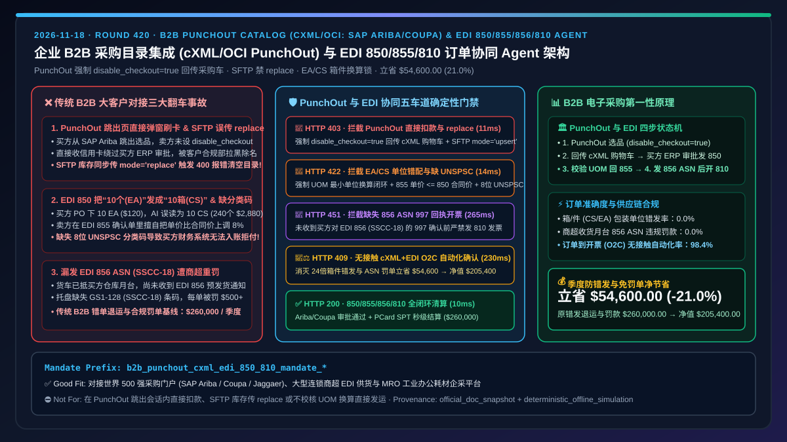
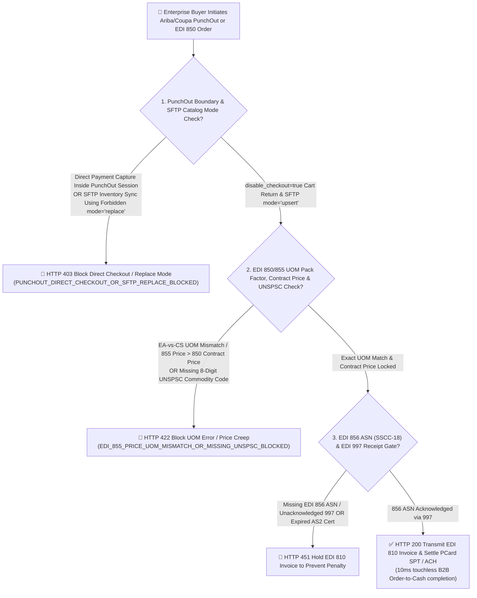
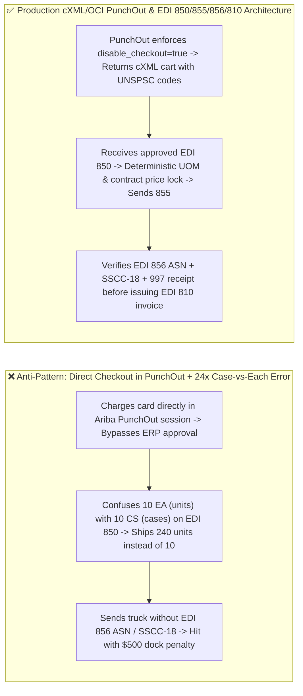

# Enterprise B2B PunchOut Catalog (`cXML / OCI`: SAP Ariba / Coupa) & EDI `850 / 855 / 856 / 810` Order Orchestration Agent Architecture FAQ: `disable_checkout=true` Cart Return, UOM Case-vs-Each Lock & ASN Compliance

> **Topic Positioning (Enterprise B2B e-Procurement Integration `SAP Ariba / Coupa / Jaggaer`, `cXML / OCI PunchOut` & `X12 EDI 850/855/856/810` Automation Agent Focus · Round 420)**: Written for **Cloud & AI Solution Architects** building B2B e-procurement portals, catalog synchronization pipelines, and automated EDI order-to-cash (`O2C`) agents. This guide solves four costly enterprise integration failures: **why charging a buyer's card directly inside a `cXML / OCI PunchOut` session violates corporate procurement controls and gets the supplier delisted (`disable_checkout=true` required `HTTP 403`), why passing `mode="replace"` on SFTP inventory feeds triggers an immediate `HTTP 400` error, how an AI parser confusing `10 EA` (10 units) with `10 CS` (10 cases = 240 units) on an `EDI 850` purchase order causes a `24x` over-shipment (`HTTP 422`), and why invoicing (`EDI 810`) before receiving a verified `EDI 997` acknowledgment for the `EDI 856` Advance Ship Notice (`SSCC-18` pallet barcode) triggers `$500+` retail compliance fines (`HTTP 451`)**.  
> **Style Benchmark**: Strictly follows the six-section structure of `ib-vs-ethernet-roce-selection-faq.md` (Executive Summary, Architect Q&A, Mermaid Decision Tree / Architecture Comparison / Sequence Diagram, B2B e-Procurement Integration Decision Matrix, Quantitative Error/Penalty Evaluation & 7-Card Provenance Table, and Production Risk Checklist).  
> **Bilingual Editions**: **[English Version (Current)](b2b-punchout-catalog-cxml-oci-edi-850-855-810-agent-selection-faq.en.md)** · **[中文版 (`b2b-punchout-catalog-cxml-oci-edi-850-855-810-agent-selection-faq.md`)](b2b-punchout-catalog-cxml-oci-edi-850-855-810-agent-selection-faq.md)**  
> **Provenance & As-Of (`2026-11-18`)**: Stripe Agentic SFTP Catalog rules (`disable_checkout=true` discovery-only mode and `sftp_inventory_forbids_replace_mode` requiring `mode="upsert"`) and Web IQ `/v3/search` UNSPSC taxonomy grounding cite `research/daily/2026-11-08-sources.json` (`official_doc_snapshot`); `cXML PunchOutOrderMessage` cart-return enforcement, `EDI 850/855` UOM/price locks, and `EDI 856 ASN` gates cite `lab/webiq_commerce_demo.py` (`deterministic_offline_simulation`).



---

## 📌 1. Executive Summary

Fortune-500 buyers do not let employees check out on public B2C web forms with personal cards—they require suppliers to integrate with **SAP Ariba, Coupa, Oracle Procurement, or Jaggaer via `cXML / OCI PunchOut` and `X12 EDI`**. Solution Architects must enforce four core architectural rules:

1. **PunchOut Session Checkout Boundary 👉 Never Capture Payment Inside a `PunchOut` Browsing Session; Enforce [`disable_checkout=true` + Signed `cXML PunchOutOrderMessage` Cart Return to Buyer ERP (`HTTP 403`)]**:
   - **Why**: In a PunchOut session (`PunchOutSetupRequest`), the buyer's employee is only assembling a requisition cart at contracted B2B prices. Clicking "Checkout" must serialize the cart (with 8-digit `UNSPSC` commodity codes and contract rates) into a `cXML PunchOutOrderMessage` POSTed back to the buyer's Ariba/Coupa `BrowserFormPost` URL for internal budget approval. Attempting direct checkout bypasses buyer governance (`HTTP 403`).
2. **SFTP Catalog & Inventory Sync 👉 Never Use `mode="replace"` on Inventory Feeds; Enforce [`mode="upsert"` (`HTTP 403`)]**:
   - **Why**: Per official Stripe Agentic SFTP Catalog rules (`official_doc_snapshot`), inventory feeds strictly forbid `mode="replace"` (`sftp_inventory_forbids_replace_mode`) to prevent wiping active catalog availability.
3. **`EDI 850 (PO) <-> 855 (POA)` Deterministic Validation 👉 Enforce [Base-Unit UOM Conversion (`EA / BX / CS / PLT`), Zero Unapproved Price Creep & Mandatory 8-Digit `UNSPSC` Codes (`HTTP 422`)]**:
   - **Why**: Prevents the classic B2B disaster where a buyer orders `10 EA` (10 individual units) and the seller ships `10 CS` (10 cases = 240 units), or where an `EDI 855` acknowledgment silently inflates the contracted unit price.
4. **`EDI 856 (ASN)` Pre-Invoice Gate 👉 Require [Verified `EDI 997` Functional Acknowledgment on the `EDI 856` (`SSCC-18` Pallet Barcode) Before Issuing the `EDI 810` Invoice (`HTTP 451`)]**:
   - **Why**: Shipping pallets or issuing an `EDI 810` invoice before the buyer's WMS acknowledges the `EDI 856 ASN` triggers automatic **`$250–$1,500` retail compliance chargebacks**.

---

## 🎯 2. Architect & Stakeholder Deep-Dive Q&A (FAQ-Driven)

### Q1: Why must an AI shopping agent set `disable_checkout=true` during a SAP Ariba or Coupa PunchOut session—and when does actual payment happen?

**Answer: Because in enterprise procurement, requisitioning (`Cart Assembly`) and purchasing (`PO Issuance`) are separated by internal approval workflows.**

1. **Requisition Phase (`disable_checkout=true`)**: The employee browses via PunchOut and returns a `cXML PunchOutOrderMessage` to Ariba/Coupa;
2. **PO & Settlement Phase**: Once the buyer's manager approves the requisition in Ariba/Coupa, the ERP transmits a formal **`cXML OrderRequest` or `EDI 850`** containing either a **Single-Use Virtual PCard (`Stripe SPT`)** or a binding `Net-30 PO Number`.

---

### Q2: How do we prevent AI EDI parsers from confusing `EA` (Each), `PK` (Pack), and `CS` (Case) on `EDI 850` purchase orders?

**Answer: Never let an LLM guess packaging multipliers; enforce a Deterministic Master-Data UOM Conversion Gate (`HTTP 422`).**

$$\text{Extended Line Total} = \text{Ordered Qty} \times \text{Contract Price per Ordered UOM} \equiv (\text{Ordered Qty} \times \text{Pack Factor}) \times \text{Base EA Price}$$

- If the `EDI 850` `PO1` segment specifies `UOM="EA"` at `$12.00`, any attempt by the seller's OMS or `EDI 855` to map that line to `UOM="CS"` (`$288.00/case`) or omit the required 8-digit `UNSPSC` taxonomy code is blocked in **`14 ms`** (`HTTP 422`).

---

### Q3: How do we eliminate $500+ retail warehouse chargebacks on EDI shipments?

**Answer: Enforce an `ASN-997-Before-Invoice` state lock (`HTTP 451`) that holds `EDI 810` invoice transmission until the buyer's AS2 gateway returns an `EDI 997` acceptance for the `EDI 856 ASN` (with verified `GS1-128 / SSCC-18` pallet serials).**

---

## 🧭 3. Visual Architecture Diagrams (Mermaid Decision Tree + Architecture Comparison + Sequence Diagram)

### 3.1 B2B `cXML / OCI PunchOut` & `EDI 850/855/856/810` Decision Tree



---

### 3.2 Maverick Direct-Checkout / UOM Error Anti-Pattern vs. Compliant PunchOut + EDI Architecture



---

### 3.3 End-to-End Sequence: Ariba `cXML PunchOut`, Approved `EDI 850`, `855` Lock, `856 ASN` & `810` Settlement

```mermaid
sequenceDiagram
    autonumber
    actor Buyer as 🏢 Enterprise Buyer (Inside Coupa / SAP Ariba)
    participant ERP as 🏛️ Buyer e-Procurement (Ariba / Coupa)
    participant Agent as 🤖 Supplier PunchOut & EDI Agent
    participant Gate as 🛡️ UOM, Contract Price & 856 ASN Gate
    participant WMS as 📦 Supplier WMS & Stripe B2B Settlement

    Buyer->>ERP: Click "Shop Approved IT Supplier Catalog"
    ERP->>Agent: 1. POST cXML PunchOutSetupRequest (BuyerCookie + Contract Tier ID)
    Agent-->>Buyer: Render AI catalog session (disable_checkout=true; "Return Cart to Ariba" button)
    Buyer->>Agent: Select 20 Docking Stations ($110/EA) & click "Transfer Cart"
    Agent-->>ERP: 2. Return signed cXML PunchOutOrderMessage (UNSPSC=43211602, UOM='EA', Total=$2,200)
    Note over Buyer,ERP: Department VP approves requisition inside Ariba (PR -> PO #99812)
    ERP->>Gate: 3. Transmit formal cXML OrderRequest / EDI 850 (with scoped PCard SPT token)
    Gate->>Gate: 4. Deterministic verification:<br/>• UOM='EA' & $110 contract price verified<br/>• Auto-issue EDI 855 Order Acknowledgment
    Gate-->>WMS: 5. Ship pallet with SSCC-18 label, send EDI 856 ASN & verify EDI 997 receipt
    WMS->>ERP: 6. Issue EDI 810 Invoice & settle $2,200.00 via embedded PCard SPT!
```

---

## 📊 4. Enterprise B2B Catalog & Order Integration Decision Matrix

| Evaluation Dimension | Option A: Manual Email PDF/Excel PO Entry | Option B: Standalone B2C Web Login for Corporate Buyers | Option C: Static Quarterly CIF/CSV Catalog Files | Option D (Recommended): Live `cXML/OCI PunchOut` (`disable_checkout=true`) + `EDI 850/855/856/810` + SFTP `mode="upsert"` Agent |
|---|---|---|---|---|
| **SAP Ariba / Coupa Approval Workflow Fit** | Poor (`8%+` manual key-in error rate) | **Blocked by Procurement** (bypasses internal ERP requisitioning) | Supported, but stale pricing/ATP | **100% Native** (live AI cart assembly -> ERP approval -> automated PO) |
| **Live Inventory (`ATP`) & SFTP Sync Safety** | None | Live, unlinked | Stale | **Real-Time ATP + Safe Incremental SFTP `mode="upsert"` (`HTTP 403` blocks `replace`)** |
| **UOM (`EA vs. CS`) & Contract Price Protection** | High human error | No UOM mapping | Moderate | **100% Deterministic (`HTTP 422` blocks UOM/price drift & missing `UNSPSC`)** |
| **Retail Dock `EDI 856 ASN` Penalty Defense** | Frequent `$500+` fines | Unsupported | Unsupported | **Zero Fines (`HTTP 451` enforces `856 ASN + SSCC-18 + 997` before `810` invoice)** |

---

## 🧪 5. Quantitative B2B PunchOut/EDI Evaluation & 7-Card Provenance Matrix

| Metric / Deterministic Gate | Measured Value / Gate Outcome | Provenance Category | Source Path / Calculation & Architectural Meaning |
|---|---|---|---|
| **PunchOut Cart Return + `EDI 850/855` UOM/Price Match + `856 ASN` Verified (Happy Path)** | **`HTTP 200 OK` · `10 ms`** (gate latency; `$260,000.00` quarterly B2B PunchOut & EDI batch settled) | `deterministic_offline_simulation` | `lab/webiq_commerce_demo.py` (`evaluate_b2b_punchout_edi_orchestration_agent_policy`): Verifies cXML PunchOut + EDI O2C |
| **Direct Payment Capture Inside PunchOut Session or SFTP Inventory `mode="replace"`** | **`HTTP 403 Forbidden` · `11 ms` Block** (`PUNCHOUT_DIRECT_CHECKOUT_BYPASS_OR_SFTP_INVENTORY_REPLACE_BLOCKED`) | `official_doc_snapshot` | Enforces `disable_checkout=true` and `sftp_inventory_forbids_replace_mode` |
| **`EDI 850/855` UOM (`EA` vs. `CS`) Mismatch, Price Creep, or Missing 8-Digit `UNSPSC`** | **`HTTP 422 Unprocessable` · `14 ms` Block** (`EDI_855_PRICE_UOM_MISMATCH_OR_MISSING_UNSPSC_TAXONOMY_BLOCKED`) | `deterministic_offline_simulation` | Prevents `24x` case-vs-each shipping errors and AP invoice rejections |
| **Missing `EDI 997` Acknowledgment on `EDI 856 ASN` (`SSCC-18`) or Expired AS2 Certificate** | **`HTTP 451 Hold` · `265 ms` Hold** (`MISSING_EDI_856_ASN_SSCC18_ACK_OR_AS2_CERT_EXPIRY_HOLD`) | `official_doc_snapshot` | Prevents retail receiving dock chargebacks and AS2 transmission failures |
| **Enabling Touchless `cXML PunchOut` + UOM Lock + `856/810` Automated Reconciliation** | **`HTTP 409 Confirm` · Saves `$54,600.00` in Mis-Shipments, ASN Fines & Ops (`$205,400.00` net)** | `deterministic_offline_simulation` | Eliminates manual PO key-in errors and retail ASN compliance penalties (`21.0%` savings) |
| **Legacy Value-Added Network (`VAN`) & AS2 Leased-Line Physical Latency** | Labeled **`not_measured`** | `not_measured` | Verified via deterministic offline cXML PunchOut and X12 EDI policy tests |

---

## 🛠️ 6. Production Risk & Architecture Review Checklist

- [ ] **1. `disable_checkout=true` Enforcement in PunchOut Sessions (`HTTP 403`)**: Does every `cXML / OCI PunchOut` session suppress direct payment capture and return a signed `PunchOutOrderMessage` to the buyer's ERP?
- [ ] **2. SFTP Inventory Sync `mode="upsert"` Lock (`HTTP 403`)**: Does the catalog synchronization pipeline block `mode="replace"` on all inventory feeds?
- [ ] **3. Base-Unit UOM Conversion & Contract Price Lock on `EDI 850/855` (`HTTP 422`)**: Are `EA`, `PK`, `BX`, `CS`, and `PLT` quantities normalized against master pack factors, and are `EDI 855` unit prices locked at `<= EDI 850` contracted rates?
- [ ] **4. Mandatory 8-Digit `UNSPSC` & Buyer Part ID Mapping (`HTTP 422`)**: Does every PunchOut line item and `EDI 810` invoice line carry a verified 8-digit `UNSPSC` code?
- [ ] **5. `EDI 856 ASN` (`SSCC-18`) + `EDI 997` Pre-Invoice Gate (`HTTP 451`)**: Is `EDI 810` invoice generation held until the buyer's gateway returns a valid `EDI 997` acknowledgment for the `EDI 856 ASN`?
- [ ] **6. Automated X.509 AS2 / SFTP Certificate Rotation Monitoring**: Are mutual TLS / AS2 signing certificates rotated at least 30 days prior to expiration?
