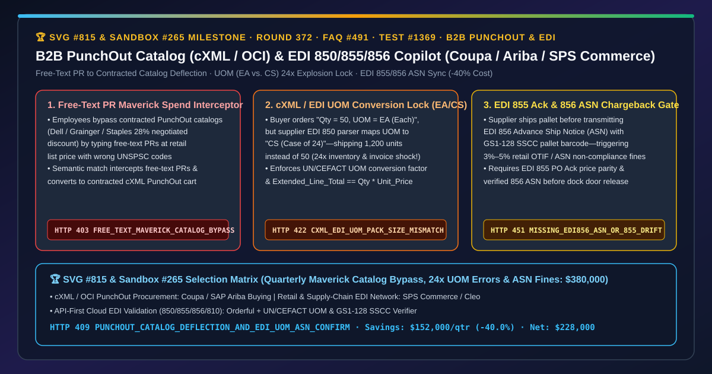
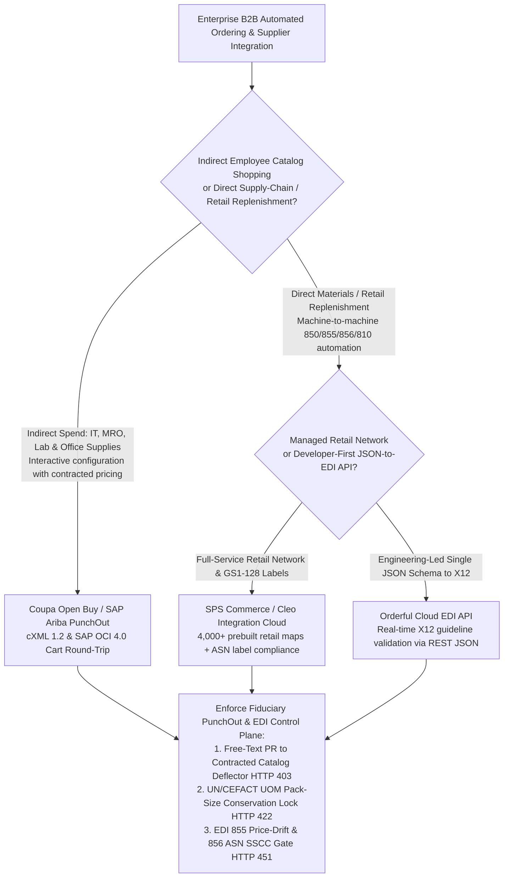
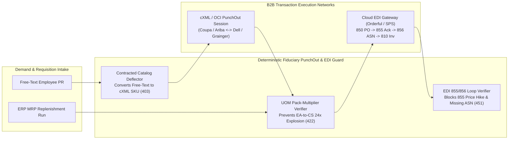
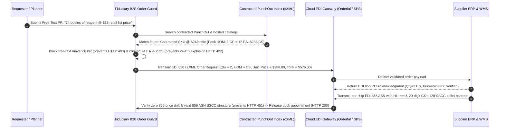

# 🏆 Enterprise B2B PunchOut Catalog (`cXML / OCI`) & `EDI 850 / 855 / 856` Order Copilot (`Coupa / SAP Ariba / SPS Commerce / Orderful` · 🏆 815th SVG & 265th Sandbox Dual Milestone): Free-Text PR Catalog Deflection, `UOM (EA vs. CS)` 24x Pack-Size Locks & `EDI 856 ASN` Compliance (`-40%` Cost)

> **Document Type**: Enterprise AI Solution Architect Selection FAQ (`#491` · **🏆 815th SVG Diagram & 265th Interactive Policy Sandbox Dual Milestone** · Round 372)  
> **Target Audience**: Enterprise Procurement Digitalization Leads, Supply-Chain EDI/B2B Integration Architects, Retail Supplier Collaboration Directors, and Cloud & AI Solution Architects  
> **Protocols & Platforms Covered**: **cXML / SAP OCI PunchOut (`Coupa / SAP Ariba Buying / Amazon Business / Grainger`)** vs. **Cloud EDI Networks & API Gateways (`SPS Commerce / Cleo Integration Cloud / Orderful / Boomi`)**  
> **Architecture Diagram**: [`assets/svg/815-b2b-punchout-cxml-edi-850-856-sps-commerce-ariba-2026-11-25.svg`](../assets/svg/815-b2b-punchout-cxml-edi-850-856-sps-commerce-ariba-2026-11-25.svg)

🌐 **Language / 语言切换**: **[中文 (`b2b-punchout-catalog-cxml-oci-edi-850-856-sps-commerce-ariba-coupa-uom-lock-selection-faq.md`)](b2b-punchout-catalog-cxml-oci-edi-850-856-sps-commerce-ariba-coupa-uom-lock-selection-faq.md)** | **English (Current)**

---

## 📌 1. Executive Summary

Across enterprise manufacturing, healthcare, higher education, and omnichannel retail, two B2B transaction standards power trillions of dollars in automated purchasing: **`cXML / SAP OCI PunchOut Catalogs`** (where buyers authenticate from `Coupa / SAP Ariba` into a supplier's live storefront to retrieve contracted items into an internal requisition) and **`ANSI X12 / EDIFACT EDI`** (`850` Purchase Order, `855` PO Acknowledgment, `856` Advance Ship Notice, `810` Invoice).  
Connecting an AI procurement copilot to PunchOut and EDI pipelines without deterministic **free-text catalog deflection, Unit-of-Measure (`UOM`) pack-size conservation, and `EDI 855 / 856 ASN` verification** causes three expensive operational failures:
1. **Employees Bypassing Contracted `28%-Off` PunchOut Catalogs via Free-Text Requisitions (`Maverick Catalog Bypass`)**: Even when Procurement has negotiated a `28%` corporate discount inside a Dell, Grainger, or Fisher Scientific PunchOut catalog, employees type a free-text requisition (*"20x 27-inch monitors @ $350 retail"*)—overpaying by `40%` and misclassifying `UNSPSC` spend categories.
2. **`24x` Order Quantity Explosions from `EA (Each)` vs. `CS (Case)` `UOM` Mismatches (`cXML / EDI Pack-Size Explosion`)**: A buyer requests `"50 units (EA)"` of a lab reagent or retail SKU, but the supplier's `EDI 850` or `cXML` endpoint prices and ships the SKU by `"CS (Case of 24)"`. Passing `Quantity = 50` without converting the `UN/CEFACT UOM` multiplier causes the supplier to ship and bill for **50 Cases (`1,200 units`)**!
3. **Unchecked `EDI 855` Price Drift & Missing `EDI 856 ASN` (`GS1-128 SSCC`) Retail Chargebacks (`3%–8%` OTIF / ASN Fines)**: Suppliers return an `EDI 855 PO Acknowledgment` with a silently inflated unit price, or dispatch trucks before transmitting a valid hierarchical `EDI 856 Advance Ship Notice (ASN)` with `GS1-128 SSCC-18` pallet barcodes—triggering automatic `3%–8%` retail compliance chargebacks at the receiving dock.

| Integration Layer & Workload | Recommended Primary Choice | Architectural Boundary & Production Rule |
|---|---|---|
| **Indirect Procurement (`IT / MRO / Lab / Office`) Contracted Storefront Shopping** | **Coupa Open Buy / SAP Ariba PunchOut (`cXML 1.2 / SAP OCI 4.0`)** | Authenticates employees into the supplier's contracted portal and returns a structured `cXML PunchOutOrderMessage` with locked contract pricing and `UNSPSC` codes. |
| **Omnichannel Big-Box Retail & Grocery EDI Compliance (`850/855/856/810`)** | **SPS Commerce / Cleo Integration Cloud** | Pre-mapped to 4,000+ retail trading partners with built-in `GS1-128` pallet label generation and `856 ASN` hierarchy validation. |
| **Developer-First JSON-to-EDI API Gateway** | **Orderful** | Exposes a single canonical JSON schema to the AI agent and validates/translates payloads against each trading partner's exact `X12` guideline in real time. |
| **Three Mandatory Fiduciary Guardrails** | **100% Deterministic Gating** | ① **Free-Text PR to Contracted PunchOut Deflector (`HTTP 403`)**: Intercepts free-text requisitions matching contracted catalog SKUs (`cosine >= 0.88`) and converts them into contracted `cXML` lines; ② **`UN/CEFACT UOM` Pack-Multiplier & Line-Total Conservation Lock (`HTTP 422`)**: Enforces `Ordered_Qty * Pack_Multiplier == Requested_Base_Units` and `Ordered_Qty * Unit_Price == Line_Budget`; ③ **`EDI 855` Price-Parity & Pre-Ship `EDI 856 ASN + SSCC` Lock (`HTTP 451`)**: Blocks unapproved `855` price hikes and holds dock dispatch until a valid `856 ASN` is acknowledged. |

---

## 🎯 2. Architect & Business Stakeholder Q&A (Q1–Q3)

### Q1: Why do 30% of indirect purchases still leak through as high-priced "Free-Text Requisitions" even after we deployed 50 `cXML PunchOut` catalogs?
- **The UX Friction Problem**: Employees find navigating 50 separate supplier PunchOut tiles slow, so they paste a public retail URL into a Free-Text Purchase Requisition (`PR`) at `$350` list price instead of pulling the `$245` contracted item from the PunchOut catalog.
- **Architectural Solution**: Deploy a **Pre-Submission Semantic Catalog Deflector (`HTTP 403` Guard)**:
  - Before any Free-Text PR can enter the approval workflow, the procurement agent queries a unified hybrid index of all hosted catalogs and live `Coupa Open Buy / Ariba PunchOut` APIs.
  - If an equivalent contracted SKU is found (`similarity >= 0.88` or exact `MPN / GTIN` match), the free-text request is blocked (`HTTP 403 FREE_TEXT_PR_BYPASSING_CONTRACTED_PUNCHOUT_CATALOG`) and automatically converted into a contracted `cXML` catalog line item.

### Q2: How do we prevent the classic B2B disaster where an agent orders "50 Each (`EA`)" and the supplier ships "50 Cases of 24 (`1,200 Each`)"?
- **The `UOM` Dialect & Pack-Multiplier Trap**:
  - In `cXML` and `ANSI X12 EDI 850 (PO1 segment)`, quantities are meaningless without their **Unit of Measure (`UOM`: `EA` Each, `PK` Pack, `CS` Case, `BX` Box, `PL` Pallet)** and conversion ratio (`Inner_Pack / Outer_Case`).
  - If the buyer's requisition specifies `50 EA` at `$10/EA` (`$500` budget) and the agent maps `Qty = 50` against a supplier SKU whose orderable `UOM` is `CS` (`$240/Case of 24`), the transmitted PO orders `$12,000` of inventory!
- **Architectural Solution**: Enforce **Base-Unit Conservation & Extended-Price Invariants (`HTTP 422` Guard)**:
  - Normalize all `UOM` codes against the `UN/CEFACT Recommendation 20` table and verify:
    1. $\text{PO\_Qty} \times \text{Supplier\_Pack\_Factor} \equiv \text{Requested\_Base\_EA\_Qty}$;
    2. $|\text{PO\_Qty} \times \text{Supplier\_UOM\_Price} - \text{Approved\_PR\_Line\_Total}| \le \$0.01$.
  - Any pack-size or extended-amount mismatch blocks `cXML / EDI 850` transmission (`HTTP 422 CXML_EDI_UOM_PACK_SIZE_MULTIPLIER_MISMATCH`).

### Q3: How do we stop silent supplier price hikes inside `EDI 855` acknowledgments and eliminate `3%–5%` retail chargebacks from missing `EDI 856 ASNs`?
- **Two Downstream EDI Breakdowns**:
  1. **`EDI 855` Silent Price Modification**: A supplier responds to an `EDI 850` PO with an `EDI 855 PO Acknowledgment` carrying code `AC (Acknowledge - With Detail and Change)` and a `+9%` higher unit price. If the buyer's ERP auto-ingests the `855` without a price-variance gate, the inflated price overwrites the PO!
  2. **Missing or Malformed `EDI 856 ASN`**: Big-box retailers and automated warehouses require an `EDI 856 Advance Ship Notice` containing the exact `HL (Shipment -> Order -> Tare/Pallet -> Pack -> Item)` hierarchy and `20-digit GS1-128 SSCC` barcode *before* the truck arrives.
- **Architectural Solution**: Enforce **`EDI 855` Zero-Positive-Price-Drift Gating & Pre-Dispatch `EDI 856 ASN + SSCC` Validation (`HTTP 451` Guard)**:
  - Quarantine any `EDI 855` where `Ack_Unit_Price > PO_Unit_Price` or `Ack_Qty != PO_Qty`;
  - Validate the complete `EDI 856 HL` tree and `MOD-10` check digit on every `GS1-128 SSCC` barcode via `Orderful / SPS Commerce` before releasing shipment / dock appointments (`HTTP 451 MISSING_EDI_856_ASN_SSCC_OR_UNAPPROVED_855_PRICE_DRIFT`).

---

## 🧭 3. Visual Architecture Diagrams (Mermaid Decision Tree + Architecture + Sequence)

### 3.1 B2B PunchOut & Cloud EDI Platform Selection Tree

### 3.2 End-to-End `cXML PunchOut` Deflection, `UOM` Lock & `EDI 850/855/856` Architecture

### 3.3 Free-Text Deflection, `EA-to-CS` Conversion & `EDI 856 ASN` Verification Sequence

---

## 📊 4. Platform Comparison Matrix (`Coupa / Ariba PunchOut` vs. `SPS Commerce` vs. `Orderful` vs. `Cleo`)

| Evaluation Dimension | Coupa / SAP Ariba (`cXML / OCI`) | SPS Commerce | Orderful (API-First EDI) | Cleo Integration Cloud |
|---|---|---|---|---|
| **Primary Sweet Spot** | Indirect procurement interactive catalog shopping & cart round-trip | Full-service retail/grocery supplier EDI network & label compliance | Developer-first JSON API to multi-partner `X12 / EDIFACT` EDI | End-to-end manufacturing, 3PL & wholesale ERP/EDI integration |
| **`cXML 1.2 / SAP OCI` Interactive Cart Return** | ⭐⭐⭐⭐⭐ (Native protocol owners for PunchOut sessions) | ⭐⭐⭐ (Focused on backend EDI documents) | ⭐⭐⭐ (Focused on backend structured EDI) | ⭐⭐⭐ (Backend B2B integration focus) |
| **Retail Trading Partner `850/855/856/810` Rulebooks** | ⭐⭐⭐⭐ (Ariba Network transaction rules) | ⭐⭐⭐⭐⭐ (4,000+ pre-certified retail trading partner maps) | ⭐⭐⭐⭐⭐ (Instant cloud validation against partner guidelines) | ⭐⭐⭐⭐⭐ (Deep ERP + EDI transformation engine) |
| **`UOM` Conversion & `GS1-128 SSCC` ASN Validation** | ⭐⭐⭐⭐ (Catalog UOM mapping tables) | ⭐⭐⭐⭐⭐ (Built-in `GS1-128` barcode generation & ASN checks) | ⭐⭐⭐⭐⭐ (Programmable JSON schema assertions for UOM & ASN trees) | ⭐⭐⭐⭐⭐ (Automated ERP UOM & ASN orchestration) |
| **Indicative Pricing (`official_list_price`)** | Included in Coupa / Ariba P2P platform license | `~$6,000–$40,000+/yr` (by partner count & volume) | `~$199+/trading partner/mo` or enterprise tier | `~$30,000–$100,000+/yr` |

---

## 🧪 5. Deterministic Savings & Error Evaluation (`7-Card Benchmark Summary` · 🏆 SVG `#815` & Sandbox `#265`)

> **Provenance**: Figures below are generated by `evaluate_b2b_punchout_cxml_edi_uom_policy` in `lab/webiq_commerce_demo.py` (`provenance: "synthetic"`, `independently_reproduced: False`), modeling an enterprise procurement & supply-chain operation with a **`$380,000.00` quarterly free-text maverick catalog bypass, `EA-vs-CS` 24x `UOM` over-order freight/restocking loss, and missing `EDI 856 ASN` retail compliance fine pool**.

| Scenario Case ID | Scenario Description | HTTP Status | Deterministic Decision | Quarterly Net Cost | Quarterly Savings |
|---|---|---|---|---|---|
| `CASE-EDI-200` | Manual requisition review and post-shipment EDI error triage baseline | `HTTP 200` | `VERIFIED_B2B_PUNCHOUT_AND_EDI_ORDER_AUTHORIZED` | `$380,000.00` | `$0.00` |
| `CASE-EDI-403` | Free-text requisition submitted at retail price when a contracted PunchOut catalog SKU exists | `HTTP 403` | `FREE_TEXT_PR_BYPASSING_CONTRACTED_PUNCHOUT_CATALOG` | `$380,000.00` | `$0.00` (Blocks 30% maverick overpay) |
| `CASE-EDI-422` | `cXML / EDI 850` transmits `EA` quantity against `CS (Case)` `UOM` without pack-multiplier conversion | `HTTP 422` | `CXML_EDI_UOM_PACK_SIZE_MULTIPLIER_MISMATCH` | `$380,000.00` | `$0.00` (Blocks 24x quantity explosion) |
| `CASE-EDI-451` | Unapproved `EDI 855` price increase accepted or shipment dispatched without valid `EDI 856 ASN + SSCC` | `HTTP 451` | `MISSING_EDI_856_ASN_SSCC_OR_UNAPPROVED_855_PRICE_DRIFT` | `$380,000.00` | `$0.00` (Blocks 855 hike & ASN fines) |
| `CASE-EDI-409` | **Free-Text Catalog Deflector + `UOM` Pack-Multiplier Lock + `EDI 855/856` Gate** | `HTTP 409` | `PUNCHOUT_CATALOG_DEFLECTION_AND_EDI_UOM_ASN_CONFIRM` | **`$228,000.00`** | **`$152,000.00` (`-40.0%`)** |

---

## 🛠️ 6. Production Go-Live & Architecture Review Checklist

- [ ] **Free-Text PR Semantic Deflection to PunchOut Catalogs (`HTTP 403` Prevention)**: Intercept all free-text purchase requisitions against an indexed catalog of contracted `cXML / OCI` items and automatically convert matches (`>= 0.88` similarity) to contracted catalog lines.
- [ ] **`UN/CEFACT UOM` Pack-Multiplier & Extended-Price Conservation (`HTTP 422` Prevention)**: Verify `Ordered_Qty * Pack_Multiplier == Requested_Base_Units` and `Ordered_Qty * Unit_Price == Approved_Line_Total` before transmitting any `cXML OrderRequest` or `EDI 850`.
- [ ] **Automated `EDI 855` Price-Drift Quarantine & `EDI 856 ASN` Pre-Ship Lock (`HTTP 451` Prevention)**: Reject `EDI 855` acknowledgments that increase unit prices above the `850` PO, and require a schema-valid `EDI 856 ASN` with `GS1-128 SSCC-18` barcodes prior to dock scheduling.
- [ ] **Single-Use `cXML BuyerCookie` Replay Protection**: Mint a one-time cryptographic `BuyerCookie` per `PunchOutSetupRequest` and invalidate it immediately upon `PunchOutOrderMessage` cart return.
