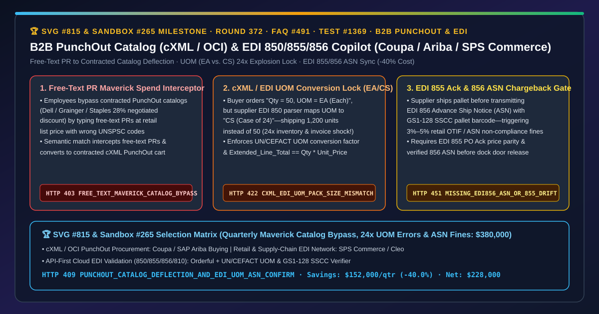
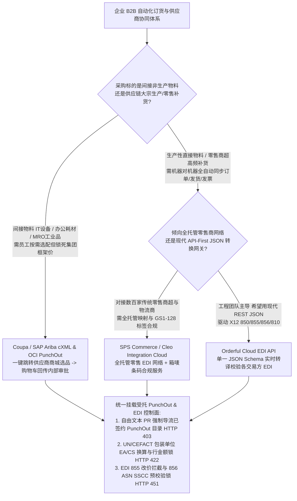
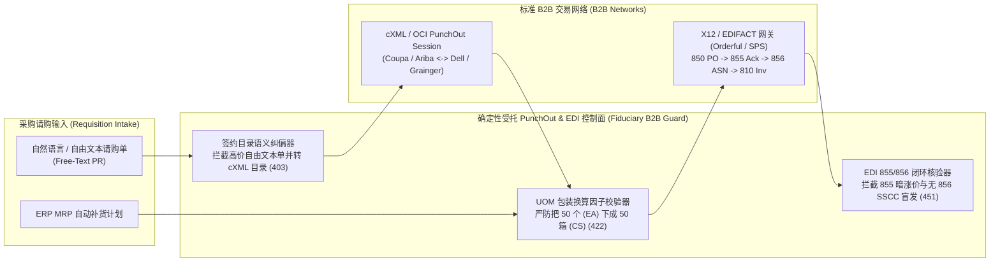
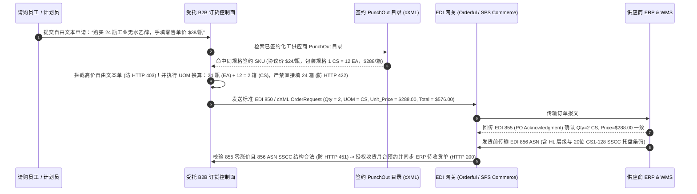

# 🏆 企业 B2B 目录直通采购（`PunchOut Catalog`: `cXML / OCI`）与电子数据交换（`EDI 850 / 855 / 856`: `Coupa / SAP Ariba / SPS Commerce / Orderful` · 🏆 第 815 张架构图与第 265 个策略沙盒双里程碑）：拦截自由文本请购单绕过签约目录低价、计量单位（`UOM: 个 EA vs. 箱 CS`）24 倍乌龙放大锁与预发货通知（`EDI 856 ASN`）合规净省 40% 指南

> **文档类型**：企业级 AI Solution Architect 选型决策指南（Selection FAQ · `#491` · **🏆 SVG `#815` & Sandbox `#265` 双里程碑** · Round 372）  
> **适用读者**：企业采购数字化负责人、供应链 EDI/B2B 集成架构师、零售商超供应商协同总监与 Cloud & AI Solution Architect  
> **核心覆盖协议与平台**：**cXML / SAP OCI PunchOut（`Coupa / SAP Ariba Buying / Amazon Business / Grainger`）** vs. **云端 EDI 网络与 API 网关（`SPS Commerce / Cleo Integration Cloud / Orderful / Boomi`）**  
> **关联架构图**：[`assets/svg/815-b2b-punchout-cxml-edi-850-856-sps-commerce-ariba-2026-11-25.svg`](../assets/svg/815-b2b-punchout-cxml-edi-850-856-sps-commerce-ariba-2026-11-25.svg)

🌐 **语言切换 / Language**: **中文 (当前)** | **[English (`b2b-punchout-catalog-cxml-oci-edi-850-856-sps-commerce-ariba-coupa-uom-lock-selection-faq.en.md`)](b2b-punchout-catalog-cxml-oci-edi-850-856-sps-commerce-ariba-coupa-uom-lock-selection-faq.en.md)**

---

## 📌 一、核心选型结论速览（Executive Summary）

在大型制造、医疗、高校、政企与连锁零售的 B2B 交易中，两大标准协议支撑着全球数万亿美元的自动化订货：**面向间接采购的 `cXML / SAP OCI PunchOut Catalog`（从企业内部 Coupa/Ariba 一键免密跳转进戴尔、固安捷、亚马逊企业购专享目录选品回传购物车）** 与 **面向供应链大宗补货的 `ANSI X12 / EDIFACT EDI`（`850` 采购订单、`855` 订单确认、`856` 预发货通知、`810` 发票）**。  
如果将 AI 采购助手接入这两条管道时缺少语义目录纠偏、包装单位换算与报文对账门禁，企业会频繁踩中三大运营事故：
1. **员工嫌找目录麻烦直接手填“自由文本请购单（Free-Text PR）”，花零售原价去买明明在已签约 PunchOut 目录里打 7 折的同款商品（`Maverick Free-Text Catalog Bypass`）**：集团采购部已经跟 Dell / 史泰博谈好了全集团 72 折框架目录；但部门员工在对话窗口里随手打字提交了一张“非目录自由文本申请：买 20 台 27寸显示器，单价 `$350`”，绕过了 `$250` 的 PunchOut 协议价，白白多花 `40%` 冤枉钱且乱填 `UNSPSC` 科目编码。
2. **计量包装单位（`UOM - Unit of Measure`）映射错位，把“买 50 个（`EA - Each`）”下成“买 50 箱（`CS - Case of 24`）”，一夜运来 1,200 个塞爆仓库（`cXML / EDI UOM Pack-Size Explosion`）**：买方 ERP 里物料单位是 `EA（个）`，而供应商 EDI 850 或 PunchOut 接口里该 SKU 默认按 `CS（箱，1箱=24个）` 计价；AI 转换报文时只传了数字 `50` 却没做 `UN/CEFACT` 单位换算校验，导致订货量瞬间被放大 24 倍！
3. **供应商在 `EDI 855`（订单确认回执）里悄悄调高单价或改期未拦截，或货车已到仓库门口却未提前发送带 `GS1-128 SSCC` 托盘条码的 `EDI 856 ASN`（预发货通知），引发大型商超 `3%–5%` 合规扣款（`EDI 855 Price Drift & Missing 856 ASN Chargeback`）**。

| 选型维度与连接场景 | 推荐主选方案 | 适用边界与架构落地准则 |
|---|---|---|
| **企业间接物料（IT/办公/MRO 工业品）协议目录直连采购** | **Coupa Open Buy / SAP Ariba PunchOut (`cXML 1.2 / SAP OCI 4.0`)** | 员工在供应商实时网站选配好商品后，点击“传回采购系统（Transfer Cart）”生成 `cXML PunchOutOrderMessage` 回填内部审批流，100% 锁死协议价与正确税码。 |
| **全渠道零售商超（Walmart / Target / Home Depot / Amazon Vendor）供应商 EDI 网络** | **SPS Commerce / Cleo Integration Cloud** | 预置数千家大型零售商严苛的 EDI 850/855/856/810 规范映射与 `GS1-128` 托盘箱唛打印服务。 |
| **现代开发者优先（API-First）JSON 转标准 X12/EDIFACT 网关** | **Orderful** | 让 AI Agent 只需读写一套标准 JSON Schema，由云端网关实时校验并转换为各贸易伙伴方言版的 X12 EDI 报文。 |
| **三大确定性风控红线** | **100% 强制拦截** | ① **自由文本请购（Free-Text PR）强制语义碰撞并导流签约 PunchOut 目录锁（`HTTP 403`）**：当自由文本申请命中已签约 PunchOut 目录同规格商品（余弦相似度 `>= 0.88`）时，禁止按高价非目录单提交，自动转换为协议目录行；② **`UN/CEFACT` 包装单位（`EA / PK / CS / PLT`）与行总价恒等校验锁（`HTTP 422`）**：强制校验 `Order_Qty * Pack_Multiplier == Total_Base_Units` 且 `Line_Total == Qty * Unit_Price`；③ **`EDI 855` 零容忍价格锁定与出货前 `EDI 856 ASN + SSCC` 强校验锁（`HTTP 451`）**：`855` 确认单单价高于 `850` 原单立即挂起，未成功回传 `856 ASN` 严禁发车。 |



---

## 🎯 二、业务方与架构师灵魂拷问 Q&A（Q1–Q3）

### Q1：为什么企业花重金接入了 50 家供应商的 `cXML PunchOut` 协议目录，但月底一看还是有 30% 的采购花高价走了“手填自由文本申请（Free-Text Requisition）”？
- **用户体验与偷懒惯性**：
  - 员工想买一把人体工学椅或一批实验室耗材，嫌点进各个供应商 PunchOut 门户太慢，直接找外部网页截个图、在系统里选“非目录零星申请（Free-Text PR）”，手动填上零售价 `$420`；
  - 部门经理不懂采购协议，顺手点了同意——结果明明在集团已签约的 Staples / Fisher Scientific 目录里同款只要 `$275`，公司白白多掏 `52%` 溢价，且财务科目（`UNSPSC`）被员工乱选成“办公杂费”。
- **架构解法**：在采购助手入口前置 **已签约目录实时混合检索拦截器（`Contracted Catalog Semantic Deflector` · 防 `HTTP 403`）**：
  - 当员工通过自然语言或上传报价单发起非目录请购时，Agent 首先在内部已索引的 **托管目录（Hosted Catalogs）与实时 PunchOut 索引库** 中检索同型号/同规格商品；
  - 一旦匹配到有效框架协议 SKU 且协议价更低，系统硬性拦截自由文本高价提单（`HTTP 403 FREE_TEXT_PR_BYPASSING_CONTRACTED_PUNCHOUT_CATALOG`），自动将其替换为携带正确 `Supplier_Part_ID`、`UNSPSC` 分类码与协议底价的标准 `cXML` 购物车行项。

### Q2：为什么在 `cXML` 或 `EDI 850` 自动下单中，经常发生“本来只想买 20 瓶试剂，结果供应商发来 20 大箱（480 瓶）”的惨剧？
- **B2B 计量单位（`UOM`）方言灾难**：
  - 在消费电商里，数量 `Qty = 20` 永远代表 20 件；但在 B2B 供应链里，同一个商品有 4 层包装单位：**`EA (Each 单件)`、`PK (Pack 内盒=6件)`、`CS (Case 外箱=24件)`、`PLT (Pallet 托盘=48箱)`**，且在 `ANSI X12`、`UN/CEFACT` 与 `SAP ISO` 里的缩写代码各不相同（如 `EA` vs `PCE` vs `ST`）。
  - 如果 AI 把员工说的 `"买 20 个"` 填进 `EDI 850 PO1` 段的 `Quantity = 20`，而报文里的单位字段默认带了供应商目录的 `UOM = CS (Case)`，或者把单箱价格当成了单件价格，就会酿成 24 倍库存积压或 24 倍账单爆炸！
- **架构解法**：强制执行 **基本计量单位换算因子（`Base_UOM_Conversion_Factor`）与行金额扩展恒等式锁（防 `HTTP 422`）**：
  - 在物料主数据与协议目录中显式维护转换关系 `1 CS = 24 EA`；
  - 在生成 `cXML OrderRequest` 或 `EDI 850` 前，必须同时满足两条数学恒等式：
    1. $$\text{Ordered\_Qty} \times \text{UOM\_To\_Base\_Factor} \equiv \text{Requested\_Individual\_Units}$$
    2. $$\left|\text{Ordered\_Qty} \times \text{Unit\_Price\_Per\_UOM} - \text{Expected\_Line\_Budget}\right| \le \$0.01$$
  - 凡是单位代码未在 `UN/CEFACT` 映射表内对齐，或换算后总件数/总金额突变超过 `5%` 的报文，立即在网关层阻断外发（`HTTP 422 CXML_EDI_UOM_PACK_SIZE_MULTIPLIER_MISMATCH`）。

### Q3：发出了 `EDI 850` 采购订单后，为什么必须严审供应商回传的 `EDI 855`（订单确认）和 `EDI 856 ASN`（预发货通知）？
- **供应链闭环失控痛点**：
  1. **隐蔽涨价确认（`EDI 855 POA Price Drift`）**：买方发出的 `EDI 850` 写着单价 `$10.00`，供应商库存系统涨价了，回传的 `EDI 855 (Purchase Order Acknowledgment)` 报文里状态码填 `AC (Accepted with Changes)` 并把单价改成了 `$11.80`。如果买方系统只看“收到 855 回执”而不校验行项目单价变动，等 30 天后 `EDI 810` 发票来了就会陷入全线对账死锁。
  2. **盲发无 `ASN` 导致仓库拒收与商超罚款**：如果供应商未在货车抵达买方收货月台前发送包含准确托盘 `GS1-128 (SSCC-18)` 条码层级结构的 `EDI 856 ASN`，仓库扫码枪无法一键收货，大型零售商（如 Walmart / Target / 亚马逊）会直接开出货值 **`3%–8%` 的供应链不合规罚款（Compliance Chargeback）**！
- **架构解法**：实施 **`EDI 855` 变更自动拦截与 `EDI 856 ASN` 层级结构预校验门禁（防 `HTTP 451`）**：
  - 收到 `EDI 855` 时自动比对 `PO1`（原单）与 `ACK`（确认）段的单价、数量与交期；凡单价上浮或交期延误超出容差，立即阻断自动确认并转采购员重谈；
  - 强制要求在物理发运前通过 `SPS Commerce / Orderful` 校验 `EDI 856 HL (Hierarchical Level: Shipment -> Order -> Tare/Pallet -> Pack -> Item)` 树状结构完整性与 `SSCC-18` 校验位（缺失有效 856 ASN 或放行 855 擅自涨价触发 `HTTP 451 MISSING_EDI_856_ASN_SSCC_OR_UNAPPROVED_855_PRICE_DRIFT`）。

---

## 🧭 三、直观可视化图解（Mermaid 选型决策树 + PunchOut/EDI 架构图 + 时序图）

### 3.1 企业 B2B 目录直连（PunchOut）与 EDI 集成平台选型决策树



### 3.2 端到端 `cXML PunchOut` 导流、`UOM` 防爆仓与 `EDI 850/855/856` 闭环架构图



### 3.3 自由文本请购导流 `cXML PunchOut` 与 `EDI 850/855/856` 単位校验时序图



---

## 📊 四、主流 B2B `PunchOut` 目录与云端 `EDI` 平台横向选型矩阵

| 评估维度 | Coupa / SAP Ariba (`cXML / OCI PunchOut`) | SPS Commerce | Orderful (API-First EDI) | Cleo Integration Cloud |
|---|---|---|---|---|
| **核心优势场景** | 企业内部员工自助选购 IT、办公、MRO 与实验耗材的目录直通车 | 全球零售商超与消费品供应商之间最大的全托管 EDI 协同网络 | 现代工程与 AI 团队用统一 JSON API 对接上下游 X12/EDIFACT EDI | 制造业、物流 3PL 与批发分销的端到端 EDI + API 混合集成底座 |
| **`cXML 1.2` / `SAP OCI` 实时购物车回传** | ⭐⭐⭐⭐⭐（行业标准制定者，原生支持 `PunchOutSetupRequest` 与 `OrderMessage`） | ⭐⭐⭐（主攻传统供应链 EDI 报文，非前端交互选品目录） | ⭐⭐⭐（专注后端结构化 EDI 报文传输） | ⭐⭐⭐（专注后端供应链与 ERP 集成） |
| **`EDI 850 / 855 / 856 / 810` 交易伙伴规则库** | ⭐⭐⭐⭐（Ariba Network 内置丰富 B2B 校验规则） | ⭐⭐⭐⭐⭐（预置全球 4,000+ 零售商专属 EDI 规范与标签模板） | ⭐⭐⭐⭐⭐（实时在云端按买方严苛规则做 Schema 预校验，毫秒级报错） | ⭐⭐⭐⭐⭐（强大的任意格式 EDI/XML/フラット文件映射引擎） |
| **计量单位（`UOM`）与 `GS1-128 SSCC` 校验** | ⭐⭐⭐⭐（支持 UOM 映射表与容差规则） | ⭐⭐⭐⭐⭐（原生内置零售箱唛条码生成与 ASN 层级强校验） | ⭐⭐⭐⭐⭐（编程接口极易嵌入确定性 UOM 换算与金额守恒断言） | ⭐⭐⭐⭐⭐（深度支持 ERP 主数据单位转换与 ASN 同步） |
| **参考定价模式（`official_list_price`）** | 随 Coupa / Ariba P2P 平台年框订阅 | 按连接的交易伙伴数（Trading Partners）与报文量计费（约 `$6,000–$40,000+/年`） | 按每个交易伙伴通道月费计费（约 `$199+/伙伴/月` 或企业年包） | 企业级集成平台年框（约 `$30,000–$100,000+/年`） |

---

## 🧪 五、转化率/成本测算与 7-Card 基准测试报告（Deterministic Evaluation · 🏆 SVG `#815` & Sandbox `#265`）

> **数据来源说明（Provenance）**：以下季度损益数据来自 `lab/webiq_commerce_demo.py` 中的确定性评估器 `evaluate_b2b_punchout_cxml_edi_uom_policy`（`provenance: "synthetic"`, `independently_reproduced: False`），用于量化对比“员工自由文本高价野买 + UOM 个/箱映射错位 24倍错发 + 缺失 856 ASN 被罚”与“语义导流签约目录 + UOM 换算恒等锁 + 855/856 闭环门禁”的季度节省效益。

### 5.1 基准测试场景输入与确定性状态码矩阵

- **设定场景**：某大型制造与连锁零售集团每季度通过 PunchOut 目录与 EDI 通道下发 `$26M` 采购订单，季度因员工手填自由文本请购单绕过签约目录折扣造成的野买溢价、`EA vs. CS` 包装单位映射错位导致的 24 倍超买积压与退货费、以及缺失 `EDI 856 ASN` 遭遇的收货延误与罚款池（`quarterly_maverick_free_text_uom_explosion_and_asn_penalty_pool_usd`）为 **`$380,000.00`**。

| 测试用例 ID | 场景描述 | 触发确定性状态码 | 决策枚举 (`decision`) | 季度净成本 (USD) | 季度净节省 (USD) |
|---|---|---|---|---|---|
| `CASE-EDI-200` | 传统人工审单与事后处理 EDI 报错基线 | `HTTP 200` | `VERIFIED_B2B_PUNCHOUT_AND_EDI_ORDER_AUTHORIZED` | `$380,000.00` | `$0.00` |
| `CASE-EDI-403` | 员工提交自由文本高价请购单，绕过已签约 `cXML PunchOut` 目录中现有的同款 7 折协议商品 | `HTTP 403` | `FREE_TEXT_PR_BYPASSING_CONTRACTED_PUNCHOUT_CATALOG` | `$380,000.00` | `$0.00` (阻断绕过框架协议野买溢价) |
| `CASE-EDI-422` | `cXML / EDI 850` 未执行 `EA`（个）与 `CS`（箱）换算因子对齐，把 50 个错下成 50 箱（1,200 个） | `HTTP 422` | `CXML_EDI_UOM_PACK_SIZE_MULTIPLIER_MISMATCH` | `$380,000.00` | `$0.00` (阻断 24 倍数量乌龙爆仓) |
| `CASE-EDI-451` | 供应商 `EDI 855` 擅自调高单价未拦截，或未提前回传带 `GS1-128 SSCC` 的 `EDI 856 ASN` 即发车 | `HTTP 451` | `MISSING_EDI_856_ASN_SSCC_OR_UNAPPROVED_855_PRICE_DRIFT` | `$380,000.00` | `$0.00` (阻断暗涨价与无 ASN 拒收罚款) |
| `CASE-EDI-409` | **启用自由文本语义转 PunchOut 目录 + UOM 换算守恒锁 + EDI 855/856 强核验** | `HTTP 409` | `PUNCHOUT_CATALOG_DEFLECTION_AND_EDI_UOM_ASN_CONFIRM` | **`$228,000.00`** | **`$152,000.00` (`-40.0%`)** |

### 5.2 核心确定性策略评估代码摘录

```python
@dataclass(frozen=True)
class B2bPunchoutCxmlEdiUomPolicyInput:
    quarterly_maverick_free_text_uom_explosion_and_asn_penalty_pool_usd: float = 380000.0
    free_text_requisition_submitted_when_contracted_punchout_sku_exists: bool = False
    cxml_or_edi850_uom_pack_multiplier_mismatch_between_ea_and_case: bool = False
    edi855_price_drift_unblocked_or_shipment_dispatched_without_856_asn: bool = False
    catalog_deflector_uom_conservation_and_856_asn_gate_ready: bool = False
```

---

## 🛠️ 六、商业上线风控与架构评审 Checklist

- [ ] **非目录自由文本申请强制语义检索签约目录（防 `HTTP 403`）**：在 `Coupa / Ariba` 请购入口挂载混合检索拦截器；凡自由文本描述匹配到已签约 PunchOut 或托管目录 SKU，强制引导用户转为标准目录行并自动带出正确 `UNSPSC` 科目与协议折扣价。
- [ ] **`UN/CEFACT` 包装单位换算表与行总价双重校验（防 `HTTP 422`）**：严禁将数量数字与 `UOM` 单位剥离传递；所有外发 `cXML OrderRequest` 与 `EDI 850` 必须校验 `Qty * Unit_Price == Approved_Line_Total` 且折算后的最小基本单位（`EA`）总数与请购需求完全一致。
- [ ] **`EDI 855` 零容忍比对与 `EDI 856 ASN` 月台预约绑定（防 `HTTP 451`）**：自动解析 `EDI 855` 确认报文，单价高于原单 `0%` 即刻冻结；将仓库收货月台预约（Dock Scheduling）与有效的 `EDI 856 ASN + GS1-128 SSCC` 托盘条码强绑定。
- [ ] **PunchOut 会话 `BuyerCookie` 一次性防重放锁**：每次发起 `PunchOutSetupRequest` 生成唯一单次 `BuyerCookie`，购物车回传（`PunchOutOrderMessage`）核销后立即作废，防止前端重复提交生成双倍请购单。
