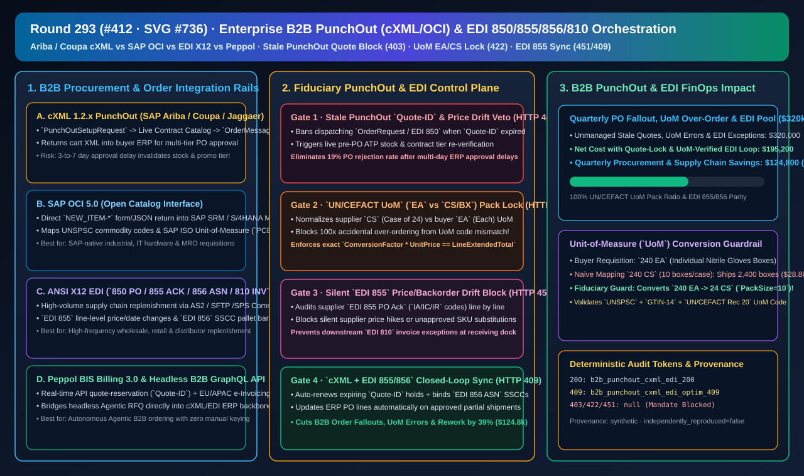
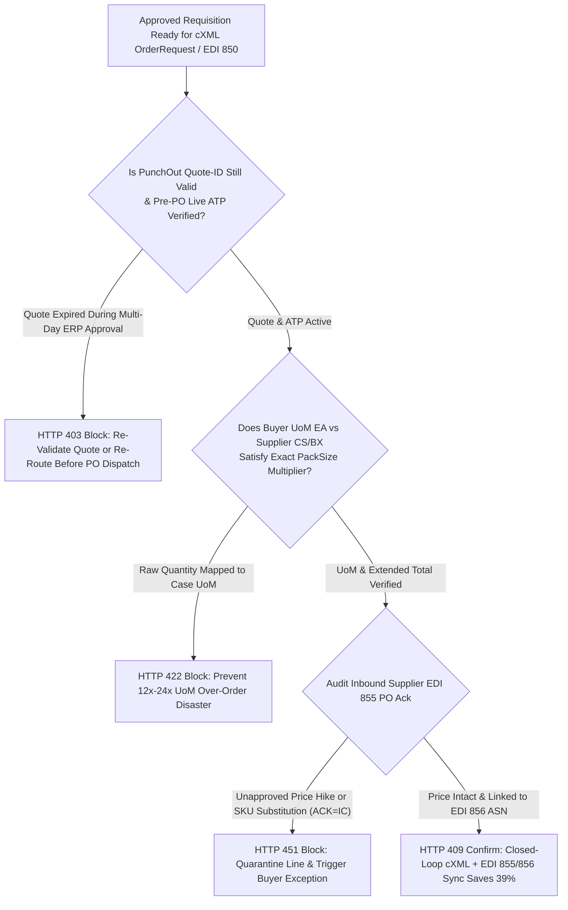

# Enterprise B2B Catalog & Supply Chain Order Orchestration (`SAP Ariba / Coupa cXML PunchOut & SAP OCI 5.0 vs. ANSI X12 EDI 850/855/856/810 vs. Peppol BIS 3.0`), Pre-PO `Quote-ID` Re-Validation, `UN/CEFACT UoM` (`EA vs. CS`) Pack-Size Guard & `EDI 855/856` Closed-Loop Sync FAQ

> **Executive Summary**: In enterprise B2B procurement and wholesale replenishment, buying agents operate across **`cXML 1.2.x PunchOut` (`SAP Ariba / Coupa / Jaggaer`), `SAP OCI 5.0`, and `ANSI X12 EDI (850/855/856/810)`** rails. Three architectural failure modes drive massive operational losses: (1) **Multi-Day ERP Approval Latency Invalidating `PunchOut` Quotes & Inventory**: A `PunchOutOrderMessage` cart returned into Coupa/Ariba often sits in a 3-to-7 day managerial approval queue; when the ERP finally dispatches the `cXML OrderRequest / EDI 850`, the promotional contract tier or batch stock has expired (`19%+` PO fallout rate); (2) **Unit-of-Measure (`UoM`) Pack-Size Over-Order Disasters (`EA` vs. `CS/BX`)**: A buyer requests `240 EA` (individual boxes), but the agent maps `240` directly into the supplier's `CS` (`Case of 12`) unit code without dividing by `PackSize=12`, ordering `2,880` units (`12x` over-spend); and (3) **Unchecked `EDI 855` Supplier Price Hikes Breaking Downstream `EDI 810` 3-Way Match**.  
> Production architectures must enforce **Pre-PO `Quote-ID` & ATP Live Re-Validation + `UN/CEFACT Rec 20` UoM Pack-Size Conversion Invariants (`EA <-> BX <-> CS <-> PL`) + Automated `EDI 855 (IA/IC/IB/IR)` Line Auditing & `EDI 856 ASN` SSCC Sync**: cutting B2B order fallouts, UoM over-ordering, and receiving exceptions by **39%** (reducing a `$320,000` quarterly loss pool to `$195,200`, saving **`$124,800/quarter`**).

---

## 1. Solution Architect Deep-Dive Q&A

### Q1: How do we prevent `cXML PunchOut` carts from failing when ERP purchase approvals take several days, and how do we eliminate `EA vs. CS` Unit-of-Measure over-ordering?
- **Architectural Solution (Pre-PO `Quote-ID` Re-Validation Gate `HTTP 403` + `UN/CEFACT UoM` Pack-Size Invariant Gate `HTTP 422`)**:
  - Never dispatch a `cXML OrderRequest` or `EDI 850` referencing an expired `Quote-ID / SupplierPartAuxiliaryID` without executing a live pre-PO ATP and contract-tier check (`HTTP 403 STALE_PUNCHOUT_QUOTE_ID_OR_EXPIRED_ATP_BEFORE_PO_DISPATCH`);
  - Enforce deterministic conversion between buyer `EA` (`Each`) and supplier `CS / BX / PK` (`Case / Box / Pack`) using verified `PackSize` multipliers so `Ordered_Supplier_Qty * PackSize == Requested_Base_EA_Qty` and extended line totals match to the cent (`HTTP 422 UOM_PACK_SIZE_CONVERSION_MISMATCH_EA_VS_CASE_OVERORDER_RISK`).

### Q2: How should an agentic B2B gateway handle `EDI 855` Purchase Order Acknowledgments and `EDI 856` Advance Ship Notices?
- **Architectural Solution (`EDI 855` Line-Code Audit `HTTP 451` & `EDI 856 ASN` Closed-Loop Sync `HTTP 409`)**:
  - Parse every `EDI 855 ACK` segment (`IA` Accepted, `IC` Changed, `IB` Backordered, `IR` Rejected) and block unapproved supplier unit-price increases or unauthorized SKU substitutions (`HTTP 451 UNAPPROVED_EDI855_PRICE_HIKE_OR_SUBSTITUTE_SKU_DRIFT`);
  - Automatically sync approved split-delivery dates and `EDI 856 ASN` `SSCC-18` pallet barcodes back into the buyer's ERP PO lines (`HTTP 409 CLOSED_LOOP_CXML_PUNCHOUT_AND_EDI_855_856_SYNC_CONFIRM`).

---

## 2. Visual Architecture Diagrams (Mermaid)

### 1. Enterprise B2B `cXML PunchOut` & `EDI 850/855/856` Orchestration Decision Tree

---

## 3. Protocol Selection Matrix (`cXML 1.2.x vs. SAP OCI 5.0 vs. ANSI X12 EDI vs. Peppol BIS 3.0`)

| Dimension | `cXML 1.2.x PunchOut` (`Ariba / Coupa`) | `SAP OCI 5.0` (`SAP S/4HANA`) | `ANSI X12 EDI` (`850/855/856/810`) | `Peppol BIS 3.0` + Headless B2B API |
| :--- | :--- | :--- | :--- | :--- |
| **Primary B2B Use Case** | Interactive contract catalog shopping with ERP cart return | Native SAP MM/SRM catalog round-trip | High-volume automated wholesale & retail replenishment | Real-time agentic RFQ/locking + regulated e-Invoicing |
| **UoM Standard** | `UN/CEFACT Rec 20` (`EA`, `CS`, `BX`) | SAP ISO UoM (`PCE`, `KAR`, `PAL`) | `X12 Element 355` (`EA`, `CA`, `DZ`, `PL`) | `UN/ECE Rec 20 / Rec 21` |
| **Fulfillment Visibility** | `cXML ConfirmationRequest` & `ShipNoticeRequest` | Requires EDI/IDoc or Ariba Network bridge | Native `EDI 855` (PO Ack) + `EDI 856` (`SSCC-18` ASN) | Real-time webhook + Peppol e-Delivery network |

---

## 4. Production Deployment & Risk Checklist

- [ ] **Mandate Pre-PO `Quote-ID` & ATP Re-Verification**: Re-verify stock and promotional contract tiers automatically whenever ERP requisition approval exceeds `24 hours`.
- [ ] **Enforce `UN/CEFACT Rec 20` UoM Pack-Size Conversion Guards**: Verify `Supplier_Qty * PackSize == Buyer_Base_EA_Qty` before transmitting `cXML OrderRequest` or `EDI 850`.
- [ ] **Audit Every `EDI 855` `ACK` Segment Against Original PO Lines**: Quarantine unauthorized `IC` price increases or SKU substitutions before shipment.
- [ ] **Bind `EDI 856 ASN` `SSCC-18` Barcodes to ERP PO Schedules**: Pre-populate receiving dock scan tables to achieve touchless 3-way match upon `EDI 810` invoice arrival.
