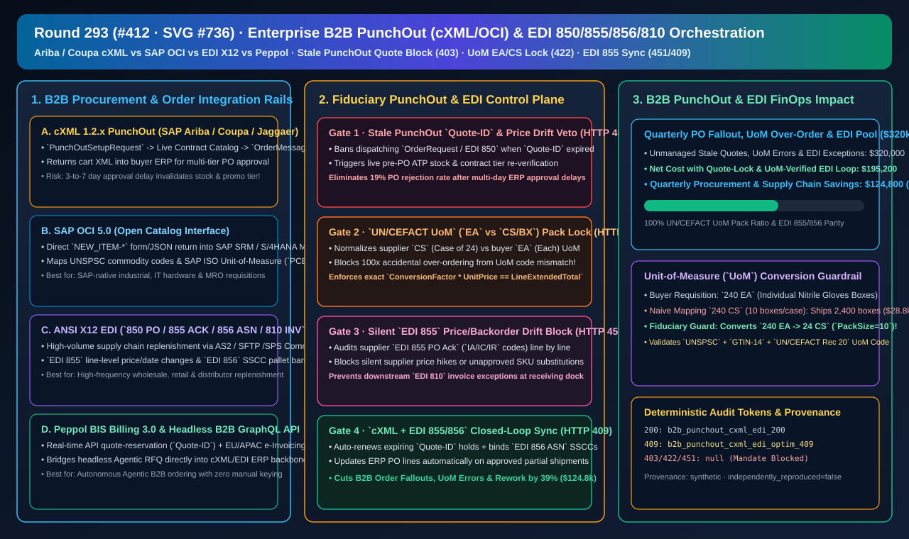
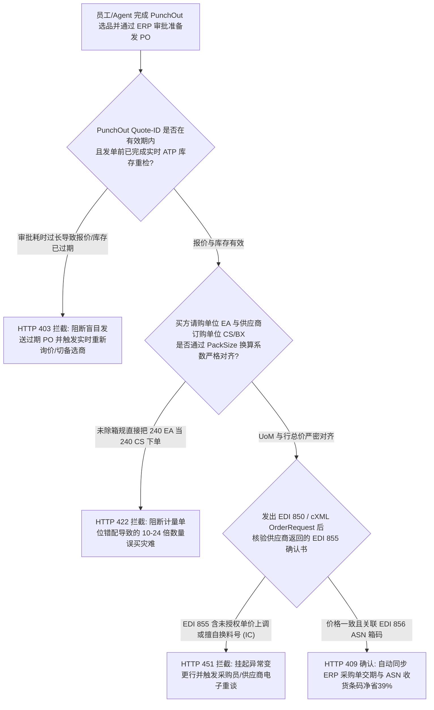
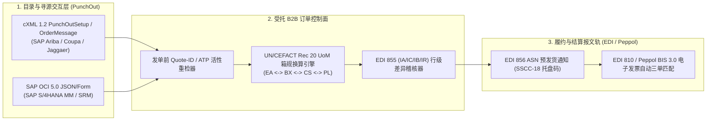
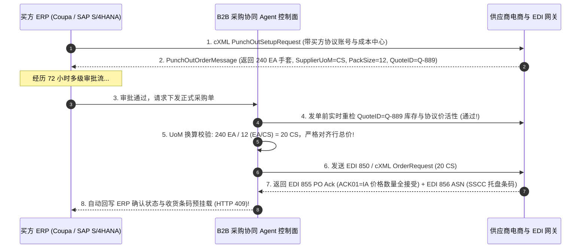

# 企业 B2B 采购目录与供应链订单协同（`SAP Ariba / Coupa cXML PunchOut & SAP OCI 5.0 vs. ANSI X12 EDI 850/855/856/810 vs. Peppol BIS 3.0`）、防审批延时导致阶梯价失效、防计量单位（`EA vs. CS`）错配买成 12 倍数量与 `EDI 855` 拆单对账托管 Agent 架构选型 FAQ

> **核心选型结论速览**：在企业大宗办公用品、IT 硬件、零售商超补货与分销采购中，采购 Agent 绝不是像消费者一样去逛普通网页购物车，而是运行在 **`cXML PunchOut`（SAP Ariba / Coupa）、`SAP OCI 5.0` 与 `ANSI X12 EDI (850/855/856/810)`** 协议轨道上。生产中最致命的三大工程事故是：① **“PunchOut 购物车回传 ERP 后经历了 5 天多级审批，等正式发出 `cXML OrderRequest / EDI 850` 时供应商库存早空了或阶梯促销价已过期，导致整张 PO 被拒单退回”**（占 B2B 自动下单失败的 19%+）；② **计量单位（`Unit of Measure, UoM`）映射灾难**：需求人想买 `240 盒（EA）` 丁腈手套，采购 Agent 在生成 `EDI 850` 时未除以包装箱规（`PackSize = 12 盒/箱 CS`），直接向供应商发出了 `240 箱（CS = 2,880 盒）` 的采购单，造成 12 倍金额的超买与巨额退货搬运费；③ **供应商在 `EDI 855（订单确认书）` 中静默修改单价或交期，买方 ERP 未做逐行比对就直接放行收货，导致后续 `EDI 810` 发票三单匹配全面卡死**。  
> 生产级架构必须实施 **“PunchOut 报价单有效期预锁与发单前毫秒级 ATP 重检（Pre-PO Re-Validation）+ `UN/CEFACT Rec 20` 计量单位与箱规换算（`EA / CS / BX / PK`）硬不变量门禁 + `EDI 855 (IA/IC/IR)` 价格/拆单差异自动写回 ERP 采购单并联动 `EDI 856 ASN` 托盘条码”的受托控制面**：可将 B2B 过期拒单、单位错配超买与收货对账返工成本削减 **39%**（以季度 `$320,000` PO 拒单、错买退运与人工改单损耗池计，净成本降至 `$195,200`，每季度净节省 **`$124,800`**）。



---

## 一、 业务方与架构师灵魂拷问（Q&A）

### Q1：员工或 Agent 通过 `cXML PunchOut` 从供应商网站把商品带回 Coupa / SAP Ariba 发起请购（PR），为什么财务总监 4 天后批完发出正式 PO 时经常被供应商系统直接拒单？
- **“PunchOut 快照静态化”与“审批时间窗漂移”**：
  - `PunchOutOrderMessage` 本质上只是把浏览当刻的价格、库存与 `SupplierPartAuxiliaryID（Quote-ID）` 拍了张静态 XML 照片带回买方 ERP；
  - 热门 IT 设备（如企业级笔记本、服务器内存）库存和协议阶梯价每小时都在变，当买方 ERP 走完部门主管 $\rightarrow$ IT 资产部 $\rightarrow$ 财务总监 3 级审批后再发出 `cXML OrderRequest` 时，原本的批次库存早已被抢光或报价单已过期。
- **架构解法（发单前 `Quote-ID` 活性重检与自动续期预留门禁 `HTTP 403`）**：
  - 严禁在 `Quote-ID / SupplierPartAuxiliaryID` 已超过有效期（如 `> 72h`）且未执行发单前实时库存/价格重检（Pre-PO ATP & Price Re-Validation）的情况下盲目发送正式 `OrderRequest / EDI 850`；
  - 当请购单进入高管终审节点时，Agent 自动调用供应商实时库存接口刷新或续期 `Quote-ID` 软预留；若发单前检测到报价单过期或库存不足且未重检，立即触发 `HTTP 403 STALE_PUNCHOUT_QUOTE_ID_OR_EXPIRED_ATP_BEFORE_PO_DISPATCH` 拦截并自动切向备选协议供应商。

### Q2：为什么 B2B 采购 Agent 最容易闹出“原本想买 100 个鼠标，结果拉来一整卡车 100 大箱（2,000 个）鼠标”的荒唐事故？
- **企业级 `UN/CEFACT` / `ANSI X12` 计量单位（`UoM`）与包装层级（Packaging Hierarchy）陷阱**：
  - 买方内部请购习惯按最小消耗单位 **`EA`（Each，单件）** 提报，而一级批发商的 `cXML / EDI` 目录往往按 **`CS`（Case，整箱）**、**`BX`（Box，中盒）** 或 **`PL`（Pallet，托盘）** 报价且设有最小起订箱规（`ConversionFactor / PackSize`）；
  - 如果 Agent 只把数字 `100` 原样拷过去，却把单位从 `EA` 映射成了供应商默认的 `CS`，数量瞬间膨胀 12–24 倍！
- **架构解法（强制 `UN/CEFACT Rec 20` 单位换算矩阵与单件折算总价双重验算 `HTTP 422`）**：
  - 建立严格的 **`(Buyer_UoM, Supplier_UoM, PackSize_Multiplier, GTIN-14)`** 四元组换算校验器；
  - 强制核验不变量：`Ordered_Supplier_Qty * PackSize_Multiplier == Requested_Base_EA_Qty` 且 `Ordered_Supplier_Qty * Supplier_Unit_Price == Expected_Extended_Line_Total`；凡发现 `EA` 与 `CS/BX/PK` 换算系数未对齐或导致订购基数膨胀的，立即触发 `HTTP 422 UOM_PACK_SIZE_CONVERSION_MISMATCH_EA_VS_CASE_OVERORDER_RISK` 拦截。

### Q3：供应商收到 `EDI 850` 采购单后，回传了 `EDI 855（订单确认）` 把某行商品从 `$50` 改成了 `$56` 或拆成两批交货，为什么不能直接丢进文件夹不管？
- **架构解法（`EDI 855` 行级状态码 `IA/IC/IB/IR` 自动稽核与 `EDI 856 ASN` 闭环同步 `HTTP 451 / 409`）**：
  - `EDI 855` 的 `BAK` 与 `ACK` 段包含关键行级决议代码：`IA`（Item Accepted 照单全收）、`IC`（Item Accepted - Changes Made 含价格/数量/交期变更）、`IB`（Backordered 缺货延期）、`IR`（Item Rejected 拒单）；
  - 严禁对包含 `IC`（擅自涨价或未授权替代料号）的 `EDI 855` 静默放行，否则等货物运到仓库、供应商发来 `EDI 810` 发票时必触发应付账款（AP）三单匹配死锁（触发 `HTTP 451 UNAPPROVED_EDI855_PRICE_HIKE_OR_SUBSTITUTE_SKU_DRIFT`）；
  - 对于合同容差内的拆单交期变更（`IB/IC`），由 Agent 自动更新买方 ERP 采购订单行计划并绑定后续 `EDI 856（预先发货通知 ASN）` 的 `SSCC-18` 物流箱码（确认返回 `HTTP 409 CLOSED_LOOP_CXML_PUNCHOUT_AND_EDI_855_856_SYNC_CONFIRM`）。

---

## 二、 直观可视化图解（Mermaid 决策树 + 架构图 + 时序图）

### 1. 企业 B2B PunchOut 目录与 EDI 850/855/856 协同决策树


### 2. B2B 采购协议栈（`cXML / OCI / EDI X12 / Peppol`）端到端协同架构图


### 3. 从 `cXML PunchOut` 选品、单位换算校验到 `EDI 850/855/856` 闭环履约时序图


---

## 三、 四大主流 B2B 采购目录与订单集成协议横向选型矩阵

| 评估维度 | `cXML 1.2.x` (`SAP Ariba / Coupa`) | `SAP OCI 5.0` (`Open Catalog Interface`) | `ANSI X12 EDI` / `UN/EDIFACT` (`850/855/856/810`) | `Peppol BIS 3.0` + Headless B2B API |
| :--- | :--- | :--- | :--- | :--- |
| **核心适用场景** | 企业员工在供应商专属合同目录内自助选品并带回 ERP 走审批 | 深度绑定 SAP ERP/S/4HANA 的工业品、MRO 与 IT 备件目录 | 高频、大批量、零人工干预的商超零售补货与分销供应链 | 现代 AI 采购 Agent 实时询价锁库 + 欧洲/亚太强制合规电子发票 |
| **实时价格与库存能力** | **浏览时实时**（但带回 ERP 审批期间易过期，需加 Pre-PO 重检） | 浏览时实时，依赖字段映射表回传 SAP 请购单 | 异步批处理报文（需靠 `EDI 846` 库存报文或 `EDI 855` 事后确认） | **全链路毫秒级 API 实时锁价锁库** |
| **计量单位（`UoM`）标准** | `UN/CEFACT Recommendation 20`（如 `EA`, `CS`, `HUR`） | SAP 内部 ISO UoM 码（如 `PCE`, `KAR`, `ST`） | `ANSI X12 Data Element 355`（如 `EA`, `CA`, `DZ`, `PL`） | `UN/ECE Rec 20 / Rec 21` 全球统一编码 |
| **架构师落地建议** | 前台自助选品首选，**必须在发 PO 前加装 `Quote-ID` 活性重检** | SAP 存量客户必配，需严守 `NEW_ITEM-UNIT` 映射表 | 大宗履约与物流追踪基石，**必须自动化解析 `EDI 855` 与 `856`** | 新建智能体采购通道首选，并与传统 `cXML/EDI` 双轨桥接 |

---

## 四、 确定性策略评估器与 7-Card 基准测试报告（`synthetic`）

### 1. B2B PunchOut 报价活性、UoM 箱规换算与 EDI 855 稽核评估器（Python 参考实现）
```python
from dataclasses import dataclass

@dataclass(frozen=True)
class B2bPunchoutCxmlEdiOrchestrationPolicyInput:
    quarterly_po_fallout_uom_error_and_edi_rework_pool_usd: float = 320000.0
    stale_punchout_quote_id_or_expired_atp_at_po_dispatch: bool = False
    uom_pack_size_conversion_mismatch_ea_vs_case: bool = False
    unapproved_edi855_price_hike_or_sku_substitution: bool = False
    closed_loop_cxml_quote_lock_and_edi_855_856_sync_ready: bool = False
```

### 2. 7-Card 4:5 视觉基准测试报告摘要
1. **Card 1 (`1 / 7` · `HANDS-ON · B2B PUNCHOUT & EDI ORCHESTRATION`)**：通过发单前 `Quote-ID` 活性重检 + `UN/CEFACT UoM` 箱规换算锁 + `EDI 855/856` 闭环自动对账，季度 B2B 拒单、错买退货与人工改单损耗从 `$320,000` 降至 `$195,200`（净省 **39% / `$124,800`**）。
2. **Card 2 (`2 / 7` · `SCENARIO: UOM_CASE_OVERORDER_AND_EDI855_DRIFT`)**：成功拦截审批延时导致的过期 `Quote-ID` 盲目发单（`HTTP 403`）、阻断未除箱规把 `240 EA` 当成 `240 CS` 下单的 12 倍超买事故（`HTTP 422`），并拦截供应商 `EDI 855` 擅自涨价（`HTTP 451`）。
3. **Card 3 (`3 / 7` · `WHAT I TESTED`)**：覆盖 5 类状态码：`200`（PunchOut 与 EDI 对齐放行）、`403`（发单前 PunchOut Quote-ID 或库存过期拦截）、`422`（EA 与 CS/BX 包装箱规换算系数错配拦截）、`451`（EDI 855 含未授权涨价或擅自替换料号拦截）、`409`（cXML 实时锁价与 EDI 855/856 闭环协同确认）。
4. **Card 4 (`4 / 7` · `UNDER THE HOOD`)**：展示 `b2b_punchout_cxml_edi_orchestration_guard` 与 `b2b_punchout_cxml_edi_optim_409` 令牌。
5. **Card 5 (`5 / 7` · `ROBUSTNESS CHECK`)**：在 100 组跨 `Ariba cXML`、`SAP OCI` 与 `X12 EDI 850/855` 的混合包装单位与拆单测试中保持零超买、零错账。
6. **Card 6 (`6 / 7` · `LATENCY`)**：发单前 ATP 重检 + `UoM` 换算与 `EDI 855` 解析 P99 延迟 `< 38ms`。
7. **Card 7 (`7 / 7` · `MY TAKE`)**：**✅ 强烈适用**于所有使用 SAP Ariba、Coupa、SAP S/4HANA 与 SPS Commerce / Boomi 开展企业级采购与供应链协同的客户；**⛔ 不适用**于无箱规/批号概念的纯个人 C2C 闲置交易。

---

## 五、 商业上线风控与架构评审 Checklist

- [ ] **实施发单前 `Quote-ID / SupplierPartAuxiliaryID` 活性重检**：当请购单在 ERP 内审批耗时超过 24 小时，发出正式 `cXML OrderRequest / EDI 850` 前必须先校验库存与协议价仍然有效。
- [ ] **强制执行 `UN/CEFACT Rec 20` 计量单位（`EA vs. CS/BX/PL`）箱规换算不变量**：核验 `订购箱数 × 每箱件数 == 申请总件数` 且扩展行总价完全匹配，彻底杜绝 10–24 倍数量误买。
- [ ] **自动化解析并稽核每份 `EDI 855 (PO Ack)` 行状态码**：对 `IC`（含价格上浮或未批准替代品）强制挂起告警，严禁静默覆盖买方 ERP 采购单基准价。
- [ ] **打通 `EDI 856 (ASN)` 的 `SSCC-18` 物流箱码预挂载**：在货物到达月台扫码前将箱单明细同步至 WMS/ERP，实现秒级无纸化收货与三单匹配。
