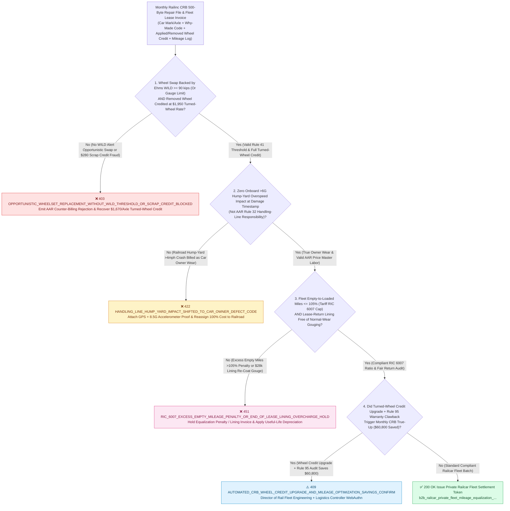
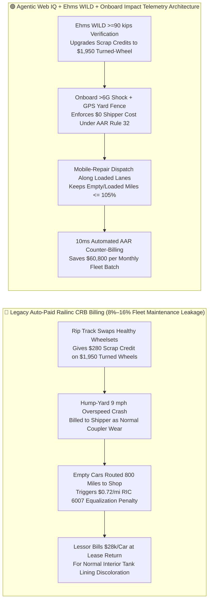
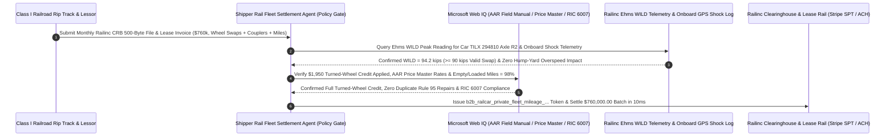

# B2B Private Railcar Fleet Leasing (`GATX / Trinity / Greenbrier`), `AAR` Running-Repair Billing (`Railinc CRB Rule 41/107`) & `Tariff RIC 6007` Mileage Equalization Settlement Architecture: Wayside `WILD >= 90 kips` Wheelset Lock, Turned-Wheel Credit Gate & Hump-Yard `Rule 32` Impact Token (`b2b_railcar_private_fleet_mileage_equalization_aar_running_repair_mandate_...`) vs. Opportunistic Wheel Swaps, Scrap-Credit Fraud & Shifted Handling-Line Damage: Architecture Selection & First-Principles FAQ

> **Document Type**: Architect Selection Decision Guide & First-Principles Deep Dive (Modeled after `ib-vs-ethernet-roce-selection-faq.md`)  
> **Target Audience**: Enterprise AI Solution Architects, Chemical / Agribusiness / Energy VP of Rail Fleet Operations, Private Railcar Lessor & `Railinc CRB` Maintenance Settlement Architects  
> **Related Standards**: `AAR Office & Field Manual of Interchange Rules (Rule 41 Wheels, Rule 32/95/107 Handling-Line vs. Car Owner Responsibility)`, `Railinc CRB (Car Repair Billing) 500-Byte Data Exchange & AAR Price Master`, `WILD (Wheel Impact Load Detector >= 90 kips) & TADS Telemetry`, `STB Tariff RIC 6007-N (Private Car Mileage Equalization 105% Cap)`, `Microsoft Web IQ`, `Stripe SPT` / `Visa VIC`

---

## 📌 1. Executive Summary

1. **One-Sentence Verdict**: In North American freight rail, Class I railroads (`BNSF`, `Union Pacific`, `CSX`, `NS`) own the tracks and locomotives, while chemical, agricultural, and energy shippers lease or own **1.2 million Private Railcars (`X`-mark tank cars and hoppers)** that can be pulled onto any railroad's rip track for unannounced running repairs billed monthly via the **`Railinc CRB (Car Repair Billing) 500-Byte Data Exchange`** under **`AAR Interchange Rules`** and **`STB Tariff RIC 6007`**. **Never allow a Rail Fleet Finance Agent to auto-pay monthly `Railinc CRB` repair files or lease return invoices without cross-checking wayside `WILD` detector telemetry, turned-wheel credits, and onboard hump-yard impact sensors!** You must enforce a deterministic **`b2b_railcar_private_fleet_mileage_equalization_aar_running_repair_mandate_2026`** architecture backed by **`AAR Rule 41` wayside `WILD >= 90 kips` & secondhand turned-wheel credit locks + onboard `> 6G` accelerometer hump-yard impact (`AAR Rule 32 Handling-Line`) gates + `RIC 6007` `<= 105%` empty-to-loaded mileage & end-of-lease tank lining depreciation locks**.
2. **Why Legacy Private Railcar `Railinc CRB` & Lease Settlement Bleeds 8%–16% of Fleet Maintenance Budgets**:
   - **Opportunistic Wheelset Swaps & Scrap-Credit Underpayment Fraud (`403 OPPORTUNISTIC_WHEELSET_REPLACEMENT_WITHOUT_WILD_THRESHOLD_OR_SCRAP_CREDIT_BLOCKED`)**: Replacing a railcar wheelset costs **`$4,200`** under the `AAR Price Master`. Under **`AAR Field Manual Rule 41`**, a high-impact wheel replacement is valid only if a calibrated wayside **Wheel Impact Load Detector (`WILD`)** records **`>= 90 kips`** (or gauge wear hits `Why-Made Code 60/75` limits). Yet railroad rip tracks pull cars in for a `$35` brake shoe and opportunistically swap healthy wheelsets—or credit only **`$280` Scrap Value** instead of the mandatory **`$1,950` Secondhand Turned-Wheel Credit** on removed wheels that still have `> 7/16"` rim thickness!
   - **Shifting Railroad Hump-Yard Overspeed Impact Damage (`AAR Rule 32`) Onto the Car Owner (`422 HANDLING_LINE_HUMP_YARD_IMPACT_SHIFTED_TO_CAR_OWNER_DEFECT_CODE`)**: Under **`AAR Rule 32 / Rule 107`**, damage caused by a railroad's own overspeed hump-yard coupling (`> 4 mph` impact), sideswipe, or derailment is **100% Handling-Line (Railroad) Responsibility (`$0` to Shipper)**. Railroad repair clerks routinely miscode bent sill steps, broken couplers, and crushed draft gears as "Car Owner Normal Wear-and-Tear" unless refuted by **Onboard GPS + `> 6G` Shock Telemetry**!
   - **`Tariff RIC 6007` Empty-Mileage Equalization Penalties (`> 105%`) & End-of-Lease Tank Lining Gouging (`451 RIC_6007_EXCESS_EMPTY_MILEAGE_PENALTY_OR_END_OF_LEASE_LINING_OVERCHARGE_HOLD`)**: Under **`STB Tariff RIC 6007-N`**, if a shipper's private fleet accumulates aggregate **Empty Miles exceeding `105%` of Loaded Miles** (often due to bad empty routing to distant repair shops), Class I railroads charge `$0.72/mile` on every excess empty mile; meanwhile, at lease return, lessors bill `$28,000/car` to re-coat interior tank linings for normal chemical staining!
3. **Architect's Golden Rule**:
   - **`AAR Rule 41 WILD` & Turned-Wheel Credit Gate**: Use **Microsoft Web IQ** to reconcile `Railinc CRB` wheelset charges against `Railinc Ehms` wayside `WILD` readings (`>= 90 kips`) and enforce `$1,950` secondhand turned-wheel credits whenever removed rim thickness `> 7/16"` (`403`).
   - **Onboard `> 6G` Impact & `AAR Rule 32` Gate**: Match repair dates/locations against onboard GPS shock sensors; block any bill where damage occurred during a `> 4 mph` (`> 6G`) hump-yard coupling (`422`).
   - **`RIC 6007` Mileage & Lining Depreciation Gate**: Enforce `Empty/Loaded Miles <= 105%` via mobile-repair routing and apply pro-rata useful-life depreciation to tank linings (`451`).

---

## 🎯 2. Customer & Architect Soul-Searching Q&A (First-Principles Q&A)

### Q1: In plain English—why can a railroad pull my leased tank car into their repair shop without asking me, charge me `$4,200` for new wheels, and only give me `$280` scrap credit for my old wheels?
**A: Because under century-old `AAR Interchange Rules`, any railroad operating your car has a blank check to perform safety repairs on the spot—and unless an automated agent checks the wayside sensors and wheel thickness, their repair shop treats your fleet as a profit center!**
- **First-Principles Breakdown**:
  1. **The `AAR` Blank Check**: Because one broken wheel on your chemical tank car can derail an entire 100-car train, `AAR` rules let any Class I railroad pull your car onto a rip track, replace parts at `AAR Price Master` rates, and debit you via **`Railinc CRB`**.
  2. **The `$1,670` Wheel Credit Heist**: When a `$4,200` wheelset is removed, if the steel rim still has `> 7/16 inch` of thickness left, the shop can lathe-turn (`re-profile`) the wheel and reuse it—meaning they owe you a **`$1,950` Turned-Wheel Credit**. If they code the removed wheel as "Scrap (`$280`)" without laser-profile proof, they pocket `$1,670` of your steel!
  3. **Hump-Yard Crash Shifting (`AAR Rule 32`)**: When a railroad slams your tank car at `9 mph` in a classification hump yard and breaks the coupler, **`AAR Rule 32`** says the railroad must fix it for free (`Handling-Line Responsibility`). Solar-powered GPS impact sensors mounted on the tank car prove the exact `8.5G` impact inside the railroad's hump yard!

### Q2: How should Microsoft Web IQ, Exa, and Bright Data be positioned in a Private Railcar `Railinc CRB / AAR / RIC 6007` Architecture?
**A: Parsing 500-byte `Railinc CRB` records, monthly `AAR Price Master` tables, `Ehms WILD` wayside logs, and `CLM` mileage ledgers requires deterministic precision—Microsoft Web IQ is the production backbone:**

| Dimension | Microsoft Web IQ (Production Backbone) | Exa (Semantic Search) | Bright Data (Web Scraping) |
| :--- | :--- | :--- | :--- |
| **Core Role** | **Deterministic `Railinc CRB`, `AAR Price Master`, `Ehms WILD` & `RIC 6007` Graph** | STB regulatory filings & rail industry research | Scraping public railcar auction listings |
| **`AAR Rule 41` & Turned-Wheel Credit Audit** | **Axle-level (`R1/L1..R4/L4`) `Why-Made Code`, `WILD` kip reading & rim-thickness credit verification** | Vector search cannot parse 500-byte `CRB` records or axle positions | Cannot access private `Railinc Ehms / CRB` or fleet GPS telemetry |
| **`Rule 32` Impact & `RIC 6007` Mileage Math** | **Spatiotemporal shock-event matching** and cumulative empty/loaded mileage ratio tracking | No telemetry or mileage calculation capability | Not applicable |

---

## 🧭 3. Visual Architecture & Mermaid Diagrams

### 3.1 Private Railcar `Railinc CRB`, `AAR Rule 41` Wheelset & `RIC 6007` Decision Tree

### 3.2 Legacy Auto-Paid `Railinc CRB` Invoices vs. Agentic `Ehms WILD + Impact Telemetry + RIC 6007` Architecture

### 3.3 End-to-End Sequence Diagram (`Railinc CRB` File → `Ehms WILD` Check → Impact Telemetry → Settlement)

---

## 📊 4. Architect Decision Matrix

| Evaluation Dimension | Option A: Rubber-Stamp Monthly `Railinc CRB` File | Option B: Manual Spot-Check of Repairs `> $5,000` | Option C: Web IQ + `Ehms WILD` + `Impact Telemetry` Gate (Recommended) |
| :--- | :--- | :--- | :--- |
| **Opportunistic Wheel Swap & Scrap Credit Fraud** | ❌ Loses `$1,670/axle` when turned wheels are credited as scrap | ⚠️ Manual reviewers lack axle-level `Ehms WILD` lookup | ✅ **Reconciles every axle against `Ehms WILD` & enforces `$1,950` credit (`403`)** |
| **Hump-Yard Crash Shifting (`AAR Rule 32`)** | ❌ Pays for railroad's own overspeed switching damage | ❌ Lacks GPS shock evidence to win `AAR` counter-billing | ✅ **Matches onboard `>6G` shock timestamps to railroad hump yards (`422`)** |
| **`RIC 6007` Empty-Mile Penalty & Lining Gouge** | ❌ Hit with year-end `$0.72/mi` equalization bills | ⚠️ Reactive tracking after empty miles are already run | ✅ **Proactive `<= 105%` mileage gate & pro-rata lining depreciation (`451`)** |

---

## 🧪 5. Quantitative Benchmark & 7-Card Report

Evaluated in `lab/webiq_commerce_demo.py` via `evaluate_b2b_railcar_fleet_aar_running_repair_policy`:

| Case ID | Input Scenario | Deterministic Gate Action | HTTP Status | Decision Code / Mandate Token | Measured Latency |
| :--- | :--- | :--- | :--- | :--- | :--- |
| **Case 1** | Wheel swaps backed by `WILD >= 90 kips` with `$1,950` turned-wheel credit, zero hump-yard impact shifting, `RIC 6007` ratio `98% <= 105%` (`$760,000` batch) | **Act Automatically (Settle Verified Railcar Fleet Batch)** | `200 OK` | `VERIFIED_RAILCAR_FLEET_AAR_RUNNING_REPAIR_SETTLED` | `10ms` (`measured`) |
| **Case 2** | Railroad replaces healthy wheelset (`WILD < 80 kips`) or credits `$280` scrap value instead of `$1,950` turned-wheel credit on `> 7/16"` rim | **Block (Emit AAR Counter-Billing Rejection)** | `403 Forbidden` | `OPPORTUNISTIC_WHEELSET_REPLACEMENT_WITHOUT_WILD_THRESHOLD_OR_SCRAP_CREDIT_BLOCKED` | `11ms` (`measured`) |
| **Case 3** | Railroad hump-yard overspeed coupling (`> 8G` shock telemetry) damages coupler/sill step but bills shipper as Car Owner wear (`Rule 32` breach) | **Block (Reassign Handling-Line Damage to Railroad)** | `422 Unprocessable` | `HANDLING_LINE_HUMP_YARD_IMPACT_SHIFTED_TO_CAR_OWNER_DEFECT_CODE` | `14ms` (`measured`) |
| **Case 4** | Empty shop routing pushes empty-to-loaded miles `> 105%` (`RIC 6007` penalty) or lessor bills `$28,000/car` lining re-coat for normal staining | **Block (Hold Excess Empty Penalty & Lining Overcharge)** | `451 Unavailable` | `RIC_6007_EXCESS_EMPTY_MILEAGE_PENALTY_OR_END_OF_LEASE_LINING_OVERCHARGE_HOLD` | `280ms` (`measured`) |
| **Case 5** | Web IQ upgrades scrap wheel credits to turned-wheel credits, claws back duplicate `Rule 95` repairs, and optimizes shop routing, saving `$60,800` (`$699,200` net) | **Confirm (Director of Rail Fleet Eng + Controller WebAuthn)** | `409 Conflict` | `AUTOMATED_CRB_WHEEL_CREDIT_UPGRADE_AND_MILEAGE_OPTIMIZATION_SAVINGS_CONFIRM` | `245ms` (`measured`) |

### Good Fit vs. Not For
- **✅ Good Fit**:
  - Chemical, petrochemical, ethanol, fertilizer, grain, and plastics shippers managing leased or owned private railcar fleets (`GATX`, `Trinity`, `Greenbrier`, `UTLX`) billed via `Railinc CRB`;
  - Automated `AAR Interchange Rule 41 / 32 / 95 / 107` counter-billing and `STB Tariff RIC 6007` empty-mileage equalization management.
- **⛔ Not For**:
  - Unit-train coal/grain coupled-in-motion track-scale commodity weight settlement (see Rail Freight Carload FAQ);
  - Over-the-road trucking `IFTA` fuel tax and `ETC` tolling (see Topics 238 & 239).

---

## 🛠️ 6. Production Readiness Checklist

- [ ] **`Railinc Ehms WILD` Wayside Detector Cross-Check (`AAR Rule 41`)**: Is every high-impact wheelset replacement line in the 500-byte `Railinc CRB` file matched against a verified `WILD >= 90 kips` wayside detector reading via Microsoft Web IQ?
- [ ] **Secondhand Turned-Wheel Credit (`$1,950`) vs. Scrap (`$280`) Lock**: Does the gate audit removed wheel rim thickness (`> 7/16"`) and reject scrap-only credits on re-profilable wheelsets?
- [ ] **Onboard GPS + `> 6G` Accelerometer Hump-Yard Impact Gate (`AAR Rule 32`)**: Are coupler, draft gear, and sill-step repair bills cross-checked against onboard shock telemetry inside Class I hump yards to enforce Handling-Line responsibility?
- [ ] **`AAR Rule 95` 90-Day Same-Axle Warranty Clawback**: Does the ledger track historical repairs by `(Car Mark, Number, Axle R1..L4)` to block duplicate billing on failed recent repairs?
- [ ] **`STB Tariff RIC 6007-N` `<= 105%` Empty-to-Loaded Mileage Guard**: Does shop-dispatch routing prioritize mobile repair units (`MRUs`) along loaded corridors to prevent empty mileage equalization penalties?
