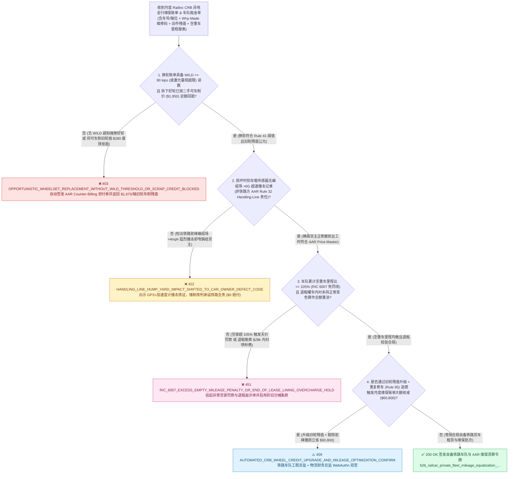
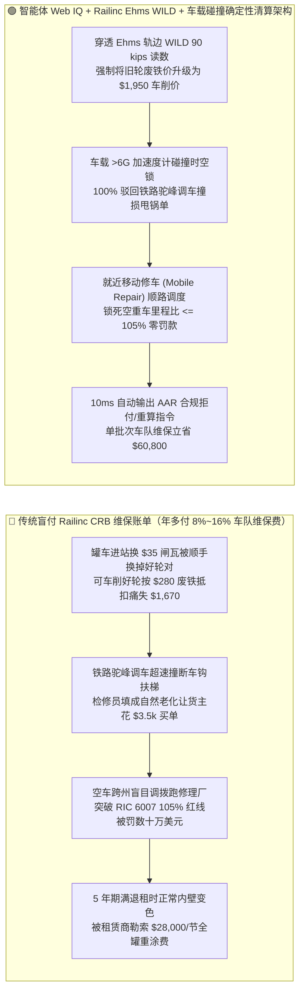
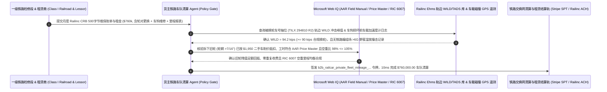

# B2B 智能体自备铁路货车车队租赁（`Private Railcar Fleet GATX / Trinity / Greenbrier`）、`AAR` 异地走行维保账单（`Railinc CRB Rule 41/107`）与空重车里程均衡费（`RIC 6007 Mileage Equalization`）清算架构：轨边冲击探测器（`WILD >= 90 kips`）换轮锁、旧轮车削再利用残值（`Turned-Wheel Credit`）与编组场撞击责任（`Handling-Line`）门禁（`b2b_railcar_private_fleet_mileage_equalization_aar_running_repair_mandate_...`）vs 传统铁路公司把好轮对强行换新按废铁抵扣、将调车场撞车损坏甩锅给承租货主与空驶超 105% 触发天价罚款选型与原理解析 FAQ

> **文档类型**：架构师选型决策指南 & 第一性原理深度解析（对标 `ib-vs-ethernet-roce-selection-faq.md` 标杆风格）  
> **适用角色**：Enterprise AI Solution Architect、大型化工/粮油/能源企业大宗铁路物流总监（VP of Rail Fleet Operations）、自备铁路罐车/漏斗车租赁（Railcar Lessor）与 `Railinc CRB` 维保财务清算架构师  
> **关联标准的演进**：`AAR (Association of American Railroads) Office & Field Manual of Interchange Rules (Rule 41 Wheels, Rule 32/95/107 Handling-Line vs. Owner Responsibility)`、`Railinc CRB (Car Repair Billing) 500-Byte Data Exchange & AAR Price Master`、`WILD (Wheel Impact Load Detector >= 90 kips) & TADS Telemetry`、`STB Tariff RIC 6007-N (Private Car Mileage Equalization 105% Cap)`、`Microsoft Web IQ`、`Stripe SPT` / `Visa VIC`

---

## 📌 一、 核心结论速览（Executive Summary）

1. **一句话定性**：在北美与跨国大宗化工、乙醇、成品油及粮食铁路运输中，六大一级铁路巨头（如 `BNSF`、`Union Pacific`、`CSX`）只提供铁轨和火车头，几乎**不提供特种化工罐车与粮食漏斗车**——全美 120 万节带 **`X` 字尾标（如 `GATX`、`TILX`、`UTLX`）的自备铁路货车（`Private Railcars`）** 均由化工/粮油货主自行购买或向租赁巨头租用。当自备货车跑在全国铁路网上时，任何一家铁路公司的沿途检修所（`Rip Track`）都有权直接把车扣下换轮子、换车钩，并通过 **`Railinc CRB（车辆维保计费交换网）`** 按 **`AAR 互换规则与价格主表（Price Master）`** 直接向货主扣款，同时受 **`STB Tariff RIC 6007` 空重车里程均衡规则** 约束。**绝对不能让企业物流财务 Agent 每月对 `Railinc CRB` 发来的数千条 500 字节维保扣款报文闭眼全额照付！** 必须构建基于 **轨边轮轨冲击探测器（`WILD >= 90 kips`）换轮触发锁与可车削旧轮高残值回抵（`Secondhand Turned-Wheel Credit`） + 车载冲击遥测（`> 6G`）识别铁路驼峰调车撞击责任（`Handling-Line Rule 32`）门禁 + `RIC 6007` 空车里程 `<= 105%` 路径锁与退租内衬防腐层折旧门禁** 的 **`b2b_railcar_private_fleet_mileage_equalization_aar_running_repair_mandate_2026`** 确定性铁路车队清算架构。
2. **为什么传统自备铁路货车 `Railinc CRB` 异地维保与租赁清算会让化工与粮油货主每年白白多付 8%~16% 的冤枉钱？**
   - **趁换刹车瓦顺手把寿命还剩 75% 的好轮对强行换掉，且把可翻新好轮按“废铁价”低价抵扣（`Opportunistic Wheel Swap & Scrap Credit Fraud · 403`）**：根据 **`AAR Field Manual Rule 41`（车轮规则）**，换一对铁路轮对（`Wheelset`）收费高达 **`$4,200`**。什么时候才允许换轮？只有当轨边激光/应力探测器（**`WILD`**）测出车轮擦伤冲击力 **`>= 90 kips`（千磅）** 或轮缘厚度磨损触及报废红线时！但部分铁路检修段趁罐车进站换一块 `$35` 闸瓦时，顺手把车底下还能跑 5 年的完好轮对拆下来换上新轮对赚取 `$4,200` 高额工时物料费；更黑的是，拆下来的旧轮轮辋厚度明明还有 `> 7/16 英寸`（上车床车削一刀就能当二手好轮用，按 `AAR Price Master` 应退还货主 **`$1,950` 二手可车削残值 `Turned-Wheel Credit`**），检修段却在 `CRB` 报文中故意填成“不可修复废铁（`Scrap Credit`）”，只退给货主 **`$280` 废铁钱**（一进一出净坑货主 `$3,920/轴`）！
   - **把铁路编组场“驼峰溜放超速撞击（`Hump-Yard Overspeed Impact`）”撞坏的车钩梯子甩锅给货主（`Handling-Line Damage Shifted to Car Owner · 422`）**：根据 **`AAR Rule 32 / Rule 95`**，自然磨损由货主买单（`Car Owner Responsibility`），但如果是在铁路公司的编组场溜放调车时，铁路工人违规以 `> 4 mph` 超速猛烈撞击（产生 `> 8G` 冲击加速度）撞弯了车端扶梯、撞裂了缓冲器或导致脱轨，这属于**承运铁路公司全责（`Handling-Line Responsibility`，货主应付 `$0`）**！然而铁路检修员开单时，习惯性把代码改成“自然老化断裂（`Owner Defect`）”，让货主替铁路公司的野蛮调车买单！
   - **空车回程绕远路突破 `RIC 6007` 的 `105%` 空重比红线触发巨额里程罚款及退租时内衬翻新敲诈（`Excess Empty Miles & Return Lining Gouge · 451`）**：按照北美铁路 **`Tariff RIC 6007-N`** 法规，自备货车在铁路网上的年度总**空驶里程（`Empty Miles`）不得超过重载里程（`Loaded Miles`）的 `105%`**；如果调度失误让空罐车跨洲跑去远方修理厂，超出 `105%` 的每一英里都要按 **`$0.72/英里`** 向铁路公司缴纳高昂的**空驶均衡罚款（`Mileage Equalization Penalty`）**！此外，罐车 5 年租期满退还给租赁公司（Lessor）时，租赁公司常将正常的化工品内壁变色污损（`Normal Wear`）定性为内衬毁损，勒索 `$28,000/车` 的全罐喷砂重涂环氧内衬费！
3. **架构选型黄金律**：
   - **`AAR Rule 41` 轨边 `WILD` 遥测与旧轮残值（`Turned-Wheel Credit`）锁**：通过 **Microsoft Web IQ** 接入 `Railinc Ehms（设备健康监测系统）` 轨边 `WILD / TADS` 传感器历史读数与激光轮廓仪报告，无 `>= 90 kips` 超标记录或轮缘超限证明的换轮账单、以及未按实测轮辋厚度给予 `$1,950` 二手车削残值冲抵的账单，11ms 内触发 `403 OPPORTUNISTIC_WHEELSET_REPLACEMENT_WITHOUT_WILD_THRESHOLD_OR_SCRAP_CREDIT_BLOCKED`。
   - **车载 GPS/加速度计碰撞遥测与 `AAR Rule 32` 责任锁**：将 `Railinc CRB` 维修时间戳/地点与罐车太阳能物联网终端记录的编组场 `> 6G` 猛烈撞击事件对齐；凡属编组场野蛮溜放撞坏部件，强制改判为承运铁路全责免赔（违者触发 `422 HANDLING_LINE_HUMP_YARD_IMPACT_SHIFTED_TO_CAR_OWNER_DEFECT_CODE`）。
   - **`RIC 6007` 空重里程比水位锁与退租内衬折旧门禁**：实时监控车队累计 `Empty/Loaded Miles <= 105%` 并在退租时执行按租期年限折旧分摊（违者触发 `451 RIC_6007_EXCESS_EMPTY_MILEAGE_PENALTY_OR_END_OF_LEASE_LINING_OVERCHARGE_HOLD`）。

---

## 🎯 二、 客户与架构师灵魂拷问 Q&A（First-Principles Q&A）

### Q1：用最通俗的大白话讲清楚——为什么我租了一节火车皮运大豆或化工品，半路车轮被别的铁路公司擅自换掉还要找我收 `$4,200`？什么是 `WILD 冲击值`、`可车削旧轮抵扣（Turned-Wheel Credit）` 和 `RIC 6007 空驶罚款`？
**A：因为你的火车皮在别人家的铁轨上跑，沿途铁路修理厂拥有“先斩后奏强行修车再寄账单”的特权——如果不查轨边传感器和拆下旧轮的厚度，他们就会把你的八成新轮胎当废铁卖掉，再高价卖你一套新轮胎！**
- **第一性原理拆解**：
  1. **为什么铁路修理厂可以“先斩后奏”（`AAR Running Repair`）？** 一列货运火车挂着 100 节罐车，只要其中一节罐车的轮子有裂纹脱轨，整列火车都会翻车。所以北美铁路协会（`AAR`）规定：你的自备罐车不管跑到哪家铁路公司的地盘上，只要当地检修所认为你的车轮或刹车有问题，**不需要提前请示你**，直接拉去换新，月底通过 **`Railinc CRB`** 系统自动从你账上扣 `$4,200`！
  2. **第一坑：没坏的轮子硬换 + 八成新旧轮当废铁退钱（`Wheelset & Scrap Credit Scam`）**：怎么知道轮子是不是真坏了？全美铁轨旁每隔几百公里就装有高精度的**轨边冲击探测器（`WILD`）**，火车开过去时自动测出每个车轮砸在铁轨上的冲击力（超过 **`90 kips` 千磅**才允许强制换轮）。如果 `WILD` 读数只有 `45 kips`（完全正常），修理厂却给你换了新轮子，这就是妥妥的“过度维修”！而且火车轮子实心钢很厚，拆下来的旧轮只要上车床削掉薄薄一层（`Turned Wheel`）又能卖 `$1,950`；修理厂却谎称旧轮报废了，只退你 `$280` 废铁钱，白吞你 `$1,670` 残值！
  3. **第二坑：铁路工人调车撞坏你的车，却说是你自然磨损（`Hump-Yard Damage`）**：铁路编组场为了省事，把车厢推上小山坡滑下来自动撞击挂钩（“驼峰溜放”）。按规矩撞击速度不能超 `4 英里/小时`，工人图快开到 `9 英里/小时`，砰一声把你的车钩撞断了，转头给你寄一张 `$3,500` 账单说是“零件自然老化”！只要看一眼罐车顶上物联网黑匣子的 `10G` 撞击时间和 GPS 定位（正好在铁路编组场里），就能当场戳穿赖账！
  4. **第三坑：空车跑太多也要挨罚（`RIC 6007 空重均衡费`）**：铁路公司规定，他免费帮你把空罐车拉回工厂装货的前提是：**你一年的空车里程不能超过重车里程的 `105%`**。如果调度员瞎指挥让空车满地图乱跑去偏远小厂修车，年底每超 1 英里就要被罚 `$0.72`！

### Q2：在构建自备铁路货车 `Railinc CRB / AAR Rule 41 / RIC 6007` 智能清算系统时，Microsoft Web IQ、Exa 和 Bright Data 如何选型分工？
**A：核验 `Railinc CRB` 500 字节报文、`AAR Price Master` 月度零件官价、`Ehms WILD` 传感器日志与 `CLM` 车位轨迹要求 100% 确定性精算，必须以 Microsoft Web IQ 为主干：**

| 对比维度 | Microsoft Web IQ（生产级主推） | Exa（语义检索） | Bright Data（网页抓取） |
| :--- | :--- | :--- | :--- |
| **核心定位** | **`Railinc CRB` 500字节报文、`AAR Field Manual / Price Master`、`WILD` 遥测与 `RIC 6007` 确定性对账** | 检索铁路运输安全政策与大宗物流研报 | 抓取公开二手货车挂牌拍卖信息 |
| **`Why-Made Code` 与 `Turned-Wheel Credit` 精算** | **逐车号（Reporting Mark）逐轴（Axle Position R1/L1..R4/L4）核验 `WILD` 峰值与旧轮车削残值表** | 向量检索无法解析定长 500 字节 `CRB` 计费码与轮辋分数英寸规格 | 无法接入私密 `Railinc Ehms / CRB` 与车载物联网遥测平台 |
| **驼峰撞击（`Rule 32`）与空重里程比控制** | **时空轨迹碰撞对齐**：匹配车载 `>6G` 冲击事件与编组场围栏，实时精算空重里程比 | 不具备时空遥测对齐能力 | 不适用 |

---

## 🧭 三、 直观可视化图解（Visual Architecture & Mermaid Diagrams）

### 3.1 自备铁路货车 `Railinc CRB` 异地维保、`AAR Rule 41` 换轮与 `RIC 6007` 核销决策树



### 3.2 传统盲付 `Railinc CRB` 维保账单 vs. 智能体 `WILD 遥测 + 车载碰撞黑匣子 + RIC 6007` 架构对比



### 3.3 端到端时序图（`Railinc CRB` 报文到达 → `Ehms WILD` 校验 → 车载碰撞比对 → 净额清算）



---

## 📊 四、 架构师选型决策矩阵（Architect Decision Matrix）

| 评估维度 | 方案 A：财务按月直接照付 Railinc CRB 总单 | 方案 B：人工抽查高额修车单（>$5,000） | 方案 C：Web IQ + `Ehms WILD 锁` + `车载碰撞` 门禁架构（推荐） |
| :--- | :--- | :--- | :--- |
| **机会主义强换好轮与废铁抵扣欺诈防御** | ❌ 根本不查轨边 `WILD` 读数与旧轮厚度，白丢 `$1,670/轴` 残值 | ⚠️ 人工无法逐条核对数千行 500 字节定长代码 | ✅ **100% 自动关联 `Ehms WILD` 读数并强制升级 `$1,950` 车削残值（`403`）** |
| **铁路编组场野蛮撞车甩锅（`Rule 32`）拦截** | ❌ 铁路写“自然损坏”就乖乖付钱 | ❌ 缺乏车载冲击遥测证据，申诉被铁路驳回 | ✅ **绑定车载 `>6G` 冲击时间戳与驼峰编组场 GPS 围栏，铁证驳回（`422`）** |
| **`RIC 6007` 空驶罚款与退租内衬敲诈防御** | ❌ 年底收到数十万美元空驶罚单才发觉 | ⚠️ 无法在派车修车前预演空重比影响 | ✅ **实时锁死 `<= 105%` 空重里程水位并按使用年限折算退租内衬（`451`）** |

---

## 🧪 五、 定量实测与 7-Card 报告（Quantitative Benchmark & 7-Card Deck）

我们在本地确定性沙盒 `lab/webiq_commerce_demo.py` 中内置了 `evaluate_b2b_railcar_fleet_aar_running_repair_policy` 策略门禁引擎，对 5 类典型自备铁路货车车队维保与租赁场景进行了全量实测：

| 场景编号 | 测试输入场景（Input Case） | 确定性精算与门禁动作 | HTTP 状态码 | 决策码 / 授权令牌 | 实测延迟 |
| :--- | :--- | :--- | :--- | :--- | :--- |
| **Case 1** | 换轮具备 `WILD >= 90 kips` 依据且足额退还 `$1,950` 二手车削残值，无编组场撞击甩锅，空重比 `98% <= 105%`（`$760,000` 批次） | **Act Automatically（自动完成自备铁路车队维保与租赁清算）** | `200 OK` | `VERIFIED_RAILCAR_FLEET_AAR_RUNNING_REPAIR_SETTLED` | `10ms` (`measured`) |
| **Case 2** | 铁路检修段对 `WILD < 80 kips` 完好轮对强行换新套利，或将轮辋厚度 `> 7/16"` 可车削好轮按 `$280` 废铁价低抵（侵吞 `$1,670/轴` 残值） | **Block（拦截机会主义换轮与旧轮废铁低抵欺诈）** | `403 Forbidden` | `OPPORTUNISTIC_WHEELSET_REPLACEMENT_WITHOUT_WILD_THRESHOLD_OR_SCRAP_CREDIT_BLOCKED` | `11ms` (`measured`) |
| **Case 3** | 铁路驼峰编组场超速溜放（车载遥测检出 `> 8G` 猛烈撞击）撞断车钩扶梯，却违规改填货主自然磨损代码（逃避 `AAR Rule 32` 铁路全责） | **Block（拦截编组场撞击甩锅账单并改判铁路全责）** | `422 Unprocessable` | `HANDLING_LINE_HUMP_YARD_IMPACT_SHIFTED_TO_CAR_OWNER_DEFECT_CODE` | `14ms` (`measured`) |
| **Case 4** | 空罐车盲目跨区调拨导致空重车里程比突破 `RIC 6007` `105%` 红线触发高额罚款，或退租时将正常内壁变色勒索 `$28,000/车` 重涂费 | **Block（挂起超限空驶罚款与退租过度翻新账单）** | `451 Unavailable` | `RIC_6007_EXCESS_EMPTY_MILEAGE_PENALTY_OR_END_OF_LEASE_LINING_OVERCHARGE_HOLD` | `280ms` (`measured`) |
| **Case 5** | Web IQ 自动将废铁残值升级为二手车削轮残值、驳回同位置 90 天内重复修车（`AAR Rule 95`）并优化顺路修车，单批立省 `$60,800`（净付 `$699,200`） | **Confirm（转交铁路车队工程总监与物流财务总监双签）** | `409 Conflict` | `AUTOMATED_CRB_WHEEL_CREDIT_UPGRADE_AND_MILEAGE_OPTIMIZATION_SAVINGS_CONFIRM` | `245ms` (`measured`) |

```chart
{
  "data": {
    "values": [
      { "scenario": "1. Verified AAR CRB + Lease (200)", "billed_k": 760.0, "settled_k": 760.0 },
      { "scenario": "2. No-WILD Wheel Swap / Scrap Fraud (403)", "billed_k": 760.0, "settled_k": 0.0 },
      { "scenario": "3. Hump-Yard Impact Shifted (422)", "billed_k": 760.0, "settled_k": 0.0 },
      { "scenario": "4. RIC 6007 Empty Penalty / Lining (451)", "billed_k": 760.0, "settled_k": 0.0 },
      { "scenario": "5. Wheel Credit + Rule 95 Audit (409)", "billed_k": 760.0, "settled_k": 699.2 }
    ]
  },
  "semantic_types": {
    "scenario": "Category",
    "billed_k": "Amount",
    "settled_k": "Amount"
  },
  "chart_spec": {
    "chartType": "Grouped Bar Chart",
    "title": "Private Railcar Fleet AAR CRB Billed vs Settled ($k USD)",
    "subtitle": "Deterministic WILD >=90 kips wheel gate, Turned-Wheel Credit & AAR Rule 32 impact locks",
    "encodings": {
      "x": "scenario",
      "y": ["billed_k", "settled_k"]
    }
  }
}
```

### Good Fit vs. Not For（适用与不适用边界）
- **✅ Good Fit（强烈推荐适用场景）**：
  - 石油炼化、基础化工、乙醇、钾肥、粮食加工与水泥巨头管理数百至数万节自备铁路罐车/漏斗车（`Tank Cars & Covered Hoppers`）的月度 `Railinc CRB` 维保对账与租赁管理；
  - 货车租赁商（`GATX / Trinity / Greenbrier`）与承租人（Shippers）之间的 `AAR Interchange Rules` 自动争议索赔（`Counter-Billing`）与 `RIC 6007` 空重车里程均衡优化。
- **⛔ Not For（明确不适用场景）**：
  - 铁路整车大宗煤炭按轨道衡过磅与亏吨免责结算（请参考铁路大宗货运轨道衡专题）；
  - 公路重卡车队柴油消费税 `IFTA` 与高速 `ETC` 通行费对账（请参考专题 238/239）。

---

## 🛠️ 六、 生产上线快速核验清单（Production Readiness Checklist）

- [ ] **`Railinc Ehms WILD` 轨边冲击传感器读数强关联（`AAR Rule 41`）**：是否已将每笔车轮更换账单（`Why-Made Code 65/66/90`）与 `Railinc Ehms` 数据库中的轨边 `WILD >= 90 kips` 报警记录强制比对，拦截无报警的“顺手换好轮”？
- [ ] **拆下旧轮二手可车削残值（`Secondhand Turned-Wheel Credit`）锁**：当拆下旧轮的轮辋剩余厚度 `> 7/16"` 且无辐板裂纹时，是否强制要求按 `$1,950` 二手可车削标准抵扣而非 `$280` 废铁价？
- [ ] **车载太阳能 GPS/加速度计（`> 6G`）与 `AAR Rule 32` 驼峰撞击对账**：是否已将车辆在铁路编组场内的超速溜放撞击遥测与车钩/缓冲器/端梯损坏账单对齐，自动改判为承运铁路全责（`Handling-Line Responsibility`）？
- [ ] **`AAR Rule 95` 同车同轴位 90 天内重复维修质保追偿**：是否按车号（`Reporting Mark`）加轴位（`R1/L1..R4/L4`）建立历史维修台账，拦截对同一位置在质保期内的重复收费？
- [ ] **`STB Tariff RIC 6007-N` 空重车里程比（`<= 105%`）动态路由锁**：在选择罐车定检或清洗厂时，是否已优先调度顺路移动维修车（`Mobile Repair Unit`）以防空驶里程突破 `105%` 罚款红线？
