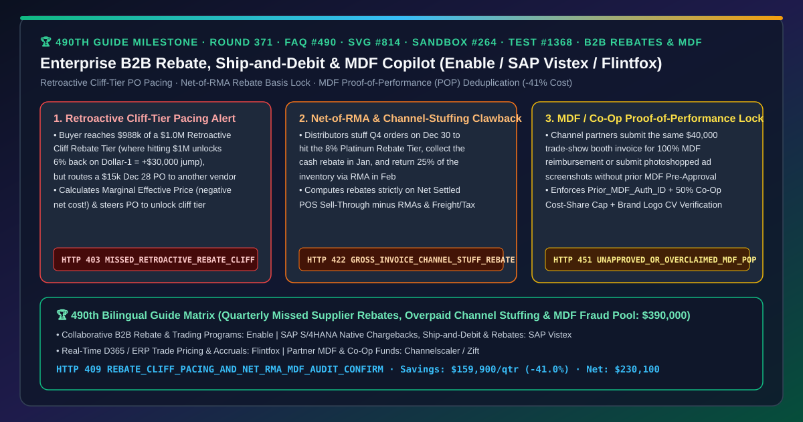
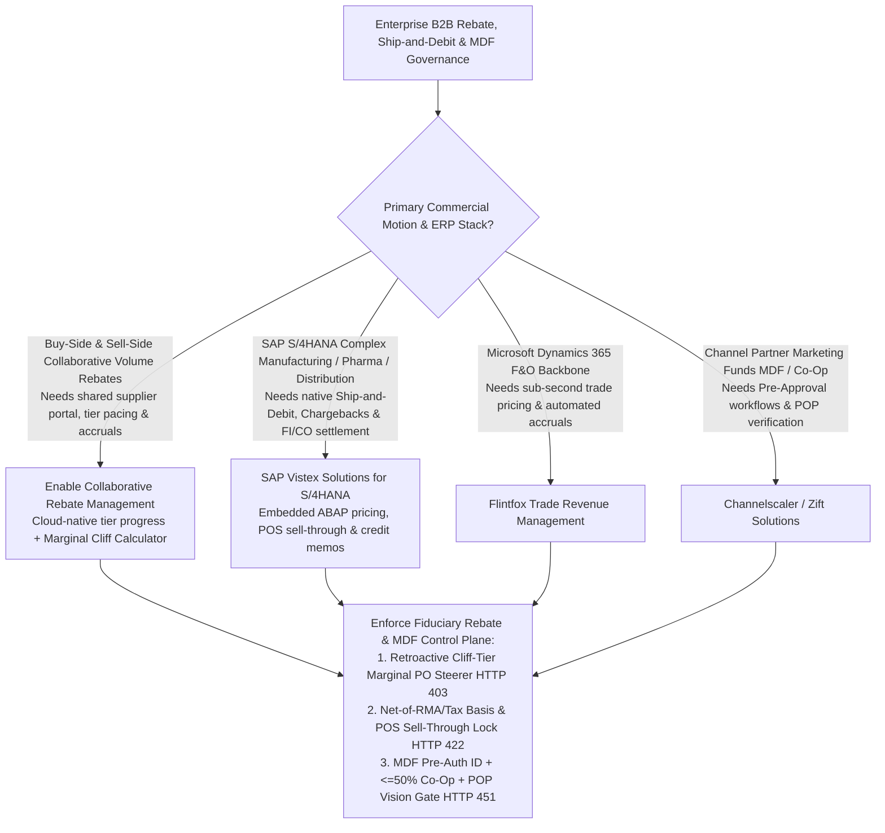
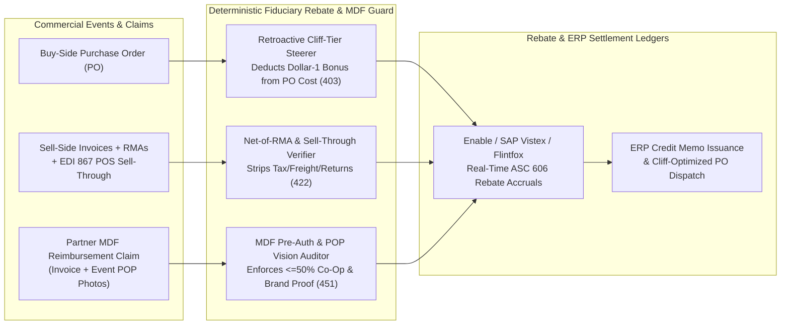

# 🏆 Enterprise B2B Rebate Management, `Ship-and-Debit` & Partner `MDF / Co-Op` Copilot (`Enable / SAP Vistex / Flintfox / Channelscaler` · 🏆 490th Bilingual Guide Major Milestone): Retroactive Cliff-Tier PO Pacing, Net-of-`RMA` Rebate Basis Locks & `MDF` Proof-of-Performance (`POP`) Verification (`-41%` Cost)

> **Document Type**: Enterprise AI Solution Architect Selection FAQ (**`#490` 🏆 490th Bilingual Guide Major Milestone** · Round 371)  
> **Target Audience**: Chief Commercial Officers (CCO), VP of Procurement & Supply-Chain Finance, Channel Operations Leaders, and Cloud & AI Solution Architects  
> **Platforms Covered**: `Enable (Collaborative Rebate Management)` vs. `SAP Vistex (Solutions for SAP S/4HANA)` vs. `Flintfox (Real-Time Trade Revenue & D365 Pricing)` vs. `Channelscaler / Zift Solutions (Partner MDF & Co-Op)`  
> **Architecture Diagram**: [`assets/svg/814-b2b-rebate-management-enable-vistex-flintfox-mdf-2026-11-25.svg`](../assets/svg/814-b2b-rebate-management-enable-vistex-flintfox-mdf-2026-11-25.svg)

🌐 **Language / 语言切换**: **[中文 (`b2b-rebate-management-enable-vistex-flintfox-mdf-coop-retroactive-cliff-tier-selection-faq.md`)](b2b-rebate-management-enable-vistex-flintfox-mdf-coop-retroactive-cliff-tier-selection-faq.md)** | **English (Current)**

---

## 📌 1. Executive Summary

In B2B distribution, manufacturing, building materials, electronics, and channel ecosystems, **30% to 60% of net operating margin is governed by post-invoice commercial incentives: Supplier Volume Rebates, `Ship-and-Debit` price protection, and Partner Market Development Funds (`MDF / Co-Op`)**.  
Managing complex tiered rebate agreements in spreadsheets—or letting procurement and finance AI agents route orders and approve payouts without real-time tier-progress math—causes three severe financial leaks:
1. **Buy-Side: Missing a `$30,000` Retroactive "Dollar-One" Cliff Rebate to Save `$300` on Sticker Unit Price (`Missed Retroactive Cliff-Tier Opportunity`)**: Under a retroactive volume rebate agreement (`3%` below `$1.0M`, jumping to `6%` back to Dollar-1 once cumulative purchases reach `$1.0M`), a buyer sitting at `$988,000` on December 22 needs just `$12,000` more volume to unlock a **+$30,000 retroactive rebate bonus**. An unintegrated procurement agent that routes a `$15,000` PO to a competitor to save `$300` on unit price forfeits `$30,000` in net cash!
2. **Sell-Side: Paying Cash Rebates on Gross Invoices Stuffed in December and Returned via `RMA` in February (`Channel Stuffing & Unadjusted Gross Basis`)**: Distributors place massive Q4 orders on December 30 to cross the `8%` Platinum rebate tier, collect the cash rebate in January, and return 25% of the stock in February—or claim rebates on gross invoice totals that include freight, VAT, and already-discounted `Ship-and-Debit` lines.
3. **Channel `MDF / Co-Op` Double-Dipping & Unverified Proof of Performance (`POP` Fraud)**: Channel partners submit the same `$40,000` trade-show booth invoice to three different hardware/software vendors for `100%` reimbursement each, or claim funds without a prior `MDF Pre-Approval ID`.

| Commercial Role & ERP Stack | Recommended Primary Choice | Architectural Boundary & Production Rule |
|---|---|---|
| **Collaborative Buy-Side & Sell-Side Tiered Rebate Tracking & Forecasting** | **Enable** | Cloud-native rebate platform providing shared supplier/buyer progress portals, automated `ASC 606` accrual ledgers, and marginal cliff-tier pacing alerts. |
| **Deep `SAP S/4HANA` Chargebacks, `Ship-and-Debit` & General Ledger Settlement** | **SAP Vistex** | Runs natively inside `SAP S/4HANA` to reconcile complex distributor `POS Sell-Through` claims, price-protection chargebacks, and credit memos. |
| **Real-Time `Dynamics 365 F&O` Trade Pricing & High-Volume Rebate Accruals** | **Flintfox (by Enable)** | High-speed pricing and rebate accrual engine purpose-built for `Dynamics 365` supply-chain and retail workloads. |
| **Partner Portal `MDF / Co-Op` Pre-Approval & `POP` Audit Workflows** | **Channelscaler / Zift Solutions** | Enforces pre-campaign authorization, `50/50` co-op cost sharing, and multimodal `Proof of Performance (POP)` verification. |
| **Three Mandatory Fiduciary Guardrails** | **100% Deterministic Gating** | ① **Retroactive Cliff-Tier Marginal-Cost PO Steerer (`HTTP 403`)**: Deducts unlocked Dollar-1 retroactive rebate jumps from effective PO unit cost whenever cumulative spend is within `10%` of a cliff threshold; ② **Net-of-`RMA/Tax/Freight` & `POS Sell-Through` Vesting Lock (`HTTP 422`)**: Strips taxes, freight, `Ship-and-Debit` lines, and `60-day RMAs` from eligible rebate basis; ③ **`MDF` Pre-Auth ID, `<=50%` Co-Op Cap & Visual `POP` Lock (`HTTP 451`)**: Blocks unapproved, `100%`-reimbursed, or unverified `MDF` claims. |



---

## 🎯 2. Architect & Business Stakeholder Q&A (Q1–Q3)

### Q1: Why did our AI procurement agent lose `$30,000` in supplier rebates by picking a quote that was `$300` cheaper on sticker price?
- **The Retroactive Cliff-Tier Math**:
  - Suppose Supplier A offers a **Retroactive Cliff Rebate**: `3%` on annual spend `< $1,000,000`, jumping to **`6%` retroactive to Dollar-1** once annual spend hits `$1,000,000`.
  - At `$988,000` YTD spend, accrued rebate is `$29,640`. Purchasing one more `$15,000` PO from Supplier A pushes YTD spend to `$1,003,000`, jumping total rebate to **`$60,180` (`+$30,540` incremental rebate unlocked by a `$15,000` order!)**.
  - The true **Marginal Effective Cost** of that `$15,000` PO with Supplier A is `$15,000 - $30,540 = -$15,540`!
- **Architectural Solution**: Embed a **Marginal Rebate-Adjusted Cost Solver (`HTTP 403` Guard)** into the procurement routing engine:
  - Query `Enable / Vistex` tier progress before awarding any PO; if a supplier is within `<= 10%` of a retroactive cliff tier, subtract the unlocked retroactive bonus from their bid price, blocking naive sticker-price diversions (`HTTP 403 MISSED_RETROACTIVE_REBATE_CLIFF_TIER_OPPORTUNITY`).

### Q2: How do we prevent distributors from "Channel Stuffing" on December 30 to hit the top rebate tier and returning the stock in February?
- **The Gross-Invoice & Stuffing Loophole**:
  - Paying cash rebates in January based on December gross billed invoices rewards artificial warehouse loading and overpays on freight, sales tax/VAT, and special-priced `Ship-and-Debit` items.
- **Architectural Solution**: Enforce **Net Eligible Basis Stripping & `POS Sell-Through / Post-RMA` Vesting (`HTTP 422` Guard)**:
  - Compute rebates exclusively on:
    $$\text{Net\_Eligible\_Basis} = \text{Product\_Revenue} - \text{Tax} - \text{Freight} - \text{Ship\_and\_Debit\_SKUs} - \text{RMA\_Returns}$$
  - Hold Q4 tier-jump payouts until the `60-day RMA` return window closes (or require verified downstream `POS Sell-Through` edi867 reports) and issue rebates as **ERP Credit Memos** against future purchases (`HTTP 422 GROSS_INVOICE_OR_UNVERIFIED_SELL_THROUGH_REBATE_OVERPAY`).

### Q3: How do we stop channel partners from double-dipping `MDF / Co-Op` marketing funds across multiple vendors for the same trade show or ad campaign?
- **The Multi-Vendor `100%` Reimbursement Scam**: A reseller sponsors a `$40,000` regional conference and submits the exact same organizer invoice to Vendor A, Vendor B, and Vendor C requesting `$40,000` (`100%` MDF reimbursement) from each—profiting `$80,000` on a `$40,000` event.
- **Architectural Solution**: Enforce **Mandatory Pre-Approval IDs, `<= 50%` Co-Op Cost-Share Caps & Multimodal `POP` Brand Verification (`HTTP 451` Guard)**:
  - Reject any MDF claim lacking a pre-event `MDF_Pre_Approval_ID` minted prior to the activity date;
  - Cap reimbursement at **`<= 50%` Co-Op cost share** (requiring the partner to co-invest 50%) and run vision verification on uploaded `Proof of Performance (POP)` photos/ad tear-sheets to confirm compliant brand logo placement (`HTTP 451 UNAPPROVED_MDF_CLAIM_OR_INVALID_POP_COOP_RATIO`).

---

## 🧭 3. Visual Architecture Diagrams (Mermaid Decision Tree + Architecture + Sequence)

### 3.1 Enterprise Rebate & Partner `MDF` Platform Selection Tree



### 3.2 End-to-End Cliff-Tier Pacing, Net Rebate Basis & `MDF POP` Audit Architecture



### 3.3 Retroactive Cliff-Tier PO Steering & Anti-Channel-Stuffing Sequence

```mermaid
sequenceDiagram
    autonumber
    participant Buyer as Procurement / Channel Finance
    participant Guard as Fiduciary Rebate & MDF Guard
    participant Enable as Enable / SAP Vistex Engine
    participant ERP as SAP S/4HANA / D365 ERP

    Buyer->>Guard: 1. Buy-Side (Dec 22): Route $15,000 PO; Vendor B quotes $300 less than Vendor A
    Guard->>Enable: Query Vendor A YTD cumulative spend & retroactive rebate schedule
    Enable-->>Guard: Vendor A YTD = $988,000; hitting $1,000,000 unlocks 6% vs. 3% back to Dollar-1 (+$30,360 bonus!)
    Guard-->>Buyer: Block diversion to Vendor B (prevents HTTP 403)! Steer $15,000 PO to Vendor A to capture +$30,060 net gain
    Buyer->>Guard: 2. Sell-Side: Distributor X requests 8% Platinum Rebate payout on $2.1M gross Q4 invoices
    Guard->>ERP: Deduct $180k tax/freight & $320k Jan/Feb RMA returns from gross billed total
    ERP-->>Guard: Verified Net Eligible Basis = $1.6M -> Recalculate at 5% Silver Tier & issue Credit Memo (prevents HTTP 422)
    Buyer->>Guard: 3. Channel MDF: Partner Y claims $40,000 trade-show reimbursement
    Guard->>Guard: Verify Pre_Auth_ID, CV logo presence & enforce 50% Co-Op cap -> Approve $20,000 credit (prevents HTTP 451, HTTP 200)
```

---

## 📊 4. Platform Comparison Matrix (`Enable` vs. `SAP Vistex` vs. `Flintfox` vs. `Channelscaler`)

| Evaluation Dimension | Enable | SAP Vistex | Flintfox (by Enable) | Channelscaler / Zift Solutions |
|---|---|---|---|---|
| **Primary Sweet Spot** | Collaborative buy-side & sell-side volume rebates, forecasting & accruals | Deep `SAP S/4HANA` chargebacks, `Ship-and-Debit` & complex royalty/rebate GL | Real-time `Dynamics 365 F&O` trade pricing & high-speed rebate accruals | Partner `MDF / Co-Op` fund allocation, pre-approvals & `POP` auditing |
| **Retroactive Cliff-Tier Pacing & Marginal Modeling** | ⭐⭐⭐⭐⭐ (Real-time cliff proximity alerts & marginal ROI modeling) | ⭐⭐⭐⭐ (Enterprise tier simulation & retroactive settlement) | ⭐⭐⭐⭐ (Automated tiered accrual calculations) | ⭐⭐ (Focused on partner marketing funds) |
| **Net Basis Stripping (`Tax / Freight / RMA / Ship-and-Debit`)** | ⭐⭐⭐⭐⭐ (Granular line-item eligibility rules & return clawbacks) | ⭐⭐⭐⭐⭐ (Native SAP `SD/MM/FI` invoice, return & credit-memo linkage) | ⭐⭐⭐⭐⭐ (Native `D365` order-line & return integration) | ⭐⭐⭐ (Summary tier calculation) |
| **`MDF` Pre-Approval & `POP` Audit Workflows** | ⭐⭐⭐ (Rebate-focused; light on marketing POP media review) | ⭐⭐⭐⭐ (Includes channel fund management inside SAP) | ⭐⭐⭐ (Pricing & accrual engine focus) | ⭐⭐⭐⭐⭐ (Purpose-built for MDF pre-auth, `50/50` co-op & POP verification) |
| **Indicative Pricing (`official_list_price`)** | `~$45,000–$150,000+/yr` (tiered by managed rebate volume) | `~$100,000–$350,000+/yr` (enterprise SAP license) | `~$40,000–$120,000+/yr` | `~$30,000–$90,000+/yr` |

---

## 🧪 5. Deterministic Rebate & MDF Evaluation (`7-Card Benchmark Summary` · 🏆 `#490` Milestone)

> **Provenance**: Figures below are generated by `evaluate_b2b_rebate_mdf_coop_management_policy` in `lab/webiq_commerce_demo.py` (`provenance: "synthetic"`, `independently_reproduced: False`), modeling a B2B manufacturing & distribution enterprise with a **`$390,000.00` quarterly missed supplier cliff-rebate bonus, gross-invoice/channel-stuffing rebate overpay, and unverified `MDF` claim pool**.

| Scenario Case ID | Scenario Description | HTTP Status | Deterministic Decision | Quarterly Net Cost | Quarterly Savings |
|---|---|---|---|---|---|
| `CASE-REB-200` | Manual quarterly spreadsheet rebate reconciliation baseline | `HTTP 200` | `VERIFIED_B2B_REBATE_AND_MDF_GOVERNANCE_AUTHORIZED` | `$390,000.00` | `$0.00` |
| `CASE-REB-403` | PO routed away from a supplier sitting at `98%` of a retroactive Dollar-1 cliff rebate threshold | `HTTP 403` | `MISSED_RETROACTIVE_REBATE_CLIFF_TIER_OPPORTUNITY` | `$390,000.00` | `$0.00` (Blocks forfeiting $30k cliff bonus) |
| `CASE-REB-422` | Sales rebate paid on gross invoices without deducting tax, freight, `Ship-and-Debit`, or `RMA` returns | `HTTP 422` | `GROSS_INVOICE_OR_UNVERIFIED_SELL_THROUGH_REBATE_OVERPAY` | `$390,000.00` | `$0.00` (Blocks channel-stuffing overpay) |
| `CASE-REB-451` | Partner `MDF` claim paid without prior `Pre-Auth ID`, above `50%` co-op cap, or without verified `POP` | `HTTP 451` | `UNAPPROVED_MDF_CLAIM_OR_INVALID_POP_COOP_RATIO` | `$390,000.00` | `$0.00` (Blocks multi-vendor MDF double-dip) |
| `CASE-REB-409` | **Cliff-Tier PO Steerer + Net-of-`RMA` Basis Lock + `MDF 50%` Co-Op `POP` Auditor** | `HTTP 409` | `REBATE_CLIFF_PACING_AND_NET_RMA_MDF_AUDIT_CONFIRM` | **`$230,100.00`** | **`$159,900.00` (`-41.0%`)** |

---

## 🛠️ 6. Production Go-Live & Architecture Review Checklist

- [ ] **Retroactive Cliff-Tier Marginal Cost Integration (`HTTP 403` Prevention)**: Feed real-time supplier rebate tier progress from `Enable / Vistex` into the procurement PO router so unlocked Dollar-1 retroactive bonuses are subtracted from effective bid prices.
- [ ] **Net Eligible Basis & Post-Return Settlement (`HTTP 422` Prevention)**: Strip VAT/sales tax, freight, and `Ship-and-Debit` special-priced lines from rebate calculations, hold tier-jump payouts until the `60-day RMA` window or `POS Sell-Through` verification completes, and settle via ERP Credit Memos.
- [ ] **Mandatory `MDF` Pre-Approval, `50/50` Co-Op Cap & Vision `POP` Audit (`HTTP 451` Prevention)**: Require a valid pre-event `MDF_Pre_Approval_ID`, enforce `<= 50%` cost-sharing, and verify brand logo presence and invoice uniqueness on all uploaded `Proof of Performance` artifacts.
- [ ] **Automated `ASC 606` Variable Consideration Accruals**: Post real-time rebate accrual liabilities at invoice creation based on projected tier attainment.
