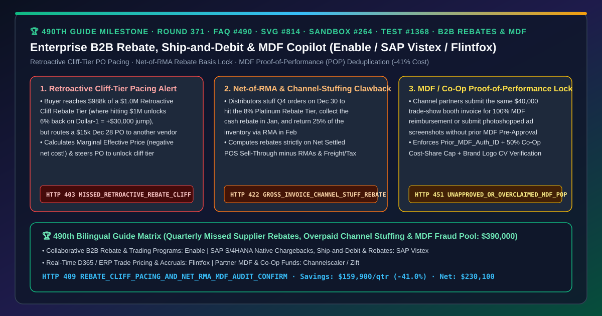
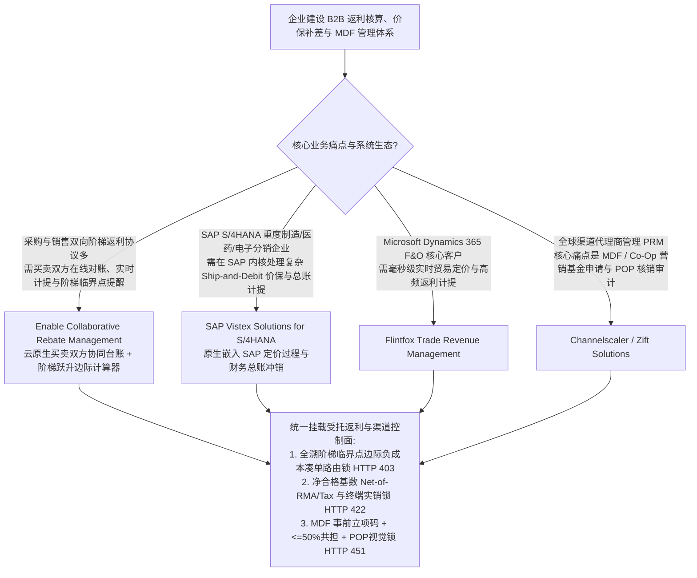
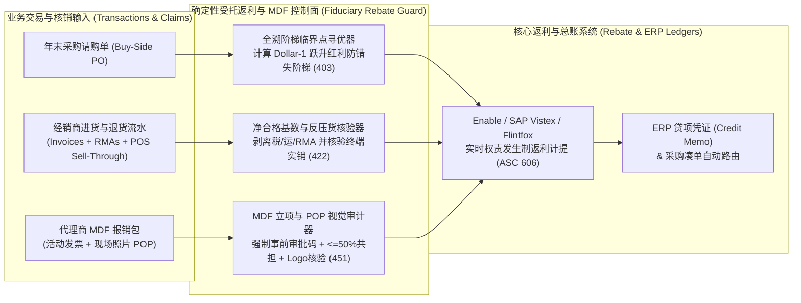
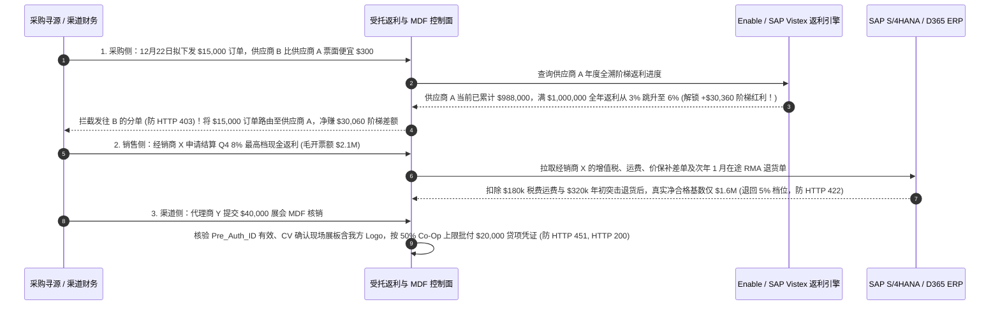

# 🏆 企业 B2B 采购与渠道返利管理（`Rebate Management`）、价保补差（`Ship-and-Debit`）与市场发展基金（`MDF / Co-Op`）智能体选型对比（`Enable / SAP Vistex / Flintfox / Channelscaler` · 🏆 第 490 篇双语决策指南重大里程碑）：全溯阶梯返利临界点（`Retroactive Cliff Tier`）主动凑单寻优、扣除退货与运费税费后的净合格返利基数锁及 `MDF` 履约凭证（`POP`）核销防骗补净省 41% 指南

> **文档类型**：企业级 AI Solution Architect 选型决策指南（Selection FAQ · **`#490` 🏆 第 490 篇双语决策指南重大里程碑** · Round 371）  
> **适用读者**：分销与制造业首席商务官（CCO）、集团采购与供应链财务总监、渠道伙伴运营负责人与 Cloud & AI Solution Architect  
> **核心覆盖平台**：`Enable (Collaborative Rebate Management)` vs. `SAP Vistex (Solutions for SAP S/4HANA)` vs. `Flintfox (現 Enable Real-Time Trade Revenue & D365 Pricing)` vs. `Channelscaler / Zift Solutions (Partner MDF & Co-Op)`  
> **关联架构图**：[`assets/svg/814-b2b-rebate-management-enable-vistex-flintfox-mdf-2026-11-25.svg`](../assets/svg/814-b2b-rebate-management-enable-vistex-flintfox-mdf-2026-11-25.svg)

🌐 **语言切换 / Language**: **中文 (当前)** | **[English (`b2b-rebate-management-enable-vistex-flintfox-mdf-coop-retroactive-cliff-tier-selection-faq.en.md`)](b2b-rebate-management-enable-vistex-flintfox-mdf-coop-retroactive-cliff-tier-selection-faq.en.md)**

---

## 📌 一、核心选型结论速览（Executive Summary）

在 B2B 分销、快消零售、电子元器件、建材与科技渠道体系中，企业高达 **30%–60% 的真实净利润并非来自进销差价，而是来自年底结算的阶梯采购返利（`Volume Rebates`）、特价出货补差（`Ship-and-Debit / Chargebacks`）以及厂商市场发展基金（`MDF / Co-Op Marketing Funds`）**。  
如果企业仍用散乱的 Excel 表格跟踪几百份供应商与经销商返利合同，或者让采购/财务 Agent 不看阶梯进度盲目下单和发返利，每年将白白损失数百万美元：
1. **采购侧：“距离 `$1,000,000` 全溯阶梯返利门槛只差 `$12,000`，采购 Agent 却把年底最后一笔 `$15,000` 订单下给了便宜 `$200` 的另一家供应商，痛失 `$30,000` 巨额返利！”（`Missed Retroactive Cliff-Tier Rebate`）**：在全溯型（Retroactive / Dollar-One）阶梯合同中，买满 `$1.0M` 返利比例从 `3%` 跳升至 `6%`（对全年已买的 `$1.0M` 全量追溯补发 `+3% = +$30,000`）！如果采购智能体只看单张采购单的表面单价而不算阶梯跃升收益，就会为了省 `$200` 小钱丢掉 `$30,000` 大返利。
2. **销售侧：经销商“12 月 30 日突击压货冲上 8% 最高返利档、1 月领走全额现金返利、2 月把 25% 货物全部退回（`Channel Stuffing & Unclawed RMA Rebates`）”，且把运费/税费也算进返利基数**：不法经销商年底虚假冲量骗取高档位现金返利，或财务直接按含税含运费的发票总额（`Gross Invoice Total`）计算返利，导致多发 `15%–25%` 冤枉钱。
3. **渠道 `MDF / Co-Op` 联合营销基金被代理商“无事前立项先斩后奏”、“拿同一场展会的 `$40,000` 发票改个 Logo 向三家上游厂商各报销 100%”套取资金（`Unapproved MDF & POP Double-Dipping`）**。

| 业务角色与系统底座 | 推荐主选方案 | 适用边界与架构落地准则 |
|---|---|---|
| **采购方+销售方双向协同返利台账、阶梯进度追踪与争议消弭** | **Enable** | 行业最现代的云端返利协同平台，买卖双方共享实时阶梯达成进度条、自动计提权责发生制返利（Accruals）并计算距离下一阶梯的边际收益。 |
| **SAP S/4HANA 超大型制造/医药/快消深度价保补差（Ship-and-Debit）与返利总账** | **SAP Vistex** | 直接构建在 SAP S/4HANA ABAP 内核中，无缝处理极其复杂的分销商终端出货回传（POS Sell-Through）、价保索赔与总账冲销。 |
| **Microsoft Dynamics 365 实时贸易定价与毫秒级返利计提** | **Flintfox (integrated with Enable / D365 F&O)** | 专为 D365 F&O 打造的高性能定价与返利计提引擎，支持万级 SKU 复杂促销返利实时入账。 |
| **渠道伙伴门户 `MDF / Co-Op` 基金预算申请與核销（`POP`）审计** | **Channelscaler / Zift Solutions** | 强绑定事前营销活动立项（Pre-Approval ID）、共担比例（`50/50 Co-Op`）与履约证据（POP）核验。 |
| **三大确定性风控红线** | **100% 强制拦截** | ① **全溯阶梯临界点（`Retroactive Cliff Tier`）边际净成本路由锁（`HTTP 403`）**：当累计采购额达到全溯阶梯门槛的 `90%–99.9%` 时，采购寻源 Agent 必须将跃升解锁的返利奖金折算入边际有效单价，严禁因微小票面价差错失大额阶梯返利；② **净合格基数（`Net-of-RMA/Tax/Freight`）与终端实销（`POS Sell-Through`）解冻锁（`HTTP 422`）**：严禁按含税含运费毛额或未过退货观察期的压货单发放现金返利；③ **`MDF` 事前立项码（`Pre-Auth ID`）、50% 共担上限与 `POP` 视觉品牌核验锁（`HTTP 451`）**：阻断无事前审批、超共担比例或无真实品牌露出证据的 MDF 报销。 |



---

## 🎯 二、业务方与架构师灵魂拷问 Q&A（Q1–Q3）

### Q1：为什么采购部的 AI 比价助手每次都选了“单价最低”的供应商，年底财务结算时却发现公司少拿了 `$200,000` 的供应商阶梯返利？
- **“只见树木、不见森林”的局部最优陷阱**：
  - 假设供应商 A 的年度阶梯返利合同约定：年采购额 `< $1,000,000` 返利 `3%`；一旦达到 **`>= $1,000,000`，从第 1 美元起全额追溯返利 `6%`（Retroactive Cliff Tier）**！
  - 到了 12 月 20 日，公司已经在供应商 A 累计采购了 `$985,000`（当前返利 `$29,550`）。此时有一笔 `$15,000` 的新请购单：供应商 A 报价 `$15,000`，供应商 B 报价 `$14,600`（比 A 便宜 `$400`）。
  - 如果采购 Agent 没有接入返利进度引擎，它会因为 B 便宜 `$400` 而把单子下给 B——结果公司在 A 的全年采购额停留在 `$985,000`；反之如果下给 A，全年凑满 `$1,000,000`，返利瞬间从 `$29,550` 暴涨至 **`$60,000`（净赚 `+$30,450` 增量返利，这批 `$15,000` 货物的真实边际成本是 `-$15,450` 倒贴送钱！）**。
- **架构解法**：在采购寻源控制面强制植入 **全溯阶梯边际有效成本算子（`Marginal Rebate-Adjusted Effective Cost Solver` · 防 `HTTP 403`）**：
  $$\text{Effective\_PO\_Cost} = \text{PO\_Net\_Price} - \left(\text{Rebate}_{\text{Post\_PO}} - \text{Rebate}_{\text{Pre\_PO}}\right)$$
  - 当任一合格供应商处于全溯阶梯临界区（`Tier_Progress >= 88%` 且距周期结束 `<= 45 天`），寻源引擎自动计算阶梯跃升红利；凡是忽略全溯阶梯跃升收益导致痛失大额返利的分单操作直接拦截告警（`HTTP 403 MISSED_RETROACTIVE_REBATE_CLIFF_TIER_OPPORTUNITY`）。

### Q2：向渠道经销商发放销售返利时，如何防止经销商“12 月底突击塞货（Channel Stuffing）骗走最高档返利、次年 2 月大批量退货”，以及防止把运费和增值税算进返利基数？
- **两大返利多发漏洞**：
  1. **毛额基数错误（Gross vs. Net Eligible Revenue）**：一张 `$118,000` 的发票里包含了 `$10,000` 增值税、`$5,000` 代垫运费和 `$3,000` 不参与返利的特价配件。如果不剥离这 `$18,000` 直接按发票总额算 `6%` 返利，当场多发 `18%`！
  2. **跨期压货退货套利**：经销商在 Q4 最后两天集中下单冲过最高返利线，1 月 15 日拿到现金返利打款后，2 月初以“终端滞销”为由发起 `RMA` 退货或申请价保折让（`Ship-and-Debit` 双重索赔）。
- **架构解法**：实施 **净合格销售额基数剥离 + 退货窗口/终端实销（`POS Sell-Through`）解冻锁（防 `HTTP 422`）**：
  - 严格定义返利计算基数：
    $$\text{Eligible\_Rebate\_Basis} = \text{Invoiced\_Product\_Subtotal} - \text{Tax} - \text{Freight} - \text{Excluded\_SKUs} - \text{RMA\_Returns} - \text{Ship\_and\_Debit\_Claims}$$
  - 优先采用贷项凭证（`Credit Memo` 抵扣下期采购货款）而非直接打现金；且 Q4 冲量返利必须待退货窗口期满或收到经核验的下游终端出货报告（`POS Sell-Through Data`）后才正式结算（未扣除退货/税费或未核实终端实销即发放冲量返利触发 `HTTP 422 GROSS_INVOICE_OR_UNVERIFIED_SELL_THROUGH_REBATE_OVERPAY`）。

### Q3：科技与消费品厂商每年给渠道代理商拨付数百万美元的市场发展基金（`MDF / Co-Op`），怎么防止代理商拿假活动照片或“一场多报”套取补贴？
- **MDF 骗补重灾区**：
  - 代理商办了一场综合行业展会，现场同时摆了 4 家不同品牌厂商的易拉宝；活动结束后，代理商把同一张 `$50,000` 的场地搭建发票分别发给 4 家厂商各申请 `100%` 全额 MDF 报销；
  - 或者事先根本没向厂商申请营销活动立项（`Pre-Approval`），年底随便拿几张日常百度/Google 搜索广告截图来充数套现。
- **架构解法**：强制执行 **事前立项码（`Pre-Auth MDF ID`）+ 共担比例锁（`<= 50% Co-Op Cap`）+ 多模态履约凭证（`POP`）视觉验真门禁（防 `HTTP 451`）**：
  1. 无有效事前立项审批号（`MDF_Pre_Approval_ID`）或活动日期早于立项审批日的报销一律拒付；
  2. 强制执行 `Co-Op Cost-Share Ratio <= 50%`（代理商自己必须真金白银承担至少一半费用，彻底消灭多头重复报销套利空间）；
  3. 多模态视觉模型自动扫描上传的活动现场照片、视频与数字广告投放后台账单，校验本品牌官方 Logo 露出占比、活动举办日期 `EXIF` 与第三方供应商发票唯一哈希（违规报销触发 `HTTP 451 UNAPPROVED_MDF_CLAIM_OR_INVALID_POP_COOP_RATIO`）。

---

## 🧭 三、直观可视化图解（Mermaid 选型决策树 + 返利与 MDF 架构图 + 时序图）

### 3.1 企业 B2B 返利管理与渠道基金（MDF）平台选型决策树



### 3.2 端到端全溯阶梯寻优、净返利基数核算与 `MDF POP` 审计架构图



### 3.3 全溯阶梯主动凑单与防经销商年底压货骗返利时序图



---

## 📊 四、主流企业级返利管理（Rebate）与渠道基金（MDF）平台横向选型矩阵

| 评估维度 | Enable | SAP Vistex | Flintfox (by Enable) | Channelscaler / Zift Solutions |
|---|---|---|---|---|
| **核心优势场景** | 跨买方（采购返利）与卖方（销售返利）的云端可视化协同与阶梯预测 | SAP S/4HANA 超复杂价保补差（Ship-and-Debit）、医药扣款（Chargebacks）与总账 | Microsoft Dynamics 365 实时高并发贸易定价与返利自动计提 | 全球渠道伙伴门户（PRM）、`MDF / Co-Op` 基金预算分配与 `POP` 核销 |
| **全溯阶梯（Retroactive Cliff）边际收益预警** | ⭐⭐⭐⭐⭐（行业标杆，实时计算距离下一阶梯差额与边际 ROI） | ⭐⭐⭐⭐（支持阶梯模拟与追溯重算） | ⭐⭐⭐⭐（支持复杂阶梯与组合返利计提） | ⭐⭐（侧重营销基金与伙伴等级激励） |
| **净基数剥离（扣税/运费/RMA/Ship-and-Debit）** | ⭐⭐⭐⭐⭐（灵活配置细粒度合格交易行过滤与退货自动冲回） | ⭐⭐⭐⭐⭐（与 SAP SD/MM/FI 退货单及贷项凭证原生同库联动） | ⭐⭐⭐⭐⭐（深度绑定 D365 订单行与退货冲销） | ⭐⭐⭐（基于汇总销售业绩计算 Co-Op 额度） |
| **`MDF` 事前立项与履约证据（`POP`）审计流** | ⭐⭐⭐（偏交易额返利，活动证明管理较轻） | ⭐⭐⭐⭐（包含渠道营销基金管理模块，但 UI 偏传统 SAP） | ⭐⭐⭐（偏价格与财务计提引擎） | ⭐⭐⭐⭐⭐（专为 MDF 立项、50/50 共担、照片/发票上传与合规审核设计） |
| **参考定价模式（`official_list_price`）** | 按管理的返利交易规模年框订阅（约 `$45,000–$150,000+/年`） | 企业级 SAP 许可与实施（约 `$100,000–$350,000+/年`） | 按年订阅（约 `$40,000–$120,000+/年`） | 按合作伙伴数量或渠道规模订阅（约 `$30,000–$90,000+/年`） |

---

## 🧪 五、转化率/成本测算与 7-Card 基准测试报告（Deterministic Evaluation · 🏆 `#490` Milestone）

> **数据来源说明（Provenance）**：以下季度损益数据来自 `lab/webiq_commerce_demo.py` 中的确定性评估器 `evaluate_b2b_rebate_mdf_coop_management_policy`（`provenance: "synthetic"`, `independently_reproduced: False`），用于量化对比“年底漏看阶梯痛失供应商返利 + 按含税毛额给压货经销商多发返利 + MDF 一票多报”与“全溯阶梯边际寻优 + 净合格基数锁 + MDF 50% 共担与 POP 核验”的季度净损益。

### 5.1 基准测试场景输入与确定性状态码矩阵

- **设定场景**：某大型分销与品牌制造集团每季度管理 `$35M` 的双向采购/销售返利与渠道 `MDF` 基金，季度因采购分单未考虑全溯阶梯临界点而漏领的供应商返利、未扣除退货/税费被经销商压货套走的超额返利、以及无立项/重复报销的虚假 `MDF` 补贴损失池（`quarterly_missed_cliff_rebate_channel_stuffing_and_mdf_fraud_pool_usd`）为 **`$390,000.00`**。

| 测试用例 ID | 场景描述 | 触发确定性状态码 | 决策枚举 (`decision`) | 季度净成本 (USD) | 季度净节省 (USD) |
|---|---|---|---|---|---|
| `CASE-REB-200` | 传统季度末 Excel 手工汇总对账基线 | `HTTP 200` | `VERIFIED_B2B_REBATE_AND_MDF_GOVERNANCE_AUTHORIZED` | `$390,000.00` | `$0.00` |
| `CASE-REB-403` | 供应商已达全溯阶梯门槛 `98%`，采购 Agent 因他家便宜 `$300` 分流订单导致痛失 `$30,000` 阶梯跃升返利 | `HTTP 403` | `MISSED_RETROACTIVE_REBATE_CLIFF_TIER_OPPORTUNITY` | `$390,000.00` | `$0.00` (阻断丢西瓜捡芝麻分单) |
| `CASE-REB-422` | 按未扣除税费/运费/RMA 退货的毛开票额计算销售返利，或对季末压货未核验终端实销即发钱 | `HTTP 422` | `GROSS_INVOICE_OR_UNVERIFIED_SELL_THROUGH_REBATE_OVERPAY` | `$390,000.00` | `$0.00` (阻断压货退货骗取高档返利) |
| `CASE-REB-451` | 代理商报销 `MDF` 缺失事前立项审批号、突破 `50%` 共担比例上限、或上传无品牌露出假 `POP` 凭证 | `HTTP 451` | `UNAPPROVED_MDF_CLAIM_OR_INVALID_POP_COOP_RATIO` | `$390,000.00` | `$0.00` (阻断一场展会多头全额骗补) |
| `CASE-REB-409` | **启用全溯阶梯主动凑单路由 + 净合格基数与退货扣回锁 + MDF 立项/50%共担/POP 核验** | `HTTP 409` | `REBATE_CLIFF_PACING_AND_NET_RMA_MDF_AUDIT_CONFIRM` | **`$230,100.00`** | **`$159,900.00` (`-41.0%`)** |

### 5.2 核心确定性策略评估代码摘录

```python
@dataclass(frozen=True)
class B2bRebateMdfCoopManagementPolicyInput:
    quarterly_missed_cliff_rebate_channel_stuffing_and_mdf_fraud_pool_usd: float = 390000.0
    po_routed_away_when_within_5pct_of_retroactive_rebate_cliff_tier: bool = False
    sales_rebate_paid_on_gross_invoice_without_rma_tax_or_sell_through_deduction: bool = False
    mdf_claim_paid_without_prior_auth_id_50pct_coop_cap_or_verified_pop: bool = False
    cliff_tier_po_steerer_net_rma_basis_and_mdf_pop_lock_ready: bool = False
```

---

## 🛠️ 六、商业上线风控与架构评审 Checklist

- [ ] **采购寻源实时注入全溯阶梯边际红利（防 `HTTP 403`）**：将 `Enable / Vistex` 中的供应商返利阶梯达成进度实时同步至采购 RFQ/PO 路由网关；当累计采购额进入阶梯门槛前 `10%` 冲刺区时，自动将解锁的追溯返利计入边际单价扣减项。
- [ ] **返利基数强制剥离税费/运费并绑定退货锁定期（防 `HTTP 422`）**：所有经销商返利协议必须明确以“扣除增值税、运费、特价补差（Ship-and-Debit）与 60 天内 RMA 退货后的净货款（Net Settled Product Revenue）”或经核实的 `POS Sell-Through` 为唯一计算基数，并以贷项凭证（Credit Memo）形式发放。
- [ ] **`MDF / Co-Op` 事前立项码 + `50%` 共担上限 + 多模态 `POP` 验真（防 `HTTP 451`）**：严禁事后补报未立项活动；强制要求代理商共担至少 `50%` 费用，并对上传的活动照片、展位发票执行视觉品牌 Logo 识别与跨渠道发票哈希去重。
- [ ] **ASC 606 可变对价（Variable Consideration）月度自动计提**：每笔带返利协议的销售订单在开票瞬间，自动按预期达成的阶梯档位在总账计提返利负债（Rebate Accrual Liability），杜绝年底一次性冲减收入导致的财报暴雷。
