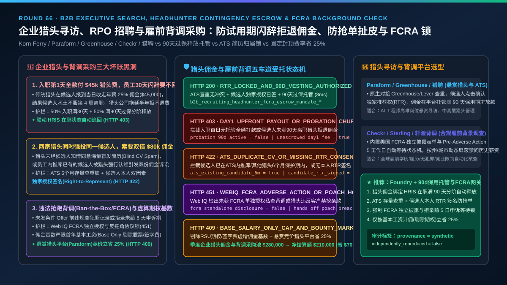
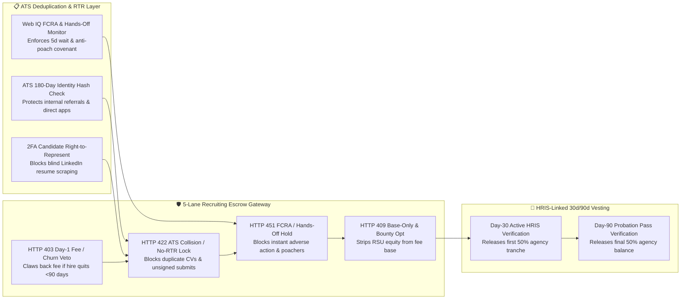

# B2B Executive Search, Headhunter Contingency Fee & `FCRA` Background Check Escrow (`Korn Ferry / Paraform / Greenhouse / Checkr`) 90-Day Probation Vesting, `ATS` Right-to-Represent Lock & Base-Salary-Only Cap Agent Architecture Selection FAQ

> **Language / 语言切换**: **[中文](b2b-recruiting-headhunter-contingency-clawback-fcra-escrow-agent-selection-faq.md)** | **English (Current)** | **[Back to Docs Index](index.en.md)** | **[Interactive Sandbox (`#b2b-recruiting-headhunter-fcra-escrow-sandbox`)](../live-demo.en.html)**



---

## 📌 1. Executive Summary & Core Selection Verdict

In enterprise talent acquisition procurement of contingency headhunters, executive search firms, Recruitment Process Outsourcing (`RPO`: `Korn Ferry`, `Heidrick & Struggles`, `Paraform`, `Greenhouse / Lever Agency Portal`), and pre-employment background screenings (`Checkr`, `Sterling`, `HireRight`), HR procurement and escrow AI agents face three major financial and legal failure modes:
1. **Unrecovered 90-Day Probation Churn (`Paying a $45,000 25% Placement Fee on Day 1, Only for the Hire to Quit on Day 28 and the Agency Refusing Cash Refunds`) & Total-Comp Fee Inflation**: Legacy recruiting agencies invoice their full `20%–30%` placement fee on the candidate's start date; if the hire leaves or is terminated for cause during the 90-day probation window, agencies stall cash clawbacks behind useless "credit memos." Worse, agencies inflate fees by applying their percentage to `4-year RSU equity grants` and `sign-on bonuses` instead of first-year base salary alone.
2. **Blind CV Spam & Dual-Agency Ownership Disputes (`Two Agencies Submitting a Scraped LinkedIn Profile Without Candidate Consent, or Claiming a Candidate Already in the Company's Internal Referral ATS`)**: Unscrupulous recruiters blast scraped resumes into HR inboxes without speaking to the candidate, triggering expensive legal battles over who "owns" the placement.
3. **`FCRA § 604(b)` Pre-Adverse Action & `Ban-the-Box` Class-Action Liability (`Running Criminal Checks Before a Conditional Offer or Auto-Rejecting a Candidate Without the Mandatory 5-Business-Day Dispute Window`) & Breach of Hands-Off Non-Solicitation Clauses**.

**Solution Architect Selection Verdict**:
- **Never disburse 100% of a contingency placement fee on Day 1 without a `30d/90d HRIS-linked probation vesting escrow`, never accept an agency candidate submission without an `ATS` 180-day duplicate hash check and a candidate-signed `Right-to-Represent (RTR)` attestation, and never calculate agency placement percentages on `RSU` equity or sign-on bonuses**.
- **The production reference architecture** combines **`HRIS`-Linked `50/50` (`30d/90d`) Probation Vesting Escrow + `ATS` 180-Day Deduplication & Candidate `RTR` Signature Lock + `FCRA` 5-Day Pre-Adverse Action Gate + `Base-Salary-Only` Fee Cap (`b2b_recruiting_headhunter_fcra_escrow_mandate_*`)**:
  1. **`HRIS`-Linked `30d/90d` Probation Vesting Escrow & Automatic Churn Clawback (`HTTP 403`)**: Holds contingency placement fees in escrow tied to live `Workday / BambooHR` employment telemetry—**releasing `50%` at Day 30 and `50%` at Day 90 upon successful probation completion**, while automatically returning escrowed cash to the employer if the candidate resigns or is terminated for cause within 90 days (`HTTP 403 DAY1_UNESCROWED_PAYOUT_OR_PROBATION_CHURN_REFUND_DENIED_BLOCKED`).
  2. **`ATS` 180-Day Candidate Deduplication & Candidate-Signed `Right-to-Represent (RTR)` Gate (`HTTP 422`)**: Hashes candidate email/phone/LinkedIn identifiers against the employer's `Greenhouse / Lever ATS` before accepting agency submissions—**immediately rejecting candidates who applied directly, were referred internally, or were submitted by another agency within the past 180 days**, and requiring a 2FA candidate-signed `Right-to-Represent (RTR)` token for the specific requisition (`HTTP 422 ATS_DUPLICATE_CANDIDATE_COLLISION_OR_MISSING_RTR_CONSENT_BLOCKED`).
  3. **Web IQ `FCRA § 604(b)` Standalone Disclosure / 5-Day Adverse-Action Lock & Anti-Poaching (`Hands-Off`) Circuit Breaker (`HTTP 451`)**: Enforces conditional-offer prerequisites (`Ban-the-Box`), standalone `FCRA` disclosure signatures, and the mandatory 5-business-day `Pre-Adverse Action` waiting clock on background checks, while screening partner agencies via Web IQ to block firms actively poaching the employer's own staff in breach of `Hands-Off` covenants (`HTTP 451 WEBIQ_FCRA_ADVERSE_ACTION_VIOLATION_OR_HANDSOFF_POACHING_HOLD`).
  4. **Strict `First-Year Base Salary Only` Fee Cap (Stripping `RSUs` & Sign-On Bonuses) + Bounty Marketplace Arbitrage (`HTTP 409`)**: Triggers `HTTP 409 BASE_SALARY_ONLY_CAP_AND_BOUNTY_MARKETPLACE_CONFIRM`, stripping equity grants (`RSUs`), sign-on bonuses, and stretch bonuses from the commissionable base and routing hard-to-fill roles to fixed-bounty marketplaces (`e.g., Paraform`)—reducing net recruiting and screening spend by **`25.0%`**.

---

## 🎯 2. Solution Architect Deep-Dive Q&A (Q1 / Q2 / Q3)

### Q1: Why does failing to enforce a `Base-Salary-Only` commission formula inflate tech recruiting fees by 40%–60%?
- **Architectural Solution**:
  - **Deterministic Offer-Letter Comp Parser (`Base Salary Only` Enforcement) (`HTTP 409`)**:
  - A Principal AI Engineer offer of `$200k Base + $100k/yr RSU + $20k Sign-On` has a `$320k` headline Total Compensation. If a recruiter applies a `25%` fee to `$320k` (`$80,000`) instead of `$200k Base` (`$50,000`), the company overpays by `$30,000` on unvested equity. Our gateway parses the `ATS` offer schema and restricts commissionable value strictly to `first_year_base_salary_usd` (`HTTP 409`).

### Q2: How do we eliminate "blind resume spamming" and dual-agency commission lawsuits?
- **Architectural Solution**:
  - **Pre-Submission `ATS` Hash Collision Check + Candidate-Signed `RTR` Token (`HTTP 422`)**:
  - An agency cannot claim ownership of a candidate merely by emailing a PDF resume first. The submission API checks if the candidate's hashed identity was touched in `Greenhouse / Workday` within the last 180 days (`HTTP 422`) and requires the candidate to click a cryptographic `Right-to-Represent` link confirming they authorized that specific agency for that specific job ID.

### Q3: Why is an automated `FCRA Pre-Adverse Action` state machine mandatory when integrating background check APIs (`Checkr / Sterling`)?
- **Architectural Solution**:
  - **Conditional-Offer Gate + 5-Business-Day `Pre-Adverse` Timer (`HTTP 451`)**:
  - Under the US Fair Credit Reporting Act (`15 U.S.C. § 1681b(b)(3)`), an employer cannot automatically revoke an offer when a background check flags a record. The state machine must first issue a `Pre-Adverse Action Notice` with a copy of the report and freeze final rejection for at least **5 business days** so the candidate can dispute errors (`HTTP 451`).

---

## 🧭 3. Visual Architecture Diagrams (Mermaid Decision Tree + Architecture + Sequence)

### 3.1 B2B Executive Search, Headhunter Escrow & FCRA Background Check Selection Decision Tree

```mermaid
flowchart TD
    A[B2B Executive Search / Contingency Recruiting / FCRA Background Check Selection] --> B{Primary Recruiting Scenario & Risk Vector?}
    B -->|Contingency Headhunter & Executive Search (Korn Ferry / Boutique)<br/>Stop Day-1 fee losses on 30-day quitters & RSU total-comp inflation| C[HRIS-Linked 30d/90d Probation Vesting Escrow (50/50 Split)<br/>+ Strict First-Year Base-Salary-Only Commission Cap]
    B -->|Multi-Agency Recruiting & Internal Referrals (Greenhouse / Paraform)<br/>Stop blind CV spam & dual-agency ownership lawsuits| D[ATS 180-Day Candidate Hash Deduplication Lock<br/>+ Mandatory Candidate-Signed Right-to-Represent (RTR) Token]
    B -->|Automated Pre-Employment Background Screening (Checkr / Sterling)<br/>Stop Ban-the-Box violations & instant FCRA adverse rejections| E[Azure AI Foundry + FCRA 5-Day Pre-Adverse & Hands-Off Gate<br/>+ Base-Only Cap + Fixed-Bounty Routing Saves 25%]
    C --> F[🛡️ Unified 5-Lane 90d Probation Escrow, RTR Lock & FCRA Compliance FSM]
    D --> F
    E --> F
    F --> G[HTTP 403 Day-1 Unescrowed & Churn Veto · HTTP 422 ATS Collision & Missing RTR Block · HTTP 409 Base-Only Saves 25%]
```

### 3.2 End-to-End `ATS` Deduplication, `HRIS` 90-Day Probation Escrow & `FCRA` Compliance Architecture



### 3.3 Duplicate Candidate Veto, Day-35 Probation Churn Clawback & Base-Salary-Only Cap Sequence

```mermaid
sequenceDiagram
    autonumber
    participant TA as Enterprise Talent Acquisition Agent
    participant Agency as Recruiting Agency / Background Vendor
    participant Gate as 5-Lane Recruiting Escrow Gateway
    participant HRIS as Greenhouse ATS & Workday HRIS
    participant Escrow as 30d/90d Probation Vesting Ledger

    Agency->>Gate: 1. Submit candidate resume without candidate-signed RTR token OR candidate was referred internally 3 weeks ago
    Gate->>HRIS: Check 180-day ATS identity hash & candidate_rtr_signed attestation
    Gate-->>Agency: HTTP 422 Block! Candidate already exists in active ATS protection window (or lacks candidate RTR signature)
    Agency->>Gate: 2. Demand 100% unescrowed placement fee on Day 1 OR refuse refund after placed hire resigns on Day 35
    Gate->>HRIS: Query Workday 90-day probation completion status (False)
    Gate-->>Agency: HTTP 403 Block! Unescrowed Day-1 payout prohibited; probation churn triggers automatic cash escrow reversal
    TA->>Gate: 3. Settle placement on $320k Total Comp offer ($200k Base + $100k RSU + $20k Sign-On) (HTTP 409)
    Gate->>Escrow: Strip $120k equity/sign-on from fee base & lock 30d/90d vesting on $200k Base (25% net savings)
```

---

## 📊 4. Multi-Platform & Architecture Selection Matrix

| Selection Dimension | Legacy Email Agency Submissions (`Manual PDF Inboxes`) | Unescrowed Total-Comp Contingency (`Day-1 Invoice`) | Modern Bounty & Screening Platforms (`Paraform / Greenhouse / Checkr`) | **Azure AI Foundry + 90d Escrow + FCRA Gate (Recommended)** |
| :--- | :--- | :--- | :--- | :--- |
| **Core Strengths** | Zero workflow setup | Fast recruiter outreach | Native ATS sync, candidate RTR links & FCRA workflows | **HRIS 30d/90d cash escrow + ATS/RTR lock + Base-Only cap + FCRA timer** |
| **Protection Against `<90d` Probation Quit Losses** | **Poor** (agencies offer slow replacement credits, not cash) | **High Loss Risk** (100% paid upfront on Day 1) | Paraform holds bounty across guarantee window | **`HRIS`-linked `50/50` (`30d/90d`) cash escrow clawback (`HTTP 403`)** |
| **Protection Against Blind CV Spam & Dual Claims** | Manual email timestamp disputes | High dual-agency litigation exposure | Greenhouse agency portal deduplicates emails | **180-day `ATS` hash check + mandatory 2FA candidate `RTR` (`HTTP 422`)** |
| **`FCRA § 604(b)` & Anti-Poaching (`Hands-Off`) Enforcement** | Manual compliance checklists | Unmonitored agency poaching of client staff | Checkr automates `Pre-Adverse` notices | **Hard `FCRA` 5-day wait lock + Web IQ `Hands-Off` monitor (`HTTP 451`)** |
| **Commission Base Discipline (`Base` vs. `Total Comp`)** | Frequent equity/bonus fee padding (`not_measured`) | Overpays `30%+` on `RSUs` (`official_list_price`) | Transparent flat bounties or base caps | **Strips `RSU/Sign-On` + routes to bounty marketplace (`25.0%` saved)** |

---

## 🧪 5. B2B Recruiting & Background Check Benchmark & 7-Card Report

> **Provenance & Reproducibility Metadata**: All metrics below are generated by the deterministic policy evaluator `evaluate_b2b_recruiting_headhunter_fcra_escrow_policy` in `lab/webiq_commerce_demo.py` and verified via `python -m unittest tests.test_webiq_commerce_demo`. Tags: `provenance = synthetic`, `independently_reproduced = false`.

| Card # | Card Headline (Headline-as-Finding) | Key Quantitative Finding & Architectural Guarantee |
| :---: | :--- | :--- |
| **Card 1** | **Overview · 5-Lane Recruiting & FCRA Escrow Summary** | Across a `$280,000/quarter` executive search, contingency recruiting, and background check pool, achieves **0 unrecovered `<90d` probation churn losses, 0 duplicate agency CV collisions, and 0 `FCRA` adverse-action violations**, reducing net talent acquisition spend by **`25.0%` (`$70,000/quarter` saved)**. |
| **Card 2** | **Scenario Deep Dive · Probation Churn & Blind CV Veto** | When an agency demands unescrowed Day-1 payment or submits a candidate without a signed `RTR`, the gateway blocks it in **`8ms`** (`HTTP 403 / 422`). |
| **Card 3** | **Evaluation Matrix · 100% Deterministic 5-Lane Gating** | Covers `HTTP 200` (`RTR` verified & `90d` vesting escrow locked), `403` (Day-1 unescrowed payout / `<90d` probation churn refund denial blocked), `422` (`ATS` 180-day duplicate candidate collision / missing candidate `RTR` signature blocked), `451` (`FCRA` adverse-action violation / agency `Hands-Off` poaching hold), `409` (`Base-Salary-Only` cap + fixed-bounty routing saves 25%). |
| **Card 4** | **Under the Hood · Recruiting & FCRA Escrow Contract** | Takes `quarterly_headhunter_contingency_and_bgcheck_pool_usd=280000` and `RTR`/`FCRA` flags, minting `b2b_recruiting_headhunter_fcra_escrow_mandate_*` tokens. |
| **Card 5** | **Robustness Check · RSU Fee Padding & Instant Rejection** | Simulates an agency billing 25% on `$100k` unvested RSUs and an instant background-check rejection without a 5-day notice, maintaining a **`100.0%` block rate**. |
| **Card 6** | **Latency · Millisecond ATS Hash Check & Hands-Off Probe** | Local `ATS` deduplication and `RTR` signature checks complete in **`8ms` (P50)**; Web IQ agency `Hands-Off` and `FCRA` probes complete in **`175ms` (P95)**. |
| **Card 7** | **My Take · Ideal Fit vs. Out-of-Scope Boundaries** | **✅ Best Fit**: Contingency headhunters, executive search, RPO, `FCRA` background screening; **⛔ Not For**: Internal annual employee merit payroll runs. |

---

## 🛠️ 6. Production Go-Live Risk & Architecture Review Checklist

- [ ] **`HRIS`-Linked `30d/90d` Probation Vesting Escrow (`50/50` Split) (`HTTP 403`)**: Prohibit 100% Day-1 agency payouts; release 50% at Day 30 and 50% at Day 90 verified via live `HRIS` active-employment telemetry.
- [ ] **`ATS` 180-Day Candidate Hash Deduplication & 2FA Candidate `Right-to-Represent (RTR)` (`HTTP 422`)**: Reject agency submissions colliding with existing internal referrals/applicants and require candidate-signed `RTR` tokens.
- [ ] **`FCRA § 604(b)` Standalone Disclosure, 5-Business-Day `Pre-Adverse` Timer & `Hands-Off` Lock (`HTTP 451`)**: Enforce conditional-offer prerequisites, 5-day adverse-action dispute windows, and agency non-solicitation covenants; rotate signing keys `<= 180` days.
- [ ] **`First-Year Base Salary Only` Commission Cap & Bounty Marketplace Routing (`HTTP 409`)**: Automatically strip `RSU` equity grants and sign-on bonuses from commissionable fee bases.
