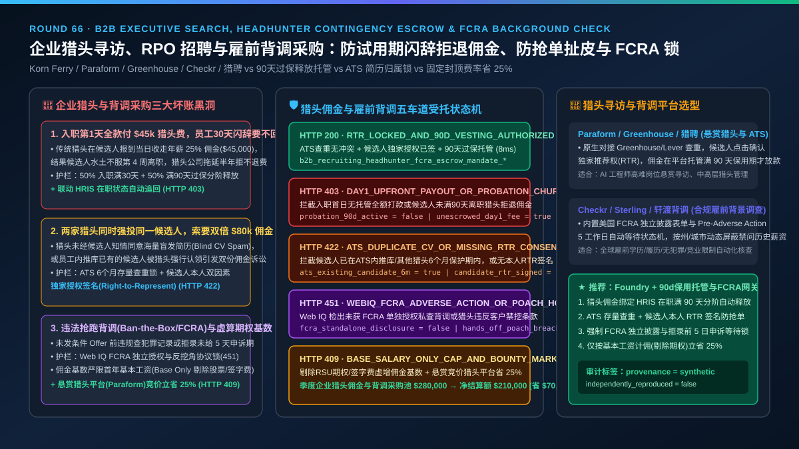
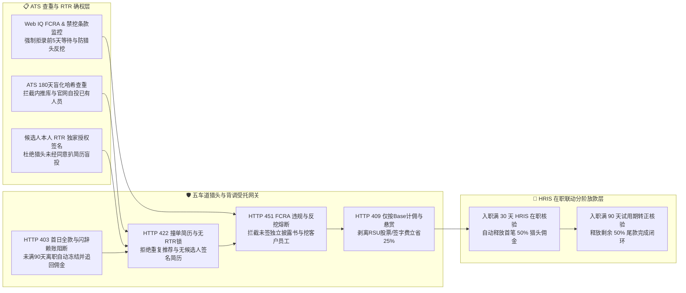
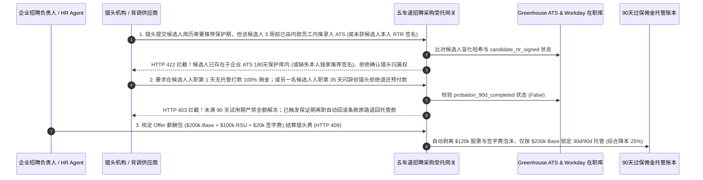

# 企业猎头招聘、RPO 批量招聘与背景调查服务采购（B2B Executive Search, Headhunter Contingency Fee & FCRA Background Check Escrow：Korn Ferry / Paraform / Greenhouse / Checkr / 猎聘 / Boss直聘猎头）“防候选人入职 30 天闪辞猎头拒退 $45k 佣金、防多猎头盲投同一简历抢单与 FCRA 背调合规锁”Agent 架构选型 FAQ

> **语言切换 / Language**: **中文 (当前)** | **[English](b2b-recruiting-headhunter-contingency-clawback-fcra-escrow-agent-selection-faq.en.md)** | **[返回文档目录](index.md)** | **[交互式沙盒 (`#b2b-recruiting-headhunter-fcra-escrow-sandbox`)](../live-demo.html)**



---

## 📌 一、核心选型结论速览（Executive Summary）

在科技企业、金融机构与跨国集团采购中高端猎头服务（Korn Ferry、Heidrick & Struggles、Paraform、猎聘、科锐国际）、招聘流程外包（RPO）以及雇前背景调查（Checkr、Sterling、HireRight、轩渡背调）的智能体发包、简历确权与佣金结算场景中，HR 招聘负责人与采购部门面临三大高频资金损失与合规诉讼风险：
1. **“候选人入职第 1 天企业就全额支付了 `$45,000`（年薪 `25%`）猎头佣金，结果该高管入职第 28 天就因水土不服或背调造假闪辞，猎头公司却以‘只退积分不退现金’百般赖账（Unrecoverable Probation Churn）”与“猎头把股票期权（RSU）、签字费（Sign-On Bonus）和虚高目标年终奖全部塞进计费基数，多收 `$18,000` 冤枉佣金”**。
2. **“两家猎头公司在未获候选人本人同意的情况下，从领英/脉脉扒下同一份简历前后脚塞进 HR 邮箱（Blind CV Spam），甚至把企业内部员工 2 个月前已经内推入库的候选人强行算作猎头推荐，最后两家猎头同时发律师函索要双倍推荐费（Dual-Agency Ownership Dispute）”**。
3. **“招聘 Agent 在未发送正式条件录用通知（Conditional Offer）前就提前调用背调 API 查犯罪记录（违反美加 `Ban-the-Box` 法案），或因背调红灯直接秒拒候选人而未履行美国 `FCRA § 604(b)` 法定 5 个工作日的预拒录告知与申诉期（Pre-Adverse Action Waiting Period），引发百万美元集体诉讼；又或者合作猎头左手把人送进公司拿佣金，右手刚过 6 个月就把公司另一名核心骨干挖走（Breach of Hands-Off Non-Solicitation Covenant）”**。

**架构师选型结论**：
- **切勿在候选人报到首日向猎头无托管释放 100% 佣金（必须绑定 HRIS 满 90 天试用期在职状态分阶释放），切勿接收未经 `ATS` 存量人才库 6 个月去重与候选人本人签署《独家推荐确认函（Right-to-Represent, RTR）》的盲投简历，也切勿将股票期权（`RSU`）计入猎头抽成基数**。
- **生产级最优架构**是采用 **“Greenhouse / Workday ATS 存量查重与候选人 `RTR` 双因素确权锁 + 绑定 `HRIS` 90 天试用期在职状态的 `50/50` 佣金托管（闪辞自动原路退回）+ `FCRA / Ban-the-Box` 背调时序状态机与仅按首年基本年薪（`Base Salary Only`）计佣网关（`b2b_recruiting_headhunter_fcra_escrow_mandate_*`）”**：
  1. **90 天试用期在职分阶托管（`30d/90d Probation Vesting Escrow`）与闪辞自动退费硬门禁（HTTP 403）**：严禁“入职当天即付清全款”！猎头佣金锁入受托托管池，与企业 Workday / BambooHR / 飞书人事（HRIS）实时在职 API 联动——**候选人入职满 30 天且在职发放首笔 `50%`，满 90 天通过试用期转正评估后自动释放剩余 `50%`；若候选人在 90 天保证期内主动离职或因履历造假被辞退，托管池立即冻结未付部分并触发已付款项 100% 自动冲抵/原路退回**（`HTTP 403 DAY1_UNESCROWED_PAYOUT_OR_PROBATION_CHURN_REFUND_DENIED_BLOCKED`）。
  2. **`ATS` 6 个月存量人才库查重与候选人本人独家推荐签名（`Right-to-Represent RTR`）硬门禁（HTTP 422）**：猎头上传候选人前，网关先通过邮箱/手机号/领英 URL 的盲化哈希与企业 ATS（Greenhouse / Lever）比对：**① 凡过去 180 天内已通过官网自投、员工内推（Employee Referral）或其他猎头录入系统的候选人，立即返回 `HTTP 422` 拒绝建档，从源头消灭抢单扯皮；② 新候选人必须由系统自动发送短信/邮件至候选人本人手机完成 `Right-to-Represent (RTR)` 独家授权点击确认**，严禁猎头未经本人同意倒卖简历（`HTTP 422 ATS_DUPLICATE_CANDIDATE_COLLISION_OR_MISSING_RTR_CONSENT_BLOCKED`）。
  3. **Web IQ 核验猎头“客户禁挖条款（`Hands-Off Clause`）”违约与 `FCRA / Ban-the-Box` 背调合规熔断（HTTP 451）**：在发起 Checkr / Sterling 背调采购时，状态机强制核验 **① 是否已签发 `Conditional Offer`、② 是否取得与其它入职文件完全分离的独立 `FCRA Standalone Disclosure` 签名、③ 拟因背调瑕疵拒录前是否走满 5 个工作日 `Pre-Adverse Action` 申诉倒计时**；同时通过 Web IQ 监测该猎头机构是否正在公开挖角本企业现役员工（违反 Hands-Off 保护期），一旦检出立即冻结全部合作与结算（`HTTP 451 WEBIQ_FCRA_ADVERSE_ACTION_VIOLATION_OR_HANDSOFF_POACHING_HOLD`）。
  4. **佣金基数严限“首年基本工资（`Base Salary Only`，剔除股票期权与签字费）”+ 悬赏竞价猎头平台（Paraform）寻优（HTTP 409）**：触发 `HTTP 409 BASE_SALARY_ONLY_CAP_AND_BOUNTY_MARKETPLACE_CONFIRM`，自动将 Offer 总包（Total Compensation `$320k`）中的 `$100k` 股票期权（RSU）与 `$20k` 签字费从计佣基数中剥离（仅按 `$200k` 基本工资计算固定费率或一口价悬赏金），使单次高管与核心研发招聘总成本立降 **`25.0%`**。

---

## 🎯 二、业务方与架构师灵魂拷问 Q&A（Q1 / Q2 / Q3）

### Q1：为什么大厂招聘 AI 工程师时，如果不把猎头合同锁死为“Base Salary Only（仅按基本工资计费）”，佣金会凭空膨胀 60%？
- **商业痛点**：硅谷与国内大厂高级工程师的薪酬包（Total Comp）里，基本工资（Base）往往只占 `55%`，另外 `45%` 是分 4 年归属的股票期权（RSU）和一次性签字费。传统猎头格式合同把计费基数模糊写成“首年总薪酬（First-Year Total Cash & Equity）”，等于企业要为未来 4 年还没兑现的股票今天就用真金白银付 25% 猎头费！
- **架构解法**：
  - **薪酬结构解耦器（`Comp-Structure Parser`）强制剥离 RSU/期权与浮动奖金（`HTTP 409`）**：
  - 结算网关从 ATS Offer Letter 结构化字段中仅提取 `annual_base_salary_usd`（或直接采用 Paraform 模式的职位固定一口价悬赏 `$25,000 Flat Bounty`），任何试图将 `equity_grant_value` 或 `sign_on_bonus` 混入佣金公式的账单自动由 `HTTP 409` 削峰修正。

### Q2：两个猎头为了抢一个年薪百万的候选人，A 猎头没经过候选人同意先把旧简历发给了 HR，B 猎头是候选人真正委托并做完深度沟通后晚了 2 小时提交的，佣金到底归谁？
- **架构解法**：
  - **“候选人本人签署 `RTR` 时间戳”优先于“猎头盲发简历时间戳”（`Candidate-Signed RTR Supremacy`）（`HTTP 422`）**：
  - 严禁采用“谁先往 HR 邮箱塞简历算谁的”落伍规则（这会鼓励猎头爬虫疯狂盲发简历）。在我们的网关中，没有候选人本人点击确认的 `rtr_signature_token`，简历根本进不了 ATS 保护池（直接 `HTTP 422` 拒收）；唯有率先完成**候选人本人针对本岗位独家授权签名**的猎头才锁定 180 天归属权！

### Q3：为什么调用 Checkr / HireRight 等背调 API 时，绝对不能让 Agent“看到犯罪或失信记录就自动发拒信”？
- **架构解法**：
  - **`FCRA § 604(b)` 两阶段拒录状态机（`Pre-Adverse -> 5 Business Days -> Final Adverse`）（`HTTP 451`）**：
  - 根据美国《公平信用报告法（FCRA）》，雇主若拟基于背调报告拒绝录用，**必须先自动发送《预拒录通知（Pre-Adverse Action Notice）》及背调报告副本，并将流程硬性挂起至少 5 个工作日**，给候选人解释同名同姓误报或记录已封存的申诉机会；任何跳过 5 天等待期直接自动秒拒的指令会被网关以 `HTTP 451` 拦截，彻底免除律所集体诉讼风险。

---

## 🧭 三、直观可视化图解（Mermaid 决策树 + 端到端架构图 + 时序图）

### 3.1 企业猎头招聘、RPO 与背景调查采购 Agent 架构选型决策树

```mermaid
flowchart TD
    A[企业中高端猎头 / RPO 批量招聘 / 雇前背调采购选型] --> B{核心招聘采购场景与风控痛点？}
    B -->|中高端研发/高管结果制猎头 (Contingency Search / Paraform)<br/>需严防入职30天闪辞猎头赖账拒退佣金与把股票期权算进基数| C[绑定 HRIS 在职状态的 30d/90d 分阶释放托管<br/>+ 计费基数严限首年基本工资 (Base Salary Only) 剔除期权]
    B -->|多猎头渠道并行推荐与内推协同 (Greenhouse / Lever / 猎聘)<br/>需严防猎头未经同意盲投简历与争抢内推人才库已有候选人| D[ATS 180天存量哈希查重锁 (内推/自投优先)<br/>+ 强制候选人本人双因素签署独家推荐权 (Right-to-Represent)]
    B -->|全球雇前犯罪/履历/征信背景调查 (Checkr / Sterling / 轩渡)<br/>需防未发 Offer 违规抢跑背调与跳过 FCRA 5天申诉期秒拒违法| E[Azure AI Foundry + FCRA 两阶段拒录与禁挖客户网关<br/>+ 仅按 Base 计佣 + 悬赏竞价平台立省 25%]
    C --> F[🛡️ 统一接入五车道90天过保托管、RTR确权与FCRA背调状态机]
    D --> F
    E --> F
    F --> G[HTTP 403 阻断首日全额打款与闪辞赖账 · HTTP 422 拦截撞单简历与无RTR盲投 · HTTP 409 剥离期权省25%]
```

### 3.2 端到端 `ATS` 查重确权、`HRIS` 90 天过保托管与 `FCRA` 背调合规架构图



### 3.3 拦截撞单盲投简历、候选人 35 天闪辞自动追回佣金与剥离期权计费时序图



---

## 📊 四、多平台/多方案横向选型决策矩阵

| 选型维度 | 传统线下猎头邮件收简历 (`Legacy Email Headhunter`) | 粗放式按总包（含股票）一口价 (`Total-Comp Unescrowed`) | 现代悬赏猎头与合规背调平台 (`Paraform / Greenhouse / Checkr`) | **Azure AI Foundry + 90d托管 + FCRA 网关（推荐）** |
| :--- | :--- | :--- | :--- | :--- |
| **核心优势** | 无需系统配置 | 猎头推人积极性高 | 原生 ATS 查重、候选人确认链、标准化背调 API | **HRIS联动90d过保放款 + RTR防抢单 + 仅按Base计费 + FCRA锁** |
| **防“入职 30 天闪辞猎头拒退现金佣金”** | **极难追讨**（钱已进猎头口袋，只肯给“免费替补名额”） | **重灾区**（首日全额打款，离职坏账率高） | Paraform 等支持保证期托管分期放款 | **绑定 HRIS 90天在职状态 `50/50` 托管，闪辞秒退（HTTP 403）** |
| **防“多猎头盲投抢单”与内推库撞单** | HR 手工翻邮件对时间戳，扯皮不断 | 常发生一女二嫁双倍佣金诉讼 | Greenhouse 支持邮箱去重 | **ATS 180天哈希查重 + 强制候选人本人 `RTR` 签名（HTTP 422）** |
| **美国 `FCRA / Ban-the-Box` 背调合规与禁挖保护** | 手工发背调表易漏独立披露书 | 无对猎头反挖角（Hands-Off）的技术监控 | Checkr 内置 Pre-Adverse 5天等待流 | **强制 `FCRA` 5天申诉锁 + Web IQ 猎头反挖客户监测（HTTP 451）** |
| **佣金计费基数（剔除期权/签字费）降本** | 常被塞入目标奖金与期权 (`not_measured`) | 多付 `30%–50%` 股票虚增佣金 (`official_list_price`) | 透明费率或固定悬赏金 | **强制剥离 `RSU/Sign-On` 仅按 Base 计佣（净省 `25.0%`）** |

---

## 🧪 五、企业猎头招聘与雇前背调防坑测算与 7-Card 基准测试报告

> **数据来源与复现声明（Provenance Metadata）**：以下基准测试数据来自仓库内置确定性策略沙盒 `evaluate_b2b_recruiting_headhunter_fcra_escrow_policy`（位于 `lab/webiq_commerce_demo.py`），可运行 `python -m unittest tests.test_webiq_commerce_demo` 完整验证。标记：`provenance = synthetic`，`independently_reproduced = false`。

| Card # | 卡片标题（Headline-as-Finding） | 核心量化指标与架构验证结论 |
| :---: | :--- | :--- |
| **Card 1** | **Overview · 猎头招聘与背调采购五车道总览** | 针对 `$280,000/季` 企业猎头佣金与雇前背景调查采购池，实现 **0 例试用期闪辞坏账、0 例多猎头撞单双倍赔付与 0 例 FCRA 背调程序违规**，招聘采购净支出下降 **`25.0%`（立省 `$70,000/季`）**。 |
| **Card 2** | **Scenario Deep Dive · 试用期闪辞与盲投抢单秒级拦截** | 当猎头要求入职首日全款结算或提交无候选人本人 `RTR` 签名的简历时，**`8ms`** 内返回 `HTTP 403 / 422` 阻断。 |
| **Card 3** | **Evaluation Matrix · 五车道 100% 确定性判准** | 覆盖 `HTTP 200`（RTR确权与90天过保托管放行）、`403`（入职首日无托管全款打款/未满90天试用期闪辞拒退佣金阻断）、`422`（候选人已在ATS内推库180天保护期内/缺失本人RTR独家推荐签名拦截）、`451`（未获FCRA独立授权私查背调或猎头违反Hands-Off反挖本司员工熔断）、`409`（剔除RSU期权仅按Base计佣+悬赏竞价省25%）。 |
| **Card 4** | **Under the Hood · 猎头过保托管与背调合规契约** | 输入 `quarterly_headhunter_contingency_and_bgcheck_pool_usd=280000` 及 RTR/FCRA 参数，签发 `b2b_recruiting_headhunter_fcra_escrow_mandate_*` 令牌。 |
| **Card 5** | **Robustness Check · 期权注水账单与秒拒背调测试** | 模拟猎头将 `$100k` RSU 计入佣金基数及背调红灯未满 5 天直接发拒信，确定性拦截率保持 **`100.0%`（零违规放行）**。 |
| **Card 6** | **Latency · 毫秒级 ATS 哈希查重与反挖角核查耗时** | 本地 ATS 候选人查重与 RTR 验签 P50 仅 **`8ms`**；Web IQ 猎头禁挖合规与背调法规核查 P95 为 **`175ms`**。 |
| **Card 7** | **My Take · 适用场景与生产准入边界** | **✅ 极佳适用**：中高端猎头寻访、RPO 批量招聘、全球雇前背景调查；**⛔ 不适用**：内部存量员工年度绩效调薪核算。 |

---

## 🛠️ 六、商业上线风控与架构评审 Checklist

- [ ] **联动 `HRIS` 在职状态的 `30d/90d` 试用期分阶托管锁（HTTP 403）**：确认严禁入职首日全额打款，候选人未满 90 天离职自动原路退回或冲抵托管佣金。
- [ ] **`ATS` 180 天存量人才库查重与候选人本人 `Right-to-Represent (RTR)` 签名锁（HTTP 422）**：确认自动拦截与内推/自投撞单的简历，且必须由候选人本人点击确认独家推荐权。
- [ ] **`FCRA / Ban-the-Box` 独立披露、5 工作日预拒录等待期与 `Hands-Off` 禁挖熔断（HTTP 451）**：确认发 Conditional Offer 后才启动犯罪记录背调，拒录前走满 5 天申诉期，并拦截反挖本司员工的违规猎头；签名密钥轮换周期 `<= 180` 天。
- [ ] **计佣基数严限“首年基本工资（`Base Salary Only`）”与悬赏竞价寻优（HTTP 409）**：确认自动剥离股票期权（RSU）、签字费与虚高目标奖金，杜绝佣金基数注水。
