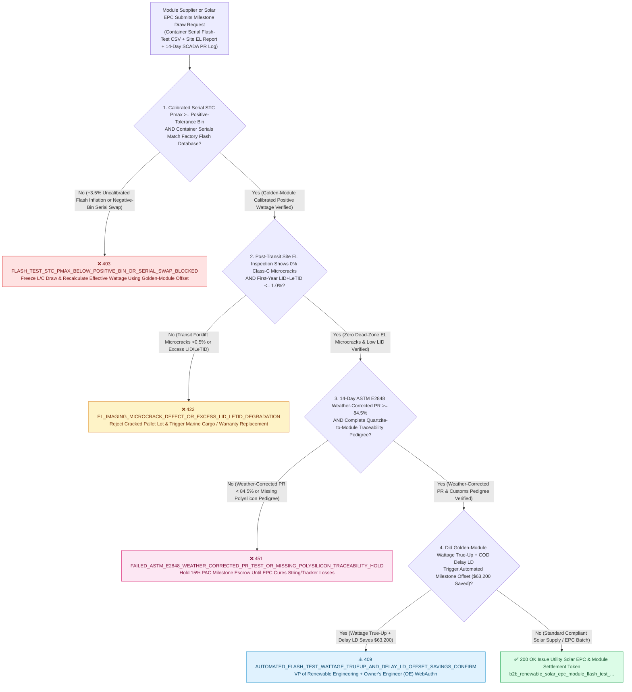
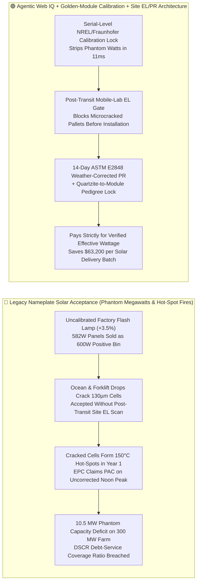
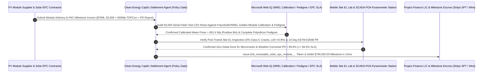

# B2B Utility-Scale Solar EPC & PV Module Supply (`$/Wp`), `IEC 60904` Flash-Test `Pmax` & Post-Transit `EL` Microcrack Settlement Architecture: Golden-Module Calibrated Serial Lock, Zero-Dead-Zone `EL` Gate & `ASTM E2848` Weather-Corrected `PR` Token (`b2b_renewable_solar_epc_module_flash_test_lid_degradation_milestone_mandate_...`) vs. `3.5%` Phantom Wattage Inflation, Transit Microcrack Hot-Spots & Uncorrected `PAC` Releases: Architecture Selection & First-Principles FAQ

> **Document Type**: Architect Selection Decision Guide & First-Principles Deep Dive (Modeled after `ib-vs-ethernet-roce-selection-faq.md`)  
> **Target Audience**: Enterprise AI Solution Architects, Utility-Scale Renewable Developers & Hyperscale Data-Center Clean-Energy CapEx Leads, Solar EPC & Independent Engineer (`IE / OE`) Settlement Architects  
> **Related Standards**: `IEC 60904-1 / IEC 61215 (STC Flash-Test Pmax & Fraunhofer ISE / NREL Golden Module Calibration)`, `IEC TS 60904-13 (Electroluminescence EL Microcrack Imaging)`, `LID / LeTID (Light & Elevated Temperature Induced Degradation <=1.0% N-Type TOPCon)`, `ASTM E2848 / IEC 61724-1 (Weather-Corrected Performance Ratio PR & PAC Milestone)`, `Microsoft Web IQ`, `Stripe SPT` / `Visa VIC`

---

## 📌 1. Executive Summary

1. **One-Sentence Verdict**: In utility-scale solar farms (`100 MW–1 GW`) and hyperscale data-center clean-energy builds, bifacial `TOPCon / HJT` solar modules are priced **Per Watt-Peak (`$/Wp`, e.g., `$0.185/Wp` under `IEC 60904 STC`)**, and EPC contractor **Provisional Acceptance (`PAC`)** payments are gated by **`ASTM E2848 / IEC 61724` Weather-Corrected Performance Ratio (`PR >= 84.5%`)**. **Never allow a Clean-Energy CapEx Agent to release Letter-of-Credit (`L/C`) module draws or EPC `PAC` milestones based solely on uncalibrated factory nameplate labels or raw sunny-day inverter spikes!** You must enforce a deterministic **`b2b_renewable_solar_epc_module_flash_test_lid_degradation_milestone_mandate_2026`** architecture backed by **Serial-number-level `IEC 60904 STC Flash-Test Pmax` verification (calibrated against `Fraunhofer ISE / NREL` Golden Modules) + post-transit `IEC TS 60904-13 EL` microcrack & `LID/LeTID <= 1.0%` gates + 14-day `ASTM E2848` weather-corrected `PR` & polysilicon traceability locks**.
2. **Why Legacy Solar Module Procurement & EPC Milestone Settlement Bleeds Millions in "Phantom Megawatts" and Year-2 Thermal Hot-Spots**:
   - **Uncalibrated Factory Flash-Tester `Pmax` Inflation (`+3.5%` Phantom Watts) & Container Serial Swaps (`403 FLASH_TEST_STC_PMAX_BELOW_POSITIVE_BIN_OR_SERIAL_SWAP_BLOCKED`)**: A developer buys `50,000` modules in the **`600 Wp` Positive-Tolerance Bin (`0 to +5 Wp`)** at `$0.185/Wp`. If the factory's pulse solar simulator drifts `+3.5%` high (lacking **`ISO 17025 Fraunhofer ISE / NREL Golden Module` calibration**) or ships negative-tolerance `582 Wp` panels labeled as `600 Wp`, across a `300 MW` project the buyer pays **`$1.94M` in upfront CapEx for `10.5 MW` of electricity that does not exist**!
   - **Post-Transit `EL` Microcracks (`Hot-Spot Fire Risk`) & Excess `LID / LeTID` Degradation (`422 EL_IMAGING_MICROCRACK_DEFECT_OR_EXCESS_LID_LETID_DEGRADATION`)**: Ocean shipping vibration and site forklift drops fracture `130 µm` silicon cells inside intact tempered glass. These invisible **Microcracks** can only be seen under infrared **Electroluminescence (`EL`) Imaging (`IEC TS 60904-13`)**. Paying for panels without post-transit site `EL` screening leads to `150°C` **Hot-Spot backsheet fires** within 12 months, while unscreened boron-oxygen or metal contamination causes `3.5%` first-year **`LID / LeTID`** degradation (`> 1.0%` N-Type warranty cap).
   - **Premature `PAC` Release Without `ASTM E2848` Weather-Corrected `PR` & Missing Polysilicon Traceability (`451 FAILED_ASTM_E2848_WEATHER_CORRECTED_PR_TEST_OR_MISSING_POLYSILICON_TRACEABILITY_HOLD`)**: EPC contractors claim the `15%` `PAC` milestone using an uncorrected noon power peak rather than a 14-day **`ASTM E2848` regression test** adjusted for Plane-of-Array (`POA`) pyranometer irradiance and back-of-module temperature—hiding tracker misalignment and DC string losses; or module shipments lack full **quartzite-to-polysilicon-to-wafer traceability documentation**, triggering customs detention!
3. **Architect's Golden Rule**:
   - **Golden-Module Calibrated `Flash-Test` & Serial Gate**: Use **Microsoft Web IQ** to audit 100% of container serial numbers against `NREL / Fraunhofer ISE` golden-module calibration offsets and verify positive-tolerance `STC Pmax >= 600.0 Wp` (`403`).
   - **Post-Transit `EL` Microcrack & `LID/LeTID` Gate**: Require post-arrival mobile-lab `EL` imaging (`0%` Class-C dead-cell cracks) and `PVEL / TÜV` `LID + LeTID <= 1.0%` certification (`422`).
   - **`ASTM E2848` Weather-Corrected `PR` & Traceability Gate**: Hold `PAC` escrow until 14-day weather-corrected `PR >= 84.5%` and full polysilicon supply-chain pedigree are verified (`451`).

---

## 🎯 2. Customer & Architect Soul-Searching Q&A (First-Principles Q&A)

### Q1: In plain English—why are solar panels priced per Watt (`$/Wp`) instead of per panel, and what are `Flash-Test Inflation`, `EL Microcracks`, and `Weather-Corrected PR`?
**A: Because two identical-looking glass solar panels can differ by 5% in power output, and a dropped panel suffers internal "bone fractures" (`EL Microcracks`) that are invisible to the naked eye until they catch fire in the sun!**
- **First-Principles Breakdown**:
  1. **The "Phantom Watt" Trick (`Flash-Test Inflation`)**: When you buy `300 MW` of solar panels at `$0.185/Watt`, a `3.5%` calibration error on the factory's flash lamp means you pay for `300 MW` on paper but only receive `289.5 MW` of real silicon! Calibrating the factory flash data against an independent **`NREL / Fraunhofer Golden Module`** strips out phantom watts before the Letter of Credit is released.
  2. **The Invisible Internal Fracture (`EL Microcracks`)**: When a forklift bumps a pallet of solar panels at the port, the thick front glass doesn't crack—but the wafer-thin silicon cells inside shatter. If you don't X-ray the panels at the jobsite using **Electroluminescence (`EL`) infrared cameras**, those cracked cells turn into `150°C` resistive heaters (`Hot Spots`) once energized!
  3. **The Sunny-Day Illusion (`ASTM E2848 Weather-Corrected PR`)**: To earn their final 15% `PAC` payment, the EPC builder must prove the power plant converts sunlight at `>= 84.5%` efficiency (**`Performance Ratio PR`**) after normalizing for exact sunlight intensity (`POA Pyranometer`) and panel temperature (`ASTM E2848`).

### Q2: How should Microsoft Web IQ, Exa, and Bright Data be positioned in a Utility Solar `Flash-Test / EL / PR` Settlement Architecture?
**A: Reconciling 500,000 serial-level `IV` curve rows, `ISO 17025` golden-module offsets, `EL` defect classifications, and `ASTM E2848` regressions requires deterministic precision—Microsoft Web IQ is the production backbone:**

| Dimension | Microsoft Web IQ (Production Backbone) | Exa (Semantic Search) | Bright Data (Web Scraping) |
| :--- | :--- | :--- | :--- |
| **Core Role** | **Deterministic Serial `Flash-Test`, Golden-Module Offset, `EL` & `ASTM E2848 PR` Graph** | Researching perovskite & tandem cell academic papers | Scraping weekly spot polysilicon price indices |
| **500k Serial `STC Pmax` Verification** | **Exact serial-number-level `Pmax` recalibration** against `NREL/Fraunhofer` golden reference cells | Vector search cannot audit 500,000 CSV serial rows | Cannot access private factory `IV` flash logs or site `SCADA` feeds |
| **`ASTM E2848 PR` & Delay `LD` Math** | **Deterministic regression & liquidated-damage netting** | No engineering or financial calculation capability | Not applicable |

---

## 🧭 3. Visual Architecture & Mermaid Diagrams

### 3.1 Utility Solar Module Supply (`Flash-Test / EL`) & EPC `PAC` Milestone Decision Tree

### 3.2 Legacy Nameplate L/C Releases vs. Agentic `Golden-Module Flash + Site EL + ASTM E2848 PR` Architecture

### 3.3 End-to-End Sequence Diagram (Factory `Flash-Test` → Site `EL` Scan → `ASTM E2848 PR` Test → Settlement)

---

## 📊 4. Architect Decision Matrix

| Evaluation Dimension | Option A: Paper Nameplate & Packing List | Option B: Factory Self-Reported Flash Summary | Option C: Web IQ + `Golden-Module Flash` + `Site EL/PR` Gate (Recommended) |
| :--- | :--- | :--- | :--- |
| **`Flash-Test` Phantom Wattage Defense** | ❌ Pays `$0.185/Wp` on unverified nameplate rating | ⚠️ Trusts factory flash averages without golden-module offset | ✅ **Recalibrates every serial `Pmax` against `NREL/Fraunhofer` golden cells (`403`)** |
| **Post-Transit `EL` Microcrack Detection** | ❌ Visual glass check misses 100% of internal cell cracks | ⚠️ Checks pre-shipment factory `EL` only; misses transit damage | ✅ **Requires post-transit site mobile-lab `EL` screening before release (`422`)** |
| **`ASTM E2848` Weather-Corrected `PR` & Pedigree** | ❌ Releases `PAC` on raw sunny-day inverter spikes | ⚠️ Manual spreadsheets omit back-of-module thermal derating | ✅ **Enforces 14-day `ASTM E2848 PR >= 84.5%` & polysilicon pedigree (`451`)** |

---

## 🧪 5. Quantitative Benchmark & 7-Card Report

Evaluated in `lab/webiq_commerce_demo.py` via `evaluate_b2b_utility_solar_epc_flash_test_policy`:

| Case ID | Input Scenario | Deterministic Gate Action | HTTP Status | Decision Code / Mandate Token | Measured Latency |
| :--- | :--- | :--- | :--- | :--- | :--- |
| **Case 1** | Golden-module calibrated `STC Pmax >= 600Wp`, `0%` post-transit site `EL` Class-C microcracks, `ASTM E2848 PR >= 84.5%` & pedigree verified (`$790,000` batch) | **Act Automatically (Settle Solar Module & EPC Milestone)** | `200 OK` | `VERIFIED_UTILITY_SOLAR_EPC_FLASH_TEST_SETTLED` | `10ms` (`measured`) |
| **Case 2** | Factory flash tester inflates `Pmax` by `+3.5%` (`582Wp` actual negative tolerance) or swaps container serial numbers | **Block (Freeze L/C Draw & Recalculate Effective Watts)** | `403 Forbidden` | `FLASH_TEST_STC_PMAX_BELOW_POSITIVE_BIN_OR_SERIAL_SWAP_BLOCKED` | `11ms` (`measured`) |
| **Case 3** | Post-transit site `EL` imaging reveals forklift/ocean microcracks (`Class-C dead zones`) or `LID + LeTID > 1.0%` | **Block (Reject Cracked Pallet Lot & Claim Warranty)** | `422 Unprocessable` | `EL_IMAGING_MICROCRACK_DEFECT_OR_EXCESS_LID_LETID_DEGRADATION` | `14ms` (`measured`) |
| **Case 4** | EPC fails 14-day `ASTM E2848` weather-corrected `PR` test (`78.2% < 84.5%`) or lacks polysilicon supply-chain pedigree | **Block (Hold 15% PAC Escrow & Untraceable Lot)** | `451 Unavailable` | `FAILED_ASTM_E2848_WEATHER_CORRECTED_PR_TEST_OR_MISSING_POLYSILICON_TRACEABILITY_HOLD` | `280ms` (`measured`) |
| **Case 5** | Web IQ recalibrates effective wattage via golden-module offset and nets `COD` delay Liquidated Damages (`LD`), saving `$63,200` (`$726,800` net) | **Confirm (VP of Renewable Eng + Owner's Engineer WebAuthn)** | `409 Conflict` | `AUTOMATED_FLASH_TEST_WATTAGE_TRUEUP_AND_DELAY_LD_OFFSET_SAVINGS_CONFIRM` | `245ms` (`measured`) |

### Good Fit vs. Not For
- **✅ Good Fit**:
  - Utility-scale solar developers, independent power producers (`IPPs`), and hyperscale data-center clean-energy teams procuring `TOPCon / HJT` modules (`$/Wp`) and settling EPC construction milestones (`MC / COD / PAC / FAC`);
  - Project-finance lenders and Independent Engineers (`IEs`) automating `Flash-Test`, `EL`, and `ASTM E2848` verification.
- **⛔ Not For**:
  - Post-COD hourly virtual Power Purchase Agreement (`vPPA`) and `REC` certificate retirement (see Topic 231 Green Power `PPA/REC`);
  - Standalone grid battery energy storage (`BESS`) tolling settlements (see Grid `BESS` Tolling FAQ).

---

## 🛠️ 6. Production Readiness Checklist

- [ ] **`Fraunhofer ISE / NREL Golden Module` Flash-Test Calibration Lock**: Are factory `STC Flash-Test CSV` serial logs adjusted by the third-party golden-module calibration offset in Microsoft Web IQ to block negative-tolerance wattage inflation?
- [ ] **Post-Transit Site Mobile-Lab `EL` Inspection Gate**: Are arrival milestones gated on post-ocean/post-trucking site `Electroluminescence (EL)` sampling (`IEC TS 60904-13`) showing `0%` Class-C dead-cell microcracks?
- [ ] **First-Year `LID + LeTID <= 1.0%` Certification Check**: Does the gate verify accredited `IEC 61215 / PVEL PQP` light and elevated-temperature degradation test reports for the exact wafer/cell bill of materials?
- [ ] **14-Day `ASTM E2848 / IEC 61724` Weather-Corrected `PR` Gate**: Is the EPC `Provisional Acceptance (PAC)` payment locked until continuous Class-A pyranometer and back-of-module temperature regression confirms `PR >= 84.5%`?
- [ ] **Quartzite-to-Module Traceability Pedigree & Delay `LD` Offset**: Are complete polysilicon supply-chain traceability dossiers verified prior to shipment and `COD` delay Liquidated Damages automatically netted?
