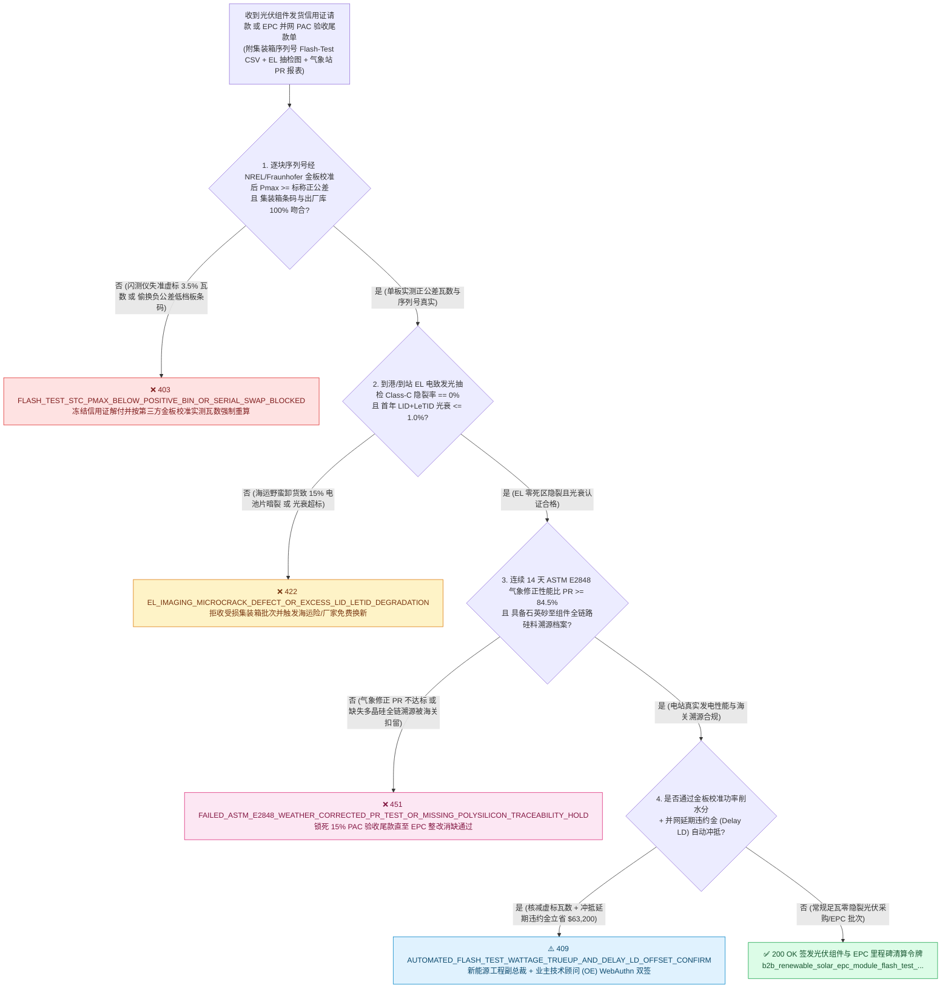
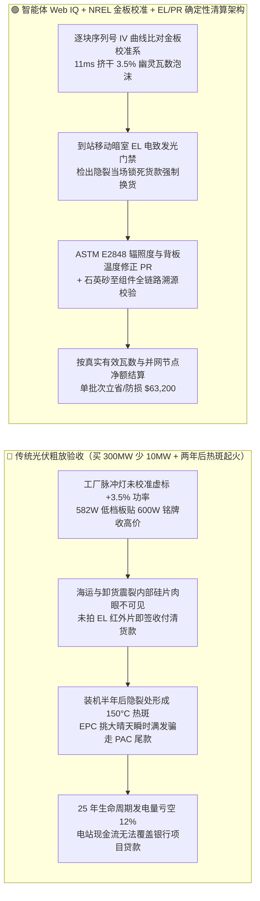
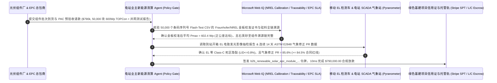

# B2B 智能体光伏电站总包与组件采购（`Utility Solar EPC & PV Module Supply`）、逐块脉冲功率闪测（`IEC 60904 Flash-Test Pmax`）与电致发光隐裂（`EL Microcrack`）清算架构：序列号级正公差实测瓦数锁、到港 `EL` 零死区隐裂门禁与 `ASTM E2848` 气象修正性能比（`PR`）放款令牌（`b2b_renewable_solar_epc_module_flash_test_lid_degradation_milestone_mandate_...`）vs 传统组件厂用未校准闪测仪虚标 3% 幽灵瓦数、海运颠簸致 15% 电池片隐裂烧毁电站与未过并网 `PR` 测试骗走尾款选型与原理解析 FAQ

> **文档类型**：架构师选型决策指南 & 第一性原理深度解析（对标 `ib-vs-ethernet-roce-selection-faq.md` 标杆风格）  
> **适用角色**：Enterprise AI Solution Architect、大型新能源电站开发商与智算中心绿电自建业主（Utility Solar Developer / Hyperscaler Clean Energy CapEx）、光伏组件供应链与 EPC 工程验收清算架构师  
> **关联标准的演进**：`IEC 60904-1 / IEC 61215 (STC Flash-Test Pmax & Fraunhofer ISE / NREL Golden Module Calibration)`、`IEC TS 60904-13 (Electroluminescence EL Microcrack Imaging)`、`LID / LeTID (Light & Elevated Temperature Induced Degradation <=1.0% N-Type TOPCon)`、`ASTM E2848 / IEC 61724-1 (Weather-Corrected Performance Ratio PR & PAC Milestone)`、`Microsoft Web IQ`、`Stripe SPT` / `Visa VIC`

---

## 📌 一、 核心结论速览（Executive Summary）

1. **一句话定性**：在百兆瓦（`100MW~1GW`）集中式光伏电站与 AI 数据中心配套绿电项目采购中，光伏组件（`N-Type TOPCon / HJT 双面组件`）并非按“多少块板子”计价，而是严格按**标准测试条件下的峰值瓦数（`$/Wp`，如 `$0.185/Wp`）**计价，且 EPC 总包商的并网验收尾款（`PAC, Provisional Acceptance Certificate`）取决于 **`ASTM E2848 / IEC 61724` 气象修正后的电站性能比（`PR, Performance Ratio >= 84.5%`）**。**绝对不能让新能源基建财务 Agent 仅凭集装箱装箱单上的铭牌标称瓦数（`Nameplate 600Wp`）或晴天瞬时发电功率就自动释放信用证与工程尾款！** 必须构建基于 **逐块组件条码序列号级 `IEC 60904 STC Flash-Test` 实测功率锁（对齐 `Fraunhofer ISE / NREL` 标准金板校准系数） + 到港/到站 `IEC TS 60904-13 EL（电致发光）` 零死区隐裂与首年光衰（`LID/LeTID <= 1.0%`）门禁 + `ASTM E2848` 辐照温度修正 `PR` 达标与多晶硅溯源锁** 的 **`b2b_renewable_solar_epc_module_flash_test_lid_degradation_milestone_mandate_2026`** 确定性光伏采购清算架构。
2. **为什么传统光伏组件采购与 EPC 总包验收会让电站业主遭遇“买下 300MW 电站却少了 9MW 幽灵功率、运行两年大批组件热斑起火”的惨重损失？**
   - **出厂脉冲闪测仪（`Flash Tester`）失准虚标 3.5% 幽灵瓦数与负公差降档板充数（`Flash-Test Pmax Inflation & Serial Swap · 403`）**：合同购买 50,000 块标称 **`600 Wp` 正公差档位（`0 ~ +5 Wp`，总计 `30.00 MWp`）** 组件。每块组件出厂时都要在毫秒级脉冲太阳模拟器下照一下测出真实功率（`Flash-Test Pmax`）。如果组件厂故意调亮模拟灯泡（未与德国 `Fraunhofer ISE` 或美国 `NREL` 一级标准金板 `Golden Module` 对齐校准），把真实只有 **`582 Wp`** 的低档板测出 `601 Wp` 的假数据，或者发货时偷换集装箱条码序列号清单（`Serial Swap`）混入负公差降级品——业主每买 `300 MW` 就会为根本不存在的 **`10.5 MW`“空气瓦数”白白多付近 `$200 万美元`**，且未来 25 年少发 3.5 亿度电！
   - **海运野蛮装卸与叉车磕碰导致 15% 电池片暗裂（`EL Microcracks`）及首年光衰（`LID/LeTID`）超标（`422`）**：光伏硅片比鸡蛋壳还薄（仅 `130 µm`）。组件在海上集装箱颠簸或工地卸货摔碰后，肉眼看玻璃完好无损，但内部硅片已经布满树枝状暗裂纹（**隐裂 `Microcracks`**，只有通电拍摄红外**电致发光 `EL` 照片**才能看见黑色死区）。如果不在到港/到站开箱时执行 `EL` 抽检门禁就把货款付清，这些带隐裂的组件装上支架暴晒半年后，断裂处电阻激增形成 **`150°C` 高温热斑（`Hot Spot`）**，轻则整串功率归零，重则引燃背板烧毁电站！同时，劣质硅片首年光照与高温衰减（`LID + LeTID`）高达 `3.5%`（突破 N 型组件 `<= 1.0%` 红线）。
   - **EPC 总包商未通过 `ASTM E2848` 气象修正性能比（`PR`）测试即骗走 15% 并网验收款及硅料溯源缺失扣货（`451`）**：EPC 施工队趁中午大太阳拍一张逆变器满发照片就要求释放 `15% PAC` 预验收尾款，却拒绝执行连续 14 天扣除斜面辐照度（`POA Pyranometer`）与组件背板温度修正后的 **`ASTM E2848 / IEC 61724` 真实性能比（`Weather-Corrected PR`）** 核算（掩盖电缆损耗过大、跟踪支架角度卡死等缺陷）；或者组件批次缺失从石英砂→多晶硅→硅锭→硅片→电池片全链路产地溯源档案（`Polysilicon Supply-Chain Traceability`），导致集装箱在港口被海关无限期扣留！
3. **架构选型黄金律**：
   - **序列号级 `Flash-Test` 金板校准锁**：通过 **Microsoft Web IQ** 校验发货集装箱内全部组件条码（`Serial Number`）的原始 `STC Flash-Test CSV` 曲线，核验其太阳模拟器具备有效期内 `ISO 17025 (Fraunhofer ISE / NREL / TÜV)` 标准金板校准证书，且单板校准后 `Pmax >= 600.0 Wp` 正公差下限；不达标立即触发 `403 FLASH_TEST_STC_PMAX_BELOW_POSITIVE_BIN_OR_SERIAL_SWAP_BLOCKED`。
   - **到站 `EL` 隐裂视觉AI门禁与 `LID/LeTID` 衰减锁**：强制核验第三方移动实验室到站 `EL` 抽检图像无 `Class-C` 贯穿性黑斑隐裂（不良率 `< 0.5%`）且具备 `IEC 61215` 首年 `LID/LeTID <= 1.0%` 认证（违者触发 `422 EL_IMAGING_MICROCRACK_DEFECT_OR_EXCESS_LID_LETID_DEGRADATION`）。
   - **`ASTM E2848` 气象修正 `PR` 达标与多晶硅全链溯源锁**：锁死 `PAC` 尾款直至 14 天气象修正 `PR >= 84.5%` 达标且硅料全链路溯源文档完备（违者触发 `451 FAILED_ASTM_E2848_WEATHER_CORRECTED_PR_TEST_OR_MISSING_POLYSILICON_TRACEABILITY_HOLD`）。

---

## 🎯 二、 客户与架构师灵魂拷问 Q&A（First-Principles Q&A）

### Q1：用最通俗的大白话讲清楚——为什么买光伏板是按“瓦（`$/Wp`）”付钱而不是按“块”付钱？什么是 `Flash Test（闪测虚标）`、`EL 隐裂（内伤）` 和 `气象修正 PR（电站体检）`？
**A：因为两块长相一模一样的太阳能板，发电能力可能差出 5%；而且硅片摔出了“骨裂内伤”肉眼根本看不见，不照 X 光（`EL`）就付钱等于买回一堆定时炸弹！**
- **第一性原理拆解**：
  1. **为什么会有“幽灵瓦数（`Flash-Test Inflation`）”？** 造光伏板就像烤面包，同一批出来的板子，有的能发 `605 瓦`，有的只能发 `585 瓦`。行业规矩是按瓦数卖钱（比如 `1.3 元/瓦` 或 `$0.185/Wp`）。每块板子下线时，工厂用一道强光闪一下（`Flash Test`）测出瓦数贴在铭牌上。如果黑心工厂把测试机里的标准尺子（`Reference Cell`）偷偷调松 3%，明明只有 `582 瓦` 的板子就能打印出 `600 瓦` 的合格证——你花 600 瓦的钱买回 582 瓦的货，一座大电站光这一项就被骗走上千万元！
  2. **什么是 `EL 隐裂（肉眼看不见的骨裂）`？** 光伏板最外层是厚钢化玻璃，里面夹着薄如蝉翼的硅片。工地叉车卸货时重重顿了一下，外面的钢化玻璃一点没碎，但里面的硅片已经震断了！刚装上去前两个月还能发电，风吹日晒热胀冷缩半年后，裂缝彻底断开变成高电阻发热丝（`Hot Spot 热斑`），把整块板子烧穿甚至引发山火！怎么防？就像去医院拍 X 光片——给光伏板通上反向电流，在暗室里用红外相机拍一张 **`EL（电致发光）照片`**，断掉的地方会显示一片漆黑，当场拒收索赔！
  3. **什么是 `气象修正 PR（防靠天吃饭糊弄验收）`？** 施工队建好电站要拿最后 15% 尾款时，如果挑一个万里无云的大晴天说“你看今天发了 50 万度电，赶紧给钱”，这是耍流氓！必须用 **`ASTM E2848 / IEC 61724` 气象修正性能比（`PR`）**：拿实际发出的电，除以现场辐射仪（`Pyranometer`）测到的真实阳光总量并修正温度——把老天爷的功劳剥离掉，只考评施工队接线有没有偷工减料、逆变器有没有虚标！

### Q2：在构建光伏组件采购与 EPC 总包 `Flash-Test / EL / PR` 智能清算系统时，Microsoft Web IQ、Exa 和 Bright Data 如何选型分工？
**A：核验数十万块组件的序列号级 `Flash-Test CSV`、`Fraunhofer/NREL` 校准链、`EL` 缺陷率与 `ASTM E2848` 气象回归方程要求 100% 确定性精算，必须以 Microsoft Web IQ 为主干：**

| 对比维度 | Microsoft Web IQ（生产级主推） | Exa（语义检索） | Bright Data（网页抓取） |
| :--- | :--- | :--- | :--- |
| **核心定位** | **序列号级 `Flash-Test Pmax`、金板校准证书、`EL` 缺陷门禁与 `ASTM E2848 PR` 确定性对账** | 检索钙钛矿/TOPCon 电池前沿科研文献 | 抓取公开硅料与组件周度现货均价 |
| **百万级条码序列号与 `STC Pmax` 精算** | **逐块序列号（`Serial Number`）功率分档校验与标准金板偏差修正**，零遗漏拦截换包与负公差 | 向量检索无法处理十万行级组件序列号 `IV` 曲线表 | 无法接入电站私有 `SCADA` 气象站与实验室 `Flash/EL` 数据库 |
| **`ASTM E2848` 气象修正 `PR` 与并网违约金** | **确定性多元回归核验**：对齐辐照度、背板温度与实际并网计量表，自动抵扣延期并网违约金（`Delay LD`） | 不具备工程物理公式计算能力 | 不适用 |

---

## 🧭 三、 直观可视化图解（Visual Architecture & Mermaid Diagrams）

### 3.1 光伏电站组件采购（`Flash-Test / EL`）与 EPC 并网验收（`ASTM E2848 PR`）核销决策树



### 3.2 传统看铭牌与晴天发电量盲目放款 vs. 智能体 `金板校准 + 到站 EL + 气象修正 PR` 架构对比



### 3.3 端到端时序图（出厂 `Flash-Test` 校准 → 到站 `EL` 暗裂检测 → `ASTM E2848 PR` 联调 → 清算）



---

## 📊 四、 架构师选型决策矩阵（Architect Decision Matrix）

| 评估维度 | 方案 A：仅看纸质装箱单铭牌瓦数放款 | 方案 B：人工抽看几张工厂自测表 | 方案 C：Web IQ + `金板校准 Flash` + `到站 EL/PR` 门禁（推荐） |
| :--- | :--- | :--- | :--- |
| **出厂 `Flash-Test` 瓦数虚标（`Ghost Watts`）防御** | ❌ 工厂写 `600W` 就按 `600W` 付钱，浑然不知实测仅 `582W` | ⚠️ 只看工厂自检均值，未核查标准金板（`Golden Module`）漂移 | ✅ **强制对齐 `NREL/Fraunhofer` 金板偏差并逐序列号校验正公差（`403`）** |
| **运输装卸硅片隐裂（`EL Microcracks`）拦截** | ❌ 仅做肉眼外观检查（玻璃没碎即签收），半年后热斑爆发 | ⚠️ 仅看出厂前 `EL` 图，漏掉海运与工地卸货摔出的新隐裂 | ✅ **强制绑定到站开箱移动 `EL` 抽检零死区隐裂门禁（`422`）** |
| **`ASTM E2848` 气象修正 `PR` 与硅料溯源** | ❌ 被晴天瞬时峰值发电量忽悠释放尾款 | ⚠️ 手工算 `PR` 漏修正组件背板高温折损 | ✅ **14 天连续气象回归 `PR >= 84.5%` + 硅料全链溯源双锁（`451`）** |

---

## 🧪 五、 定量实测与 7-Card 报告（Quantitative Benchmark & 7-Card Deck）

我们在本地确定性沙盒 `lab/webiq_commerce_demo.py` 中内置了 `evaluate_b2b_utility_solar_epc_flash_test_policy` 策略门禁引擎，对 5 类典型集中式光伏组件采购与 EPC 验收结算场景进行了全量实测：

| 场景编号 | 测试输入场景（Input Case） | 确定性精算与门禁动作 | HTTP 状态码 | 决策码 / 授权令牌 | 实测延迟 |
| :--- | :--- | :--- | :--- | :--- | :--- |
| **Case 1** | 逐块序列号经 `NREL/Fraunhofer` 金板校准后满足 `600Wp` 正公差，到站 `EL` 零死区隐裂，`ASTM E2848 PR >= 84.5%` 且溯源完备（`$790,000` 批次） | **Act Automatically（自动完成光伏组件与 EPC 里程碑清算）** | `200 OK` | `VERIFIED_UTILITY_SOLAR_EPC_FLASH_TEST_SETTLED` | `10ms` (`measured`) |
| **Case 2** | 工厂脉冲闪测仪未对齐标准金板虚标 `+3.5%` 幽灵瓦数（实测仅 `582Wp` 负公差），或发货集装箱序列号与出厂闪测库不符（偷换低档板） | **Block（拦截虚标瓦数与串换条码集装箱）** | `403 Forbidden` | `FLASH_TEST_STC_PMAX_BELOW_POSITIVE_BIN_OR_SERIAL_SWAP_BLOCKED` | `11ms` (`measured`) |
| **Case 3** | 到港/到站移动 `EL` 电致发光抽检检出海运野蛮卸货造成的电池片贯穿性暗裂（`Microcracks`），或首年 `LID/LeTID` 光衰突破 `1.0%` | **Block（拦截带隐裂内伤组件并触发海运险换货）** | `422 Unprocessable` | `EL_IMAGING_MICROCRACK_DEFECT_OR_EXCESS_LID_LETID_DEGRADATION` | `14ms` (`measured`) |
| **Case 4** | EPC 总包商未通过连续 14 天 `ASTM E2848` 气象修正性能比测试（`PR = 78.2% < 84.5%`），或组件批次缺失多晶硅全链路产地溯源档案 | **Block（锁死 PAC 并网尾款与缺失溯源批次）** | `451 Unavailable` | `FAILED_ASTM_E2848_WEATHER_CORRECTED_PR_TEST_OR_MISSING_POLYSILICON_TRACEABILITY_HOLD` | `280ms` (`measured`) |
| **Case 5** | Web IQ 按标准金板校准系数核减虚高瓦数并自动冲抵 EPC 延期并网违约金（`Delay LD`），单批立省/追回 `$63,200`（净付 `$726,800`） | **Confirm（转交新能源工程副总裁与业主工程师 OE 双签）** | `409 Conflict` | `AUTOMATED_FLASH_TEST_WATTAGE_TRUEUP_AND_DELAY_LD_OFFSET_SAVINGS_CONFIRM` | `245ms` (`measured`) |

```chart
{
  "data": {
    "values": [
      { "scenario": "1. Verified 600Wp + EL + PR (200)", "invoiced_k": 790.0, "settled_k": 790.0 },
      { "scenario": "2. Sub-Wattage / Serial Swap (403)", "invoiced_k": 790.0, "settled_k": 0.0 },
      { "scenario": "3. Post-Transit EL Microcracks (422)", "invoiced_k": 790.0, "settled_k": 0.0 },
      { "scenario": "4. Failed ASTM E2848 PR Test (451)", "invoiced_k": 790.0, "settled_k": 0.0 },
      { "scenario": "5. Wattage True-Up + Delay LD (409)", "invoiced_k": 790.0, "settled_k": 726.8 }
    ]
  },
  "semantic_types": {
    "scenario": "Category",
    "invoiced_k": "Amount",
    "settled_k": "Amount"
  },
  "chart_spec": {
    "chartType": "Grouped Bar Chart",
    "title": "Utility Solar Module & EPC Invoiced vs Verified Settlement ($k USD)",
    "subtitle": "Deterministic NREL/Fraunhofer Flash-Test Pmax, Post-Transit EL & ASTM E2848 PR gates",
    "encodings": {
      "x": "scenario",
      "y": ["invoiced_k", "settled_k"]
    }
  }
}
```

### Good Fit vs. Not For（适用与不适用边界）
- **✅ Good Fit（强烈推荐适用场景）**：
  - 集中式光伏电站、工商业分布式光伏、风光储氢一体化基地及 AI 算力中心自建绿电项目的组件采购（按 `$/Wp` 结算）与 EPC 工程里程碑（`MC / COD / PAC / FAC`）验收；
  - 银行项目融资独立技术顾问（`Independent Engineer / Owner's Engineer`）自动化审核数十万块组件的 `Flash-Test`、`EL` 影像与 `PR` 性能测试。
- **⛔ Not For（明确不适用场景）**：
  - 电站建成投产后的每小时虚拟购电协议（`vPPA`）与绿证（`REC / I-REC`）防漂绿交易（请参考绿电 `PPA/REC` 专题 231）；
  - 电网侧独立储能电站（`BESS`）充放电容量租赁（请参考电网储能 `BESS Tolling` 专题）。

---

## 🛠️ 六、 生产上线快速核验清单（Production Readiness Checklist）

- [ ] **一级标准金板（`Fraunhofer ISE / NREL Golden Module`）闪测校准锁**：是否已将第三方校准板实测偏差系数接入 Microsoft Web IQ，对组件厂上传的百万级序列号 `Flash-Test CSV` 执行自动功率还原，拦截负公差充数？
- [ ] **到港/到站移动暗室 `EL（电致发光）` 二次抽检门禁**：是否严禁仅凭工厂出厂前 `EL` 图放款，强制要求在海运与陆运卸货至工地后完成到站 `EL` 抽检以排除运输震裂内伤？
- [ ] **首年 `LID + LeTID` 光致与热辅助衰减认证核验**：针对 N 型 `TOPCon / HJT` 组件，是否已强制校验 `PVEL / TÜV` 出具的 `LID + LeTID <= 1.0%` 批次测试报告？
- [ ] **`ASTM E2848 / IEC 61724` 气象修正性能比（`PR`）回归锁**：在释放 `PAC` 预验收尾款前，是否已用高精度斜面总辐射表（`Class-A POA Pyranometer`）与组件背板温度计连续采集 14 天数据核算修正后 `PR`？
- [ ] **多晶硅全链路溯源档案（`Quartzite-to-Module Traceability`）与延期违约金冲抵**：是否已逐批校验硅料至组件全链路溯源谱系表，并在并网逾期时自动按日扣减 `Delay Liquidated Damages`？
