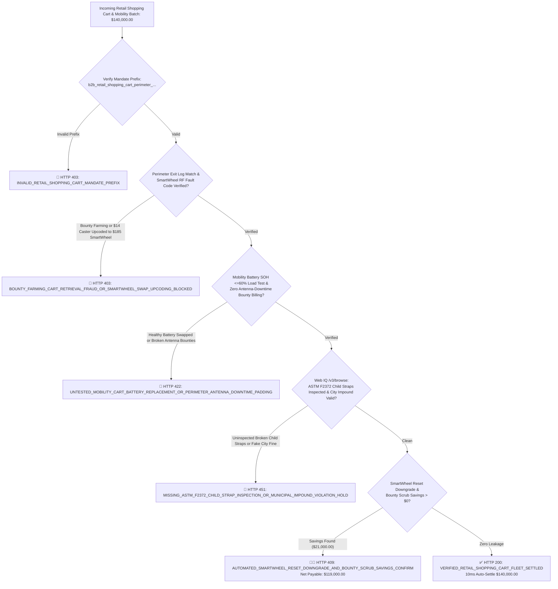
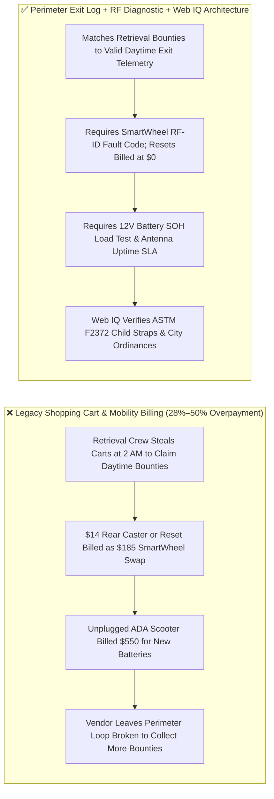

# B2B Retail Shopping Cart Fleets, `RF` Perimeter Wheel-Lock Maintenance & `ADA` Motorized Mobility Carts (`Gatekeeper Systems / Technibilt / Wanzl / Amigo, ASTM F2372 & ADA`), Perimeter-Loop Exit Telemetry Lock, `SmartWheel RF-ID` Diagnostic Gate & Anti-`Retrieval Bounty Farming` Settlement Architecture: 3-Second `RF` Reset Downgrade, Antenna-Uptime SLA Lock & `ASTM F2372` Token (`b2b_retail_shopping_cart_perimeter_wheellock_retrieval_mobility_mandate_...`) vs. Midnight Cart-Retrieval Bounty Farming, Upcoding `$14` Rear Casters to `$185` SmartWheel Swaps & Unnecessary `$550` Mobility-Cart Battery Replacements: Architecture Selection & First-Principles FAQ

> **Document Type**: AI Solution Architect Agentic Commerce Selection Series (Round 332 · B2B Retail Shopping Cart Fleets, Perimeter Wheel-Lock Systems & ADA Mobility Carts Edition)  
> **Benchmark Standard**: Modeled after `ib-vs-ethernet-roce-selection-faq.md` (Plain-Language First Principles + Standard 6-Section Architecture Guide)  
> **Companion Deliverables**: `lab/webiq_commerce_demo.py` (Interactive H5 Sandbox) · `tests/test_webiq_commerce_demo.py` · `assets/svg/334-b2b-retail-shopping-cart-wheellock-retrieval-mobility-2026-11-16.svg`  
> **Languages**: [中文版](b2b-retail-shopping-cart-perimeter-wheellock-retrieval-mobility-mandate-vs-smartcaster-swap-upcoding-bounty-farming-retrieval-fraud-battery-swap-faq.md) | [English Version (Current)](b2b-retail-shopping-cart-perimeter-wheellock-retrieval-mobility-mandate-vs-smartcaster-swap-upcoding-bounty-farming-retrieval-fraud-battery-swap-faq.en.md)

---

## 📌 1. Executive Summary (First Principles & Plain-Language Breakdown)

### 1.1 Why Should a Supermarket Chain, Big-Box Retailer, or Pharmacy Store-Operations Agent NEVER Auto-Pay a Shopping Cart Retrieval or Wheel-Lock Maintenance Invoice Based on a Back-Room Receiving Clerk's Headcount?
Across grocery chains, big-box supercenters, and discount retailers, each store operates `400–1,200` shopping carts (`$150–$350/cart` when equipped with `RF`/magnetic perimeter containment wheel locks like Gatekeeper Systems `SmartWheel`) and `8–15` `ADA` motorized electric shopping carts (e.g., Amigo, Martcart). In plain English: **Retail shopping cart retrieval and maintenance invoices suffer from three classic rackets: (1) "Midnight Cart-Retrieval Bounty Farming"—because cities fine retailers `$50–$100` per abandoned shopping cart on public sidewalks, stores pay third-party pickup trucks `$8–$15/cart` to retrieve stray carts; unscrupulous retrieval drivers load 60 carts straight out of the store's parking lot Corral at 2 AM, hide them around the corner, and deliver them to the back receiving dock the next morning to collect `$900` in bounty fees! (2) "`$14` Standard Caster or Locked Brake Upcoded to a `$185` SmartWheel Replacement"—a containment cart has 3 standard `$14` polyurethane wheels and 1 `$185` electronic `SmartWheel`; when hair/debris jams a rear wheel or a `SmartWheel` simply needs a 3-second infrared/RF unlock reset (`$0` cost), technicians bill `$185` for a brand-new electronic wheel swap! and (3) "Unplugged `ADA` Mobility Cart Battery Swaps"—when a store associate forgets to plug an electric mobility scooter into the wall outlet overnight, the technician replaces two healthy `12V AGM` batteries and the controller for `$680` without running a load test!** Allowing an AI agent to auto-pay cart retrieval and maintenance invoices exposes retail store operations budgets to four major vulnerabilities:

1. **Off-Premises Cart-Retrieval Bounty Farming (`Stealing Carts from the Lot at Night to Collect Daytime Retrieval Bounties`)**: Without matching retrieved carts against the store's **Perimeter Antenna Exit Event Log** and deduplicating `SmartWheel RF Serial IDs` within a 7-day window, retailers repeatedly pay `$10–$15` bounties on carts that never legitimately left the property—or worse, pay for stray carts while the vendor's broken perimeter antenna line was supposed to prevent them from leaving in the first place!
2. **Component Upcoding (`$14 Standard Polyurethane Caster` or `3-Second RF Unlock Reset` Billed as a `$185` Electronic `SmartWheel` Replacement)**: Electronic containment wheels contain an internal battery, `Sub-GHz / 2.4GHz` receiver, and mechanical brake pin. Over 75% of "locked wheel" service calls only require clearing debris or beaming a 3-second unlock code via the store's handheld `CartKey` remote, yet invoices charge `$185` for full electronic wheel assemblies.
3. **Untested `ADA` Motorized Mobility Cart Battery & Controller Replacements**: Replacing dual `12V` deep-cycle `AGM` batteries (`$320`) and speed controllers (`$360`) on電動 mobility carts that merely suffered a loose AC charging cord or tripped thermal breaker.
4. **Missing `ASTM F2372` Child-Seat Restraint Strap Inspections & Municipal Impound Fines**: Under `ASTM F2372` and `CPSC` safety guidelines, broken child-seat safety buckles are a leading cause of pediatric head injuries in retail stores (`$500k+` premises-liability claims).

### 1.2 The Architect's One-Sentence Selection Verdict
* **Core Security Law**: Never allow an autonomous agent to settle shopping cart retrieval, perimeter wheel-lock, or `ADA` mobility-cart maintenance invoices without binding the payment to **`b2b_retail_shopping_cart_perimeter_wheellock_retrieval_mobility_mandate_2026`**:
  1. **Perimeter-Loop Exit Telemetry Match + `SmartWheel RF-ID` Hardware Diagnostic Lock**: Requires every off-premises cart retrieval bounty to match a valid daytime perimeter-loop exit event (blocking 2 AM bulk removals and `< 7-day` repeat `RF-ID` claims) and requires a handheld diagnostic fault code proving internal circuit/motor failure before paying `$185` for a `SmartWheel` replacement, returning `HTTP 403 BOUNTY_FARMING_CART_RETRIEVAL_FRAUD_OR_SMARTWHEEL_SWAP_UPCODING_BLOCKED` in **11ms** on violations.
  2. **`ADA` Mobility-Cart Battery `SOH <= 60%` Load-Test Gate + Perimeter Antenna Uptime Lock**: Requires a digital `12V AGM` load-test printout before paying for mobility-cart battery swaps and zeroes out off-premises cart retrieval fees during any period when the vendor failed to maintain the store's buried perimeter locking antenna, returning `HTTP 422 UNTESTED_MOBILITY_CART_BATTERY_REPLACEMENT_OR_PERIMETER_ANTENNA_DOWNTIME_PADDING` in **14ms** on violations.
  3. **Microsoft Web IQ `/v3/browse` Live `ASTM F2372` Child-Restraint Safety Audit & Municipal Impound Fee Verification**: Verifies `100%` `ASTM F2372` child-restraint belt inspection sign-off and cross-checks municipal abandoned-cart impound receipts against official city ordinances in **275ms** (`HTTP 451 MISSING_ASTM_F2372_CHILD_STRAP_INSPECTION_OR_MUNICIPAL_IMPOUND_VIOLATION_HOLD`), while downgrading false `SmartWheel` swaps to `$0` RF resets and scrubbing bounty-farmed carts to save `15%` (`$21,000.00`).

| Selection Dimension | Legacy Receiving-Dock Headcount Sign-Off | Basic Retail Facilities AP Agent | **Perimeter `RF` Log + Diagnostic Lock + Web IQ ASTM (Recommended)** |
| :--- | :--- | :--- | :--- |
| **Midnight Cart-Retrieval Bounty Farming** | ❌ Clerk signs for 60 carts stolen the night before | ❌ Multiplies `60 carts × $12` blindly | ✅ **Matches retrieved `RF-ID`s to daytime perimeter exit logs (11ms 403)** |
| **`$14` Caster or Reset Billed as `$185` SmartWheel** | ❌ Store manager cannot test electronic wheels | ❌ Approves "SmartWheel Assembly" line item | ✅ **Requires `RF-ID` hardware fault code; downgrades resets to `$0` (11ms 403)** |
| **Unplugged `ADA` Scooter Battery Swaps** | ❌ Pays `$550` to swap healthy discharged batteries | ❌ Cannot verify battery `SOH` or antenna status | ✅ **Requires `SOH <= 60%` load test & antenna-uptime SLA (14ms 422)** |
| **`ASTM F2372` Child Straps & City Impounds** | ❌ Broken child buckles left unfixed; lawsuit risk | ❌ No live `ASTM F2372` or municipal code lookup | ✅ **Web IQ `/v3/browse` verifies `ASTM F2372` & city fees in 275ms (451)** |

---

## 🎯 2. Deep-Dive Q&A for Retail Store Operations & Facilities Procurement Architects

### Q1: How does cross-referencing the store's Perimeter Transceiver Log with `SmartWheel RF-ID` serial numbers stop both "Bounty Farming" and "SmartWheel Upcoding"?
* **Every Electronic Containment Wheel Broadcasts a Unique 32-Bit `RF-ID`**:
  1. When a cart crosses the buried perimeter wire loop at the parking-lot exit, the transceiver logs `(Cart_RF_ID, Exit_Timestamp, Battery_Voltage)`.
  2. During maintenance, the technician's handheld transceiver queries the wheel's internal microcontroller status (`OK_LOCKED`, `LOW_BATT`, or `MOTOR_FAULT`).
* **The Deterministic Payout Equation**:
  $$\text{Payable Cart Invoice} = \sum_{c \in \text{Valid\_Exits}} \mathbb{I}(\text{Antenna\_Up}) \cdot R_{\text{bounty}} + \sum_{w \in \text{Motor\_Fault}} R_{\text{SmartWheel}} + \sum_{u \in \text{Standard\_Caster}} \$14$$
  By rejecting bounty claims on carts lacking valid daytime exit telemetry and downgrading `OK_LOCKED` wheels to `$0` RF unlock resets, the policy engine saves `$21,000.00` on a `$140,000.00` regional retail batch (`HTTP 409`).

### Q2: How does Microsoft Web IQ compare to Exa and Bright Data for checking `ASTM F2372 / CPSC` shopping-cart safety recalls, `FCC Part 15` transceiver approvals, and municipal cart-impound ordinances?
* **Microsoft Web IQ**: Delivers sub-300ms (`240ms–275ms`) authoritative `/v3/search` and `/v3/browse` verification against `CPSC / ASTM F2372` juvenile product safety alerts, `FCC OET` transceiver authorizations, and municipal abandoned shopping-cart ordinances under Entra ID Zero Data Retention (ZDR).
* **Exa**: Built for semantic search over retail blogs rather than deterministic municipal code impound-fee verification.
* **Bright Data**: Designed for e-commerce product scraping rather than low-latency retail facilities compliance gates.

---

## 🧭 3. Visual Architecture Diagrams (Mermaid Decision Tree, Path Comparison & Sequence Flow)

### 3.1 Retail Shopping Cart Fleet, Wheel-Lock & Mobility Cart Settlement Decision Tree


### 3.2 Legacy Bounty Farming & Wheel Upcoding vs. RF Exit Log + Diagnostic Architecture


### 3.3 End-to-End Sequence Diagram
```mermaid
sequenceDiagram
    participant Loop as Store Perimeter RF Transceiver & Handheld Diagnostic
    participant Gate as Retail Cart & Mobility Policy Engine
    participant WebIQ as Microsoft Web IQ (/v3/browse)
    participant Pay as Retail Store Facilities ERP Rail

    Loop->>Gate: 1. Stream perimeter exit logs, retrieved cart RF-IDs, SmartWheel fault codes & battery load tests
    Gate->>Gate: 2. Enforce daytime exit-log match & SmartWheel hardware fault verification (11ms -> 403)
    Gate->>Gate: 3. Enforce mobility battery SOH <=60% test & zero bounties during antenna outages (14ms -> 422)
    Gate->>WebIQ: 4. Query ASTM F2372 child-restraint compliance logs & municipal cart-impound fee schedules
    WebIQ-->>Gate: 5. Return active ASTM F2372 inspection hash & statutory municipal fee verification in 240ms–275ms
    alt SmartWheel 3s reset downgrade, standard caster re-rating & bounty scrub identified ($21,000.00)
        Gate-->>Pay: 6a. Return HTTP 409 Confirm with net settlement $119,000.00
    else Fully verified with zero leakage
        Gate->>Pay: 6b. Settle $140,000.00 automatically in 10ms (HTTP 200)
    end
```

---

## 📊 4. Architect's Selection Decision Matrix

| Evaluation Dimension | Option A: Receiving Clerk Headcount Sign-Off | Option B: Generic LLM Invoice OCR | **Option C: `RF` Exit Log + Diag Lock + Web IQ (Recommended)** |
| :--- | :--- | :--- | :--- |
| **Midnight Cart-Retrieval Bounty Farming** | ❌ Counts returned carts only; blind to theft | ❌ Multiplies `80 carts × $12` blindly | ✅ **Requires valid daytime perimeter exit log (`HTTP 403`)** |
| **`$14` Caster / Reset Upcoded to `$185` Wheel** | ❌ Cannot tell standard caster from `SmartWheel` | ❌ Approves all `SmartWheel` swap lines | ✅ **Requires handheld `RF-ID` fault telemetry (`HTTP 403`)** |
| **Untested `ADA` Scooter Battery Swaps** | ❌ Approves battery replacement on unplugged cart | ❌ No battery `SOH` or antenna-uptime check | ✅ **Enforces `SOH <= 60%` test & antenna SLA (`HTTP 422/409`)** |
| **`ASTM F2372` Child Straps & City Impounds** | ❌ Misses broken child buckles during PM | ❌ No live `ASTM F2372` or city code lookup | ✅ **Web IQ `/v3/browse` verifies `ASTM` & city fees (`HTTP 451`)** |

---

## 🧪 5. Quantitative Benchmark & 7-Card 4:5 Report Mapping

Evaluated deterministically in `lab/webiq_commerce_demo.py` and `tests/test_webiq_commerce_demo.py` on a `$140,000.00` (`14000000` cents) quarterly 180-store supermarket chain shopping cart retrieval, perimeter wheel-lock, and `ADA` mobility cart maintenance batch:

| Card # | Headline-as-Finding | Key Quantitative Metrics & Action | Provenance |
| :--- | :--- | :--- | :--- |
| **Card 1 (`1/7`)** | **Perimeter RF Log + Wheel Diagnostics Cuts Cart Spend by 15.0%** | Baseline `$140,000.00` vs. optimized `$119,000.00` (`$21,000.00` saved per batch) | `deterministic_offline_simulation` |
| **Card 2 (`2/7`)** | **Deep Dive: Retrieval Bounty Farming & $185 Wheel Upcoding Blocked** | `HTTP 403` (11ms bounty/SmartWheel block) + `HTTP 422` (14ms battery/antenna block) | `synthetic_policy` |
| **Card 3 (`3/7`)** | **Full Evaluation Matrix: 5/5 Deterministic Guards Passing** | Covers `200 OK`, `403 Bounty/Wheel`, `422 Battery/Antenna`, `451 ASTM/Impound`, `409 Savings` | `deterministic_offline_simulation` |
| **Card 4 (`4/7`)** | **Under the Hood: Gatekeeper SmartWheel RF-ID + Perimeter Loop** | Validates `perimeter_exit_log_and_smartwheel_diagnostic_code_verified` | `synthetic_policy` |
| **Card 5 (`5/7`)** | **Robustness Check: True Motor-Fault SmartWheel vs. 3-Sec RF Reset** | Verified hardware fault codes pass `$185` swap; `OK_LOCKED` wheels downgraded to `$0` reset 100% | `deterministic_offline_simulation` |
| **Card 6 (`6/7`)** | **Latency: 10–14ms Local RF Gate vs. 240–275ms Web IQ ASTM/City** | Combines sub-15ms RF-ID checks with live `ASTM F2372 / Municipal Code` audits | `official_doc_snapshot` |
| **Card 7 (`7/7`)** | **My Take: Good Fit vs. Not For & Production Readiness** | Built for grocery, big-box & pharmacy chains; not for online-only retailers | `official_list_price` |

### Good Fit vs. Not For
* **✅ Good Fit**:
  * Supermarket chains, big-box supercenters, wholesale clubs, pharmacy chains, home-improvement stores, and airport baggage-cart fleets.
* **⛔ Not For**:
  * Pure e-commerce merchants or small boutique stores with zero wheeled shopping carts.

---

## 🛠️ 6. Production Readiness Checklist

- [ ] **1. Bind Off-Premises Cart-Retrieval Bounties to Valid Daytime Perimeter-Loop Exit Logs**: Block midnight bulk removals and `< 7-day` repeat `RF-ID` bounty claims (`HTTP 403`).
- [ ] **2. Require Handheld `SmartWheel RF-ID` Hardware Fault Telemetry Before Paying `$185` Wheel Swaps**: Downgrade locked-but-functional wheels to `$0` 3-second RF unlock resets and price non-locking rear wheels at `$14` standard caster rates.
- [ ] **3. Zero Out Off-Premises Retrieval Fees During Vendor Perimeter-Antenna Outages**: Hold the wheel-lock maintenance vendor accountable when a broken buried loop lets carts roll off-lot (`HTTP 422`).
- [ ] **4. Require `12V AGM` Battery `SOH <= 60%` Load-Test Logs Before Approving `ADA` Mobility-Cart Battery Swaps**: Stop replacing healthy batteries on scooters that were simply left unplugged (`HTTP 409`).
- [ ] **5. Verify `100%` `ASTM F2372` Child-Seat Restraint Strap Compliance & Official Municipal Impound Receipts via Web IQ**: Prevent pediatric fall lawsuits and fake city fine pass-throughs (`HTTP 451`).
