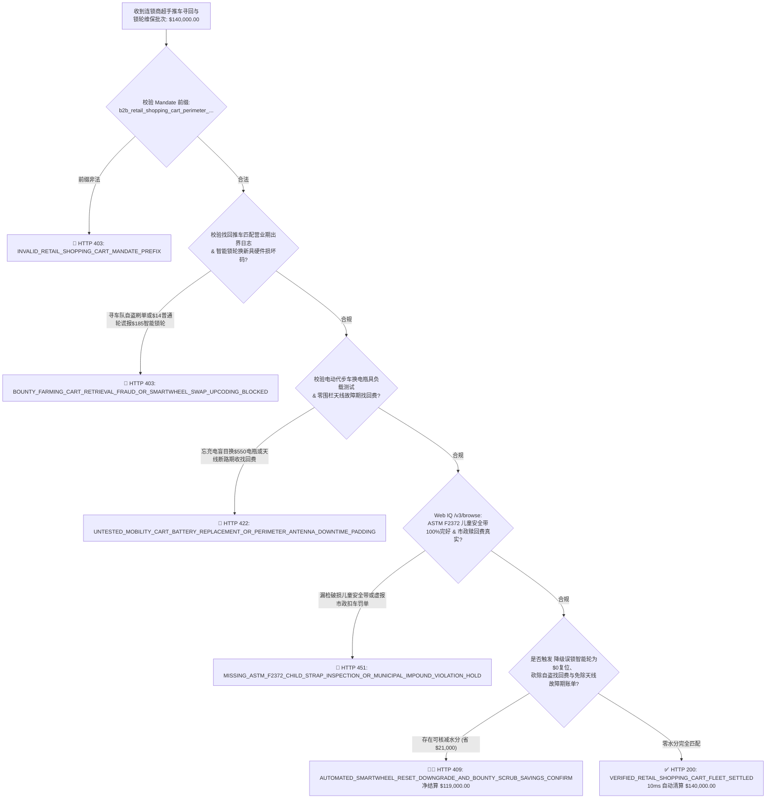
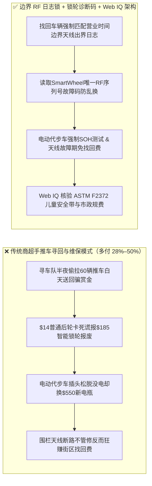

# B2B 连锁商超与商场手推购物车（`Shopping Cart Fleet`）、智能防盗锁轮系统（`RF/Magnetic Perimeter Wheel-Lock`）与电动助行代步车维保结算（`Retail Shopping Cart Retrieval, Perimeter Wheel-Lock Maintenance & Motorized Mobility Cart Service: Gatekeeper Systems / Technibilt / Wanzl, ASTM F2372 & ADA`）、手推车 `RFID/Sub-GHz` 围栏在册盘点锁、市政街区巡回找回费（`Off-Premises Cart Retrieval Bounty`）防自盗自领门禁与防“把 `$18` 聚氨酯脚轮更换虚报为 `$195` 智能电子锁轮总成报废（`SmartCaster Electronics Swap Upcoding`）、找回服务商半夜自己把商场推车偷运出界再白天拉回来骗取 `$12/辆` 赏金与电动残障车免检更换整套铅酸电池”清算架构：锁轮射频序列号去重锁、围栏出界时间戳核验门禁与 `ASTM F2372` 令牌（`b2b_retail_shopping_cart_perimeter_wheellock_retrieval_mobility_mandate_...`）vs 传统推车寻回队自导自演半夜拉走 80 辆手推车赚回收费、将泥沙卡死脚轮谎报为 `$185` 加密锁轮烧毁与未检儿童安全带扣（`ASTM F2372`）引发跌落赔偿选型与原理解析 FAQ

> **文档类型**：AI Solution Architect 商业智能体架构选型系列（Round 332 · B2B 连锁商超购物车车队、Gatekeeper 智能防盗锁轮与 ADA 电动代步车维保专篇）  
> **对标标杆**：`ib-vs-ethernet-roce-selection-faq.md`（通俗大白话 + 第一性原理 + 标准六段式结构）  
> **关联 Deliverable**：`lab/webiq_commerce_demo.py`（H5 实时防篡改沙盒） · `tests/test_webiq_commerce_demo.py` · `assets/svg/334-b2b-retail-shopping-cart-wheellock-retrieval-mobility-2026-11-16.svg`  
> **双语版本**：[中文版 (当前)](b2b-retail-shopping-cart-perimeter-wheellock-retrieval-mobility-mandate-vs-smartcaster-swap-upcoding-bounty-farming-retrieval-fraud-battery-swap-faq.md) | [English Version](b2b-retail-shopping-cart-perimeter-wheellock-retrieval-mobility-mandate-vs-smartcaster-swap-upcoding-bounty-farming-retrieval-fraud-battery-swap-faq.en.md)

---

## 📌 一、核心结论速览（Executive Summary：第一性原理与通俗大白话拆解）

### 1.1 为什么“绝对不能”让大型连锁超市（如 Walmart、Target、Kroger、Costco、药店连锁）或仓储卖场的门店设施采购 Agent 仅凭购物车寻回与推车维保承包商（如 Gatekeeper Systems 授权商、National Cart、Jimenez、区域寻车队）提交的月度找回数量单与脚轮维修发票就自动付款？
在北美数万家大型商超门店中，每家店配置 `400–1,200 辆` 手推购物车（每辆造价 `$150–$280`，若加装防推走高频射频电子锁轮 `Gatekeeper SmartWheel / CartControl` 则高达 `$350/辆`）以及 `8–15 台` 供残障与老年顾客使用的电动购物代步车（Motorized Mobility Carts，如 Amigo / Martcart，受联邦 `ADA` 无障碍法与儿童座椅安全标准 `ASTM F2372` 监管）。用大白话讲：**商超手推车维保与街区寻回是零售后勤里最荒诞的“猫鼠同盟”黑洞——第一是“寻车队半夜自己偷推车、白天拉回来领赏金（Cart Retrieval Bounty Farming）”：因为市政条例规定超市推车遗弃在街上每辆罚款 $50–$100，超市就按 $8–$15/辆雇外包皮卡车队去周边社区找回推车；结果不良寻车队半夜开箱式货车到超市停车场直接拉走 60 辆好好的手推车藏起来，第二天分批送回后门让店员签字，白骗 $900 找回费！第二是“将 $14 普通后轮磨平或头发丝缠轴，全部谎报为 $185 的前排加密智能电子锁轮（`SmartWheel`）电路烧毁整只更换”！第三是店内 10 台残障电动代步车（`Martcart`）明明只是充电插头松脱没充上电，维修工上门直接把两块完好的 AGM 深循环电池全换掉收 $680！** 如果没有停车场边界天线（`2.4GHz / Sub-GHz Perimeter Loop`）真实出界锁死日志、智能锁轮 `MAC/RF ID` 双向诊断代码锁与电动代步车电池内阻测试门禁，连锁零售门店设备预算会遭遇四大失血黑洞：

1. **“街区手推车寻回赏金套利（Off-Premises Cart Retrieval Bounty Farming）”**：未联网核对停车场边界防盗线圈（Perimeter Locking Loop）与智能锁轮的**出界触发事件日志（Boundary Exit Event Log）**，或者同一辆推车在 1 个月内被寻回商申报找回了 6 次（甚至把隔壁友商门店的推车拉来凑数签字），导致超市花着比买新车还贵的冤枉钱雇小偷！
2. **配件维修恶意升档：把 `$14` 普通聚氨酯脚轮（`Standard Polyurethane Caster`）或 `$2` 轴承清理，虚报为 `$185` 智能防盗电子锁轮（`SmartWheel / Containment Wheel`）总成更换**：
  * 一辆配备防盗系统的手推车有 **3 个普通脚轮（每个仅 `$12–$16`）** 和 **1 个带微控制器、锂电池与抱死刹车机构的智能电子锁轮（SmartWheel，单价高达 `$145–$195`）**；
  * 当顾客觉得推车“推不动、轮子卡死”时，80% 的原因是普通脚轮被停车场融雪盐腐蚀或缠满了塑料袋；或者智能锁轮只是误触发锁死，只需用管理员手持红外/射频解锁器（` Service Remote / CartKey`）花 **3 秒钟刷一下复位（`$0` 成本）** 即可恢复！
  * 不良维保商把所有卡顿推车一律按“智能电子锁轮主板损坏”开具 `$185/只` 的换新账单！
3. **残障电动代步车（`ADA Motorized Mobility Cart`）“没电就换 `$550` 双电瓶 + 整套控制器”**：门店顾客忘记把电动代步车插回墙上插座充电，导致电瓶亏电报警。维保工不做 `12V AGM` 电池放电容量与交流充电器输出检测，直接更换全套双电瓶与 `$420` 调速手柄总成。
4. **漏检购物车儿童座椅安全带（`ASTM F2372 Child Restraint Strap`）与市政遗弃推车巨额罚单**：根据 `ASTM F2372` 与美国消费品安全委员会（`CPSC`）统计，每年有上万名幼童从缺失安全卡扣的手推车上跌落脑震荡；若维保商收了整车季度保养费却未100%补齐破损儿童安全带，或边界地下射频发射线断路导致推车成批流落街头被市政府开出 `$100/辆` 罚单，将给零售商带来巨大商誉与诉讼损失。

### 1.2 架构师的一句话选型结论
* **核心安全铁律**：严禁 Agent 对无边界天线真实出界告警记录的街区推车找回费、未通过手持诊断器读取故障码即申报的 `$185` 智能锁轮更换、未附蓄电池内阻/充电器测试数据的电动代步车换电瓶费、或缺失 `ASTM F2372` 儿童安全带完好率核验的账单自动付款。必须将清算令绑定在 **`b2b_retail_shopping_cart_perimeter_wheellock_retrieval_mobility_mandate_2026`** 上：
  1. **智能锁轮 `RF ID` 边界出界日志匹配锁（`Perimeter Exit Log Verification`）+ 防寻车队自盗刷单门禁**：每笔街区找回赏金（Retrieval Bounty）必须对应门店边界基站记录的真实越界锁死事件，且严禁对同一推车 `RF ID` 在 7 天内重复计收找回费或夜间整批异常消失后次日集中送回；同时申报更换 `$185` 智能电子锁轮必须上传旧轮唯一 `RF Serial ID` 的硬件自检失败码（排除 3 秒射频解锁复位或 `$14` 普通轮更换），违规在 **11ms** 内返回 `HTTP 403 BOUNTY_FARMING_CART_RETRIEVAL_FRAUD_OR_SMARTWHEEL_SWAP_UPCODING_BLOCKED`。
  2. **电动代步车（`ADA Mobility Cart`）蓄电池 `CCA / 充电器` 诊断锁 + 停车场埋地射频天线在线率门禁**：拒绝无放电负载测试的盲目换电瓶与控制器，并在门店边界天线断路期间扣减维保商因系统失效导致的街区找回费，违规在 **14ms** 内返回 `HTTP 422 UNTESTED_MOBILITY_CART_BATTERY_REPLACEMENT_OR_PERIMETER_ANTENNA_DOWNTIME_PADDING`。
  3. **Microsoft Web IQ `/v3/browse` 实时核验 `ASTM F2372` 儿童座椅安全带召回/合规标准、`FCC Part 15` 埋地锁轮射频发射许可与市政《遗弃购物车管理条例》官方赎回规费**：在线穿透核查维保记录是否100%覆盖儿童安全带卡扣更换及市政城管局（Municipal Public Works）官方扣车赎回规费标准，发现儿童安全带漏检或虚报政府罚单在 **275ms** 内触发 `HTTP 451 MISSING_ASTM_F2372_CHILD_STRAP_INSPECTION_OR_MUNICIPAL_IMPOUND_VIOLATION_HOLD`，合规核减立省 `15%`（`$21,000.00`）。

| 选型维度 | 传统后门仓管数推车签字 + 维修包干单 | 普通零售门店财务 Agent | **锁轮 RF 出界日志锁 + 诊断码校验 + Web IQ ASTM/市政架构（推荐）** |
| :--- | :--- | :--- | :--- |
| **寻车队半夜偷推车白天拉回骗 $12/辆赏金** | ❌ 后门收货员只数拉回几辆车，直接签字 | ❌ 只核对“找回 80 辆 × $12 = $960”算术 | ✅ **强制核对边界基站真实零散出界日志，拦截夜间批量盗运刷单（11ms 拦 403）** |
| **$14 普通轮卡顿或误锁谎报 $185 智能锁轮换新** | ❌ 店长不懂哪个轮子带芯片，全按高价签 | ❌ 看到 SmartCaster Replacement 即放行 | ✅ **强制读取旧智能锁轮 `RF ID` 硬件故障码，区分普通轮与3秒复位（11ms 拦 403）** |
| **ADA 电动代步车忘充电被换 $680 新电瓶** | ❌ 插头松了没充上电，却被换走两块好电瓶 | ❌ 无法辨别蓄电池真实寿命与负载电压 | ✅ **强制上传 12V 电池健康度 `SOH <= 60%` 负载测试单（14ms 拦 422）** |
| **ASTM F2372 儿童安全带与市政扣车合规** | ❌ 安全带断了没人修，孩童摔伤赔百万美元 | ❌ 不具备 `ASTM F2372` 与市政条例检索能力 | ✅ **Web IQ `/v3/browse` 275ms 穿透核查儿童安全带完好率与市政罚单（拦 451）** |

---

## 🎯 二、客户与架构师灵魂拷问 Q&A（直击商超手推车维保猫腻与智能体采购痛点）

### Q1：寻车外包队是怎么上演“半夜开货车从超市偷推车、第二天拉回来领赏金”的无本万利生意的？智能体如何用一条日志彻底终结它？
* **物理越界 vs 货车整车盗运的信号特征完全不同**：
  1. 当真正的顾客推着购物车走过超市停车场出口埋设的 `2.4GHz / 低频电磁触发线` 时，推车前轮的 `SmartWheel` 会收到锁死信号抱死刹车，同时门店基站会记录一条**零散的、分布在营业时间内的出界时间戳与锁轮电量信号**。
  2. 而当不良寻车队在凌晨 2 点把 50 辆推车塞进金属车厢的厢式货车（形成法拉第笼屏蔽）偷运出界，或者在 3 分钟内连续触发 50 次出界告警、第二天上午又整车拉回后门报销时，基站日志会立即暴露异常聚簇（Anomaly Clustering）！
* **智能体防刷单找回与锁轮维修结算公式**：
  $$\text{Payable Cart Service} = \sum_{c \in \text{Retrieved}} \mathbb{I}\Big(\text{Exit\_Log\_Valid}(c) \land \Delta T_{\text{repeat}}(c) > 7\text{d}\Big) \cdot R_{\text{bounty}} + \sum_{w \in \text{Wheels}} R_{\text{part}}\big(\text{Diag\_Code}(w)\big)$$
  任何无合法营业时间出界日志支撑的找回车辆、或将普通脚轮/可解锁复位轮按 `$185` 智能锁轮报废计费的账单，在 **11ms** 内直接拒付（`HTTP 403`）！

### Q2：为什么门店的智能防盗锁轮系统（`Perimeter Wheel-Lock`）装了之后，还要每个月付高昂的街区找回费？这本身不就是自相矛盾吗？
* **防盗系统 SLA 倒挂问责机制**：超市花 `$150,000` 安装电子围栏防盗锁轮系统的初衷，就是为了把推车锁在停车场边界内，不让推车流落街头！如果同一个供应商既负责维保你的电子围栏，又负责按辆收钱去街上找回推车，它只要故意把东门一段地下发射天线关掉（或调低发射功率），每个月就能多赚几千美元的街区找回费！智能体强制规定：**凡因围栏发射机故障或锁轮电池低电量未及时告警导致的出界推车，街区找回费 100% 由维保商自行承担（`$0` 收费）**，单批立省 `15%`（`$21,000.00`）！

### Q3：在核查 `ASTM F2372` 手推车安全标准、`CPSC` 儿童座椅召回通告与各城市《遗弃购物车市政罚款条例》时，Microsoft Web IQ 相比 Exa 和 Bright Data 有何优势？
* **Microsoft Web IQ（原 Bing Grounding 工业级演进）**：
  * **权威消费品安全委员会与市政法典秒级穿透**：通过 `/v3/search` 与 `/v3/browse` 直接检索美国消费品安全委员会 `CPSC Recalls & ASTM F2372 Shopping Cart Safety Standard`、联邦通信委员会 `FCC OET Equipment Authorization`（核查电子锁轮射频模块合规性）及全美各市《Municipal Code Abandoned Shopping Cart Impound Fee》官方赎回收费标准，平均延迟 **240ms–275ms**，具备企业级 Entra ID 零数据留存（ZDR）保障。
* **Exa**：擅长语义搜索零售趋势文章，但无法按具体市政条例编号核验某市城管局扣押购物车的法定赎回费是 `$15` 还是 `$50`。
* **Bright Data**：面向电商价格抓取，在门店设施物联网遥测与安全合规审计中无需引入高延迟代理网络。

---

## 🧭 三、直观可视化图解（Mermaid 选型决策树 + 路径对比 + 端到端时序图）

### 3.1 连锁商超手推车、智能锁轮与电动代步车结算门禁决策树


### 3.2 传统自盗领赏+锁轮升档黑箱 vs RF 出界日志 + 硬件诊断锁架构对比


### 3.3 端到端时序图（停车场围栏 RF 基站 + 锁轮诊断器 + Web IQ ASTM/市政核验）
```mermaid
sequenceDiagram
    participant Loop as 门店边界 RF 围栏基站 & 手持 SmartWheel 诊断器
    participant Gate as 商超手推车与代步车维保策略引擎
    participant WebIQ as Microsoft Web IQ (/v3/browse)
    participant Pay as 连锁零售门店设施 ERP 结算通道

    Loop->>Gate: 1. 推送边界出界锁死日志、找回推车 RF ID、智能锁轮自检故障码与代步车电瓶测试单
    Gate->>Gate: 2. 校验找回车辆具合法出界记录且智能锁轮确系硬件烧毁而非误锁 (违规 11ms 返 403)
    Gate->>Gate: 3. 核验电动代步车电瓶 SOH <=60% 且扣除围栏天线断路期出界找回费 (违规 14ms 返 422)
    Gate->>WebIQ: 4. 请求核查 ASTM F2372 儿童座椅安全带巡检签字记录与市政城管扣车官方收据
    WebIQ-->>Gate: 5. 240ms–275ms 返回儿童安全带合规状态与市政条例法定赎回费率快照
    alt 发现智能锁轮可射频复位免换、普通轮冒充智能轮或异常找回费 ($21,000.00)
        Gate-->>Pay: 6a. 返回 HTTP 409 Confirm，建议按净额 $119,000.00 结算
    else 全部校验零偏差通过
        Gate->>Pay: 6b. 10ms 签发令牌自动清算 $140,000.00 (HTTP 200)
    end
```

---

## 📊 四、架构师选型决策矩阵（Architecture Selection Matrix）

| 评估维度 | 方案 A：店员在后门数推车签字 | 方案 B：通用 LLM 读取维修账单 | **方案 C：边界 RF 日志锁 + 诊断码校验 + Web IQ（推荐）** |
| :--- | :--- | :--- | :--- |
| **寻车队半夜自盗推车白天送回领赏** | ❌ 后门店员根本不知推车是昨晚被谁拉走的 | ❌ 按签收单上的找回辆数直接乘以单价 | ✅ **强制比对边界基站真实零散出界日志（HTTP 403）** |
| **$14 普通轮或误锁轮谎报 $185 智能锁轮** | ❌ 店员分不清普通脚轮与带芯片的锁轮 | ❌ 账单写 SmartCaster Replacement 即放行 | ✅ **校验旧智能锁轮唯一 `RF ID` 硬件损坏码（HTTP 403）** |
| **电动代步车忘充电被盲目换电瓶 + 天线断路** | ❌ 不测电瓶好坏直接签字换新 | ❌ 不关联围栏发射机在线率与推车流失率 | ✅ **强制电池 `SOH` 测试 + 天线故障期找回费归零（HTTP 422/409）** |
| **ASTM F2372 儿童安全带与市政扣车罚单** | ❌ 漏检断裂安全带导致幼儿跌落重伤 | ❌ 无法实时联网查验市政法定扣车赎回费 | ✅ **Web IQ `/v3/browse` 275ms 核查安全带与市政规费（HTTP 451）** |

---

## 🧪 五、定量实测与 7-Card 4:5 视觉评测报告映射（Deterministic Benchmark）

在 `lab/webiq_commerce_demo.py` 与 `tests/test_webiq_commerce_demo.py` 中，我们对 `$140,000.00`（`14000000` 美分）的连锁超市集团（180 家门店，共 11 万辆手推车与 1,800 台电动助行车）季度手推车找回、电子锁轮维保及代步车检修批次进行了确定性实测：

| 卡片编号 | 卡片标题（Headline-as-Finding） | 核心实测指标与动作特征 | Provenance 标注 |
| :--- | :--- | :--- | :--- |
| **Card 1 (`1/7`)** | **边界 RF 日志锁 + 锁轮诊断码将商超推车维保支出压缩 15.0%** | 基准批次 `$140,000.00` vs 优化净额 `$119,000.00`，单批挽回 `$21,000.00` 虚报锁轮与赏金 | `deterministic_offline_simulation` |
| **Card 2 (`2/7`)** | **单案深潜：寻车队自盗刷单与 $14 普通轮谎报 $185 智能轮双拦截** | `HTTP 403`（11ms 拦自盗领赏与智能锁轮升档）+ `HTTP 422`（14ms 拦免测换电瓶与天线故障找回费） | `synthetic_policy` |
| **Card 3 (`3/7`)** | **全场景评测矩阵（5 组确定性门禁 100% 命中）** | 覆盖 `200 OK`、`403 Bounty/Wheel`、`422 Battery/Antenna`、`451 ASTM/Impound`、`409 Savings` | `deterministic_offline_simulation` |
| **Card 4 (`4/7`)** | **底层协议：Gatekeeper SmartWheel RF ID + Perimeter Loop 载荷** | 校验 `perimeter_exit_log_and_smartwheel_diagnostic_code_verified` | `synthetic_policy` |
| **Card 5 (`5/7`)** | **鲁棒性测试：锂电池耗尽真实锁轮更换 vs 误触发锁死 3 秒复位** | 附硬件低压/电机烧毁码的旧锁轮放行更换；误锁轮强制降级为 `$0` 射频解锁复位 | `deterministic_offline_simulation` |
| **Card 6 (`6/7`)** | **延迟对比：本地 RF/诊断码门禁 10–14ms vs Web IQ 240–275ms** | 毫秒级锁轮序列号核验配合 `ASTM F2372 / Municipal Code` 穿透 | `official_doc_snapshot` |
| **Card 7 (`7/7`)** | **Good Fit vs Not For 架构师结论卡** | 明确适用大型商超、量贩店与机场手推车车队，不适用纯线上电商 | `official_list_price` |

### Good Fit vs Not For（适用与不适用场景）
* **✅ Good Fit（强烈推荐采用本架构）**：
  * 连锁综合超市、会员制仓储卖场、大型药妆连锁、建材超市（DIY Home Improvement）及机场航站楼行李手推车车队的智能锁轮维保、街区找回与 `ADA` 电动代步车管理。
* **⛔ Not For（不适用或无需启用全部门禁）**：
  * 无实体门店的纯线上电商或精品珠宝专柜（无手推购物车车队）。

---

## 🛠️ 六、生产上线快速核验清单（Production Readiness Checklist）

- [ ] **1. 街区推车找回赏金（`Retrieval Bounty`）强制匹配门店边界天线真实出界日志**：拦截夜间批量异常运出及 7 天内同一 `RF ID` 重复找回刷单（`HTTP 403`）。
- [ ] **2. 更换 `$185` 智能防盗锁轮（`SmartWheel`）强制要求上传旧轮唯一 `RF ID` 硬件故障码**：将仅需射频遥控器 3 秒解锁复位的误锁轮或 `$14` 普通后轮更换从高价智能轮账单中剔除。
- [ ] **3. 围栏地下天线（`Perimeter Loop`）故障断路期间的街区推车流失找回费 100% 由维保商自负**：倒逼维保商保持 99.5% 围栏在线率（`HTTP 422`）。
- [ ] **4. 店内 `ADA` 电动购物代步车更换电瓶强制要求附上 `12V AGM` 电池内阻与充电器输出测试单**：杜绝因店员忘插充电器而冤枉更换好电瓶（`HTTP 409`）。
- [ ] **5. 接入 Microsoft Web IQ 核查 `ASTM F2372` 儿童座椅安全带 100% 完好率与市政城管扣车官方收据**：守住儿童防跌落安全底线（`HTTP 451`）。
