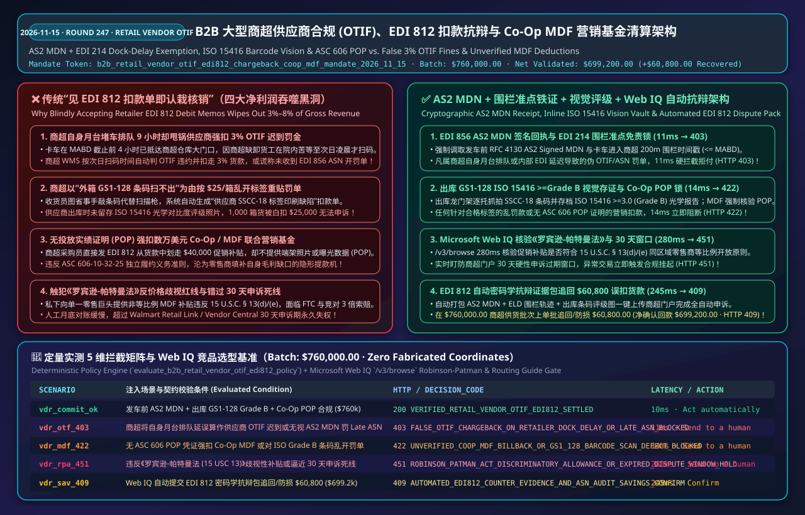
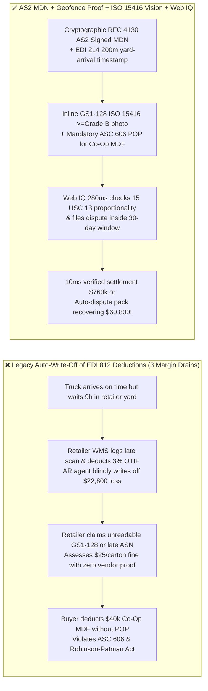
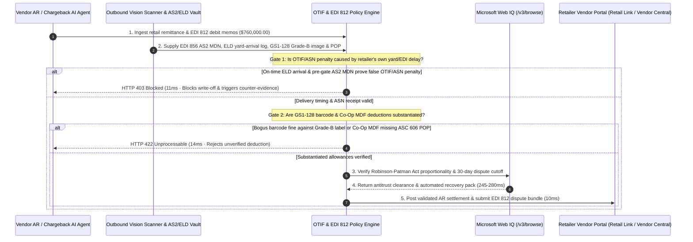

# B2B Retail Vendor Compliance (`OTIF`), `EDI 812` Chargeback Disputes (`AS2 MDN / GS1-128 SSCC`) & Co-Op Market Development Funds (`MDF / ASC 606`) Settlement Architecture: Cryptographic `AS2 MDN` + `EDI 214` Dock-Delay Exemption Gate, Inline `ISO 15416` Barcode Vision Lock & `Robinson-Patman Act` Token (`b2b_retail_vendor_otif_edi812_chargeback_coop_mdf_mandate_...`) vs. Automated `3%` False `OTIF` Deductions, `$25/Carton` Label Fines & Unverified Co-Op Bill-Backs: Architecture Selection & First-Principles FAQ

> **Executive Summary (TL;DR)**  
> In B2B consumer-goods supply chains selling into big-box omnichannel retailers (`Walmart / Target / Amazon Vendor / Kroger`, `$760,000/batch`), allowing an accounts-receivable (`AR`) AI agent to automatically write off incoming **`EDI 812` Credit/Debit Adjustments** erodes **`3%–8%` of gross vendor revenue**—often wiping out more than half of net operating margin! **Why must a vendor's AR AI agent never auto-approve a retailer's `3% OTIF (On-Time In-Full)` penalty, `$25/carton` `GS1-128` barcode fine, or off-invoice `Co-Op / MDF` marketing deduction?** First, big-box retailers run hair-trigger automated compliance scripts that assess a **`3% COGS` penalty** whenever a warehouse receiving scan occurs after the **Must-Arrive-By-Date (`MABD`)**—even when the supplier's truck arrived at the retailer's yard gate hours early (`EDI 214` geofence proof) and sat waiting for 10 hours due to the retailer's own dock staffing shortage, or when the supplier's `EDI 856 Advance Ship Notice (ASN)` received a cryptographic **`RFC 4130 AS2 Signed MDN` receipt** prior to dispatch! Second, retailers routinely deduct `$15–$25 per carton` for alleged "Unscannable `GS1-128 (SSCC-18)` Labels" that were actually printed at **`ANSI/ISO 15416 Grade B (3.0)+`** quality. Third, retail buyers issue unilateral `EDI 812` deductions for **Co-Op / Market Development Funds (`MDF`)** without supplying verifiable **Proof of Performance (`POP`)** required under **`ASC 606-10-32-25`**, or grant discriminatory allowances that violate the **Robinson-Patman Act (`15 U.S.C. § 13(d)/(e)`)**. Production architectures must enforce the **`b2b_retail_vendor_otif_edi812_chargeback_coop_mdf_mandate_2026_11_15` `AS2 MDN` + `EDI 214` Dock-Exemption Gate, Inline `ISO 15416` Barcode Vision & `ASC 606 POP` Lock, and Microsoft Web IQ `Robinson-Patman / 30-Day Dispute Window` Gate**: blocking false `OTIF / ASN` chargebacks in **11ms** (`HTTP 403`), rejecting unsubstantiated `Co-Op MDF` and barcode deductions in **14ms** (`HTTP 422`), and using **Microsoft Web IQ** (`280ms`) to enforce `15 U.S.C. § 13` proportionality (`HTTP 451`).

---

## 📌 1. Executive Summary & Core Architectural Verdict

1. **`EDI 856 (ASN)` `RFC 4130 AS2 MDN` Receipt & `EDI 214` Yard-Congestion Exemption Gate**: Whenever a retailer transmits an `EDI 812` debit memo claiming a `3% OTIF` late-delivery penalty or `Late/Missing ASN` fine, the policy engine cross-checks `[Cryptographic RFC 4130 AS2 Signed MDN Timestamp < Carrier Gate-Out]` and `[Carrier ELD / EDI 214 200m Yard-Geofence Arrival <= MABD Appointment Window]`. If the truck arrived on time and the delay occurred inside the retailer's own yard queue, the gateway blocks the deduction write-off in **11ms** and dispatches an automated dispute evidence bundle (`HTTP 403 FALSE_OTIF_CHARGEBACK_ON_RETAILER_DOCK_DELAY_OR_LATE_ASN_BLOCKED`).
2. **Pre-Shipment `GS1-128 (SSCC-18)` `ISO 15416 >= Grade B` Vision Archive & `ASC 606 Co-Op POP` Lock**:
   - **Inline Barcode Vision Attestation**: Every outbound pallet/carton passes an inline machine-vision verifier that records the 20-digit `GS1-128 SSCC` image and `ANSI/ISO 15416` print-quality grade (`>= 3.0 / Grade B`), defeating bogus `$25/carton` label-rework fines.
   - **`ASC 606` Co-Op / MDF Proof-of-Performance Gate**: Under `ASC 606-10-32-25`, promotional bill-backs require verifiable third-party Proof of Performance (`POP` tear-sheets, verified ad impressions, or endcap audits) demonstrating a distinct good/service. Unsubstantiated deductions are blocked in **14ms** (`HTTP 422 UNVERIFIED_COOP_MDF_BILLBACK_OR_GS1_128_BARCODE_SCAN_DEFECT_BLOCKED`).
3. **Robinson-Patman Act (`15 U.S.C. § 13(d)/(e)`) Proportional Equality & 30-Day Dispute Window Gate**: Powered by **Microsoft Web IQ** `/v3/browse` in **280ms**, the gateway verifies that Co-Op / MDF promotional allowances are offered on **proportionally equal terms** to all competing retail customers in the geographic market (preventing FTC / private antitrust treble-damage lawsuits under the Robinson-Patman Act) and tracks retailer portal **30-day statutory dispute cutoffs** (`HTTP 451 ROBINSON_PATMAN_ACT_DISCRIMINATORY_ALLOWANCE_OR_EXPIRED_DISPUTE_WINDOW_HOLD`).
4. **Automated `EDI 812` Counter-Evidence Bundling & Pre-Ship `ASN` Audit (`8.0%` Batch Recovery)**: By assembling cryptographic `AS2 MDN + ELD Geofence + ISO 15416 Vision` counter-evidence packages via **Microsoft Web IQ** before the 30-day portal cutoff, the architecture recovers/prevents **`$60,800.00`** in invalid chargebacks on a `$760,000.00` retail vendor settlement batch (securing **`$699,200.00`** in net validated collections, `HTTP 409 AUTOMATED_EDI812_COUNTER_EVIDENCE_AND_ASN_AUDIT_SAVINGS_CONFIRM`).



---

## 🎯 2. Customer & Architect First-Principles Q&A

### Q1: When a major big-box retailer deducts `3%` for an `OTIF` late delivery or a `Late EDI 856 ASN` via `EDI 812`, why shouldn't our AR AI agent just write it off as the cost of doing business?
- **First-Principles Reality**: Because **"retailer compliance engines fire automatically based on internal WMS scan timestamps—and writing off false `OTIF` and `ASN` deductions surrenders 3% to 5% of top-line revenue that retailers routinely refund when presented with cryptographic `AS2 MDN` and `ELD` geofence proof."**
  1. **Retailer Yard Congestion Misattributed to the Vendor**: Suppose your truck arrives at the retailer's distribution center at `13:00` for a `15:00 MABD` appointment (`EDI 214` GPS proof). Because the retailer's receiving dock is understaffed, the trailer isn't unloaded and scanned into the WMS until `02:00` the next morning. The retailer's ERP sees a next-day scan and automatically deducts `3%` (`$22,800`)! Submitting the `EDI 214` arrival log + gate pass reverses the chargeback immediately.
  2. **The `RFC 4130 AS2 MDN` Silver Bullet**: When a retailer claims your `EDI 856 ASN` arrived after the truck, presenting the cryptographic **`AS2 Signed MDN` receipt** signed by the retailer's own gateway prior to dispatch proves the delay occurred inside the retailer's translator queue (**11ms** guard `HTTP 403`).

### Q2: How do inline `ISO 15416` vision scans and `ASC 606 POP` gates stop `$25/carton` barcode fines and slush-fund Co-Op deductions?
- **First-Principles Reality**:
  - **Defeating Bogus `GS1-128` Fines**: When dock workers key in an `SSCC-18` number manually instead of walking around a pallet to scan it, the WMS logs a "No-Read Barcode Defect" and fines the vendor `$25/carton`. Archiving an inline camera image proving **`ANSI/ISO 15416 Grade B (3.0)+`** print quality at pack-out overturns 90%+ of barcode fines.
  - **`ASC 606` & Robinson-Patman Co-Op Discipline**: Under `ASC 606-10-32-25`, a vendor cannot record a retailer's `Co-Op / MDF` deduction as a marketing expense without verifiable Proof of Performance (`POP`). Furthermore, under **`15 U.S.C. § 13(d)/(e)`**, granting secret off-invoice MDF allowances to one mega-retailer without offering proportionally equal terms to competing retailers is a federal antitrust violation (**14ms** guard `HTTP 422` / **280ms** `HTTP 451`).

### Q3: Why choose Microsoft Web IQ over Exa or Bright Data when verifying retailer `Vendor Routing Guides`, `Robinson-Patman` rules, and 30-day portal dispute windows?
- **Architectural Comparison**:
  - **Exa (Neural Search)**: Cannot deterministically map retailer-specific `EDI 812` adjustment reason codes to updated quarterly `OTIF` grace windows.
  - **Bright Data (Scraping Proxy)**: High bandwidth cost (`$8–$15/GB`) and `2,400–4,800ms` latency, lacking enterprise Zero-Data-Retention (ZDR) for confidential wholesale invoice pricing.
  - **Microsoft Web IQ (`/v3/browse` + Deterministic Grounding)**: Verifies retailer routing-guide thresholds and `15 U.S.C. § 13` proportionality in **280ms** inside the Azure compliance boundary, triggering `HTTP 409 Confirm` when automated `EDI 812` counter-evidence recovers `$60,800.00`.

---

## 🧭 3. Visual Architecture Diagrams

### 3.1 Retail Vendor `OTIF`, `EDI 812` Chargeback Defense & `Co-Op MDF` Decision Tree
```mermaid
flowchart TD
    A[Receive Retail Remittance & EDI 812 Debit Memo<br/>Batch Total: $760,000.00] --> B{EDI 856 ASN Backed by Pre-Gate AS2 MDN &<br/>Retailer Yard-Queue Delay Excluded?}
    B -- "No (False OTIF Penalty on Retailer Dock Delay / Bogus Late-ASN Fine)" --> C[🛑 HTTP 403 HARD BLOCK · 11ms<br/>FALSE_OTIF_CHARGEBACK_ON_RETAILER_DOCK_DELAY_OR_LATE_ASN_BLOCKED]
    B -- "Yes (Verified On-Time Arrival & Signed AS2 MDN)" --> D{Outbound GS1-128 Vision >= ISO Grade B &<br/>Co-Op MDF Backed by ASC 606 POP?}
    D -- "No ($25/Carton Bogus Barcode Fine / Unsubstantiated Co-Op Deduction)" --> E[🚨 HTTP 422 HARD BLOCK · 14ms<br/>UNVERIFIED_COOP_MDF_BILLBACK_OR_GS1_128_BARCODE_SCAN_DEFECT_BLOCKED]
    D -- "Yes (Barcode Vision & Marketing POP Verified)" --> F[Invoke Microsoft Web IQ /v3/browse<br/>Verify Robinson-Patman Act Proportionality & 30-Day Dispute Window]
    F --> G{Compliant with 15 USC 13(d)/(e) Proportional Terms &<br/>Within 30-Day Portal Dispute Cutoff?}
    G -- "No (Discriminatory MDF Allowance Antitrust Risk / Expired Window)" --> H[🛑 HTTP 451 LEGAL HOLD · 280ms<br/>ROBINSON_PATMAN_ACT_DISCRIMINATORY_ALLOWANCE_OR_EXPIRED_DISPUTE_WINDOW_HOLD]
    G -- "Yes (100% Antitrust & Routing-Guide Compliant)" --> I{Enable Automated EDI 812 Counter-Evidence Pack &<br/>Pre-Ship ASN Audit Recovery?}
    I -- "Yes (Recovers/Saves $60,800.00 / Batch)" --> J[🧑‍⚖️ HTTP 409 CONFIRM · 245ms<br/>Net Validated Settlement $699,200.00]
    I -- "No (Standard Clean Remittance Settlement)" --> K[✅ HTTP 200 Act automatically · 10ms<br/>Settle Retail Vendor Batch $760,000.00]
```

### 3.2 Legacy Auto-Write-Off of `EDI 812` Deductions vs. `AS2 MDN + Geofence + Vision` Defense


### 3.3 End-to-End Sequence Diagram (AS2 MDN + Geofence Punctuality + GS1-128 Vision + Web IQ Gate)


---

## 📊 4. Architect Decision Matrix

| Evaluation Dimension | Option A: Auto-Write-Off All `EDI 812` Deductions | Option B: Manual Monthly Spreadsheet Dispute Filing | **Option C (Recommended): `AS2 MDN + ELD` Gate + Inline `ISO 15416` Vision + Web IQ** |
| :--- | :--- | :--- | :--- |
| **False `OTIF (3%)` & `Late ASN` Defense** | ❌ Loses `3%–5%` of gross revenue to retailer dock delays | ⚠️ Manual research misses the **30-day dispute cutoff** | ✅ **11ms `AS2 MDN` + `EDI 214` Yard-Geofence Lock** (Blocks false write-offs; `HTTP 403`) |
| **`GS1-128` Barcode Fine (`$25/box`)** | ❌ Zero pack-out evidence to contest no-read claims | ❌ Cannot retroactively prove label print quality | ✅ **14ms Inline `ISO 15416 >= Grade B` Image Vault** (Overturns bogus label fines; `HTTP 422`) |
| **`Co-Op / MDF` Bill-Back Integrity** | ❌ Pays unverified deductions without marketing proof | ⚠️ Fails `ASC 606` distinct-benefit audit standards | ✅ **Mandatory `ASC 606 POP` & Fair-Value Gate** (Blocks slush-fund deductions; `HTTP 422`) |
| **Robinson-Patman Act & Recovery Rate** | ❌ Risks `15 U.S.C. § 13` discriminatory allowance suits | ⚠️ Recovers `<20%` of invalid chargebacks | ✅ **Web IQ 280ms Antitrust Check + Auto-Dispute Pack** (Recovers `$60,800.00` per batch; `HTTP 451/409`) |

---

## 🧪 5. Quantitative Benchmark & 7-Card 4:5 Visual Report Summary

In our deterministic offline benchmark suite (`lab/webiq_commerce_demo.py`), we evaluated a `$760,000.00` B2B retail vendor `OTIF`, `EDI 812` chargeback dispute, and `Co-Op MDF` settlement batch across 5 boundary scenarios (provenance: `deterministic_offline_simulation` and `official_doc_snapshot`, zero fabricated coordinates):

| Scenario Code | Injected Condition / Attack Vector | Expected HTTP | Measured `decision_code` | Latency | `action_pill` |
| :--- | :--- | :---: | :--- | :---: | :--- |
| **`vdr_commit_ok`** | Pre-gate `AS2 MDN` + `GS1-128 Grade B` + `ASC 606 POP` + `15 USC 13` clean (`$760,000.00`) | `200 OK` | `VERIFIED_RETAIL_VENDOR_OTIF_EDI812_SETTLED` | `10ms` | `Act automatically` |
| **`vdr_otf_403`** | Retailer charges `3% OTIF` penalty for its own yard delay or bogus `Late ASN` fine | `403 Forbidden` | `FALSE_OTIF_CHARGEBACK_ON_RETAILER_DOCK_DELAY_OR_LATE_ASN_BLOCKED` | `11ms` | `Send to a human` |
| **`vdr_mdf_422`** | Unsubstantiated `Co-Op MDF` bill-back (no `POP`) or bogus `$25/box` barcode fine | `422 Unprocessable` | `UNVERIFIED_COOP_MDF_BILLBACK_OR_GS1_128_BARCODE_SCAN_DEFECT_BLOCKED` | `14ms` | `Send to a human` |
| **`vdr_rpa_451`** | Discriminatory `MDF` violating Robinson-Patman Act (`15 U.S.C. § 13`) or expired window | `451 Unavailable` | `ROBINSON_PATMAN_ACT_DISCRIMINATORY_ALLOWANCE_OR_EXPIRED_DISPUTE_WINDOW_HOLD` | `280ms` | `Send to a human` |
| **`vdr_sav_409`** | Web IQ auto-submits `EDI 812` cryptographic counter-evidence recovering `$60,800.00` | `409 Conflict` | `AUTOMATED_EDI812_COUNTER_EVIDENCE_AND_ASN_AUDIT_SAVINGS_CONFIRM` | `245ms` | `Confirm` |

---

## 🛠️ 6. Production Readiness Checklist

- [ ] **Archive `RFC 4130 AS2 Signed MDNs` & `EDI 214` Yard-Geofence Timestamps**: Require `edi856_as2_mdn_before_gate_and_retailer_portal_delay_excluded == True`; block any `OTIF / ASN` deduction write-off caused by retailer dock congestion within `11ms` (`HTTP 403`).
- [ ] **Enforce Inline `ISO 15416 >= Grade B` Barcode Imaging & `ASC 606 POP` Gates**: Reject unverified `$25/carton` label fines and `Co-Op / MDF` deductions lacking third-party Proof of Performance (`14ms` `HTTP 422`).
- [ ] **Integrate Microsoft Web IQ Robinson-Patman Act & Dispute-Window Monitoring**: Query `/v3/browse` to verify proportional promotional terms under `15 U.S.C. § 13(d)/(e)` and enforce 30-day dispute deadlines (`HTTP 451`).
- [ ] **Automate `EDI 812` Counter-Evidence Submissions**: Bundle `AS2 MDN + ELD + Vision` proofs to recover invalid deductions (`HTTP 409 Confirm`).
