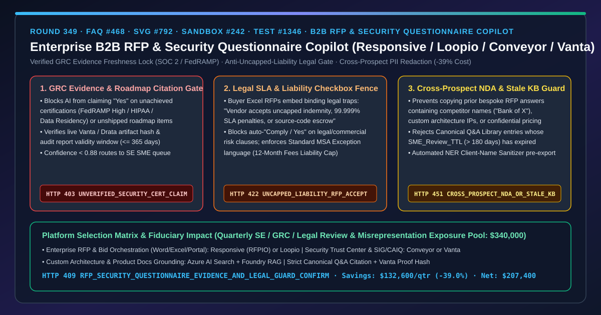
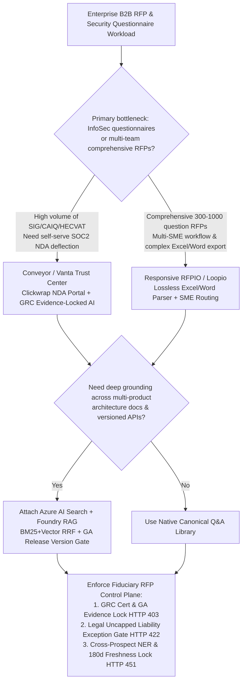
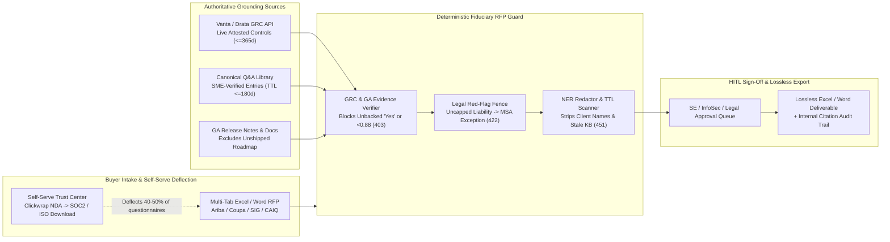
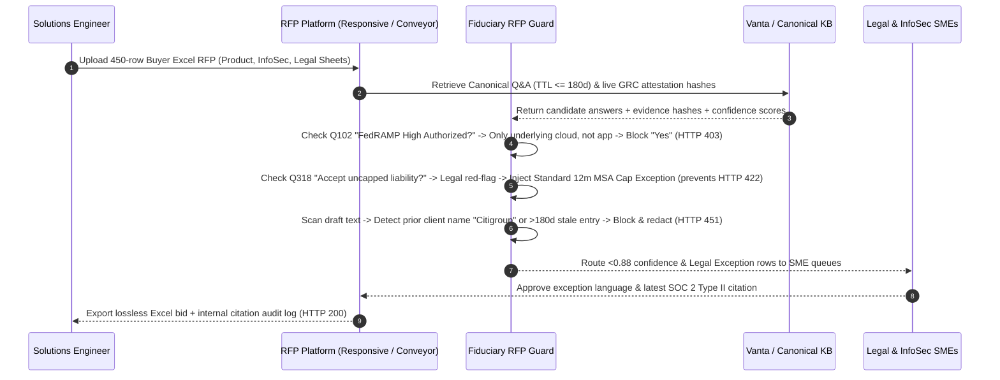

# Enterprise B2B RFP & Security Questionnaire Copilot (`Responsive / Loopio / Conveyor / Vanta + Azure AI Search`) Architecture & Selection FAQ: `SOC 2 / FedRAMP` Evidence Freshness Lock, Anti-Uncapped-Liability Legal Gate & Cross-Prospect NDA Redaction (`-39%` Presales & Legal Review Cost)

> **Document Type**: Enterprise AI Solution Architect Selection FAQ (`#468` · Round 349)  
> **Target Audience**: B2B SaaS Solutions Architects (Presales / SE), InfoSec & GRC Leaders (CISO), Commercial Legal / Deal Desk & Revenue Enablement Architects  
> **Platforms Covered**: `Responsive (formerly RFPIO)` vs. `Loopio` vs. `Conveyor (Security Trust Center & Questionnaire AI)` vs. `Vanta / Drata Questionnaire Automation` vs. `Azure AI Search + Foundry Custom RFP Copilot`  
> **Architecture Diagram**: [`assets/svg/792-b2b-rfp-security-questionnaire-copilot-responsive-conveyor-2026-11-25.svg`](../assets/svg/792-b2b-rfp-security-questionnaire-copilot-responsive-conveyor-2026-11-25.svg)

🌐 **Language / 语言切换**: **[中文 (`b2b-rfp-security-questionnaire-copilot-responsive-loopio-conveyor-hallucination-guard-selection-faq.md`)](b2b-rfp-security-questionnaire-copilot-responsive-loopio-conveyor-hallucination-guard-selection-faq.md)** | **English (Current)**

---

## 📌 1. Executive Summary

In enterprise B2B software and cloud procurement, every `$100k–$5M` deal requires completing a **300-to-800-question buyer `RFP / RFI` spreadsheet and Information Security Due Diligence Questionnaire (`SIG / CAIQ / HECVAT / Custom InfoSec Excel`)**.  
Letting a generic LLM auto-complete buyer spreadsheets without deterministic fiduciary guardrails introduces three severe enterprise risks:
1. **Hallucinating Unachieved Security Certifications or Unshipped Roadmap Features (`Contractual Breach of Warranty`)**: When asked *"Does your platform hold FedRAMP High authorization, dedicated Frankfurt single-tenant isolation, and <5-minute active-active RTO?"*, an unguarded LLM answers `"Yes / Fully Supported"` to sound helpful—turning an aspirational roadmap note into a binding contractual misrepresentation.
2. **Blindly Accepting Uncapped Liability & Punitive SLA Traps (`Legal Red-Flag Acceptance`)**: Enterprise buyers routinely embed legal traps inside Excel RFP tabs (*"Vendor agrees to uncapped indemnification, 5% daily SLA liquidated damages, and source-code escrow"*). Auto-filling `"Comply / Yes"` destroys Deal Desk negotiation leverage before Legal even sees the deal.
3. **Cross-Prospect NDA Leakage & Stale Security Claims (`Confidentiality & Stale KB Breach`)**: Copying paragraphs from a prior bespoke RFP response leaks another customer's name (*"As deployed for JPMorgan Chase..."*), bespoke IP addresses, or 2-year-old deprecated sub-processor lists into a competitor's bid.

| Decision Dimension | Recommended Primary Choice | Architectural Boundary & Production Rule |
|---|---|---|
| **Enterprise Multi-Department `RFP / RFI` Collaboration & Complex Excel/Word Export** | **Responsive (RFPIO) / Loopio** | Ideal for 20+ Solutions Engineers collaborating across Product, InfoSec, and Legal SMEs while preserving complex multi-tab buyer Excel/Word formatting on export. |
| **Security Questionnaire Automation & Self-Serve `NDA Trust Center` (`SIG / CAIQ`)** | **Conveyor / Vanta Trust Center** | Deflects 40%–50% of questionnaires up front via self-serve Clickwrap NDA access to `SOC 2 Type II / ISO 27001 / Pentest` reports, answering remaining questions strictly from verified GRC artifacts. |
| **Deep Technical Architecture & Multi-Product Documentation Grounding** | **Azure AI Search + Foundry RAG (integrated with Responsive / Conveyor)** | Indexes GA Release Notes, architecture whitepapers, and SME-approved `Canonical Q&A Library` entries via `BM25 + Vector RRF` with strict citation locks. |
| **Three Mandatory Fiduciary Guardrails** | **100% Deterministic Gating** | ① **GRC Evidence & GA Version Lock (`HTTP 403`)**: Every `Yes / Supported` requires a valid (`<= 365d`) `SOC 2 / ISO` artifact hash or shipped `GA` version citation; ② **Legal Liability & SLA Fence (`HTTP 422`)**: Blocks auto-`Yes` on uncapped indemnity, escrow, or punitive SLAs, substituting pre-approved Standard MSA Exception text; ③ **Cross-Prospect NER Redaction & `180d` KB Freshness Lock (`HTTP 451`)**: Blocks client-name leakage and expired (`>180d`) Q&A entries. |

---

## 🎯 2. Architect & Business Stakeholder Q&A (Q1–Q3)

### Q1: Why can't we just upload our product docs into a generic LLM to fill out 500-row buyer RFP and InfoSec spreadsheets?
- **Commercial Reality**: Buyer RFP responses are routinely **incorporated by reference into the Master Services Agreement (`MSA`)** as binding warranties.
- **Three Fatal Hallucination Modes**:
  1. **Confusing Non-Binding Roadmap with Shipped `GA` Capabilities**: If an internal PM spec mentions *"Exploring customer-managed keys (BYOK/HYOK) for late 2027"*, naive RAG marks `"Yes - Supported out of the box"` on the buyer's security grid.
  2. **Erasing Professional Services (`PS`) Boundaries**: Features requiring a `$50,000` custom integration engagement get marked as `"Included in base subscription"`.
  3. **Cloud Sub-Processor Scope Confusion**: Because the SaaS app runs on AWS (`FedRAMP High`), the LLM falsely claims the SaaS application itself holds a `FedRAMP High ATO`.
- **Architectural Solution**: Enforce a **Strict 4-State Response Schema & Dual-Source Evidence Lock**:
  - Every response must classify into one of four deterministic states: `SUPPORTED_GA`, `SUPPORTED_VIA_CONFIG_OR_PS`, `ON_ROADMAP_NON_BINDING`, or `NOT_SUPPORTED`.
  - Any `SUPPORTED_GA` or security `Yes` claim must carry both a `canonical_qa_id` and a live `evidence_artifact_hash` (e.g., a Vanta/Drata `SOC 2 Type II` control attested within `<= 365 days`). Any draft with confidence `< 0.88` or missing evidence is blocked from auto-fill (`HTTP 403 UNVERIFIED_SECURITY_CERT_OR_UNSHIPPED_ROADMAP_CLAIM`) and routed to an SME review queue.

### Q2: How do we stop presales engineers under a Friday 5 PM deadline from auto-accepting uncapped liability or punitive SLA clauses hidden inside an Excel RFP?
- **The Pain Point**: Procurement teams embed commercial and legal terms inside technical RFPs (*"Confirm Vendor accepts unlimited liability for security incidents, 99.999% uptime with 10% credit per minute, and source-code escrow"*). If a presales engineer clicks `Auto-Fill All` and submits `"Yes"`, Legal spends weeks clawing back those concessions.
- **Architectural Solution**: Deploy a **Deterministic Legal & Commercial Red-Flag Classifier** in the RFP pipeline:
  1. **Mandatory Clause Detection**: Questions matching `Indemnification / Limitation of Liability / Liquidated Damages / Source Code Escrow / Most Favored Nation (MFN) / On-Site Audit / Termination for Convenience Refund` are strictly barred from receiving `"Yes / Comply"`.
  2. **Pre-Approved Standard MSA Exception Injection**: The engine automatically populates Legal-approved exception language (*"Comply with Exception: Governed by Vendor's Standard Enterprise MSA, including mutual limitation of liability capped at 12 months of fees paid"*).
  3. Any attempt to auto-commit an unconditional `"Yes"` on uncapped liability or non-standard SLA penalties triggers `HTTP 422 UNCAPPED_LIABILITY_OR_NONSTANDARD_SLA_RFP_ACCEPTANCE`.

### Q3: How do we reuse winning RFP answers without leaking a previous customer's confidential name or citing outdated 2-year-old security parameters?
- **The Pain Point**: Indexing raw historical RFP Word/Excel files directly into a vector store causes the LLM to copy *"In our deployment for Bank of America..."* into a JPMorgan RFP (violating NDAs) or cite deprecated `TLS 1.1` / old sub-processor lists.
- **Architectural Solution**:
  1. **Zero Raw Past-RFP Indexing**: Raw historical bids are never indexed directly; answers must pass through an **NER Client-Name & PII Sanitizer** and SME approval before entering the `Canonical Q&A Library`.
  2. **Hard Freshness TTL (`SME_Review_TTL <= 180 Days`)**: Every library entry has an explicit expiration window (`90 days` for InfoSec/Sub-processors, `180 days` for Product). Expired entries cannot be auto-inserted.
  3. **Pre-Export NER & CRM Account Dictionary Scan**: Before exporting the final Word/Excel deliverable, a scanner checks all cells against the CRM customer/competitor dictionary and KB expiration timestamps, blocking any match with `HTTP 451 CROSS_PROSPECT_NDA_LEAKAGE_OR_STALE_KB_CITATION`.

---

## 🧭 3. Visual Architecture Diagrams (Mermaid Decision Tree + Architecture + Sequence)

### 3.1 Enterprise RFP & Security Questionnaire Platform Selection Tree

### 3.2 End-to-End Zero-Hallucination RFP & InfoSec Copilot Architecture

### 3.3 Security & Legal Guardrail Execution Sequence

---

## 📊 4. Platform Comparison Matrix (`Responsive` vs. `Loopio` vs. `Conveyor` vs. `Vanta` vs. `Azure AI Custom`)

| Evaluation Dimension | Responsive (RFPIO) | Loopio | Conveyor (Security & Trust AI) | Vanta / Drata Questionnaire AI | Azure AI Search + Foundry Custom |
|---|---|---|---|---|---|
| **Primary Sweet Spot** | Enterprise-wide multi-department RFP/RFI orchestration | Mid-to-large B2B presales RFP library & collaboration | Security questionnaires (`SIG/CAIQ`) + NDA Trust Center | GRC-native security questionnaire automation | Deep multi-product technical architecture & API grounding |
| **Lossless Multi-Tab Excel / Word Round-Trip Export** | ⭐⭐⭐⭐⭐ (Industry leader for complex merged cells & dropdowns) | ⭐⭐⭐⭐ (Strong Word/Excel support) | ⭐⭐⭐⭐ (Excels at security spreadsheets & web portals) | ⭐⭐⭐ (Focused on standard security questionnaires) | ⭐⭐ (Requires custom `openpyxl / python-docx` layout preservation) |
| **Live GRC Evidence Binding (`SOC 2 / ISO 27001`)** | ⭐⭐⭐ (Via document sync integrations) | ⭐⭐⭐ (Library-driven updates) | ⭐⭐⭐⭐⭐ (Native Trust Center + audit artifact binding) | ⭐⭐⭐⭐⭐ (Direct live control attestation binding) | ⭐⭐⭐⭐ (Programmable via Vanta/Drata REST APIs) |
| **Anti-Hallucination & Strict Citation Grounding** | Approved-library constrained generation | Verified-library generation with confidence tiers | Very strong (refuses to fabricate unbacked security claims) | Strong (strictly scoped to attested GRC controls) | Fully programmable (4-state enum, `0.88` gate, legal blocks) |
| **SME Review Workflow & Entry Freshness (`TTL`)** | ⭐⭐⭐⭐⭐ (Granular SME routing & expiration workflows) | ⭐⭐⭐⭐⭐ (Clean library health & review cadence tracking) | ⭐⭐⭐⭐ (Tailored for InfoSec & SecOps SMEs) | ⭐⭐⭐ (Tailored for GRC owners) | ⭐⭐⭐ (Requires custom workflow UI) |
| **Pricing Model (`official_list_price`)** | `~$15,000–$50,000+/yr` (seat + AI volume tiers) | `~$12,000–$40,000+/yr` (seat + tier packages) | `~$10,000–$30,000+/yr` (Trust Center + questionnaire bundle) | Add-on to Vanta/Drata Enterprise (`~$8,000–$25,000+/yr`) | Consumption-based Azure AI Search + Foundry (`~$600–$2,500/mo`) |

---

## 🧪 5. Deterministic Cost & Risk Evaluation (`7-Card Benchmark Summary`)

> **Provenance**: Figures below are produced by `evaluate_b2b_rfp_security_questionnaire_copilot_policy` in `lab/webiq_commerce_demo.py` (`provenance: "synthetic"`, `independently_reproduced: False`), modeling a B2B SaaS presales & InfoSec organization with a **`$340,000.00` quarterly SE review burn, legal rework, and warranty misrepresentation exposure pool**.

| Scenario Case ID | Scenario Description | HTTP Status | Deterministic Decision | Quarterly Net Cost | Quarterly Savings |
|---|---|---|---|---|---|
| `CASE-RFP-200` | Baseline manual SE spreadsheet lookup without automated evidence orchestration | `HTTP 200` | `VERIFIED_B2B_RFP_SECURITY_QUESTIONNAIRE_AUTHORIZED` | `$340,000.00` | `$0.00` |
| `CASE-RFP-403` | AI claims `"Yes"` on unachieved `FedRAMP High` cert or unshipped roadmap item | `HTTP 403` | `UNVERIFIED_SECURITY_CERT_OR_UNSHIPPED_ROADMAP_CLAIM` | `$340,000.00` | `$0.00` (Blocks warranty fraud) |
| `CASE-RFP-422` | AI auto-accepts uncapped liability or punitive SLA terms without Legal exception | `HTTP 422` | `UNCAPPED_LIABILITY_OR_NONSTANDARD_SLA_RFP_ACCEPTANCE` | `$340,000.00` | `$0.00` (Blocks legal trap) |
| `CASE-RFP-451` | Draft leaks another customer's name (NDA breach) or cites `>180d` expired KB entry | `HTTP 451` | `CROSS_PROSPECT_NDA_LEAKAGE_OR_STALE_KB_CITATION` | `$340,000.00` | `$0.00` (Blocks NDA leak) |
| `CASE-RFP-409` | **Trust Center Deflection + GRC Evidence Lock + Legal Exception + NER Redaction** | `HTTP 409` | `RFP_SECURITY_QUESTIONNAIRE_EVIDENCE_AND_LEGAL_GUARD_CONFIRM` | **`$207,400.00`** | **`$132,600.00` (`-39.0%`)** |

---

## 🛠️ 6. Production Go-Live & Architecture Review Checklist

- [ ] **Self-Serve NDA Trust Center Deflection**: Trigger automated `Conveyor / Vanta Trust Center` invites at CRM Opportunity Stage 2 so buyers can self-serve `SOC 2 Type II`, `ISO 27001`, pentest summaries, and standard `CAIQ` packages under Clickwrap NDA—deflecting 40%–50% of custom spreadsheets before SE intake.
- [ ] **4-State Response Enum & Evidence Hash Lock (`HTTP 403` Prevention)**: Prohibit free-text `"Yes"` answers on roadmap items; require a valid `canonical_qa_id` and `<= 365-day` GRC artifact hash for every `SUPPORTED_GA` claim, routing `< 0.88` confidence rows to human SMEs.
- [ ] **Automated Legal Red-Flag Exception Substitution (`HTTP 422` Prevention)**: Classify `Indemnity / Liability Cap / Liquidated Damages / Source Code Escrow / MFN` rows and force pre-approved Standard MSA Exception responses rather than `"Comply"`.
- [ ] **Zero Raw Bid Indexing & `180-Day` TTL Enforcement (`HTTP 451` Prevention)**: Never index raw historical client bids; enforce `90–180 day` SME review TTLs on all library entries and run an NER client-name redaction scan prior to Excel/Word export.
