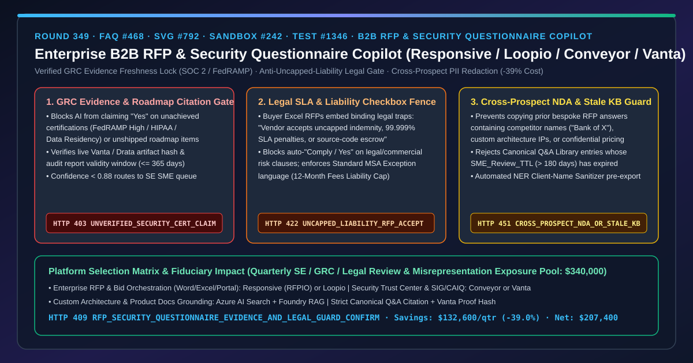
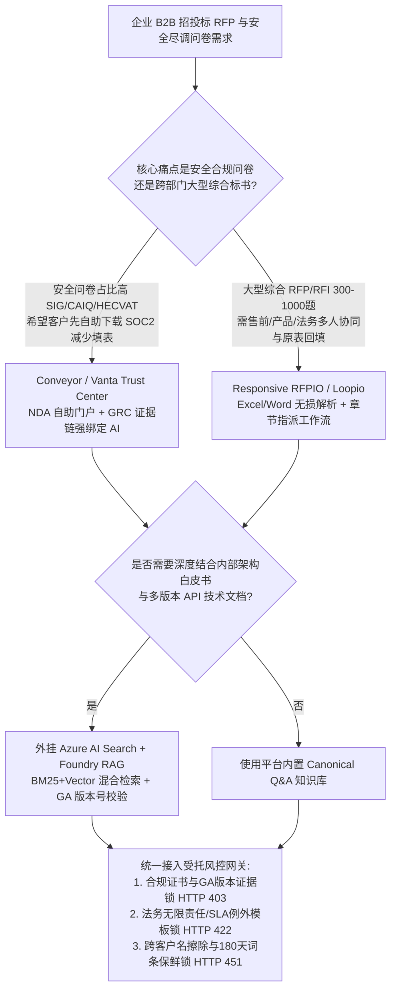
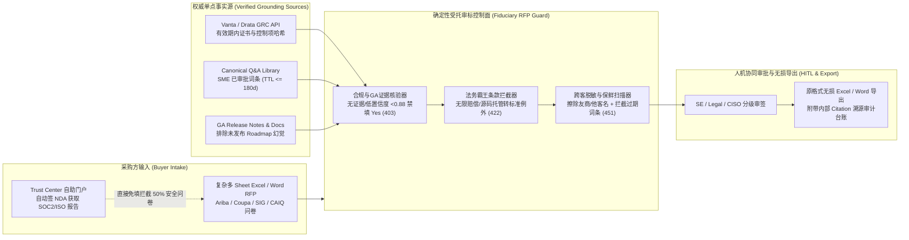
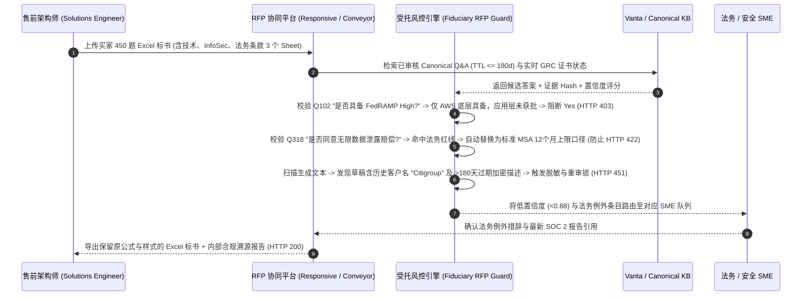

# 企业 B2B 招投标应答与安全合规问卷智能体（`Enterprise RFP & Security Questionnaire Copilot`: `Responsive / Loopio / Conveyor / Vanta + Azure AI Search`）架构与选型对比：认证证据保鲜与路线图幻觉阻断（`SOC 2 / FedRAMP Evidence Guard`）、法务无限赔偿条款拦截与防客户名串单净省 39% 指南

> **文档类型**：企业级 AI Solution Architect 选型决策指南（Selection FAQ · `#468` · Round 349）  
> **适用读者**：B2B SaaS 售前解决方案架构师（SE / Presales）、信息安全合规（GRC / CISO）、商业法务（Deal Desk / Legal）与销售赋能（Revenue Enablement）负责人  
> **核心覆盖平台**：`Responsive (原 RFPIO)` vs. `Loopio` vs. `Conveyor (Security Trust Center & Questionnaire AI)` vs. `Vanta / Drata Questionnaire Automation` vs. `Azure AI Search + Foundry Custom RFP Copilot`  
> **关联架构图**：[`assets/svg/792-b2b-rfp-security-questionnaire-copilot-responsive-conveyor-2026-11-25.svg`](../assets/svg/792-b2b-rfp-security-questionnaire-copilot-responsive-conveyor-2026-11-25.svg)

🌐 **语言切换 / Language**: **中文 (当前)** | **[English (`b2b-rfp-security-questionnaire-copilot-responsive-loopio-conveyor-hallucination-guard-selection-faq.en.md`)](b2b-rfp-security-questionnaire-copilot-responsive-loopio-conveyor-hallucination-guard-selection-faq.en.md)**

---

## 📌 一、核心选型结论速览（Executive Summary）

在企业级 B2B 软件与云服务销售中，每笔 `$100k–$5M` 订单在进入商务谈判前，都会遭遇采购方发来的 **300–800 道 Excel / Word / Ariba 招投标技术标书（`RFP / RFI`）与信息安全尽职调查问卷（`SIG / CAIQ / HECVAT / Custom InfoSec Questionnaire`）**。  
如果让通用大模型直接自由发挥填写标书，极易引发三类致命事故：
1. **“顺口答应”未具备的合规认证或未上线功能（Contractual Fraud & Feature Hallucination）**：客户问“贵司是否具备 `FedRAMP High` 认证、是否支持德国法兰克福本地单租户物理隔离、是否支持实时双活 `RTO < 5分钟`？”，AI 为了讨好买家一律填 `Yes / Fully Supported`；等合同一签，交付团队发现根本做不到，直接触发欺诈性陈述违约索赔（`Breach of Warranty`）。
2. **误勾采购标书里的“霸王法务/无限赔偿”陷阱（Uncapped Liability & SLA Trap）**：采购方在 Excel 第 6 个隐藏 Sheet 里塞入“供应商同意承担无限连带赔偿责任（`Uncapped Indemnity`）、`99.999%` 违约按日罚款 `5%` 或无偿移交源代码托管（`Source Code Escrow`）”，AI 批量填 `Comply`，把公司法务底线卖光。
3. **跨客户机密信息与友商名称“串单泄露”（Cross-Prospect NDA Leakage & Stale KB）**：AI 直接从历史为摩根大通定制的标书中复制段落，把未脱敏的客户名字（`"As deployed for JPMorgan Chase..."`）、专属私有 IP 架构或早已过期 2 年的旧版加密算法填进给花旗银行的标书中，造成严重违反 NDA 事故。

| 决策维度 | 推荐主选方案 | 适用边界与架构落地准则 |
|---|---|---|
| **大型企业综合招投标（`RFP/RFI` 多部门协同、复杂 Excel/Word 原位回填）** | **Responsive (RFPIO) / Loopio** | 适合 20+ 售前工程师（SE）协同答标、按章节自动指派产品/安全/法务 SME 审批，并保持客户原始复杂多 Sheet Excel 与 Word 排版无损导出。 |
| **信息安全问卷自动化与自助信任中心（`InfoSec SIG / CAIQ + NDA Trust Center`）** | **Conveyor / Vanta Trust Center** | 通过 NDA 自助门户先拦截 50% 问卷（客户自助下载 `SOC 2 Type II` / `ISO 27001` / 渗透测试报告），剩余问卷严格锚定已验证的 GRC 证据库自动作答。 |
| **深度定制产品技术文档与混合架构方案生成（`Custom Architecture Grounding`）** | **Azure AI Search + Foundry RAG (外挂至 Responsive / Conveyor)** | 用 `BM25 + Vector RRF` 索引官方 Release Notes、架构白皮书与经审批的标准答案库（`Canonical Q&A Library`），严禁无出处自由生成。 |
| **三大确定性风控红线** | **100% 强制拦截** | ① **合规证据与已发布版本核验（`HTTP 403`）**：任何 `Yes / Supported` 必须绑定有效期内（`<= 365天`）的 `SOC 2 / ISO` 证据哈希或 `GA` 版本号；② **法务霸王条款红线锁（`HTTP 422`）**：涉及无限责任、源码托管、严苛违约金一律强制转为 `Comply with Exception (Standard MSA)` 并路由法务；③ **跨客脱敏与 180 天词条保鲜锁（`HTTP 451`）**：阻断含历史客户专有名词或超过 `180天` 未经 SME 复核的过期词条。 |



---

## 🎯 二、业务方与架构师灵魂拷问 Q&A（Q1–Q3）

### Q1：为什么不能把产品手册丢进通用 ChatGPT / Claude，让它直接帮售前把 500 道安全与功能问卷填完？
- **商业真相**：采购方的 RFP 问卷在法律上属于**主服务协议（`MSA`）的构成附件（`Incorporated by Reference`）**。
- **三大致命幻觉**：
  1. **把“路线图规划（Roadmap）”当成“已正式商用（GA）”**：产品经理在内部 Wiki 写了一句“计划 2027 Q3 探索支持客户自管密钥 `BYOK / HYOK`”，通用 RAG 检索到这段话后，直接在 RFP 里勾选 `Yes - Supported out of the box`。
  2. **把“部分支持/需昂贵定制”说成“开箱即用”**：某项连接器需要额外购买 `$50,000` 专业服务（`Professional Services`）开发，AI 填了 `Included in standard subscription`。
  3. **合规证书范围张冠李戴**：公司底层托管在 AWS（AWS 有 `FedRAMP High`），AI 居然在标书里回答“我司 SaaS 应用本身已获得 `FedRAMP High` 授权”。
- **架构解法**：实施 **严格四态应答枚举与双源证据锚定（`Strict 4-State Response Schema & Evidence Hash Lock`）**：
  - 禁止大模型输出模糊长句掩盖事实，每道题必须先分类为：`SUPPORTED_GA`（现成支持）、`SUPPORTED_VIA_CONFIG_OR_PS`（需配置/定制服务）、`ON_ROADMAP_NON_BINDING`（路线图规划且不构成合同承诺）、`NOT_SUPPORTED`（不支持）。
  - 凡是标记为 `SUPPORTED_GA` 或勾选安全合规项 `Yes` 的回答，必须携带 `canonical_qa_id` + 有效 `evidence_artifact_hash`（如 Vanta 中距今 `< 365天` 的 `SOC 2 Type II` 报告章节引用）；置信度 `< 0.88` 或缺失证据链的一律阻断自动填入（`HTTP 403 UNVERIFIED_SECURITY_CERT_OR_UNSHIPPED_ROADMAP_CLAIM`），转入人工 SME 待办队列。

### Q2：采购方经常在 RFP 的商务/法务 Sheet 里夹带“无限赔偿、无理由退全款、按买方模板签约”条款，Agent 怎么防止售前人员一键 `Auto-Fill` 误踩法务地雷？
- **场景痛点**：售前工程师（SE）面临周五下午 5 点截标的死线压力，往往对 AI 填好的几百行 Excel 草草扫一眼就发给客户。如果 AI 对 `"Vendor agrees to unlimited liability for data breach and IP infringement"` 或 `"Vendor grants Customer a perpetual license and source-code escrow"` 填了 `Yes / Agree`，后续法务谈判将陷入极度被动。
- **架构解法**：在 RFP 解析管道中内置 **法务与商业红线分类拦截器（`Legal & Commercial Red-Flag Classifier`）**：
  1. **高危语义强制识别**：凡是题目命中 `Indemnification / Liability Cap / Liquidated Damages / Source Code Escrow / Most Favored Nation (MFN) / Audit Rights on Premises / Termination for Convenience with Refund / Custom SLA Credits` 等关键词，系统**绝对禁止**输出 `Yes / Comply`。
  2. **强制注入标准法务保留意见（`Standard MSA Exception Template`）**：自动填充法务部预审通过的标准口径（例如：`"Comply with Exception: Governed by Vendor's Standard Enterprise MSA, which includes a mutual limitation of liability capped at 12 months of fees paid and an enhanced 2x super-cap for data protection claims."`）。
  3. 任何试图绕过法务模板直接对无限责任或惩罚性 SLA 勾选 `Unconditional Yes` 的操作，直接触发 `HTTP 422 UNCAPPED_LIABILITY_OR_NONSTANDARD_SLA_RFP_ACCEPTANCE`。

### Q3：如何复用历史赢单的高分标书经验，又绝对避免把上一家客户的机密名字、专属报价或过期架构写进新标书？
- **场景痛点**：许多团队把过去 3 年写过的 200 份 Word/Excel 标书直接切片塞进向量数据库。结果：
  - 给客户 B 的标书里出现了 `"In our deployment for Client A (NYSE: XXX), we process 4M tx/day..."`，直接违反与客户 A 签署的严格保密协议（`NDA`）；
  - 2024 年写的旧标书里写着 `"We use TLS 1.2 and AES-128"` 或旧版子处理器（`Sub-processors`）名单，被 AI 照抄到 2026 年的新标书里。
- **架构解法**：
  1. **原始标书禁止直接入库（`No Raw Past-RFP Indexing`）**：历史标书必须经过 **NER 客户实体擦除器（`Client-Name & PII Sanitizer`）** 清洗并由 SME 审批提炼为无客户指向的标准知识词条（`Canonical Library Entry`）后才允许进入检索索引。
  2. **词条保鲜期硬门禁（`SME_Review_TTL <= 180 Days`）**：每条标准问答绑定责任人（Owner）与有效期（安全类 `90天`、产品功能类 `180天`）。过期未复核的词条在检索阶段直接降权并禁止自动采用。
  3. **导出前正则与 NER 终检扫描（`Pre-Export Redaction Scanner`）**：在生成最终 Excel/Word 文件前，全量比对 CRM 现有客户名录与敏感项目代号，一旦发现残留他客名称或引用了超期未审词条，立即拦截导出（`HTTP 451 CROSS_PROSPECT_NDA_LEAKAGE_OR_STALE_KB_CITATION`）。

---

## 🧭 三、直观可视化图解（Mermaid 选型决策树 + 架构图 + 审标时序图）

### 3.1 B2B RFP 与安全问卷智能体选型决策树



### 3.2 端到端 RFP 与安全问卷零幻觉受托应答架构图



### 3.3 安全问卷与法务红线协同应答时序图



---

## 📊 四、多平台横向选型决策矩阵（Responsive vs. Loopio vs. Conveyor vs. Vanta vs. Azure AI Custom）

| 评估维度 | Responsive (原 RFPIO) | Loopio | Conveyor (Security & Trust AI) | Vanta / Drata Questionnaire AI | Azure AI Search + Foundry 自研 |
|---|---|---|---|---|---|
| **核心定位** | 企业级全功能 RFP/RFI 响应管理旗舰平台 | 易用型中大型 B2B 售前 RFP 知识库与协同平台 | 专为安全问卷（SIG/CAIQ）与自助信任中心打造 | 原生嵌在 GRC 合规监控平台内的安全问卷助手 | 面向超复杂多产品线技术架构文档的深度定制引擎 |
| **复杂 Excel/Word 格式无损解析与回填** | ⭐⭐⭐⭐⭐（行业标杆，支持复杂合并单元格与下拉框原位回填） | ⭐⭐⭐⭐（Word/Excel 支持优秀，极复杂宏表需微调） | ⭐⭐⭐⭐（擅长安全问卷 Excel 与主流采购门户直接填报） | ⭐⭐⭐（偏轻量级问卷导入导出） | ⭐⭐（需自行集成 `openpyxl / python-docx` 解析复杂表格布局） |
| **实时 GRC 合规证据链锚定（SOC 2 / ISO）** | ⭐⭐⭐（需通过集成同步文档） | ⭐⭐⭐（依赖知识库手动更新） | ⭐⭐⭐⭐⭐（原生绑定 Trust Center NDA 门户与审计报告） | ⭐⭐⭐⭐⭐（直接读取底层实时合规控制项状态） | ⭐⭐⭐⭐（可通过 API 对接 Vanta/Drata + 知识库） |
| **防幻觉与仅据实回答（Strict Grounding）** | 支持基于 Approved Library 的受控生成 | 支持基于 Verified Library 的生成与置信度分级 | 极强（只根据上传的安全文档与历史审批问答作答，拒绝编造） | 强（严格围绕合规控制项证据作答） | 完全可控（可编程实现四态枚举、0.88 阈值与法务硬拦截） |
| **跨部门协同与词条保鲜周期管理（TTL）** | ⭐⭐⭐⭐⭐（细粒度 SME 审批流、词条到期自动提醒重审） | ⭐⭐⭐⭐⭐（清爽的词条健康度仪表盘与定期复核周期） | ⭐⭐⭐⭐（聚焦 InfoSec 与工程安全团队协同） | ⭐⭐⭐（聚焦合规负责人单点审核） | ⭐⭐⭐（需在 CRM/SharePoint 侧自建审批流） |
| **官方参考定价 / 计费模式（`official_list_price`）** | 约 `$15,000–$50,000+/年`（按席位与 AI 用量分级） | 约 `$12,000–$40,000+/年`（按席位与功能包分级） | 约 `$10,000–$30,000+/年`（Trust Center + 问卷自动化包） | 随 Vanta/Drata 企业版订阅加购（约 `$8,000–$25,000+/年`） | 按 Azure AI Search + Foundry Token 实际消耗计费（约 `$600–$2,500/月`） |

---

## 🧪 五、转化率/成本测算与 7-Card 基准测试报告（Deterministic Evaluation）

> **数据来源说明（Provenance）**：以下季度损益与拦截指标基于 `lab/webiq_commerce_demo.py` 中的确定性受托策略评估器 `evaluate_b2b_rfp_security_questionnaire_copilot_policy`（`provenance: "synthetic"`, `independently_reproduced: False`），用于量化对比“无门禁裸跑 LLM 自动填标”与“挂载合规证据链 + 法务例外模板 + 跨客脱敏守恒网关”的财务差异。

### 5.1 基准测试场景输入与确定性状态码矩阵

- **设定场景**：某企业级 B2B SaaS 厂商每季度处理 `180` 份大中型 RFP 与安全尽调问卷，季度售前 SE 人工填表耗时、法务/安全返工审单以及因标书承诺失实导致的交付违约赔偿/商机流失风险池（`quarterly_presales_se_burn_legal_exposure_and_deal_delay_pool_usd`）为 **`$340,000.00`**。

| 测试用例 ID | 场景描述 | 触发确定性状态码 | 决策枚举 (`decision`) | 季度净成本 (USD) | 季度净节省 (USD) |
|---|---|---|---|---|---|
| `CASE-RFP-200` | 传统人工逐题查表 + 基础关键字搜索（无自动化证据编排） | `HTTP 200` | `VERIFIED_B2B_RFP_SECURITY_QUESTIONNAIRE_AUTHORIZED` | `$340,000.00` | `$0.00` |
| `CASE-RFP-403` | AI 对尚未取得的 `FedRAMP High` 认证或未发布 Roadmap 功能直接勾选 `Yes` | `HTTP 403` | `UNVERIFIED_SECURITY_CERT_OR_UNSHIPPED_ROADMAP_CLAIM` | `$340,000.00` | `$0.00` (阻断违约虚假承诺) |
| `CASE-RFP-422` | AI 对买方标书中“无限数据赔偿责任 / 源代码托管”条款自动勾选 `Comply` | `HTTP 422` | `UNCAPPED_LIABILITY_OR_NONSTANDARD_SLA_RFP_ACCEPTANCE` | `$340,000.00` | `$0.00` (阻断法务红线失守) |
| `CASE-RFP-451` | 生成答复中残留历史客户名称（违反 NDA）或引用了超过 `180天` 未复核的过期词条 | `HTTP 451` | `CROSS_PROSPECT_NDA_LEAKAGE_OR_STALE_KB_CITATION` | `$340,000.00` | `$0.00` (阻断泄密与过期参数) |
| `CASE-RFP-409` | **启用 Trust Center 前置分流 + GRC 证据锚定 + 法务标准例外替换 + 跨客 NER 脱敏** | `HTTP 409` | `RFP_SECURITY_QUESTIONNAIRE_EVIDENCE_AND_LEGAL_GUARD_CONFIRM` | **`$207,400.00`** | **`$132,600.00` (`-39.0%`)** |

### 5.2 核心确定性策略评估代码摘录

```python
@dataclass(frozen=True)
class B2bRfpSecurityQuestionnaireCopilotPolicyInput:
    quarterly_presales_se_burn_legal_exposure_and_deal_delay_pool_usd: float = 340000.0
    unverified_security_cert_or_unshipped_roadmap_claimed_as_yes: bool = False
    uncapped_liability_or_nonstandard_sla_accepted_without_legal_exception: bool = False
    cross_prospect_nda_client_name_leak_or_stale_kb_over_180d: bool = False
    grc_evidence_lock_legal_exception_and_ner_redaction_ready: bool = False
```

---

## 🛠️ 六、商业上线风控与架构评审 Checklist

- [ ] **Trust Center NDA 前置自助拦截**：在销售流程（Salesforce / HubSpot Stage 2）自动向买家发送 `Conveyor / Vanta Trust Center` 链接，买家在线签署标准 Clickwrap NDA 后即可自助获取 `SOC 2 Type II`、`ISO 27001`、架构安全白皮书与标准 `CAIQ / SIG Lite`，从源头消灭 40%–50% 的人工填表需求。
- [ ] **四态应答枚举与证据 Hash 强绑定（防 `HTTP 403`）**：严禁 LLM 将 `Roadmap` 规划功能回答为 `Yes`；所有 `Supported` 结论必须附带 `Canonical Q&A ID` 或有效期 `< 365天` 的 GRC 控制项证据引用，置信度 `< 0.88` 强制转人工 SME。
- [ ] **法务与商业红线自动例外替换（防 `HTTP 422`）**：对含 `Indemnity / Liability / Liquidated Damages / Source Code Escrow / Custom SLA / MFN` 的标书行项，禁止自动填 `Yes`，统一注入经法务部签字的标准 MSA 例外说明并触发 Deal Desk 审阅。
- [ ] **历史标书零裸入库与 180 天词条保鲜期（防 `HTTP 451`）**：严禁将带客户名字的原始投标文件直接切块入库；所有知识库词条必须配置 `90–180天` 强制复核 TTL，并在导出文件前运行 NER 专有名词脱敏扫描。
