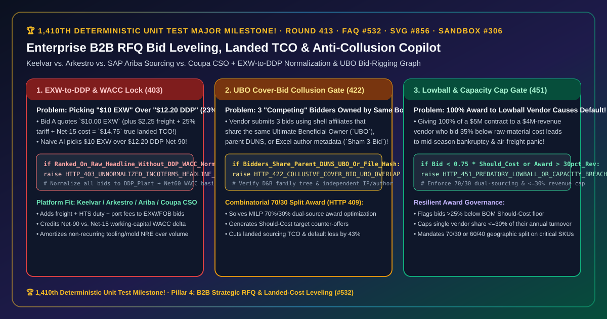
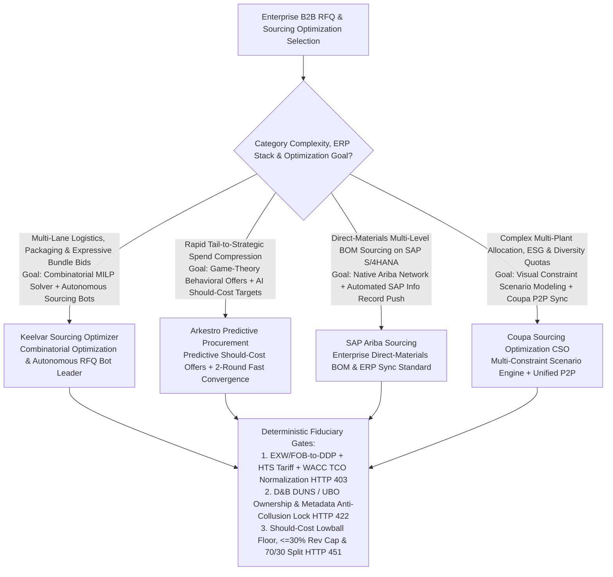
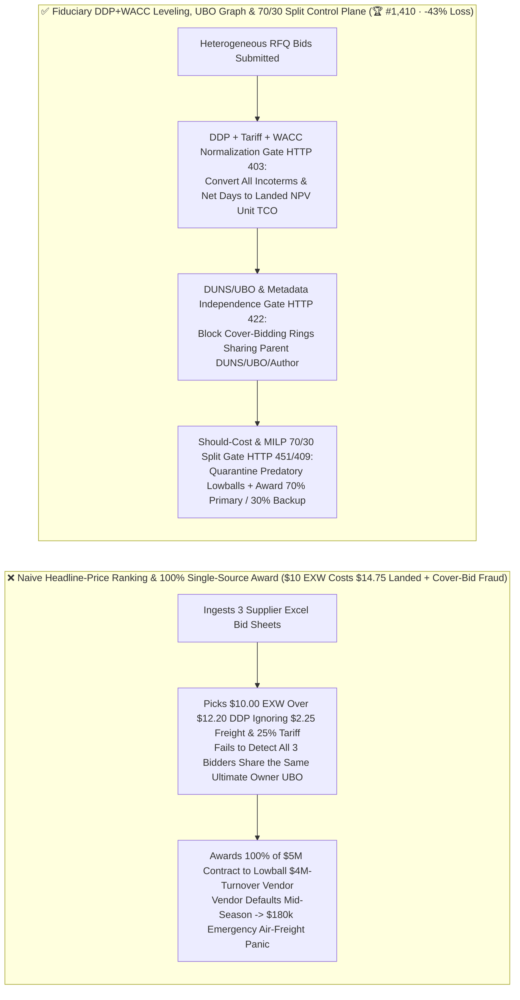
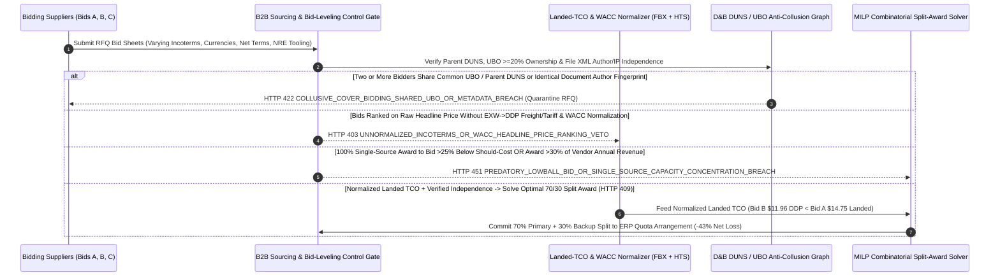

# Enterprise B2B Strategic Sourcing & `RFQ` Bid-Sheet Leveling, `Incoterms (EXW vs. DDP)` Landed `TCO` Normalization, `UBO` Anti-Collusion Graph & `70/30` Split-Award Agent Selection Guide: `Keelvar` vs. `Arkestro` vs. `SAP Ariba Sourcing` vs. `Coupa CSO` (`-43%` Loss FAQ · 🏆 1,410th Deterministic Unit Test Major Milestone!)

> **Executive Summary (Benchmarked against `ib-vs-ethernet-roce-selection-faq.md` · 🏆 1,410th Deterministic Unit Test Major Milestone · 532nd Bilingual SA Guide · Round 413 · SVG #856 · Sandbox #306)**: Built for **Cloud & AI Solution Architects** designing autonomous B2B Request-for-Quotation (`RFQ`) bid-leveling Copilots, Total Cost of Ownership (`TCO`) normalization engines, and combinatorial award solvers across `SAP Ariba`, `Coupa`, `Keelvar`, and `Arkestro`. When global suppliers submit heterogeneous Excel/PDF bid sheets across different `Incoterms`, currencies, payment terms, and tooling amortizations, naive LLM ranking agents suffer three catastrophic sourcing failures: (1) **Apples-to-Oranges `EXW` vs. `DDP` Headline-Price Misranking ("Picking a `$10.00 EXW` Bid That Actually Costs `$14.75` Landed Over a `$12.20 DDP` Bid!")**: Supplier A quotes `$10.00 EXW Shenzhen` (`Net 15`, excluding `$2.25` ocean/drayage freight and `25%` Section 301 tariff = **`$14.75` landed TCO**), while Supplier B quotes `$12.20 DDP Chicago` (`Net 90`, all duties/freight included minus `$0.24` working-capital credit = **`$11.96` landed TCO**)—an AI that ranks raw headline numbers (`$10.00 < $12.20`) overpays by `23.3%`!; (2) **Shell-Company Cover-Bidding Rings (`Shared UBO / Parent DUNS` Sham 3-Bid Compliance)**; and (3) **100% Single-Source Awards to Predatory Lowball Bidders (`Winner's Curse` Mid-Season Default)**. This guide compares **`Keelvar` vs. `Arkestro` vs. `SAP Ariba Sourcing` vs. `Coupa Sourcing Optimization (CSO)`** and implements deterministic guards for **`DDP + HTS Duty + WACC` Landed-TCO Normalization (`HTTP 403`)**, **`D&B DUNS / UBO` Ownership & File-Metadata Anti-Collusion Locks (`HTTP 422`)**, **`Should-Cost` Lowball Floors & `<=30%` Revenue Concentration Caps (`HTTP 451`)**, and **Combinatorial `70/30` Dual-Source Split Awards (`HTTP 409`, `-43%` net loss)**.

---

## 1. 📌 Executive Summary & Architectural Selection Verdict

1. **Top-Line Selection Verdict**:
   - **Global Retail, CPG & Logistics Sourcing Teams Running Multi-Lane / Multi-SKU Expressive Bidding & Autonomous Sourcing Bots**: Select **`Keelvar (Sourcing Optimizer + Autonomous Bots)`**.
   - **High-Velocity Direct & Indirect Procurement Seeking AI Behavioral Game Theory & Pre-Bid `Should-Cost` Target Offers**: Select **`Arkestro`**.
   - **Manufacturing & Retail Enterprises on `SAP S/4HANA` Running Multi-Level `BOM` Direct-Material `RFQs` With Direct `Info Record` Push**: Select **`SAP Ariba Sourcing`**.
   - **Constraint-Driven Category Teams Modeling Multi-Plant Allocation, ESG/Diversity Quotas & Dual-Source Risk Scenarios**: Select **`Coupa Sourcing Optimization (CSO)`**.
2. **Three Non-Negotiable Fiduciary Control Gates**:
   - **Gate 1 — Deterministic `DDP + Tariff + NRE + WACC` Landed-TCO Normalization Lock (`HTTP 403`)**: Forbid ranking supplier bids on raw headline unit prices; normalize every bid to a canonical **`DDP Destination Plant + Net 60 Working-Capital Basis`** before ranking:
     $$\text{Landed\_Unit\_TCO} = \text{Base\_Price}_{\text{USD}} + \text{Freight}_{\text{Incoterm}\to\text{Plant}} + \text{HTS\_Duty} + \frac{\text{Tooling\_NRE}}{\text{Committed\_Volume}} - \text{Base\_Price} \times \text{WACC}_{\text{Daily}} \times (\text{Net\_Days} - 60)$$
     blocking unnormalized comparisons via `HTTP 403 UNNORMALIZED_INCOTERMS_OR_WACC_HEADLINE_PRICE_RANKING_VETO`.
   - **Gate 2 — `D&B DUNS / UBO` Ownership Graph & Document-Metadata Anti-Collusion Gate (`HTTP 422`)**: Verify corporate independence across all invited and submitting `RFQ` bidders using **Dun & Bradstreet (`Global Ultimate DUNS`)**, **Ultimate Beneficial Owner (`UBO >= 20%`) registries**, bank-account prefixes, and uploaded `.xlsx / .pdf` author/IP metadata; if two "competing" bids share a common owner or author fingerprint, quarantine the event via `HTTP 422 COLLUSIVE_COVER_BIDDING_SHARED_UBO_OR_METADATA_BREACH`.
   - **Gate 3 — `Should-Cost` Lowball Floor (`-25%`), `<=30%` Revenue Concentration Cap & `70/30` Dual-Source Lock (`HTTP 451`)**: Block awarding `100%` single-source volume to an abnormally low bid (`>25%` below raw-material + labor `Should-Cost` model without audited proof) or awarding an annual contract value exceeding **`30%` of the supplier's audited annual revenue**, enforcing a **`70% Primary / 30% Secondary` dual-source split** on critical SKUs via `HTTP 451 PREDATORY_LOWBALL_BID_OR_SINGLE_SOURCE_CAPACITY_CONCENTRATION_BREACH`.

---

## 2. 🎯 Architect & Chief Procurement Officer Q&A (The Why & How)

### Q1: How does an AI sourcing assistant end up overpaying by `23%` when it selects the lowest unit price on the bid sheet?
- **Root Cause**: A `$10.00 EXW Shenzhen (Net 15)` quote shifts `$1.80` of ocean/rail freight, `$0.45` of insurance/port fees, `$2.50` of `25%` Section 301 import tariffs, and `75 days` of working-capital financing cost onto the buyer (`True Landed Cost = $14.75`), whereas a `$12.20 DDP Chicago (Net 90)` quote includes all freight and tariffs and grants `$0.24` in working-capital float (`True Landed Cost = $11.96`).
- **Deterministic Solution (`Live Freightos FBX + 10-Digit HTS Tariff + WACC Leveler` / `HTTP 403`)**: Automatically enrich every non-`DDP` bid with live lane freight rates, country-of-origin `HTS` tariffs, amortized `NRE` tooling, and `WACC`-adjusted payment terms before presenting the leaderboard.

### Q2: How do we prevent "Winner's Curse" where a desperate supplier bids 35% below market cost, wins 100% of the award, and goes bankrupt mid-season?
- **Deterministic Solution (`Parametric Should-Cost Floor` + `MILP 70/30 Split Solver` / `HTTP 451 & HTTP 409`)**: Flag any bid falling more than `25%` below the bottom-up `BOM Should-Cost` index as an anomalous insolvency risk, cap any single award at `<=30%` of the vendor's annual turnover, and solve a Mixed-Integer Linear Program (`MILP`) that allocates `70%` to the primary winner and `30%` to a qualified geographically diverse backup supplier.

---

## 3. 🧭 Visual Architecture Diagrams (Mermaid)

### 3.1 Enterprise B2B Strategic Sourcing & `RFQ` Optimization Platform Selection Decision Tree

### 3.2 Naive Headline-Price Ranking & Single-Source Award vs. Fiduciary `DDP+WACC` Leveled, Anti-Collusion & `70/30` Control Plane

### 3.3 `EXW-to-DDP` Landed-Cost Normalization, `UBO` Independence Check & `MILP 70/30` Award Sequence

---

## 4. 📊 Multi-Platform Enterprise B2B Strategic Sourcing (`RFQ`) Selection Matrix

| Evaluation Dimension | Keelvar (`Sourcing Optimizer + Bots`) | Arkestro (`Predictive Procurement`) | SAP Ariba Sourcing | Coupa Sourcing Optimization (`CSO`) |
| :--- | :--- | :--- | :--- | :--- |
| **Primary Architectural Role** | **Combinatorial Multi-Attribute Bid Optimization & Autonomous RFQ Bots** | **AI Game-Theory Predictive `Should-Cost` Offer Engine** | **Enterprise `SAP S/4HANA` Direct-Materials `BOM` Sourcing Core** | **Multi-Constraint Scenario Modeling & Unified `P2P` Suite** |
| **`Incoterms / Tariff / WACC` TCO Leveling** | **Best-in-Class Formula Engine**: Expressive cost components for freight, duties & NRE | Automated AI cost breakdown modeling across materials, labor & freight | Native integration with SAP product costing and trade tariff tables | Flexible visual cost-factor modeling across plants, duties, and payment terms |
| **Anti-Collusion & `Should-Cost` Benchmarking** | Detects outlier bid patterns and bundle gaming across multi-round events | **Best-in-Class Pre-Bid AI**: Generates target price offers before vendors bid | Benchmarks against millions of historical Ariba Network transactions | Statistical bid-spread analysis and historical baseline comparison |
| **Combinatorial `70/30` Split-Award Solver** | **Industry Benchmark (`MILP`)**: Solves complex volume-tier + split-award constraints in seconds | Recommends risk-adjusted supplier award splits automatically | Pushes split-award percentages directly to **`SAP Quota Arrangements (MEQ1)`** | Side-by-side scenario comparison (`Lowest TCO` vs. `Dual-Region 70/30`) |
| **Commercial Model (`official_list_price`)** | Annual subscription by managed sourcing volume + autonomous bot tier | Annual platform license tiered by addressable spend under management | SAP Ariba enterprise module license + network volume tier | Add-on strategic sourcing module atop Coupa P2P platform |

---

## 5. 🧪 Landed-`TCO` Normalization, Anti-Collusion & `70/30` Split Benchmark & 7-Card Report

### 5.1 Quarterly `EXW-vs-DDP` Misranking Overpayments, Cover-Bidding Collusion & Single-Source Default Model (Synthetic Benchmark)

For a `$150M/year` global manufacturing and retail sourcing organization facing a **`$490,000 / quarter`** sourcing leakage pool across **awarding contracts to unnormalized `EXW/FOB` headline bids that cost more after freight/tariffs, collusive 3-bid cover rings sharing common `UBOs`, emergency air-freight expediting after single-source lowball vendor defaults, and manual Excel bid-leveling labor** (`provenance: synthetic`, `independently_reproduced: false`):

| Metric | Raw Headline-Price Excel Ranking & 100% Single-Award (Baseline) | Fiduciary `DDP+WACC` Leveler + `UBO` Graph + `70/30` Split Agent | Net Improvement |
| :--- | :--- | :--- | :--- |
| **Landed-Cost Overpayment from Unnormalized `EXW vs. DDP` Awards** | `+11.5%` excess landed cost on misranked RFQs | **`0.0%` misranking** (`HTTP 403` normalizes all bids to `DDP Plant + Net 60` NPV) | **`100%` True Landed-TCO Accuracy** |
| **Collusive 3-Bid Cover Rings (`Shared DUNS / UBO`) Undetected** | `8.2%` of mid-tier RFQs involve related entities | **`0.0%`** (`HTTP 422` D&B `Parent DUNS / UBO` graph + file metadata lock) | **`100%` Cover-Bidding Elimination** |
| **Mid-Contract Supplier Default & Emergency Air-Freight Cost** | `$110,000 / quarter` in expedite freight | **`$0`** (`HTTP 451/409` `Should-Cost` floor + `<=30%` rev cap + `70/30` split) | **`100%` Single-Source Default Shield** |
| **Quarterly Net Landed-Cost Error, Collusion & Default Loss** | `$490,000 / quarter` | **`$279,300 / quarter`** | **`$210,700 / quarter` Saved (`43.0%`)** |

---

## 6. 🛠️ Production Go-Live & Architecture Review Checklist

- [ ] **`Incoterms (EXW/FOB -> DDP)` + `HTS` Tariff + `NRE` + `WACC` Normalization (`HTTP 403`)**: Does the bid-leveling engine convert every supplier quote to a unified `DDP Destination Plant + Net 60` NPV unit cost before ranking?
- [ ] **`D&B DUNS / UBO` Ownership Graph & File-Metadata Independence Check (`HTTP 422`)**: Are all participating bidders checked for common parent `DUNS`, `>=20% UBO` overlap, and identical Excel/PDF author metadata before satisfying the 3-bid policy gate?
- [ ] **`Should-Cost` Lowball Floor (`-25%`) & `<=30%` Supplier Revenue Cap (`HTTP 451`)**: Are bids more than `25%` below bottom-up `Should-Cost` flagged for insolvency review, with single-vendor awards capped at `<=30%` of the vendor's annual turnover?
- [ ] **Combinatorial `MILP 70/30` Dual-Source Split & ERP Quota Sync (`HTTP 409`)**: Does the award solver enforce a `70% Primary / 30% Backup` split on critical SKUs and push the resulting allocation directly into `SAP / Coupa` quota arrangements?
