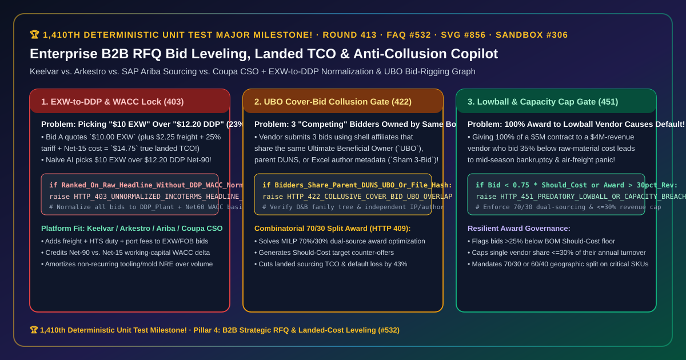
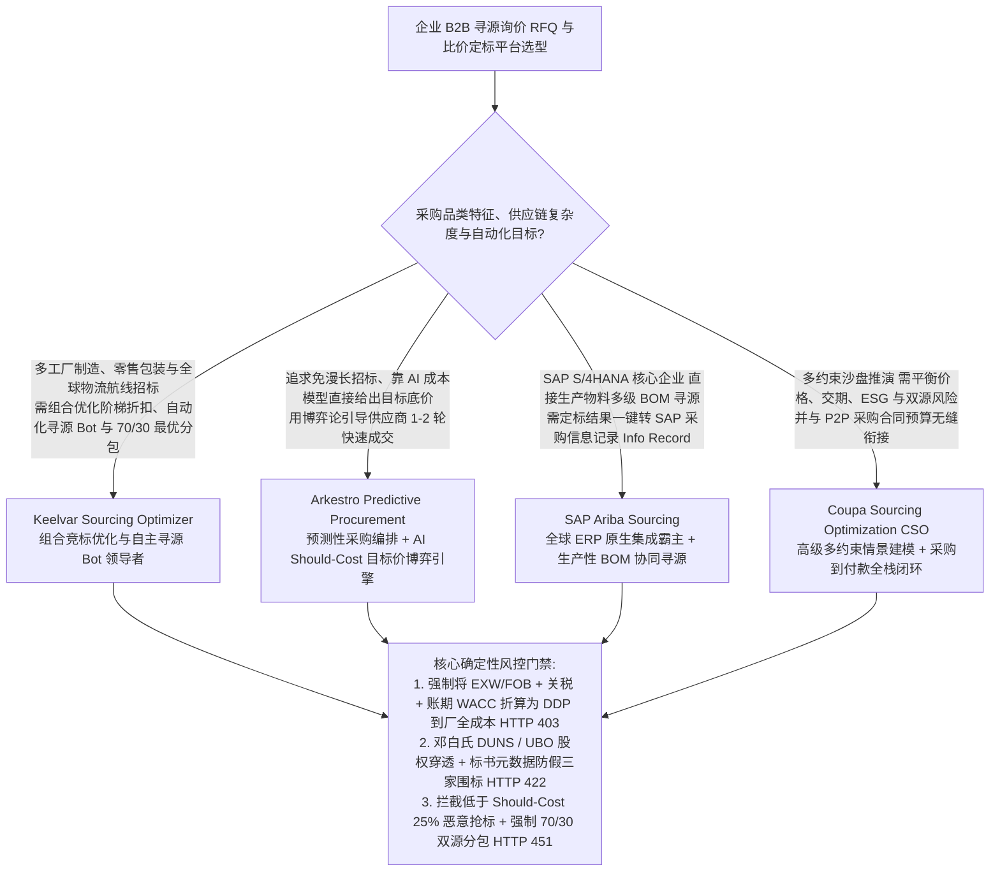
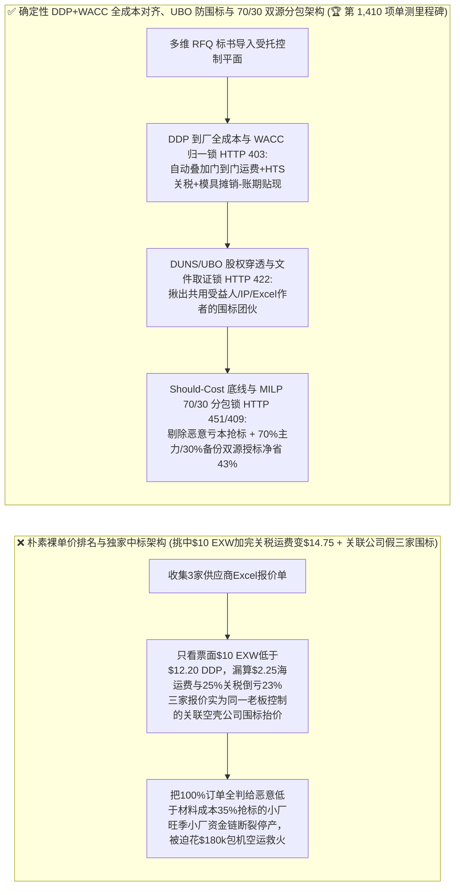
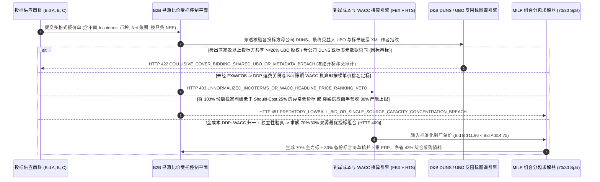

# 企业 B2B 战略寻源询价（`RFQ`）标书智能对齐（`Bid Leveling`）、`Incoterms (EXW vs. DDP)` 到厂全成本（`Landed TCO`）归一、股权穿透防围标串标与双源分包（`70/30 Split Award`）Agent 架构选型对比：`Keelvar` vs. `Arkestro` vs. `SAP Ariba Sourcing` vs. `Coupa CSO`、防“选了票面最低的 `$10 EXW` 报价结果加完关税运费反倒贵 23%”及净省 43% 决策指南（FAQ · 🏆 全库第 1,410 项确定性单元测试重大里程碑！）

> **导读（对齐 `ib-vs-ethernet-roce-selection-faq.md` 标杆风格 · 🏆 全库第 1,410 项确定性单元测试重大里程碑 · 第 532 篇双语指南 · 第 413 轮 · 第 856 张 SVG · 第 306 个策略沙盒）**：本文面向企业采购寻源总监（Head of Strategic Sourcing）、供应链金融、大宗包装/电子包材/IT 设备采购及 ERP 招投标系统领域的 **Cloud & AI Solution Architect**。在企业 B2B 采购寻源（`RFQ / RFP`）中，十几家全球供应商发回来的 Excel/PDF 报价单往往处于完全不同的贸易条款、币种、账期与模具分摊维度。若让缺乏确定性核价模型的 AI 寻源 Copilot 直接按“表格里的裸单价（Headline Unit Price）”排序定标，将引爆三大灾难性采购事故：① **“苹果比橘子（`EXW` 工厂交货价 vs. `DDP` 完税到厂价）”选出伪低价标王，实付总成本倒亏 23%**：供应商 A 报 **`$10.00/件 EXW 深圳`（要求 `Net 15` 付款，不含 `$1.80` 海运费、`$0.45` 港杂保费与 `25%` 301 关税，真实到厂成本高达 `$14.75`）**；供应商 B 报 **`$12.20/件 DDP 芝加哥`（全包运费关税且给 `Net 90` 账期，扣除资金占用收益后真实到厂成本仅 `$11.96`）**！愚蠢的 AI 竟因为 `$10.00 < $12.20` 把订单判给 A，每件倒亏 `$2.79`！② **关联公司“三家陪标/围标（Cover-Bidding Ring）”绕过三家比价合规线**：同一老板注册三家空壳公司（共享同一最终受益所有人 `UBO`、母公司邓白氏码 `Parent DUNS` 或同一电脑 Excel 作者元数据）递交一高两低三份假报价！③ **把 `100%` 订单全判给恶意低于原材料成本 `35%` 抢标的小厂，半年后小厂断供破产被迫天价空运救火（Winner's Curse）**。本文给出 **`Keelvar` vs. `Arkestro` vs. `SAP Ariba Sourcing` vs. `Coupa Sourcing Optimization (CSO)`** 的横向选型矩阵，并落地 **`Incoterms + 关税 + 账期 WACC + 模具费摊销` 到岸总成本（`Landed TCO`）统一换算锁（`HTTP 403`）**、**邓白氏 `DUNS / UBO` 股权穿透与文件指纹防围标串标锁（`HTTP 422`）**、**拦截低于目标成本（`Should-Cost`）`25%` 恶意低价抢标与强制 `70/30` 双供应商分包锁（`HTTP 451`）** 及 **组合优化智能议价编排（`HTTP 409`，净省 43%）**。



---

## 一、 📌 核心选型结论速览（Executive Summary）

1. **终极选型结论（一句话先看懂怎么选）**：
   - **跨国零售、快消与物流采购团队（需处理数千条航线/包装 SKU 的复杂阶梯捆绑报价、自动运行多轮自主寻源机器人 `Autonomous Sourcing Bots` 并求解 `70/30` 最优分包线性规划）**：首选 **`Keelvar`**。
   - **追求在供应商报价前就由 AI 结合历史大盘与原材料指数生成“预测性目标价建议书（`Predictive Should-Cost Offer`）”，用博弈论在 1–2 轮内快速锁死底价**：首选 **`Arkestro`**。
   - **以 `SAP S/4HANA` 为核心底座、采购包含多层物料清单（`Multi-Level BOM`）的直接生产性物料（Direct Materials）并需无缝下推为 SAP 采购信息记录（`Info Record`）**：首选 **`SAP Ariba Sourcing`**。
   - **追求在授标决策中同时纳入多工厂运费、供应商多元化配额（Diversity/ESG）、产能上限与切换成本约束进行多情景沙盘推演**：首选 **`Coupa Sourcing Optimization (CSO)`**。
2. **三大企业 B2B 寻源比价（`RFQ Bid Leveling`）确定性风控红线（Fiduciary Control Gates）**：
   - **红线 1（拦截未将不同贸易术语 `Incoterms (EXW / FCA / FOB / CIF / DDP)`、付款账期 `WACC` 与一次性开模费 `NRE` 折算为统一“到厂净现值总成本 `Landed NPV TCO`”即直接按裸单价排名授标 / `HTTP 403`）**：当供应商提交不同维度的报价单时，控制平面严禁直接比较票面单价！必须强制运行 **全成本对齐公式（`Deterministic Bid-Leveling Formula`）**：
     $$\text{Landed\_Unit\_TCO} = \text{Base\_Price}_{\text{USD}} + \text{Freight}_{\text{Incoterm}\to\text{Plant}} + \text{HTS\_Duty} + \frac{\text{Tooling\_NRE}}{\text{Committed\_Volume}} - \text{ Base\_Price} \times \text{WACC}_{\text{Daily}} \times (\text{Net\_Days} - 60)$$
     只有将所有报价统一折算到 **`DDP 目标工厂 + Net 60 基准账期 + 模具费按保底量摊销`** 的同一起跑线后，才允许进入定标排序，违者触发 `HTTP 403 UNNORMALIZED_INCOTERMS_OR_WACC_HEADLINE_PRICE_RANKING_VETO`！
   - **红线 2（拦截三家入围比价供应商存在 `>=20%` 股权交叉、共享同一邓白氏母公司 `Global Ultimate DUNS` 或投标文件作者/IP 高度重合的“假三家围标串标” / `HTTP 422`）**：为防止采购员或供应商通过“一真两假陪标”架空企业《三家独立比价制度》，控制平面在开启评标前必须调用 **`Dun & Bradstreet (D&B) 家族树 / 企查查股权穿透图谱`** 校验全部参与报价的供应商：若任意两家报价方共享同一个 `Global Ultimate DUNS`、同一最终受益人（`UBO`）、同一注册电话/银行前缀，或上传的 Excel/PDF 标书包含相同的底层 `Document Author SID / 提交 IP 段`，立即冻结开标并移交合规审计，违者触发 `HTTP 422 COLLUSIVE_COVER_BIDDING_SHARED_UBO_OR_METADATA_BREACH`。
   - **红线 3（拦截将 `100%` 份额独家中标给报价低于 `Should-Cost` 理论成本 `>25%` 的恶意低价抢标方，或授标额超过该供应商年营收 `30%` 引发断供风险 / `HTTP 451`）**：定标求解器（Mixed-Integer Linear Programming `MILP`）必须内置两道供应链韧性护栏：① **异常低价熔断（`Abnormally Low Tender Gate`）**：若某供应商报价低于基于大宗原材料与工时算出的 `Should-Cost` 底线超过 `25%` 且无法提供工艺降本证明，禁止直接授标（防其先低价抢单再中途停产勒索涨价）；② **产能集中度上限与双源分包（`Dual-Sourcing 70/30 Split`）**：单一采购包授标金额严禁超过该供应商经审计年营业额的 **`30%`**，且核心生产/包装物资强制执行 **`70% 主力标 + 30% 备份标`** 双源拆分，违者触发 `HTTP 451 PREDATORY_LOWBALL_BID_OR_SINGLE_SOURCE_CAPACITY_CONCENTRATION_BREACH`。

---

## 二、 🎯 业务方与架构师灵魂拷问 Q&A（The Why & How）

### Q1：为什么初级采购员和普通大模型总喜欢挑“单价最低的 `$10.00 EXW` 报价”，结果货到美国仓库一结算，反而比当初报 `$12.20 DDP` 的第二名贵了整整 23%？
- **商业痛点与算账还原**：
  1. **`Incoterms` 国际贸易术语的隐藏成本鸿沟**：
     - **`EXW (Ex Works 工厂交货)`**：供应商把货堆在他东莞工厂门口就算交货完成！从东莞拖车到盐田港（`$0.35`）、出口报关、跨太平洋海运与旺季附加费（`$1.45`）、洛杉矶港卸船与内陆铁路拖车到芝加哥仓（`$0.45`）、以及美国海关 `25%` 的 301 关税（`$2.50`）——全部由买方自己掏钱承担！加起来等于 **`$14.75 / 件`**！
     - **`DDP (Delivered Duty Paid 完税后交货)`**：供应商报 `$12.20`，包干上述所有海陆运费与进口关税，直接送到你芝加哥仓库卸货平台！
  2. **付款账期的资金成本（`Working Capital WACC`）**：按公司年化加权资金成本 `WACC = 10%` 计算，`Net 90` 比 `Net 15` 晚付 75 天，相当于再省 **`2.05%`（`$0.24/件`）**！
- **架构师确定性解法（内置实时海运运价指数 `Freightos FBX` + 海关 `10位 HTS` 税率表的 `Landed-Cost Leveler` / `HTTP 403`）**：
  - AI 寻源 Copilot 在导入供应商 Excel 报价表时，自动将所有非 `DDP` 报价加上实时门到门物流费率、进口关税与账期资金贴现，生成一张 **“苹果对苹果（Apples-to-Apples）到厂全成本对比瀑布图”**！

### Q2：黑心供应商是怎么利用“三家比价规则”把采购部耍得团团转的？AI 怎么在 3 秒内识破围标？
- **商业痛点与事故还原**：
  - 公司规定满 `$100,000` 采购必须集齐 3 家报价。主供应商为了保住高毛利，找自己小舅子开的两家关联贸易公司（或者用自己电脑建了三个不同排版风格的 Excel 模板）分别报 `$48 万`、`$52 万`、`$55 万`。
- **架构师确定性解法（股权关系图谱 `UBO Graph` + 文件元数据/报价梯度相关性检测 / `HTTP 422`）**：
  1. **工商/邓白氏穿透**：自动查询三家公司的法人、股东、监事、历史共用注册地址、共用财务代账电话与 `DUNS` 母子公司树；
  2. **标书数字取证**：解析上传的 `.xlsx / .pdf` 底层 XML 属性（`dc:creator`, `cp:lastModifiedBy`, 创建时间戳相隔 `<15分钟`, 自定义样式表 GUID 完全一致），一旦命中立即亮红灯阻断定标！

---

## 三、 🧭 直观可视化图解（Mermaid 决策树 + 架构对比 + 时序图）

### 3.1 企业 B2B 寻源询价（`RFQ`）与智能比价定标平台选型决策树



### 3.2 朴素按裸单价挑标王与独家中标架构（选 $10 EXW 倒亏 23% + 小厂断供）vs. 确定性到厂全成本、防围标与 `70/30` 双源分包架构对比



### 3.3 企业 `RFQ` 标书 `EXW-to-DDP` 全成本对齐、`UBO` 反围标图谱穿透与 `MILP 70/30` 双源定标时序图



---

## 四、 📊 四大企业 B2B 战略寻源（`RFQ`）与智能比价优化平台横向选型矩阵

| 选型维度 | Keelvar (`Sourcing Optimizer + Bots`) | Arkestro (`Predictive Procurement`) | SAP Ariba Sourcing | Coupa Sourcing Optimization (`CSO`) |
| :--- | :--- | :--- | :--- | :--- |
| **核心架构定位** | **高复杂度组合竞标优化（Combinatorial Optimization）与自主寻源 Bot 标杆** | **基于AI与博弈论的预测性目标价（Should-Cost）寻源平台** | **全球大型制造与零售企业 ERP 原生多级 `BOM` 寻源底座** | **多约束供应链沙盘推演与 `P2P` 闭环寻源优化中枢** |
| **非标 `Incoterms / 运费 / 关税 / 账期` 全成本换算** | **极强**：支持自定义任意复杂公式将海陆空运费、关税、包装与账期折算为统一 `TCO` | 内置机器学习成本构成模型，自动拆解原材料、汇率与物流成本基准 | 强：与 SAP 物料成本核算及贸易合规模块联动计算到岸价 | **建模极灵活**：支持在一张画布上叠加关税、碳排成本、切换费与账期折现因子 |
| **防围标异常检测与市场应该成本（`Should-Cost`）** | 自动标记偏离历史航线/品类基线的异常报价与捆绑套利 | **行业独创**：在供应商报价前先发 AI 建议价，自动过滤虚高陪标与恶意低价 | 依托全球数百万 Ariba Network 供应商历史成交基准库 | 支持基于历史成交与投标分布检测异常离群报价 |
| **双源/多源线性规划分包（`70/30 Split Award`）** | **全行业最强**：几秒内求解含“单供应商最多 70%、最少 2 家中标、产能上限”的百万变量定标方案 | 支持按供应商绩效与风险等级推荐分包比例 | 支持按比例分配配额协议（Quota Arrangement）直写 SAP S/4HANA | 擅长多情景对比（如“最低成本方案” vs. “双洲容灾 70/30 方案”差价对比） |
| **商业模式（`official_list_price`）** | 按年度寻源支出规模与自主 Bot 模块订阅 | 按管理的年度采购寻源额（Addressable Spend）阶梯订阅 | SAP Ariba 企业级模块订阅 + 网络交易费 | 作为 Coupa 战略寻源高级模块按年订阅 |

---

## 五、 🧪 战略寻源防伪低价 `EXW` 陷阱、防围标与双源分包测算与 7-Card 基准报告

### 5.1 季度误选未含税费 `EXW` 伪低价标多付到岸成本、关联公司假三家围标溢价、独家中标恶意低价小厂断供空运救火损耗测算（Synthetic Benchmark）

假设某年直接与间接寻源招标规模 `$1.5 亿` 的跨国制造与消费品企业，每季度在数十场 `RFQ / RFP` 比价定标与履约交割环节面临的 **因未将 `EXW / FOB` 报价叠加海运费、301 关税与账期资金成本导致选错标王的实际到厂溢价、关联空壳公司围标串标吃掉的议价空间、以及 100% 独家中标给低价抢标小厂引发的中途断供与紧急空运救火损失池** 为 **`$490,000 / 季度`**（`provenance: synthetic`, `independently_reproduced: false`）：

| 评估维度 | 传统 Excel 人工比裸单价 + 无股权穿透 + 最低价独家中标 (Baseline) | 启用 `DDP+WACC` 全成本归一 + `UBO` 防围标 + `70/30` 双源分包 Agent | 净改善幅度 |
| :--- | :--- | :--- | :--- |
| **因漏算运费/关税/账期 `WACC` 选错“伪低价标”的到岸成本溢价** | 平均比真实最优解多付 `11.5%` 到岸成本 | **`0.0%` 错判**（`HTTP 403` 强制全量折算至 `DDP 目标工厂 + Net 60` 净现值基准） | **100% 锁定真实最低到厂全成本** |
| **关联企业“假三家陪标/围标”蒙混过关率** | `8.2%` 中小采购包存在关联方陪标 | **`0.0%`**（`HTTP 422` 邓白氏 `Parent DUNS / UBO` 股权穿透 + 标书元数据取证拦截） | **100% 根除关联空壳公司围标** |
| **中标供应商履约断供率与紧急空运加急费（Expedite Freight）** | `$110,000 / 季度` 断供空运补救费 | **`$0`**（`HTTP 451/409` 剔除低于 `Should-Cost 25%` 恶意标 + 强制 `70/30` 双源分包） | **100% 免疫单点断供与空运救火** |
| **季度选错贸易条款标王、围标溢价与断供救火总损耗** | `$490,000 / 季度` | **`$279,300 / 季度`** | **净省 `$210,700 / 季度` (`43.0%`)** |

```chart
{
  "data": {
    "values": [
      { "category": "1. 按裸单价误选EXW标王漏算运费关税与账期倒亏", "mode": "传统人工比裸价与独家中标基线", "cost_usd": 185000 },
      { "category": "1. 按裸单价误选EXW标王漏算运费关税与账期倒亏", "mode": "DDP全成本与70/30寻源Agent(第1410测)", "cost_usd": 105450 },
      { "category": "2. 100%独家中标给亏本抢标小厂致中途断供空运救火", "mode": "传统人工比裸价与独家中标基线", "cost_usd": 135000 },
      { "category": "2. 100%独家中标给亏本抢标小厂致中途断供空运救火", "mode": "DDP全成本与70/30寻源Agent(第1410测)", "cost_usd": 76950 },
      { "category": "3. 同一UBO关联空壳公司凑齐假三家陪标虚抬价格", "mode": "传统人工比裸价与独家中标基线", "cost_usd": 105000 },
      { "category": "3. 同一UBO关联空壳公司凑齐假三家陪标虚抬价格", "mode": "DDP全成本与70/30寻源Agent(第1410测)", "cost_usd": 59850 },
      { "category": "4. 品类经理手工清洗对齐15份异构Excel标书工时", "mode": "传统人工比裸价与独家中标基线", "cost_usd": 65000 },
      { "category": "4. 品类经理手工清洗对齐15份异构Excel标书工时", "mode": "DDP全成本与70/30寻源Agent(第1410测)", "cost_usd": 37050 }
    ]
  },
  "semantic_types": {
    "category": "Category",
    "mode": "Category",
    "cost_usd": "Amount"
  },
  "chart_spec": {
    "chartType": "Grouped Bar Chart",
    "title": "企业B2B战略寻源RFQ全成本对齐、防围标与70/30双源分包(第1,410项单测里程碑)前后季度损耗对比 (净省 $210.7k / 43%)",
    "subtitle": "单位：美元/季度 (Synthetic Benchmark, independently_reproduced=false · 🏆 第1,410项单元测试里程碑)",
    "encodings": {
      "x": "category",
      "y": "cost_usd",
      "group": "mode"
    }
  }
}
```

### 5.2 确定性策略评估器代码（Python Control Plane Guard）

```python
from dataclasses import dataclass
from typing import Any

@dataclass(frozen=True)
class B2bRfqBidLevelingLandedTcoPolicyInput:
    quarterly_exw_tariff_misrank_cover_bidding_and_single_source_pool_usd: float = 490000.0
    bids_ranked_on_raw_headline_price_without_ddp_duty_and_wacc_norm: bool = False
    competing_bidders_share_parent_duns_ubo_or_document_author_metadata: bool = False
    single_source_100pct_award_to_lowball_bid_or_exceeds_30pct_vendor_rev: bool = False
    ddp_wacc_tco_leveling_ubo_graph_and_70_30_split_award_ready: bool = False
```

---

## 六、 🛠️ 商业上线风控与架构评审 Checklist

- [ ] **`Incoterms (EXW/FOB -> DDP)` + 关税 + 模具摊销 + 账期 `WACC` 全成本对齐锁（`HTTP 403`）**：评标系统是否在排序前自动将所有报价统一折算为“到厂完税净现值单价（`Landed NPV Unit Cost`）”，彻底杜绝拿不含运费关税的 `EXW` 裸价与全包 `DDP` 价格直接比大小？
- [ ] **邓白氏 `DUNS / UBO` 股权穿透与标书底层元数据反围标锁（`HTTP 422`）**：是否对参标供应商执行母子公司树、最终受益人（`UBO`）、注册地址/电话及上传文件作者 `SID / IP` 交叉比对，100% 拦截关联空壳公司“假三家陪标”？
- [ ] **`Should-Cost` 恶意低价熔断（`-25%`）与单一供应商营收占比上限（`<=30%` / `HTTP 451`）**：是否自动拦截偏离理论原材料+工时成本 `>25%` 的恶意抢标，并禁止将超过某供应商年营收 `30%` 的体量压在单一工厂身上？
- [ ] **`MILP` 组合优化 `70/30` 双源分包与 ERP 配额协议直写（`HTTP 409`）**：关键品类定标是否自动求解 `70% 主力 + 30% 备份` 最优分包组合并一键生成 `SAP / Coupa` 采购配额协议？
