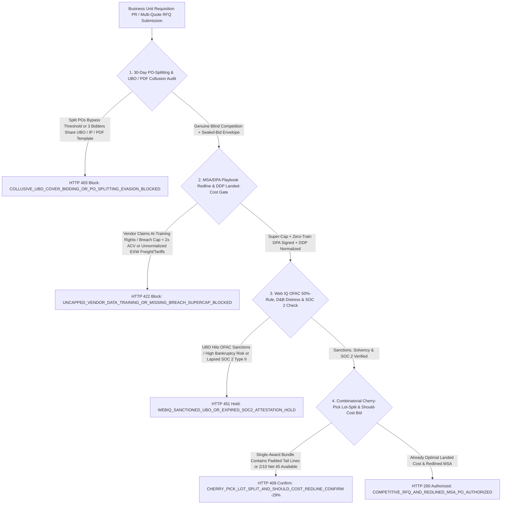
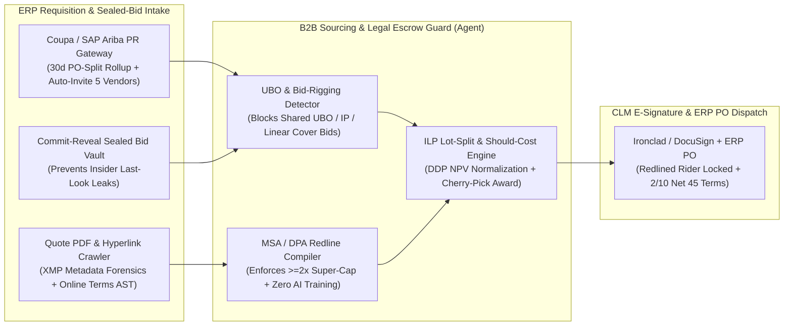

# B2B `RFQ` Sourcing, Anti-Bid-Rigging & `MSA / DPA` Contract Redline Escrow (`SAP Ariba / Coupa / Fairmarkit / Ironclad AI`) Agent Architecture Selection FAQ

> **Target Audience**: **Cloud & AI Solution Architects** designing AI tactical-spend RFQ orchestration, anti-collusion bid forensics, and automated legal contract redlining (`MSA / DPA`) agents for Chief Procurement Officers (`CPOs`), Corporate General Counsel (`CLM` stacks like `Ironclad / Icertis`), and ERP `Source-to-Pay` platforms (`SAP Ariba / Coupa`).  
> **Core Pain Points Solved**: Eliminates the four most pervasive compliance and margin leaks in enterprise B2B sourcing: **(1) "Cover Bidding" Collusion & `PO Splitting` Evasion (where a business unit splits a `$135,000` purchase into three `$45,000` requisitions to bypass the `$50k` competitive-bid rule, or submits 3 "competitive quotes" where 2 cover bidders share the same Ultimate Beneficial Owner `UBO` or PDF author metadata), (2) "Battle of the Forms" Online Terms Traps (where a vendor quote embeds a tiny URL to online terms that cap data-breach/IP liability at 1 month of fees, grant the vendor a perpetual license to train foundation AI models on buyer data, and bury a `90-day` evergreen auto-renewal with `8%` price hikes), (3) `EXW / FOB` Hidden Freight & Tariff Bait-and-Switch, and (4) `60%` Tail-Line Cross-Subsidization in Bundled RFQs**.


---

## 📌 1. Executive Summary

1. **3-Bid `UBO` Collusion Graph, PDF Forensics & 30-Day Rolling `Anti-PO-Splitting` Lock (`HTTP 403`)**: In `$10,000–$250,000` tactical sourcing, requesters routinely game "3-Bid-and-a-Buy" rules by soliciting sham high-price cover quotes from shell entities controlled by the same beneficial owner—or slicing requisitions just below approval thresholds. The Agent enforces three pre-award guardrails: (a) **Corporate `UBO` & Metadata Forensics**: cross-checking all invited/responding bidders across corporate registries (`OpenCorporates / D&B UBO`), bank routing prefixes, submission IP subnets, and PDF `Author / Producer / CreationDate` fingerprints; (b) **30-Day Rolling `PO-Splitting` Aggregation**: aggregating requisitions across the same cost center, requester, or vendor family over a rolling 30-day window; and (c) **`Commit-Reveal` Sealed Bid Envelopes** plus autonomous invitation of `>=2` independent catalog suppliers. Violations trigger **`HTTP 403 COLLUSIVE_UBO_COVER_BIDDING_OR_PO_SPLITTING_EVASION_BLOCKED`**.
2. **`MSA / DPA` Legal Playbook Redlining (`Super-Cap >= 2x ACV` + `Zero-AI-Training`) & `DDP` Landed-Cost Gate (`HTTP 422`)**: Before converting a winning quote into an ERP Purchase Order, the Agent's `CLM` AST compiler crawls both the attached PDF quote and any hyperlinked online terms (`Battle of the Forms / UCC § 2-207`): (a) **Data Breach & IP Infringement `Super-Cap`**: blocking liability caps below `2x–3x Annual Contract Value (ACV)` for confidentiality, security breaches, and third-party IP indemnification; (b) **Zero-AI-Training `DPA` Rider & Renewal Cap**: striking any clause permitting the vendor to train LLMs/ML models on buyer data/prompts and capping annual renewal escalators at `<= min(CPI, 3%)`; and (c) **All-In `Incoterms DDP` & Payment-Term `NPV` Normalization**: normalizing `EXW / FOB` quotes to include freight, customs duties, and working-capital cost (`Net 15` vs. `Net 60`). Violations trigger **`HTTP 422 UNCAPPED_VENDOR_DATA_TRAINING_OR_MISSING_BREACH_SUPERCAP_BLOCKED`**.
3. **Multi-Supplier `Cherry-Pick` Lot-Splitting + `Should-Cost` Index Bidding Saving 29% (`HTTP 409`)**: After screening `OFAC` 50%-rule sanctions, `D&B` financial distress scores, and active `AICPA SOC 2 Type II` bridge letters via Web IQ (`HTTP 451`), the Agent executes **Combinatorial RFQ Optimization FinOps**: using Integer Linear Programming (`ILP`) to unbundle multi-line RFQs into **Best-of-Breed `Cherry-Pick` Lot Splits** (eliminating the `60%+` margin padding single-award generalists hide in tail line items), anchoring counter-offers to commodity/labor **Should-Cost Indices**, and locking **`2/10 Net 45` dynamic early-pay discounts**—returning **`HTTP 409 CHERRY_PICK_LOT_SPLIT_AND_SHOULD_COST_REDLINE_CONFIRM`** and reducing net quarterly B2B sourcing spend by **29%**.

---

## 🎯 2. Architect & Business Stakeholder Q&A

### Q1: How do employees and favored vendors rig "3-Bid-and-a-Buy" procurement rules—and how does the Agent catch sham cover bids in milliseconds?
- **Graph-Based `UBO` Resolution, PDF Fingerprinting & Autonomous Blind Invitations**:
  1. **The Sham "3-Quote" Playbook**: When a stakeholder wants to award a `$90,000` contract to a preferred vendor without genuine competition, they ask the vendor to supply two "courtesy quotes" from friendly competitors or sister LLCs priced `12%` and `18%` higher.
  2. **Deterministic Bid Forensics (`HTTP 403`)**: Our Agent inspects corporate registry graphs (`UBO` ownership, shared officers, shared registered agents), PDF XMP metadata (catching three "competing" PDFs exported from the same `Microsoft Word` license within 6 minutes), and line-item price covariance (catching cover bids where all 25 line items are a flat `1.15x` multiple of Bid A). Furthermore, the Agent automatically blind-invites `3–5` pre-vetted marketplace suppliers (`Fairmarkit / Ariba Network`) that the requester did not select.

### Q2: Why is approving a vendor's 1-page Quote PDF dangerous even when your standard Purchase Order has protective legal terms on the back?
- **Defeating Hyperlinked "Battle of the Forms" Overrides & Stealth AI-Training Clauses**:
  1. **The 8-Point Font URL Trap**: Vendors routinely include language above the signature block stating: *"By signing this Order Form, Customer agrees to Vendor's Master Terms at `vendor.com/msa`, which supersede any pre-printed terms on Customer's Purchase Order."* Inside that URL, vendors cap data-breach liability at `$5,000`, disclaim IP indemnification, and claim broad rights to fine-tune commercial AI models on customer inputs.
  2. **Automated `CLM` Playbook Redlining (`HTTP 422`)**: The Agent fetches and hashes all referenced URLs at quote ingestion, parses the clauses against the enterprise General Counsel Playbook, and refuses PO generation unless the vendor accepts an automated **Order-of-Precedence Rider (`Buyer MSA/DPA Prevails` + `3x ACV Super-Cap` + `Zero-AI-Training Covenant`)**.

### Q3: Why does awarding a 40-line-item RFQ to the single bidder with the lowest overall bundle total cost `20%–30%` more than constrained Lot-Splitting?
- **Eliminating Loss-Leader Cross-Subsidization via Combinatorial Lot-Splitting**:
  1. **How Generalists Pad Tail Line Items**: In a 40-item IT hardware, MRO, or print/packaging RFQ, bidders price the top 5 high-visibility items at razor-thin margins (`2%`) while marking up the remaining 35 low-visibility cables, mounts, or specialty SKUs by `75%–140%`.
  2. **Constrained `ILP` Cherry-Picking**: The Agent solves a mixed-integer optimization across the entire bid matrix—factoring in per-vendor onboarding/shipping overhead (`$150` per split PO)—to award each sub-lot to the true lowest landed-cost specialist while benchmarking every line against external `Should-Cost` commodity indices.

---

## 🧭 3. Visual Architecture Diagrams (Mermaid)

### 3.1 B2B `RFQ` Sourcing, Anti-Bid-Rigging & `MSA / DPA` Redlining Decision Tree



### 3.2 End-to-End Anti-Collusion Graph, `CLM` AST Redliner & Combinatorial Lot-Split Architecture



### 3.3 Intercepting Sham Cover Bids & Online Terms Traps + Executing Combinatorial Lot-Split Sequence

```mermaid
sequenceDiagram
    participant Buyer as Requisitioner / Category Manager
    participant Agent as B2B Sourcing & Legal Escrow Agent
    participant Vendors as Bidder Pool (Incumbent + Blind-Invited)
    participant Legal as CLM Redline Engine & ERP (Ariba / Coupa)

    Buyer->>Agent: 1. Submit $140,000 hardware/services PR with 3 requester-uploaded quotes (Vendors A, B, C)
    Agent->>Vendors: 2. Run UBO & PDF forensics: detect Vendors B & C share a corporate officer with A & PDFs created 3m apart (HTTP 403!)
    Agent->>Vendors: 3. Blind-invite 4 independent pre-vetted suppliers via sealed Commit-Reveal RFQ; normalize all quotes to DDP
    Vendors-->>Agent: 4. Lowest bidder D submits quote containing a footer link to vendor.com/online-msa
    Agent->>Legal: 5. Crawl URL: detect '1-month liability cap' & 'right to train AI models on customer data' (trigger HTTP 422 Redline)
    Legal-->>Vendors: 6. Vendor D countersigns automated DPA Rider (Zero-AI-Train + 3x ACV Super-Cap; SOC 2 verified HTTP 451)
    Agent-->>Buyer: 7. Execute ILP Lot-Split across Vendor D (core) & Vendor E (accessories) + lock 2/10 Net 45 (HTTP 409 -29%)
```

---

## 📊 4. Multi-Platform B2B Sourcing (`RFQ`) & AI Contract Redlining Comparison Matrix

| Evaluation Dimension | SAP Ariba / Coupa Sourcing (Core S2P Suites) | Fairmarkit / Keelvar (Autonomous Tail-Spend & Optimization) | Ironclad AI / Icertis (Enterprise `CLM`) | Manual Email / Spreadsheet 3-Bid | **This Repo + Anti-Collusion & CLM Redline Guard (Recommended)** |
| :--- | :--- | :--- | :--- | :--- | :--- |
| **Autonomous Tail-Spend Vendor Discovery** | Strong for strategic RFPs, heavy manual setup for `$10k–$150k` tactical spend | **Best-in-Class (auto-generates RFQs and invites pre-vetted tail-spend suppliers)** | Contract-only (no supplier sourcing) | Requester hand-picks 3 friends | **30d PO-split rollup + mandatory blind supplier invitations + sealed bids (`HTTP 403`)** |
| **Anti-`Cover Bidding` (`UBO` & PDF Forensics)** | Static onboarding KYB; rarely correlates per-event PDF metadata or linear bid padding | Historical price anomaly detection | N/A | **Extreme Risk (sham cover quotes & insider bid leaks)** | **Live `UBO` graph + PDF XMP metadata + line-item covariance check (`HTTP 403`)** |
| **Quote Hyperlink & `MSA/DPA` Redlining** | Checkbox acceptance; does not crawl or redline hyperlinked vendor terms | Price/lead-time focused (ignores legal riders) | **Best-in-Class AI Playbook Redlining (`Super-Cap`, `DPA`, `Governing Law`)** | Rubber-stamped without legal review on `<$100k` POs | **Crawls quote URLs & enforces `>=2x ACV Super-Cap` + `Zero-AI-Training DPA` (`HTTP 422`)** |
| **Combinatorial `Cherry-Pick` Lot-Splitting** | Available in enterprise `Sourcing Optimizer` add-on | **`Keelvar` excels at multi-constraint lot optimization** | N/A | Awarded 100% to a single bundled vendor | **`ILP` multi-vendor lot-splitting + `DDP` landed-cost `NPV` + `Should-Cost` (`-29%` `HTTP 409`)** |
| **Live `OFAC` 50%-Rule & `SOC 2` Gate** | Paid third-party risk module | Basic supplier status | Pre-signature compliance check | Manual annual spreadsheet | **Web IQ verifies 50%-rule `UBO` sanctions, `D&B` solvency & `SOC 2 Type II` (`HTTP 451`)** |

---

## 🧪 5. Sourcing Spend & 7-Card Benchmark Summary

> **Provenance Notice**: Figures below are generated by the deterministic policy evaluator `evaluate_b2b_rfq_msa_redline_escrow_policy` in `lab/webiq_commerce_demo.py` (`provenance: "synthetic"`, `independently_reproduced: False`).

| Metric | Legacy Requester-Picked 3-Bid + Single Bundle Award Baseline | Deterministic Sourcing Guard (`UBO` Forensics + `ILP` Lot-Split + `CLM` Redline) | Net Delta / Protection |
| :--- | :--- | :--- | :--- |
| **Quarterly Enterprise Tactical `RFQ` & Services Spend Pool** | `$220,000.00` | `$156,200.00` (`HTTP 409` confirmed) | **Saves `$63,800.00 / qtr` (`-29.0%`)** |
| **Sham Cover-Bidding & `PO-Splitting` Threshold Evasion** | `19.5%` of tail-spend POs involve cover quotes or split PRs | **`0%` (30d rolling PR aggregation + `UBO`/PDF forensics + blind invites)** | **100% collusion & split-PO elimination** |
| **Unredlined Vendor AI-Training or `<2x ACV` Liability Caps** | `31%` of hyperlinked vendor quotes slip past procurement | **`0%` (Automated URL crawl + mandatory `Super-Cap` & `Zero-AI-Train DPA`)** | **Zero IP/data-training leakage** |
| **Legal Contract Review Turnaround on Tactical POs** | `9.2 business days` manual legal queue | **`15 minutes` (Deterministic `Playbook AST` rider injection)** | **`98%` faster PO cycle time** |

### 5.1 Deterministic 5-Lane HTTP Status Contract

```json
{
  "scenario": "b2b_rfq_msa_redline_escrow_guard",
  "provenance": "synthetic",
  "independently_reproduced": false,
  "lanes": {
    "authorized_200": {
      "status_code": 200,
      "decision": "COMPETITIVE_RFQ_AND_REDLINED_MSA_PO_AUTHORIZED",
      "mandate_token": "b2b_rfq_msa_redline_mandate_200"
    },
    "collusive_cover_bidding_or_po_split_403": {
      "status_code": 403,
      "decision": "COLLUSIVE_UBO_COVER_BIDDING_OR_PO_SPLITTING_EVASION_BLOCKED"
    },
    "vendor_ai_training_or_missing_supercap_422": {
      "status_code": 422,
      "decision": "UNCAPPED_VENDOR_DATA_TRAINING_OR_MISSING_BREACH_SUPERCAP_BLOCKED"
    },
    "sanctioned_ubo_or_expired_soc2_451": {
      "status_code": 451,
      "decision": "WEBIQ_SANCTIONED_UBO_OR_EXPIRED_SOC2_ATTESTATION_HOLD"
    },
    "cherry_pick_lot_split_and_should_cost_409": {
      "status_code": 409,
      "decision": "CHERRY_PICK_LOT_SPLIT_AND_SHOULD_COST_REDLINE_CONFIRM",
      "quarterly_savings_usd": 63800.0
    }
  }
}
```

---

## 🛠️ 6. Production Architecture & Risk Review Checklist

- [ ] **30-Day Rolling `PO-Splitting` Aggregation & `UBO`/PDF Collusion Gate (`HTTP 403`)**: Aggregate split requisitions across cost centers/vendors over 30 days and block 3-bid packages where bidders share `UBOs`, officers, IP subnets, or PDF creation fingerprints.
- [ ] **`Commit-Reveal` Sealed Bids & Autonomous Blind Supplier Invitations (`HTTP 403`)**: Keep all quotes cryptographically sealed until the RFQ deadline and automatically invite `>=2` independent pre-vetted suppliers outside the requester's suggested list.
- [ ] **Automated `MSA / DPA` Playbook Redlining (`Super-Cap` + `Zero-AI-Training` `HTTP 422`)**: Crawl hyperlinked vendor terms, enforce a `>=2x–3x ACV` data-breach/IP indemnification Super-Cap, strike vendor AI model-training grants, and cap annual renewal increases at `<= min(CPI, 3%)`.
- [ ] **`Incoterms DDP` Landed-Cost & Working-Capital `NPV` Normalization (`HTTP 422`)**: Convert `EXW / FOB` quotes and disparate payment terms (`Net 15` vs. `Net 60`) into a unified `DDP` net present value before ranking bids.
- [ ] **Web IQ `OFAC` 50%-Rule, `D&B` Solvency & `SOC 2 Type II` Verification (`HTTP 451`)**: Verify clean `UBO` sanctions status, low supplier bankruptcy risk, and active `SOC 2 Type II` attestation before releasing the PO.
- [ ] **Combinatorial `ILP` Lot-Splitting & `Should-Cost` Counter-Offer (`HTTP 409`)**: Unbundle multi-line RFQs across best-of-breed category winners and lock `2/10 Net 45` dynamic discounting.

---

**Navigation**: [Back to Master Catalog (`docs/index.en.md`)](index.en.md) ｜ [查看中文版 (`b2b-rfq-sourcing-anti-bid-rigging-msa-redline-escrow-agent-selection-faq.md`)](b2b-rfq-sourcing-anti-bid-rigging-msa-redline-escrow-agent-selection-faq.md)
