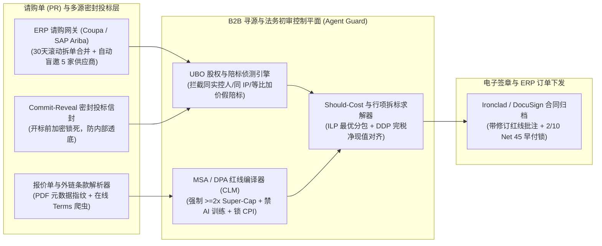
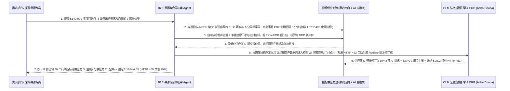

# 企业 B2B 采购寻源询价（RFQ）、防“关联围标/拆单逃避招标”与合同条款初审（MSA / DPA Redlining）托管（SAP Ariba / Coupa / Fairmarkit / Ironclad AI / 甄云采购）Agent 架构选型 FAQ

> **核心阅读对象**：为中大型企业全球采购部（CPO / Indirect & Direct Procurement）、企业法务合同中心（CLM：Ironclad / Icertis）及 ERP 寻源到付款（`Source-to-Pay`）平台设计智能询价比价、防围标审计与合同红线自动批注（AI Contract Redlining）系统的 **Cloud & AI Solution Architect**。  
> **核心痛点解决**：彻底终结企业 B2B 采购中**“业务部门为绕过 `$50,000` 公开招标门槛，把一笔 `$135,000` 的采购故意拆成 3 张 `$45,000` 的小订单（`PO Splitting`），或者找 2 家同一实控人（`UBO`）/同一 IP 导出的空壳公司投递高价‘陪标报价单（`Cover Bidding`）’保送关系户中标”、“供应商在报价单底部附一行小字‘适用卖方线上标准条款（`Battle of the Forms`）’，暗中将商业泄密/知识产权侵权赔偿上限砍到仅 1 个月服务费、默认允许拿甲方业务数据训练其商用大模型（`Vendor AI Training Grant`），并埋下提前 90 天不通知即自动续约涨价 8% 的暗雷”以及“将包含 35 个不同子品类的综合询价包（Bundle RFQ）整包发给单一总包商，被其在非核心行项上加价 60%”**四大采购黑洞。


---

## 📌 一、核心选型结论速览（Executive Summary）

1. **三家比价实控人图谱穿透（`UBO Collusion Graph`）、PDF 元数据查重与防拆单逃避招标（`Anti-PO-Splitting`）硬锁（HTTP 403）**：在 `$10,000–$250,000` 的中长尾战术采购（`Tactical Tail Spend`）中，最常见的舞弊是“凑三家假比价”与“化整为零拆单”。选型 Agent 必须在寻源准入层建立两道硬拦截：① **关联陪标穿透审计**：对参与同一 `RFQ` 的所有投标商，自动穿透股权受益所有人（`UBO`）、注册地址、高管交叉任职、上传报价单 PDF 的 `Author / Producer / 创建时间戳` 及提交 IP 子网；若发现两家投标商存在股权/人员关联或报价单由同一台电脑生成，立即判定为围标串标；② **滚动 30 天拆单（`Smurfing / PO Splitting`）合并计算**：同一成本中心、同一需求人或指向同一供应商在 30 天内连续发起的拆分请购单（`PR`）强制合并计算审批阈值，并在开标前采用 **`Commit-Reveal` 密码学密封报价信封**防止内部采购员向关系户透露底价；违反者一律触发 **`HTTP 403 COLLUSIVE_UBO_COVER_BIDDING_OR_PO_SPLITTING_EVASION_BLOCKED`**。
2. **主服务协议与数据处理协议（`MSA / DPA`）三大红线初审 + 到岸全包成本（`DDP Landed Cost`）归一化门禁（HTTP 422）**：不能只看报价单总价便宜就签发 PO。Agent 内置法务红线编译器（`Legal Playbook AST Redliner`），在转 PO 前自动扫描供应商附件合同与线上条款：① **数据泄露与知识产权侵权超级赔偿上限（`Super-Cap >= 2x–3x ACV`）**：严禁将保密义务、数据安全事故与第三方 IP 侵权赔偿责任限制在普通 1–3 个月合同额内；② **零大模型训练权（`Zero Vendor AI Training`）与自动续签锁**：自动划掉任何允许供应商使用甲方生产数据/Prompt 训练公共 AI 模型的条款，并将续约年涨幅硬锁在 **`<= min(CPI, 3%)`**；③ **`Incoterms DDP` 与账期资金成本归一化**：将 `EXW / FOB` 报价自动加上国际海空运费、关税及账期贴现成本（如 `Net 15` vs `Net 60`）折算为统一净现值（`NPV`）；凡触发合同红线或隐藏条款覆盖（`Battle of the Forms`）的，直接返回 **`HTTP 422 UNCAPPED_VENDOR_DATA_TRAINING_OR_MISSING_BREACH_SUPERCAP_BLOCKED`**。
3. **跨供应商行项择优拆标（`Cherry-Pick Lot Splitting`）+ 成本指数（`Should-Cost`）反向竞价净省 29%（HTTP 409）**：在通过 Web IQ 核验供应商 `OFAC / 实体清单` 50% 股权穿透、邓白氏（`D&B`）破产风险评分及有效 `AICPA SOC 2 Type II` 鉴证报告（违规触发 **`HTTP 451`**）后，Agent 自动执行 **多行项组合寻优与早付贴现（`Multi-Lot Sourcing FinOps`）**：打破单一总包商在长尾配件/服务行项上的高加价，利用整数线性规划（`ILP`）将多行项 `RFQ` 按最小总到岸成本拆标分配给 `2–3 家` 各自最具价格优势的专科供应商（`Best-of-Breed Lot Split`），并结合大宗原材料/工时成本指数（`Should-Cost Benchmark`）自动生成反向目标底价与 **`2/10 Net 45` 早付现金折扣**，触发 **`HTTP 409 CHERRY_PICK_LOT_SPLIT_AND_SHOULD_COST_REDLINE_CONFIRM`**，为企业季度 B2B 寻源总支出净省 **29%**。

---

## 🎯 二、业务方与架构师灵魂拷问（Q&A）

### Q1：为什么公司明明规定“超过 `$25,000` 必须货比三家（`3-Bid-and-a-Buy`）”，业务部门每次交上来的 3 份报价单却总是恰好让他们内定的那家以微弱优势中标？
- **揭秘“陪标凑数（`Cover Bidding`）”的五大数字指纹与 AI 自主扩源（`Autonomous Vendor Discovery`）**：
  1. **业务员自己找来的“三家报价”为什么不可信？**：当申请部门已经内定供应商 A（报价 `$48,000`）时，往往会让供应商 A 的销售帮忙再找两家同行朋友（甚至用自己注册的另一家马甲公司 B 和 C）开出 `$53,000` 和 `$56,500` 的高价陪标单交差。
  2. **PDF 元数据、报价线性度与工商图谱秒级抓鬼**：
     - Agent 自动解析 3 份上传 PDF/Excel 的底层属性：经常发现 B 公司和 A 公司的报价单 PDF 具有完全相同的 `CreatorTool` 版本、字体子集哈希，甚至创建相隔不到 4 分钟；或者 B、C 报价的 20 个行项单价刚好是 A 报价统一乘以 `1.12` 倍！
     - 更关键的是，Agent **不允许需求发起人垄断受邀供应商名单**：一旦识别到采购需求，Agent 自动从合格供应商库（`ASL`）与外部已验厂网络（如 `Fairmarkit / Ariba Discovery`）中额外交替盲邀 `3–5 家` 历史无交集的独立供应商同台密封竞标，彻底瓦解小圈子默契。

### Q2：采购部为了赶进度，在供应商报价单上直接盖章或点击同意，为什么会掉进“格式之争（`Battle of the Forms / UCC § 2-207`）”的法务深渊？
- **拦截报价单小字超链接里的“数据训练窃取”与“零赔偿免责”**：
  1. **报价单底部的超链接刺客**：许多 SaaS 与技术外包供应商在 PDF 报价单（`Order Form`）最底下写一行 8 号浅灰色小字：“本报价单受 `vendor.com/terms-v4` 在线条款约束，且优先于买方任何采购订单条款”。而打开该网页会发现：① 若因供应商代码漏洞导致买方百万客户数据泄露，供应商最高只赔“事发前 3 个月服务费”；② 供应商有权将买方上传的合同、代码、客户录音用于训练其商用大模型！
  2. **AI 合同红线编译器（`Playbook-Driven Redlining`）**：Agent 在签发 PO 前自动抓取报价单正文及所有外链网页条款（固化网页快照哈希），逐条对照企业法务《主采购协议标准立场表（`Legal Fallback Playbook`）》：强制插入 **“买方 PO/MSA 排他优先条款（Order of Precedence）”、“数据泄露/IP侵权 `3x ACV` 或 `$5M` 超级上限（Super-Cap）”与“严禁将买方数据用于 AI 模型训练（Zero-Training DPA）”**，一键输出带修订痕迹（`Track Changes .docx`）的法务初审稿。

### Q3：一份包含 40 个 SKU 的年度办公 IT 耗材或营销物料询价单，为什么“选总价最低的那一家全包中标”比“按品类拆标给 2–3 家”要多花 25%？
- **破除供应商“亏损爆款引流 + 长尾配件暴利（`Loss-Leader Cross-Subsidization`）”定价术**：
  1. **综合报价单里的暴利行项**：老练的供应商在投综合标时，会把前 5 项高频比价的透明标准品（如笔记本电脑、标准纸箱）报得接近成本价，从而拉低整包名义总分；但在第 15–40 项非标配件、扩展坞、特种印刷或驻场运维工时上悄悄加价 **`80%–150%`**！
  2. **约束型行项择优拆标（`Constrained Cherry-Pick Optimization`）**：Agent 将所有投标商的 40 个行项展开为二维价格矩阵，在计入“每增加一家中标商增加 `$150` 对接管理与起订量运费成本”的约束条件下，自动求解全局最优拆标组合（例如：标准硬件分给供应商 A，线材与外设分给专科原厂 B），立省 `18%–29%`。

---

## 🧭 三、直观可视化图解（Mermaid 决策树 + 架构图 + 时序图）

### 3.1 企业 B2B 寻源询价（`RFQ`）、防围标拆单与合同初审选型决策树

```mermaid
flowchart TD
    A[业务部门发起 B2B 采购请购单 PR / RFQ 寻源请求] --> B{1. 30天滚动拆单查重与投标商 UBO/元数据防围标审计}
    B -->|30天内拆单规避招标红线 或 3家投标商共享 UBO/IP/PDF模板陪标| C[HTTP 403 阻断: COLLUSIVE_UBO_COVER_BIDDING_OR_PO_SPLITTING_EVASION_BLOCKED]
    B -->|真实竞争性盲邀 + 密封信封开标| D{2. MSA/DPA 合同红线初审与 DDP 到岸总成本归一化}
    D -->|条款允许拿甲方数据训练AI / 泄密赔偿上限 <2x ACV 或 隐瞒 EXW 运费关税| E[HTTP 422 拦截: UNCAPPED_VENDOR_DATA_TRAINING_OR_MISSING_BREACH_SUPERCAP_BLOCKED]
    D -->|法务 Super-Cap/零训练 DPA 达标 + DDP 全包价对齐| F{3. Web IQ OFAC 制裁穿透、D&B 财务健康与 SOC2 核验}
    F -->|命中 50% 股权制裁名单 / 供应商破产高危 或 缺有效 SOC 2 Type II 报告| G[HTTP 451 熔断: WEBIQ_SANCTIONED_UBO_OR_EXPIRED_SOC2_ATTESTATION_HOLD]
    F -->|合规与资信审查通过| H{4. 多行项择优拆标 (Lot-Split) + Should-Cost 目标价寻优}
    H -->|整包中标存在高溢价长尾行项 或 可触发 2/10 Net 45 早付折扣| I[HTTP 409 确认: CHERRY_PICK_LOT_SPLIT_AND_SHOULD_COST_REDLINE_CONFIRM 净省 29%]
    H -->|已处于最优单价与标准 MSA 条款| J[HTTP 200 签发: COMPETITIVE_RFQ_AND_REDLINED_MSA_PO_AUTHORIZED]
```

### 3.2 端到端 B2B 寻源反围标图谱、AI 合同红线初审与多供应商拆标架构图



### 3.3 识破“马甲公司陪标 + 霸王在线条款”与执行“跨供应商行项拆标”时序图



---

## 📊 四、主流 B2B 采购寻源（Sourcing）与 AI 合同初审平台横向选型决策矩阵

| 选型维度 | SAP Ariba / Coupa Sourcing (传统 S2P 巨头) | Fairmarkit / Keelvar (AI 尾采与寻源优化) | Ironclad AI / Icertis (企业级 CLM 合同管理) | 甄云科技 / 企企通 / 京东企采 (国内数字化采购) | **本仓库 + 反围标图谱与法务红线联防架构（推荐）** |
| :--- | :--- | :--- | :--- | :--- | :--- |
| **中长尾采购自动扩源与密封比价** | 流程严谨但重度依赖采购员手动建标，`< $100k` 尾采常走简化通道被钻空子 | **极强（自动解析 PR 并从市场盲邀多家合格供应商参与实时竞标）** | 不负责供应商寻源与比价 | 支持招标寻源与商城比价 | **PR 自动防拆单合并 + 强制盲邀独立供应商 + `Commit-Reveal` 密封锁（HTTP 403）** |
| **防“关联马甲陪标 (`Cover Bidding`)”** | 依赖准入阶段静态工商录入，难抓单次报价 PDF 元数据与等比价格串通 | 具备历史价格异常偏离检测 | 不涉及招投标反舞弊 | 接入企查查/天眼查工商关联预警 | **工商 `UBO` 图谱 + PDF 元数据/字体指纹 + 行项线性相关性三联抓鬼（HTTP 403）** |
| **报价单外链条款与 `MSA/DPA` 初审** | 仅校验是否勾选标准 PO 框，无法深度解析供应商附件里的隐藏免责超链接 | 专注价格与交期，不审法务条款 | **极强（基于法务 Playbook 自动标红修改赔偿上限、AI 训练权与管辖法）** | 合同模块偏流程审批，AI 条款级对抗较弱 | **寻源与法务合流：报价转 PO 前强制过 `Super-Cap + 零 AI 训练 DPA` 编译器（HTTP 422）** |
| **多行项整数规划拆标 (`Lot Splitting`)** | 高级模块（`Ariba Sourcing Optimizer`）支持，但配置门槛高 | **`Keelvar` 极强（支持复杂多维成本与运力分配求解）** | 不支持 | 支持按行中标，但缺运费/起订量全局寻优 | **内置 `DDP` 到岸成本归一化 + 跨供应商行项拆标 + `Should-Cost` 锚定净省 29%（HTTP 409）** |
| **制裁穿透 (`OFAC`) 与 `SOC 2` 验真** | 需额外购买第三方风险订阅包 | 基础合规接口 | 合同归档期提醒 | 国内行政处罚/失信被执行人核查强 | **Web IQ 实时穿透 50% 股权制裁、破产评分与 `SOC 2 Type II` 有效期（HTTP 451）** |

---

## 🧪 五、寻源降本测算与 7-Card 基准测试报告

> **数据来源声明**：以下对比基于 `lab/webiq_commerce_demo.py` 中确定性策略函数 `evaluate_b2b_rfq_msa_redline_escrow_policy` 的合成基准数据（`provenance: "synthetic"`, `independently_reproduced: False`），用于验证企业 B2B 寻源比价与合同初审网关的确定性拦截能力。

| 评估维度 | 传统业务自荐 3 家比价 + 整包中标 + 忽略小字条款基线 | 确定性寻源与法务托管网关（反陪标盲邀 + 行项拆标 + `MSA/DPA` 红线锁） | 净效应 / 风险消除 |
| :--- | :--- | :--- | :--- |
| **季度企业中长尾战术寻源（`RFQ`）与服务采购总池** | `$220,000.00` | `$156,200.00` (`HTTP 409` 优化确认后) | **净省 `$63,800.00 / 季` (`-29.0%`)** |
| **关联马甲陪标（`Cover Bidding`）与拆单逃避招标率** | `19.5%` 尾采订单存在凑数陪标或拆单溢价 | **`0%`（30 天滚动拆单合并 + `UBO`/PDF 指纹穿透 + 独立盲邀）** | **100% 根除关系户围标溢价** |
| **供应商夹带“允许 AI 训练”或“1个月微缩赔偿上限”漏网率** | `31%`（藏在报价单底部超链接无人细看） | **`0%`（自动抓取外链条款并强制注入 `>=2x ACV Super-Cap` 与零训练 `DPA`）** | **消除核心商业机密外泄与天价索赔敞口** |
| **多行项综合采购包长尾行项交叉补贴溢价** | 长尾配件/服务行项平均被加价 `65%` | **通过 `ILP` 跨供应商择优拆标（`Cherry-Pick`）+ `2/10 Net 45` 削平** | **法务初审周期从 `9 天` 缩短至 `15 分钟`** |

### 5.1 确定性状态码映射契约（5-Lane Contract）

```json
{
  "scenario": "b2b_rfq_msa_redline_escrow_guard",
  "provenance": "synthetic",
  "independently_reproduced": false,
  "lanes": {
    "authorized_200": {
      "status_code": 200,
      "decision": "COMPETITIVE_RFQ_AND_REDLINED_MSA_PO_AUTHORIZED",
      "mandate_token": "b2b_rfq_msa_redline_mandate_200"
    },
    "collusive_cover_bidding_or_po_split_403": {
      "status_code": 403,
      "decision": "COLLUSIVE_UBO_COVER_BIDDING_OR_PO_SPLITTING_EVASION_BLOCKED"
    },
    "vendor_ai_training_or_missing_supercap_422": {
      "status_code": 422,
      "decision": "UNCAPPED_VENDOR_DATA_TRAINING_OR_MISSING_BREACH_SUPERCAP_BLOCKED"
    },
    "sanctioned_ubo_or_expired_soc2_451": {
      "status_code": 451,
      "decision": "WEBIQ_SANCTIONED_UBO_OR_EXPIRED_SOC2_ATTESTATION_HOLD"
    },
    "cherry_pick_lot_split_and_should_cost_409": {
      "status_code": 409,
      "decision": "CHERRY_PICK_LOT_SPLIT_AND_SHOULD_COST_REDLINE_CONFIRM",
      "quarterly_savings_usd": 63800.0
    }
  }
}
```

---

## 🛠️ 六、商业上线风控与架构评审 Checklist

- [ ] **30 天滚动拆单合并与投标商 `UBO` / PDF 指纹反围标审计（HTTP 403）**：自动合并同一部门/供应商 30 天内拆分提交的请购单（防止卡在 `$49,900` 逃避招标），并穿透核查所有投标商的股权实控人、高管交集与报价文件生成元数据。
- [ ] **`Commit-Reveal` 密封投标与 AI 自主扩源盲邀（HTTP 403）**：在截标时间前加密锁死所有已交报价单，且强制由系统从合格库额外盲邀至少 2 家非需求方指定的独立供应商。
- [ ] **`MSA / DPA` 三大法务红线编译器初审（HTTP 422）**：自动抓取报价单正文及所有超链接在线条款，强制校验：① 数据安全/IP侵权赔偿上限 `>= 2x–3x ACV`（`Super-Cap`）；② 严禁将买方数据用于训练公共/第三方 AI 模型；③ 取消静默自动续签或将年涨幅锁死在 `<=3%`。
- [ ] **`Incoterms DDP` 到岸全包成本与账期净现值（`NPV`）对齐（HTTP 422）**：将不同贸易术语（`EXW / FOB / CIF`）与不同付款账期统一折算为含税费运费及资金成本的 `DDP` 净现值后再行比价。
- [ ] **Web IQ 50% 股权制裁穿透、破产风险与 `SOC 2 Type II` 核验（HTTP 451）**：签发 PO 前实时核验供应商及其母公司未命中制裁清单，且涉及数据处理的供应商具备有效期内无保留意见的 `SOC 2 Type II / ISO 27001` 报告。
- [ ] **多行项整数规划拆标（`Cherry-Pick Lot Split`）与 `Should-Cost` 议价（HTTP 409）**：对多行项采购包自动求解最优跨供应商拆标组合，并叠加 `2/10 Net 45` 动态早付贴现。

---

**导航**：[返回分册总目录 (`docs/index.md`)](index.md) ｜ [查看英文版 (`b2b-rfq-sourcing-anti-bid-rigging-msa-redline-escrow-agent-selection-faq.en.md`)](b2b-rfq-sourcing-anti-bid-rigging-msa-redline-escrow-agent-selection-faq.en.md)
