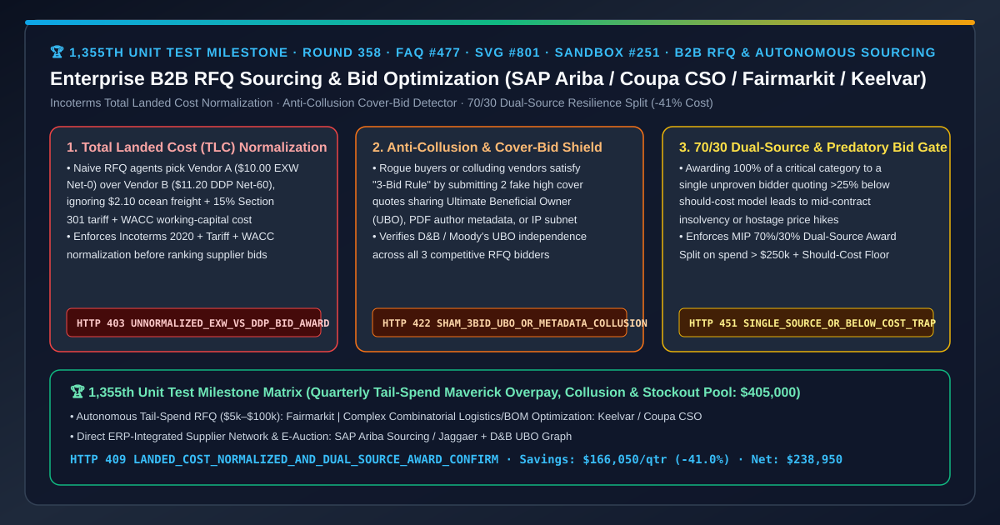
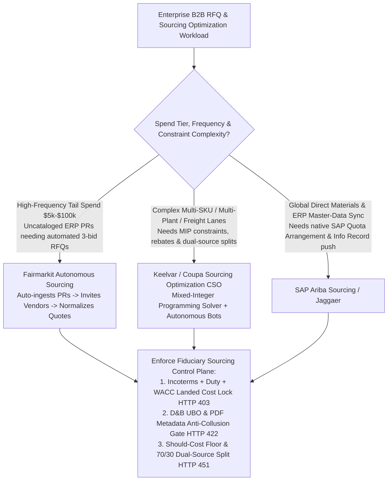
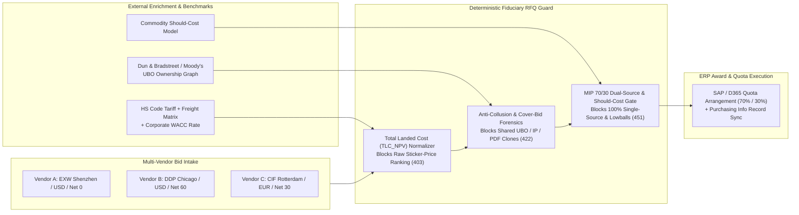

# 🏆 Enterprise B2B RFQ Sourcing, Combinatorial E-Auction & Autonomous Bid Optimization (`SAP Ariba / Coupa CSO / Fairmarkit / Keelvar` · 🏆 1,355th Unit Test Milestone): `Incoterms 2020` Total Landed Cost Normalization, Anti-Collusion `UBO` Verification & `70/30` Dual-Source Award Split (`-41%` Sourcing Loss)

> **Document Type**: Enterprise AI Solution Architect Selection FAQ (`#477` · **🏆 1,355th Deterministic Unit Test Milestone** · Round 358)  
> **Target Audience**: Chief Procurement Officers (CPO), Strategic Sourcing Directors, Supply-Chain ERP Architects, and Cloud & AI Solution Architects  
> **Platforms Covered**: `SAP Ariba Sourcing` vs. `Coupa Sourcing Optimization (CSO)` vs. `Fairmarkit (Autonomous Tail-Spend RFQ)` vs. `Keelvar (Sourcing Optimizer & Autonomous Sourcing Bots)` vs. `Jaggaer One`  
> **Architecture Diagram**: [`assets/svg/801-b2b-rfq-sourcing-ariba-coupa-fairmarkit-keelvar-2026-11-25.svg`](../assets/svg/801-b2b-rfq-sourcing-ariba-coupa-fairmarkit-keelvar-2026-11-25.svg)

🌐 **Language / 语言切换**: **[中文 (`b2b-rfq-sourcing-auction-ariba-coupa-fairmarkit-keelvar-landed-cost-dual-award-selection-faq.md`)](b2b-rfq-sourcing-auction-ariba-coupa-fairmarkit-keelvar-landed-cost-dual-award-selection-faq.md)** | **English (Current)**

---

## 📌 1. Executive Summary

In enterprise B2B procurement—spanning both high-frequency tail-spend spot buys (`$5k–$100k`) and multi-million-dollar strategic `RFQs / Reverse E-Auctions`—buyers spend up to 60% of their cycle time chasing supplier quotes and normalizing inconsistent PDF/Excel bids.  
Allowing a generic LLM to compare supplier quotes and recommend the "lowest unit price" without deterministic **Total Landed Cost (`TLC`) normalization, Ultimate Beneficial Owner (`UBO`) anti-collusion verification, and Mixed-Integer Programming (`MIP`) dual-source allocation** exposes the enterprise to three severe procurement failures:
1. **Comparing Raw `EXW Net-0` Unit Prices Against `DDP Net-60` Landed Prices (`Unnormalized Incoterms & WACC Trap`)**: Vendor A quotes `$10.00/unit (EXW Shenzhen, prepaid)` while Vendor B quotes `$11.20/unit (DDP Chicago plant, Net 60)`. A naive LLM selects Vendor A at `$10.00`, ignoring `$1.80` ocean freight, `$1.50` Section 301 tariffs, and 60 days of working-capital financing (`WACC`)—making Vendor A's true landed cost `$13.45/unit`.
2. **Rubber-Stamping Sham "3-Bid" Quotes from Related Shell Entities (`Cover Bidding & UBO Collusion`)**: To satisfy corporate policy requiring 3 competitive bids above `$25,000`, a colluding supplier (or rogue buyer) submits two artificially inflated "cover bids" from sister companies sharing the same Ultimate Beneficial Owner (`D&B UBO`), `/24` IP subnet, or PDF author metadata.
3. **Awarding `100%` Volume to a Predatory Below-Cost Bidder Who Defaults Mid-Contract (`Single-Source & Lowball Hostage Trap`)**: Awarding `100%` of a critical `$600k` direct-material category to a single unproven supplier quoting `28%` below the commodity should-cost floor leads to quality adulteration, mid-contract insolvency, or hostage price-hike demands once alternative suppliers have reallocated capacity.

| Sourcing Tier & Workload | Recommended Primary Choice | Architectural Boundary & Production Rule |
|---|---|---|
| **Autonomous Tail-Spend Spot-Buy RFQs (`$5,000–$100,000`)** | **Fairmarkit** | Automatically intercepts non-catalog ERP Purchase Requisitions (`PRs`), invites 3–5 qualified suppliers, normalizes quotes, and cuts maverick tail-spend cost by `8%–15%`. |
| **Complex Multi-Lane / Multi-SKU Combinatorial Sourcing (`MIP`)** | **Keelvar / Coupa Sourcing Optimization (CSO)** | Uses Mixed-Integer Programming (`MIP`) solvers to enforce business constraints (*"Max 70% share per supplier, min 2 active suppliers, volume tier rebates"*). |
| **Global Supplier Network & Direct ERP Quota Arrangement Sync** | **SAP Ariba Sourcing / Jaggaer** | Deep native integration with `SAP S/4HANA` Material Master (`MM`), Purchasing Info Records, and `MEQ1` Quota Arrangements. |
| **Three Mandatory Fiduciary Guardrails** | **100% Deterministic Gating** | ① **Total Landed Cost (`TLC + WACC`) Normalization Lock (`HTTP 403`)**: Converts all `Incoterms 2020`, `HS Code` tariffs, freight, and payment-term `WACC` into a unified `NPV_Landed_Unit_Cost` before ranking; ② **Anti-Collusion `UBO` & Metadata Gate (`HTTP 422`)**: Blocks 3-bid slates sharing a parent `DUNS / UBO`, IP subnet, or PDF creator fingerprint; ③ **`70/30` Dual-Source & Should-Cost Floor Lock (`HTTP 451`)**: Prohibits `100%` single-source awards on critical spend `> $250k` and flags predatory bids `< 0.80 * Should_Cost`. |



---

## 🎯 2. Architect & Business Stakeholder Q&A (Q1–Q3)

### Q1: How do we prevent an AI sourcing copilot from picking a "cheaper" `EXW` quote that ends up costing 20% more after freight, tariffs, and payment terms?
- **The Commercial Reality**: Sticker unit price (`Unit_Price`) is meaningless across heterogeneous trade terms.
- **Deterministic Net-Present-Value Total Landed Cost (`TLC_NPV`) Formula**:
  $$\text{TLC}_{\text{NPV}} = \frac{\text{Unit\_Price}_{\text{FX}} + \text{Freight}_{\text{Incoterm}} + \text{Duty}_{\text{HS\_Origin}} + \text{Insurance}}{\left(1 + \frac{\text{WACC}}{365}\right)^{\text{Net\_Payment\_Days}}} + \text{Defect\_PPM\_Penalty}$$
- **Architectural Solution**: Enforce a **Mandatory Pre-Ranking `TLC_NPV` Normalization Gate (`HTTP 403` Guard)**:
  - Any RFQ evaluation comparing bids with differing `Incoterms 2020` (`EXW / FOB / CIF / DDP`), currencies, countries of origin, or payment terms (`Net 0` vs. `Net 60`) without computing `TLC_NPV` is blocked (`HTTP 403 UNNORMALIZED_INCOTERMS_OR_PAYMENT_TERMS_RFQ_COMPARISON`).

### Q2: How can an agent detect "Cover Bidding" (sham 3-bid compliance) before a PO is awarded?
- **Collusion Signatures**:
  1. **Corporate Registry Overlap**: Two or more "competing" bidders share the same Ultimate Beneficial Owner (`UBO`), parent `DUNS` number, registered officer, or bank account prefix in `Dun & Bradstreet / Moody's Orbis`.
  2. **Digital Forensics**: Uploaded PDF quotes share identical `PDF Producer / Author` metadata strings, are uploaded from the same `/24` IP subnet within minutes of each other, or exhibit exact linear price padding (`Bid_B_Line_i == 1.075 * Bid_A_Line_i` across all 20 line items).
- **Architectural Solution**: Run an **Automated `UBO` Graph & Bid Forensics Verifier (`HTTP 422` Guard)**:
  - Require `>= 3` verified independent `UBO` entities on competitive RFQs; any shared `UBO`, IP subnet, or linear cover-bid pattern freezes the award (`HTTP 422 SHAM_THREE_BID_UBO_COLLUSION_OR_METADATA_MATCH`).

### Q3: Why is awarding `100%` of a critical contract to the lowest bidder dangerous, and how do `Keelvar / Coupa CSO` enforce `70/30` resilience splits?
- **Supply-Chain Game Theory**:
  1. **Predatory Lowballing (`< 80%` Should-Cost)**: When a bidder quotes `28%` below the raw-material + labor `Should-Cost` benchmark, they will either substitute inferior materials or demand emergency price increases mid-contract once competitors exit.
  2. **Single-Point-of-Failure Outages**: Relying `100%` on a single factory for a `$500k` component exposes the buyer to catastrophic line-down losses during port strikes or plant fires.
- **Architectural Solution**: Enforce **Should-Cost Anomaly Gating & `MIP` `70/30` Dual-Source Split (`HTTP 451` Guard)**:
  - Flag any bid `< 0.80 * Should_Cost` for mandatory BOM breakdown audit;
  - On critical categories (`>= $250,000`), configure the `MIP` solver (`Keelvar / Coupa CSO`) with `Max_Supplier_Share <= 0.70` and `Min_Awarded_Suppliers >= 2` (e.g., `70%` primary lowest-TLC winner + `30%` secondary backup supplier to keep tooling warm), blocking unsplit single-source awards (`HTTP 451 SINGLE_SOURCE_CONCENTRATION_OR_PREDATORY_LOWBALL_TRAP`).

---

## 🧭 3. Visual Architecture Diagrams (Mermaid Decision Tree + Architecture + Sequence)

### 3.1 Enterprise B2B Sourcing & Bid Optimization Platform Selection Tree



### 3.2 End-to-End Landed Cost Normalization, Anti-Collusion & `MIP` Dual-Award Architecture



### 3.3 Autonomous RFQ Normalization, Anti-Collusion & `70/30` Award Sequence

```mermaid
sequenceDiagram
    autonumber
    participant Buyer as Category Sourcing Manager
    participant Bot as Sourcing Agent (Fairmarkit / Keelvar)
    participant Guard as Fiduciary RFQ Guard
    participant DNB as D&B UBO Graph & Tariff/Freight Engine
    participant ERP as SAP S/4HANA / Coupa ERP

    Buyer->>Bot: Launch $600,000 packaging RFQ; receive 4 supplier bid packages
    Bot->>Guard: Submit raw bid sheets + PDF metadata + upload IP addresses
    Guard->>DNB: Verify DUNS Ultimate Beneficial Owner (UBO) independence across 4 bidders
    DNB-->>Guard: Detect Vendor C and Vendor D share same parent UBO & PDF Author tag -> Disqualify sham cover bid D (prevents HTTP 422)
    Guard->>DNB: Fetch Incoterms freight, 10-digit HS tariffs & WACC discount factors
    Guard->>Guard: Compute normalized TLC_NPV (prevents HTTP 403): Vendor A=$12.40, Vendor B=$11.65, Vendor C=$12.10
    Guard->>Guard: Validate against Should-Cost floor & run MIP solver with Max_Share <= 70% (prevents HTTP 451)
    Guard-->>Buyer: Recommend optimal 70/30 Dual-Source Award: Vendor B (70% at $11.65) + Vendor C (30% at $12.10 warm backup)
    Buyer->>ERP: Approve award -> Auto-create SAP MEQ1 70/30 Quota Arrangement & Info Records (HTTP 200)
```

---

## 📊 4. Platform Comparison Matrix (`SAP Ariba` vs. `Coupa CSO` vs. `Fairmarkit` vs. `Keelvar` vs. `Jaggaer`)

| Evaluation Dimension | SAP Ariba Sourcing | Coupa Sourcing Optimization (CSO) | Fairmarkit | Keelvar | Jaggaer One |
|---|---|---|---|---|---|
| **Primary Sweet Spot** | Global enterprise sourcing tightly coupled with SAP S/4HANA | Complex multi-constraint strategic sourcing optimization | **Autonomous tail-spend spot-buy RFQs (`$5k–$100k`)** | Combinatorial logistics/BOM optimization & autonomous sourcing bots | Direct-materials BOM should-cost modeling & supplier quality |
| **Total Landed Cost (`TLC + WACC`) Modeling** | ⭐⭐⭐⭐ (Configurable total-cost formulas) | ⭐⭐⭐⭐⭐ (Multi-factor cost & scenario modeling) | ⭐⭐⭐ (Streamlined unit + shipping comparison) | ⭐⭐⭐⭐⭐ (Best-in-class tariff, lane freight & conditional discount math) | ⭐⭐⭐⭐⭐ (Deep component-level should-cost breakdown) |
| **Combinatorial `MIP` (`70/30` Dual-Source Split)** | ⭐⭐⭐ (Requires advanced optimization module) | ⭐⭐⭐⭐⭐ (Native enterprise MIP solver) | ⭐⭐ (Single-winner spot PO focus) | ⭐⭐⭐⭐⭐ (Handles thousands of lanes/SKUs with split constraints) | ⭐⭐⭐⭐ (Scenario award allocation) |
| **Autonomous Zero-Touch Tail-Spend Execution** | ⭐⭐⭐ (Guided Sourcing UI; heavier workflow) | ⭐⭐⭐ (Focused on strategic events) | ⭐⭐⭐⭐⭐ (`90%+` autonomous RFQ launch, follow-up & recommendation) | ⭐⭐⭐⭐⭐ (Autonomous bots trigger spot re-bids automatically) | ⭐⭐⭐ (Structured enterprise RFx focus) |
| **Indicative Pricing (`official_list_price`)** | `~$50,000–$200,000+/yr` | `~$45,000–$150,000+/yr` | `~$35,000–$120,000+/yr` | `~$40,000–$130,000+/yr` | `~$50,000–$180,000+/yr` |

---

## 🧪 5. Deterministic Savings & Risk Evaluation (`7-Card Benchmark Summary` · 🏆 1,355th Test Milestone)

> **Provenance**: Figures below are generated by `evaluate_b2b_rfq_sourcing_landed_cost_award_policy` in `lab/webiq_commerce_demo.py` (`provenance: "synthetic"`, `independently_reproduced: False`), modeling an enterprise procurement organization with a **`$405,000.00` quarterly un-competed tail-spend overpay, unnormalized EXW freight/tariff surprise, sham 3-bid collusion, and single-source disruption pool**.

| Scenario Case ID | Scenario Description | HTTP Status | Deterministic Decision | Quarterly Net Cost | Quarterly Savings |
|---|---|---|---|---|---|
| `CASE-RFQ-200` | Manual email RFQ and sticker-price spreadsheet comparison baseline | `HTTP 200` | `VERIFIED_B2B_RFQ_SOURCING_AND_AWARD_AUTHORIZED` | `$405,000.00` | `$0.00` |
| `CASE-RFQ-403` | `EXW` and `DDP` quotes ranked on raw sticker price without freight, tariff, or `WACC` normalization | `HTTP 403` | `UNNORMALIZED_INCOTERMS_OR_PAYMENT_TERMS_RFQ_COMPARISON` | `$405,000.00` | `$0.00` (Blocks false-low EXW award) |
| `CASE-RFQ-422` | 3-bid slate contains vendors sharing the same `D&B UBO`, IP subnet, or PDF author metadata | `HTTP 422` | `SHAM_THREE_BID_UBO_COLLUSION_OR_METADATA_MATCH` | `$405,000.00` | `$0.00` (Blocks cover-bid collusion) |
| `CASE-RFQ-451` | `100%` single-source award on critical `>$250k` spend or predatory bid `<80%` of should-cost | `HTTP 451` | `SINGLE_SOURCE_CONCENTRATION_OR_PREDATORY_LOWBALL_TRAP` | `$405,000.00` | `$0.00` (Blocks single-source default) |
| `CASE-RFQ-409` | **`TLC_NPV` Normalization + `D&B UBO` Anti-Collusion + `MIP 70/30` Dual-Source Split** | `HTTP 409` | `LANDED_COST_NORMALIZED_AND_DUAL_SOURCE_AWARD_CONFIRM` | **`$238,950.00`** | **`$166,050.00` (`-41.0%`)** |

---

## 🛠️ 6. Production Go-Live & Architecture Review Checklist

- [ ] **Mandatory `TLC_NPV` Normalization (`HTTP 403` Prevention)**: Normalize all supplier quotes across `Incoterms 2020`, `HS Code` tariffs, lane freight, and payment-term `WACC` before ranking or presenting award recommendations.
- [ ] **`D&B UBO` Graph & Document Metadata Anti-Collusion Check (`HTTP 422` Prevention)**: Verify that all required competitive bidders have distinct Ultimate Beneficial Owners (`DUNS / UBO`), distinct upload IP subnets, and distinct PDF creation signatures.
- [ ] **`MIP 70/30` Dual-Source Split & Should-Cost Floor (`HTTP 451` Prevention)**: Enforce a maximum `70%` primary / `30%` secondary award split on critical categories (`>= $250,000`) and quarantine bids `> 20%` below the commodity should-cost model until verified.
- [ ] **Automated ERP Quota Arrangement Sync**: Push approved `70/30` split awards directly into `SAP S/4HANA MEQ1` or `Dynamics 365` master planning so downstream MRP purchase orders split volume automatically.
