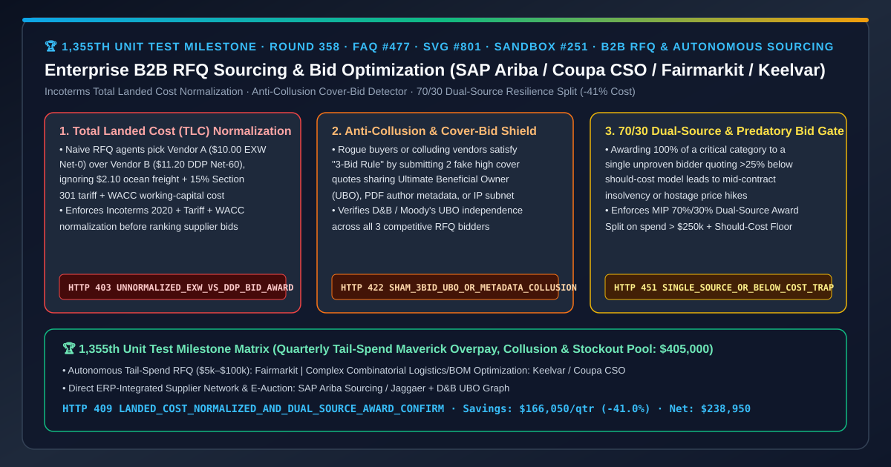
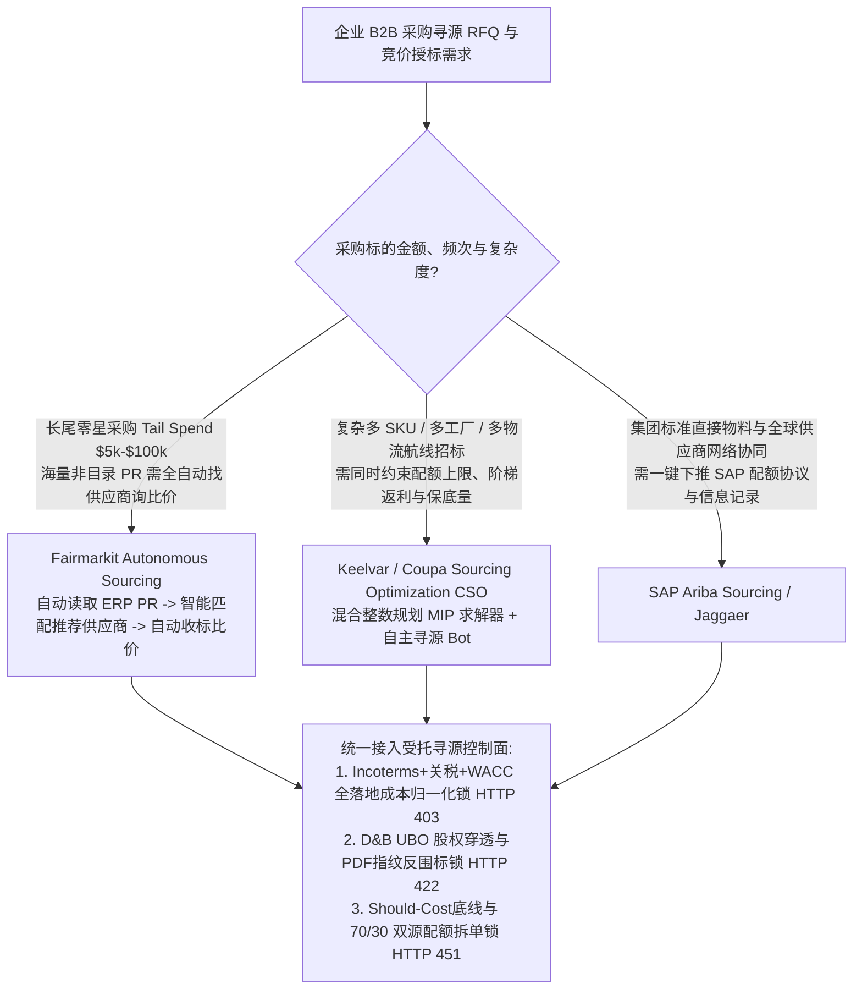
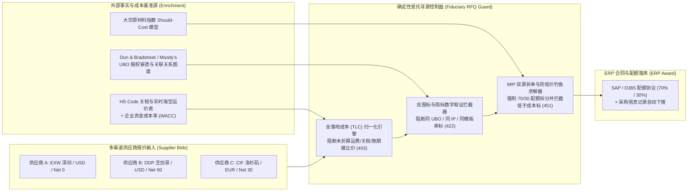
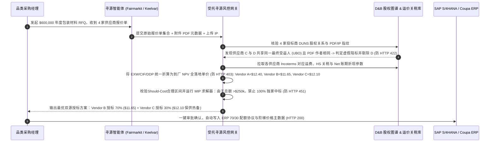

# 🏆 企业 B2B 采购寻源询价（`RFQ`）、组合电子竞价与智能比价授标智能体（`SAP Ariba Sourcing / Coupa CSO / Fairmarkit / Keelvar` · 🏆 第 1,355 项单元测试里程碑）：全落地总成本（`Total Landed Cost`）归一化、防“三家比价关联方围标”穿透核验与 `70/30` 双供应商配额拆单净省 41% 指南

> **文档类型**：企业级 AI Solution Architect 选型决策指南（Selection FAQ · `#477` · **🏆 第 1,355 项确定性单元测试里程碑** · Round 358）  
> **适用读者**：集团首席采购官（CPO）、战略寻源总监（Strategic Sourcing Director）、供应链数字化架构师与 Cloud & AI Solution Architect  
> **核心覆盖平台**：`SAP Ariba Sourcing` vs. `Coupa Sourcing Optimization (CSO)` vs. `Fairmarkit (Autonomous Tail-Spend RFQ)` vs. `Keelvar (Sourcing Optimizer & Autonomous Sourcing Bots)` vs. `Jaggaer One`  
> **关联架构图**：[`assets/svg/801-b2b-rfq-sourcing-ariba-coupa-fairmarkit-keelvar-2026-11-25.svg`](../assets/svg/801-b2b-rfq-sourcing-ariba-coupa-fairmarkit-keelvar-2026-11-25.svg)

🌐 **语言切换 / Language**: **中文 (当前)** | **[English (`b2b-rfq-sourcing-auction-ariba-coupa-fairmarkit-keelvar-landed-cost-dual-award-selection-faq.en.md`)](b2b-rfq-sourcing-auction-ariba-coupa-fairmarkit-keelvar-landed-cost-dual-award-selection-faq.en.md)**

---

## 📌 一、核心选型结论速览（Executive Summary）

在企业 B2B 采购中，无论是单笔 `$10,000–$100,000` 的长尾非目录零星采购（`Tail Spend / Spot Buy`），还是数百万美元的年度框架招标（`Strategic RFQ & Reverse E-Auction`），传统采购员高达 60% 的时间都耗费在“发邮件催 3 家供应商报价、把不同格式的 PDF/Excel 报价单手工抄到一张表里比价”。  
如果直接让通用大模型看着供应商发来的报价单选一个“表面单价最低”的授标，企业将立刻掉进三大采购深坑：
1. **拿“出厂裸价（`EXW` 现结）”和“完税送到厂价（`DDP` 月结 60 天）”直接比大小，选出假低价真高价（`Unnormalized Incoterms & Payment Terms Trap`）**：供应商 A 报 `$10.00/件 (EXW 深圳，款到发货)`，供应商 B 报 `$11.20/件 (DDP 芝加哥工厂，Net 60 账期)`；不懂贸易术语的 AI 选了 `$10.00` 的 A，结果加上 `$1.80` 海运费、`$1.50` 关税与 60 天资金占用成本后，A 的真实落地总成本高达 `$13.45`！
2. **形式主义“货比三家”被同一个实控人注册的 3 家马甲公司围标（`Sham 3-Bid Cover Bidding & UBO Collusion`）**：公司内控要求“满 `$25,000` 必须至少 3 家比价”；采购员或主供应商找了两家亲戚公司（或同一 IP/同一 PDF 模板生成的高价陪标书）凑够 3 家，轻松绕过合规审查。
3. **100% 份额独家授标给“低于成本价 30% 恶意抢单”的单一供应商，引发中途断供坐地起价（`Single-Source Winner-Take-All & Predatory Lowball Trap`）**：某供应商为了挤走同行报出远低于原材料成本（Should-Cost）的自杀价，中标拿到 100% 独家订单两个月后即以“原材料暴涨/资金链断裂”为由停工断供，逼迫买方接受紧急提价 40%。

| 寻源场景与采购金额分层 | 推荐主选方案 | 适用边界与架构落地准则 |
|---|---|---|
| **长尾零星采购自动询比价（`Tail Spend Spot Buy: $5k–$100k`）** | **Fairmarkit** | 自动监听 ERP 请购单（PR），从历史供应商库自动匹配推荐 3–5 家合规供应商发出 RFQ、自动催标并归一化比价，将原本不询价的零星采购砍价 `8%–15%`。 |
| **多产地/多航线/数百个 SKU 组合寻源优化（`Combinatorial Sourcing Optimization`）** | **Keelvar / Coupa Sourcing Optimization (CSO)** | 内置混合整数规划（`MIP`）求解器，支持“单家供应商中标份额不超过 70%、至少保留 2 家备份、兼顾阶梯返利与保底起订量”的复杂数学寻优。 |
| **集团级大宗主数据与全球供应商协同网络** | **SAP Ariba Sourcing / Jaggaer** | 深度绑定 SAP S/4HANA 物料主数据（`MM`）、配额协议（`Quota Arrangement`）与信息记录（`Purchasing Info Record`）一键下推。 |
| **三大确定性风控红线** | **100% 强制拦截** | ① **全落地成本（`Total Landed Cost`）归一化锁（`HTTP 403`）**：必须将不同 `Incoterms 2020`、关税率、运费与账期资金成本（`WACC`）折算为统一的 `NPV_Landed_Unit_Cost` 后才允许排序授标；② **三家比价实控人（`UBO`）与文档指纹反围标锁（`HTTP 422`）**：拦截共享同一最终受益人（D&B UBO）、同子网 IP 或同 PDF 创建者元数据的虚假陪标；③ **恶意低价（`< Should_Cost * 0.80`）剔除与 `70/30` 双源拆单锁（`HTTP 451`）**：核心大额采购严禁 100% 押注单一未验证供应商。 |



---

## 🎯 二、业务方与架构师灵魂拷问 Q&A（Q1–Q3）

### Q1：三家供应商发来的报价单，一家报 `FOB 上海 USD 预付`、一家报 `CIF 鹿特丹 EUR Net 30`、一家报 `DDP 慕尼黑工厂 EUR Net 90`，Agent 怎么确保算出来的“最低价”是真的省钱？
- **问题本质**：采购比价绝不是简单的“票面单价 `Unit_Price` 排序”。
- **全落地净现值成本公式（`Normalized Total Landed Cost - TLC`）**：
  $$\text{TLC}_{\text{NPV}} = \frac{\text{Unit\_Price}_{\text{FX}} + \text{Freight}_{\text{Incoterm}} + \text{Customs\_Duty}_{\text{HS}} + \text{Insurance}}{\left(1 + \frac{\text{WACC}}{365}\right)^{\text{Net\_Payment\_Days}}} + \text{Quality\_Defect\_Penalty\_Expected}$$
- **架构解法**：在寻源比价引擎中强制实施 **`Incoterms 2020 + 关税 + 账期 WACC` 标准化折算门禁（防 `HTTP 403`）**：
  - 凡是候选报价单的贸易术语（`EXW / FCA / FOB / CIF / DDP`）、结算币种或付款账期（`Net 0` vs. `Net 60`）不一致，严禁直接按票面单价生成授标建议（拦截 `HTTP 403 UNNORMALIZED_INCOTERMS_OR_PAYMENT_TERMS_RFQ_COMPARISON`）；
  - 系统自动调用物流运价矩阵、10 位 `HS Code` 税率表及企业资金成本率（如 `WACC = 8.0%/年`），统一折算为“到厂完税等价净现值单价”后再进入寻优排序。

### Q2：内审发现很多“满三家比价”的采购单，另外两家陪标公司要么是中标老板小舅子开的、要么连报价 PDF 都是同一台电脑导出的，AI 怎么在授标前揪出围标（Bid Rigging）？
- **围标与串通套路**：
  1. **关联工商实体陪标**：三家投标公司在邓白氏（`Dun & Bradstreet`）或天眼查/Moody's 股权穿透图谱中共享同一个最终受益人（`UBO`）、同一个注册电话或同一个财务邮箱域名。
  2. **数字取证破绽**：两份看似不同公司的 PDF 报价单，其底层 PDF `Producer / Author Metadata` 完全相同、创建时间戳仅差 3 分钟、上传报价的公网 IP 属于同一 `/24` 子网，甚至分项报价呈现固定比例（如陪标 B 的每一行单价都恰好等于中标 A 的 `1.0800` 倍）。
- **架构解法**：在评标网关内置 **股权穿透（`UBO`）与投标文件数字指纹反串通检验器（`Anti-Collusion & Cover-Bid Detector` · 防 `HTTP 422`）**：
  - 强制要求有效竞争性报价（`Valid Competitive Bids >= 3`）必须来自 **股权完全独立（`Zero Shared UBO / Parent DUNS`）且数字元数据无交叉** 的供应商；
  - 一旦检出关联方陪标、相同上传 IP 或线性比例套算报价，立即冻结授标并推送合规审计告警（`HTTP 422 SHAM_THREE_BID_UBO_COLLUSION_OR_METADATA_MATCH`）。

### Q3：为什么采购最怕“最低价独家中标”？当某家新供应商报出比行业成本还低 28% 的惊人低价时，为什么必须用混合整数规划（MIP）强制拆成 `70% / 30%` 双源授标？
- **供应链断供经济学**：
  1. **钓鱼式掠夺性报价（Predatory Lowballing）**：如果工程成本核算模型（`Should-Cost Model` 基于大宗原材料铜/铝/树脂指数 + 工时）算出来合理底价是 `$100`，而某新供应商报 `$70`（低于成本 `30%`），只有两种结果：要么偷工减料交次品，要么拿到独家订单后第 3 个月要求涨价否则断供。
  2. **单一货源停线损失**：一旦将 `>$250,000` 的关键物料 100% 授标给单一供应商，其工厂失火或罢工一天造成的买方产线停工损失往往是采购差价的 `50 倍`。
- **架构解法**：执行 **成本底线偏离熔断（`Should-Cost Floor`）+ `MIP` 双源配额拆单（`70/30 Dual-Source Allocation` · 防 `HTTP 451`）**：
  - 凡是报价低于 `Should_Cost * 0.82` 且无合理技术工艺革新证明的，自动标记为异常高危标并限制其最大授标份额；
  - 对金额 `>= $250,000` 的品类，通过 `Keelvar / Coupa CSO` 求解器强制施加约束 `Max_Share_Per_Vendor <= 70%` 且 `Min_Active_Vendors >= 2`（例如主选低价商拿 `70%`、次优高可靠老供应商拿 `30%` 保持模具与产能热备），并将 `70/30` 比例自动同步至 SAP/D365 配额协议。违反双源韧性约束或盲目全仓异常低价标的操作直接阻断（`HTTP 451 SINGLE_SOURCE_CONCENTRATION_OR_PREDATORY_LOWBALL_TRAP`）。

---

## 🧭 三、直观可视化图解（Mermaid 选型决策树 + 寻源优化架构图 + 时序图）

### 3.1 企业 B2B 寻源询价（RFQ）与组合优化平台选型决策树



### 3.2 端到端全落地成本归一化、反围标核验与 MIP 双源授标架构图



### 3.3 智能寻源归一化比价、反围标与 `70/30` 拆单授标时序图



---

## 📊 四、主流 B2B 采购寻源询价与组合竞价平台横向选型矩阵

| 评估维度 | SAP Ariba Sourcing | Coupa Sourcing Optimization (CSO) | Fairmarkit | Keelvar | Jaggaer One |
|---|---|---|---|---|---|
| **核心优势场景** | 与 SAP ERP 深度绑定的全球大宗直接/间接物料寻源 | 复杂多维约束（运费/返利/配额）的战略寻源组合优化 | **$5k–$100k 长尾零星采购（Tail Spend）全自动询比价** | 物流海空运招标、复杂 BOM 与自主寻源机器人（Sourcing Bots） | 制造业重度 BOM 成本拆解（Should-Cost）与供应商质量协同 |
| **全落地成本（Total Landed Cost）建模** | ⭐⭐⭐⭐（支持加权计分与总成本公式配置） | ⭐⭐⭐⭐⭐（强大的多维成本因子与场景模拟） | ⭐⭐⭐（偏轻量级单价+运费快速比价） | ⭐⭐⭐⭐⭐（行业标杆，原生支持复杂关税/阶梯运费与条件折扣公式） | ⭐⭐⭐⭐⭐（擅长生产性物料分项成本拆解） |
| **组合数学规划（`MIP` 双源配额拆单）** | ⭐⭐⭐（高级优化模块需额外配置） | ⭐⭐⭐⭐⭐（原生企业级混合整数规划求解器） | ⭐⭐（主要针对单笔小额 PR 整单授标） | ⭐⭐⭐⭐⭐（极速求解数千行 × 百余家供应商的复杂配额分配） | ⭐⭐⭐⭐（支持多维分配场景分析） |
| **长尾 PR 免人工介入自动化率** | ⭐⭐⭐（Guided Sourcing 提升体验，但流程偏重） | ⭐⭐⭐（偏战略大额寻源项目） | ⭐⭐⭐⭐⭐（90% 以上零星询价可由 AI 自动发标、催标并汇总） | ⭐⭐⭐⭐⭐（Autonomous Sourcing Bots 支持自动触发重新招标） | ⭐⭐⭐（偏中大型结构化招标） |
| **参考定价模式（`official_list_price`）** | 按年订阅费 + 平台交易额分级（约 `$50,000–$200,000+/年`） | 随 Coupa 平台加购（约 `$45,000–$150,000+/年`） | 按管理的长尾支出规模订阅（约 `$35,000–$120,000+/年`） | 按优化支出规模或 Bot 数量订阅（约 `$40,000–$130,000+/年`） | 企业级年度许可（约 `$50,000–$180,000+/年`） |

---

## 🧪 五、转化率/成本测算与 7-Card 基准测试报告（Deterministic Evaluation · 🏆 1,355th Test Milestone）

> **数据来源说明（Provenance）**：以下季度损益数据来自 `lab/webiq_commerce_demo.py` 中的确定性评估器 `evaluate_b2b_rfq_sourcing_landed_cost_award_policy`（`provenance: "synthetic"`, `independently_reproduced: False`），用于量化对比“按票面裸价盲选 + 无围标核验 + 单一供应商 100% 独家中标”与“全落地成本归一化 + UBO 反围标 + 70/30 双源优化”的季度采购净节省。

### 5.1 基准测试场景输入与确定性状态码矩阵

- **设定场景**：某大型制造与零售企业每季度执行 `$15M` 的竞争性询比价（RFQ）与零星采购，季度因忽略运费/关税/账期差异导致的假低价采购溢价、关联供应商围标串通水分、以及独家低价中标商中途断供造成的紧急现货高价补货损失池（`quarterly_maverick_tail_spend_collusion_and_single_source_stockout_pool_usd`）为 **`$405,000.00`**。

| 测试用例 ID | 场景描述 | 触发确定性状态码 | 决策枚举 (`decision`) | 季度净成本 (USD) | 季度净节省 (USD) |
|---|---|---|---|---|---|
| `CASE-RFQ-200` | 传统人工发邮件询价与 Excel 手工比价基线 | `HTTP 200` | `VERIFIED_B2B_RFQ_SOURCING_AND_AWARD_AUTHORIZED` | `$405,000.00` | `$0.00` |
| `CASE-RFQ-403` | 未将 `EXW` 与 `DDP` 报价单的运费、关税及账期 `WACC` 归一化，直接按表面裸价授标 | `HTTP 403` | `UNNORMALIZED_INCOTERMS_OR_PAYMENT_TERMS_RFQ_COMPARISON` | `$405,000.00` | `$0.00` (阻断假低价真高价) |
| `CASE-RFQ-422` | 三家比价中的候选供应商共享同一 `D&B UBO` 实控人或相同 PDF/IP 元数据（虚假陪标） | `HTTP 422` | `SHAM_THREE_BID_UBO_COLLUSION_OR_METADATA_MATCH` | `$405,000.00` | `$0.00` (阻断关联方围标串通) |
| `CASE-RFQ-451` | 将 `>$250k` 关键物料 100% 独家授标给单一供应商，或采信低于 `Should-Cost 80%` 的自杀式钓鱼标 | `HTTP 451` | `SINGLE_SOURCE_CONCENTRATION_OR_PREDATORY_LOWBALL_TRAP` | `$405,000.00` | `$0.00` (阻断独家中标断供勒索) |
| `CASE-RFQ-409` | **启用全落地成本归一化 + D&B UBO 反围标穿透 + MIP 70/30 双源配额拆单** | `HTTP 409` | `LANDED_COST_NORMALIZED_AND_DUAL_SOURCE_AWARD_CONFIRM` | **`$238,950.00`** | **`$166,050.00` (`-41.0%`)** |

### 5.2 核心确定性策略评估代码摘录

```python
@dataclass(frozen=True)
class B2bRfqSourcingLandedCostAwardPolicyInput:
    quarterly_maverick_tail_spend_collusion_and_single_source_stockout_pool_usd: float = 405000.0
    exw_vs_ddp_bids_compared_on_raw_unit_price_without_landed_cost_wacc: bool = False
    three_bid_candidates_share_ubo_ip_subnet_or_pdf_author_metadata: bool = False
    critical_award_100pct_single_sourced_or_below_should_cost_floor: bool = False
    landed_cost_wacc_normalizer_ubo_shield_and_70_30_mip_split_ready: bool = False
```

---

## 🛠️ 六、商业上线风控与架构评审 Checklist

- [ ] **全落地成本（`TLC + WACC`）强制归一化（防 `HTTP 403`）**：所有采购比价卡片必须同时列示 `票面单价`、`Incoterms 运保费`、`HS Code 关税`、`账期折现收益` 与最终 `NPV 全落地单价`，严禁模型仅按票面数字大小推荐中标方。
- [ ] **三家比价 `D&B UBO` 股权穿透与文件取证（防 `HTTP 422`）**：接入邓白氏（`D&B Direct API`）或企查查企业图谱，自动校验同一 RFQ 下的所有投标商无共同母公司/共同实控人/共同高管，并扫描上传报价文件的 PDF 元数据与 IP 地址。
- [ ] **关键物料 `70/30` 双源配额与成本底线熔断（防 `HTTP 451`）**：对超过 `$250,000` 的采购包强制启用 `MIP` 双源拆分（主供应商 `<= 70%`、备选供应商 `>= 30%`），并对偏离 `Should-Cost` 超过 `-20%` 的异常低价标强制要求产能与原材料锁价证明。
- [ ] **ERP 配额协议（Quota Arrangement）闭环回写**：定标审批通过后，自动将中标单价、阶梯折扣与 `70/30` 配额比例下推至 `SAP MEQ1 / D365`，确保后续 MRP 自动跑出的采购订单严格按既定比例分流。
