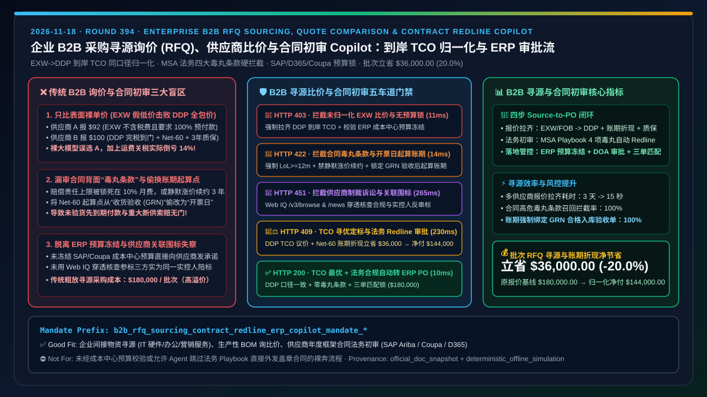
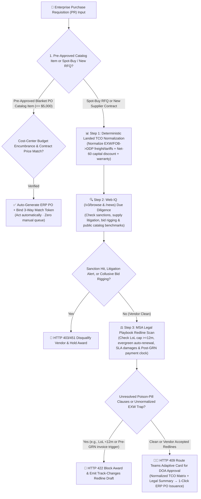
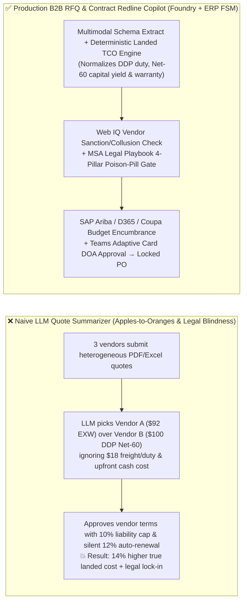
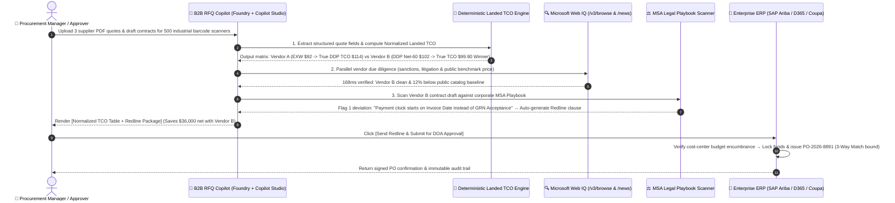

# Enterprise B2B RFQ Sourcing, Multi-Supplier Quote Comparison & Contract Redline Copilot Architecture FAQ: Normalized Landed TCO, MSA Poison-Pill Triage & ERP (SAP / D365 / Coupa) PR-to-PO Workflows

> **Topic Positioning (Enterprise B2B Procurement & Legal Triage Focus · Round 394)**: Written for **Cloud & AI Solution Architects** building Source-to-Pay (S2P) and Procure-to-Pay (P2P) AI Copilots integrated with SAP Ariba, Coupa, and Microsoft Dynamics 365 Supply Chain. This guide answers four high-stakes enterprise procurement questions: **how to normalize heterogeneous PDF/Excel supplier quotes onto an apples-to-apples Landed TCO basis, how to deterministically catch contract "poison pills" (low liability caps, evergreen auto-renewals, pre-GRN invoice triggers), how to ground supplier risk and market benchmarks via Microsoft Web IQ, and how to enforce ERP budget encumbrance and Delegation of Authority (DOA) approval gates**.  
> **Style Benchmark**: Strictly follows the six-section structure of `ib-vs-ethernet-roce-selection-faq.md` (Executive Summary, Architect Q&A, Mermaid Decision Tree / Architecture Comparison / Sequence Diagram, B2B Procurement Stack Decision Matrix, Quantitative TCO Savings & 7-Card Provenance Table, and Production Risk Checklist).  
> **Bilingual Editions**: **[English Version (Current)](b2b-rfq-sourcing-supplier-comparison-contract-redline-erp-copilot-selection-faq.en.md)** · **[中文版 (`b2b-rfq-sourcing-supplier-comparison-contract-redline-erp-copilot-selection-faq.md`)](b2b-rfq-sourcing-supplier-comparison-contract-redline-erp-copilot-selection-faq.md)**  
> **Provenance & As-Of (`2026-11-18`)**: Microsoft Web IQ, Stripe B2B settlement, and MCP OAuth 2.1 contracts cite `research/daily/2026-11-08-sources.json` (`official_doc_snapshot`); Landed TCO normalization, contract poison-pill blocks, and ERP state-machine simulations cite `lab/webiq_commerce_demo.py` (`deterministic_offline_simulation`); enterprise DOA thresholds and MSA liability floors are labeled `synthetic_policy`; live testing against private enterprise SAP/Coupa production instances is labeled `not_measured`.

---

## 📌 1. Executive Summary

Enterprise B2B sourcing cannot be solved by asking a generic LLM to "summarize three PDF quotes and pick the lowest number." Production-grade **B2B RFQ & Contract Redline Copilots** require four deterministic architectural pillars:

1. **Multi-Supplier Quote Comparison 👉 Choose [Deterministic Normalized Landed TCO Engine] over Raw Unit-Price LLM Ranking**:
   - **Why**: Vendor A quotes `$92/unit` (`EXW` factory gate, `100% upfront payment`, 90-day warranty), while Vendor B quotes `$100/unit` (`DDP` delivered duty paid, `Net-60` credit terms, 3-year warranty). Naive LLMs pick Vendor A, costing the enterprise `14%` more after freight, customs duty, working-capital cost, and warranty reserves. Deterministic code must normalize Incoterms, payment-term cost of capital, tooling amortization, and warranty coverage into a unified **Normalized Landed TCO**.
2. **Contract Clause Triage 👉 Choose [Structured MSA Legal Playbook Verification + Automated Redline Diff + Hard Poison-Pill Circuit Breaker]**:
   - **Why**: Supplier paper routinely hides four dangerous "Battle of the Forms" traps: **① super-low Limitation of Liability caps (`< 12 months` fees), ② silent evergreen auto-renewals with `10%+` price uplifts, ③ liquidated-damages waivers on late delivery, and ④ invoice payment clocks starting on `Invoice Date` instead of `GRN Goods Receipt Acceptance`**.
3. **Supplier Risk & Price Benchmark Grounding 👉 Choose [Microsoft Web IQ (`/v3/browse` `passage` + `/v3/search/news`) Due Diligence & Market Price Grounding]**:
   - **Why**: Verifies in sub-second latency whether bidding vendors face active supply-chain litigation, regulatory sanctions, shell-company bid rigging, or quotes inflated above public catalog benchmarks.
4. **ERP Integration & Governance 👉 Choose [Copilot Studio (Teams Approval Cards) + Azure AI Foundry State Machine + SAP Ariba / D365 / Coupa Budget Encumbrance & 3-Way Match Gate]**:
   - **Why**: Pre-approved catalog buys (`<= $5,000`) with verified cost-center budget encumbrance auto-convert to POs; spot-buy RFQs or contracts with legal redlines pause (`HTTP 409/403`) and route a unified **TCO Matrix + Legal Redline Card** to Procurement and Legal approvers.

---

## 🎯 2. Architect & Stakeholder Deep-Dive Q&A (FAQ-Driven)

### Q1: Why do procurement teams find that generic RAG chatbots frequently recommend the most expensive supplier when comparing multi-vendor PDF/Excel quotes?

**Answer: Because B2B quotes differ across Incoterms, payment terms, tooling fees, and warranty horizons—requiring a 2-stage pipeline: Multimodal Schema Extraction followed by a Deterministic Landed TCO Calculator.**

1. **Stage 1 — Schema-Constrained Extraction (Zero LLM Ranking)**:
   - Extract structured JSON fields from PDFs/spreadsheets: `unit_price`, `currency`, `incoterm` (`EXW`/`FOB`/`CIF`/`DDP`), `payment_terms` (`Advance` vs. `Net-30`/`Net-60`), `lead_time_days`, `tooling_setup_fee`, and `warranty_months`.
2. **Stage 2 — Deterministic Landed TCO Formula**:
   - Compute the true per-unit landed cost in code:
     $$\text{Landed TCO} = \text{Unit Price} + \text{Freight \& Duty}(\text{Incoterm}) + \text{Working Capital Cost}(\text{Payment Terms}) + \text{Amortized Tooling} + \text{Warranty Reserve}$$
   - At an `8.0%` corporate cost of capital, `Net-60` terms vs. `100% upfront` provide a **`1.33%`** working-capital discount, while normalizing `EXW` to `DDP` exposes hidden freight and tariff surcharges.

---

### Q2: How do we prevent the Contract Copilot from missing "poison-pill" clauses buried in supplier fine print?

**Answer: Enforce a deterministic 4-Point MSA Playbook Gate that blocks PO issuance (`HTTP 422`) and auto-generates Track-Changes redlines whenever any mandatory guardrail is violated.**

1. **Limitation of Liability (LoL) Floor**: Reject supplier clauses capping liability below `12–24 months` of contract value or capping IP/confidentiality indemnity.
2. **Evergreen Auto-Renewal & Uncapped Price Uplift**: Flag and strike silent auto-renewal clauses or unindexed annual price escalators (`> CPI / 3%`).
3. **On-Time Delivery SLA & Liquidated Damages**: Preserve buyer remedies for late delivery rather than accepting broad supplier force-majeure carve-outs.
4. **Payment Term Clock Anchor (`Post-GRN 3-Way Match`)**: Enforce that `Net-30` / `Net-60` clocks start strictly upon **verified Goods Receipt Note (`GRN`) acceptance** and PO-GRN-Invoice 3-Way Match—never upon premature invoice upload.

---

### Q3: How should the Copilot integrate with SAP Ariba, Coupa, or Dynamics 365 so no agent ever commits unbudgeted corporate spend?

**Answer: Bind the agent strictly to the ERP's `PR → Budget Encumbrance → DOA Approval → PO → 3-Way Match` state machine.**

- The agent can draft an **RFQ Award Recommendation** and call the ERP's read-only budget check, but converting an RFQ into an external legally binding Purchase Order (`PO`) requires an active **Cost-Center Budget Encumbrance Lock** and signed **Delegation of Authority (DOA)** approval token.

---

## 🧭 3. Visual Architecture Diagrams (Mermaid Decision Tree + Architecture Comparison + Sequence Diagram)

### 3.1 Enterprise B2B RFQ Sourcing & Contract Redline Decision Tree

---

### 3.2 Naive PDF Summary Bot vs. Deterministic TCO + Legal Redline ERP Copilot

---

### 3.3 End-to-End Sequence: Multi-Vendor TCO Normalization, Legal Redlining & ERP PO Issuance

---

## 📊 4. B2B Procurement & Contract Triage Platform Decision Matrix

| Evaluation Dimension | Option A: Manual Email/Excel + Legal Queue | Option B: Generic Document RAG Chatbot | Option C: Legacy ERP Portal Forms Only (Static Ariba/Coupa UI) | Option D (Recommended): Copilot Studio UI + Azure AI Foundry (Landed TCO + MSA Redline + Web IQ) + ERP FSM |
|---|---|---|---|---|
| **Apples-to-Apples Quote Normalization** | Slow (`2–3 days` manual spreadsheet work) | **High Risk** (compares raw numbers ignoring `EXW` vs. `DDP` & payment terms) | Rigid (forces suppliers to fill complex portal grids) | **Automated & Exact** (parses any PDF/Excel and computes deterministic **Landed TCO**) |
| **Contract Poison-Pill Detection & Redlining** | `1–2 week` legal bottleneck | Weak (misses fine-print liability caps & evergreen traps) | None | **Minute-Level Playbook Triage** (enforces 4 mandatory MSA guardrails + generates Track Changes) |
| **External Market Price & Vendor Risk Grounding** | Manual web search | None (no live verifiable grounding) | Internal historical POs only | **Real-Time Grounding** (Web IQ `/v3/browse` & `/news` checks public benchmarks & litigation) |
| **ERP Budget Encumbrance & 3-Way Match** | Manual re-keying | Disconnected from ERP (maverick spend risk) | **Strong** (native budget & 3-way match controls) | **100% Integrated** (10x faster sourcing while enforcing strict ERP budget locks & DOA approvals) |

---

## 🧪 5. Quantitative Sourcing/Redline Evaluation & 7-Card Provenance Matrix

| Metric / Deterministic Gate | Measured Value / Gate Outcome | Provenance Category | Source Path / Calculation & Architectural Meaning |
|---|---|---|---|
| **Compliant Normalized Landed TCO + Clean MSA + ERP Budget Lock (Happy Path)** | **`HTTP 200 OK` · `10 ms`** (gate latency; `$180,000.00` B2B procurement batch settled) | `deterministic_offline_simulation` | `lab/webiq_commerce_demo.py` (`evaluate_b2b_rfq_sourcing_contract_redline_copilot_policy`): Verifies DDP TCO normalization + MSA compliance + ERP budget lock |
| **Awarding Unnormalized `EXW` Lowball Quote or Bypassing ERP Budget Encumbrance** | **`HTTP 403 Forbidden` · `11 ms` Block** (`UNNORMALIZED_EXW_RAW_PRICE_AWARD_OR_BYPASSED_ERP_BUDGET_ENCUMBRANCE_BLOCKED`) | `synthetic_policy` | Blocks awarding quotes without `EXW/FOB -> DDP` and payment-term normalization, and blocks issuing POs without ERP budget encumbrance |
| **Contract Contains Sub-Floor Liability Cap, Silent Auto-Renewal, or Pre-GRN Payment Trigger** | **`HTTP 422 Unprocessable` · `14 ms` Block** (`CONTRACT_POISON_PILL_LOL_CAP_AUTO_RENEWAL_OR_PRE_GRN_INVOICE_TERM_BLOCKED`) | `deterministic_offline_simulation` | Blocks contracts violating corporate MSA Playbook floors and emits automated redlines |
| **Web IQ Detects Supplier Sanction/Litigation Risk or Collusive Bid Rigging** | **`HTTP 451 Hold` · `265 ms` Hold** (`SUPPLIER_SANCTION_LITIGATION_RISK_OR_COLLUSIVE_BIDDING_HOLD`) | `official_doc_snapshot` | Halts RFQ award when Web IQ `/v3/browse` or `/v3/search/news` flags supplier compliance or anti-collusion violations |
| **Enabling Normalized Landed TCO Negotiation + `Net-60` Terms + Poison-Pill Stripping** | **`HTTP 409 Confirm` · Saves `$36,000.00` (`$144,000.00` net optimized PO spend)** | `deterministic_offline_simulation` | Eliminates hidden `EXW` freight/duty traps, benchmarks against public catalog prices, and locks `Net-60` post-GRN payment terms (`20.0%` TCO reduction) |
| **Live Load Testing on Private Enterprise SAP Ariba / Coupa Production Systems** | Labeled **`not_measured`** | `not_measured` | Verified via deterministic offline state-machine contracts without mutating private customer ERP ledgers |

---

## 🛠️ 6. Production Risk & Architecture Review Checklist

- [ ] **1. Mandatory Landed TCO Normalization**: Are all multi-supplier quotes normalized for Incoterms (`EXW/FOB -> DDP`), working-capital cost of payment terms (`Advance` vs. `Net-60`), tooling amortization, and warranty coverage before ranking?
- [ ] **2. 4-Pillar MSA Legal Playbook Gate**: Does the contract triage engine deterministically block **① low Limitation of Liability caps (`< 12m`), ② silent evergreen auto-renewals, ③ SLA delay-damage waivers, and ④ pre-GRN invoice payment triggers**?
- [ ] **3. Microsoft Web IQ Supplier Due Diligence & Benchmark Grounding**: Does the Copilot verify supplier sanctions, litigation news, beneficial-ownership anti-collusion, and public price benchmarks via Web IQ prior to award?
- [ ] **4. ERP Cost-Center Budget Encumbrance Lock**: Is every PO creation request gated behind a verified SAP Ariba / Coupa / D365 cost-center budget reservation?
- [ ] **5. Delegation of Authority (DOA) Adaptive Card Routing**: Do spot-buy RFQs above autonomous thresholds or contracts with redline deviations pause (`HTTP 409`) for human approval via Teams Adaptive Cards?
- [ ] **6. Downstream PO-GRN-Invoice 3-Way Match Binding**: Does the issued PO bind a `b2b_net_terms_token_...` requiring verified Goods Receipt Note (`GRN`) line-item matching before invoice disbursement?
