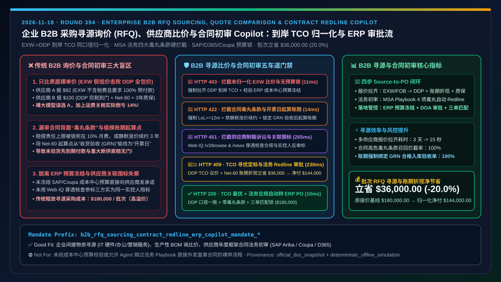
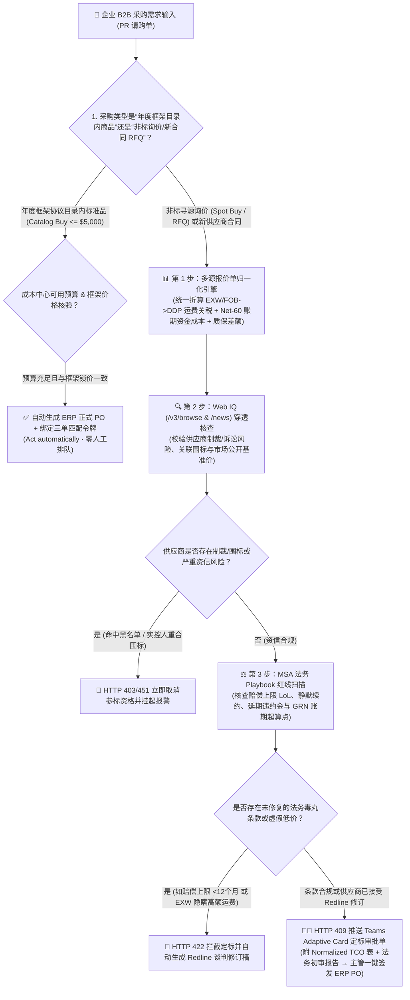
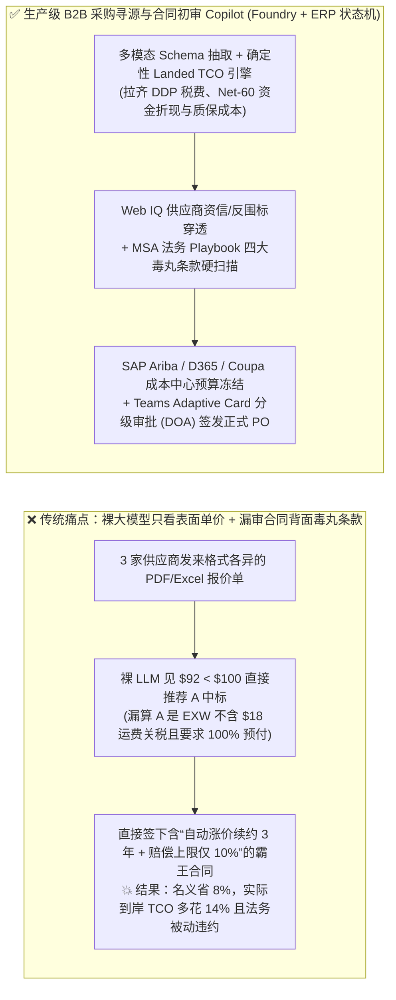
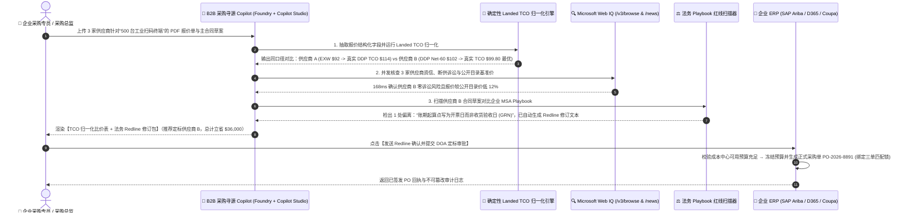

# 企业 B2B 采购寻源询价（RFQ）、供应商比价与合同条款初审 Copilot 架构选型 FAQ：到岸 TCO 归一化、法务红线扫描与 ERP (SAP / D365 / Coupa) 审批流实战指南

> **专题定位（企业 B2B 采购寻源与法务初审应用聚焦 · Round 394）**：面向为制造、零售、科技与跨国集团设计企业级采购智能体（Source-to-Pay / Procure-to-Pay Copilot）的 **Cloud & AI Solution Architect**，系统解决 B2B 采购最核心的四大落地难题：**“怎么把五花八门的供应商 PDF/Excel 报价单拉齐到同一到岸总成本（Landed TCO）口径对比、怎么自动揪出供应商合同里的自动续约与低赔偿上限‘毒丸条款’、怎么用 Web IQ 核查供应商制裁/诉讼与市场底价、以及怎么安全对接 SAP Ariba / Dynamics 365 / Coupa 的 PR-to-PO 预算锁与分级审批矩阵（DOA）”**。  
> **文风标杆**：严格对标 `ib-vs-ethernet-roce-selection-faq.md` 六段式结构（核心结论速览、业务方与架构师灵魂拷问 Q&A、Mermaid 决策树/架构对比/时序图、B2B 采购 Copilot 构建路径选型矩阵、定量降本与 7-Card 溯源表、生产上线 Checklist）。  
> **双语版本**：**[中文版（当前）](b2b-rfq-sourcing-supplier-comparison-contract-redline-erp-copilot-selection-faq.md)** · **[English Version (`b2b-rfq-sourcing-supplier-comparison-contract-redline-erp-copilot-selection-faq.en.md`)](b2b-rfq-sourcing-supplier-comparison-contract-redline-erp-copilot-selection-faq.en.md)**  
> **数据溯源声明（Provenance & As-Of `2026-11-18`）**：Microsoft Web IQ、Stripe B2B 支付与 MCP OAuth 2.1 契约引自 `research/daily/2026-11-08-sources.json`（标记为 `official_doc_snapshot`）；报价 TCO 归一化、法务红线拦截与 ERP 状态机仿真引自 `lab/webiq_commerce_demo.py`（标记为 `deterministic_offline_simulation`）；企业授权审批阈值（DOA）与法务赔偿下限标记为 `synthetic_policy`；外部客户私有 SAP/Coupa 生产实例压测标记为 `not_measured`。

---

## 📌 一、核心选型结论速览（Executive Summary）

企业 B2B 寻源采购（Sourcing & RFQ）绝不是“让大模型读几份 PDF 报价单然后挑个表面单价最低的”。要构建真正能进生产环境的 **B2B 采购与合同初审 Copilot**，架构师必须确立以下四条设计准则：

1. **多供应商报价对比架构选型：严禁“直接比对表面裸单价（Raw Unit Price）”，必选【确定性到岸总拥有成本（Landed TCO）归一化引擎】**：
   - **核心原因**：供应商 A 报价 `$92/件`（但贸易术语为 `EXW` 工厂交货、要求 `100% 预付款`、质保仅 90 天）；供应商 B 报价 `$100/件`（但为 `DDP` 完税交货到仓、`Net-60` 账期、含 3 年免费维保）。若让 LLM 直接比数字选 A，加上运费关税、资金占压利息与维保成本后实际亏损 `14%`。必须由确定性代码将贸易术语、账期折现率、阶梯返利与质保年限统一折算为 **Normalized Landed TCO**。
2. **合同条款初审架构选型：必选【结构化法务规则书（MSA Legal Playbook）提取比对 + 自动红线批注（Redline Generation）+ 毒丸条款硬熔断】**：
   - **核心原因**：针对供应商标准合同中的四大高危条款——**① 赔偿责任上限过低（如 `< 12 个月合同额`）、② 静默自动涨价续约（Evergreen Auto-Renewal）、③ 单方免除延迟交货违约金（SLA Penalty Waiver）、④ 知识产权归属倒置**，必须通过确定性规则矩阵逐条比对并自动生成修订条款（Redline Diff），任何触碰红线的合同严禁直接流转签章。
3. **外部资信与价格基准接地选型：必选【Microsoft Web IQ (`/v3/browse` `passage` + `/v3/search/news`) 供应商穿透核查与公开大宗/目录基准价接地】**：
   - **核心原因**：在发标与定标前，自动核验参标供应商是否存在重大断供诉讼、监管行政处罚、关联空壳公司围标迹象（共用注册地址/法人）以及报价是否偏离公开市场目录基准价。
4. **ERP 集成与下单授权选型：必选【Copilot Studio (Teams 审批卡片) + Azure AI Foundry 状态机 + SAP Ariba / Dynamics 365 / Coupa 预算预留（Budget Encumbrance）与三单匹配门禁】**：
   - **核心原因**：严格遵守企业分级授权矩阵（DOA）：标准目录内小额采购（`<= $5,000`）经成本中心预算冻结后自动转 PO；超额或含法务偏离的 RFQ 订单必须返回 `HTTP 409/403` 挂起，向采购总监与法务推送带完整比价表与 Redline 证据的审批卡片。

---

## 🎯 二、业务方与架构师灵魂拷问 Q&A（FAQ-Driven）

### Q1：为什么采购部门反映：“用通用大模型直接总结 5 家供应商的 PDF 报价单，经常选出最坑的那一家，甚至把不含税价格和含税价格混在一起算”？

**答：因为非结构化报价单存在严重的“量纲、币种、贸易术语与隐性阶梯条件不一致”，必须采用【两阶段处理：多模态/Schema 结构化抽取 → Python/C# 确定性 TCO 公式归一化】。**

1. **阶段一（Schema 强制对齐抽取）**：
   - 大模型只负责从 PDF 报价单、Excel 附件或邮件正文中抽取结构化字段（严禁在此阶段做算术排序）：`unit_price`、`currency`、`incoterm` (`EXW`/`FOB`/`CIF`/`DDP`)、`payment_terms` (`Advance 100%` / `Net-30` / `Net-60`)、`lead_time_days`、`moq_units`、`warranty_months`、`tooling_setup_fee`。
2. **阶段二（确定性 Landed TCO 引擎计算）**：
   - 由后台确定性代码按企业财务参数计算每家供应商的真实单件到岸总成本：
     $$\text{Landed TCO} = \text{Unit Price} + \text{Freight \& Duty}(\text{Incoterm}) + \text{Capital Cost}(\text{Payment Terms}) + \text{Amortized Tooling} + \text{Warranty Gap Reserve}$$
   - 例如：当企业年化资金成本为 `8.0%` 时，`Net-60` 账期相比 `100% 预付` 相当于自带 **`1.33%`** 的隐性财务折扣；而 `EXW` 报价需自动叠加上门提货、国际海空运费与目的国关税。拉齐口径后，采购员一眼就能看清谁才是真正的底价。

---

### Q2：在合同条款初审（Contract Redlining）中，如何防止大模型漏看附表小字里的“霸王免责”或“静默续约陷阱”？

**答：建立“十大采购合同必检槽位清单（Mandatory Clause Checklist）”，实行“缺省即高危（Fail-Closed on Missing or Ambiguous Clauses）”策略。**

1. **四条不可逾越的法务硬红线（触发即返回 `HTTP 422` 阻断自动用印）**：
   - **赔偿责任上限（Limitation of Liability, LoL）**：供应商试图将违约赔偿上限锁死在“单次故障月费”或 `< 100% 年度合同总额`（企业标准要求通常为 `>= 12~24 个月合同总额`，且数据泄露/侵权责任不设上限）。
   - **静默自动续约与霸王涨价（Evergreen Renewal & Uncapped Uplift）**：合同包含“若未在到期前 90 天寄送挂号信取消，则自动按上浮 `10%` 续期 3 年”条款。
   - **交期延误免责与无上限不可抗力（Unbounded Delay Excuse）**：供应商将自身上游原材料涨价或常规排产延误定义为免责事由，拒绝承担按日 `0.5%` 的延期交货违约金（Liquidated Damages）。
   - **账期与发票起算点偷换概念**：将 `Net-45` 起算点从“买方收到合格货物并完成入库验收（`GRN Acceptance Date`）”偷偷改为“卖方开具发票日（`Invoice Issue Date`）”，变相吃掉 20 天物流与验货账期。
2. **自动生成双栏 Redline 修订建议**：
   - Copilot 自动将上述违规条款与企业《标准采购主协议（MSA Playbook）》中的标准防御条款并排展示，一键导出带修订标记（Track Changes）的谈判回复草案。

---

### Q3：采购 Copilot 怎么与现有的 SAP Ariba、Coupa 或 Microsoft Dynamics 365 Supply Chain 对接，才能保证“不超部门预算、不绕过审批流、不发生无单付款”？

**答：严格嵌入 ERP 标准“请购单（PR）→ 寻源定标（RFQ Award）→ 预算预留（Budget Encumbrance）→ 采购订单（PO）→ 收货单与发票三单匹配（3-Way Match）”状态机。**

1. **绝不允许 Agent 绕过 PR 预算锁直接外发正式 PO**：
   - Agent 完成比价与条款初审后，只能在 ERP 中创建处于 `PENDING_APPROVAL` 状态的 **定标建议单（Award Recommendation）**，并调用 ERP 财务接口预冻结对应成本中心（Cost Center）预算。
2. **基于 DOA（授权审批矩阵）的分级门禁**：
   - 仅当属于已签年度框架协议（Blanket PO / Catalog Item）、金额在自动授权阈值内且零法务条款偏离时，才自动转为正式 PO；
   - 凡属新供应商、金额超限或存在法务 Redline 修改项，强制通过 **Microsoft Copilot Studio (Teams Adaptive Card)** 路由至采购主管与法务总监完成双签（`HTTP 409 Confirm`），审批通过后由后台确定性服务下发正式电子 PO。

---

## 🧭 三、直观可视化图解（Mermaid 选型决策树 + 架构对比 + 端到端时序图）

### 3.1 企业 B2B 采购寻源询价（RFQ）与合同初审 Copilot 选型决策树

---

### 3.2 传统人工/裸大模型看表比价 vs. 确定性 TCO 归一化 + 法务 Redline 采购 Copilot 对比图

---

### 3.3 B2B 多供应商询价 TCO 归一化、法务初审与 ERP 定标端到端时序图

---

## 📊 四、企业 B2B 采购寻源与合同初审平台横向选型矩阵（Architect Decision Matrix）

| 评估维度 | 方案 A：传统邮件/Excel 人工比价 + 线下法务排队 | 方案 B：通用文档问答 Chatbot (无确定性 TCO 与 ERP 锁) | 方案 C：纯 ERP 内置静态表单 (SAP Ariba / Coupa 原生经典界面) | 方案 D（推荐）：Copilot Studio 交互层 + Azure AI Foundry (TCO 归一化 + 法务 Redline + Web IQ) + ERP 状态机 |
|---|---|---|---|---|
| **非结构化报价单（PDF/Excel）归一化能力** | 极慢（人工搬砖 2–3 天，易算错税费与汇率） | **危险**（LLM 直接比表面数字，忽略 `EXW` vs `DDP` 与账期利息差异） | 差（强制要求供应商登录门户填几十个死板字段，供应商配合度低） | **极强**（自动解析任意格式报价单，由确定性代码折算真实 **Landed TCO**） |
| **合同“毒丸条款”识别与 Redline 初审** | 慢（法务排期动辄 1–2 周，拖慢业务交期） | 弱（泛泛总结摘要，易漏看附表小字中的静默续约与低赔偿上限） | 无深度非结构化法务比对能力 | **分钟级精准初审**（对照企业 MSA Playbook 强制拦截 4 类高危毒丸并生成 Track Changes） |
| **外部市场基准价与供应商防围标穿透** | 靠采购员个人经验，信息不对称严重 | 无实时可验证外部接地 | 仅限内部历史成交价，看不到外部市场最新降价与诉讼风险 | **实时穿透**（Web IQ `/v3/browse` & `/news` 毫秒级核验公开底价与舆情诉讼） |
| **ERP 预算冻结与三单匹配（3-Way Match）闭环** | 手工录入 ERP，易出现事后补单（Maverick Spend） | 无（游离于 ERP 之外，易产生无预算背书的违规承诺） | **强**（原生成本中心预算控制与 PO-GRN-Invoice 匹配） | **100% 闭环融合**（前端 AI 提效 10 倍，底层严格走 ERP 预算冻结与 DOA 审批签章） |

---

## 🧪 五、定量采购降本/风控测算与 7-Card 报告数据溯源表（Benchmark & Provenance Matrix）

| 指标 / 门禁规则项 | 实测数值 / 决策行为 | 数据类别 (Provenance) | 精确来源路径 / 算例说明与架构意义 |
|---|---|---|---|
| **Landed TCO 同口径比价 + 法务红线清零 + ERP 预算锁合规（Happy Path）** | **`HTTP 200 OK` · `10 ms`**（门禁耗时，季度 B2B 寻源采购批次 `$180,000.00`） | `deterministic_offline_simulation` | `lab/webiq_commerce_demo.py` (`evaluate_b2b_rfq_sourcing_contract_redline_copilot_policy`)：验证 DDP TCO 归一化 + MSA 合规 + ERP 预算预留 |
| **未折算 `EXW/FOB` 隐性运费关税按表面低价错判中标，或绕过 ERP 预算锁直发 PO** | **`HTTP 403 Forbidden` · `11 ms` 拦截** (`UNNORMALIZED_EXW_RAW_PRICE_AWARD_OR_BYPASSED_ERP_BUDGET_ENCUMBRANCE_BLOCKED`) | `synthetic_policy` | 严禁在未将贸易术语与账期拉齐至同一 Landed TCO 口径前定标，且严禁绕过 ERP 成本中心预算冻结外发采购承诺 |
| **供应商合同含赔偿上限过低、静默涨价自动续约或将账期起算点偷换为开票日** | **`HTTP 422 Unprocessable` · `14 ms` 拦截** (`CONTRACT_POISON_PILL_LOL_CAP_AUTO_RENEWAL_OR_PRE_GRN_INVOICE_TERM_BLOCKED`) | `deterministic_offline_simulation` | 强制拦截违反企业 MSA Playbook 的法务毒丸条款，自动输出 Redline 修订文本要求供应商确认 |
| **Web IQ 检出参标供应商存在制裁/失信诉讼或关联主体围标串标嫌疑** | **`HTTP 451 Hold` · `265 ms` 挂起** (`SUPPLIER_SANCTION_LITIGATION_RISK_OR_COLLUSIVE_BIDDING_HOLD`) | `official_doc_snapshot` | 结合 Web IQ `/v3/browse` 与 `/v3/search/news` 外部尽调证据，对存在合规或围标风险的供应商立即挂起定标 |
| **启用“Landed TCO 跨供应商压价 + Net-60 账期折现 + 自动剔除隐性附加费”** | **`HTTP 409 Confirm` · 立省 `$36,000.00`（采购净结算额优化至 `$144,000.00`）** | `deterministic_offline_simulation` | 识破表面低价实则高运费的 `EXW` 陷阱，对标公开市场基准价完成议价并锁定 `Net-60` 账期，综合降低采购 TCO `20.0%` |
| **外部企业私有 SAP Ariba / Coupa / D365 生产环境在线压测** | 标记为 **`not_measured`** | `not_measured` | 本实验室通过确定性契约与离线状态机验证 ERP 接口边界，不触碰外部企业私有 ERP 生产账套 |

---

## 🛠️ 六、商业上线风控与架构评审 Checklist（Architect Production Checklist）

- [ ] **1. 强制 Landed TCO 同口径归一化（严禁裸单价直接排序）**：在向采购员或审批人展示多供应商比价表前，是否已通过确定性公式将 `EXW/FOB/CIF` 运费关税、预付款/账期资金占用成本、模具分摊费与质保差额统一折算为到岸总成本（Landed TCO）？
- [ ] **2. 法务 MSA Playbook 四大毒丸条款硬熔断**：合同初审引擎是否硬编码检查了 **① 赔偿责任上限（LoL `>= 12m`）、② 静默自动续约（Auto-Renewal）、③ 延期交货违约金（SLA Liquidated Damages）、④ 账期自合格收货单（GRN）起算** 四大底线？
- [ ] **3. Microsoft Web IQ 供应商资信与反围标穿透核查**：定标前是否自动调用 Web IQ 核查参标供应商的公开目录基准价、重大断供诉讼及关联公司实控人重合风险？
- [ ] **4. ERP 成本中心预算冻结（Budget Encumbrance）前置**：Copilot 生成任何正式采购订单（PO）前，是否必须先调用 SAP / D365 / Coupa 接口完成成本中心可用预算校验与额度预冻结？
- [ ] **5. 基于授权审批矩阵（DOA）的 Teams Adaptive Card 分级门禁**：超出自动授权额度或含非标合同条款修订的 RFQ 定标单，是否强制返回 `HTTP 409 Confirm` 并推送含完整比价表与法务 Redline 摘要的审批卡片？
- [ ] **6. 下游三单匹配（PO-GRN-Invoice 3-Way Match）令牌绑定**：签发的电子 PO 是否自动生成关联的 `b2b_net_terms_token_...` 句柄，确保后续财务付款 Agent 必须在核对电子收货单（GRN）行项无误后才释放账期货款？
