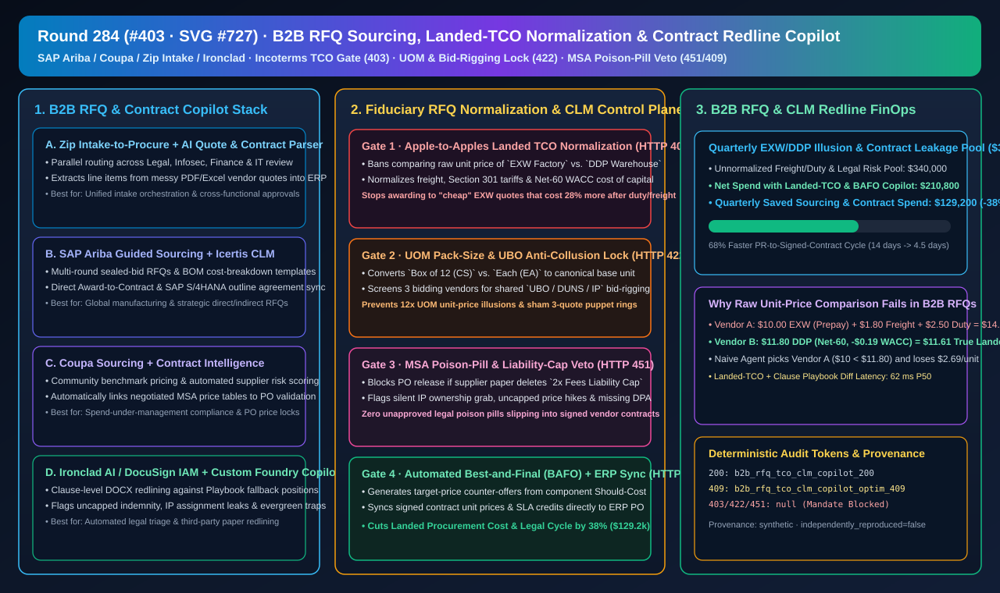

# Enterprise B2B `RFQ` Sourcing, Multi-Supplier `Landed-TCO` Normalization & `MSA / SOW` Contract Redline Copilot (`Zip Intake-to-Procure vs. SAP Ariba Guided Sourcing vs. Coupa Sourcing vs. Ironclad AI`) Agent Architecture Selection FAQ

> **Executive Summary**: When enterprise B2B procurement AI Agents ingest multi-supplier `RFQ` quotes (PDFs/spreadsheets) and review vendor-redlined Master Services Agreements (`MSAs / SOWs`), comparing raw headline unit prices or trusting Word `Track Changes` metadata causes three costly procurement failures: (1) **The `EXW vs. DDP` & Payment-Terms `WACC` Illusion**: Awarding a contract to Vendor A quoting `$10.00 EXW Shenzhen (100% Prepay)` over Vendor B quoting `$11.80 DDP Chicago (Net-60)`—ignoring `$1.80` in ocean freight, `$2.50` in Section 301 tariffs, and `$0.19` in working-capital `WACC` cost, resulting in a **`$2.69/unit` net loss**; (2) **`UOM` Pack-Size Confusion (`Case vs. Each`) & Related-Party `UBO` Bid Rigging**: Miscomparing a `$12.00/dozen` quote against a `$1.50/each` quote, or accepting 3 "competitive" bids from shell companies secretly owned by the same Ultimate Beneficial Owner (`UBO`); and (3) **Silent `DOCX` Edits & `MSA` Poison Pills**: Failing to catch that a supplier turned off `Track Changes` and deleted the `2x Fees Liability Cap`, shifted IP ownership, or inserted an uncapped `12%` annual auto-renewal escalator.  
> Production architectures must enforce an **Apple-to-Apples `Landed NPV TCO` Normalization Engine (`Base + Freight + HTS Duty + Tooling - Net-Terms WACC`) + Canonical `Base UOM` Conversion & `DUNS/UBO` Anti-Collusion Graph + Server-Side `AST Diff` Playbook Redliner with Direct `ERP PIR` Price Sync**: combining **`Zip Intake-to-Procure` / `SAP Ariba Guided Sourcing` / `Coupa Sourcing` / `Ironclad AI / Icertis`** eliminates **38%** of landed-cost overpaying, bid-rigging markups, and contractual leakage (reducing a `$340,000` quarterly sourcing and contract risk pool to `$210,800`, saving **`$129,200/quarter`**).



---

## 1. Solution Architect Deep-Dive Q&A

### Q1: Why do general-purpose LLMs pick the most expensive supplier when comparing `EXW` vs. `FOB` vs. `DDP` quotes, and how do we detect puppet bid-rigging rings?
- **Architectural Solution (Normalized `Landed NPV TCO` Gate `HTTP 403` + `Base UOM` & `UBO` Anti-Collusion Lock `HTTP 422`)**:
  - Compute canonical **Landed Net-Present-Value Unit Cost**:
    $$\text{LandedTCO} = \text{UnitBase} + \text{IncotermsFreight} + \text{HTSTariff} + \text{AmortizedTooling} - \left(\text{UnitBase} \times \frac{\text{NetDays}}{365} \times \text{WACC}\right)$$
    Block any award recommendation that compares unnormalized `EXW/FOB` unit prices against `DDP` quotes (`HTTP 403 UNNORMALIZED_INCOTERMS_EXW_VS_DDP_OR_WACC_ILLUSION`);
  - Normalize all quantities to the ERP material master's `Base UOM` (`EA / KG`) and cross-check bidding entities across `DUNS parent-child trees`, shared `UBO >= 10%`, bank IBAN prefixes, and PDF authoring metadata (`HTTP 422 UOM_PACK_SIZE_MISMATCH_OR_SHARED_UBO_BID_RIGGING_DETECTED`).

### Q2: How do we prevent suppliers from slipping uncapped liability or IP-transfer clauses past an AI contract reviewer by turning off Word `Track Changes`?
- **Architectural Solution (Server-Side `AST Diff` & Playbook Poison-Pill Gate `HTTP 451` + `Should-Cost BAFO` & `ERP PIR` Sync `HTTP 409`)**:
  - Never rely on client-supplied OOXML `<w:ins>/<w:del>` tags. Run a deterministic server-side **paragraph-level AST diff** against the last clean buyer baseline document and block execution if any red-line invariant (`Liability Cap >= 12m Fees`, `Buyer Foreground IP Ownership`, `GDPR/CCPA DPA`, `<=3% CPI Cap`) is violated (`HTTP 451 MSA_POISON_PILL_LIABILITY_CAP_STRIPPED_OR_SILENT_DOCX_EDIT`);
  - Synthesize a component-level `Should-Cost` target to trigger an automated **Best-and-Final-Offer (`BAFO`)** round, and automatically write the signed unit prices and SLA penalty credits into `SAP Purchasing Info Records (PIR) / Coupa Contracts` (`HTTP 409 NORMALIZED_LANDED_TCO_BAFO_AND_PLAYBOOK_REDLINE_ERP_SYNC_CONFIRM`).

---

## 2. Visual Architecture Diagrams (Mermaid)

### 1. B2B RFQ Landed-TCO Normalization & Contract Redline Decision Tree
```mermaid
flowchart TD
    A[Ingest Multi-Vendor RFQ Quotes & Redlined MSA Drafts] --> B[Check Canonical Base UOM & Screen Vendor UBO / PDF Metadata]
    B --> C{UOM Pack-Size Mismatch (CS vs EA) or<br/>Shared UBO / Metadata Bid-Rigging Ring?}
    C -- Yes --> D[HTTP 422 Block: Disqualify Puppet Ring & Normalize Base UOM]
    C -- Clean --> E[Compute Landed NPV TCO: Base + Freight + HTS Duty - Net-Terms WACC]
    E --> F{Comparing Raw EXW Price Against DDP<br/>Without Duty, Freight & WACC Normalization?}
    F -- Yes --> G[HTTP 403 Block: Re-Rank Quotes by True Landed DDP Present Value]
    F -- Normalized --> H[Run Server-Side Clean-Baseline AST Diff Against Playbook]
    H --> I{Silent Deletion of Liability Cap, IP Grab<br/>or Uncapped Auto-Renewal Escalator?}
    I -- Yes --> J[HTTP 451 Block: Inject Approved Tier-1 Fallback Clause & Escalate]
    I -- Playbook Compliant --> K[HTTP 409 Confirm: Run Should-Cost BAFO & Sync PIR to ERP Saves 38%]
```

---

## 3. Platform Selection Matrix (`Zip vs. SAP Ariba + Icertis vs. Coupa vs. Ironclad AI + Foundry`)

| Dimension | Zip Intake-to-Procure | SAP Ariba Guided Sourcing + Icertis | Coupa Sourcing + Contract AI | Ironclad AI / DocuSign IAM + Foundry |
| :--- | :--- | :--- | :--- | :--- |
| **Primary Sweet Spot** | Cross-functional intake (Legal, Sec, IT, Fin) & quote parsing | Global manufacturing BOM RFQs & SAP S/4HANA sync | Spend compliance, GPO benchmarks & PO price locks | Deep clause-by-clause third-party paper redlining |
| **Landed-TCO Normalization** | AI multi-quote table extraction | **Full multi-currency, Incoterms & tariff formula sheets** | Built-in TCO optimizer & community price benchmarks | Extracts price exhibits; pairs with Foundry TCO engine |
| **Anti-Collusion `UBO` Check** | Integrates KYB / D&B risk feeds | Ariba Supplier Risk & ownership tree screening | Spend Guard anomalous bid-pattern detection | Enriched via `Web IQ / DUNS` UBO graph |
| **MSA Redline & ERP Sync** | Parallel legal review routing | Native **Icertis** clause library -> SAP Outline Agreement | Auto-links contract price tables to PO validation | **Best-in-Class DOCX Playbook redlining + API sync** |

---

## 4. Production Deployment & Risk Checklist

- [ ] **Normalize All `RFQ` Quotes to `Landed NPV TCO` Before Ranking**: Add origin-to-destination freight, `10-digit HTS` tariffs, and amortized tooling while subtracting `Net-30/60/90` working-capital `WACC` benefits.
- [ ] **Canonicalize `UOM` Pack Sizes & Screen for Shared `UBOs`**: Convert all supplier quotes to the ERP `Base UOM` and check `DUNS / UBO` registries to block related-party sham bidding.
- [ ] **Diff Redlined Contracts Server-Side Against the Clean Baseline**: Never trust supplier `Track Changes` flags; run a server-side AST diff to catch silent edits to liability caps, IP ownership, or renewal terms.
- [ ] **Auto-Sync Signed Contract Price Tables to `ERP Purchasing Info Records (PIR)`**: Eliminate post-signature price leakage by writing negotiated unit prices and volume tiers directly into `SAP / Coupa`.
