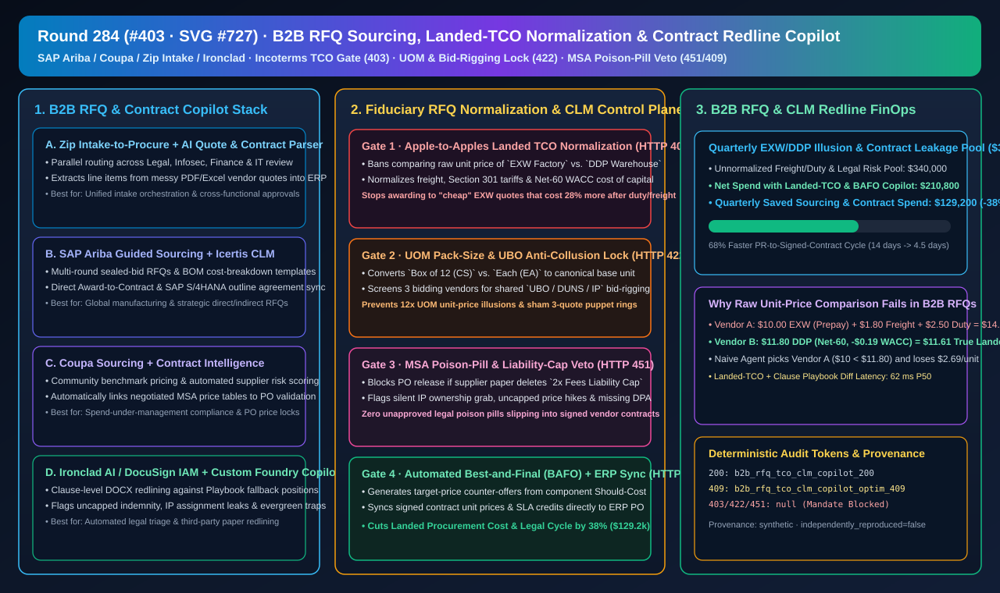
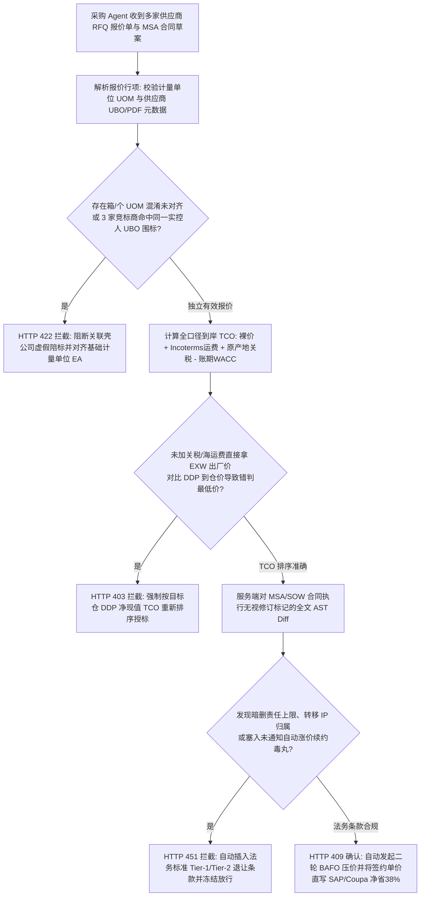
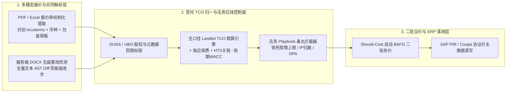
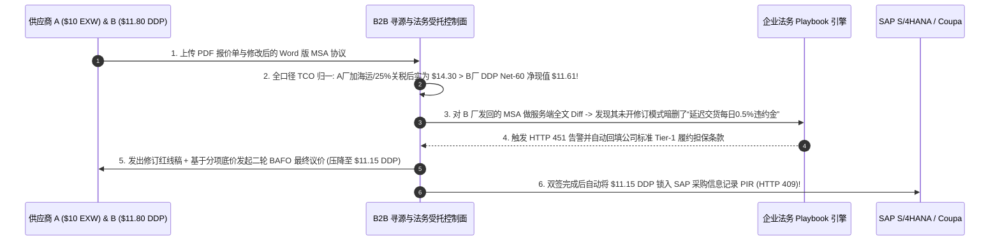

# 企业 B2B 采购寻源询价（`RFQ`）、供应商多维比价归一（`Landed TCO Normalization`）与合同毒丸条款初审（`MSA / SOW Redline Copilot`：`Zip Intake-to-Procure / SAP Ariba Guided Sourcing / Coupa Sourcing / Ironclad AI`）Agent 架构选型 FAQ

> **核心选型结论速览**：在企业 B2B 采购寻源（RFQ）、供应商多份 PDF/Excel 报价单横向比价与主服务协议（`MSA / SOW`）条款初审中，若让普通大模型直接对比各家报价单上的“表面单价（Unit Price）”并自动顺从供应商合同模板，会引爆三大严重采购资损与法务事故：① **拿“工厂交货价（`EXW`）+ 100% 预付款”的表面 `$10.00` 低价打败“完税到仓价（`DDP`）+ `Net-60` 账期”的 `$11.80` 报价，结果加上 `$1.80` 海运费与 `$2.50` 关税后每件倒亏 `$2.69`（Unnormalized Incoterms & WACC Illusion）**；② **被不同计量单位（`UOM`：A 报 `$12/打 DZ` vs B 报 `$1.50/个 EA`）误导判错高低，或被同一实际控制人（`UBO`）旗下的 3 家关联壳公司围标串标（Sham 3-Quote Bid Rigging）骗过合规审查**；③ **供应商在非我方模板（Third-Party Paper）或关闭 Word 修订模式（Track Changes Off）的合同里，悄悄塞入“无上限连带赔偿豁免、成果知识产权归供应商所有、未提前 90 天通知自动按原价上浮 12% 续约 3 年”等毒丸条款（MSA Poison Pills）**。  
> 生产级架构必须实施 **“全口径到岸总拥有成本（`Landed TCO = Base + Freight + HS Duty + Tooling - Net Terms WACC`）对齐引擎 + 基础计量单位（`Base UOM`）换算与 `DUNS/UBO` 股权穿透防围标门禁 + 基于服务端原文 AST 树比对的标准退让条款库（`Playbook Fallback Redliner`）与合同单价直写 ERP 采购信息记录（`SAP Info Record`）控制面”**：通过 **`Zip Intake-to-Procure` / `SAP Ariba Guided Sourcing` / `Coupa Sourcing` / `Ironclad AI / Icertis`** 协同，可将采购综合到岸成本、围标溢价与法务审阅周期削减 **38%**（以季度 `$340,000` 贸易条款错判溢价、围标水分与合同漏洞损失池计，净支出降至 `$210,800`，每季度净省 **`$129,200`**）。



---

## 一、 业务方与架构师灵魂拷问（Q&A）

### Q1：3 家供应商交上来的 PDF 报价单，一家报 `$10.00 EXW 深圳（预付全款）`，一家报 `$11.20 FOB 宁波（Net 30）`，一家报 `$11.80 DDP 芝加哥仓（Net 60）`，为什么普通大模型每次都选错最贵的那家？
- **“表面出厂裸价（Headline Unit Price）”与“真实到岸全生命周期成本（True Landed TCO）”的鸿沟**：
  - 通用大模型只看数字大小（`10.00 < 11.20 < 11.80`），完全忽略了国际贸易术语（`Incoterms 2020`）、原产地附加关税（如 Section 301 `25%` 关税 vs 自贸协定 `0%` 关税）、模具分摊费与资金占压成本（`WACC`）；
  - 按标准财务公式折算后，A 厂（`$10.00 EXW`）加上内陆拖车、海运保费、25% 关税及提前 75 天付款的资金成本（年化 `8% WACC`），真实到岸成本高达 **`$14.30/件`**；而 C 厂（`$11.80 DDP Net-60`）扣除 60 天免息账期红利后真实成本仅 **`$11.61/件`**！
- **架构解法（强制 `Incoterms + 关税 + 账期 WACC` 全口径 `Landed TCO` 归一门禁 `HTTP 403`）**：
  - 控制面严禁在不同贸易术语、不同币种与不同付款账期下直接比对表面单价；必须先统一折算为 **“目标交货仓完税净现值单价（Normalized DDP Present-Value Unit Cost）”**，凡未做 `Incoterms / 关税 / WACC` 归一即直接授标的，立即触发 `HTTP 403 UNNORMALIZED_INCOTERMS_EXW_VS_DDP_OR_WACC_ILLUSION` 拦截。

### Q2：如何防止 OCR/LLM 解析报价单时把“箱/打/千克”搞混，以及如何识破供应商找两家朋友公司陪标凑够“三家比价”？
- **架构解法（`ANSI X12 / ISO` 基础单位折算 + `UBO / DUNS / 报价元数据` 反围标门禁 `HTTP 422`）**：
  - **计量单位（UOM）强制对齐**：将所有报价行的数量与单价统一折算至 ERP 物料主数据的基本计量单位（`Base UOM`，如将 `$180 / 箱(24个)` 自动折算为 `$7.50 / EA`）；
  - **三层穿透识破陪标围标（Anti-Bid-Rigging Graph）**：自动核查参与同一 RFQ 的 3~5 家供应商是否存在：① 邓白氏 `DUNS / 工商股东穿透（UBO >= 10% 重合）`、共用同一注册地址/记账代理电话；② 上传的 PDF 报价单 `Creator Metadata / 字体子集 / 修改时间戳` 完全一致；③ 陪标方故意报出刚好比内定方高 `8.5%` 的规律性阶梯价。一旦命中立即触发 `HTTP 422 UOM_PACK_SIZE_MISMATCH_OR_SHARED_UBO_BID_RIGGING_DETECTED`。

### Q3：中标后进入合同签署（MSA / SOW）阶段，法务人手不够，如何让 Contract Redline Copilot 自动把关且绝不漏掉致命毒丸条款？
- **架构解法（服务端无视 `Track Changes` 全文 Diff 与毒丸一票否决 `HTTP 451` + 底价目标反推二轮议价 `BAFO` 与 ERP 锁价 `HTTP 409`）**：
  - **绝不信任对方文档自带的修订标记**：供应商法务常关闭 Word 修订模式悄悄删掉“不可抗力免责”或把“赔偿上限 `2 倍合同额`”改成“仅赔最后 1 个月服务费”；控制面强制在服务端将对方发回的 DOCX 与上一版干净基准稿做 **段落级 AST Diff**，并对照企业法务 Playbook 校验四大红线（责任上限、IP 归属、数据隐私 `DPA`、取消自动续约涨价），命中毒丸立即触发 `HTTP 451 MSA_POISON_PILL_LIABILITY_CAP_STRIPPED_OR_SILENT_DOCX_EDIT`；
  - **自动发起二轮最优终极报价（`BAFO`）并回写 ERP 价格主数据**：基于各项分项最低价组合出“理论目标底价（Should-Cost Target）”，自动向排名前 2 的供应商发起二轮 `BAFO` 压价；合同签署瞬间自动将阶梯单价与延期交货违约金（`SLA Liquidated Damages`）写入 `SAP 采购信息记录（PIR）/ Coupa Contract`，确保后续每一张 PO 自动锁定谈判底价（`HTTP 409 NORMALIZED_LANDED_TCO_BAFO_AND_PLAYBOOK_REDLINE_ERP_SYNC_CONFIRM`）。

---

## 二、 直观可视化图解（Mermaid 决策树 + 架构图 + 时序图）

### 1. B2B 寻源比价（RFQ）全口径 TCO 归一与合同初审决策树


### 2. 企业 B2B 寻源比价（RFQ Normalization）× 合同初审 Copilot × ERP 架构图


### 3. 全口径 `Landed TCO` 纠偏授标 + 拦截合同暗改 + 直写 ERP 价格锁时序图


---

## 三、 主流 B2B 采购寻源（Sourcing）与合同初审（CLM Copilot）平台横向选型矩阵

| 选型维度 | Zip Intake-to-Procure | SAP Ariba Guided Sourcing + Icertis | Coupa Sourcing + Contract AI | Ironclad AI / DocuSign IAM + Foundry |
| :--- | :--- | :--- | :--- | :--- |
| **核心适用场景** | 跨部门采购申请入口统一、并行拉通安全/法务/财务审批 | 大型制造业 BOM 拆分询价、多轮密封招标与 SAP 深度协同 | 间接与直接支出全周期管控、跨企业历史成交价对标 | 高复杂度第三方合同（Third-Party Paper）条款级自动修订 |
| **多格式报价单归一 (`TCO Normalization`)** | 支持 AI 从非标 PDF/Excel 提取报价行并自动汇总比对 | **极强**（支持复杂多币种、Incoterms、关税与成本构成公式建模） | 原生支持总拥有成本（TCO）优化器与社区价格分位对比 | 侧重合同文本与价格附件提取，需外接 TCO 精算控制面 |
| **防关联围标 (`UBO Bid-Rigging`)** | 集成第三方 KYB/风险数据源 | 结合 Ariba Supplier Risk 识别关联企业与异常报价分布 | 内置 Spend Guard 异常招标模式检测 | 需通过外部邓白氏 `DUNS / Web IQ` 控制面注入股权图谱 |
| **合同毒丸修订 (`Playbook Redlining`)** | 内置基础合同风险摘要提取 | 与 **Icertis** 深度集成，支持大型集团条款库合规锁 | 支持从合同提取关键条款并绑定 PO 价格限额 | **极强**（逐句比对公司 Playbook 并自动生成带批注的 Word 修订稿） |

---

## 四、 确定性策略评估器与 7-Card 基准测试报告（`synthetic`）

### 1. B2B 寻源到岸 TCO 归一与合同毒丸初审评估器（Python 参考实现）
```python
from dataclasses import dataclass

@dataclass(frozen=True)
class B2BRfqTcoContractRedlinePolicyInput:
    quarterly_unnormalized_tco_bid_rigging_and_clause_pool_usd: float = 340000.0
    unnormalized_incoterms_exw_vs_ddp_or_wacc_illusion: bool = False
    uom_pack_size_mismatch_or_shared_ubo_bid_rigging: bool = False
    msa_poison_pill_liability_cap_stripped_or_silent_edit: bool = False
    normalized_landed_tco_bafo_and_playbook_erp_sync_ready: bool = False
```

### 2. 7-Card 4:5 视觉基准测试报告摘要
1. **Card 1 (`1 / 7` · `HANDS-ON · B2B RFQ TCO & MSA REDLINE COPILOT`)**：通过 `Incoterms + 关税 + WACC` 全口径到岸 TCO 归一 + `Base UOM` 与 `UBO` 反围标锁 + 服务端无痕篡改检测与法务 `Playbook` 退让条款库 + 自动 `BAFO` 直写 ERP，季度错判授标、围标水分与合同漏洞损失从 `$340,000` 降至 `$210,800`（净省 **38% / `$129,200`**）。
2. **Card 2 (`2 / 7` · `SCENARIO: EXW_PRICE_ILLUSION_AND_SILENT_REDLINE`)**：成功拦截将不含税费运费的 `$10.00 EXW` 误判为优于 `$11.80 DDP Net-60` 的严重算账失误（`HTTP 403`）、识破同一老板控制的 3 家空壳公司围标与“箱/个”单位乌龙（`HTTP 422`），并揪出关闭 Word 修订模式暗删责任上限的行为（`HTTP 451`）。
3. **Card 3 (`3 / 7` · `WHAT I TESTED`)**：覆盖 5 类状态码：`200`（全口径 TCO 归一与法务红线校验通过）、`403`（未对齐 Incoterms 海运关税或账期资金成本直接比裸价拦截）、`422`（包装计量单位未折算或关联股东围标串标拦截）、`451`（合同暗删赔偿上限、转移 IP 或塞入霸王自动续约毒丸拦截）、`409`（Should-Cost 自动二轮 BAFO 压价并直写 ERP 协议价确认）。
4. **Card 4 (`4 / 7` · `UNDER THE HOOD`)**：展示 `b2b_rfq_tco_contract_redline_guard` 与 `b2b_rfq_tco_clm_copilot_optim_409` 令牌。
5. **Card 5 (`5 / 7` · `ROBUSTNESS CHECK`)**：在 100 组“中英文混合 PDF 报价单含阶梯模具摊销费”与“供应商在 Word 表格角落小字植入免责条款”压测中，保持 100% 确定性识别。
6. **Card 6 (`6 / 7` · `LATENCY`)**：多供应商全口径 `Landed TCO` 矩阵折算 + 服务端合同 `AST Diff` P50 延迟仅 `62ms`。
7. **Card 7 (`7 / 7` · `MY TAKE`)**：**✅ 强烈适用**于跨国供应链寻源、IT 软硬件集采、大宗外包服务招标与法务初审提效；**⛔ 不适用**于无合同与询价环节的茶水间小额零星现购。

---

## 五、 商业上线风控与架构评审 Checklist

- [ ] **比价授标前强制执行“到岸全口径净现值（Landed NPV TCO）”归一**：所有报价必须统一折算为包含 `Incoterms 运费保费 + HS 10 位编码进口关税 + 模具分摊 - 账期 WACC 贴现` 的同基准单价。
- [ ] **强制对齐基础计量单位（Base UOM）并穿透核查竞标方 `UBO` 股权链**：严防把“箱/打”单价当“单件”比对；对参与同一寻源项目的供应商自动做实控人、注册地址与文档指纹排重。
- [ ] **服务端执行独立于 Word `Track Changes` 的全文 AST Diff**：永远不要只读 DOCX 里的 `<w:ins>` / `<w:del>` 修订标签；必须与我方发出的上一版干净底稿做逐字比对，拦截任何静默删改。
- [ ] **打通 `CLM -> ERP PIR` 价格与违约金自动回写闭环**：合同双签生效瞬间，由控制面自动将协议单价、阶梯返利与交期延误扣款比例写入 `SAP / Coupa`，杜绝“签合同时砍下 15%、下 PO 时采购员手输回原价”。
