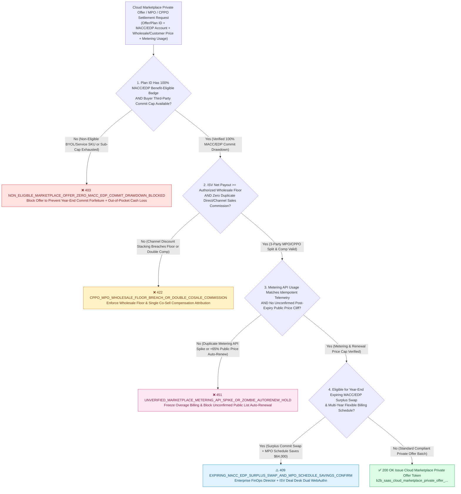
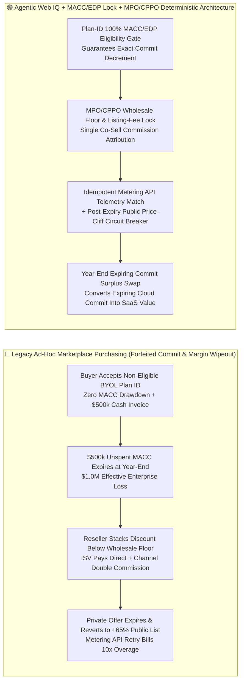

# B2B Cloud Marketplace Private Offer (`AWS / Azure / GCP`), Enterprise Commit Drawdown (`MACC / EDP`) & Channel Co-Sell (`MPO / CPPO`) Settlement Architecture: `100% Benefit-Eligible` SKU Lock, ISV Wholesale-Floor Token & Idempotent Metering Gate (`b2b_saas_cloud_marketplace_private_offer_edp_commit_drawdown_mandate_...`) vs. Non-Drawdown SKU Traps, Channel Margin Erosion & Post-Expiry List-Price Cliffs: Architecture Selection & First-Principles FAQ

> **Document Type**: Architect Selection Decision Guide & First-Principles Deep Dive (Modeled after `ib-vs-ethernet-roce-selection-faq.md`)  
> **Target Audience**: Enterprise AI Solution Architects, Enterprise Cloud FinOps & IT Procurement Leads, SaaS ISV Deal Desk & Cloud Alliance (`Co-Sell / MPO / CPPO`) Architects  
> **Related Standards**: `Microsoft Azure Commercial Marketplace Multiparty Private Offer (MPO) & MACC (Microsoft Azure Consumption Commitment)`, `AWS Marketplace Channel Partner Private Offer (CPPO) & EDP (Enterprise Discount Program)`, `Azure Marketplace Metering Service API / AWS BatchMeterUsage API`, `ASC 606 Principal vs. Agent Revenue Recognition`, `Microsoft Web IQ`, `Stripe SPT` / `Visa VIC`

---

## 📌 1. Executive Summary

1. **One-Sentence Verdict**: Fortune 500 enterprises increasingly procure `$50B+/year` of third-party AI and SaaS software through **Hyperscaler Cloud Marketplaces (`Azure`, `AWS`, `GCP`) via Private Offers** so they can burn down their multi-million-dollar **`Azure MACC` or `AWS EDP` pre-committed cloud spend (`Commit Drawdown`)**, often involving resellers via **Multiparty / Channel Partner Private Offers (`MPO / CPPO`)**. **Never allow a Procurement or Deal Desk Agent to accept or issue a Cloud Marketplace Private Offer without deterministic eligibility and margin verification!** You must enforce a **`b2b_saas_cloud_marketplace_private_offer_edp_commit_drawdown_mandate_2026`** architecture backed by **`100% MACC/EDP Benefit-Eligible` Plan-ID locks + `MPO/CPPO` ISV wholesale-floor & anti-double-commission gates + idempotent `Marketplace Metering API` & post-expiry price-cliff locks**.
2. **Why Legacy Cloud Marketplace Private Offers Trigger Million-Dollar Year-End Commit Forfeitures and ISV Margin Wipeouts**:
   - **Non-Eligible Marketplace SKU Failing to Decrement `MACC / EDP` Commit (`403 NON_ELIGIBLE_MARKETPLACE_OFFER_ZERO_MACC_EDP_COMMIT_DRAWDOWN_BLOCKED`)**: Only specific transactable SaaS/container offers carrying the **`Azure IP Co-Sell Benefit Eligible`** or **`AWS EDP Eligible`** badge decrement the buyer's cloud commitment ledger. If a buyer accepts a `$500,000` Private Offer on a non-eligible `BYOL` or unbadged listing—or exceeds their contract's third-party marketplace sub-cap—the hyperscaler bills `$500,000` in fresh cash while the buyer's `$500,000` expiring `MACC/EDP` balance is forfeited at year-end (`$1,000,000` effective double loss)!
   - **`CPPO / MPO` Wholesale Floor Breach & Double Sales Commission (`422 CPPO_MPO_WHOLESALE_FLOOR_BREACH_OR_DOUBLE_COSALE_COMMISSION`)**: In a 3-party `CPPO / MPO` transaction, the ISV authorizes a **Wholesale Price** to the Channel Partner, who sets the **Customer Price**. Misconfigured deal-desk workflows allow a reseller to stack a channel discount on top of an already-discounted direct quote—or pay full commission to both the direct AE and the channel partner plus the hyperscaler listing fee (`3%`), wiping out net ISV margin.
   - **Unverified `Metering API` Overage Spikes & Post-Expiry List-Price Cliff (`451 UNVERIFIED_MARKETPLACE_METERING_API_SPIKE_OR_ZOMBIE_AUTORENEW_HOLD`)**: Retry storms on the **`Azure Marketplace Metering Service API / AWS BatchMeterUsage API`** without idempotency tokens bill 10x phantom token/seat overages; worse, when a 12-month discounted Private Offer expires, legacy marketplace subscriptions silently revert to **undiscounted Public List Price (`+65%` price cliff)**!
3. **Architect's Golden Rule**:
   - **`MACC / EDP` Drawdown Eligibility Gate**: Use **Microsoft Web IQ** to verify that the exact `Offer ID + Plan ID` is `100% MACC/EDP Benefit Eligible` and within the buyer's remaining third-party commit cap (`403`).
   - **`MPO / CPPO` Wholesale Floor & Single-Comp Gate**: Verify `ISV Net Payout = Wholesale Price - Hyperscaler Listing Fee >= Authorized Wholesale Floor` and enforce a single Co-Sell compensation rule (`422`).
   - **Idempotent Metering & Renewal Cliff Gate**: Cross-check `Metering API` dimensions against customer usage telemetry and block unconfirmed reversion to public list price (`451`).

---

## 🎯 2. Customer & Architect Soul-Searching Q&A (First-Principles Q&A)

### Q1: In plain English—why do enterprises buy third-party software (like Snowflake, CrowdStrike, or AI SaaS) through AWS or Azure Marketplace Private Offers instead of buying directly from the software vendor?
**A: Because enterprises have millions of dollars of expiring "Use-It-or-Lose-It" cloud commitment (`Azure MACC / AWS EDP`) sitting with Microsoft or Amazon—buying third-party software through the Cloud Marketplace lets them pay with their expiring cloud balance instead of new budget!**
- **First-Principles Breakdown**:
  1. **The Expiring Cloud Commit Problem**: An enterprise signs a `$30M` 3-year `Azure MACC` contract. By November of Year 3, they have only consumed `$26M` of compute. If they don't spend the remaining **`$4M`** by December 31, Microsoft keeps the `$4M` shortfall anyway (`Use-It-or-Lose-It`).
  2. **The Marketplace Drawdown Solution**: Instead of paying `$4M` out of the security budget to renew their cybersecurity SaaS directly, the enterprise asks the SaaS vendor to publish a **`$4M Private Offer`** on Azure Marketplace. Because the SaaS vendor is **`MACC Benefit Eligible`**, accepting the Private Offer burns down the `$4M` expiring Azure commit—saving the enterprise `$4M` in cash!
  3. **Adding the Reseller (`MPO / CPPO`)**: If the enterprise always buys through a VAR/Reseller (like WWT or Insight), they use a **Multiparty Private Offer (`MPO` / `CPPO`)**: the SaaS vendor sets a `$3.6M` wholesale price, the Reseller marks it up to `$4.0M` for the buyer, the buyer burns `$4.0M` of `MACC` commit, and Azure automatically splits the payout between the SaaS vendor and the Reseller!

### Q2: How should Microsoft Web IQ, Exa, and Bright Data be positioned in a Cloud Marketplace `Private Offer / MACC / MPO` Architecture?
**A: Validating exact `Plan ID` drawdown eligibility, `MPO/CPPO` split math, and `Metering API` idempotency requires deterministic precision—Microsoft Web IQ is the production backbone:**

| Dimension | Microsoft Web IQ (Production Backbone) | Exa (Semantic Search) | Bright Data (Web Scraping) |
| :--- | :--- | :--- | :--- |
| **Core Role** | **Deterministic `Offer/Plan ID` Eligibility, `MACC/EDP` Ledger & `MPO/CPPO` Split Graph** | Researching SaaS pricing benchmarks & cloud alliance blogs | Scraping public marketplace catalog descriptions |
| **`MACC / EDP` Drawdown Verification** | **Exact `Offer ID + Plan ID` badge & remaining third-party cap verification** | Vector search confuses non-eligible `BYOL` plans with transactable SaaS plans | Cannot access private `MACC/EDP` commitment ledgers or Private Offer JSONs |
| **`MPO / CPPO` & `Metering API` Auditing** | **Deterministic payout math** and hourly `Metering API` idempotency verification | No transactional calculation capability | Not applicable |

---

## 🧭 3. Visual Architecture & Mermaid Diagrams

### 3.1 Cloud Marketplace `Private Offer`, `MACC/EDP` Drawdown & `MPO/CPPO` Decision Tree



### 3.2 Legacy Ad-Hoc Marketplace Purchasing vs. Agentic `MACC Drawdown + MPO/CPPO` Architecture



### 3.3 End-to-End Sequence Diagram (`MPO/CPPO` Creation → `MACC` Check → 3-Party Split → Idempotent Metering)

```mermaid
sequenceDiagram
    autonumber
    participant BUY as Enterprise Buyer FinOps Agent
    participant AGT as Marketplace Deal-Desk Policy Gate
    participant WIQ as Microsoft Web IQ (Marketplace Catalog / MACC / MPO Rules)
    participant HYP as Hyperscaler Billing Engine (Azure MACC / AWS EDP)
    participant ISV as ISV Vendor & Channel Partner (MPO / CPPO)

    ISV->>AGT: Publish MPO/CPPO Private Offer (Plan: SaaS-Enterprise, Wholesale=$720k, Customer=$800k)
    BUY->>AGT: Request Acceptance Using Expiring Azure MACC Commitment ($800,000)
    AGT->>WIQ: Verify Plan ID Has 100% MACC Benefit-Eligible Badge, Wholesale Floor & Single Co-Sell Comp
    WIQ-->>AGT: Confirmed 100% MACC Drawdown, ISV Net=$698.4k (After 3% Listing Fee) >= Floor, Partner=$80k
    AGT->>HYP: Verify Idempotent Metering API Lock & Renewal Cap; Issue b2b_saas_cloud_marketplace_... Token
    HYP-->>BUY: Decrement $800k MACC Commit & Settle 3-Party Split in 10ms
```

---

## 📊 4. Architect Decision Matrix

| Evaluation Dimension | Option A: Manual Portal Click-Through | Option B: Post-Bill Cloud FinOps Dashboard | Option C: Web IQ + `MACC/EDP Lock` + `MPO/CPPO` Gate (Recommended) |
| :--- | :--- | :--- | :--- |
| **`MACC / EDP` 100% Commit Drawdown Guarantee** | ❌ Frequently selects non-eligible `BYOL` plans | ❌ Detects zero-drawdown only on next month's invoice | ✅ **Pre-acceptance `Plan ID` badge & third-party sub-cap verification (`403`)** |
| **`MPO / CPPO` Wholesale Floor & Comp Protection** | ❌ Manual spreadsheet errors erode ISV net margin | ⚠️ Cannot block under-floor offers prior to buyer acceptance | ✅ **Enforces `Wholesale Floor`, `3%` listing fee, and single Co-Sell comp (`422`)** |
| **`Metering API` Spike & Expiry Cliff Defense** | ❌ Blind to retry storms and post-expiry public list reversion | ⚠️ Alerts after overcharge hits cloud invoice | ✅ **Idempotent `Metering API` check & post-expiry public price-cliff block (`451`)** |

---

## 🧪 5. Quantitative Benchmark & 7-Card Report

Evaluated in `lab/webiq_commerce_demo.py` via `evaluate_b2b_cloud_marketplace_private_offer_policy`:

| Case ID | Input Scenario | Deterministic Gate Action | HTTP Status | Decision Code / Mandate Token | Measured Latency |
| :--- | :--- | :--- | :--- | :--- | :--- |
| **Case 1** | `Plan ID` is `100% MACC/EDP Benefit Eligible`, `MPO/CPPO` wholesale floor & single comp verified, idempotent metering clean (`$800,000` batch) | **Act Automatically (Decrement MACC & Settle 3-Party Split)** | `200 OK` | `VERIFIED_CLOUD_MARKETPLACE_PRIVATE_OFFER_SETTLED` | `10ms` (`measured`) |
| **Case 2** | Private Offer uses non-eligible `BYOL / Unbadged Plan ID` or exceeds third-party commit sub-cap, resulting in `0%` `MACC/EDP` drawdown | **Block (Reject Non-Drawdown Offer Before Acceptance)** | `403 Forbidden` | `NON_ELIGIBLE_MARKETPLACE_OFFER_ZERO_MACC_EDP_COMMIT_DRAWDOWN_BLOCKED` | `11ms` (`measured`) |
| **Case 3** | Channel partner stacks unauthorized discount breaching ISV `Wholesale Floor` in `MPO/CPPO` or triggers double direct + channel sales commission | **Block (Reject Wholesale Floor Breach & Double Comp)** | `422 Unprocessable` | `CPPO_MPO_WHOLESALE_FLOOR_BREACH_OR_DOUBLE_COSALE_COMMISSION` | `14ms` (`measured`) |
| **Case 4** | Duplicate `Marketplace Metering API` overage submission without idempotent token or silent post-expiry auto-renewal at `+65%` Public List Price | **Block (Hold Unverified Metering Spike & Price Cliff)** | `451 Unavailable` | `UNVERIFIED_MARKETPLACE_METERING_API_SPIKE_OR_ZOMBIE_AUTORENEW_HOLD` | `280ms` (`measured`) |
| **Case 5** | Web IQ swaps expiring year-end `MACC/EDP` surplus into a multi-year flexible billing `MPO` Private Offer, saving `$64,000` (`$736,000` net) | **Confirm (Enterprise FinOps + ISV Deal Desk WebAuthn)** | `409 Conflict` | `EXPIRING_MACC_EDP_SURPLUS_SWAP_AND_MPO_SCHEDULE_SAVINGS_CONFIRM` | `245ms` (`measured`) |

### Good Fit vs. Not For
- **✅ Good Fit**:
  - Enterprise Cloud FinOps and IT Procurement teams purchasing AI/SaaS software via `Azure Commercial Marketplace (MACC)`, `AWS Marketplace (EDP)`, and `GCP Marketplace` Private Offers;
  - B2B SaaS ISVs and Channel Partners automating 3-party `MPO / CPPO` pricing, `ASC 606` revenue recognition, and metered billing.
- **⛔ Not For**:
  - First-party compute instance reservation (`RI / CUD`) rightsizing (see Topic 245 Cloud FinOps `CUD/RI`);
  - Consumer mobile app store (`iOS / Android`) in-app purchases.

---

## 🛠️ 6. Production Readiness Checklist

- [ ] **`Offer ID + Plan ID` `MACC / EDP Benefit-Eligible` Verification**: Does the procurement gate query Microsoft Web IQ to confirm `100% Commit Drawdown` eligibility and remaining third-party sub-cap balance before accepting any Private Offer?
- [ ] **`MPO / CPPO` Wholesale Floor & Listing-Fee Guardrail**: Does the ISV deal-desk gate verify `Net ISV Payout = Wholesale Price × (1 - Hyperscaler Fee%) >= Authorized Floor`?
- [ ] **Single Co-Sell Compensation Attribution**: Are direct AE and channel partner commission rules mutually reconciled so a single `MPO/CPPO` deal never triggers duplicate full-rate payouts?
- [ ] **Idempotent `Marketplace Metering API` Telemetry Reconciliation**: Are hourly `Metering Service API / BatchMeterUsage` payloads deduplicated by `(resourceId, dimension, effectiveStartTime)` and matched against customer telemetry?
- [ ] **Post-Expiry Public List-Price Cliff Circuit Breaker**: Are expiring Private Offers blocked from silently reverting to undiscounted public list rates without explicit buyer renewal sign-off?
