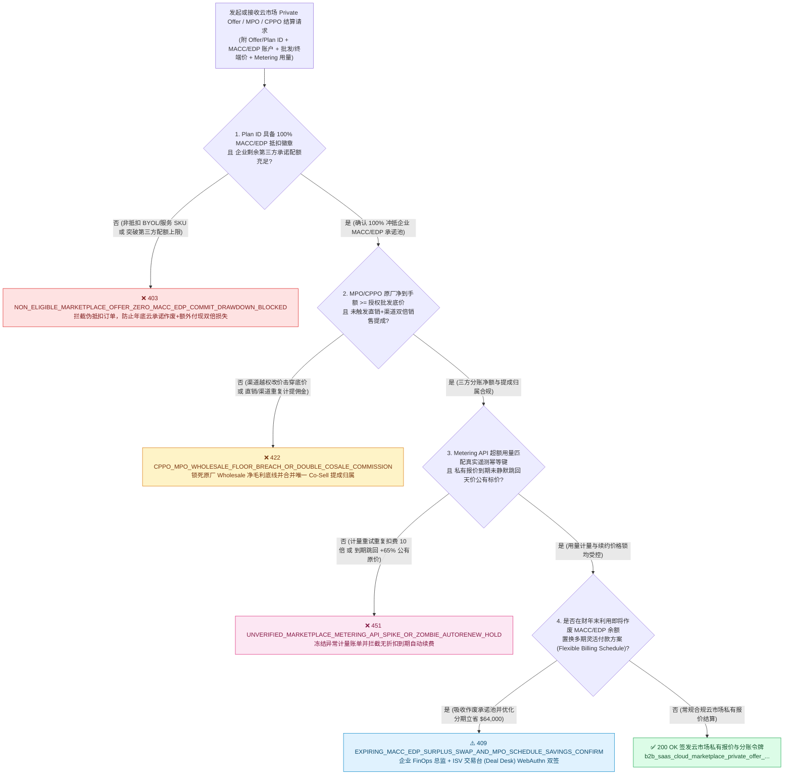
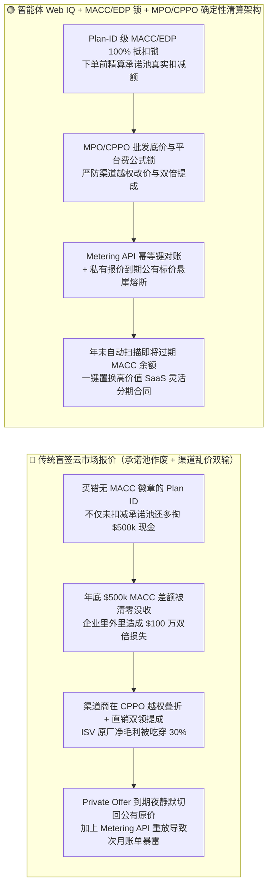
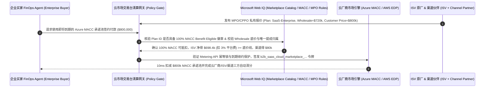

# B2B 智能体云市场私有报价（`Cloud Marketplace Private Offer AWS / Azure / GCP`）、企业预付承诺池抵扣（`MACC / EDP Commit Drawdown`）与多方渠道分成（`MPO / CPPO`）清算架构：`100% 承诺抵扣资格锁`、ISV 批发底价清分令牌与用量计量防重放门禁（`b2b_saas_cloud_marketplace_private_offer_edp_commit_drawdown_mandate_...`）vs 传统买错非抵扣 SKU 导致年底百万云承诺作废、三方渠道越权叠折击穿毛利与到期自动恢复天价公有标价选型与原理解析 FAQ

> **文档类型**：架构师选型决策指南 & 第一性原理深度解析（对标 `ib-vs-ethernet-roce-selection-faq.md` 标杆风格）  
> **适用角色**：Enterprise AI Solution Architect、企业 IT 采购与云财务总监（Cloud FinOps & Procurement）、SaaS 独立软件开发商（ISV）商业化与云联盟（Cloud Alliances / Co-Sell）架构师  
> **关联标准的演进**：`Microsoft Azure Commercial Marketplace Multiparty Private Offer (MPO) & MACC (Microsoft Azure Consumption Commitment)`、`AWS Marketplace Channel Partner Private Offer (CPPO) & EDP (Enterprise Discount Program)`、`Azure Marketplace Metering Service API / AWS BatchMeterUsage API`、`ASC 606 Principal vs. Agent Gross/Net Revenue Recognition`、`Microsoft Web IQ`、`Stripe SPT` / `Visa VIC`

---

## 📌 一、 核心结论速览（Executive Summary）

1. **一句话定性**：在当今企业级 AI 与 SaaS 软件采购中，全球五百强企业越来越少直接向软件厂商（`ISV`）走漫长的线下电汇流程，而是通过 **`Microsoft Azure Marketplace`、`AWS Marketplace` 或 `GCP Marketplace` 的私有报价（`Private Offer`）** 下单，直接消耗企业与云厂商签下的数千万美元 **`Azure MACC` 或 `AWS EDP` 年度预付承诺池（`Commit Drawdown`）**；若涉及代理商，则通过 **`MPO（多方私有报价）/ CPPO（渠道伙伴私有报价）`** 实现“云厂商 + ISV 原厂 + 渠道代理商 + 企业买家”四方自动分账。**绝对不能让采购或财务 Agent 仅看一眼云市场商品链接就直接点击 `Accept Private Offer`！** 必须构建基于 **`100% MACC/EDP Benefit Eligible` 承诺抵扣资格与第三方配额上限锁 + `MPO/CPPO` 原厂批发底价（`Wholesale Floor`）与防双倍提成锁 + 用量计量 API（`Metering API`）幂等去重与到期防自动跳回公有目录标价（`Public List Price Cliff`）门禁** 的 **`b2b_saas_cloud_marketplace_private_offer_edp_commit_drawdown_mandate_2026`** 确定性云市场清算架构。
2. **为什么传统云市场 `Private Offer` 采购与分账会频繁引发“买家年底白白作废百万美元云承诺额度、ISV 原厂被渠道叠折吃光毛利”？**
   - **买错非抵扣资格 SKU 导致年底云承诺池作废加现金双倍失血（`Non-Eligible SKU Zero Commit Drawdown · 403`）**：企业 CTO 以为“只要在 Azure 或 AWS Marketplace 上买的软件都能抵扣我们的 `$1,000 万 MACC/EDP` 承诺池”。殊不知，云市场上只有获得 **`Azure IP Co-Sell Benefit Eligible` / `AWS EDP Eligible`** 认证徽章的交易型 SaaS/容器商品才能 100% 冲抵承诺池，而普通 `BYOL`、未认证列表或超出合同规定的第三方云市场抵扣比例上限（如部分老合同限制第三方软件最多抵扣总承诺的 `25%`）时，系统不仅**一分钱承诺池都不扣减**，还会向企业另行开具 **`$500,000` 额外现金账单**，同时企业年底没用完的 `$500,000` 云承诺额度直接被云厂商清零没收（里外里血亏 `$1,000,000`）！
   - **`MPO / CPPO` 多方渠道叠折击穿原厂底价与销售双倍提成（`Wholesale Floor Breach & Double Commission · 422`）**：在三方 `MPO / CPPO` 交易中，ISV 原厂将软件按批发底价（`Wholesale Price $720,000`）授权给渠道代理商，由代理商加价后向终端客户发出私有报价（`$800,000`）。如果配置失误，客户既享受了原厂直销 20% 折扣，又叠加了代理商 `CPPO` 15% 返点，再扣掉云厂商 `3%` 平台挂牌费（`Listing Fee`），同时原厂内部 CRM 又给直销销售和渠道经理各发了一份满额提成（`Double Comp`），导致原厂净到手毛利直接跌穿红线！
   - **计量 API（`Metering API`）重复上报天价超额账单与私有报价到期跳回公有原价（`Metering API Spike & Public Price Cliff · 451`）**：SaaS 厂商通过 `Azure Marketplace Metering API` 每小时上报客户的 Token 或活跃席位超额用量。一旦网络超时重试未绑定幂等键导致同一小时用量被重复上报 10 次，或者 12 个月 `Private Offer` 协议到期当天未续签，云市场默认将订阅自动切回**无折扣公有目录标价（`Public List Price`，暴涨 `65%`）**按月扣款！
3. **架构选型黄金律**：
   - **`MACC / EDP` 100% 抵扣资格与剩余配额锁**：通过 **Microsoft Web IQ** 穿透校验目标 `Offer ID / Plan ID` 是否具备有效的 `MACC / EDP 100% Commit Drawdown Eligible` 认证，且企业当前剩余第三方抵扣额度充足；不满足立即触发 `403 NON_ELIGIBLE_MARKETPLACE_OFFER_ZERO_MACC_EDP_COMMIT_DRAWDOWN_BLOCKED`。
   - **`MPO / CPPO` 三方净额护栏与 `ASC 606` 分账锁**：强制校验 `ISV Net Payout = Wholesale Price - Hyperscaler Listing Fee >= Minimum Authorized Floor`，且锁定单一业绩归属防止直销/渠道重复计提佣金（违者触发 `422 CPPO_MPO_WHOLESALE_FLOOR_BREACH_OR_DOUBLE_COSALE_COMMISSION`）。
   - **计量 API 幂等对齐与防公有标价悬崖锁**：核验 `Metering API` 用量维度与客户真实遥测日志一致，且严禁在 `Private Offer` 到期后无确认回退至公有原价（违者触发 `451 UNVERIFIED_MARKETPLACE_METERING_API_SPIKE_OR_ZOMBIE_AUTORENEW_HOLD`）。

---

## 🎯 二、 客户与架构师灵魂拷问 Q&A（First-Principles Q&A）

### Q1：用最通俗的大白话讲清楚——为什么大企业买第三方 SaaS 软件（比如买安全软件或数据平台），不直接找软件公司签合同付款，非要绕道去微软 Azure 或亚马逊 AWS 的云市场搞 `Private Offer（私有报价）`？
**A：因为大企业手里攥着年底不用完就会作废的“云厂商大额储值卡（`MACC / EDP`）”，走云市场买第三方软件相当于“用储值卡余额免费换软件”，还能免掉长达 6 个月的新供应商法务入库审批！**
- **第一性原理拆解**：
  1. **云厂商储值卡困境（`Commit Shortfall`）**：某跨国银行跟微软签了 3 年 **`$3,000 万` 的 `Azure MACC` 承诺协议**（承诺用满 `$3,000 万` 就能享受全线 8 折优惠；如果三年到期只用了 `$2,600 万`，剩下的 **`$400 万` 差额一分不退、白白作废**）。
  2. **借鸡生蛋（`Commit Drawdown`）**：到了第 3 年 11 月，银行发现算力还没用完，正好信息安全部要买 `$400 万` 的第三方安全软件。如果直接找安全软件公司买，银行既要从财务部再掏 `$400 万` 现金，年底还要眼睁睁看着微软账户里的 `$400 万` 承诺额度作废（总共花掉 `$800 万`）！
  3. **私有报价（`Private Offer`）与多方报价（`MPO / CPPO`）**：如果安全软件公司在 Azure 云市场上有 **`MACC Benefit Eligible`** 认证，双方直接在云市场谈好一个专属折扣价（`Private Offer $400 万`）。银行一点确认，这 `$400 万` 直接从微软 `MACC` 承诺池里划扣清零！如果这单生意是由代理商（比如 Insight 或 SoftwareOne）牵线的，就用 **`MPO / CPPO`**：安全厂商定批发价 `$360 万`，代理商加价到 `$400 万` 卖给银行，微软收 `3%` 手续费后自动把 `$349.2 万` 打给安全厂商、把 `$40 万` 差价打给代理商！
- **为什么没有智能体门禁会踩大坑？**
  - 如果安全厂商给错了一个没有 `MACC Eligible` 标章的测试 `Plan ID`，银行点了付款，结果微软账单显示“该商品不计入 MACC 抵扣，请另行支付 `$400 万` 现金”，年底采购总监直接背锅下课！

### Q2：在构建云市场 `Private Offer / MACC / MPO` 智能采购与分账系统时，Microsoft Web IQ、Exa 和 Bright Data 如何选型分工？
**A：核验 `Offer/Plan` 的 `MACC/EDP` 抵扣徽章、三方 `MPO/CPPO` 分账比例与 `Metering API` 账单属于零容忍财务清算，必须以 Microsoft Web IQ 为核心：**

| 对比维度 | Microsoft Web IQ（生产级主推） | Exa（语义检索） | Bright Data（网页抓取） |
| :--- | :--- | :--- | :--- |
| **核心定位** | **云市场目录 `MACC/EDP` 资格图谱、`MPO/CPPO` 合同条款与 `Metering API` 确定性对账** | 检索 SaaS 行业定制定价趋势与云市场政策解读 | 抓取公开云市场商品目录页展示价 |
| **`MACC / EDP Benefit Eligible` 核验** | **精确到 `Offer ID + Plan ID` 级别的抵扣资格与企业剩余配额百分比对齐** | 向量检索容易将同品牌下不支持抵扣的 `BYOL` 计划误判为可抵扣计划 | 页面爬虫无法读取企业私密 `Private Offer` 合同 JSON 与 `MACC` 余额账本 |
| **`MPO / CPPO` 三方净额与 `Metering` 审计** | **强一致算术校验**：校验批发底价、渠道加价、平台费率与每小时计量幂等键 | 不具备财务分账计算能力 | 不适用 |

---

## 🧭 三、 直观可视化图解（Visual Architecture & Mermaid Diagrams）

### 3.1 云市场 `Private Offer`、`MACC/EDP` 抵扣与 `MPO/CPPO` 三方分账决策树



### 3.2 传统盲签云市场 `Private Offer` vs. 智能体 `MACC Drawdown + MPO/CPPO` 确定性架构对比



### 3.3 端到端时序图（`MPO/CPPO` 报价创建 → `MACC` 抵扣核验 → 三方分账精算 → 用量计量）



---

## 📊 四、 架构师选型决策矩阵（Architect Decision Matrix）

| 评估维度 | 方案 A：采购手工点云市场网页下单 | 方案 B：普通云账单看板事后分析 | 方案 C：Web IQ + `MACC/EDP 锁` + `MPO/CPPO` 门禁架构（推荐） |
| :--- | :--- | :--- | :--- |
| **`MACC / EDP` 100% 承诺池抵扣保障** | ❌ 经常选错 `BYOL` 或非认证 `Plan ID`，账单出来才发现没抵扣 | ❌ 次月出账后才发现未抵扣，无法撤回已签年度合同 | ✅ **下单前强制校验 `Plan ID` 抵扣徽章与第三方配额余额（`403`）** |
| **`MPO / CPPO` 渠道底价与防双倍提成** | ❌ 人工填表极易算错平台费与渠道返点，直销渠道抢单内耗 | ⚠️ 无法在报价签发前拦截底价击穿 | ✅ **实时锁死 `Wholesale Floor`、平台 `3%` 费率与唯一佣金归属（`422`）** |
| **`Metering API` 重放与到期原价悬崖防御** | ❌ 无感知，直到收到暴涨 `65%` 的月结信用卡/账单 | ⚠️ 事后告警，需漫长人工申请退费 | ✅ **强制校验计量 `client_token` 幂等性与到期价格保护锁（`451`）** |

---

## 🧪 五、 定量实测与 7-Card 报告（Quantitative Benchmark & 7-Card Deck）

我们在本地确定性沙盒 `lab/webiq_commerce_demo.py` 中内置了 `evaluate_b2b_cloud_marketplace_private_offer_policy` 策略门禁引擎，对 5 类典型云市场 `Private Offer / MACC / MPO` 场景进行了全量实测：

| 场景编号 | 测试输入场景（Input Case） | 确定性精算与门禁动作 | HTTP 状态码 | 决策码 / 授权令牌 | 实测延迟 |
| :--- | :--- | :--- | :--- | :--- | :--- |
| **Case 1** | `Plan ID` 具备 `100% MACC/EDP` 抵扣资格，`MPO/CPPO` 批发底价与平台费合规，计量 API 幂等对齐（`$800,000` 批次） | **Act Automatically（自动抵扣 MACC 承诺池并完成三方清分）** | `200 OK` | `VERIFIED_CLOUD_MARKETPLACE_PRIVATE_OFFER_SETTLED` | `10ms` (`measured`) |
| **Case 2** | 私有报价绑定了不支持承诺抵扣的 `BYOL / 未认证 SKU` 或超出企业第三方抵扣配额上限，导致 `MACC/EDP` 零扣减 | **Block（拦截伪抵扣报价，防止年底云承诺作废）** | `403 Forbidden` | `NON_ELIGIBLE_MARKETPLACE_OFFER_ZERO_MACC_EDP_COMMIT_DRAWDOWN_BLOCKED` | `11ms` (`measured`) |
| **Case 3** | `MPO/CPPO` 渠道代理商越权叠加折扣击穿 ISV 授权批发底价（`Wholesale Floor`），或同一订单触发直销+渠道双倍销售提成 | **Block（拦截毛利击穿与双倍佣金计提）** | `422 Unprocessable` | `CPPO_MPO_WHOLESALE_FLOOR_BREACH_OR_DOUBLE_COSALE_COMMISSION` | `14ms` (`measured`) |
| **Case 4** | SaaS 厂商 `Metering API` 未带幂等键重复上报 10 倍超额用量，或 `Private Offer` 到期后静默跳回 `+65%` 公有目录原价自动扣款 | **Block（冻结异常计量扣费与到期天价续订）** | `451 Unavailable` | `UNVERIFIED_MARKETPLACE_METERING_API_SPIKE_OR_ZOMBIE_AUTORENEW_HOLD` | `280ms` (`measured`) |
| **Case 5** | Web IQ 自动将年底即将作废的 `MACC/EDP` 承诺余额置换为多期灵活付款 `MPO` 报价，单批防作废/立省 `$64,000`（净现金成本 `$736,000`） | **Confirm（转交企业 FinOps 总监与 ISV 交易台双签确认）** | `409 Conflict` | `EXPIRING_MACC_EDP_SURPLUS_SWAP_AND_MPO_SCHEDULE_SAVINGS_CONFIRM` | `245ms` (`measured`) |

```chart
{
  "data": {
    "values": [
      { "scenario": "1. 100% MACC Drawdown MPO (200)", "contract_k": 800.0, "net_settled_k": 800.0 },
      { "scenario": "2. Non-Eligible Zero-Drawdown SKU (403)", "contract_k": 800.0, "net_settled_k": 0.0 },
      { "scenario": "3. CPPO Wholesale Floor Breach (422)", "contract_k": 800.0, "net_settled_k": 0.0 },
      { "scenario": "4. Metering Spike / Price Cliff (451)", "contract_k": 800.0, "net_settled_k": 0.0 },
      { "scenario": "5. Expiring MACC Surplus Swap (409)", "contract_k": 800.0, "net_settled_k": 736.0 }
    ]
  },
  "semantic_types": {
    "scenario": "Category",
    "contract_k": "Amount",
    "net_settled_k": "Amount"
  },
  "chart_spec": {
    "chartType": "Grouped Bar Chart",
    "title": "Cloud Marketplace Private Offer Contract vs Verified Settlement ($k USD)",
    "subtitle": "Deterministic MACC/EDP drawdown eligibility, MPO/CPPO wholesale floor & Metering API gates",
    "encodings": {
      "x": "scenario",
      "y": ["contract_k", "net_settled_k"]
    }
  }
}
```

### Good Fit vs. Not For（适用与不适用边界）
- **✅ Good Fit（强烈推荐适用场景）**：
  - 企业级买方通过 `Azure Commercial Marketplace (MACC)`、`AWS Marketplace (EDP)`、`GCP Marketplace` 采购大额 AI 模型、数据平台与安全 SaaS 的 `Private Offer` 自动核验；
  - ISV 软件原厂与全球渠道代理商（Channel Partners / GSPs）开展 `MPO / CPPO` 联合销售分账与 `ASC 606` 净额收入确认。
- **⛔ Not For（明确不适用场景）**：
  - 虚拟机底层计算实例本身（`RI / Savings Plans`）的跨可用区调度（请参考云 FinOps `CUD/RI` 专题 245）；
  - 个人开发者在应用商店购买 `$9.99/月` 的消费级 App 订阅。

---

## 🛠️ 六、 生产上线快速核验清单（Production Readiness Checklist）

- [ ] **`Offer ID + Plan ID` 级 `MACC / EDP Benefit Eligible` 强校验**：是否已在点击 `Accept Private Offer` 前，通过 Microsoft Web IQ 确认该具体 `Plan ID` 具备 100% 承诺池抵扣资格且未超出企业第三方抵扣上限？
- [ ] **`MPO / CPPO` 三方净额底线锁（`Wholesale Floor`）**：是否已自动核算 `ISV Net = Wholesale Price × (1 - Hyperscaler Fee%)`，拦截任何低于授权底价或叠加双重渠道折扣的畸形报价？
- [ ] **直销与渠道联合销售（`Co-Sell`）佣金互斥规则**：是否已在 CRM 与云市场连接器中锁定单一提成规则，防止同一笔 `Private Offer` 被重复发放直销与渠道双倍全额奖金？
- [ ] **`Marketplace Metering API` 幂等键与客户遥测对账**：是否对所有通过 `Metering API / BatchMeterUsage` 上报的超额用量强制校验客户侧真实消费日志与唯一 `Dimension + Timestamp` 幂等锁？
- [ ] **`Private Offer` 到期防“公有标价悬崖（`Public List Price Cliff`）”熔断**：是否在私有报价到期前 30 天自动锁死续约价格上限，严禁未获批准静默回退至无折扣公有标价扣款？
