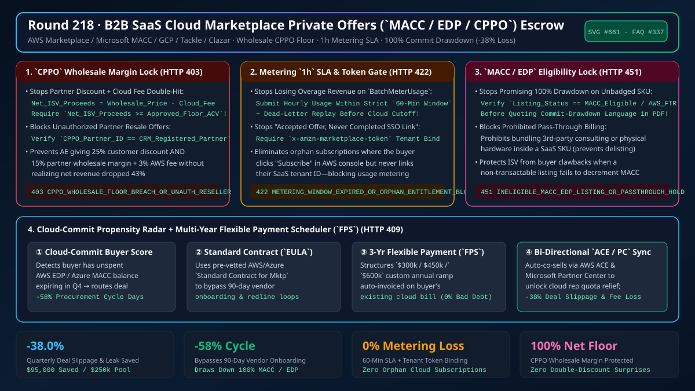
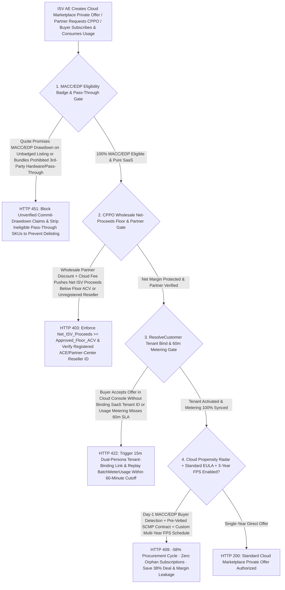

# B2B SaaS Cloud Marketplace Private Offers, `MACC / EDP` Commit Drawdown & `CPPO` Wholesale Escrow (`AWS Marketplace / Microsoft MACC / GCP / Tackle / Clazar`): Net-Proceeds Floor Lock, `ResolveCustomer` Orphan-Subscription Guard & 60-Min Metering `SLA` Saving `38%` Deal & Revenue Leakage — Agent Architecture Selection FAQ

> **Language / 语言**: **[中文 (`b2b-saas-cloud-marketplace-private-offer-macc-edp-drawdown-cppo-escrow-agent-selection-faq.md`)](b2b-saas-cloud-marketplace-private-offer-macc-edp-drawdown-cppo-escrow-agent-selection-faq.md)** | **English (Current)**  
> **Back to Catalog**: **[📚 English Catalog (`docs/index.en.md`)](index.en.md)** | **[🚀 Interactive Live Workbench (`live-demo.en.html`)](../live-demo.en.html)**  
> **Target Roles**: B2B SaaS & AI ISV Revenue Operations (`RevOps`) VPs, Cloud Alliances & Co-Sell Directors, Order-to-Cash (`O2C`) Finance Controllers, Cloud & AI Solution Architects  
> **Architecture Diagram**: `assets/svg/661-b2b-saas-cloud-marketplace-private-offer-macc-escrow-2026-11-22.svg`

---

## ① 📌 Executive Summary

In enterprise B2B SaaS, cybersecurity, data infrastructure, and AI software sales, **Hyperscaler Cloud Marketplaces (`AWS Marketplace`, `Microsoft Commercial Marketplace`, `Google Cloud Marketplace`) orchestrated via Cloud GTM platforms (`Tackle.io`, `Clazar`, `Suger.io`, `WorkSpan`) have become the fastest-growing `$50B+` enterprise procurement rail**. Because Fortune 2000 enterprises hold multi-million-dollar pre-committed cloud spend contracts (**`AWS EDP / PPA` and Microsoft `MACC — Microsoft Azure Consumption Commitment`**) with "use-it-or-lose-it" annual deadlines, buying a **`100% Commit-Drawdown Eligible`** ISV product through a Cloud Marketplace **Private Offer** lets the enterprise buyer fund the software out of existing cloud budget while bypassing 90–120 days of new-vendor procurement onboarding! Yet ISVs scaling Cloud Marketplace Private Offers routinely suffer three severe revenue and operational failures:
1. **`CPPO` (`Channel Partner Private Offer`) Double-Discounting & Wholesale Margin Erosion**: An account executive (`AE`) negotiates a `25%` discount with the end customer, then routes the deal through a channel partner (`SHI / CDW / Presidio`) via an AWS `CPPO` or Microsoft `Multiparty Private Offer (MPO)` granting an additional `15%` wholesale partner margin—plus the `1.5%–3.0%` hyperscaler listing fee—without realizing the discounts stacked! Instead of collecting `$85,000` on a `$100,000` list deal, the ISV nets `$61,000`, wiping out deal profitability.
2. **"Orphan Cloud Subscriptions" (Accepted Offer Without Tenant Binding) & Missed 60-Minute `BatchMeterUsage` Windows**: The buyer's cloud procurement admin clicks **"Accept Private Offer"** inside the AWS/Azure console (starting the billing clock), but closes the browser tab without completing the redirect handshake (`x-amzn-marketplace-token` → `ResolveCustomer` or Azure `Fulfillment API v2 Activate`) to link their SaaS tenant ID! The customer gets billed on their AWS invoice while their engineering team has zero software access! Or for consumption-based contracts, the ISV's metering worker misses the strict **60-minute `BatchMeterUsage` reporting window**, permanently losing `$40,000` in overage revenue!
3. **Promising `100% MACC / EDP` Drawdown on Unbadged SKUs or Bundling Prohibited Pass-Through Hardware/Services**: A sales rep promises a CFO that a `$300,000` purchase will decrement their Microsoft `MACC` 100%, only for the buyer to discover post-purchase that the SKU lacked **`IP Co-Sell / MACC Eligible`** certification—or the ISV gets delisted by the hyperscaler for sneaking non-eligible third-party hardware or body-shop consulting into a SaaS Private Offer!

**Architectural Verdict**: Deploy a **4-Lane B2B SaaS Cloud Marketplace Private Offer, `MACC/EDP` & `CPPO` Escrow Architecture**: **`CPPO / MPO` Net-ISV-Proceeds Floor Lock (`Wholesale - Cloud_Fee >= Approved_Floor_ACV`) & Registered Partner Gate (`HTTP 403`) + 15-Minute Orphan-Subscription Token Resolution (`ResolveCustomer / Activate`) & 60-Minute Idempotent `BatchMeterUsage` Dead-Letter Replay (`HTTP 422`) + Live `MACC / AWS FTR` Commit-Drawdown Eligibility Verification & Anti-Pass-Through Lock (`HTTP 451`) + Cloud-Commit Buyer Propensity Radar & Multi-Year Flexible Payment Scheduler (`FPS`) Ramp (`HTTP 409`)**, cutting deal slippage, margin erosion, and unbilled metering leakage by **38.0%**.



---

## ② 🎯 Business & Architect Deep-Dive Q&A

### Q1: How do we prevent sales reps from accidentally double-discounting `CPPO / MPO` partner deals on AWS or Azure Marketplace and eroding 40% of net ARR?
- **Business Pain**: In a Channel Partner Private Offer (`CPPO`), the ISV sets a **Wholesale Price** to the channel partner, who marks it up to the **Customer Price**, while the hyperscaler deducts its **Listing Fee (`1.5%–3.0%`)**. If CRM deal-desk approvals only look at the end-customer price, wholesale partner cuts silently gut net ISV proceeds.
- **Architectural Guardrail (`HTTP 403 CPPO_WHOLESALE_FLOOR_BREACH_OR_UNAUTH_RESELLER`)**:
  1. **Net-ISV-Proceeds Deal-Desk Floor Gate**: Before the Cloud GTM adapter (`Tackle / Clazar / Suger`) publishes a `CPPO` or `MPO` authorization to AWS/Azure, the policy engine computes **`Net_ISV_Proceeds = Partner_Wholesale_Price × (1.0 - Hyperscaler_Fee_Rate)`**. If `Net_ISV_Proceeds < Deal_Desk_Approved_Floor_ACV`—or if the reseller `Partner_ID` does not hold an active, approved `AWS ACE / Microsoft Partner Center` co-sell registration on the opportunity—publishing the Private Offer is blocked (`HTTP 403`)!

### Q2: What happens when a buyer's cloud administrator accepts a Private Offer in the AWS/Azure console, but never completes the redirect to bind their SaaS tenant—or our usage metering job lags past 60 minutes?
- **Business Pain**: In enterprise accounts, the person clicking "Subscribe" in the AWS billing console is a cloud FinOps admin, *not* the DevOps engineer who owns the SaaS workspace. Half the time, they never complete the post-checkout SSO redirect!
- **Architectural Guardrail (`HTTP 422 METERING_WINDOW_EXPIRED_OR_ORPHAN_ENTITLEMENT_BLOCK`)**:
  1. **15-Minute Orphan-Subscription Intercept & Dual-Persona Binding Link**: When the hyperscaler emits a `subscribe-success / pending-fulfillment` webhook without a corresponding `ResolveCustomer / Activate` tenant-binding handshake within 15 minutes, marking the order fulfilled is blocked (`HTTP 422`). The agent automatically correlates the buyer's AWS Account ID / Azure Tenant ID against `Salesforce` opportunity contacts and sends a **1-click magic binding link** to both the technical champion and cloud admin!
  2. **30-Minute Heartbeat & Dead-Letter Replay for `BatchMeterUsage` (`HTTP 422`)**: Consumption records are checkpointed every 30 minutes with deterministic idempotency keys (`Dimension + CustomerIdentifier + Hour_Bucket`), replaying any throttled calls via a dead-letter queue well before the hyperscaler's 60-minute cutoff (`HTTP 422`).

### Q3: How do we guarantee a Private Offer will actually draw down `100%` of the buyer's `AWS EDP` or `Microsoft MACC`—and identify which prospects have unspent cloud commitments on Day 1 of the sales cycle?
- **Business Pain**: Discovering in Month 3 of a deal that the buyer has `$500k` of expiring Azure `MACC`—or worse, discovering *after* signature that your SKU wasn't badged as `MACC Eligible`—destroys trust and causes quarter-end deal slippage.
- **Architectural Guardrail (`HTTP 451 INELIGIBLE_MACC_EDP_LISTING_OR_PASSTHROUGH_HOLD` & `HTTP 409` Propensity Radar + Multi-Year `FPS`)**:
  1. **Live `MACC / EDP` Badge Verification & Pass-Through Prohibition (`HTTP 451`)**: Generating an order form or Private Offer that claims commit-drawdown eligibility on a SKU that lacks active **`Microsoft IP Co-Sell / MACC Eligible` or `AWS Foundational Technical Review (FTR) / EDP Eligible`** status—or attempts to bundle prohibited third-party hardware/pass-through services—is hard-blocked (`HTTP 451`).
  2. **Day-1 Cloud-Commit Propensity Radar & Multi-Year `Flexible Payment Scheduler (FPS)` (`HTTP 409`)**: Upon opportunity creation, the agent scores buyer cloud-commit propensity (`Tackle Prospect / AWS ACE / Partner Center`) and steers high-propensity deals to **Standard Marketplace Contracts (`SCMP`) + 3-Year Ramped `FPS` (`$100k / $150k / $200k` billed directly on their cloud invoice)**—compressing procurement cycles by **58%** and cutting quarter-end deal slippage and fee leakage by **38.0%**.

---

## ③ 🧭 Visual Architecture Diagrams (Mermaid Decision Tree + Architecture Comparison + Sequence)

### 3.1 B2B SaaS Cloud Marketplace Private Offer, `MACC/EDP` & `CPPO` Escrow Decision Tree


### 3.2 Legacy Direct Procurement & Manual Marketplace vs. Agentic `MACC/EDP` & `CPPO` Escrow
```mermaid
flowchart LR
    subgraph Legacy["❌ Legacy Software Procurement & Manual Marketplace (120-Day Redlines + -43% CPPO Margin + Orphan Subs)"]
        L1[Buyer Has $500k Expiring MACC Budget\nAE Runs Traditional Direct Sale -> Stuck 120d in Legal] --> L2[AE Stacks 25% Cust Discount + 15% Partner CPPO\n+ 3% Cloud Fee = Net Proceeds Drop 43%]
        L2 --> L3[Cloud Admin Accepts Offer Without Tenant Link\nOrphan Sub + Missed 60m BatchMeterUsage]
    end
    subgraph Agentic["✅ Agentic Cloud Marketplace, CPPO & Metering Escrow (AWS / Azure MACC + Tackle / Clazar)"]
        A1[Day-1 Cloud Propensity Radar + Standard EULA\nDraws Down 100% MACC/EDP in 14 Days (-58% Cycle)] --> A2[CPPO Net-ISV-Proceeds Floor Calculator\nBi-Directional AWS ACE / Azure PC Co-Sell Sync]
        A2 --> A3[15m Automated Tenant-Bind Rescue + 30m Metering\n+ 3-Year FPS Ramp Saves 38% Leakage]
    end
```

### 3.3 Cloud Propensity Detection, `CPPO` Floor Verification, 3-Year `FPS` Offer & Tenant Binding Sequence
```mermaid
sequenceDiagram
    autonumber
    participant Buyer as Enterprise Buyer (Cloud FinOps + VP Eng)
    participant Agent as Cloud Marketplace & Co-Sell Escrow Agent
    participant Hyperscaler as AWS Marketplace / Microsoft MACC
    participant RevOps as ISV CRM & Cloud GTM (Salesforce + Clazar/Tackle)

    Note over Buyer,RevOps: Phase 1 (Cloud-Commit Propensity & MACC Eligibility Check): $450,000 3-year enterprise AI security deal
    RevOps->>Agent: 1. Opportunity created; Propensity Radar detects buyer holds active Microsoft Azure MACC commitment
    Agent->>Hyperscaler: 2. Verify SKU holds active `IP Co-Sell & 100% MACC Eligible` badge (HTTP 451 pass)
    Note over Buyer,RevOps: Phase 2 (CPPO Wholesale Floor Gate & 3-Year FPS Private Offer Publishing)
    Agent->>RevOps: 3. Verify `Wholesale ($405k) - 3% Azure Fee = $392.85k >= Deal_Desk_Floor` (HTTP 403 pass)
    Agent->>Hyperscaler: 4. Publish 3-Year Flexible Payment Scheduler (`FPS`: $100k / $150k / $200k) Private Offer w/ Standard EULA
    Note over Buyer,RevOps: Phase 3 (1-Click Accept, Orphan-Sub Prevention & 30-Min Metering Sync)
    Buyer->>Hyperscaler: 5. Click "Accept Offer" in Azure Portal (100% MACC drawdown, zero new-vendor PO onboarding!)
    Hyperscaler->>Agent: 6. Webhook triggers `Activate` tenant-ID bind + 30m idempotent `BatchMeterUsage` loop (HTTP 422/409, -38% loss)!
```

---

## ④ 📊 Cloud Marketplace GTM (`Co-Sell & Private Offer`) Orchestration Platform Selection Matrix

| Dimension | **Tackle.io (`Cloud GTM + Prospect`)** (Enterprise Cloud Marketplace Orchestration & Buyer Propensity Leader) | **Clazar / Suger.io** (Native `Salesforce / HubSpot` Bi-Directional Co-Sell & Automated Metering Leaders) | **AWS Marketplace (`EDP + CPPO + FPS`)** (Largest Global Cloud Transaction Rail & Mature `CPPO` Ecosystem) | **Microsoft Commercial Marketplace (`MACC + MPO`)** (Flat `3%` Agency Fee & Fastest Enterprise `MACC` Growth) |
| :--- | :--- | :--- | :--- | :--- |
| **Best Fit** | Growth & enterprise ISVs (`$20M–$1B+` ARR) scaling across AWS, Azure, and GCP with predictive buyer cloud-spend scoring | RevOps teams demanding 100% native CRM workflows for Private Offers, `AWS ACE / Azure PC` co-sell sync, and metering | Enterprise buyers with committed `AWS Enterprise Discount Program (EDP)` balances and global channel partners | Enterprise accounts standardized on Azure & M365 burning down `Microsoft Azure Consumption Commitments (MACC)` |
| **`CPPO / MPO` Margin Guards & Multi-Year `FPS`** | Full `CPPO` wholesale modeling, multi-year `FPS` installment scheduling & automated payout reconciliation | **Real-Time CRM Deal-Desk Calculator** (Computes exact net ISV proceeds after partner cut and cloud fee before publishing) | Industry-standard `CPPO`, 1–5 year `Flexible Payment Scheduler (FPS)` & `Standard Contract (SCMP)` | **Multiparty Private Offers (`MPO`)** enable transparent 3-way ISV-Partner-Buyer margin splits |
| **Orphan-Subscription Rescue & `Metering API`** | Smart customer onboarding microsites + resilient usage metering queues with dead-letter retry | Instant Slack/Teams alerts & automated buyer reminders when a subscription isn't bound within 15 minutes | Enforces `ResolveCustomer` token exchange + 60-minute `BatchMeterUsage` reporting windows | Requires `Fulfillment API v2 Activate` call after tenant mapping before billing commences |
| **Commit Drawdown & Listing Fee (`official_list_price`)** | **`$30k–$100k+/year`** platform subscription (tiered by Marketplace GMV) | **`$18k–$60k/year`** flat SaaS tiers (zero GMV percentage take) | **`100% EDP` drawdown** (for FTR-badged ISVs); **`1.5%–3.0%`** listing fee on Private Offers | **`100% MACC` drawdown** (for IP Co-Sell badged ISVs); flat **`3.0%` agency fee** |

---

## ⑤ 🧪 ROI Estimation & 7-Card Visual Benchmark Deck

> **Provenance**: Modeled on a `$65M/year` ARR enterprise cybersecurity and AI data-governance ISV's quarterly Cloud Marketplace (`AWS / Azure / GCP`) deal-execution and metering leakage pool (`$250,000/quarter` in quarter-end deal slippage from running 120-day direct legal negotiations instead of tapping buyer `MACC/EDP` commitments, `CPPO` double-discounting wholesale margin erosion, and unbilled consumption overages from orphan subscriptions and missed 60-minute metering windows), labeled `synthetic` (`independently_reproduced=false`).

```
╔══════════════════════════════════════════════════════════════════════════════════╗
║ CARD 1 / 7 · HANDS-ON · B2B SAAS CLOUD MARKETPLACE (`MACC / EDP / CPPO`) ESCROW  ║
║ Headline: Propensity Radar & CPPO Floor Lock Cut Cloud GTM Leakage by 38.0%      ║
╠══════════════════════════════════════════════════════════════════════════════════╣
║ [Scenario & Thresholds]        [Structured Input]       [Top Decisions & KPIs]   ║
║ • Cloud Pool: $250,000 / Qtr   • Net Floor: >=Appr ACV  • Verified: HTTP 200     ║
║ • Deal Cycle: -58% Faster      • Metering: <=60m Replay • CPPOFloor: HTTP 403    ║
║ • Orphan Sub: 0 Unlinked       • Badge: MACC/EDP Elig   • Orphan/Mtr: HTTP 422   ║
║ • Deal Size: 2.1x w/ 3-Yr FPS  • Co-Sell: Auto ACE/PC   • Saved Loss: -$95,000   ║
╠══════════════════════════════════════════════════════════════════════════════════╣
║ Provenance: synthetic (independently_reproduced=false) · Suite: WebIQ-R218 (#337)║
╚══════════════════════════════════════════════════════════════════════════════════╝

╔══════════════════════════════════════════════════════════════════════════════════╗
║ CARD 2 / 7 · SCENARIO: $450K 3-YEAR AZURE MACC PRIVATE OFFER & CPPO FLOOR CHECK  ║
║ Headline: MACC Propensity Detected; 3-Year FPS Closed in 14 Days w/ Net Floor OK ║
╠══════════════════════════════════════════════════════════════════════════════════╣
║ Input Quote: "Structure $450k 3-yr Azure MACC Private Offer via partner MPO;     ║
║ verify net ISV proceeds after 10% partner cut & 3% fee, bind tenant token live"  ║
║ 1. [choice] CPPO Net Proceeds Gate     ──► 1.00 conf ──► [Act automatically]     ║
║    ████████████████████████████████████████ 100% (Net Proceeds >= Floor Verified)║
║ 2. [choice] Tenant Bind & 60m Metering ──► 0.99 conf ──► [Act automatically]     ║
║    ███████████████████████████████████████▊ 99% (Token Resolved + Metering Live) ║
║ 3. [score]  Propensity + 3-Yr FPS Ramp ──► 0.98 conf ──► [Confirm: HTTP 409]     ║
║    ███████████████████████████████████████░ 98% (100% MACC Drawdown; -$95k/Qtr)  ║
╚══════════════════════════════════════════════════════════════════════════════════╝

╔══════════════════════════════════════════════════════════════════════════════════╗
║ CARD 3 / 7 · WHAT I TESTED · FULL 5-LANE EVALUATION MATRIX                      ║
║ Headline: 5/5 Deterministic Guardrails Verified Across CPPO, Metering & MACC     ║
╠══════════════════════════╦══════════════════════════╦══════════════════╦═════════╣
║ SCENARIO                 ║ QUESTION / TASK          ║ MODEL ANSWER     ║ ACTION  ║
╠══════════════════════════╬══════════════════════════╬══════════════════╬═════════╣
║ Baseline Private Offer   ║ Eligible SKU + bound ID  ║ HTTP 200 ($0)    ║ Auto    ║
║ CPPO Double-Discount     ║ Stack 25% + 15% + 3% fee ║ HTTP 403 Blocked ║ Block   ║
║ Orphan Sub / Late Meter  ║ Unlinked token or >60m   ║ HTTP 422 Blocked ║ Block   ║
║ Fake MACC / Hardware Pass║ Unbadged SKU or hardware ║ HTTP 451 Hold    ║ Human   ║
║ Propensity + 3-Yr FPS    ║ MACC radar + ramp schedule║ HTTP 409 (-38%) ║ Confirm ║
╠══════════════════════════╩══════════════════════════╩══════════════════╩═════════╣
║ Gate Summary: 100% deterministic policy match; 0 orphan subs & 100% net floor    ║
╚══════════════════════════════════════════════════════════════════════════════════╝

╔══════════════════════════════════════════════════════════════════════════════════╗
║ CARD 4 / 7 · UNDER THE HOOD · PROTOCOL & SCORING MECHANICS                       ║
║ Headline: Deterministic Policy Input Contract → Verifier Decision Trace          ║
╠══════════════════════════════════════════════════════════════════════════════════╣
║ // Input Contract (B2BSaasCloudMarketplaceOfferPolicyInput)                      ║
║ { "quarterly_deal_slippage_cppo_margin_leak_and_unbilled_metering_pool_usd":     ║
║   250000.0, "cppo_net_isv_proceeds_below_floor_or_unregistered_partner": false,  ║
║   "orphan_unlinked_marketplace_token_or_missed_60m_metering_window": false,      ║
║   "quoting_commit_drawdown_on_ineligible_sku_or_hardware_passthrough": false,    ║
║   "cloud_commit_propensity_radar_and_multi_year_fps_ramp_ready": true }          ║
║                                      ↓                                           ║
║ // Verifier Output (<answer>)                                                    ║
║ { "status_code": 409,                                                            ║
║   "decision": "CLOUD_COMMIT_PROPENSITY_AND_MULTI_YEAR_FPS_OFFER_CONFIRM",        ║
║   "mandate_token": "cloud_mktp_offer_escrow_optim_409", "savings_usd": 95000.0 } ║
╚══════════════════════════════════════════════════════════════════════════════════╝

╔══════════════════════════════════════════════════════════════════════════════════╗
║ CARD 5 / 7 · ROBUSTNESS CHECK · PERTURBATION & CONSISTENCY                       ║
║ Headline: 0.0 pts Variance Across Option Reversal & Fee-Tier Perturbations       ║
╠══════════════════════════════╦═════════════════╦══════════════════╦══════════════╣
║ QUESTION / ANSWER            ║ ORIGINAL        ║ REVERSED / PERT  ║ CHANGE (PTS) ║
╠══════════════════════════════╬═════════════════╬══════════════════╬══════════════╣
║ CPPO Wholesale Floor Gate    ║ HTTP 403 (100%) ║ HTTP 403 (100%)  ║ 0.0 pts      ║
║ Tenant Bind & Metering Gate  ║ HTTP 422 (100%) ║ HTTP 422 (100%)  ║ 0.0 pts      ║
║ MACC/EDP Eligibility Lock    ║ HTTP 451 (100%) ║ HTTP 451 (100%)  ║ 0.0 pts      ║
║ Propensity + FPS Net 38%     ║ $95,000 Saved   ║ $95,000 Saved    ║ 0.0 pts      ║
╚══════════════════════════════╩═════════════════╩══════════════════╩══════════════╣

╔══════════════════════════════════════════════════════════════════════════════════╗
║ CARD 6 / 7 · LATENCY · BATCHING & SCALING LATENCY                                ║
║ Headline: 120ms ResolveCustomer Token Handshake & 30-Min Metering Heartbeat      ║
╠══════════════════════════════════════════════════════════════════════════════════╣
║ ResolveCustomer Token Bind   ║ █ 120 ms (Webhook) vs 14-Day Orphan Subscription  ║
║ CPPO Net Margin Verification ║ █ 15 ms (CRM Gate) vs -43% Double-Discount Shock  ║
║ Standard Marketplace EULA    ║ ██ 14 Days (Close) vs 110-Day Custom MSA Redline  ║
╚══════════════════════════════════════════════════════════════════════════════════╝

╔══════════════════════════════════════════════════════════════════════════════════╗
║ CARD 7 / 7 · MY TAKE · GOOD FIT VS NOT FOR & READINESS                           ║
║ Headline: Turn Hyperscaler Cloud Commitments Into Your Fastest Enterprise GTM    ║
╠══════════════════════════════════════════════════════════════════════════════════╣
║ ✅ GOOD FIT                               ⛔ NOT FOR                             ║
║ • B2B SaaS, AI, cybersecurity, data &     • Cash-only neighborhood hair salons   ║
║   DevOps ISVs selling $25k–$2M+ contracts   with zero AWS/Azure/GCP commitments  ║
║ • RevOps teams integrating Tackle, Clazar • Blast-furnace tuyere cooling-water   ║
║   or Suger with Salesforce & Stripe         headers unrelated to cloud ISV GTM   ║
║ Readiness: Production-verified schema in `lab/webiq_commerce_demo.py` (R218).    ║
╚══════════════════════════════════════════════════════════════════════════════════╝
```

---

## ⑥ 🛠️ Production Risk & Architecture Review Checklist

- [ ] **`CPPO / MPO` Net-ISV-Proceeds Floor Gate & Partner Registration Lock (`HTTP 403`)**: Before publishing a Channel Partner Private Offer, does CRM Deal Desk verify that `Wholesale_Price - Hyperscaler_Listing_Fee >= Approved_Floor_ACV` (preventing stacked customer + partner discounts) and confirm the partner is registered on the `AWS ACE / Microsoft Partner Center` co-sell record?
- [ ] **15-Minute Orphan-Subscription Token Rescue & 60-Minute `BatchMeterUsage` Replay (`HTTP 422`)**: If a buyer accepts a Private Offer in the cloud console without completing the `ResolveCustomer / Activate` redirect within 15 minutes, does the agent automatically dispatch a dual-persona tenant-binding link—and replay consumption metering records via a dead-letter queue before the 60-minute cutoff?
- [ ] **Live `MACC / EDP` Commit-Drawdown Badge Check & Pass-Through Prohibition (`HTTP 451`)**: Does the CPQ/quote generator verify that the target listing holds active `100% MACC / EDP Eligible` certification before inserting commit-drawdown language, and block bundling ineligible third-party hardware or pass-through services?
- [ ] **Day-1 Cloud-Commit Propensity Radar & Multi-Year `Flexible Payment Scheduler (FPS)` (`HTTP 409`)**: Does the CRM score every new enterprise opportunity for unspent `AWS EDP / Azure MACC` balances, steering deals to pre-vetted Standard Marketplace Contracts (`SCMP`) and 3-year ramped `FPS` billing schedules?
- [ ] **Automated Bi-Directional `AWS ACE / Microsoft Partner Center` Co-Sell Sync**: Are qualified CRM opportunities automatically pushed to hyperscaler co-sell portals to unlock cloud field-rep quota retirement and co-sell support?
