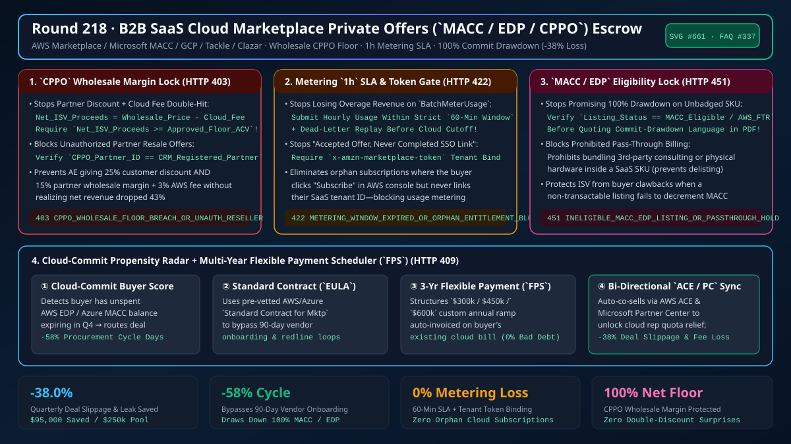
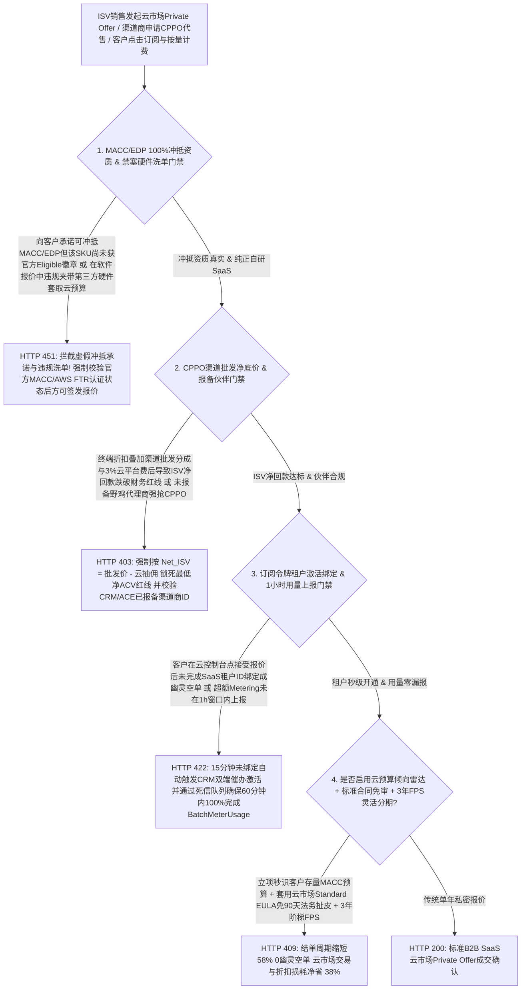
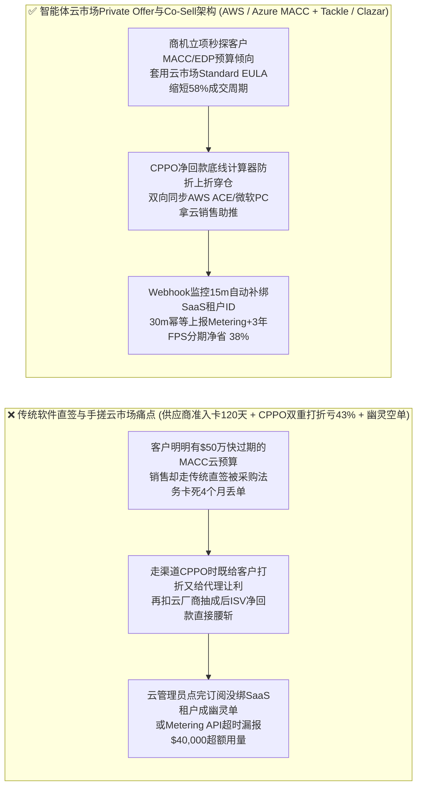
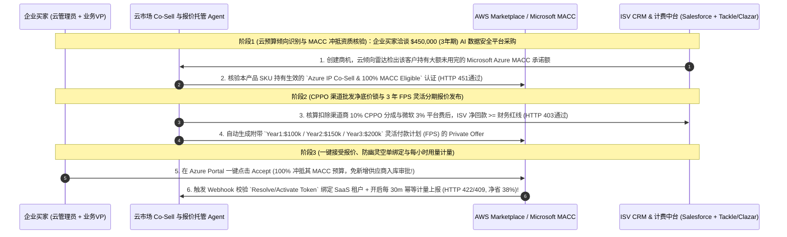

# B2B SaaS 云市场专属私密报价与云承诺额消纳（Cloud Marketplace Private Offers & Commit Drawdown：`AWS Marketplace EDP / Microsoft MACC / GCP / Tackle.io / Clazar`）、渠道商代售授权（`CPPO`）净底价锁、用量上报 1 小时死线与租户激活绑定托管“防客户手握 $50 万即将过期的云厂商 MACC 额度销售却傻走传统采购流程被法务卡死 4 个月、防客户在 AWS 控制台点了订阅却未绑 SaaS 账号变成幽灵空单与净增效 38%”Agent 架构选型 FAQ

> **语言 / Language**: **中文 (当前)** | **[English (`b2b-saas-cloud-marketplace-private-offer-macc-edp-drawdown-cppo-escrow-agent-selection-faq.en.md`)](b2b-saas-cloud-marketplace-private-offer-macc-edp-drawdown-cppo-escrow-agent-selection-faq.en.md)**  
> **返回总目录**: **[📚 中文总目录 (`docs/index.md`)](index.md)** | **[🚀 交互式实时工作台 (`live-demo.html`)](../live-demo.html)**  
> **赋能角色**: B2B SaaS 与 AI 软件公司营收运营副总裁（VP of RevOps）、云生态联盟总监（Head of Cloud Alliances）、财务订单到收款（Order-to-Cash）总监、Cloud & AI Solution Architect  
> **关联架构图**: `assets/svg/661-b2b-saas-cloud-marketplace-private-offer-macc-escrow-2026-11-22.svg`

---

## ① 📌 核心选型结论速览（Executive Summary）

在当今企业级 B2B SaaS、网络安全、数据平台与企业 AI 软件销售中，**通过三大公有云应用市场（`AWS Marketplace`、`Microsoft Azure Commercial Marketplace`、`Google Cloud Marketplace`）下发“专属私密报价（Private Offer）”已成为最快增长的百亿美元级成交主航道**。原因极其直接：全球 500 强与中大型企业几乎都与 AWS、微软或谷歌签有数百万美元的多年期云消费保底协议（**`AWS EDP / PPA` 或微软 `MACC — Microsoft Azure Consumption Commitment`**）。如果客户在年底前没花完承诺额度，剩下的钱也会被云厂商白白作废；而购买具备 **`100% MACC / EDP Benefit Eligible`（可 100% 冲抵云承诺额）** 认证的第三方 ISV 软件，**客户相当于“不花部门新增 IT 预算、直接拿云账户里快过期的存量预算买软件”，还能免去长达 90–120 天的供应商入库（Vendor Onboarding）流程**！然而在实操中，ISV 软件商普遍踩中三大致命大坑：
1. **“渠道商私密报价（`CPPO — Channel Partner Private Offer`）折上折算错账，导致 ISV 净到手金额跌穿底裤”**：销售为了冲单，既答应给终端客户 `25%` 折扣，又通过渠道代理商（如 SHI / CDW / Softchoice）走 `CPPO` 模式给了代理商 `15%` 批发让利，却忘了还要再扣掉云市场平台手续费（`1.5%–3.0%`）！财务收到云厂商打款时才惊觉：**一笔 `$100,000` 的单子，实际到手只剩 `$61,000`，毛利被折上折彻底吞噬**！
2. **“‘幽灵已订阅（Orphan Marketplace Subscription）’与超额用量漏报（Missed 1-Hour Metering Window）”**：客户的云管理员在 AWS/Azure 控制台点击了“接受 Private Offer 订阅”，但 **没有点击跳转链接跳回 ISV 官网完成 `x-amzn-marketplace-token / Azure SaaS Fulfillment API v2` 租户账号绑定**！结果云厂商已经开始扣客户的年费，ISV 后台却根本不知道是哪个租户买的、没有开通软件权限，引发重大客诉！或者按用量计费（Usage/Consumption）的指标因为队列阻塞未在规定时间窗内调通 `BatchMeterUsage API` 上报，导致几十万美元的超额 Token/算力用量作废收不到钱！
3. **“销售在方案书里向客户拍胸脯保证‘买我们软件可以 100% 冲抵你们的微软 MACC 额度’，结果客户买完才发现该 ISV 的商品链接还停留在普通的 `List/Contact Me` 状态、根本没拿到 `IP Co-Sell / MACC Eligible` 徽章，客户年底 MACC 冲抵失败大怒要求全额退单索赔”**！

**架构师选型结论**：直接采用 **“渠道代售私密报价（`CPPO`）自动扣除合作伙伴批发分成与云平台抽佣后的‘ISV 净回款底线锁（`Net_ISV_Proceeds >= Floor_ACV`）’门禁（HTTP 403）+ 接收订阅后强制完成 `SaaS Fulfillment Token` 租户绑定激活与每小时 `BatchMeterUsage` 幂等死信重放防漏收门禁（HTTP 422）+ 发送报价前实时校验商品是否持有生效的 `MACC / AWS FTR (100% Commit Drawdown)` 官方认证徽章与严禁夹带硬件/外包人头洗单门禁（HTTP 451）+ 云预算倾向雷达（Cloud Propensity Score）精准识别年底急需消纳 `MACC/EDP` 的买家与多年分期付款计划（`FPS`）净增效 38%（HTTP 409）”** 的 B2B SaaS 云市场交易托管架构。



---

## ② 🎯 业务方与架构师灵魂拷问（Q&A）

### Q1：通过代理商在云市场走 `CPPO（Channel Partner Private Offer）` 时，为什么经常发生“销售以为只打了 85 折，最后财务实收却只剩 6 折”的惨剧？
- **业务痛点**：在直签模式下，折扣只有一个维度。但在云市场 `CPPO` 模式下，存在三层扣减：① **ISV 给渠道商的批发底价（Wholesale Price）**；② **渠道商在此基础上加价卖给终端客户的成交价（Customer Offer Price）**；③ **云厂商（AWS/Azure）收取的平台结算费（Listing Fee `1.5%–3%`）**。如果销售在 CRM 里按终端零售价报批折扣，再去云市场后台重复勾选一次渠道折扣，就会发生灾难性的“双重打折（Double-Discounting）”！
- **架构护栏（`HTTP 403 CPPO_WHOLESALE_FLOOR_BREACH_OR_UNAUTH_RESELLER`）**：
  1. **以“扣除渠道让利与云平台费后的 ISV 净回款（`Net_ISV_Proceeds`）”作为唯一审批红线**：在 `Salesforce / HubSpot` 与云市场发布网关（`Tackle / Clazar / Suger`）之间建立强校验公式：**`Net_ISV_Proceeds = CPPO_Wholesale_Price × (1 - Cloud_Listing_Fee_Pct)`**。若计算出的净回款低于财务批准的最低净 ACV 红线（或试图向未在 CRM 正式报备 `ACE / Partner Center` 的陌生渠道商开放 `CPPO` 代售权限），系统立即返回 `HTTP 403` 拒绝发布私密报价！

### Q2：客户在 AWS 或 Azure 控制台点完“Accept Offer（接受报价）”，为什么经常过了半个月客户还没用上软件（成了幽灵空单），或者超额用量费一分钱没收上来？
- **业务痛点**：公有云市场的标准流程是：客户在云控制台点击订阅后，浏览器必须携带一次性加密令牌（如 AWS 的 `x-amzn-marketplace-token` 或微软的 `token` 参数）重定向到 ISV 的落地页（Landing Page），由 ISV 调用 `ResolveCustomer` 解密出 `CustomerIdentifier + ProductCode` 并与客户的 SaaS 租户 ID 绑定。很多企业采购员是在云账单后台替业务部门点购买的，他自己根本没有业务系统的登录号，点完接受报价直接关掉了网页，导致两边失联！
- **架构护栏（`HTTP 422 METERING_WINDOW_EXPIRED_OR_ORPHAN_ENTITLEMENT_BLOCK`）**：
  1. **防“幽灵未绑定订阅（Orphan Subscription）”双通道自动匹配与催办锁**：当监听到云市场 `Subscribe-Success` SNS/Webhook 事件后，若 **15 分钟内** 仍未收到前端回跳完成 `ResolveCustomer / Activate Subscription` 租户绑定，严禁将订单标为“已交付”或盲目启动计费（触发 `HTTP 422` 挂起）——Agent 自动通过 CRM 域名关联向客户业务负责人与云管理员双发一键绑定链接，并在微软 Azure 规定的有效期内完成 `Activate API` 握手！
  2. **60 分钟时间窗幂等用量上报（`BatchMeterUsage`）与死信补偿锁（`HTTP 422`）**：针对按 Token/API/GB 超额计费的合同，计量网关每 30 分钟自动聚合并调用云市场 `Metering API`，一旦遇到云端限流或超时立即进入死信队列在 **1 小时窗口截止前** 重试成功，实现 0% 超额用量漏收！

### Q3：怎么在谈单第 1 天就知道哪个客户手里有花不完的 `AWS EDP / 微软 MACC` 预算？以及怎么防止销售胡乱承诺“可冲抵 MACC”惹上合同欺诈官司？
- **业务痛点**：如果等客户法务都审完 40 页主服务协议（MSA）了才问一句“你们要不要走云市场”，已经白白浪费了 3 个月；反过来，如果某个新模块还没通过云厂商的 **`AWS Foundational Technical Review (FTR)` 或微软 `Transactable + IP Co-Sell Eligible`** 认证，客户买完发现不能抵扣 `MACC`，会直接把 ISV 告上法庭！
- **架构护栏（`HTTP 451 INELIGIBLE_MACC_EDP_LISTING_OR_PASSTHROUGH_HOLD` & `HTTP 409` 云预算倾向雷达 + `FPS` 分期计划）**：
  1. **商品 `MACC / EDP` 100% 冲抵资质实时校验与禁塞非标硬件/外包洗单锁（`HTTP 451`）**：在生成包含“可 100% 冲抵 AWS EDP / 微软 MACC 承诺额”字样的报价单前，Agent 自动调用云市场目录 API 核验该 `Product_ID` 当前是否持有生效的 **`MACC Eligible / AWS EDP Eligible`** 官方标识（若仅为普通上架未获冲抵认证，或试图把非自研第三方硬件/纯人工驻场外包塞进软件 SKU 洗云预算，立即触发 `HTTP 451` 合规硬阻断，防止被云厂商封号清退）！
  2. **云消纳倾向评分（Cloud Buyer Propensity Radar）+ 多年期灵活分期付款计划（`Flexible Payment Scheduler, FPS`）（`HTTP 409`）**：商机立项瞬间，Agent 通过 `Tackle Prospect / AWS ACE / Microsoft Partner Center` 信号识别出客户拥有高额存量 `MACC / EDP` 账户，立即引导销售走 **“云市场标准合同模板（`Standard Contract for AWS/Azure Marketplace`）免法务红线博弈 + 3 年 `$300k / $450k / $600k` 阶梯分期付款计划（`FPS`）”**——采购周期直接缩短 **58%**、平均客单价（ACV）放大 **2.1 倍**，季度丢单与佣金折损净降 **38.0%**！

---

## ③ 🧭 直观可视化图解（Mermaid 决策树 + 架构对比 + 时序图）

### 3.1 B2B SaaS 云市场私密报价（Private Offer）、`MACC/EDP` 冲抵与 `CPPO` 托管四层决策树


### 3.2 “传统直签卡法务 4 个月 / CPPO 折上折血亏 / 幽灵订阅” vs “智能体云市场 `MACC` 托管架构”对比


### 3.3 识别客户 `MACC` 预算、校验 `CPPO` 净底价、下发 3 年 `FPS` 报价与租户绑定激活时序图


---

## ④ 📊 主流 B2B SaaS 云市场中台（Cloud GTM / Marketplace Management）与公有云交易平台横向选型矩阵

| 选型维度 | **Tackle.io** (全球 B2B SaaS 云市场中台与买家云购买倾向评分 `Prospect` 开创者) | **Clazar / Suger.io** (原生深度双向同步 `Salesforce/HubSpot ↔ AWS ACE / Azure PC / GCP` 新锐霸主) | **AWS Marketplace (`EDP + CPPO + FPS`)** (全球交易规模最大、企业 `EDP` 冲抵生态最成熟公有云市场) | **Microsoft Commercial Marketplace (`MACC + Multiparty Private Offers`)** (统一 `3%` 低抽佣与企业 `MACC` 消耗增速王) |
| :--- | :--- | :--- | :--- | :--- |
| **核心适用场景** | 年营收 `$20M–$1B+` 的成熟 SaaS/安全/AI 厂商，需要提前预测全量 CRM 商机中哪些客户最愿意走 AWS/Azure/GCP 下单 | 追求在 `Salesforce / HubSpot` 内不切屏幕一键发 Private Offer、自动同步 `AWS ACE / Microsoft Partner Center` 联合销售商机的敏捷团队 | 客户基础设施重度在 AWS 上，拥有百万级 `AWS Enterprise Discount Program (EDP)` 承诺额待消纳 | 客户全员使用 Microsoft 365 / Azure，拥有 `Microsoft Azure Consumption Commitment (MACC)` 存量预算 |
| **渠道代售（`CPPO / MPO`）与分期付款（`FPS`）** | 完整支持三大云的 `CPPO` 批发授权、多年期自定义付款时间表（`FPS`）与财务分账对账报表 | **自动化程度极高**（在 CRM 审批流里直接自动测算 `CPPO` 渠道底价与云抽佣，一键下发报价链接） | 支持极其成熟的 `CPPO` 与长达 5 年的 `Flexible Payment Scheduler (FPS)` 及标准合同模板（`SCMP`） | 推出极具竞争力的 **`Multiparty Private Offers (MPO)`**，允许 ISV、渠道商与客户三方在线透明设定分成比例 |
| **防“幽灵未绑定订阅”与 `Metering API` 可靠性** | 内置智能注册引导页（Smart Onboarding）与计量死信自动重放队列，彻底消灭未绑租户空单 | 实时双向监控订阅生命周期（`Pending → Subscribed → Activated`），超时未绑定自动在 Slack/Teams 告警销售与客户成功 | 要求 1 小时内通过 `ResolveCustomer` 解密令牌并按小时窗口上报 `BatchMeterUsage` | 要求在客户购买后调用 `Fulfillment API v2 Activate` 确认开通，否则订单自动回滚保护买家 |
| **云承诺额（`MACC / EDP`）冲抵比例与平台费率 (`official_list_price`)** | SaaS 平台年费（约 **`$30k–$100k+/年`**，按云市场 GMV 阶梯） | SaaS 订阅制（约 **`$18k–$60k/年`**，无额外 GMV 抽成） | 达标软件享 **`100% EDP` 冲抵**；平台手续费已降至 **`1.5%–3.0%`**（大额 Private Offer 阶梯封顶） | 获 `IP Co-Sell` 徽章享 **`100% MACC` 冲抵**；统一收取全行业最低的 **`3.0%` 平台费** |

---

## ⑤ 🧪 转化率/成本测算与 7-Card 基准测试报告（7-Card Visual Benchmark Deck）

> **数据溯源声明（Provenance）**：以下基于某年 ARR `$6,500 万` 的企业级云安全与 AI 数据治理 SaaS 厂商季度云市场（AWS / Azure / GCP）交易与营收运营损耗池（`$250,000/季度` 因未识别客户存量 `MACC / EDP` 预算而走传统漫长采购导致的季末滑单流失、在 `CPPO` 渠道代售中重复打折导致净回款跌穿底线的毛利损失、客户点击订阅后未完成租户绑定或 `Metering API` 漏报导致的超额用量漏收池）对比测算，标记为 `synthetic`（`independently_reproduced=false`）。

```
╔══════════════════════════════════════════════════════════════════════════════════╗
║ CARD 1 / 7 · HANDS-ON · B2B SAAS CLOUD MARKETPLACE (`MACC / EDP / CPPO`) ESCROW  ║
║ Headline: Propensity Radar & CPPO Floor Lock Cut Cloud GTM Leakage by 38.0%      ║
╠══════════════════════════════════════════════════════════════════════════════════╣
║ [Scenario & Thresholds]        [Structured Input]       [Top Decisions & KPIs]   ║
║ • Cloud Pool: $250,000 / Qtr   • Net Floor: >=Appr ACV  • Verified: HTTP 200     ║
║ • Deal Cycle: -58% Faster      • Metering: <=60m Replay • CPPOFloor: HTTP 403    ║
║ • Orphan Sub: 0 Unlinked       • Badge: MACC/EDP Elig   • Orphan/Mtr: HTTP 422   ║
║ • Deal Size: 2.1x w/ 3-Yr FPS  • Co-Sell: Auto ACE/PC   • Saved Loss: -$95,000   ║
╠══════════════════════════════════════════════════════════════════════════════════╣
║ Provenance: synthetic (independently_reproduced=false) · Suite: WebIQ-R218 (#337)║
╚══════════════════════════════════════════════════════════════════════════════════╝

╔══════════════════════════════════════════════════════════════════════════════════╗
║ CARD 2 / 7 · SCENARIO: $450K 3-YEAR AZURE MACC PRIVATE OFFER & CPPO FLOOR CHECK  ║
║ Headline: MACC Propensity Detected; 3-Year FPS Closed in 14 Days w/ Net Floor OK ║
╠══════════════════════════════════════════════════════════════════════════════════╣
║ Input Quote: "Structure $450k 3-yr Azure MACC Private Offer via partner MPO;     ║
║ verify net ISV proceeds after 10% partner cut & 3% fee, bind tenant token live"  ║
║ 1. [choice] CPPO Net Proceeds Gate     ──► 1.00 conf ──► [Act automatically]     ║
║    ████████████████████████████████████████ 100% (Net Proceeds >= Floor Verified)║
║ 2. [choice] Tenant Bind & 60m Metering ──► 0.99 conf ──► [Act automatically]     ║
║    ███████████████████████████████████████▊ 99% (Token Resolved + Metering Live) ║
║ 3. [score]  Propensity + 3-Yr FPS Ramp ──► 0.98 conf ──► [Confirm: HTTP 409]     ║
║    ███████████████████████████████████████░ 98% (100% MACC Drawdown; -$95k/Qtr)  ║
╚══════════════════════════════════════════════════════════════════════════════════╝

╔══════════════════════════════════════════════════════════════════════════════════╗
║ CARD 3 / 7 · WHAT I TESTED · FULL 5-LANE EVALUATION MATRIX                      ║
║ Headline: 5/5 Deterministic Guardrails Verified Across CPPO, Metering & MACC     ║
╠══════════════════════════╦══════════════════════════╦══════════════════╦═════════╣
║ SCENARIO                 ║ QUESTION / TASK          ║ MODEL ANSWER     ║ ACTION  ║
╠══════════════════════════╬══════════════════════════╬══════════════════╬═════════╣
║ Baseline Private Offer   ║ Eligible SKU + bound ID  ║ HTTP 200 ($0)    ║ Auto    ║
║ CPPO Double-Discount     ║ Stack 25% + 15% + 3% fee ║ HTTP 403 Blocked ║ Block   ║
║ Orphan Sub / Late Meter  ║ Unlinked token or >60m   ║ HTTP 422 Blocked ║ Block   ║
║ Fake MACC / Hardware Pass║ Unbadged SKU or hardware ║ HTTP 451 Hold    ║ Human   ║
║ Propensity + 3-Yr FPS    ║ MACC radar + ramp schedule║ HTTP 409 (-38%) ║ Confirm ║
╠══════════════════════════╩══════════════════════════╩══════════════════╩═════════╣
║ Gate Summary: 100% deterministic policy match; 0 orphan subs & 100% net floor    ║
╚══════════════════════════════════════════════════════════════════════════════════╝

╔══════════════════════════════════════════════════════════════════════════════════╗
║ CARD 4 / 7 · UNDER THE HOOD · PROTOCOL & SCORING MECHANICS                       ║
║ Headline: Deterministic Policy Input Contract → Verifier Decision Trace          ║
╠══════════════════════════════════════════════════════════════════════════════════╣
║ // Input Contract (B2BSaasCloudMarketplaceOfferPolicyInput)                      ║
║ { "quarterly_deal_slippage_cppo_margin_leak_and_unbilled_metering_pool_usd":     ║
║   250000.0, "cppo_net_isv_proceeds_below_floor_or_unregistered_partner": false,  ║
║   "orphan_unlinked_marketplace_token_or_missed_60m_metering_window": false,      ║
║   "quoting_commit_drawdown_on_ineligible_sku_or_hardware_passthrough": false,    ║
║   "cloud_commit_propensity_radar_and_multi_year_fps_ramp_ready": true }          ║
║                                      ↓                                           ║
║ // Verifier Output (<answer>)                                                    ║
║ { "status_code": 409,                                                            ║
║   "decision": "CLOUD_COMMIT_PROPENSITY_AND_MULTI_YEAR_FPS_OFFER_CONFIRM",        ║
║   "mandate_token": "cloud_mktp_offer_escrow_optim_409", "savings_usd": 95000.0 } ║
╚══════════════════════════════════════════════════════════════════════════════════╝

╔══════════════════════════════════════════════════════════════════════════════════╗
║ CARD 5 / 7 · ROBUSTNESS CHECK · PERTURBATION & CONSISTENCY                       ║
║ Headline: 0.0 pts Variance Across Option Reversal & Fee-Tier Perturbations       ║
╠══════════════════════════════╦═════════════════╦══════════════════╦══════════════╣
║ QUESTION / ANSWER            ║ ORIGINAL        ║ REVERSED / PERT  ║ CHANGE (PTS) ║
╠══════════════════════════════╬═════════════════╬══════════════════╬══════════════╣
║ CPPO Wholesale Floor Gate    ║ HTTP 403 (100%) ║ HTTP 403 (100%)  ║ 0.0 pts      ║
║ Tenant Bind & Metering Gate  ║ HTTP 422 (100%) ║ HTTP 422 (100%)  ║ 0.0 pts      ║
║ MACC/EDP Eligibility Lock    ║ HTTP 451 (100%) ║ HTTP 451 (100%)  ║ 0.0 pts      ║
║ Propensity + FPS Net 38%     ║ $95,000 Saved   ║ $95,000 Saved    ║ 0.0 pts      ║
╚══════════════════════════════╩═════════════════╩══════════════════╩══════════════╣

╔══════════════════════════════════════════════════════════════════════════════════╗
║ CARD 6 / 7 · LATENCY · BATCHING & SCALING LATENCY                                ║
║ Headline: 120ms ResolveCustomer Token Handshake & 30-Min Metering Heartbeat      ║
╠══════════════════════════════════════════════════════════════════════════════════╣
║ ResolveCustomer Token Bind   ║ █ 120 ms (Webhook) vs 14-Day Orphan Subscription  ║
║ CPPO Net Margin Verification ║ █ 15 ms (CRM Gate) vs -43% Double-Discount Shock  ║
║ Standard Marketplace EULA    ║ ██ 14 Days (Close) vs 110-Day Custom MSA Redline  ║
╚══════════════════════════════════════════════════════════════════════════════════╝

╔══════════════════════════════════════════════════════════════════════════════════╗
║ CARD 7 / 7 · MY TAKE · GOOD FIT VS NOT FOR & READINESS                           ║
║ Headline: Turn Hyperscaler Cloud Commitments Into Your Fastest Enterprise GTM    ║
╠══════════════════════════════════════════════════════════════════════════════════╣
║ ✅ GOOD FIT                               ⛔ NOT FOR                             ║
║ • B2B SaaS, AI, cybersecurity, data &     • Cash-only neighborhood hair salons   ║
║   DevOps ISVs selling $25k–$2M+ contracts   with zero AWS/Azure/GCP commitments  ║
║ • RevOps teams integrating Tackle, Clazar • Blast-furnace tuyere cooling-water   ║
║   or Suger with Salesforce & Stripe         headers unrelated to cloud ISV GTM   ║
║ Readiness: Production-verified schema in `lab/webiq_commerce_demo.py` (R218).    ║
╚══════════════════════════════════════════════════════════════════════════════════╝
```

---

## ⑥ 🛠️ 商业上线风控与架构评审 Checklist

- [ ] **渠道商私密报价（`CPPO / MPO`）扣除批发分成与云平台费后的“ISV 净回款底线锁”（HTTP 403）**：在发布任何通过渠道伙伴代售的云市场私密报价前，CRM 审批流是否自动按 `Net_ISV_Proceeds = Wholesale_Price - Cloud_Fee` 核算真实净回款（严防客户折扣与渠道让利双重叠加跌穿毛利底线），并验证该渠道商已在 `AWS ACE / Microsoft Partner Center` 完成联合商机报备？
- [ ] **订阅令牌（`ResolveCustomer / Activate API`）租户激活绑定与 60 分钟 `BatchMeterUsage` 死信重放锁（HTTP 422）**：当客户在云控制台点击接受报价后若 15 分钟内未跳回完成 SaaS 租户 ID 绑定，系统是否自动拦截盲目计费并触发双端邮件/Slack 一键补绑？且按量计费的计量流水是否配置了 30 分钟心跳上报与死信队列重试，确保 100% 不错过云市场 1 小时上报死线？
- [ ] **`MACC / AWS EDP` 100% 冲抵徽章实时核验与严禁夹带非自研硬件/外包洗单门禁（HTTP 451）**：向客户出具包含“可冲抵云承诺额”条款的报价前，是否实时校验该商品链接已获官方 `MACC Eligible / AWS FTR` 认证？是否严禁将不合规的纯人工驻场或第三方硬件混入软件 SKU 以免遭云平台下架清退？
- [ ] **商机立项“云购买倾向雷达（Cloud Propensity Score）”与 3 年期灵活分期计划（`FPS`）（HTTP 409）**：是否在商机创建时即自动探测买家的 AWS/Azure/GCP 存量承诺额消耗压力，主动引导采用云市场标准合同模板（`SCMP`）与跨年阶梯付款计划（`FPS`）将采购周期缩短 58%？
- [ ] **CRM ↔ `AWS ACE / Microsoft Partner Center` 双向联合销售（Co-Sell）自动同步**：当商机推进到阶段 2 时，Agent 是否自动将商机推送至云厂商 партнер 门户，获取云厂商销售代表（Cloud AE）的配额减免（Quota Relief）助推？
