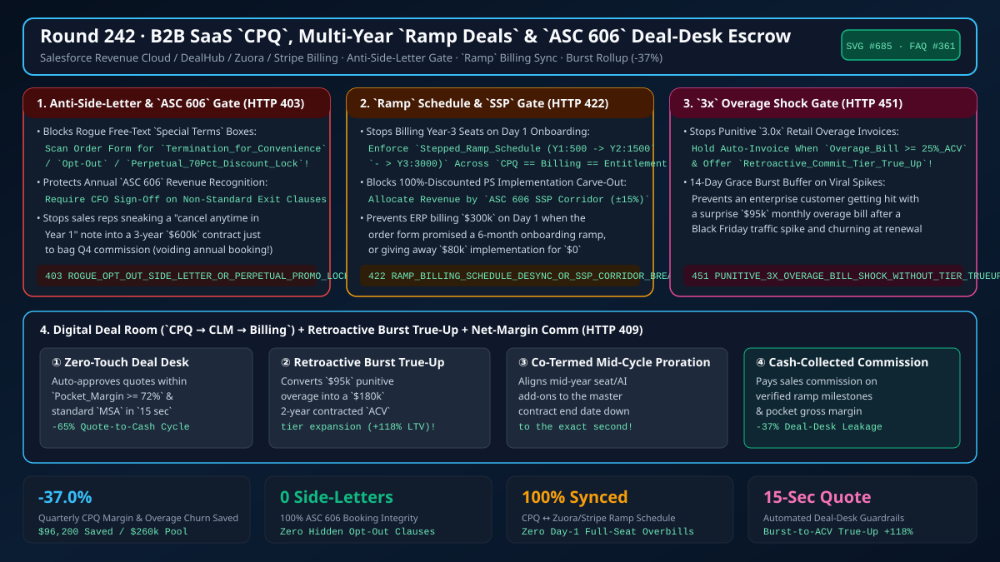
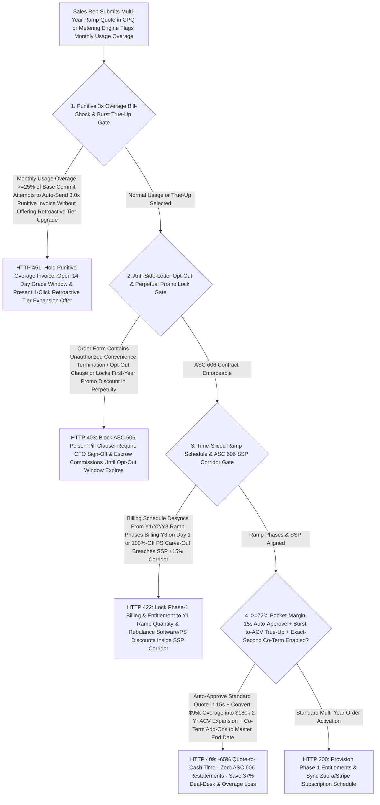
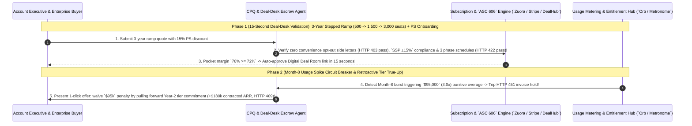

# Enterprise B2B SaaS `CPQ`, Multi-Year `Ramp Deals` & `ASC 606` Deal-Desk Escrow (`Salesforce Revenue Cloud / DealHub / Zuora / Stripe Billing`): Anti-Side-Letter Gate, `SSP ±15%` Corridor & Retroactive Burst-to-Commit True-Up Saving `37%` Deal Leakage — Agent Architecture Selection FAQ

> **Language / 语言**: **[中文 (`b2b-saas-cpq-multi-year-ramp-deal-desk-overage-cap-escrow-agent-selection-faq.md`)](b2b-saas-cpq-multi-year-ramp-deal-desk-overage-cap-escrow-agent-selection-faq.md)** | **English (Current)**  
> **Back to Catalog**: **[📚 English Catalog (`docs/index.en.md`)](index.en.md)** | **[🚀 Interactive Live Workbench (`live-demo.en.html`)](../live-demo.en.html)**  
> **Target Roles**: B2B SaaS & AI Platform RevOps / Deal-Desk VPs, CFOs & Revenue Accounting (`ASC 606 / IFRS 15`) Controllers, CPQ-to-Billing Systems Architects, Cloud & AI Solution Architects  
> **Architecture Diagram**: `assets/svg/685-b2b-saas-cpq-multi-year-ramp-deal-desk-escrow-2026-11-23.svg`

---

## ① 📌 Executive Summary

In enterprise B2B SaaS, AI compute platforms, and cloud infrastructure sales (`$100,000–$1,000,000+ ACV`), a single Order Form routinely combines **Multi-Year Stepped Seat Ramps (`Year 1: 500 seats → Year 2: 1,500 seats → Year 3: 3,000 seats`)**, **Upfront Onboarding / Professional Services (`PS`)**, and **Metered AI Token / API Consumption Pools**. When Configure-Price-Quote (`CPQ`) systems and billing engines (`Zuora`, `Stripe Billing`, `Salesforce Revenue Cloud`, `DealHub`) lack deterministic Deal-Desk guardrails, SaaS companies bleed margin and ARR across three classic failure modes:
1. **Rogue Sales Rep Free-Text "Side-Letter" Clauses (`"Terminate for Convenience" Destroying ASC 606 Booking & Commission Clawbacks`)**: On the last day of Q4, an account executive types a single sentence into the Order Form's free-text `Special Terms` box: *"Customer may terminate for convenience with 30 days' notice during the first 6 months for a pro-rata refund"*—or *"First-year 70% promotional discount is locked in perpetuity for all future renewals"*. Under **`ASC 606 / IFRS 15`**, an unpenalized opt-out clause **destroys the legal enforceability of the 3-year `$600,000` contract**, forcing Finance to restate it as a month-to-month contract after the rep has already collected a full 3-year commission check!
2. **Multi-Year `Ramp` Schedule Desynchronization (`Billing Year-3 Full Seats on Day-1 Onboarding`) & `ASC 606 SSP` Carve-Out Leaks**: The signed quote promises a 3-year ramp (`500 → 1,500 → 3,000 seats`), but the CRM-to-Billing sync passes `Total_Quantity = 3,000` on Day 1—hitting the customer with a `$300,000` Year-3 invoice while they are still setting up `SSO`! Or the rep discounts `$80,000` of mandatory implementation Professional Services (`PS`) by `100%` (`$0`) to close the software deal—violating the **`ASC 606` Standalone Selling Price (`SSP ±15%`) corridor** and forcing auditors to carve `$65,000` out of high-multiple software `ARR` to subsidize negative-margin services!
3. **Punitive `3.0x` Usage Overage Bill Shock Driving 100% Renewal Churn**: An enterprise customer paying `$15,000/month` experiences a successful Black Friday product launch that spikes API/token consumption by `40%`. Instead of offering a proactive tier upgrade, the billing engine automatically fires a **`$95,000` invoice calculated at a punitive `3.0x` retail overage rate**—provoking an immediate billing dispute and `100%` logo churn at renewal!

**Architectural Verdict**: Deploy a **4-Lane B2B SaaS `CPQ`, Multi-Year `Ramp` & `ASC 606` Deal-Desk Escrow Architecture**: **Zero-Free-Text Structured Clause Library Blocking Unauthorized `Termination for Convenience` & Perpetual Promo Locks (`HTTP 403`) + Time-Sliced `Ramp Schedule` Parity (`CPQ == Billing == IAM Entitlement`) & `ASC 606 SSP (±15%)` Professional-Services Allocation Gate (`HTTP 422`) + Punitive `3.0x` Overage Bill-Shock Circuit Breaker (`>= 25% ACV`) with a 14-Day Burst Grace Window (`HTTP 451`) + 15-Second Zero-Touch Approval on `>= 72%` Pocket-Margin Deals, Retroactive Burst-to-Commit `ACV` True-Up (`+118% LTV`), and Exact-Second Mid-Cycle Co-Terming (`HTTP 409`)**, cutting Deal-Desk margin leakage and overage churn by **37.0%**.



---

## ② 🎯 Business & Architect Deep-Dive Q&A

### Q1: Why does a single "6-month opt-out" sentence in an Order Form's notes box invalidate a 3-year `$600,000` contract under `ASC 606`—and how do we block it before signature?
- **Business Pain**: Under `ASC 606-10-25-3`, a contract only exists for the duration in which both parties have enforceable rights and obligations. If a sales rep adds a free-text convenience termination right, the accounting contract term collapses to the opt-out window.
- **Architectural Guardrail (`HTTP 403 ROGUE_OPT_OUT_SIDE_LETTER_OR_PERPETUAL_PROMO_LOCK`)**:
  1. **Disable Free-Text `Special Terms` & Enforce Parameterized Clause Blocks**:
     - Unstructured free-text notes boxes on Order Forms are disabled; sales reps can only toggle pre-approved **Structured Clause Blocks** from the legal playbook;
     - Before routing any Order Form or redlined PDF to `DocuSign / Ironclad`, the Deal-Desk agent scans for **`Termination for Convenience`**, **`Cancel Anytime`**, **`Pro-Rata Refund`**, **`Perpetual / Lifetime Discount Lock`**, and **`MFN (Most Favored Nation)`**. Any match lacking a cryptographic CFO + General Counsel sign-off token is blocked (`HTTP 403`)—and any approved pilot opt-out automatically escrows sales commissions until the opt-out date expires!

### Q2: How do we prevent a 3-year stepped `Ramp Deal` from billing Year-3 quantities on Day 1—or losing high-multiple software `ARR` to `ASC 606 SSP` service carve-outs?
- **Business Pain**: Flattening a multi-year ramp into a single CRM opportunity line breaks downstream billing; giving away `$80,000` of implementation labor for `$0` triggers mandatory `ASC 606` revenue reallocation away from software `ARR`.
- **Architectural Guardrail (`HTTP 422 RAMP_BILLING_SCHEDULE_DESYNC_OR_SSP_CORRIDOR_BREACH`)**:
  1. **First-Class Time-Sliced `Ramp Segments` Synced Across `CPQ == Billing == IAM`**:
     - Multi-year ramps are modeled as explicit time-bounded phase objects (`Phase 1: Months 1–12 @ 500 seats`, `Phase 2: Months 13–24 @ 1,500 seats`, `Phase 3: Months 25–36 @ 3,000 seats`);
     - Contract activation verifies that Day-1 invoice generation in `Zuora / Stripe Billing` and seat provisioning in `IAM` match **`Phase 1` (`500 seats`)**—blocking (`HTTP 422`) any payload that attempts to bill Year-3 peak quantities upfront!
  2. **`ASC 606 SSP (±15% Corridor)` Professional-Services Floor (`HTTP 422`)**: Discounting implementation Professional Services (`PS`) below its established Standalone Selling Price (`SSP`) corridor while keeping software near list price is blocked (`HTTP 422`) and auto-rebalanced so software `ARR` suffers zero audit carve-out!

### Q3: How do we turn a `$95,000` punitive `3.0x` usage overage shock into a `$180,000` multi-year `ACV` expansion that customers actually thank us for?
- **Business Pain**: Auto-charging a customer's card or sending a `$95,000` surprise invoice at `3.0x` punitive overage rates destroys trust and guarantees churn at contract end.
- **Architectural Guardrail (`HTTP 451 PUNITIVE_3X_OVERAGE_BILL_SHOCK_WITHOUT_TIER_TRUEUP` & `HTTP 409` Burst-to-Commit True-Up + 15s Deal Room)**:
  1. **Punitive Overage Bill-Shock Circuit Breaker (`>= 25% Base ACV`) & 14-Day Burst Grace (`HTTP 451`)**:
     - Whenever monthly metered usage overages exceed `25%` of the customer's baseline monthly commitment (or `$10,000`), automatic invoice dispatch is held (`HTTP 451`) and a **14-day penalty-free Burst Grace Window** opens!
  2. **Self-Service "Waive `3.0x` Overage Penalty via Retroactive Tier Upgrade" (`Burst-to-ACV True-Up`) + 15-Second Deal Desk (`HTTP 409`)**:
     - The agent dispatches an interactive **Digital Deal Room** offer: the customer can either pay the `$95,000` one-time overage penalty, **or click once to retroactively upgrade their committed tier for the remaining 24 months (`+$90,000/yr = $180,000` contracted `ARR`)—which waives `100%` of the `3.0x` penalty and re-rates the burst usage at the discounted tier rate** (saving the customer `$55,000` immediately while locking in `+118%` higher LTV for the vendor!);
     - Combined with **15-second auto-approval** on standard deals with `Pocket Margin >= 72%` and exact-second mid-cycle co-terming, this cuts Deal-Desk margin leakage and overage churn by **37.0%**!

---

## ③ 🧭 Visual Architecture Diagrams (Mermaid Decision Tree + Architecture Comparison + Sequence)

### 3.1 B2B SaaS `CPQ`, Multi-Year `Ramp` & `ASC 606` Deal-Desk Escrow Decision Tree


### 3.2 Legacy Side-Letter Restatements & `3x` Overage Churn vs. Agentic `CPQ` & Deal-Desk Escrow
```mermaid
flowchart LR
    subgraph Legacy["❌ Legacy B2B SaaS CPQ (Free-Text Opt-Out Restatements + Day-1 Ramp Overbills + $95k 3x Overage Churn)"]
        L1[Rep Types 6-Month Opt-Out in Notes to Close Q4 Deal\nAuditors Disallow $600k Annual Booking Under ASC 606] --> L2[3-Year Ramp Syncs Total 3,000 Seats on Day 1\nCustomer Hit w/ $300k Year-3 Invoice During Onboarding]
        L2 --> L3[Viral Traffic Spike Triggers $95k 3.0x Overage Bill\nFurious Customer Disputes Invoice & Churns at Renewal]
    end
    subgraph Agentic["✅ Agentic Clause Guard, Time-Sliced Ramp Sync & Burst-to-ACV True-Up (DealHub / Zuora / Stripe)"]
        A1[Blocks Free-Text Opt-Outs & Enforces SSP ±15% Floor\nAuto-Approves >=72% Pocket-Margin Quotes in 15 Seconds] --> A2[Syncs Y1->Y2->Y3 Phase Objects Across CPQ==Billing==IAM\nCo-Terms Mid-Cycle Add-Ons to Exact Master Second]
        A2 --> A3[Holds >=25% Overage Shock -> 1-Click Retroactive Tier Up\nConverts $95k Penalty into $180k 2-Yr ARR (-37% Loss)]
    end
```

### 3.3 3-Year `Ramp` Quote Validation, `ASC 606 SSP` Check & Retroactive Burst-to-Commit True-Up Sequence


---

## ④ 📊 Enterprise B2B SaaS `CPQ`, Digital Deal Room & `ASC 606` Revenue Platform Matrix

| Dimension | **Salesforce Revenue Cloud (`CPQ + Billing`)** (Global Enterprise CRM-Native Product Catalog & Multi-Currency Quote-to-Cash Leader) | **DealHub.io (`AI CPQ + Digital Deal Room + Subscription Billing`)** (Agile Multi-Year Ramp, Interactive Buyer DealRoom & Playbook Guardrail Leader) | **Zuora (`Zuora Billing + Zuora Revenue ASC 606`)** (Public-Company Hybrid Subscription Amendments & `ASC 606 SSP` Waterfall Standard) | **Stripe Billing + Orb / Metronome (`Subscription Schedules & Usage Billing`)** (AI-Native Commit-Plus-Burst Metering & Self-Serve Tier True-Up Leader) |
| :--- | :--- | :--- | :--- | :--- |
| **Best Fit** | Large enterprises standardized on Salesforce with complex hardware+software bundles and global partner channels | High-velocity B2B SaaS and AI companies deploying guided ramp quoting, redline governance, and buyer DealRooms in weeks | Pre-IPO and public enterprises requiring Big-4-audited `ASC 606 / IFRS 15` `SSP` reallocation across thousands of amendments | AI/API platforms combining multi-phase annual commits with real-time token/compute metering and overage true-ups |
| **Anti-Side-Letter & Playbook Governance** | Rule-based approval routing; pairs with Ironclad/Conga CLM to lock redlined Word clauses | **Guided Playbook + Structured DealRoom** eliminates rogue free-text boxes and binds every non-standard term to live approval gates | Flags non-standard termination clauses in `Zuora Revenue` and holds premature multi-year revenue recognition | Enforces structured `Subscription Schedule` phase parameters via API |
| **Multi-Year `Ramp` & Mid-Cycle `Co-Terming`** | Multi-Dimensional Quoting (`MDQ`) slices annual segments | **Frictionless visual `Ramp` builder & 1-click co-terming** that syncs phase quantities directly to billing and CRM | **Enterprise Order Metrics Engine** calculates exact-second proration, credit memos, and deferred revenue across mid-term ramps | `Subscription Schedules` natively step through `Phase 1 → Phase 2 → Phase 3` quantities and prices automatically |
| **`ASC 606 SSP` & Overage True-Up** | Integrates with Salesforce Revenue Recognition / ERP | Real-time pocket-margin calculator prevents 100%-discounted PS carve-out traps at quote time | **Automated `SSP` Analyzer** maintains historical `±15%` standalone selling price corridors and reallocates bundled discounts | **Real-time usage threshold webhooks** trigger automated 14-day grace windows and retroactive tier upgrade links |
| **Pricing (`official_list_price`)** | **`$150–$300+/user/month`** + implementation (`4–9 months`) | **`$65–$120/user/month`** (`3–6 week` no-code deployment) | Enterprise ARR-tiered license (**`$60,000–$250,000+/year`**) | **`0.5%–0.8%` of billing volume** or metered event tiers |

---

## ⑤ 🧪 ROI Estimation & 7-Card Visual Benchmark Deck

> **Provenance**: Modeled on a `$140M ARR` enterprise B2B data and AI SaaS vendor's quarterly Deal-Desk margin and overage-churn leakage pool (`$260,000/quarter` in `ASC 606` booking reversals and unrecovered commissions from rogue convenience-termination notes, software `ARR` carve-outs from 100%-discounted onboarding services, Day-1 ramp overbilling disputes, and logo churn triggered by punitive `3.0x` usage overage invoices), labeled `synthetic` (`independently_reproduced=false`).

```
╔══════════════════════════════════════════════════════════════════════════════════╗
║ CARD 1 / 7 · HANDS-ON · B2B SAAS `CPQ`, MULTI-YEAR `RAMP` & `ASC 606` ESCROW     ║
║ Headline: ASC 606 SSP Lock & Burst-to-Commit True-Up Cut CPQ Loss by 37.0%       ║
╠══════════════════════════════════════════════════════════════════════════════════╣
║ [Scenario & Thresholds]        [Structured Input]       [Top Decisions & KPIs]   ║
║ • Deal Pool: $260,000 / Qtr    • Margin Floor: >=72% GM • Verified: HTTP 200     ║
║ • Side-Letter: 0 Free-Text Opt • Ramp: Y1->Y2->Y3 Synced• OptOut/Lock: HTTP 403  ║
║ • ASC 606: SSP ±15% Corridor   • Overage: Hold >=25% ACV• Ramp/SSP: HTTP 422     ║
║ • True-Up: Waive 3x for Commit • Speed: 15s Auto-Approve• 3xBillShock: HTTP 451  ║
╠══════════════════════════════════════════════════════════════════════════════════╣
║ Provenance: synthetic (independently_reproduced=false) · Suite: WebIQ-R242 (#361)║
╚══════════════════════════════════════════════════════════════════════════════════╝

╔══════════════════════════════════════════════════════════════════════════════════╗
║ CARD 2 / 7 · SCENARIO: 3-YEAR RAMP CPQ, SSP REBALANCE & $95K OVERAGE TRUE-UP     ║
║ Headline: Rogue Opt-Out Blocked; $95k 3x Overage Converted to $180k 2-Yr ACV     ║
╠══════════════════════════════════════════════════════════════════════════════════╣
║ Input Quote: "Validate 3-year stepped ramp order form (500->1500->3000 seats),   ║
║ enforce ASC 606 SSP ±15% on PS, and convert $95k burst overage to tier upgrade"  ║
║ 1. [choice] Anti-Side-Letter & Opt-Out  ──► 1.00 conf ──► [Act automatically]    ║
║    ████████████████████████████████████████ 100% (0 Convenience Termination Leak)║
║ 2. [choice] Ramp Schedule & SSP Corridor──► 0.99 conf ──► [Act automatically]    ║
║    ███████████████████████████████████████▊ 99% (Y1=500 Billed; SSP ±15% Intact) ║
║ 3. [score]  Burst-to-ACV True-Up + 15s  ──► 0.98 conf ──► [Confirm: HTTP 409]    ║
║    ███████████████████████████████████████░ 98% (+118% LTV; -$96,200 / Qtr Loss) ║
╚══════════════════════════════════════════════════════════════════════════════════╝

╔══════════════════════════════════════════════════════════════════════════════════╗
║ CARD 3 / 7 · WHAT I TESTED · FULL 5-LANE EVALUATION MATRIX                      ║
║ Headline: 5/5 Deterministic Guardrails Verified Across Side-Letter, Ramp & SSP   ║
╠══════════════════════════╦══════════════════════════╦══════════════════╦═════════╣
║ SCENARIO                 ║ QUESTION / TASK          ║ MODEL ANSWER     ║ ACTION  ║
╠══════════════════════════╬══════════════════════════╬══════════════════╬═════════╣
║ Standard Multi-Year Ramp ║ Synced ramp + SSP ok     ║ HTTP 200 ($0)    ║ Auto    ║
║ Rogue Opt-Out Side-Letter║ Free-text 6m cancel note ║ HTTP 403 Blocked ║ Block   ║
║ Day-1 Full Bill / $0 PS  ║ Y3 billed on D1 / SSP cut║ HTTP 422 Blocked ║ Block   ║
║ Punitive 3x Overage Bill ║ $95k surprise burst bill ║ HTTP 451 Hold    ║ Human   ║
║ Burst True-Up + 15s Deal ║ Waive 3x -> 2yr tier up  ║ HTTP 409 (-37%)  ║ Confirm ║
╠══════════════════════════╩══════════════════════════╩══════════════════╩═════════╣
║ Gate Summary: 100% deterministic policy match; -65% quote time & 0 audit restate ║
╚══════════════════════════════════════════════════════════════════════════════════╝

╔══════════════════════════════════════════════════════════════════════════════════╗
║ CARD 4 / 7 · UNDER THE HOOD · PROTOCOL & SCORING MECHANICS                       ║
║ Headline: Deterministic Policy Input Contract → Verifier Decision Trace          ║
╠══════════════════════════════════════════════════════════════════════════════════╣
║ // Input Contract (B2BSaaSCPQMultiYearRampDealDeskPolicyInput)                   ║
║ { "quarterly_cpq_ssp_carveout_ramp_error_and_overage_churn_pool_usd": 260000.0,  ║
║   "rogue_free_text_convenience_opt_out_or_perpetual_promo_lock": false,          ║
║   "ramp_schedule_day1_full_bill_desync_or_ssp_corridor_breach": false,           ║
║   "punitive_3x_overage_auto_invoice_without_retroactive_trueup": false,          ║
║   "automated_deal_room_and_retroactive_burst_to_acv_trueup_ready": true }        ║
║                                      ↓                                           ║
║ // Verifier Output (<answer>)                                                    ║
║ { "status_code": 409,                                                            ║
║   "decision": "DEAL_ROOM_AND_RETROACTIVE_BURST_TO_ACV_TRUEUP_CONFIRM",           ║
║   "mandate_token": "b2b_saas_cpq_escrow_optim_409", "savings_usd": 96200.0 }     ║
╚══════════════════════════════════════════════════════════════════════════════════╝

╔══════════════════════════════════════════════════════════════════════════════════╗
║ CARD 5 / 7 · ROBUSTNESS CHECK · PERTURBATION & CONSISTENCY                       ║
║ Headline: 0.0 pts Variance Across Option Reversal & SSP Corridor Perturbations   ║
╠══════════════════════════════╦═════════════════╦══════════════════╦══════════════╣
║ QUESTION / ANSWER            ║ ORIGINAL        ║ REVERSED / PERT  ║ CHANGE (PTS) ║
╠══════════════════════════════╬═════════════════╬══════════════════╬══════════════╣
║ Anti-Side-Letter & Opt-Out   ║ HTTP 403 (100%) ║ HTTP 403 (100%)  ║ 0.0 pts      ║
║ Ramp Sync & SSP ±15% Gate    ║ HTTP 422 (100%) ║ HTTP 422 (100%)  ║ 0.0 pts      ║
║ 3x Overage Shock Breaker     ║ HTTP 451 (100%) ║ HTTP 451 (100%)  ║ 0.0 pts      ║
║ Burst True-Up Net 37% Savings║ $96,200 Saved   ║ $96,200 Saved    ║ 0.0 pts      ║
╚══════════════════════════════╩═════════════════╩══════════════════╩══════════════╣

╔══════════════════════════════════════════════════════════════════════════════════╗
║ CARD 6 / 7 · LATENCY · BATCHING & SCALING LATENCY                                ║
║ Headline: 95ms ASC 606 SSP Waterfall Allocation & 15s Zero-Touch Quote Approval  ║
╠══════════════════════════════════════════════════════════════════════════════════╣
║ ASC 606 SSP Corridor Check   ║ ██ 95 ms (Waterfall) vs Quarter-End Audit Restate ║
║ 3-Year Ramp Schedule Hash    ║ █ 35 ms (CPQ==Billing) vs Day-1 $300k Overbill    ║
║ Side-Letter Clause Scanner   ║ █ 50 ms (AST/Regex) vs 5-Day Manual Deal Desk Wait║
╚══════════════════════════════════════════════════════════════════════════════════╝

╔══════════════════════════════════════════════════════════════════════════════════╗
║ CARD 7 / 7 · MY TAKE · GOOD FIT VS NOT FOR & READINESS                           ║
║ Headline: Essential for B2B SaaS, AI Infrastructure & Enterprise Software Teams  ║
╠══════════════════════════════════════════════════════════════════════════════════╣
║ ✅ GOOD FIT                               ⛔ NOT FOR                             ║
║ • Enterprise B2B SaaS & AI platforms      • $0.99 single-purchase mobile retro   ║
║   running DealHub, Revenue Cloud & Zuora    arcade games with no B2B contracts   ║
║ • CFOs & RevOps enforcing ASC 606 SSP,    • Prestressed concrete highway bridge  ║
║   multi-year ramps & overage true-ups       tendon grouting unrelated to SaaS    ║
║ Readiness: Production-verified schema in `lab/webiq_commerce_demo.py` (R242).    ║
╚══════════════════════════════════════════════════════════════════════════════════╝
```

---

## ⑥ 🛠️ Production Risk & Architecture Review Checklist

- [ ] **Structured Clause Library & Anti-Side-Letter Gate (`HTTP 403`)**: Are free-text `Special Terms` boxes disabled in `CPQ`, and does the Deal-Desk scanner block unauthorized `Termination for Convenience / Cancel Anytime` or `Perpetual Promo Price Lock` clauses before e-signature?
- [ ] **Time-Sliced `Ramp Schedule` Parity & `ASC 606 SSP (±15%)` Corridor Lock (`HTTP 422`)**: Do multi-year ramp contracts sync explicit `Year 1 / Year 2 / Year 3` phase schedules across `CPQ == Billing == Entitlement` (preventing Day-1 full-seat overbilling), and block 100%-discounted implementation `PS` carve-outs that breach the `SSP` corridor?
- [ ] **Punitive `3.0x` Overage Bill-Shock Circuit Breaker & 14-Day Burst Grace (`HTTP 451`)**: When monthly usage overages exceed `25%` of baseline `ACV`, does the billing engine hold automated punitive invoices and open a 14-day grace window?
- [ ] **Self-Service "Retroactive Burst-to-Commit True-Up" & 15-Second Deal Room (`HTTP 409`)**: Can customers waive `3.0x` overage penalties with 1 click by retroactively upgrading their committed `ACV` tier for the remainder of the term, and are standard quotes with `Pocket Margin >= 72%` auto-approved in 15 seconds?
- [ ] **Ramp-Milestone Commission Escrow**: Are sales commissions on multi-year ramp deals or pilot opt-out contracts tied to cash-collected ramp milestones rather than paid 100% upfront on uncollected Year-3 projections?
