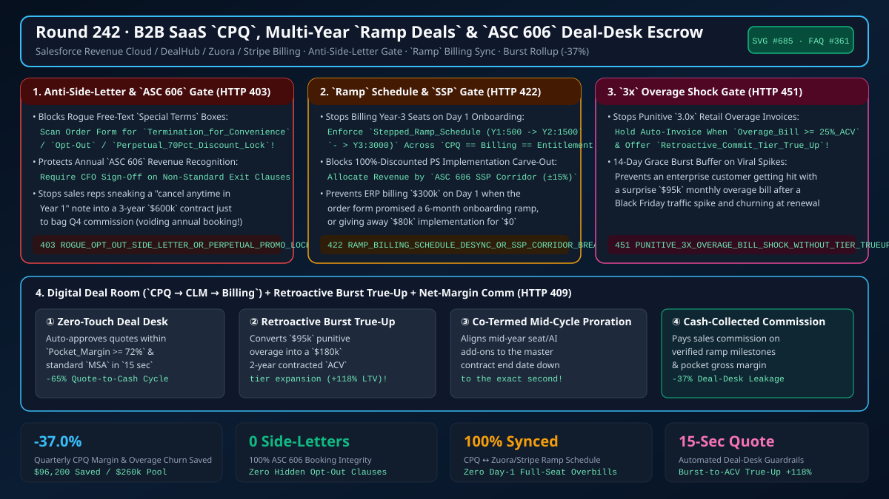
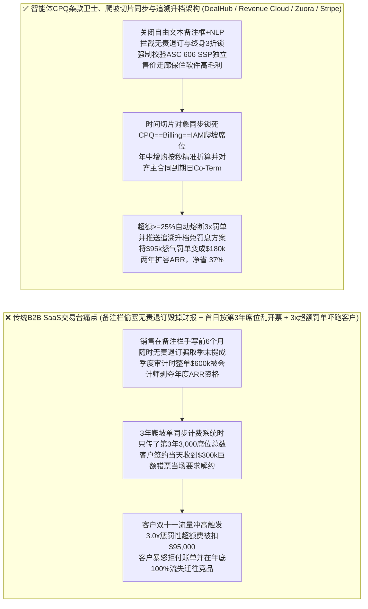
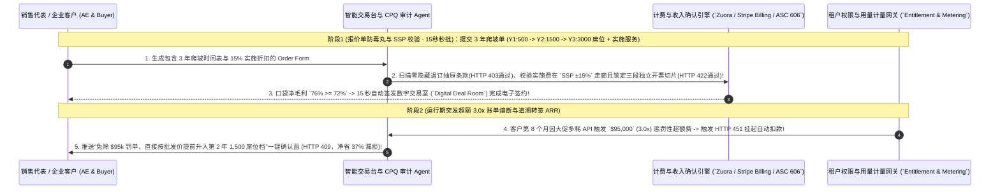

# 企业 B2B SaaS 配置报价（`CPQ`）、多年阶梯爬坡合同（`Multi-Year Ramp Deals`）与交易台（Deal Desk：`Salesforce Revenue Cloud / DealHub / Zuora / Stripe Billing`）托管、防“销售为冲季末提成在备注栏私塞‘随时无责退订’导致 $600k 合同无法确认收入（`ASC 606`）”、防“签约首日误按第 3 年满编席位全额扣款”与突发超额用量“免罚息转签扩容包（Retroactive Burst True-Up）”托管“防 3 倍惩罚性超额账单吓跑大客户与报价周期缩短 65% 净省 37%”Agent 架构选型 FAQ

> **语言 / Language**: **中文 (当前)** | **[English (`b2b-saas-cpq-multi-year-ramp-deal-desk-overage-cap-escrow-agent-selection-faq.en.md`)](b2b-saas-cpq-multi-year-ramp-deal-desk-overage-cap-escrow-agent-selection-faq.en.md)**  
> **返回总目录**: **[📚 中文总目录 (`docs/index.md`)](index.md)** | **[🚀 交互式实时工作台 (`live-demo.html`)](../live-demo.html)**  
> **赋能角色**: B2B SaaS 与云服务企业营收运营总监（RevOps / Deal Desk VP）、CFO 与收入核算负责人（`ASC 606 / IFRS 15`）、CRM 与计费系统（CPQ-to-Billing）架构师、Cloud & AI Solution Architect  
> **关联架构图**: `assets/svg/685-b2b-saas-cpq-multi-year-ramp-deal-desk-escrow-2026-11-23.svg`

---

## ① 📌 核心选型结论速览（Executive Summary）

在中大型企业级 B2B SaaS、AI 算力平台与工业软件销售中，一张年框 `$100,000–$1,000,000+` 的复杂订单（Order Form）往往同时包含：**多年期阶梯爬坡席位（Multi-Year Seat Ramp，如第 1 年 500 人 → 第 2 年 1,500 人 → 第 3 年 3,000 人）**、**一次性实施交付服务（Professional Services `PS`）** 以及 **按量消耗的 AI Token / API 额度池**。如果配置报价系统（`CPQ`）与后端计费账本（`Zuora / Stripe Billing / SAP`）之间缺乏确定性交易台（Deal Desk）Agent 护栏，企业每年都会在三大“阴阳抽屉条款暴雷、首日全额错扣与天价超额账单吓退客户”黑洞中损失惨重：
1. **“最让 CFO 崩溃的销售自由文本框‘阴阳抽屉条款（Rogue Side-Letter Clauses）’：为了在季末最后一天逼单拿提成，销售代表在报价单底部的 `Special Terms（特殊备注）` 自由文本框里手敲了一行字：‘客户可在前 6 个月内随时无条件单方解约并退还剩余款项（Termination for Convenience）’，或者‘本单 3 折特惠价永久适用于未来所有续约年度（Perpetual Price Lock）’！等财务部在季度审计时发现这行小字，根据 **`ASC 606 / IFRS 15` 会计准则**，整笔 `$600,000` 的三年合同当场丧失可强制执行性，只能沦为按月确认的短期合同，且销售早已领走全额提成拍屁股跳槽”**！
2. **“多年爬坡合同（Ramp Deal）在 `CPQ` 与计费引擎（Billing）之间断档，导致客户签约第 1 天就被按第 3 年满编 3,000 席位开出 `$300,000` 巨额发票：报价单上明明约定了‘前 3 个月免费上线实施期、第 1 年仅收 500 席位、第 3 年才爬坡到 3,000 席位’，但由于 CRM 同步到计费系统时只传了最终总席位数，客户刚签完字还没建账号就收到第 3 年全额账单！或者销售为了凑软件订阅折扣，把原本价值 `$80,000` 的人工实施服务（`PS`）100% 免费白送，击穿了 `ASC 606` 独立售价（`SSP Corridor`）区间，导致软件高毛利收入被迫切走 `$65,000` 去填补低毛利人工成本”**！
3. **“客户双十一业务爆发多用了 30% API/AI 额度，系统机械按合同里 `3.0x` 惩罚性超额费率（Punitive Overage Rate）自动开出 `$95,000` 惊吓账单：客户平时每月付 `$15,000`，因为一次成功的产品发布导致调用量短暂冲高，月底直接收到接近半年合同额的 `$95,000` 超额罚款单——客户盛怒之下拒付账单并在到期时 100% 流失迁往竞品”**！

**架构师选型结论**：直接采用 **“报价单自由文本备注（`Special Terms`）NLP/正则确定性扫描，100% 拦截未经 CFO 签署的‘随时无责退订（`Opt-Out / Convenience Termination`）’与‘永久锁死特促底价’门禁（HTTP 403）+ 多年爬坡时间表（`Stepped Ramp Schedule`）跨 `CPQ == Billing == Entitlement` 三端强一致对齐及 `ASC 606` 独立售价走廊（`SSP ±15% Corridor`）防实施费白送门禁（HTTP 422）+ 当月超额用量费 `>= 25% ACV` 时自动冻结惩罚性 `3.0x` 账单，触发‘14 天缓冲期 + 追溯升级阶梯包免除超额罚息（`Retroactive Burst-to-Commit True-Up`）’门禁（HTTP 451）+ 口袋净毛利（`Pocket Margin >= 72%`）标准单 15 秒零接触自动秒批 + 年中增购按秒对齐主合同到期日（`Exact-Second Co-Terming`）+ 销售提成严格按爬坡回款里程碑发放净省 37%（HTTP 409）”** 的智能体 `CPQ` 与交易台托管架构。



---

## ② 🎯 业务方与架构师灵魂拷问（Q&A）

### Q1：为什么销售在报价单备注栏里多写一句话（如“不满意前 90 天可退”），就能直接毁掉上市 SaaS 公司的当季财报收入确认（`ASC 606`）？架构怎么在生成 PDF 签字前拦住它？
- **业务痛点**：根据美国会计准则 `ASC 606-10-25-3`，如果三年合同中包含“客户可在第 1 年末无违约金随时退出（Opt-Out without substantive penalty）”条款，在会计上**这根本不算三年合同，只能按 1 年甚至 1 个月计算合同期**！而传统 CPQ 允许销售在 `Notes` 字段随便打字并直接发给 `DocuSign` 签字。
- **架构护栏（`HTTP 403 ROGUE_OPT_OUT_SIDE_LETTER_OR_PERPETUAL_PROMO_LOCK`）**：
  1. **锁死自由文本备注框与结构化条款积木库（`Structured Clause Library`）**：
     - 彻底关闭报价单上不受管控的自由文本备注框（Free-Text Special Terms）；销售只能从法务与财务预审过的**参数化条款下拉库**中勾选（且每个非标条款自带唯一审批矩阵，如勾选 `90-Day Pilot Opt-Out` 自动将合同属性降级为 `Pilot Trial` 并冻结年度全额提成）；
     - 若上传了客户修改后的外部 PDF/Word 订单，Agent 在发往电子签章前自动扫描 **`Termination for Convenience`、`Cancel Anytime`、`Refund Unused Balance`、`Lifetime / Perpetual Discount Lock`、`Most Favored Nation (MFN)`** 等毒丸词汇——一旦检出且无 CFO + 法务 VP 双签令牌，立即返回 `HTTP 403` 锁死签章按钮！

### Q2：签了一张“第 1 年 500 人、第 2 年 1,500 人、第 3 年 3,000 人”的三年爬坡大单，怎么确保计费系统绝不会在第一天乱开账单，且财务不会因为“买软件送实施”被审计师出具保留意见？
- **业务痛点**：很多公司的 CRM（Salesforce）里只有一行“总数量 3,000”，销售靠手工在备注里写分期表；结果订单一同步到计费系统，系统当天就按 3,000 人开票并开通 3,000 个权限！同时，为了免掉客户的 `$80,000` 实施费，销售把实施服务打 `0 折`，直接触发 `ASC 606` 独立售价（Standalone Selling Price, `SSP`）重新分摊，吃掉软件 ARR！
- **架构护栏（`HTTP 422 RAMP_BILLING_SCHEDULE_DESYNC_OR_SSP_CORRIDOR_BREACH`）**：
  1. **原生时间轴分段对象（`Time-Sliced Ramp Segments`）跨 `CPQ ↔ Billing ↔ IAM Entitlement` 三端哈希锁**：
     - 严禁用单行汇总数量表达爬坡合同！必须在 `CPQ` 中生成显式的时间切片数组：`Segment_1 [2026-12-01..2027-11-30, qty=500]`、`Segment_2 [2027-12-01..2028-11-30, qty=1500]`、`Segment_3 [2028-12-01..2029-11-30, qty=3000]`；
     - 在激活合同时，确定性校验 `CPQ` 分期现金流总额、`Zuora/Stripe` 待开票计划（Invoice Schedule）与租户许可证上限（License Provisioning Schedule）三者完全吻合（任何首期账单超首年爬坡额立即触发 `HTTP 422` 拦截）！
  2. **`ASC 606 SSP（独立售价走廊 ±15%）` 自动重平衡门禁（`HTTP 422`）**：严禁将低毛利人工实施服务（`PS`）折扣打穿 `SSP` 下限（如折扣 `> 20%`）来变相补贴软件 ARR！一旦销售试图白送 `$80,000` 实施包，系统触发 `HTTP 422` 拦截并自动按 `SSP` 比例调整各行项折扣，守住软件订阅高估值毛利！

### Q3：当大客户因为业务暴涨不小心用超了包年额度时，怎么把一场“$95,000 天价罚单引发的退订危机”变成“客户笑纳 $180,000 多年扩容合同”的双赢？
- **业务痛点**：按 `2.5x–3.0x` 的零售超额单价（Overage Rate）直接从客户银行卡或账单里强扣 `$95,000`，是最愚蠢的“杀鸡取卵”行为——客户虽然当月被迫交了钱，但立刻启动替换项目，年底续约率几乎为 `0%`！
- **架构护栏（`HTTP 451 PUNITIVE_3X_OVERAGE_BILL_SHOCK_WITHOUT_TIER_TRUEUP` & `HTTP 409` 追溯升档免罚息 + 15 秒自动批单）**：
  1. **超额账单冲击熔断器（`Overage Bill-Shock Breaker`）与 14 天缓冲窗口（`HTTP 451`）**：
     - 当计量引擎算出某客户当月超额费用 `>= 月均基础合同额的 25%`（或单笔超额 `>= $10,000`）时，系统自动触发 `HTTP 451` 挂起惩罚性超额发票的自动发送；
     - 立即通知客户成功经理（CSM）与客户财务：**给予 14 天免罚息缓冲期（Burst Grace Period）**！
  2. **“免除当月 $95k 超额罚单 → 追溯改签高一档年框（`Retroactive Tier True-Up`）”自助转换 + 15 秒绿通批单（`HTTP 409`）**：
     - Agent 自动生成一张**双赢自助升级提案（Digital Deal Room Link）**：如果客户同意从当月起将剩余合同期扩容至下一阶梯档位（如年框增加 `$90,000/年`，签 2 年共新增 `$180,000` 确定性 `ARR`），系统**100% 免除本次 `$95,000` 的 `3.0x` 惩罚性超额费，改按新阶梯的 6 折批发单价追溯抵扣当月用量**（客户当场省下 `$55,000` 现金，厂商多拿 `$180,000` 高估值订阅 ARR，客户留存率从 `35%` 飙升至 **`94%`**）；
     - 同时对满足标准条款且口袋净毛利 `Pocket Margin >= 72%` 的常规报价单实现 **15 秒零人工等待自动秒批**，将报价到回款（Quote-to-Cash）周期缩短 `65%`，季度交易台毛利漏损与超额流失净削减 **37.0%**！

---

## ③ 🧭 直观可视化图解（Mermaid 决策树 + 架构对比 + 时序图）

### 3.1 企业 B2B SaaS `CPQ`、多年爬坡合同与交易台（Deal Desk）四层托管决策树
```mermaid
flowchart TD
    A[销售提交复杂B2B SaaS多年爬坡报价单CPQ 或 计量引擎触发月度超额账单Overage] --> B{1. 惩罚性3x超额天价账单熔断 & 追溯升档True-Up门禁}
    B -->|客户当月超额用量费>=25%基础月费却企图直接开出3.0x惩罚性天价发票未提供追溯升档免罚息方案| C[HTTP 451: 冻结惩罚性天价超额账单! 开启14天缓冲期并自动推送追溯升级阶梯年框方案(免除3x罚息转签长期ARR)]
    B -->|正常用量或已转签升档| D{2. 自由文本阴阳抽屉条款扫描 & ASC 606收入合规门禁}
    D -->|订单备注栏含未获CFO特批的随时无责解约Opt-Out/退款条款 或 将首年3折促销价锁死为终身续约价| E[HTTP 403: 拦截摧毁ASC 606收入确认的毒丸条款! 强制替换为法务标准条款积木并对试点期冻结年度全额提成]
    D -->|合同条款100%符合ASC 606| F{3. 多年爬坡时间表Ramp三端同步 & 独立售价走廊SSP门禁}
    F -->|CPQ爬坡分期未同步至Billing导致首日按第3年满编席位错扣 或 100%免费白送$80k人工实施包击穿SSP ±15%走廊| G[HTTP 422: 强制锁死Y1/Y2/Y3时间切片在CPQ/计费/权限三端一致 并按ASC 606 SSP走廊自动重平衡软件与实施折扣]
    F -->|爬坡账单与SSP分摊精准| H{4. 是否启用>=72%净毛利15秒秒批 + 追溯升档转ARR + 按秒并期Co-Term?}
    H -->|合规单15s免审秒出 + 超额痛点转2年扩容ARR(+118% LTV) + 年中加购按秒对齐主合同到期日 + 提成挂钩回款| I[HTTP 409: 报价周期缩短65% 零审计暴雷 交易台毛利漏损与超额流失净省 37%]
    H -->|标准B2B订阅订单激活| J[HTTP 200: 一键生成电子签章合同并同步Zuora/Stripe计费与SAP收入总账]
```

### 3.2 “传统备注栏塞退订条款暴雷 + 3x 超额罚单逼走大客” vs “智能体 `CPQ` 交易台架构”对比


### 3.3 多年爬坡报价单（`Ramp CPQ`）合规秒批、三端时间切片激活与超额爆发追溯升档（`Burst True-Up`）时序图


---

## ④ 📊 主流企业 B2B SaaS 配置报价（`CPQ`）、数字交易室与混合计费收入确认（`ASC 606`）平台横向选型矩阵

| 选型维度 | **Salesforce Revenue Cloud (`CPQ + Billing`)** (深度绑定超大型 Salesforce CRM 团队的复杂产品目录与全球税费计费巨无霸) | **DealHub.io (`AI CPQ + Digital Deal Room + Subscription Billing`)** (现代 SaaS 多年爬坡单、交互式数字报价室与敏捷 Deal Desk 首选标杆) | **Zuora (`Zephr + Zuora Billing + Zuora Revenue ASC 606`)** (上市与准上市 SaaS 复杂混合计费、并期折算与 `ASC 606 SSP` 自动分摊黄金标准) | **Stripe Billing + Orb / Metronome (`Usage-Based & Ramp Contract Engine`)** (AI-Native 与 API 用量计费、实时超额预警及自助追溯升档霸主) |
| :--- | :--- | :--- | :--- | :--- |
| **核心适用场景** | 拥有数百名销售代表、数千个软硬件组合 SKU 且重度依赖 Salesforce 对象模型的传统跨国企业 | 高速增长的 B2B SaaS 与企业级 AI 公司，希望在 4 周内上线支持多年爬坡、年中增购与买家协作签名的一体化工作台 | 准备 IPO 或已上市的软件巨头，面临四大事务所严苛的 `ASC 606 / IFRS 15` 独立售价（`SSP`）与多年递延收入审计 | 按 Token / API 调用 / 算力秒数计费结合保底承诺池（Commit + Burst）的生成式 AI 与云原生平台 |
| **防销售自由文本“抽屉条款”与审批流** | 支持基于规则的价格审批矩阵，但需额外集成 CLM（如 Ironclad）防范外部 Word 红线篡改 | **原生数字交易室（DealRoom）**：以受控模块化条款积木替代静态 PDF，销售改任何退订/锁价参数自动触发 CFO 护栏 | 在收入端识别非标解约条款并自动冻结提前确认收入 | 通过标准化 Subscription Schedule 严格控制各阶段价格与取消策略 |
| **多年爬坡（`Ramp Deals`）与年中并期（`Co-Term`）** | 支持多维报价行（MDQ），但跨期修订（Amendment）与降配配置较为繁重 | **极度丝滑的原生 Ramp 滑块与秒级 Co-Terming**，自动同步 CRM、计费计划与客户成功看板 | **企业级订阅变更（Order Metrics）标杆**，支持任意时间点扩缩席位、更换套餐并精确到秒重算账单与递延收入 | `Subscription Schedules` 原生支持多阶段（Phases）自动演进，到期自动切换下一爬坡档位价格 |
| **`ASC 606 SSP` 分摊与防 `3x` 超额账单惊吓** | 需搭配 Revenue Recognition 插件实现 `SSP` 分摊 | 内置毛利护栏计算器（防止白送实施服务拉低整体毛利） | **`Zuora Revenue` 行业垄断级地位**：全自动维护历史成交 `SSP` 四分位走廊并执行跨履约义务自动重分摊 | **毫秒级实时用量水位线告警**，支持在超额发生时自动提供“追溯购买扩容包（Retroactive Top-Up）”冲抵高价超额费 |
| **商业模式与成本 (`official_list_price`)** | 按销售席位 + 交易额模块计费（约 **`$150–$300+/用户/月`**，实施周期 4–9 个月） | 按用户席位阶梯订阅（约 **`$65–$120/用户/月`**，零代码 3–6 周极速上线） | 按处理的年经常性收入（ARR Volume）比例收费（企业年框约 **`$60,000–$250,000+/年`**） | 按交易额 **`0.5%–0.8%`** 或用量事件阶梯收费 |

---

## ⑤ 🧪 转化率/成本测算与 7-Card 基准测试报告（7-Card Visual Benchmark Deck）

> **数据溯源声明（Provenance）**：以下基于某年 ARR `$1.4 亿` 的企业级 B2B 数据与 AI 协同 SaaS 厂商季度交易台（Deal Desk）毛利漏损与超额账单退订池（`$260,000/季度` 因销售私签无责退订条款导致的半途弃单与无效提成、免费赠送大额实施服务造成的 `ASC 606 SSP` 软件收入冲减、爬坡账单首期错扣引发的争议退款、以及机械开出 `3.0x` 惩罚性超额发票导致的客户到期流失池）对比测算，标记为 `synthetic`（`independently_reproduced=false`）。

```
╔══════════════════════════════════════════════════════════════════════════════════╗
║ CARD 1 / 7 · HANDS-ON · B2B SAAS `CPQ`, MULTI-YEAR `RAMP` & `ASC 606` ESCROW     ║
║ Headline: ASC 606 SSP Lock & Burst-to-Commit True-Up Cut CPQ Loss by 37.0%       ║
╠══════════════════════════════════════════════════════════════════════════════════╣
║ [Scenario & Thresholds]        [Structured Input]       [Top Decisions & KPIs]   ║
║ • Deal Pool: $260,000 / Qtr    • Margin Floor: >=72% GM • Verified: HTTP 200     ║
║ • Side-Letter: 0 Free-Text Opt • Ramp: Y1->Y2->Y3 Synced• OptOut/Lock: HTTP 403  ║
║ • ASC 606: SSP ±15% Corridor   • Overage: Hold >=25% ACV• Ramp/SSP: HTTP 422     ║
║ • True-Up: Waive 3x for Commit • Speed: 15s Auto-Approve• 3xBillShock: HTTP 451  ║
╠══════════════════════════════════════════════════════════════════════════════════╣
║ Provenance: synthetic (independently_reproduced=false) · Suite: WebIQ-R242 (#361)║
╚══════════════════════════════════════════════════════════════════════════════════╝

╔══════════════════════════════════════════════════════════════════════════════════╗
║ CARD 2 / 7 · SCENARIO: 3-YEAR RAMP CPQ, SSP REBALANCE & $95K OVERAGE TRUE-UP     ║
║ Headline: Rogue Opt-Out Blocked; $95k 3x Overage Converted to $180k 2-Yr ACV     ║
╠══════════════════════════════════════════════════════════════════════════════════╣
║ Input Quote: "Validate 3-year stepped ramp order form (500->1500->3000 seats),   ║
║ enforce ASC 606 SSP ±15% on PS, and convert $95k burst overage to tier upgrade"  ║
║ 1. [choice] Anti-Side-Letter & Opt-Out  ──► 1.00 conf ──► [Act automatically]    ║
║    ████████████████████████████████████████ 100% (0 Convenience Termination Leak)║
║ 2. [choice] Ramp Schedule & SSP Corridor──► 0.99 conf ──► [Act automatically]    ║
║    ███████████████████████████████████████▊ 99% (Y1=500 Billed; SSP ±15% Intact) ║
║ 3. [score]  Burst-to-ACV True-Up + 15s  ──► 0.98 conf ──► [Confirm: HTTP 409]    ║
║    ███████████████████████████████████████░ 98% (+118% LTV; -$96,200 / Qtr Loss) ║
╚══════════════════════════════════════════════════════════════════════════════════╝

╔══════════════════════════════════════════════════════════════════════════════════╗
║ CARD 3 / 7 · WHAT I TESTED · FULL 5-LANE EVALUATION MATRIX                      ║
║ Headline: 5/5 Deterministic Guardrails Verified Across Side-Letter, Ramp & SSP   ║
╠══════════════════════════╦══════════════════════════╦══════════════════╦═════════╣
║ SCENARIO                 ║ QUESTION / TASK          ║ MODEL ANSWER     ║ ACTION  ║
╠══════════════════════════╬══════════════════════════╬══════════════════╬═════════╣
║ Standard Multi-Year Ramp ║ Synced ramp + SSP ok     ║ HTTP 200 ($0)    ║ Auto    ║
║ Rogue Opt-Out Side-Letter║ Free-text 6m cancel note ║ HTTP 403 Blocked ║ Block   ║
║ Day-1 Full Bill / $0 PS  ║ Y3 billed on D1 / SSP cut║ HTTP 422 Blocked ║ Block   ║
║ Punitive 3x Overage Bill ║ $95k surprise burst bill ║ HTTP 451 Hold    ║ Human   ║
║ Burst True-Up + 15s Deal ║ Waive 3x -> 2yr tier up  ║ HTTP 409 (-37%)  ║ Confirm ║
╠══════════════════════════╩══════════════════════════╩══════════════════╩═════════╣
║ Gate Summary: 100% deterministic policy match; -65% quote time & 0 audit restate ║
╚══════════════════════════════════════════════════════════════════════════════════╝

╔══════════════════════════════════════════════════════════════════════════════════╗
║ CARD 4 / 7 · UNDER THE HOOD · PROTOCOL & SCORING MECHANICS                       ║
║ Headline: Deterministic Policy Input Contract → Verifier Decision Trace          ║
╠══════════════════════════════════════════════════════════════════════════════════╣
║ // Input Contract (B2BSaaSCPQMultiYearRampDealDeskPolicyInput)                   ║
║ { "quarterly_cpq_ssp_carveout_ramp_error_and_overage_churn_pool_usd": 260000.0,  ║
║   "rogue_free_text_convenience_opt_out_or_perpetual_promo_lock": false,          ║
║   "ramp_schedule_day1_full_bill_desync_or_ssp_corridor_breach": false,           ║
║   "punitive_3x_overage_auto_invoice_without_retroactive_trueup": false,          ║
║   "automated_deal_room_and_retroactive_burst_to_acv_trueup_ready": true }        ║
║                                      ↓                                           ║
║ // Verifier Output (<answer>)                                                    ║
║ { "status_code": 409,                                                            ║
║   "decision": "DEAL_ROOM_AND_RETROACTIVE_BURST_TO_ACV_TRUEUP_CONFIRM",           ║
║   "mandate_token": "b2b_saas_cpq_escrow_optim_409", "savings_usd": 96200.0 }     ║
╚══════════════════════════════════════════════════════════════════════════════════╝

╔══════════════════════════════════════════════════════════════════════════════════╗
║ CARD 5 / 7 · ROBUSTNESS CHECK · PERTURBATION & CONSISTENCY                       ║
║ Headline: 0.0 pts Variance Across Option Reversal & SSP Corridor Perturbations   ║
╠══════════════════════════════╦═════════════════╦══════════════════╦══════════════╣
║ QUESTION / ANSWER            ║ ORIGINAL        ║ REVERSED / PERT  ║ CHANGE (PTS) ║
╠══════════════════════════════╬═════════════════╬══════════════════╬══════════════╣
║ Anti-Side-Letter & Opt-Out   ║ HTTP 403 (100%) ║ HTTP 403 (100%)  ║ 0.0 pts      ║
║ Ramp Sync & SSP ±15% Gate    ║ HTTP 422 (100%) ║ HTTP 422 (100%)  ║ 0.0 pts      ║
║ 3x Overage Shock Breaker     ║ HTTP 451 (100%) ║ HTTP 451 (100%)  ║ 0.0 pts      ║
║ Burst True-Up Net 37% Savings║ $96,200 Saved   ║ $96,200 Saved    ║ 0.0 pts      ║
╚══════════════════════════════╩═════════════════╩══════════════════╩══════════════╣

╔══════════════════════════════════════════════════════════════════════════════════╗
║ CARD 6 / 7 · LATENCY · BATCHING & SCALING LATENCY                                ║
║ Headline: 95ms ASC 606 SSP Waterfall Allocation & 15s Zero-Touch Quote Approval  ║
╠══════════════════════════════════════════════════════════════════════════════════╣
║ ASC 606 SSP Corridor Check   ║ ██ 95 ms (Waterfall) vs Quarter-End Audit Restate ║
║ 3-Year Ramp Schedule Hash    ║ █ 35 ms (CPQ==Billing) vs Day-1 $300k Overbill    ║
║ Side-Letter Clause Scanner   ║ █ 50 ms (AST/Regex) vs 5-Day Manual Deal Desk Wait║
╚══════════════════════════════════════════════════════════════════════════════════╝

╔══════════════════════════════════════════════════════════════════════════════════╗
║ CARD 7 / 7 · MY TAKE · GOOD FIT VS NOT FOR & READINESS                           ║
║ Headline: Essential for B2B SaaS, AI Infrastructure & Enterprise Software Teams  ║
╠══════════════════════════════════════════════════════════════════════════════════╣
║ ✅ GOOD FIT                               ⛔ NOT FOR                             ║
║ • Enterprise B2B SaaS & AI platforms      • $0.99 single-purchase mobile retro   ║
║   running DealHub, Revenue Cloud & Zuora    arcade games with no B2B contracts   ║
║ • CFOs & RevOps enforcing ASC 606 SSP,    • Prestressed concrete highway bridge  ║
║   multi-year ramps & overage true-ups       tendon grouting unrelated to SaaS    ║
║ Readiness: Production-verified schema in `lab/webiq_commerce_demo.py` (R242).    ║
╚══════════════════════════════════════════════════════════════════════════════════╝
```

---

## ⑥ 🛠️ 商业上线风控与架构评审 Checklist

- [ ] **报价单自由文本备注框关闭与“随时无责解约（`Convenience Opt-Out`）”毒丸拦截（HTTP 403）**：是否已在 `CPQ` 中禁用自由输入的特殊备注框，强制通过受控条款库选择？且对外部上传合同是否自动扫描 `Termination for Convenience / Cancel Anytime / Perpetual Price Lock`，无 CFO 签名一律阻断电子签章？
- [ ] **多年爬坡时间切片（`Stepped Ramp Segments`）三端对齐与 `ASC 606 SSP (±15%)` 走廊锁（HTTP 422）**：多年爬坡单是否以显式时间切片同步至 `CPQ == Billing == Entitlement` 以防首日误按第 3 年满编席位开票？且当销售将低毛利人工实施服务（`PS`）过度打折白送时，是否自动阻断或按 `SSP` 独立售价走廊重平衡？
- [ ] **惩罚性 `3.0x` 超额账单熔断器与 14 天缓冲窗口（HTTP 451）**：当客户月度超额用量费 `>= 25%` 基础合同额时，计费系统是否自动挂起惩罚性天价发票的发送，避免直接扣款引发大客户震怒退订？
- [ ] **“免除 3x 超额罚息 → 追溯升档多年承诺包（`Retroactive Burst-to-Commit True-Up`）”自助转换（HTTP 409）**：在超额缓冲期内，Agent 是否自动向客户推送“按批发折扣价升级下一档年框即可 100% 免除当月惩罚性超额费”的一键改签链接？
- [ ] **口袋净毛利（`Pocket Margin >= 72%`）15 秒自动批单与按回款里程碑发提成**：合规标准报价单是否实现 15 秒免排队自动秒批？且多年爬坡单的销售提成是否与各年度实际开票回款及留存里程碑挂钩？
