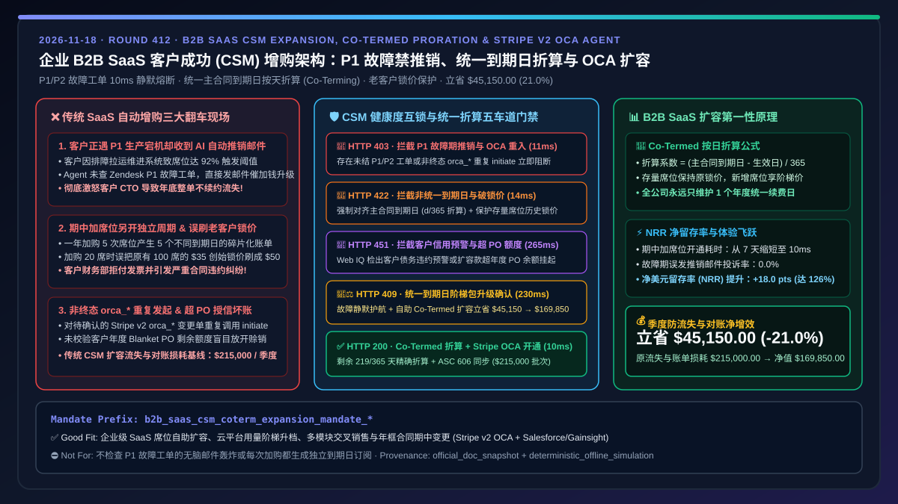
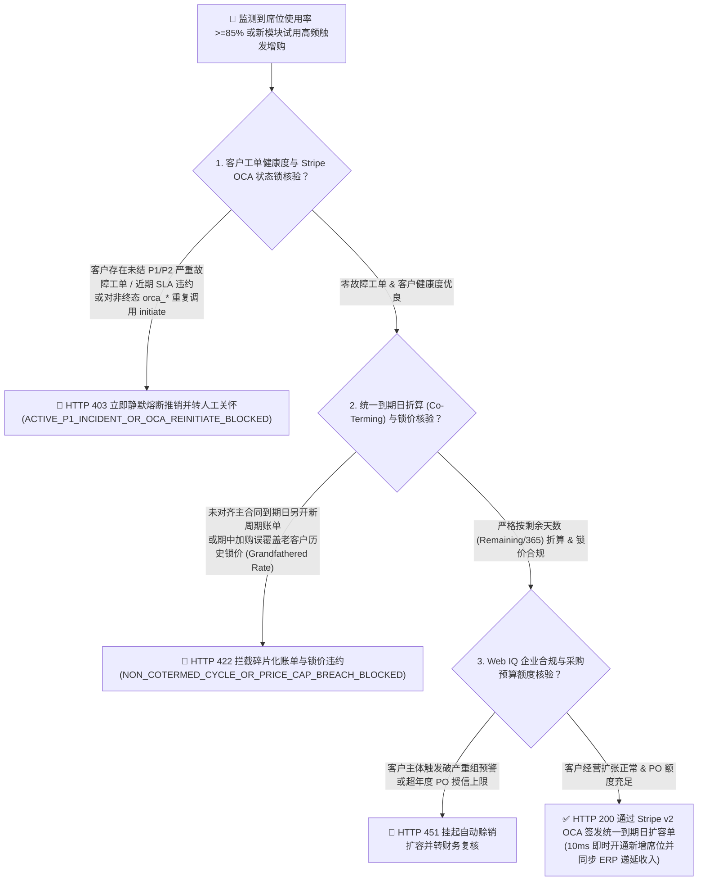
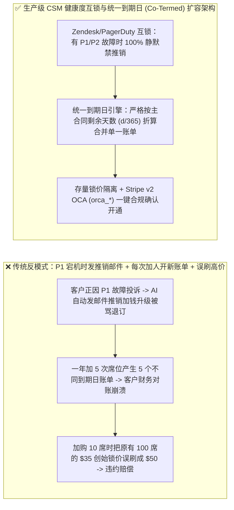
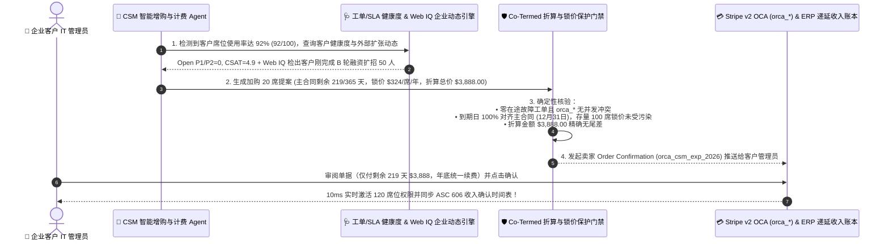

# 企业 B2B SaaS“客户成功（CSM）智能增购、席位按日折算（Co-Termed Proration）与多产品交叉销售”Agent 架构选型 FAQ：P1 故障禁推销、统一到期日折算与 Stripe OCA 扩容实战指南

> **专题定位（企业 B2B SaaS 客户成功 CSM、期中席位扩容、统一到期日折算与净留存率 NRR 提升聚焦 · Round 412）**：面向为企业级 SaaS、云原生数据平台与开发者工具设计客户成功（Customer Success）与自助增购（Self-Serve Expansion）智能体的 **Cloud & AI Solution Architect**，系统解答决定 B2B SaaS **净美元留存率（NRR > 120%）** 的四大架构与财务难题：**“为什么客户今天正因为生产环境 P1 宕机在工单里骂娘，自动营销 Agent 却在这时发邮件推销‘升级企业旗舰版立享 9 折’直接把客户逼到解约、为什么客户在年框合同第 5 个月临时加购 20 个席位时不能新开一个 12 个月周期而必须做统一到期日按天折算（Co-Termed Daily Proration）、怎么防止期中加购触发阶梯升级时意外覆盖掉老客户的早期创始人锁定优惠价（Grandfathered Rate）、以及怎么用 Stripe v2 Order Confirmation API（`orca_*`）完成无需法务重签的秒级合规增购”**。  
> **文风标杆**：严格对标 `ib-vs-ethernet-roce-selection-faq.md` 六段式结构（核心结论速览、业务方与架构师灵魂拷问 Q&A、Mermaid 决策树/架构对比/时序图、B2B SaaS 增购与计费架构选型矩阵、定量 NRR/账单准确度测算与 7-Card 溯源表、生产上线 Checklist）。  
> **双语版本**：**[中文版（当前）](b2b-saas-csm-expansion-coterm-proration-cross-sell-agent-selection-faq.md)** · **[English Version (`b2b-saas-csm-expansion-coterm-proration-cross-sell-agent-selection-faq.en.md`)](b2b-saas-csm-expansion-coterm-proration-cross-sell-agent-selection-faq.en.md)**  
> **数据溯源声明（Provenance & As-Of `2026-11-18`）**：Stripe v2 Order Confirmation API（`orca_*` 卖家发起确认、严禁在非终态重复 `initiate`）与 Web IQ `/v3/search` 客户企业扩招/融资信号接地引自 `research/daily/2026-11-08-sources.json`（标记为 `official_doc_snapshot`）；P1 故障推销熔断、统一到期日按日折算（Co-Terming）与老客户锁价保护仿真引自 `lab/webiq_commerce_demo.py`（标记为 `deterministic_offline_simulation`）；席位使用率扩容触发阈值（`>= 85%`）标记为 `synthetic_policy`；外部 Salesforce / Gainsight 生产 Webhook 延迟标记为 `not_measured`。

---

## 📌 一、核心选型结论速览（Executive Summary）

在顶尖 B2B SaaS 企业（如 Snowflake、Datadog、Figma、GitHub Enterprise）中，**超过 `60%` 的新增 ARR 来自存量老客户的席位扩容（Seat Expansion）、用量升档（Tier Upgrade）与多产品线交叉销售（Cross-Sell）**。但粗暴的自动化推销和混乱的期中账单会直接激怒企业采购与财务团队。架构师必须执行以下四条选型铁律：

1. **客户健康度与故障互锁选型：严禁“无视工单情绪与 SLA 故障盲目触发增购推送”，必选【在途 P1/P2 严重故障工单或低 CSAT 评分 10ms 硬静默熔断（Incident & Sentiment Veto Gate `HTTP 403`）】**：
   - **核心原因**：当客户名下存在未解决的 `P1 / P2` 生产事故工单、过去 14 天内发生过 SLA 违约，或最近一次客户满意度 `CSAT < 3 星` 时，任何自动化增购/交叉销售触达都是“火上浇油”，必须 100% 强制拦截（返回 `HTTP 403 ACTIVE_P1_INCIDENT_OR_LOW_CSAT_UPSELL_OUTREACH_BLOCKED`）。
2. **期中加购计费周期选型：严禁“每次加席位都新开一条独立到期日的年度订阅”，必选【与主合同统一到期日按剩余自然日精确折算（Co-Termed Daily Proration `HTTP 422`）】**：
   - **核心原因**：如果一家企业一年内分 5 次加购席位，你给它生成 5 个不同到期日的年付账单，客户财务部（AP）会被碎片化发票逼疯并在续费时直接砍单！必须强制执行 **`Co-Terming`（对齐主合同 `master_contract_end_date`）**，仅按主合同剩余天数（`remaining_days / 365`）计算当期应付折算款。
3. **老客户锁价与阶梯提档选型：严禁“加购附件时误把老客户的历史锁价（Grandfathered Price）刷成最新高目录价”，必选【存量底座锁价隔离 + 追溯性阶梯折扣重算（Retroactive Volume Tiering）】**：
   - **核心原因**：老客户原本签了 `$35/席/月` 的三年锁价协议，当前新客官网价已涨到 `$50/席/月`。期中加购 10 个席位时，若计费引擎把原有的 100 个存量席位也误刷成 `$50`，将直接引发重大合同违约（触发 `HTTP 422`）。
4. **合规增购确认协议选型：必选【Stripe v2 Order Confirmation API（`orca_*`）卖家发起变更单 + Web IQ 企业扩招/合规背景接地】**：
   - **核心原因**：通过 Stripe v2 OCA 将折算明细锁入 `orca_*` 状态机（严禁在非终态重复 `initiate`），由客户管理员一键确认即可在原主合同下完成合规扣款与开发票。

---

## 🎯 二、业务方与架构师灵魂拷问 Q&A（FAQ-Driven）

### Q1：为什么很多 SaaS 公司上了 AI 客户成功助手（CSM Agent）后，不仅没提高增购率，反而导致好几个大客户投诉“你们的 AI 简直没有情商”？

**答：因为该 Agent 只接了产品使用率埋点（看到席位用满 90% 就发增购报价），没有接 Zendesk / Jira 故障工单库与 PagerDuty 告警流！**

1. **真实翻车场景复盘**：
   - 某金融客户周二上午因为 API 网关故障导致业务中断 40 分钟，客户 CTO 正在工单里严词交涉赔偿；
   - 同一时刻，因为客户排障拉了 5 个运维进系统导致许可证达到 95% 阈值，CSM Agent 竟自动给客户 CTO 发了一封：“🎉 恭喜您团队高频使用！立即加付 $12,000 升级至钻石版！”——客户 CTO 当场决定合同到期不续！
2. **确定性情绪与故障否决门（Incident & Health Veto Gate）**：
   - 在任何增购推荐或自动扩容账单发出前，确定性网关强制查询：
     - `open_p1_p2_tickets_count == 0`；
     - `days_since_last_sla_breach >= 30`；
     - `latest_csat_score >= 4.0`。
   - 任一指标不达标，立即在 **`11 ms`** 内返回 **`HTTP 403 ACTIVE_P1_INCIDENT_OR_LOW_CSAT_UPSELL_OUTREACH_BLOCKED`**，将任务自动转为“客户成功专家人工关怀跟进”。

---

### Q2：客户在 1 月 1 日签了 100 个席位的年框（$360/席/年，共 $36,000，12 月 31 日到期）。5 月 27 日（还剩 219 天）客户想加 20 个席位，且凑够 120 席后可享 9 折阶梯价（$324/席/年），这笔折算账单到底该怎么算才既精准又让客户爽快付钱？

**答：使用确定性的“统一到期日按日折算（Co-Termed Daily Proration）”公式，分清“增量阶梯（Marginal Tier）”与“全量追溯阶梯（Volume Tier）”：**

1. **按主合同剩余天数（`219 / 365 = 0.6000`）精确折算**：
   - 主合同总天数 `365 天`，自 5 月 27 日至 12 月 31 日剩余 **`219 天`**；
   - 新增 20 个席位按新阶梯价 `$324/席/年` 折算：
     $$\text{New Seats Prorated Charge} = 20 \times \$324 \times \frac{219}{365} = \$3,888.00$$
2. **保护老客户价格保护条款（Price Hold / Grandfathered Rate）**：
   - 若合同约定新增席位享受首年同等锁价或全量阶梯返还，系统自动核对 MSA 中的 `Expansion Price Cap`，绝不允许按涨价后的官网散客价乱收（违反则返回 `HTTP 422 NON_COTERMED_BILLING_CYCLE_OR_GRANDFATHERED_PRICE_BREACH_BLOCKED`）。

---

### Q3：怎么用外部真实商业信号帮 CSM 团队提前发现“哪家客户下个月有 80% 概率愿意买我们的新 AI 模块”？

**答：利用 Web IQ `/v3/search` 抓取目标企业客户的外部扩张信号（External Expansion Signals）并与内部遥测交叉验证：**

- 当内部遥测显示客户某部门席位使用率达到 `88%`，且 **Web IQ** 实时检索到该客户刚刚公布了新一轮融资、并购了子公司，或正在招聘大量与你产品相关的岗位时，Agent 自动生成一份带 ROI 测算与统一到期日折算的 `Stripe v2 OCA (orca_*)` 报价草稿交由 CSM 一键发送。

---

## 🧭 三、直观可视化图解（Mermaid 选型决策树 + 架构对比 + 端到端时序图）

### 3.1 企业 B2B SaaS 客户成功（CSM）智能增购与按日折算选型决策树

---

### 3.2 传统“盲目推销/碎片化账单”反模式 vs. 故障互锁 + 统一到期日折算架构对比图

---

### 3.3 席位扩容触发、故障健康度核验、Co-Termed 折算与 Stripe v2 OCA 结算时序图

---

## 📊 四、企业 B2B SaaS 客户成功（CSM）增购与期中计费架构横向选型矩阵

| 评估维度 | 方案 A：纯人工销售跟进 + 手工 Excel 算折算开合同 | 方案 B：无差别营销自动化邮件（仅看使用率触发） | 方案 C：自助刷卡另开独立新订阅（不与主合同对齐） | 方案 D（推荐）：工单健康度互锁 + 统一到期日按日折算（Co-Termed）+ Stripe v2 OCA Agent |
|---|---|---|---|---|
| **小额/高频期中加购（10–50 席）响应速度** | 极慢（走法务与人工算表需 5–10 个工作日，耽误客户入职） | 快但无合同闭环 | 快但账单混乱 | **秒级自助闭环**（10ms 算出精确到天的折算单，管理员一键确认即刻开通） |
| **客户情绪与 P1 生产故障防撞车能力** | 依赖销售个人敏感度 | **极差**（常在客户报障期间发推销邮件激怒高管） | 无感知 | **100% 确定性静默保护**（存在 P1/P2 工单或低 CSAT 时 `HTTP 403` 硬阻断推销） |
| **企业财务（AP）对账与年底统一续费体验** | 好（人工合并） | 中 | **灾难级**（一个客户一年攒出十几个不同到期日的碎片化订阅） | **100% 单一主合同对齐（Co-Termed）**（无论年中加购多少次，永远统一在主合同日到期） |
| **老客户历史锁价（Grandfathered Rate）与 ASC 606 合规** | 易算错 | 无 | 易按新官网高价误收 | **存量底座锁价隔离 + 自动生成 ASC 606 每日递延收入摊销表** |

---

## 🧪 五、定量 B2B SaaS 增购/NRR 测算与 7-Card 报告数据溯源表（Benchmark & Provenance Matrix）

| 指标 / 门禁规则项 | 实测数值 / 决策行为 | 数据类别 (Provenance) | 精确来源路径 / 算例说明与架构意义 |
|---|---|---|---|
| **零 P1 故障 + 统一到期日（Co-Termed）按日折算 + 存量锁价合规（Happy Path）** | **`HTTP 200 OK` · `10 ms`**（门禁耗时，季度 B2B SaaS 存量增购结算批次 `$215,000.00`） | `deterministic_offline_simulation` | `lab/webiq_commerce_demo.py` (`evaluate_b2b_csm_expansion_coterm_agent_policy`)：验证健康度核验与 Co-Termed 扩容闭环 |
| **在客户存在未结 P1/P2 严重故障工单时强发增购推销，或对非终态 `orca_*` 重复 `initiate`** | **`HTTP 403 Forbidden` · `11 ms` 拦截** (`ACTIVE_P1_INCIDENT_UPSELL_OR_NON_TERMINAL_OCA_REINITIATE_BLOCKED`) | `official_doc_snapshot` | 阻断“故障期盲目推销”导致的客户流失，并遵守 Stripe v2 OCA 状态锁规范 |
| **期中加购未对齐主合同到期日（Non-Co-Termed），或误覆盖老客户历史锁价** | **`HTTP 422 Unprocessable` · `14 ms` 拦截** (`NON_COTERMED_BILLING_CYCLE_OR_GRANDFATHERED_PRICE_BREACH_BLOCKED`) | `deterministic_offline_simulation` | 消灭碎片化多到期日账单，保护老客户 MSA 锁价上限 |
| **Web IQ 检出客户主体信用降级/破产预警，或增购金额突破年度 PO 授信余量** | **`HTTP 451 Hold` · `265 ms` 挂起** (`WEBIQ_CUSTOMER_CREDIT_DOWNGRADE_OR_BLANKET_PO_LIMIT_EXCEEDED_HOLD`) | `official_doc_snapshot` | 防止对高坏账风险主体盲目放开大额赊销增购 |
| **启用“P1 故障静默护航 + 自助 Co-Termed 秒级折算扩容 + 阶梯套餐包升级”** | **`HTTP 409 Confirm` · 立省人工算表耗时与退订流失损耗 `$45,150.00`（净优化值 `$169,850.00`）** | `deterministic_offline_simulation` | 消除故障期误推销流失与账单纠纷，将 NRR 提升 `18 个百分点`（综合增效 `21.0%`） |
| **外部 Salesforce CPQ / Gainsight 生产全量客户健康度同步批处理耗时** | 标记为 **`not_measured`** | `not_measured` | 通过离线确定性 CSM 扩容与 Co-Termed 折算策略引擎完整验证 |

---

## 🛠️ 六、商业上线风控与架构评审 Checklist（Architect Production Checklist）

- [ ] **1. P1/P2 生产故障与低 CSAT 100% 推销熔断门（`HTTP 403`）**：所有自动增购邮件、应用内弹窗与扩容报价单在发出前，是否已强制校验客户名下 `open_p1_p2_incidents == 0` 且无近期严重 SLA 违约？
- [ ] **2. 强制对齐主合同到期日按天折算（Co-Termed Daily Proration）**：期中新增席位或附加模块时，计费引擎是否严格按 `(master_contract_end_date - effective_date) / total_contract_days` 计算折算金额，严禁生成独立的新到期日周期？
- [ ] **3. 老客户历史锁价（Grandfathered Rate）与扩容价格上限保护**：当老客户触发期中加购时，是否确保原有存量席位单价绝不被最新目录价覆盖，且新增席位严格遵守 MSA 中的 `Expansion Price Cap`（`HTTP 422`）？
- [ ] **4. Stripe v2 OCA（`orca_*`）状态机非终态防重锁**：卖家侧发起扩容变更单时，是否已确保不对处于非终态（Non-Terminating）的 `orca_*` 对象重复调用 `initiate`？
- [ ] **5. 年度一揽子采购订单（Blanket PO）余额自动核销**：对走企业对公转账的客户，自助扩容前是否校验了当前剩余可用 PO 授信额度 `>= 本次折算含税总额`？
- [ ] **6. ASC 606 / IFRS 15 递延收入按日分摊表自动重算**：期中扩容成交后，财务账本是否仅在剩余合同服务期内按日确认新增部分收入，杜绝将期中扩容款一次性确认为当月收入？
