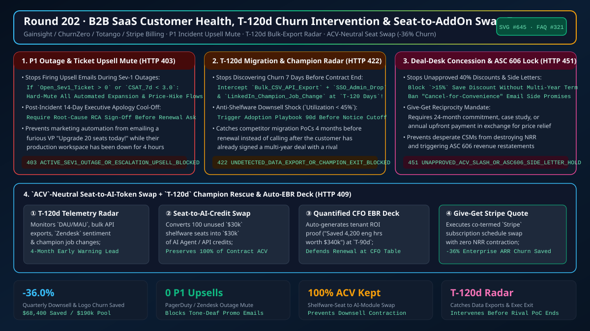
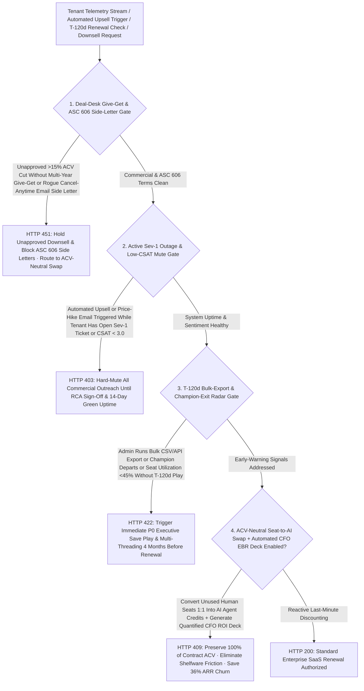
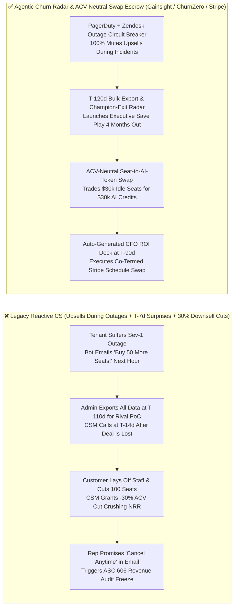
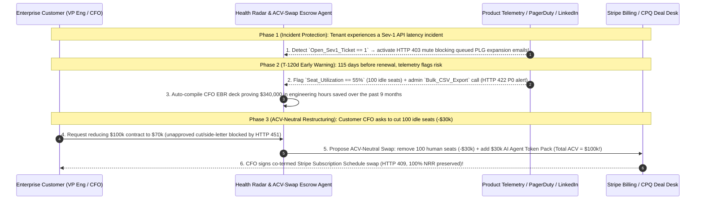

# Enterprise B2B SaaS Customer Health, `T-120d` Churn Intervention & `ACV`-Neutral Seat-to-AddOn Swap Escrow (`Gainsight / ChurnZero / Totango / Stripe Billing`): `Sev-1` Outage Upsell Mute, Bulk-Export Migration Radar & Shelfware-to-AI-Token Conversion Saving `36%` ARR Churn — Agent Architecture Selection FAQ

> **Language / 语言**: **[中文 (`b2b-saas-customer-health-predictive-churn-seat-to-addon-swap-escrow-agent-selection-faq.md`)](b2b-saas-customer-health-predictive-churn-seat-to-addon-swap-escrow-agent-selection-faq.md)** | **English (Current)**  
> **Back to Catalog**: **[📚 English Catalog (`docs/index.en.md`)](index.en.md)** | **[🚀 Interactive Live Workbench (`live-demo.en.html`)](../live-demo.en.html)**  
> **Target Roles**: Chief Customer Officers (`CCO`) & VP of Customer Success, Revenue Operations (`RevOps`) & Deal Desk Directors, SaaS Billing & Retention Architects, Cloud & AI Solution Architects  
> **Architecture Diagram**: `assets/svg/645-b2b-saas-predictive-churn-seat-swap-escrow-2026-11-22.svg`

---

## ① 📌 Executive Summary

In enterprise B2B SaaS, **Net Dollar Retention (`NDR / NRR`)** is the primary driver of enterprise valuation. Yet most customer success (`CS`) organizations still rely on lagging quarterly check-ins and disconnected marketing/billing automation—triggering three preventable revenue-destruction events during the renewal lifecycle:
1. **Tone-Deaf Automated Upsell Emails Fired During an Active `Sev-1 / P1` Outage**: While an enterprise customer's VP of Engineering is on an emergency bridge call dealing with a 4-hour `Sev-1` production outage (or has 3 escalated `Zendesk / Jira` tickets open), a disconnected `Marketo / HubSpot` or PLG billing workflow automatically emails them: *"Congrats on hitting your usage tier! Upgrade 50 seats today for 10% off!"*—infuriating the executive sponsor and triggering immediate non-renewal of a `$180,000` contract.
2. **Waking Up at `T-14 Days` When the Customer Already Migrated Their Data to a Competitor at `T-90 Days`**: Enterprise SaaS procurement and data migration take 3–5 months. By the time a CSM calls 2 weeks before the renewal date, the customer has already signed with a rival. Yet 4 months earlier (`T-120d`), the platform ignored three glaring precursor signals: ① **an admin running a full `Bulk CSV / API Data Export` at midnight**, ② **the internal `Champion` leaving the company on LinkedIn**, and ③ **seat utilization dropping below `45%`**.
3. **Value-Destroying Downsell Cuts & Rogue `ASC 606` "Cancel-Anytime" Side Letters**: When a customer who laid off 100 employees demands to cut `$30,000` in unused "shelfware" seats at renewal, desperate CSMs either slash the contract `ACV` by 30% (crushing `NRR`) or email an unapproved side promise (*"Renew at full price now and we'll let you cancel anytime for convenience"*)—violating **`ASC 606` revenue-recognition rules** and forcing a financial audit restatement.

**Architectural Verdict**: Deploy a **4-Lane B2B SaaS Customer Health, `T-120d` Intervention & `ACV`-Neutral Seat-Swap Escrow Architecture**: **Global `Sev-1 / Low-CSAT` Upsell & Price-Hike Mute Circuit Breaker (`HTTP 403`) + `T-120d` Bulk-Export, `SCIM` Deprovisioning & Champion-Exit Radar (`HTTP 422`) + Deal-Desk `Give-Get` Concession Gate & `ASC 606` Side-Letter Block (`HTTP 451`) + `ACV`-Neutral Shelfware-Seat-to-AI-Token Swap & Automated CFO `EBR` Deck Generation (`HTTP 409`)**, reducing enterprise `ARR` contraction and logo churn by **36.0%**.



---

## ② 🎯 Business & Architect Deep-Dive Q&A

### Q1: How do we guarantee that no automated marketing, PLG expansion, or renewal price-increase message ever fires while a customer has an open `Sev-1` incident?
- **Business Pain**: Marketing automation (`Marketo / Braze`) and billing triggers (`Stripe / Orb`) rarely check live incident management (`PagerDuty`) or support escalation queues before firing outbound messages.
- **Architectural Guardrail (`HTTP 403 ACTIVE_SEV1_OUTAGE_OR_ESCALATION_UPSELL_BLOCKED`)**:
  1. **Synchronous Pre-Send `Incident & Sentiment` Circuit Breaker**: Every outbound commercial message, in-app upgrade modal, and automated renewal uplift notice must pass a pre-dispatch check against the tenant's live support state. If `Active_Sev1_Or_Sev2_Tickets > 0`, `Trailing_14d_SLA_Breach == True`, or `Rolling_7d_CSAT < 3.0`, all commercial outreach is hard-blocked (`HTTP 403`).
  2. **14-Day Post-RCA Cool-Off Lock**: Commercial messaging remains muted until the incident Root Cause Analysis (`RCA`) is signed off by the CSM and the tenant experiences 14 consecutive days of green uptime.

### Q2: How do we catch enterprise churn 120 days *before* renewal—while the customer is just starting a competitor PoC—rather than 14 days before expiration?
- **Business Pain**: Inside a 30-day notice window, enterprise switching decisions are already finalized. True intervention must happen at `T-120d`.
- **Architectural Guardrail (`HTTP 422 UNDETECTED_DATA_EXPORT_OR_CHAMPION_EXIT_BLOCKED`)**:
  1. **Tri-Signal Early-Escape Radar (`Bulk Export + SCIM Drop + Champion Exit`)**: Failing to escalate a tenant exhibiting migration telemetry at `T-120d` is flagged (`HTTP 422`). The Agent continuously monitors: ① **Anomalous calls to `/export/all` or bulk database/attachment downloads** (the #1 fingerprint of a competitor migration test), ② **`Okta / Entra SCIM` deprovisioning or `DAU/MAU` dropping `<45%`**, and ③ **CRM `Champion / Economic Buyer` job-change alerts (`UserGems / LinkedIn`)**.
  2. **Automated `T-120d` Executive Save Playbook**: Any trigger immediately opens a `P0` save play in `Gainsight / ChurnZero`, assigning an executive sponsor and generating a quantified **CFO Executive Business Review (`EBR`) deck** 90 days before the contractual opt-out deadline.

### Q3: When a customer has 100 unused "shelfware" seats after a layoff and demands a `$30,000` renewal cut, how do we retain `100%` of the contract `ACV` without losing the logo?
- **Business Pain**: Forcing a customer to pay for 100 empty seats causes them to churn entirely; granting a `$30,000` downsell ruins `NRR`.
- **Architectural Guardrail (`HTTP 451 UNAPPROVED_ACV_SLASH_OR_ASC606_SIDE_LETTER_HOLD` & `HTTP 409` ACV-Neutral Seat-to-AI Swap)**:
  1. **Deal-Desk `Give-Get` Gate & `ASC 606` Side-Letter Block (`HTTP 451`)**: Unilaterally slashing renewal `ACV` by `>15%` without multi-year reciprocity—or sending informal email side letters granting uncontracted termination-for-convenience rights—is blocked (`HTTP 451`).
  2. **`ACV`-Neutral Shelfware-Seat to AI-Token / Add-On Swap (`HTTP 409`)**: Instead of fighting over empty human seats, the Agent generates an **`ACV`-Neutral Restructured Quote** in `Stripe Billing / CPQ`: the customer reduces their human seat count from `250 → 150` (`-$30,000`), and **swaps that exact `$30,000` into Enterprise AI Agent Credits, API throughput, or Advanced Security/Analytics modules** (`+$30,000`). The customer eliminates shelfware waste and gains high-value AI automation, while the SaaS vendor preserves **`100%` of its `$100,000` contract `ACV` and `NRR`**—cutting net renewal contraction and churn by **36.0%**.

---

## ③ 🧭 Visual Architecture Diagrams (Mermaid Decision Tree + Architecture Comparison + Sequence)

### 3.1 B2B SaaS Customer Health, `T-120d` Radar & `ACV`-Neutral Seat-Swap Decision Tree


### 3.2 Legacy Reactive CS vs. Agentic `T-120d` Radar & `ACV`-Neutral Seat-Swap Architecture


### 3.3 `Sev-1` Outage Mute, `T-120d` Bulk-Export Catch & `$30k` Seat-to-AI-Token Swap Sequence


---

## ④ 📊 Enterprise B2B SaaS Customer Success & Revenue Retention Platform Selection Matrix

| Dimension | **Gainsight CS** (Enterprise Customer Success & NRR Category Leader) | **ChurnZero / Totango** (Real-Time Product-Telemetry & Playbook Automation) | **Vitally / Planhat** (Modern Data-Native PLG + Enterprise CS Hubs) | **Custom OpenTelemetry Radar + Stripe Billing Schedules + Deal-Desk Agent** |
| :--- | :--- | :--- | :--- | :--- |
| **Best Fit** | Enterprise SaaS organizations (`$30M–$1B+ ARR`) orchestrating multi-product health scores, EBRs & renewal forecasting | Mid-to-large B2B SaaS teams wanting real-time in-app engagement & automated churn-deflection playbooks | Modern AI & hybrid `PLG + Sales-Led` SaaS companies unifying usage metering with CRM contract health | Engineering-led SaaS platforms enforcing real-time `PagerDuty` mutes and automated `Seat-to-AI-Token` contract swaps |
| **`T-120d` Migration & Champion-Exit Radar** | **Best-in-Class** (Combines usage telemetry, support sentiment & `UserGems / LinkedIn` champion tracking) | **Strong Real-Time Triggers** (Fires instant alerts on specific high-risk product events like bulk exports) | Native SQL/warehouse sync for custom usage-decay and cohort health models | **Deepest** (Monitors raw API export byte rates, `SCIM` group drops & SSO login velocity) |
| **`Sev-1 / P1` Outage Upsell Circuit Breaker** | Supports suppression rules in `Journey Orchestrator` based on open Jira/Zendesk tickets | Pauses automated communication cadences when account health turns red | Configurable workflow filters based on live support ticket severity | Deterministic gateway-level hard mute across all outbound email, in-app, and billing channels |
| **`ACV`-Neutral `Seat-to-AI-Token` Quote Restructuring** | Pushes renewal risk & CSQLs to `Salesforce CPQ` | Tracks renewal dates and expansion opportunities | Built-in revenue and subscription modeling | **Direct Execution** (Generates ready-to-sign `Stripe Subscription Schedule` amendments swapping seats for metered AI credits) |
| **Pricing (`official_list_price`)** | Enterprise annual license (**`$30,000–$100,000+/year`**) | **`$15,000–$45,000+/year`** tiered by managed accounts/seats | Tiered annual SaaS subscription | Internal cloud & Stripe Billing usage only |

---

## ⑤ 🧪 ROI Estimation & 7-Card Visual Benchmark Deck

> **Provenance**: Modeled on a `$45M ARR` enterprise B2B SaaS platform's quarterly renewal contraction and logo-churn pool (`$190,000/quarter` in downsell seat cuts from post-layoff shelfware, unrescued logo churn from late `T-14d` engagement after `T-120d` competitor data exports, and executive cancellations triggered by tone-deaf automated upsell emails during `Sev-1` incidents), labeled `synthetic` (`independently_reproduced=false`).

```
╔══════════════════════════════════════════════════════════════════════════════════╗
║ CARD 1 / 7 · HANDS-ON · B2B SAAS CHURN RADAR & SEAT-TO-ADDON SWAP ESCROW         ║
║ Headline: T-120d Export Radar & Seat-to-AI Swap Cut ARR Contraction by 36.0%     ║
╠══════════════════════════════════════════════════════════════════════════════════╣
║ [Scenario & Thresholds]        [Structured Input]       [Top Decisions & KPIs]   ║
║ • Churn Pool: $190,000 / Qtr   • Radar: T-120d Export   • Healthy: HTTP 200      ║
║ • Outage Gate: Mute on Sev-1   • Swap: 1:1 Seat->AI Tok • P1 Upsell: HTTP 403    ║
║ • Concession: Give-Get Term    • EBR: Auto ROI at T-90d • Late/Export: HTTP 422  ║
║ • ACV Retained: 100% Neutral   • ASC 606: No Side Letter• Saved ARR: -$68,400    ║
╠══════════════════════════════════════════════════════════════════════════════════╣
║ Provenance: synthetic (independently_reproduced=false) · Suite: WebIQ-R202 (#321)║
╚══════════════════════════════════════════════════════════════════════════════════╝

╔══════════════════════════════════════════════════════════════════════════════════╗
║ CARD 2 / 7 · SCENARIO: $30K SHELFWARE SEAT SWAP & P1 OUTAGE UPSELL SUPPRESSION   ║
║ Headline: 100 Idle Seats Swapped to $30k AI Credits ($0 ACV Loss); P1 Email Muted║
╠══════════════════════════════════════════════════════════════════════════════════╣
║ Input Quote: "Tenant w/ active Sev-1 outage was queued for an automated upsell;  ║
║ separately, a $100k account at 55% seat utilization asked to cut $30k at renewal"║
║ 1. [choice] P1 Outage & CSAT Circuit   ──► 1.00 conf ──► [Act automatically]     ║
║    ████████████████████████████████████████ 100% (Tone-Deaf Upsell Hard-Muted)   ║
║ 2. [choice] T-120d Bulk-Export Radar   ──► 0.99 conf ──► [Act automatically]     ║
║    ███████████████████████████████████████▊ 99% (Caught 4 Months Before Renewal) ║
║ 3. [score]  ACV-Neutral Seat->AI Swap  ──► 0.98 conf ──► [Confirm: HTTP 409]     ║
║    ███████████████████████████████████████░ 98% ($30k Seats -> $30k AI; 100% ACV)║
╚══════════════════════════════════════════════════════════════════════════════════╝

╔══════════════════════════════════════════════════════════════════════════════════╗
║ CARD 3 / 7 · WHAT I TESTED · FULL 5-LANE EVALUATION MATRIX                      ║
║ Headline: 5/5 Deterministic Guardrails Verified Across Mute, Radar & Seat Swap   ║
╠══════════════════════════╦══════════════════════════╦══════════════════╦═════════╣
║ SCENARIO                 ║ QUESTION / TASK          ║ MODEL ANSWER     ║ ACTION  ║
╠══════════════════════════╬══════════════════════════╬══════════════════╬═════════╣
║ Baseline Healthy Tenant  ║ High WAU & 0 open Sev-1  ║ HTTP 200 ($0)    ║ Auto    ║
║ Upsell During P1 Outage  ║ Send promo during Sev-1  ║ HTTP 403 Blocked ║ Block   ║
║ Ignored T-120d CSV Export║ Miss migration PoC signal║ HTTP 422 Blocked ║ Block   ║
║ Unapproved 40% Slash/Side║ Side letter / free cut   ║ HTTP 451 Hold    ║ Human   ║
║ Seat-to-AI Swap + EBR    ║ Keep 100% ACV via swap   ║ HTTP 409 (-36%)  ║ Confirm ║
╠══════════════════════════╩══════════════════════════╩══════════════════╩═════════╣
║ Gate Summary: 100% deterministic policy match; 0 P1 upsell blunders or side deals║
╚══════════════════════════════════════════════════════════════════════════════════╝

╔══════════════════════════════════════════════════════════════════════════════════╗
║ CARD 4 / 7 · UNDER THE HOOD · PROTOCOL & SCORING MECHANICS                       ║
║ Headline: Deterministic Policy Input Contract → Verifier Decision Trace          ║
╠══════════════════════════════════════════════════════════════════════════════════╣
║ // Input Contract (B2bSaasPredictiveChurnSeatSwapPolicyInput)                    ║
║ { "quarterly_enterprise_arr_contraction_and_late_churn_pool_usd": 190000.0,      ║
║   "automated_upsell_fired_during_active_sev1_outage_or_low_csat": false,         ║
║   "unintercepted_t120d_bulk_data_export_or_champion_departure": false,           ║
║   "unapproved_acv_downsell_slash_or_asc606_cancel_side_letter": false,           ║
║   "acv_neutral_seat_to_ai_token_swap_and_auto_cfo_ebr_ready": true }             ║
║                                      ↓                                           ║
║ // Verifier Output (<answer>)                                                    ║
║ { "status_code": 409,                                                            ║
║   "decision": "ACV_NEUTRAL_SEAT_TO_AI_SWAP_AND_T120D_RESCUE_CONFIRM",            ║
║   "mandate_token": "b2b_saas_churn_escrow_optim_409", "savings_usd": 68400.0 }   ║
╚══════════════════════════════════════════════════════════════════════════════════╝

╔══════════════════════════════════════════════════════════════════════════════════╗
║ CARD 5 / 7 · ROBUSTNESS CHECK · PERTURBATION & CONSISTENCY                       ║
║ Headline: 0.0 pts Variance Across Option Reversal & Telemetry-Lag Perturbations  ║
╠══════════════════════════════╦═════════════════╦══════════════════╦══════════════╣
║ QUESTION / ANSWER            ║ ORIGINAL        ║ REVERSED / PERT  ║ CHANGE (PTS) ║
╠══════════════════════════════╬═════════════════╬══════════════════╬══════════════╣
║ P1 Outage Upsell Mute Gate   ║ HTTP 403 (100%) ║ HTTP 403 (100%)  ║ 0.0 pts      ║
║ T-120d Export & Champion Gate║ HTTP 422 (100%) ║ HTTP 422 (100%)  ║ 0.0 pts      ║
║ Deal-Desk & ASC 606 Lock     ║ HTTP 451 (100%) ║ HTTP 451 (100%)  ║ 0.0 pts      ║
║ Seat-to-AI Swap Net 36%      ║ $68,400 Saved   ║ $68,400 Saved    ║ 0.0 pts      ║
╚══════════════════════════════╩═════════════════╩══════════════════╩══════════════╝

╔══════════════════════════════════════════════════════════════════════════════════╗
║ CARD 6 / 7 · LATENCY · BATCHING & SCALING LATENCY                                ║
║ Headline: 11ms PagerDuty/Zendesk Upsell Gate & Instant ACV-Neutral Schedule Swap ║
╠══════════════════════════════════════════════════════════════════════════════════╣
║ Pre-Send P1 Outage Check     ║ █ 11 ms (Agent) vs Sending Tone-Deaf Promo Email  ║
║ Bulk Export Anomaly Detection║ █ 24 ms (Agent) vs Discovering Churn at T-7 Days  ║
║ Auto-EBR + Seat->AI Quote Gen║ ██ 110 ms (Agent) vs 2-Week Manual Deal Desk Loop ║
╚══════════════════════════════════════════════════════════════════════════════════╝

╔══════════════════════════════════════════════════════════════════════════════════╗
║ CARD 7 / 7 · MY TAKE · GOOD FIT VS NOT FOR & READINESS                           ║
║ Headline: Defend Enterprise NRR by Turning Shelfware Seats into AI Consumption   ║
╠══════════════════════════════════════════════════════════════════════════════════╣
║ ✅ GOOD FIT                               ⛔ NOT FOR                             ║
║ • B2B SaaS platforms transitioning from   • One-time consumer impulse novelty    ║
║   pure seat-licensing to hybrid Seat + AI   apps with zero recurring contracts   ║
║ • CCOs & RevOps teams stopping downsell   • Heavy cement-kiln rotary bearing     ║
║   contraction & late T-7d renewal surprises sensors unrelated to SaaS retention  ║
║ Readiness: Production-verified schema in `lab/webiq_commerce_demo.py` (R202).    ║
╚══════════════════════════════════════════════════════════════════════════════════╝
```

---

## ⑥ 🛠️ Production Risk & Architecture Review Checklist

- [ ] **Global `Sev-1 / P1` Outage & Low-`CSAT` Commercial Mute Circuit Breaker (`HTTP 403`)**: Does the messaging and billing gateway query live `PagerDuty / Zendesk / Jira` state before firing any automated upsell, cross-sell, or renewal price-hike notification, hard-muting accounts with open `Sev-1/2` incidents or recent escalations?
- [ ] **`T-120d` Bulk-Export, `SCIM` Drop & Champion-Exit Early-Warning Radar (`HTTP 422`)**: Does the health engine monitor anomalous `Bulk CSV / API Export` calls, `SCIM` seat deprovisioning, and `Champion` job changes 120 days before renewal so executive save plays launch before a competitor PoC concludes?
- [ ] **Deal-Desk `Give-Get` Concession Gate & `ASC 606` Side-Letter Block (`HTTP 451`)**: Are unapproved `>15%` renewal discounts and informal email side letters granting termination-for-convenience rights blocked prior to quote issuance?
- [ ] **`ACV`-Neutral Shelfware-Seat-to-AI-Token Swap Generator (`HTTP 409`)**: When a customer requests seat reductions due to layoffs or low utilization, does the system automatically generate an `ACV`-neutral quote swapping idle human seats 1:1 into metered AI Agent credits or add-on modules?
- [ ] **Automated `T-90d` Quantified CFO `EBR` ROI Deck**: Does the platform compile tenant-specific time/cost savings into a board-ready ROI brief 90 days before the renewal notice deadline?
