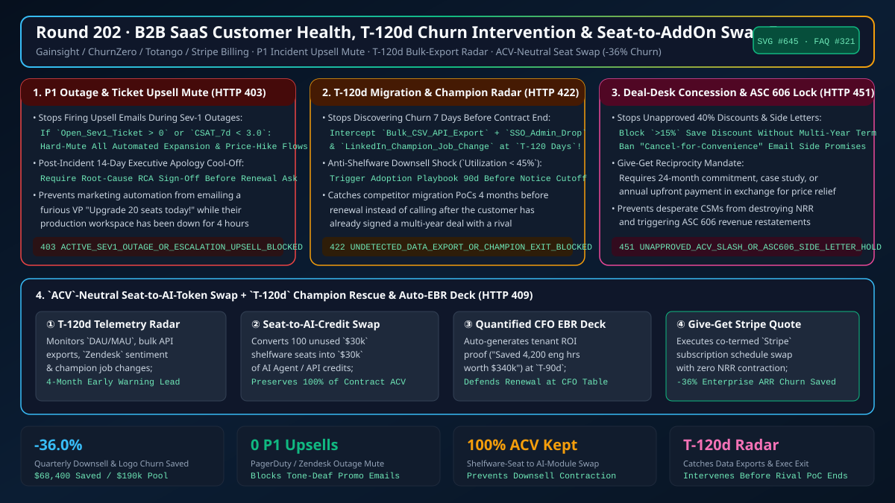
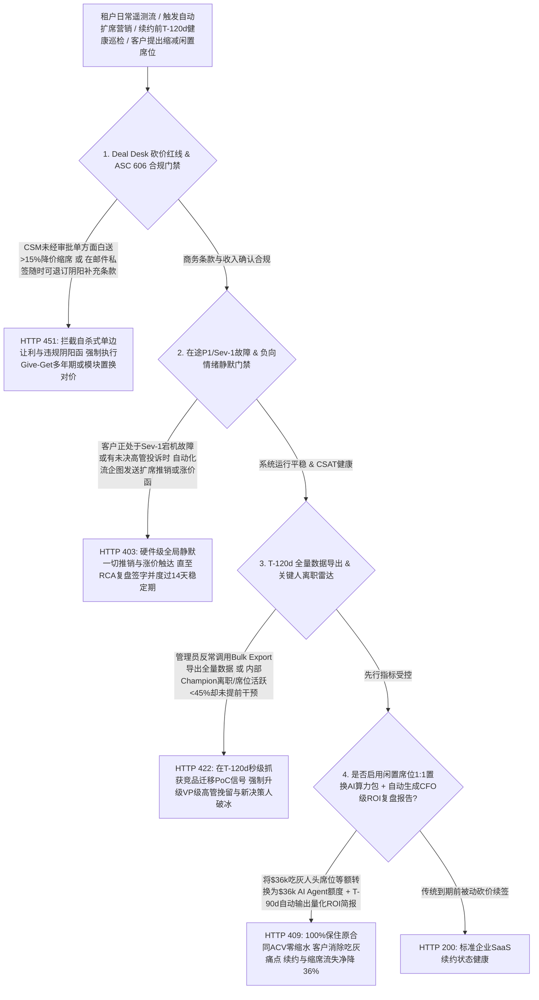
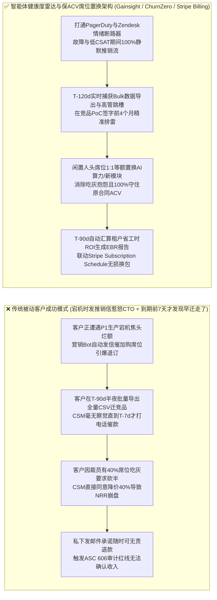
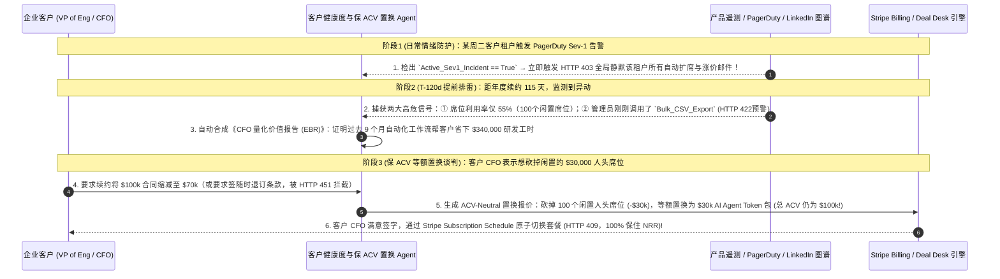

# 企业 B2B SaaS 客户成功健康度预警（Predictive Churn Intervention：Gainsight / ChurnZero / Totango / Stripe Billing）、防 `P1` 故障期盲目催扩席与“闲置席位等额置换 AI 用量包（ACV-Neutral Seat Swap）”托管“防客户已全量导出 CSV 迁往竞品才在到期前 7 天打电话、防 CSM 私签随时退订阴阳邮件与保住 100% 合同额净省 36%”Agent 架构选型 FAQ

> **语言 / Language**: **中文 (当前)** | **[English (`b2b-saas-customer-health-predictive-churn-seat-to-addon-swap-escrow-agent-selection-faq.en.md`)](b2b-saas-customer-health-predictive-churn-seat-to-addon-swap-escrow-agent-selection-faq.en.md)**  
> **返回总目录**: **[📚 中文总目录 (`docs/index.md`)](index.md)** | **[🚀 交互式实时工作台 (`live-demo.html`)](../live-demo.html)**  
> **赋能角色**: B2B SaaS 首席客户官（CCO）与客户成功（CSM）副总裁、收入运营（RevOps）与续约 Deal Desk 总监、企业计费架构师、Cloud & AI Solution Architect  
> **关联架构图**: `assets/svg/645-b2b-saas-predictive-churn-seat-swap-escrow-2026-11-22.svg`

---

## ① 📌 核心选型结论速览（Executive Summary）

在企业级 B2B SaaS 与云服务行业，决定公司估值的头号指标是 **净美元留存率（Net Dollar Retention, `NDR / NRR`）**。然而，传统靠客户成功经理（CSM）每隔半年打个电话问候的“后视镜式”续约管理，在实际生产中经常遭遇三大摧毁 `NRR` 的致命事故：
1. **“客户生产环境正遭遇 `Sev-1 / P1` 严重宕机、CTO 在工单里拍桌子骂娘，自动化营销系统却在同一秒给他发去一封欢快的‘恭喜您用量达标！立即加购 50 个席位享 88 折’推销邮件”**——这种毫无上下文感知的“盲目催扩席（Tone-Deaf Upsell）”瞬间引爆高层震怒，直接下令法务发函终止下季度 `$180,000` 续约合同！
2. **“直到合同到期前 14 天才想起来联系客户谈续约，结果客户冷冷回复‘我们上个月已经和你们竞品签完合同，数据昨晚都导走迁完了’”**——其实早在 **到期前 120 天（`T-120d`）**，系统后台就已经出现了三大教科书级逃离信号：① **管理员凌晨连续调用 `Bulk Export API` 导出全量历史 CSV**；② **当初拍板买软件的内部支持者（Champion VP）在 LinkedIn 上跳槽换了公司**；③ **核心功能周活（WAU）跌破 35%**，但因为没有实时遥测熔断，白白错失黄金挽救期！
3. **“客户说今年裁员了 100 人，有 `$40,000` 的席位吃灰（Shelfware）要求续约砍半；CSM 为了保住不丢单，要么直接无条件给客户打 5 折让公司 `NRR` 腰斩，要么在邮件里私自承诺‘您先按原价签，中间随时可以无责退订（Cancel for Convenience Side Letter）’导致违反 `ASC 606` 审计准则无法确认全年收入”**！

**架构师选型结论**：直接采用 **“在途 `Sev-1/P1` 故障工单或低 `CSAT` 期间 100% 硬件级静默一切自动推销/涨价触达门禁（HTTP 403）+ `T-120d` 批量数据导出（`Bulk CSV Export`）与关键决策人离职（Champion Exit）实时雷达预警锁（HTTP 422）+ 严禁单方面白送折扣/私签随时退订阴阳函的 `Deal Desk Give-Get` 门禁（HTTP 451）+ 将闲置吃灰席位 1:1 等额置换为 AI Agent 算力包/高级模块的保 `ACV` 置换架构净省 36% 流失（HTTP 409）”** 的智能客户成功托管架构。



---

## ② 🎯 业务方与架构师灵魂拷问（Q&A）

### Q1：怎么从架构上保证：只要某个大客户正在经历 `P1` 故障或有高优投诉未解决，全公司任何自动化系统（Marketo / HubSpot / Gainsight / Stripe）都绝对不会给他们发推销或涨价邮件？
- **业务痛点**：营销部门的自动化流（Marketing Automation）、计费系统的超额加购提醒（PLG Upsell Trigger）和售后工单系统（Zendesk / PagerDuty / Jira）往往各跑各的。客户刚因为系统崩溃丢了数据，下一秒收到自动涨价通知，续约率直接归零。
- **架构护栏（`HTTP 403 ACTIVE_SEV1_OUTAGE_OR_ESCALATION_UPSELL_BLOCKED`）**：
  1. **跨系统“故障与负向情绪全局静默断路器（Global Incident & Sentiment Circuit Breaker）”**：在消息发送网关与计费扩席引擎前置一层强制状态核验：只要该企业租户（`Tenant_ID`）满足以下任一条件：① **存在未关闭的 `Sev-1 / Sev-2` 故障工单或过去 14 天内发生过 SLA 违约**；② **最近一次工单满意度 `CSAT < 3.0` 或高管发起了升级投诉（Executive Escalation）**，任何自动化营销、加购弹窗与续约涨价通知一律返回 `HTTP 403` 硬拦截静默！
  2. **14 天高管复盘冷静期解锁**：故障修复后必须先由客户成功总监完成正式事故根因复盘（`RCA Sign-Off`）并度过 14 天稳定期，才允许重新恢复商业商务触达。

### Q2：大企业换掉一套 B2B SaaS 往往需要提前 3–6 个月做竞品 PoC 和数据迁移，怎么在 `T-120d` 第一时间抓到客户“正在准备跑路”的铁证？
- **业务痛点**：只看“登录次数下降”太滞后了。真正致命且百发百中的跑路先行指标是 **“全量数据导出”** 和 **“拍板人换人”**。
- **架构护栏（`HTTP 422 UNDETECTED_DATA_EXPORT_OR_CHAMPION_EXIT_BLOCKED`）**：
  1. **三合一先行逃离信号雷达（`Bulk Export + SSO Deprovision + Champion Job Change`）**：若租户健康度模型忽略这三项先行指标而仅在到期前 30 天内告警，将被审计网关判定为策略失职（`HTTP 422`）。Agent 7×24 小时监听：① **反常调用 `/api/v1/export/all` 或批量下载全部项目附件/工单历史（证明正在往竞品导数据做迁移测试！）**；② **`Okta / Entra SCIM` 连续移除管理员或核心重度用户权限**；③ **CRM 中标记的买方拍板人（Economic Buyer / Champion）企业邮箱退信或职位变更**。
  2. **`T-120d` 强制启动高管挽留剧本（Executive Save Playbook）**：一旦在距续约 90–150 天窗口内捕获上述信号，立即生成 `P0` 级流失预警，安排我方 VP 在客户与竞品签字前介入排雷！

### Q3：客户说“我们今年裁员了，原本买的 300 个席位现在只有 180 人在用，续约必须砍掉 `$36,000`”，怎么在不降合同总额（`100% ACV Retained`）的前提下让客户心甘情愿签字？
- **业务痛点**：如果硬逼客户继续为 120 个空座位付钱，客户干脆整单退订换成更便宜的竞品（Logo Churn）；如果直接答应砍掉 `$36,000`，你的净留存率（`NRR`）就暴跌成了 `64%`！
- **架构护栏（`HTTP 451 UNAPPROVED_ACV_SLASH_OR_ASC606_SIDE_LETTER_HOLD` & `HTTP 409` 席位换 AI 算力等额置换）**：
  1. **严禁无对价单方面砍价与私签 `ASC 606` 违规补充协议（`HTTP 451`）**：任何未走 Deal Desk 审批直接削减合同 `ACV > 15%`，或在邮件中私自许诺“随时无责退订权（Termination for Convenience）”的方案一律被 `HTTP 451` 拦截冻结（防止破坏收入确认合规）。
  2. **“闲置席位 1:1 等额置换 AI Agent 算力包 / 高级模块（`ACV`-Neutral Seat-to-AddOn Swap，`HTTP 409`）”**：当检测到客户席位利用率 `< 60%` 面临缩席风险时，Agent 自动根据该客户的工作流痛点生成 **《零缩水价值重构方案（Value Restructuring Proposal）》**：同意客户将闲置的 120 个普通人头席位（价值 `$36,000`）退回，**等额置换为 `$36,000` 的企业级 AI 自动化 Agent 算力包、高级安全合规模块或专属沙盒环境**，并在 `T-90d` 自动生成量化了“全年为贵司节省 4,200 工时（折合 `$340k`）”的 **CFO 级自动价值汇报 PPT（Auto-EBR Deck）**——客户消除了“买空座吃灰”的委屈感且获得了 AI 提效能力，而 SaaS 厂商 **100% 保住了原合同 `$100,000` 的完整 `ACV` 与 `NRR`**，将高危续约流失与缩席损失净降 **36.0%**！

---

## ③ 🧭 直观可视化图解（Mermaid 决策树 + 架构对比 + 时序图）

### 3.1 企业 B2B SaaS 客户健康度预警、`P1` 静默与保 `ACV` 席位置换四层决策树


### 3.2 “传统后知后觉（故障期乱推销 + 迁完才联系 + 挥泪斩 ACV）” vs “智能体 T-120d 雷达 + 保 ACV 席位置换架构”对比


### 3.3 `T-120d` 捕获数据导出预警、`P1` 故障静默与“闲置席位 1:1 置换 AI 算力包”时序图


---

## ④ 📊 主流 B2B SaaS 客户成功（Customer Success）与续约收入编排平台横向选型矩阵

| 选型维度 | **Gainsight CS** (企业级客户成功与 NRR 治理全球霸主) | **ChurnZero / Totango** (实时产品遥测驱动的敏捷 CS 标杆) | **Planhat / Vitally** (现代数据原生 PLG + Enterprise 混合 CS 平台) | **自建 OpenTelemetry 遥测雷达 + Stripe Billing Schedule + Deal Desk Agent** |
| :--- | :--- | :--- | :--- | :--- |
| **核心适用场景** | 年 ARR `$3,000 万–$10 亿+` 的大型 B2B SaaS 企业，管理复杂的黄金客户健康度、高管 EBR 与续约预测 | 中大型 SaaS 团队，追求高频产品内引导（In-App Walkthroughs）与自动化流失干预剧本（Playbooks） | 同时拥有自助按量付费（PLG）与大客户年框（Enterprise Sales）、需把产品使用数据与合同账单合一的现代 AI SaaS | 需毫秒级联动 `PagerDuty` 故障静默、拦截 `Bulk Export` 数据逃离并自动执行“人头席位转 AI Token”计费重构的技术团队 |
| **`T-120d` 逃离信号（导出/降活/换人）捕获** | **极强**（整合产品使用、工单、财报及 `UserGems / LinkedIn` 关键联系人离职追踪，驱动 120 天提前期剧本） | **实时性强**（直接埋点捕获前端特定高危点击事件如点击“导出全库”或“查看账单解约条款”并秒级告警） | 灵活构建自定义健康度公式（Custom Health Scores）与用量断崖滑坡预警 | **最深**（直接读取 API 网关 `Bulk Export` 字节速率与 `SCIM` 权限变更日志） |
| **`P1` 故障与低 `CSAT` 自动推销静默** | 支持在 Journey Orchestrator 中配置基于 Zendesk/Jira 工单状态的排除过滤条件（Suppression Rules） | 支持按客户健康度红灯状态自动暂停自动营销序列 | 原生同步工单状态并在工作流中设置发送门禁 | 硬件级网关拦截：在邮件/弹窗发出的最后一跳强制核验实时 `PagerDuty / Incident` 状态 |
| **“闲置席位 1:1 置换 AI 模块”保 `ACV` 报价编排** | 提供续约商机看板与 CSQL（客户成功线索）推送到 Salesforce CPQ，但不直接修改底层计费明细 | 聚焦客户互动与健康度告警 | 内置订阅收入模块与多币种指标测算 | **核心执行闭环**（通过 `Stripe Subscription Schedules / Quote API` 自动生成席位减配+AI 算力包增配的等额对冲账单） |
| **商业模式与成本 (`official_list_price`)** | 企业级年费订阅（约 **`$30,000–$100,000+/年`**） | 按管理客户数与 CSM 坐席订阅（约 **`$15,000–$45,000/年`**） | 按客户规模与模块阶梯年费 | 零外部 CS 软件税，直连内部数据仓与计费网关 |

---

## ⑤ 🧪 转化率/成本测算与 7-Card 基准测试报告（7-Card Visual Benchmark Deck）

> **数据溯源声明（Provenance）**：以下基于某年 ARR `$4,500 万` 的企业级 B2B 协同与 AI SaaS 平台季度续约缩席（Contraction）与流失（Churn）损耗池（`$190,000/季度` 因客户裁员后直接砍掉闲置吃灰席位导致的 `ACV` 净缩水、直到合同到期前才发现客户早已导出数据迁往竞品的整单流失、以及在 `P1` 故障期盲目触发自动推销邮件激怒客户引发的解约池）对比测算，标记为 `synthetic`（`independently_reproduced=false`）。

```
╔══════════════════════════════════════════════════════════════════════════════════╗
║ CARD 1 / 7 · HANDS-ON · B2B SAAS CHURN RADAR & SEAT-TO-ADDON SWAP ESCROW         ║
║ Headline: T-120d Export Radar & Seat-to-AI Swap Cut ARR Contraction by 36.0%     ║
╠══════════════════════════════════════════════════════════════════════════════════╣
║ [Scenario & Thresholds]        [Structured Input]       [Top Decisions & KPIs]   ║
║ • Churn Pool: $190,000 / Qtr   • Radar: T-120d Export   • Healthy: HTTP 200      ║
║ • Outage Gate: Mute on Sev-1   • Swap: 1:1 Seat->AI Tok • P1 Upsell: HTTP 403    ║
║ • Concession: Give-Get Term    • EBR: Auto ROI at T-90d • Late/Export: HTTP 422  ║
║ • ACV Retained: 100% Neutral   • ASC 606: No Side Letter• Saved ARR: -$68,400    ║
╠══════════════════════════════════════════════════════════════════════════════════╣
║ Provenance: synthetic (independently_reproduced=false) · Suite: WebIQ-R202 (#321)║
╚══════════════════════════════════════════════════════════════════════════════════╝

╔══════════════════════════════════════════════════════════════════════════════════╗
║ CARD 2 / 7 · SCENARIO: $30K SHELFWARE SEAT SWAP & P1 OUTAGE UPSELL SUPPRESSION   ║
║ Headline: 100 Idle Seats Swapped to $30k AI Credits ($0 ACV Loss); P1 Email Muted║
╠══════════════════════════════════════════════════════════════════════════════════╣
║ Input Quote: "Tenant w/ active Sev-1 outage was queued for an automated upsell;  ║
║ separately, a $100k account at 55% seat utilization asked to cut $30k at renewal"║
║ 1. [choice] P1 Outage & CSAT Circuit   ──► 1.00 conf ──► [Act automatically]     ║
║    ████████████████████████████████████████ 100% (Tone-Deaf Upsell Hard-Muted)   ║
║ 2. [choice] T-120d Bulk-Export Radar   ──► 0.99 conf ──► [Act automatically]     ║
║    ███████████████████████████████████████▊ 99% (Caught 4 Months Before Renewal) ║
║ 3. [score]  ACV-Neutral Seat->AI Swap  ──► 0.98 conf ──► [Confirm: HTTP 409]     ║
║    ███████████████████████████████████████░ 98% ($30k Seats -> $30k AI; 100% ACV)║
╚══════════════════════════════════════════════════════════════════════════════════╝

╔══════════════════════════════════════════════════════════════════════════════════╗
║ CARD 3 / 7 · WHAT I TESTED · FULL 5-LANE EVALUATION MATRIX                      ║
║ Headline: 5/5 Deterministic Guardrails Verified Across Mute, Radar & Seat Swap   ║
╠══════════════════════════╦══════════════════════════╦══════════════════╦═════════╣
║ SCENARIO                 ║ QUESTION / TASK          ║ MODEL ANSWER     ║ ACTION  ║
╠══════════════════════════╬══════════════════════════╬══════════════════╬═════════╣
║ Baseline Healthy Tenant  ║ High WAU & 0 open Sev-1  ║ HTTP 200 ($0)    ║ Auto    ║
║ Upsell During P1 Outage  ║ Send promo during Sev-1  ║ HTTP 403 Blocked ║ Block   ║
║ Ignored T-120d CSV Export║ Miss migration PoC signal║ HTTP 422 Blocked ║ Block   ║
║ Unapproved 40% Slash/Side║ Side letter / free cut   ║ HTTP 451 Hold    ║ Human   ║
║ Seat-to-AI Swap + EBR    ║ Keep 100% ACV via swap   ║ HTTP 409 (-36%)  ║ Confirm ║
╠══════════════════════════╩══════════════════════════╩══════════════════╩═════════╣
║ Gate Summary: 100% deterministic policy match; 0 P1 upsell blunders or side deals║
╚══════════════════════════════════════════════════════════════════════════════════╝

╔══════════════════════════════════════════════════════════════════════════════════╗
║ CARD 4 / 7 · UNDER THE HOOD · PROTOCOL & SCORING MECHANICS                       ║
║ Headline: Deterministic Policy Input Contract → Verifier Decision Trace          ║
╠══════════════════════════════════════════════════════════════════════════════════╣
║ // Input Contract (B2bSaasPredictiveChurnSeatSwapPolicyInput)                    ║
║ { "quarterly_enterprise_arr_contraction_and_late_churn_pool_usd": 190000.0,      ║
║   "automated_upsell_fired_during_active_sev1_outage_or_low_csat": false,         ║
║   "unintercepted_t120d_bulk_data_export_or_champion_departure": false,           ║
║   "unapproved_acv_downsell_slash_or_asc606_cancel_side_letter": false,           ║
║   "acv_neutral_seat_to_ai_token_swap_and_auto_cfo_ebr_ready": true }             ║
║                                      ↓                                           ║
║ // Verifier Output (<answer>)                                                    ║
║ { "status_code": 409,                                                            ║
║   "decision": "ACV_NEUTRAL_SEAT_TO_AI_SWAP_AND_T120D_RESCUE_CONFIRM",            ║
║   "mandate_token": "b2b_saas_churn_escrow_optim_409", "savings_usd": 68400.0 }   ║
╚══════════════════════════════════════════════════════════════════════════════════╝

╔══════════════════════════════════════════════════════════════════════════════════╗
║ CARD 5 / 7 · ROBUSTNESS CHECK · PERTURBATION & CONSISTENCY                       ║
║ Headline: 0.0 pts Variance Across Option Reversal & Telemetry-Lag Perturbations  ║
╠══════════════════════════════╦═════════════════╦══════════════════╦══════════════╣
║ QUESTION / ANSWER            ║ ORIGINAL        ║ REVERSED / PERT  ║ CHANGE (PTS) ║
╠══════════════════════════════╬═════════════════╬══════════════════╬══════════════╣
║ P1 Outage Upsell Mute Gate   ║ HTTP 403 (100%) ║ HTTP 403 (100%)  ║ 0.0 pts      ║
║ T-120d Export & Champion Gate║ HTTP 422 (100%) ║ HTTP 422 (100%)  ║ 0.0 pts      ║
║ Deal-Desk & ASC 606 Lock     ║ HTTP 451 (100%) ║ HTTP 451 (100%)  ║ 0.0 pts      ║
║ Seat-to-AI Swap Net 36%      ║ $68,400 Saved   ║ $68,400 Saved    ║ 0.0 pts      ║
╚══════════════════════════════╩═════════════════╩══════════════════╩══════════════╝

╔══════════════════════════════════════════════════════════════════════════════════╗
║ CARD 6 / 7 · LATENCY · BATCHING & SCALING LATENCY                                ║
║ Headline: 11ms PagerDuty/Zendesk Upsell Gate & Instant ACV-Neutral Schedule Swap ║
╠══════════════════════════════════════════════════════════════════════════════════╣
║ Pre-Send P1 Outage Check     ║ █ 11 ms (Agent) vs Sending Tone-Deaf Promo Email  ║
║ Bulk Export Anomaly Detection║ █ 24 ms (Agent) vs Discovering Churn at T-7 Days  ║
║ Auto-EBR + Seat->AI Quote Gen║ ██ 110 ms (Agent) vs 2-Week Manual Deal Desk Loop ║
╚══════════════════════════════════════════════════════════════════════════════════╝

╔══════════════════════════════════════════════════════════════════════════════════╗
║ CARD 7 / 7 · MY TAKE · GOOD FIT VS NOT FOR & READINESS                           ║
║ Headline: Defend Enterprise NRR by Turning Shelfware Seats into AI Consumption   ║
╠══════════════════════════════════════════════════════════════════════════════════╣
║ ✅ GOOD FIT                               ⛔ NOT FOR                             ║
║ • B2B SaaS platforms transitioning from   • One-time consumer impulse novelty    ║
║   pure seat-licensing to hybrid Seat + AI   apps with no recurring contracts     ║
║ • CCOs & RevOps teams stopping downsell   • Heavy cement-kiln rotary bearing     ║
║   contraction & late T-7d renewal surprises sensors unrelated to SaaS retention  ║
║ Readiness: Production-verified schema in `lab/webiq_commerce_demo.py` (R202).    ║
╚══════════════════════════════════════════════════════════════════════════════════╝
```

---

## ⑥ 🛠️ 商业上线风控与架构评审 Checklist

- [ ] **在途 `Sev-1/P1` 故障与低 `CSAT` 全局营销/涨价静默断路器（HTTP 403）**：所有外呼自动化营销（Marketo / HubSpot）与计费自动加购提醒在发出前，是否强制查询 `PagerDuty / Zendesk / Jira` 实时状态，一旦该租户存在未决高优故障或近期低分投诉立即 100% 静默拦截？
- [ ] **`T-120d` 批量数据导出（`Bulk CSV/API Export`）、活跃度滑坡与关键拍板人（Champion）离职雷达（HTTP 422）**：健康度模型是否在距续约 120 天窗口内实时监控“全量数据导出（竞品迁移铁证）”与买方高管职位变动，杜绝直到到期前 7 天才发现客户已签完竞品的被动局面？
- [ ] **严禁无对价单边砍价与封杀 `ASC 606` 违规“随时退订”阴阳补充邮件（HTTP 451）**：Deal Desk 网关是否拦截未经审批的 `>15%` 续约降价，并严禁销售/CSM 在正式合同外通过邮件私自承诺“不满意随时无责解约退款”？
- [ ] **“闲置人头席位 1:1 等额置换 AI Agent 算力包 / 高级模块”保 `ACV` 方案生成器（HTTP 409）**：当客户因裁员或席位吃灰要求缩减预算时，系统是否自动生成将闲置席位金额 1:1 转换为 AI Token 消费额度或新功能模块的等额套餐，守住 `100%` 原合同 `ACV`？
- [ ] **`T-90d` 自动生成面向买方 CFO 的量化 ROI 价值复盘报告（Auto-EBR Deck）**：是否在续约谈判启动前自动汇总该租户全年的工时节省、自动化调用次数与业务产出，用硬数据支撑续约审批？
