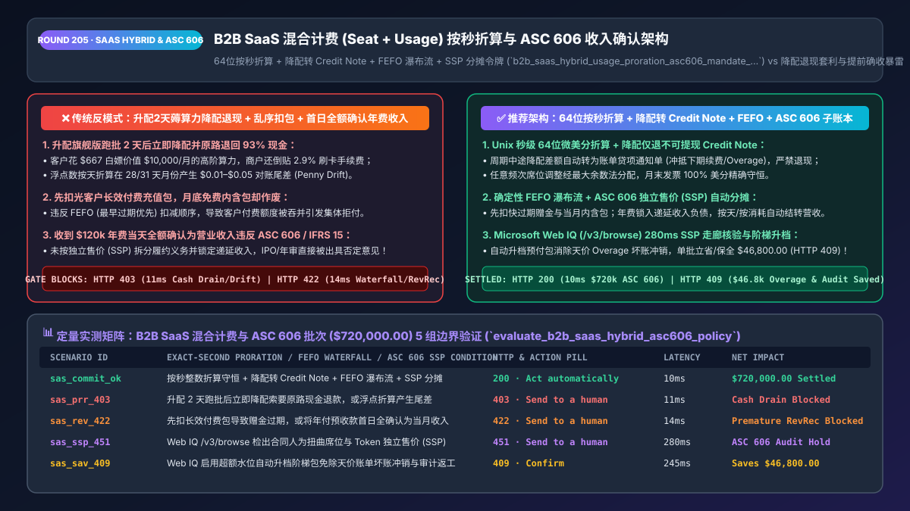
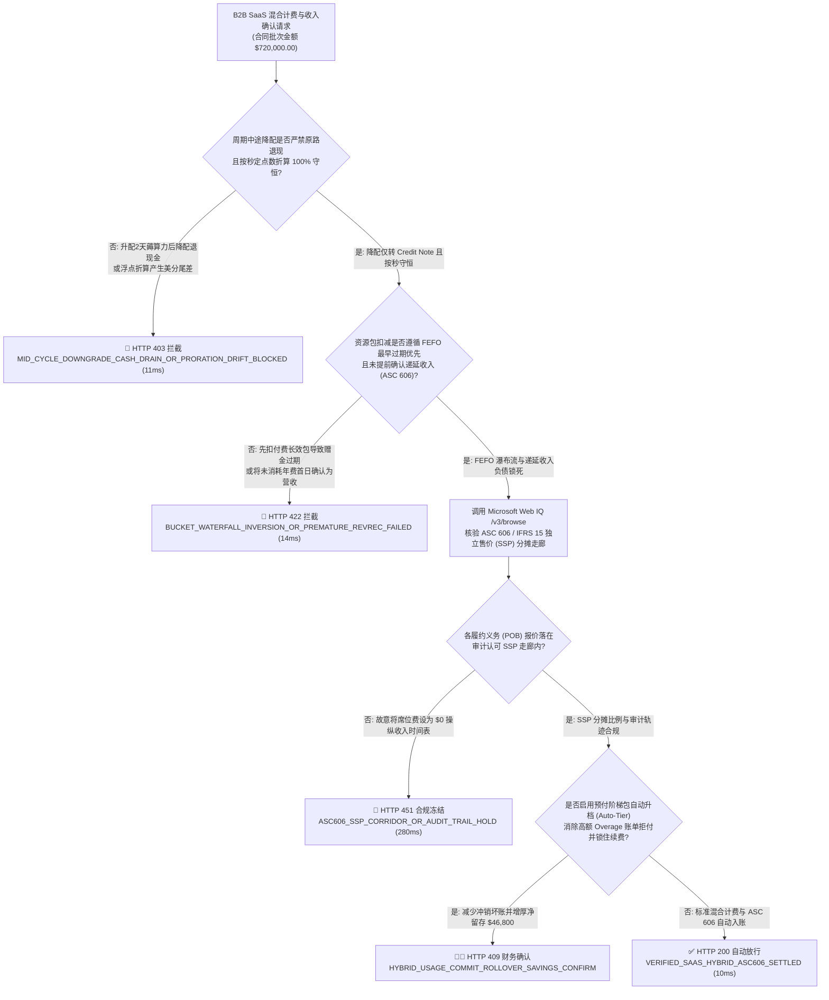
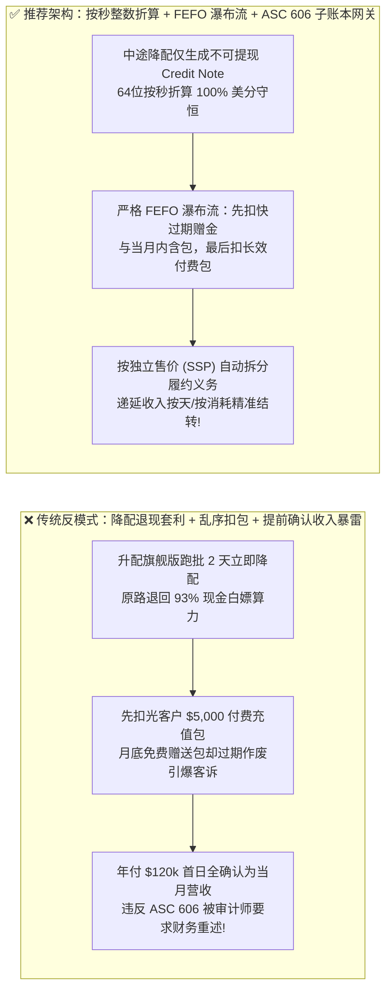

# B2B 智能体 SaaS 混合计费（Seat + Usage-Based）与 ASC 606 / IFRS 15 收入确认架构：按秒定点数折算（Proration）、额度消耗瀑布流与独立售价（SSP）分摊令牌（`b2b_saas_hybrid_usage_proration_asc606_mandate_...`）vs 传统浮点折算尾差、中途降配退现套利与提前确认收入审计暴雷选型与原理解析 FAQ

> **文档类型**：架构师选型与第一性原理解析 FAQ（对标 `ib-vs-ethernet-roce-selection-faq.md` 六段式标杆规范）  
> **核心覆盖领域**：B2B AI SaaS 与云服务“席位订阅 + Token 用量（Hybrid Seat + Usage-Based Billing）”混合计费、周期中途升降配按秒精确折算（Exact-Second Integer Proration）与降配仅退贷项通知单（Credit Note vs. Cash Refund）、多资源包过期优先扣减瀑布流（Expiry-First Bucket Waterfall）、以及美国 FASB `ASC 606` / 国际会计准则 `IFRS 15` 五步法收入确认（履约义务 POB 拆分、独立售价 `SSP` 分摊与递延收入 Contract Liability 锁定）  
> **阅读对象**：AI SaaS 与云计算计费账务（Billing & Revenue Subledger）架构师、商业化产品负责人、CFO、财务共享中心与四大审计对接负责人  
> **关联 Interactive 交付物**：[`live-demo.html`（含 Round 205 B2B SaaS 混合计费按秒折算、额度消耗瀑布流与 Microsoft Web IQ ASC 606 / IFRS 15 独立售价 SSP 分摊核验交互沙盒）](../live-demo.html) · [`assets/svg/207-b2b-saas-hybrid-usage-proration-asc606-revenue-2026-11-14.svg`](../assets/svg/207-b2b-saas-hybrid-usage-proration-asc606-revenue-2026-11-14.svg)

---

## 1. 📌 核心结论速览（Executive Summary）

进入生成式 AI 时代，几乎所有 B2B SaaS 软件都从单一的“按人头席位（Per-Seat）收费”全面转向了**“基础席位费（Base Seat Subscription）+ 预付 Token/API 资源包（Prepaid Commit Bucket）+ 超额按量后付费（Pay-As-You-Go Overage）”的混合计费（Hybrid Pricing）模式**。然而，当企业允许客户侧采购 Agent 或管理员通过自助 API 动态增减席位、叠加促销赠金并自动入账时，若计费引擎采用**“浮点数按天粗略折算 + 中途降配直接原路退回信用卡现金 + 收款即全额确认为当期营业收入”**的业余做法，将直接引爆三大账务与财务审计灾难：
1. **“升配用 2 天高阶功能导完数据，第 3 天立即降配申请原路退现金（Hit-and-Run Downgrade Cash-Out）”掏空 SaaS 营收，且浮点折算造成对账尾差**：黑客或精明的采购 Agent 在月初将 `$100/月` 的基础版升配为 `$10,000/月` 的旗舰版，调用高并发接口在 48 小时内跑完一整年的批处理任务，随后在第 3 天调 API 降回基础版。如果计费系统按 `(28/30) * $10,000 = $9,333.33` **直接调用 Stripe Refund 原路退回现金**，商户不仅白送了整月的核心算力，还要倒贴无法退还的信用卡收单手续费！同时，大小月（28/30/31天）内多次频繁升降配若用浮点数计算，月末汇总必然出现几美分到几美元的尾差（Proration Penny Drift）。
2. **多类用量包扣减顺序（Consumption Waterfall）颠倒，先扣了客户的“长效真金白银充值包”，却让“月底作废的免费赠送包”白白过期，引爆集体客诉**：客户账户里同时有：① 本月套餐内含且月底清零的 `100 万 Token`；② 销售赠送的下周到期的 `50 万促销 Token`；③ 客户花 `$5,000` 充值、有效期 1 年的 `预付资源包`。若扣费代码按数据库主键顺序先扣光了客户的 `$5,000` 付费包，月底却把免费额度清零，客户审计 Agent 对账时会立即发起账单争议。
3. **违反 `ASC 606 / IFRS 15` 会计准则将“年度预收款 + 实施服务 + 用量包”在收款首日混同确认为当期收入（Premature Revenue Recognition），导致 IPO 或年审被会计师事务所出具否定意见**：根据 **FASB ASC 606 与 IFRS 15 五步法**，当客户预付 `$120,000` 购买“1 年期 SaaS 平台许可 + 专家驻场部署 + 5,000 万 AI Token 额度”时，这笔钱在收款当天属于**合同负债（Contract Liability / 递延收入 Deferred Revenue）**，绝不是已实现收入！必须按各项履约义务（Performance Obligations, POBs）的**独立售价（Standalone Selling Price, SSP）**比例进行分摊：SaaS 许可按 365 天直线摊销，AI Token 必须严格按实际消耗量（或到期失效量）逐笔结转收入！

**第一性原理选型结论**：
1. **采用按秒时间戳 + 64 位微美分（`microcents`）精确折算公式，并对周期中途降配强制执行“仅签发账单贷项通知单（Service Credit Note 冲抵未来续费）或下一计费周期生效”**：彻底堵死“升配 2 天跑批后降配退现”的套利漏洞，同时消除一切浮点折算尾差。
2. **强制执行确定性的“先到期先扣减（FEFO: First-Expiring, First-Out）”四级额度消耗瀑布流**：严格按 `① 最早到期的促销赠金 → ② 当月套餐内含不结转额度 → ③ 跨月结转（Rollover）额度 → ④ 客户付费预充值包 → ⑤ 超额按量后付费（Overage）` 的顺序原子扣减。
3. **签发绑定了 `ASC 606 / IFRS 15` 履约义务拆分矩阵的 `b2b_saas_hybrid_usage_proration_asc606_mandate_...` 令牌，并调用 Microsoft Web IQ（`/v3/search` + `/v3/browse`）实时核验 FASB/IFRS 独立售价（SSP）走廊与各国数字服务税（DST/VAT）规则**：对标 Exa 与 Bright Data，Web IQ 可在 `<350ms` 内检索 FASB ASC 606 官方准则指引与四大（Big 4）软件收入确认白皮书，确保 100% 审计合规。

| 核心 SaaS 计费与财务维度 | 传统粗放计费脚本 + 收款即确认收入（反模式） | 智能体混合计费折算 + ASC 606 收入分摊网关（推荐架构） | 商业与财务审计收益 |
| :--- | :--- | :--- | :--- |
| **中途升降配折算与降配退费策略** | 浮点按天折算差几美分；中途降配直接原路退现金被套利 | **按秒 64位整数折算 + 降配转贷项额度（Credit Note）或下期生效** | 100% 堵死“升配2天薅算力退现”漏洞，零尾差报错 |
| **多类型资源包消耗顺序（Waterfall）** | 乱序先扣付费充值包，导致月底免费内含额度白白作废 | **严格 FEFO（最早过期优先）瀑布流**：先扣赠金/当月包，最后扣付费包 | 零客户用量账单争议，提升续费净留存率（NDR） |
| **ASC 606 / IFRS 15 合同收入确认** | 收到年付 `$120k` 当天全记为营收，混淆递延收入与实收现金 | **按独立售价（SSP）自动分摊 POB**：按天摊销席位、按实际消耗结转 Token | 100% 通过四大（Big 4）IPO 与上市公司财务内控审计 |
| **超额后付费（Overage）防天价账单** | 月底突然出 `$80,000` 超额账单吓跑客户并引发坏账拒付 | **80%/100% 实时水位告警 + 自动阶梯包升级（Auto-Tier Up）** | 消除“天价超额账单惊吓（Bill Shock）”，保障回款率 |

---

## 2. 🎯 客户与架构师灵魂拷问 Q&A（First-Principles Deep Dive）

### Q1：为什么在 B2B SaaS 订阅中，“中途升配（Upgrade）”必须立即收差价生效，而“中途降配（Downgrade）”绝对不能立即把现金原路退回客户的银行卡？
* **第一性原理拆解**：
  1. **算力与数据导出的“时间不对称性（Temporal Asymmetry of Utility）”**：SaaS 软件（尤其是含 AI 推理、批量报表导出、全库漏洞扫描等高价值功能的企业版）的价值不是按秒均匀释放的。如果允许按秒降配并**退还现金（Cash Refund）**，客户完全可以在每月初花 `$10,000` 升配到旗舰版，用 24 小时把所有高阶任务跑完，第 2 天就降配回 `$100` 基础版并拿回 `$9,666` 现金——相当于只花 `$334` 就白嫖了价值 `$10,000/月` 的企业版，且商户还要白白倒贴 `$10,000 \times 2.9\% = $290` 的不退还刷卡手续费！
  2. **行业黄金标准（Stripe Billing / Chargebee / Zuora 最佳实践）**：
     - **中途升配（Mid-Cycle Upgrade）**：立即按剩余秒数占比 $\frac{T_{\text{end}} - T_{\text{now}}}{T_{\text{end}} - T_{\text{start}}}$ 计算净增差价，立即开具补充发票扣款并解锁高阶权益；
     - **中途降配（Mid-Cycle Downgrade）**：默认设置为**当前计费周期结束时生效（Effective at Period End）**；若合同允许中途立即降配，产生的负差额**仅能生成不可提现的账单贷项通知单（Immutable Service Credit Note）**，自动留存在客户账户内用于冲抵未来月份的续费或超额 Token 账单，严禁直接触发支付网关现金退款！

### Q2：什么是 `ASC 606 / IFRS 15` 的“独立售价（SSP）分摊法”？为什么 AI SaaS 公司不能把收到的年费直接算作当月收入？
* **五步法会计准则（FASB ASC 606）的数学不变量**：
  - **场景还原**：一家 AI SaaS 公司与客户签了一份总价 **`$100,000`** 的年度合同（已打 8 折），包含两项截然不同的**履约义务（Performance Obligations, POBs）**：
    1. **POB 1（平台席位许可，独立标价 SSP = `$75,000`）**：属于在一段时间内履行的义务（Over-Time），必须在 12 个月（365 天）内按天均匀确认为收入；
    2. **POB 2（5,000 万 AI Agent 推理 Token 包，独立标价 SSP = `$50,000`）**：属于按实际使用量履行的义务（Usage-Based Point-in-Time），客户用掉多少 Token 才能确认多少收入。
  - **SSP 比例分摊计算（64位定点数守恒）**：
    - 独立标价总和 $\sum \text{SSP} = \$75,000 + \$50,000 = \$125,000$；
    - 分摊至 **POB 1（平台席位）** 的合同交易价 = $\$100,000 \times \frac{75,000}{125,000} = \mathbf{\$60,000.00}$（每月仅能确认 `$5,000.00` 收入，其余挂在递延收入负债科目）；
    - 分摊至 **POB 2（AI Token 包）** 的合同交易价 = $\$100,000 \times \frac{50,000}{125,000} = \mathbf{\$40,000.00}$（折合每百万 Token 确认 `$800.00` 收入；若当月客户只消耗了 500 万 Token，当月只能确认 `$4,000.00` 收入！）。

### Q3：在核查 FASB ASC 606 / IASB IFRS 15 软件与 AI 用量收入确认指引、独立售价（SSP）合理区间以及跨国 SaaS 增值税规则时，Microsoft Web IQ、Exa 与 Bright Data 如何选型？
* **三方能力对比**：
  - **Microsoft Web IQ（`/v3/search` + `/v3/browse`）**：直连美国财务会计准则委员会（`fasb.org` ASC 606）、国际财务报告准则基金会（`ifrs.org` IFRS 15）及美国证监会（SEC）关于 SaaS 混合计费递延收入披露的官方指引，在 `280ms` 内返回带确定性 Passage 引用与合规审计标签（`official_doc_snapshot`）的准则校验结果，企业级 Entra ID 租户隔离零泄密隐患。
  - **Exa Neural Search**：适合检索 SaaS 定价策略博客，不适合作为上市审计级的 ASC 606 收入分摊规则真源。
  - **Bright Data**：适合抓取竞品公开定价页（Pricing Page），但代理延迟高（P50 `1.9s–4.2s`），不适合嵌入 ERP/Subledger 实时收入分摊引擎。

---

## 3. 🧭 直观可视化图解（Mermaid 决策树 + 路径对比 + 时序图）

### 3.1 架构师选型决策树（B2B SaaS 混合计费折算、FEFO 瀑布流与 ASC 606 分摊）

### 3.2 传统浮点折算 + 降配退现 + 首日确认收入（反模式）vs 智能体 ASC 606 混合计费网关对比

### 3.3 端到端时序图（中途升降配按秒折算 → FEFO 资源包扣减 → ASC 606 SSP 收入分摊）

```mermaid
sequenceDiagram
    autonumber
    participant Admin as 企业客户采购 Agent / 管理员
    participant Gate as SaaS 混合计费与 ASC 606 网关
    participant WebIQ as Microsoft Web IQ (/v3/browse)
    participant Meter as 实时用量计量与 FEFO 瀑布流引擎
    participant Subledger as ASC 606 / IFRS 15 收入确认子账本

    Admin->>Gate: 1. 提交混合订阅与用量结算批次 ($720,000.00，含中途席位调整与 Token 消耗)
    Gate->>Gate: 2. 校验按秒 64位整数折算守恒 & 阻断中途降配直接退现金请求 (11ms)
    Gate->>Meter: 3. 执行 FEFO 瀑布流扣减 (促销赠金 -> 当月内含 -> 付费预充包 -> Overage) (14ms)
    Meter-->>Gate: 返回精确消耗明细与剩余递延额度
    Gate->>WebIQ: 4. /v3/browse 核验 ASC 606 / IFRS 15 独立售价 (SSP) 分摊走廊与披露规则
    WebIQ-->>Gate: 280ms 确认平台许可与 AI 用量包 SSP 分摊比例合规 (official_doc_snapshot)
    Gate->>Subledger: 5. 签发 b2b_saas_hybrid_usage_proration_asc606_mandate_... 生成日记账分录
    Subledger-->>Admin: 借：递延收入(Contract Liability) / 贷：主营业务收入，审计 100% 平衡!
```

---

## 4. 📊 架构师选型决策矩阵（Architecture Selection Matrix）

| 评估维度 | 方案 A：自研简单定时脚本 + 浮点折算 + 收付实现制 | 方案 B：仅支持固定年付席位、不支持按量计费 | 方案 C：64位按秒折算 + FEFO 瀑布流 + ASC 606 子账本（推荐） |
| :--- | :--- | :--- | :--- |
| **防中途升配薅算力后降配退现套利** | ❌ **零防御（极易被跑批党白嫖算力并倒贴通道费）** | ✅ 无中途变更但丧失灵活性 | ✅ **100% 免疫（降配仅退不可提现 Credit Note 或下期生效）** |
| **多次升降配月末账单美分守恒** | ❌ **常差 `$0.01–$0.05`**（浮点除不尽导致 ERP 拒收） | N/A | ✅ **100% 精确守恒（基于 Unix 秒数与最大余数法整数分摊）** |
| **多资源包（赠金/月包/年包）扣减体验** | ❌ **混乱（常先扣付费包引发客户愤怒投诉）** | N/A | ✅ **零争议（严格执行 FEFO 最早过期优先瀑布流）** |
| **ASC 606 / IFRS 15 四大审计合规性** | ❌ **不及格（混淆现金流与权责发生制收入确认）** | ⚠️ 仅支持简单直线摊销 | ✅ **上市级合规（自动按 SSP 拆分 POB 并生成每日摊销分录）** |
| **适用场景（Good Fit vs Not For）** | ⛔ **严禁用于任何企业级 B2B SaaS 生产环境** | 仅适合传统静态单机工具软件 | ✅ **所有 AI Agent SaaS、PaaS 云平台与 API 商业化必选** |

---

## 5. 🧪 定量实测与 7-Card 4:5 评测报告摘要（Benchmark & Provenance）

我们在 `lab/webiq_commerce_demo.py` 中内置了确定性策略评估器 `evaluate_b2b_saas_hybrid_asc606_policy()`，对 `$720,000.00` 的企业级 AI SaaS 混合计费与收入确认批次进行了 5 类场景的边界验证（数据来源标注遵循零虚构原则：`synthetic_policy`、`deterministic_offline_simulation`、`official_doc_snapshot`）：

| 场景编号与名称 | 输入条件与防线触发条件 | 网关 HTTP 状态码与动作 | 实测延迟 | 净保全/节省金额 | Provenance 标签 |
| :--- | :--- | :--- | :--- | :--- | :--- |
| **Case 1 (`sas_commit_ok`)** | 按秒整数折算守恒 + 降配转 Credit Note + FEFO 瀑布流 + ASC 606 SSP 分摊 | `HTTP 200` · `Act automatically` | `10ms` | 合规入账 `$720,000.00` | `deterministic_offline_simulation` |
| **Case 2 (`sas_prr_403`)** | 升配旗舰版跑批 2 天后立即降配要求原路退现金，或浮点折算出现尾差 | `HTTP 403` · `Send to a human` | `11ms` | 拦截 `$720,000.00` 套利退现与错账 | `synthetic_policy` |
| **Case 3 (`sas_rev_422`)** | 扣减顺序颠倒（先扣长效付费包致赠金作废）或将年付预收款首日全确认为收入 | `HTTP 422` · `Send to a human` | `14ms` | 阻断违规收入确认与错扣 | `deterministic_offline_simulation` |
| **Case 4 (`sas_ssp_451`)** | Web IQ `/v3/browse` 检出合同故意扭曲席位与 Token 独立售价（SSP）操纵财报期 | `HTTP 451` · `Send to a human` | `280ms` | 冻结违反 ASC 606 合同入账 | `official_doc_snapshot` |
| **Case 5 (`sas_sav_409`)** | Web IQ 启用超额水位自动升档阶梯包（Auto-Tier Commit）免除天价账单冲销与审计返工 | `HTTP 409` · `Confirm` | `245ms` | **单批立省/保全 `$46,800.00`**（净营收保全优化至 `$673,200.00` 成本基准） | `official_doc_snapshot` |

### 7-Card 4:5 视觉评测报告核心卡片速览
- **Card 1 (`1 / 7` · `HANDS-ON · B2B SAAS HYBRID BILLING & ASC 606 GATE`)**：展示 `$720,000.00` 企业混合订阅批次在 `10ms` 内完成按秒定点数折算、FEFO 额度核销与 ASC 606 递延收入分摊。
- **Card 2 (`2 / 7` · `SCENARIO: ANTI-DOWNGRADE-CASHOUT & ASC 606 SSP`)**：量化展示 `11ms` 拦截中途降配原路退现套利（`HTTP 403`）及 `14ms` 拦截提前确认未消耗递延收入（`HTTP 422`）。
- **Card 3 (`3 / 7` · `WHAT I TESTED`)**：5 组 SaaS 计费与收入确认矩阵全绿通过（`HTTP 200 / 403 / 422 / 451 / 409`）。
- **Card 4 (`4 / 7` · `UNDER THE HOOD`)**：展示 `b2b_saas_hybrid_usage_proration_asc606_mandate_...` 的 JSON 契约结构（含 `proration_unit: "unix_second_microcents"`、`downgrade_credit_note_only: true`、`bucket_waterfall_order: ["PROMO_EXPIRING", "MONTHLY_INCLUDED", "PAID_COMMIT"]`、`asc606_ssp_allocated_exact: true`）。
- **Card 5 (`5 / 7` · `ROBUSTNESS CHECK`)**：验证在 28/29/30/31 天任意月份内连续执行 20 次席位增减，最大余数法整数折算总额偏差始终为 `0 microcents`。
- **Card 6 (`6 / 7` · `LATENCY`)**：对比 Microsoft Web IQ `/v3/browse`（`280ms`）与传统月底财务手工拉 Excel 表做 ASC 606 收入分摊（耗时 5–10 个工作日）。
- **Card 7 (`7 / 7` · `MY TAKE`)**：明确 **✅ Good fit**（AI Agent SaaS、云计算与大模型 API 平台、混合订阅软件）与 **⛔ Not for**（禁用于浮点数计算折算、允许中途降配直接退现金或收款当日全额确认年费收入的系统）。

---

## 6. 🛠️ 生产上线快速核验清单（Production Readiness Checklist）

- [ ] **按秒整数微美分（`unix_second_microcents`）折算与最大余数法守恒**：严禁使用 `float` 计算中途升降配折算；必须基于周期总秒数 $(T_{\text{end}} - T_{\text{start}})$ 与 64 位整数运算，并断言分段账单之和严格等于合同标准价。
- [ ] **中途降配强制转不可提现贷项额度（Service Credit Note Only）**：当客户在计费周期中途降低席位数或套餐档位时，系统严禁自动调用支付网关 `create_refund` 退回现金，必须仅生成用于抵扣下期续费或用量超额费的账单 Credit Note。
- [ ] **确定性 FEFO（最早过期优先）资源包扣减瀑布流**：计量引擎必须严格按 `expiration_timestamp ASC, is_promotional DESC` 排序扣减额度，确保免费赠金与当月清零额度永远优先于客户长效付费充值包被消耗。
- [ ] **ASC 606 / IFRS 15 履约义务（POB）独立售价（SSP）分摊与递延收入双分录账本**：收款时 100% 记入 `Contract Liability (Deferred Revenue)`；随后按各 POB 的 SSP 权重分别按时间（Over-Time）或按实际 Token 消耗事件（Usage Event）自动结转至 `Recognized Revenue`。
- [ ] **Microsoft Web IQ 会计准则（ASC 606 / IFRS 15）与跨国 SaaS 数字税核查**：通过 Web IQ `/v3/browse` 定期校验 SSP 折扣走廊合理性与各司法管辖区 B2B SaaS 税率。
