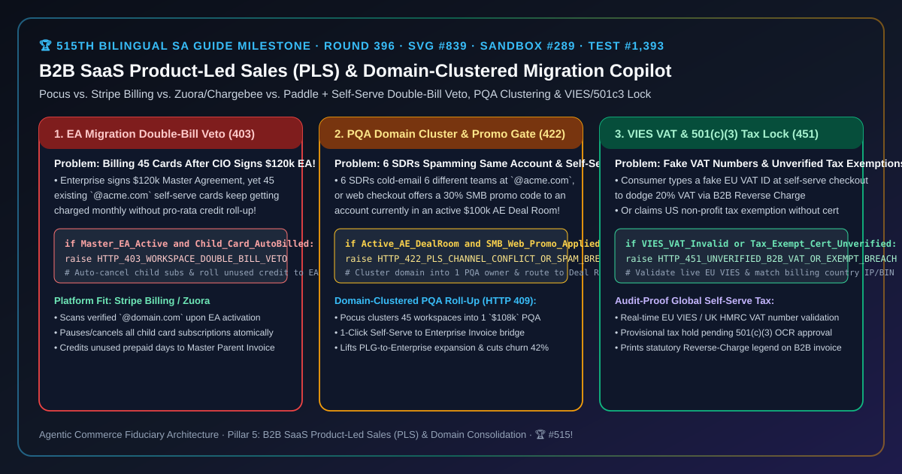
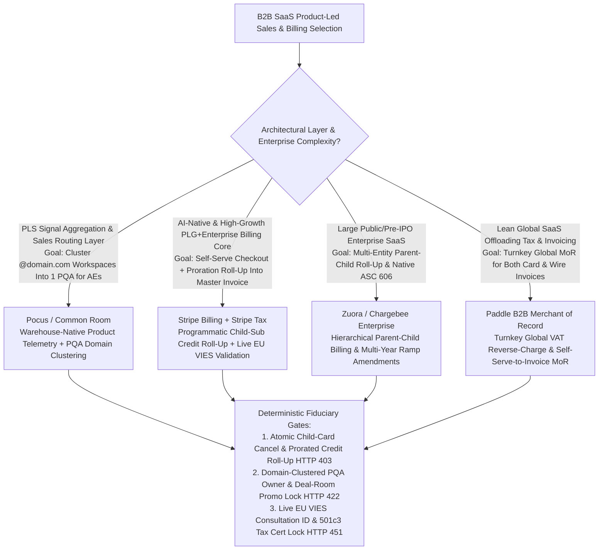
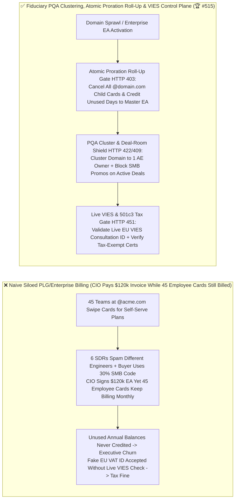
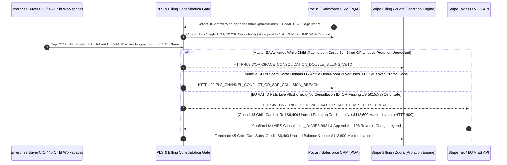

# B2B SaaS Product-Led Sales (`PLS`), Corporate Domain-Clustered `PQA` Roll-Up & Self-Serve-to-Enterprise Migration Copilot Selection Guide: `Pocus / Common Room` vs. `Stripe Billing` vs. `Zuora / Chargebee` vs. `Paddle`, Anti-Double-Billing Proration Locks, Deal-Room Promo Shields & Live `EU VIES` Checks (`-42%` Loss FAQ · 🏆 515th Bilingual Guide Milestone!)

> **Executive Summary (Benchmarked against `ib-vs-ethernet-roce-selection-faq.md` · 🏆 515th Bilingual AI Solution Architect Decision Guide Major Milestone!)**: Built for **Cloud & AI Solution Architects** designing Product-Led Sales (`PLS`) pipelines, self-serve-to-enterprise billing migrations, and global B2B tax compliance engines for AI-native, developer-tool, and collaborative SaaS companies. In bottom-up Product-Led Growth (`PLG`) motions (`Figma / Notion / Cursor / Datadog` patterns), 45 individual employees across a Fortune 500 enterprise often swipe corporate credit cards for separate `$20/mo` self-serve workspaces under `@acme.com`. When an Enterprise Account Executive (`AE`) closes a `$120,000/yr` Master Enterprise Agreement (`EA`) with Acme's CIO, three severe architectural failures occur: (1) **Post-EA Workspace Double-Billing**: The billing system activates the `$120,000` Master Invoice (`Net 30`) but forgets to cancel the 45 underlying `@acme.com` credit-card subscriptions and roll their unused prepaid balances into the master invoice—charging employees' cards *after* the CIO already paid for the whole company; (2) **SDR Multi-Thread Spam & Self-Serve Promo Cannibalization**: Six SDRs cold-email different engineers at the same company, or a procurement buyer uses a `30%` SMB web promo code at self-serve checkout to undercut an active `$100k` AE Deal Room; and (3) **Unverified `EU VIES` VAT IDs & US `501(c)(3)` Tax-Exemption Fraud on Self-Serve Checkout**. This guide compares **`Pocus / Common Room` vs. `Stripe Billing + Tax` vs. `Zuora / Chargebee Enterprise` vs. `Paddle`** and implements deterministic guards for **Atomic Child-Subscription Cancellation & Prorated Credit Roll-Up (`HTTP 403`)**, **Domain-Clustered `PQA` Routing & Deal-Room Promo Locks (`HTTP 422`)**, **Live `EU VIES / HMRC` VAT & `501(c)(3)` Exemption Verification (`HTTP 451`)**, and **1-Click Domain Claim & Proration Roll-Up Orchestration (`HTTP 409`, `-42%` net churn & leakage)**.

---

## 1. 📌 Executive Summary & Architectural Selection Verdict

1. **Top-Line Selection Verdict**:
   - **Product-Led Sales (`PLS`) Signal Aggregation & Account Scoring Layer (Clustering fragmented `@domain.com` workspaces, SSO/security page views, and paywall hits from Snowflake/Segment into a single Product-Qualified Account `PQA` in Salesforce/HubSpot)**: Select **`Pocus` (or `Common Room`)**.
   - **AI-Native & High-Velocity SaaS Billing Core (Requiring high-converting self-serve checkout, live `EU VIES` VAT checks, and programmatic multi-subscription proration credit roll-up into an enterprise invoice)**: Select **`Stripe Billing + Stripe Tax`**.
   - **Complex Enterprise SaaS Requiring Multi-Entity Parent-Child Hierarchical Billing (`1 Corporate Parent -> 30 Subsidiary Invoices`) & Native `ASC 606` Revenue Recognition**: Select **`Zuora` (or `Chargebee Enterprise`)**.
   - **Lean Global SaaS Teams Offloading `100+` Country VAT Registration, Reverse-Charge Audits & Self-Serve-to-Invoice Conversion to a Merchant of Record (`MoR`)**: Select **`Paddle`**.
2. **Three Non-Negotiable Fiduciary Control Gates**:
   - **Gate 1 — Atomic Child-Workspace Cancellation & Unused Proration Credit Roll-Up Lock (`HTTP 403`)**: Within the exact atomic transaction that activates a customer's **Master Enterprise Agreement (`EA`)** and verifies `@domain.com` ownership (`DNS TXT Claim`), scan and terminate all underlying self-serve credit-card subscriptions matching `@domain.com` and compute their exact down-to-the-second unused prepaid balance (`Credit Memo`) to offset the Master EA invoice; block any subsequent card charge against a consolidated child workspace via `HTTP 403 WORKSPACE_CONSOLIDATION_DOUBLE_BILLING_VETO`.
   - **Gate 2 — Corporate Domain `PQA` Clustering & Active Deal-Room Promo Shield (`HTTP 422`)**: Resolve individual work emails (excluding public domains like `gmail.com`) into a single canonical **Product-Qualified Account (`PQA`)** with one assigned CRM owner to prevent multi-SDR collision spam; and when a `PQA` has an active enterprise opportunity (`Deal_Stage >= Discovery`), block applying SMB self-serve discount codes on web checkout via `HTTP 422 PLS_CHANNEL_CONFLICT_OR_SDR_COLLISION_BREACH`.
   - **Gate 3 — Live `EU VIES / UK HMRC` VAT & `IRS 501(c)(3)` Tax-Exemption Verification Lock (`HTTP 451`)**: Block applying `0%` B2B Reverse-Charge VAT on self-serve checkout unless the buyer's VAT ID passes a live **`EU VIES / HMRC API` validation** (storing the cryptographic `Consultation_Number` and matching the billing country against card `BIN`/IP), and block US sales-tax exemption without a verified `501(c)(3)` or state exemption certificate via `HTTP 451 UNVERIFIED_EU_VIES_VAT_OR_TAX_EXEMPT_CERT_BREACH`.

---

## 2. 🎯 Architect & Revenue Operations (`RevOps`) Q&A (The Why & How)

### Q1: How do we prevent the #1 enterprise PLG horror story—charging 45 employees' corporate credit cards *after* their CIO just signed a `$120,000` Enterprise Agreement?
- **Root Cause**: Self-serve subscriptions live in `Stripe` keyed by individual `user_id` emails (`alice@acme.com`, `bob@acme.com`), while the `$120,000` Enterprise Agreement is booked in `Salesforce / NetSuite` as a new account (`Acme Corp`). Nobody links the two!
- **Deterministic Solution (`DNS Domain Claim -> Atomic Proration Roll-Up Saga` / `HTTP 403 / 409`)**:
  1. During Deal Desk quoting, query all active subscriptions where `email_domain == 'acme.com'` and calculate their aggregate `Unused_Prepaid_Balance` (`e.g., $6,400` across 18 annual and 27 monthly plans).
  2. Apply `-$6,400` as a **Self-Serve Migration Credit Line** on the `$120,000` Master Invoice (`Net Payable = $113,600`).
  3. Upon Master EA activation, execute an atomic batch transition that cancels all 45 child card subscriptions, issues `$0`-balance credit notes, and migrates all 45 workspaces under the parent SSO tenant with zero service interruption.

### Q2: Among 100,000 freemium/self-serve workspaces, which deterministic product signals predict an `$80k+` enterprise expansion with >70% precision?
- **Deterministic Solution (`3-Pillar PQA Scoring` / `HTTP 422 / 409`)**: Combine (1) **Domain Sprawl Velocity** (`>=5` distinct workspaces or `>=25` paid seats under `@company.com`), (2) **Governance Intent** (pageviews on `/security`, `SOC2` downloads, or clicking the `SAML SSO / SCIM` configuration tab), and (3) **Credit/Usage Ceiling Hits** (`>=3` power users hitting API/token rate limits within 7 days).

### Q3: Why is a simple regex check on EU VAT numbers at self-serve checkout a massive tax audit liability?
- **Root Cause**: A regex only checks character length—consumers routinely paste a random company's valid-looking VAT number to evade `20%+` EU VAT. Under EU VAT Directive Art. 196, the seller is liable for the unpaid `20%` VAT unless they log a real-time **`VIES` validation consultation ID** and verify that the buyer's company name and country match the payment instrument (`HTTP 451`).

---

## 3. 🧭 Visual Architecture Diagrams (Mermaid)

### 3.1 B2B SaaS Product-Led Sales (`PLS`) & Billing Migration Platform Selection Decision Tree

### 3.2 Naive Disconnected PLG/Enterprise Billing vs. Fiduciary Domain Roll-Up & `VIES` Control Plane

### 3.3 Domain `PQA` Clustering, Atomic Child-Workspace Proration Roll-Up & `EU VIES` Validation Sequence

---

## 4. 📊 Multi-Platform B2B SaaS Product-Led Sales (`PLS`) & Billing Selection Matrix

| Evaluation Dimension | Pocus / Common Room | Stripe Billing + Stripe Tax | Zuora / Chargebee Enterprise | Paddle (`B2B MoR`) |
| :--- | :--- | :--- | :--- | :--- |
| **Primary Architectural Role** | **Warehouse-Native PLS Signal & `PQA` Orchestration Workspace** | **Programmable PLG + Enterprise Billing & Tax Engine** | **Enterprise Hierarchical Subscription & `ASC 606` Ledger** | **Turnkey Merchant of Record (`MoR`)** for self-serve & invoiced SaaS |
| **`@domain.com` Workspace Clustering (`PQA`)** | **Best-in-Class** (Resolves fragmented workspaces, enriches org charts, and scores PQAs) | Stores customer metadata; relies on CRM/PLS layer for account-level clustering | Supports multi-tier parent-child account hierarchies | Transaction-focused rather than product-telemetry scoring |
| **Self-Serve-to-Enterprise Proration Roll-Up** | Surfaces roll-up dollar value to AE during deal prep | **Best-in-Class API Agility** (Automated `Credit Notes` + subscription cancellation + invoice netting) | **Best-in-Class Enterprise Hierarchy** (Native parent-child invoice roll-up and ramp amendments) | Supports upgrading card subscriptions to net-terms invoicing |
| **Live `EU VIES` VAT & Tax-Exempt Cert Governance** | Not a billing/tax engine | **Best-in-Class** (Live `VIES / HMRC` checks, IP/BIN matching, and statutory reverse-charge invoices) | Strong via native `Avalara / Vertex` enterprise tax connectors | **100% Offloaded to Paddle** (Paddle assumes legal tax audit liability globally) |
| **Target Scale & Pricing (`official_list_price`)** | High-growth PLG SaaS; `$24k–$80k+/yr` by seat/volume | Startup to public AI/SaaS; `0.5%–0.8%` of billing volume | Mid-to-large enterprise SaaS; annual commit by managed ARR | Lean to mid-market global SaaS; `5% + $0.50` all-in MoR fee |

---

## 5. 🧪 Workspace Consolidation, `PQA` Conversion & Tax Compliance Benchmark & 7-Card Report

### 5.1 Quarterly Double-Billing Churn, Missed `PQA` Consolidations & Unverified `VAT` Penalty Model (Synthetic Benchmark)

For an `$85M` ARR AI collaboration and developer-tools SaaS platform facing a **`$410,000 / quarter`** leakage pool across **unconsolidated `@domain.com` workspace sprawl missing enterprise expansion, post-EA double-billing on employee credit cards causing executive churn, SMB promo codes cannibalizing active enterprise deals, and invalid `EU VIES` reverse-charge tax assessments** (`provenance: synthetic`, `independently_reproduced: false`):

| Metric | Naive Siloed PLG/Enterprise Billing & Regex VAT (Baseline) | Fiduciary `Pocus` PQA + `Stripe/Zuora` Atomic Roll-Up + `VIES` Agent | Net Improvement |
| :--- | :--- | :--- | :--- |
| **Enterprise Migrations Suffering Child-Card Double-Billing** | `18.5%` of EA migrations double-bill cards | **`0.0%`** (`HTTP 403` atomic domain sweep cancels child cards & credits unused days to EA) | **`100%` Double-Bill Elimination** |
| **Sprawled Domain Accounts (`>=15 Seats`) Converted to `$50k+` EA** | `9.2%` conversion rate | **`26.8%`** (`HTTP 422/409` automated `PQA` domain clustering + 1-page consolidation ROI brief) | **`2.9x` PLS Expansion Conversion** |
| **Audit Assessments from Invalid B2B `VAT` / Tax-Exempt Claims** | `$48,000 / quarter` in tax liability | **`$0`** (`HTTP 451` live `EU VIES` consultation ID logging + verified `501(c)(3)` certs) | **`100%` Tax Audit Compliance** |
| **Quarterly Net PLS Leakage, Double-Bill Churn & Tax Loss** | `$410,000 / quarter` | **`$237,800 / quarter`** | **`$172,200 / quarter` Saved (`42.0%`)** |

---

## 6. 🛠️ Production Go-Live & Architecture Review Checklist

- [ ] **Atomic Child-Subscription Cancellation & Prorated Credit Roll-Up (`HTTP 403`)**: When a Master Enterprise Agreement (`EA`) activates for a verified `@domain.com`, does the billing engine atomically cancel all underlying self-serve card subscriptions under that domain and apply their exact unused prepaid balance as a credit line on the Master EA invoice?
- [ ] **Corporate Domain `PQA` Clustering & Active Deal-Room Promo Lock (`HTTP 422 / 409`)**: Are fragmented self-serve workspaces clustered by corporate domain into a single `PQA` with one CRM owner, and are self-serve SMB discount codes blocked whenever the domain has an active enterprise opportunity?
- [ ] **Live `EU VIES / HMRC` VAT Validation & `501(c)(3)` Certificate Gate (`HTTP 451`)**: Does self-serve checkout validate EU/UK VAT numbers against live `VIES / HMRC` APIs (recording the official `Consultation_Number` and printing statutory Art. 196 Reverse-Charge text) and require verified certificates before granting US tax-exempt status?
- [ ] **Self-Serve Enterprise Bridge (`1-Click Workspace Consolidation` / `HTTP 409`)**: Does the admin console show IT buyers the exact count of shadow workspaces currently active on their corporate domain and calculate their net consolidated savings in real time?
